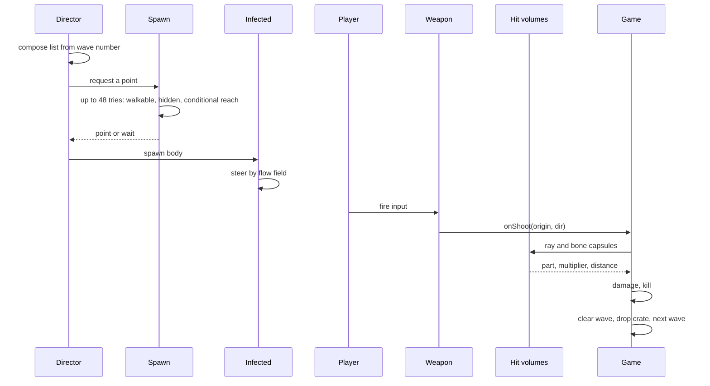
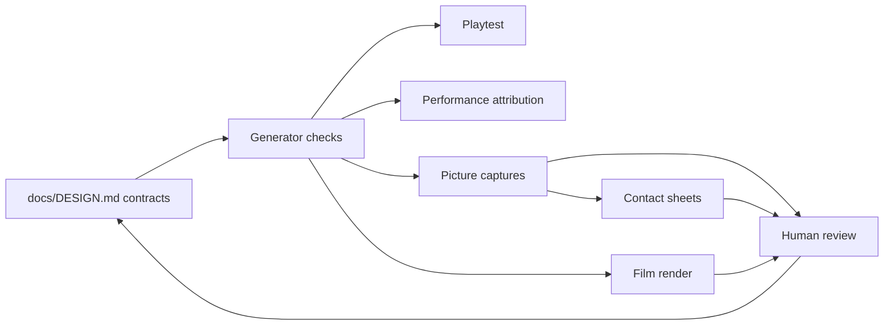

# Workflow and quality: one wave, then every check

**Short answer.** Valle Morta is a browser zombie shooter, and the infected are the enemy bodies (`README.md:3`). One wave is a sequence of small decisions. The wave director composes a list. The spawn search chooses a hidden point or the farthest visible fallback. The flow field steers each infected. The weapon ray finds a body part. The game applies the part multiplier and the distance falloff, then `zombies.damage` applies `bodyMult` and the head rule. `def.bodies` is the maximum number of bodies one ray reports, not a penetration flag (`src/game/weapon.js:32`). `raycastAll(..., bodies)` sorts hits nearest first and caps the list (`src/game/zombies.js:657-667`). The death function releases the animation and the corpse. The wave-clear step drops a crate. The summary records the result.

The project checks that sequence with tools. The design document states the contracts. Some tools write assets, and two check them. The playtest tool drives a session. The performance tool toggles one feature at a time. The capture tools build contact sheets. The film tool renders the same game at 24 frames per second with jittered sub-frames. No check is a unit test. Most are measurements or pictures; two are asset verifiers.

## Terms used in this document

| Term | Meaning |
|---|---|
| Wave | One list of infected, composed from the wave number (`src/game/game.js:345-367`). |
| Director | The wave logic in `game.js` that composes, queues and spawns infected (`src/game/game.js:345-423`). |
| Operation | A run-based mode: helicopter insertion, endless waves, a salvage currency and an extraction window every fifth wave (`src/game/operation.js:1-4`). |
| `window.__vm` | The debug object for tools (`src/main.js:165-196`). |
| `?auto=1` | A Uniform Resource Locator (URL) parameter that starts in `debug` with no menu. `debug` moves a free camera and skips `game.update`; a tool calls `game.start()` to enter `playing` (`src/main.js:116-144`, `tools/playtest.mjs:90`). |
| Spawn point | A walkable position at a minimum distance; usually hidden, with a visible fallback beyond 72 metres (`src/game/game.js:395-415`). |
| Flow field | The grid that gives each cell a distance to the player (`src/game/zombies.js:103-196`). |
| Hit volume | A capsule around a bone that receives a hit and a damage multiplier (`src/game/zombies.js:22-29`). |
| Walker | The basic infected type, drawn with the `zombie.glb` model and 100 base health (`src/game/zombies.js:211`). |
| Crate | A supply box that holds ammunition and bandages; the player opens it with F (`src/game/game.js:459-480`). |
| Profile | The saved salvage, upgrade levels, loadout and run records in browser storage (`src/game/progress.js:6-9`). |
| Salvage | The currency of Operation mode, earned per kill and per wave (`src/game/operation.js:12`). |
| Playtest | The script that drives a real session in a headless browser (`tools/playtest.mjs:1-8`). |
| Headless | A browser with no visible window. |
| Contact sheet | One picture made from several labelled pictures (`tools/sheet.mjs:1`). |
| High dynamic range (HDR) | Light values above display white. |
| User interface (UI) | The menus, settings, heads-up display (HUD) and summaries. |

## Part one: one wave from spawn to death

### Step 1: compose

The director builds a list from the wave number. The four types are the walker, the runner, the brute and the boss. The runner is fast and light. The brute is slow, heavy and has 450 base health. The boss has 2600 (`src/game/zombies.js:211-236`). Every fifth wave is a boss wave. Waves that leave a remainder of three after division by five are runner packs. Waves that leave a remainder of four are brute escorts. Other waves are mixed (`src/game/game.js:345-367`). The wave number starts at 0, and the director increments it before composition, so the first wave is wave 1 (`src/game/game.js:133`, `src/game/game.js:369-372`).

The list is a queue. The director pops one entry per successful spawn. It spawns only while the live count is below the cap. The cap is `min(zombies.maxActive - 2, 7 + this.wave * 2)` (`src/game/game.js:512`). The active limit is 26, so wave 1 gives `min(24, 9) = 9`, and the cap reaches 24 at wave 9 (`src/game/zombies.js:266`).

### Step 2: find a spawn point

The search draws up to 48 candidates and returns on the first hidden one. If none is hidden, it keeps the farthest valid point. A walker or a brute uses 24 to 54 metres. A runner or a boss uses 32 to 76 metres, from the player (`src/game/game.js:402-403`). The `close` flag is true for a walker or a brute and false for a runner or a boss (`src/game/game.js:515`). Half the candidates move 30 percent toward `(50, -88)`, inside the ruined village (`src/game/game.js:401`, `src/world/layout.js:195-223`). A position is rejected if it leaves the play radius, is too close, or is not walkable. `inField` is true when the player stands inside the flow field. An unreachable point is rejected only when `inField` is true (`src/game/game.js:398-409`).

```text
# src/game/game.js:399-414
    let fallback = null, fd = 0;
    for (let tries = 0; tries < 48; tries++) {
      const a = Math.random() * Math.PI * 2;
      const r = close ? 24 + Math.random() * 30 : 32 + Math.random() * 44;
      let x = p.pos.x + Math.cos(a) * r, z = p.pos.z + Math.sin(a) * r;
      // pull spawn points towards the village so they pour out of the ruins
      if (Math.random() < 0.5) { x = THREE.MathUtils.lerp(x, 50, 0.3); z = THREE.MathUtils.lerp(z, -88, 0.3); }
      if (Math.hypot(x - c[0], z - c[1]) > (this.layout.playRadius || 330) - 20) continue;
      const d = Math.hypot(x - p.pos.x, z - p.pos.z);
      if (d < (close ? 22 : 30)) continue;
      if (!f.walkable(x, z) || (inField && !f.reachable(x, z))) continue;
      const y = this.terrain.heightAt(x, z);
      if (!this._visible(x, y + 1.6, z) && !this._visible(x, y + 0.5, z)) return [x, z];
      if (d > fd) { fd = d; fallback = [x, z]; }
    }
    return fd > 72 ? fallback : null;
```

The dot product of the view direction and the candidate direction must be at least 0.4 (`src/game/game.js:390`). It then casts a ray from the eye and stops 0.6 metres short of the candidate (`src/game/game.js:391`). The search probes the point 1.6 metres and 0.5 metres above the ground (`src/game/game.js:411`). If both are hidden, the point is accepted. If no hidden point exists, the director keeps the farthest visible point. If that point is closer than 72 metres, the search fails and the director retries after 0.3 seconds.

### Step 3: keep a pack together

A runner pack should arrive together. The director remembers the last runner spawn. A new runner can use a point within 1.5 metres on each axis, if it is walkable, reachable and hidden. The rule stops after 4 runners or 2.5 seconds (`src/game/game.js:418-425`).

### Step 4: steer

Each infected chooses a direct line or the flow field. Every 0.3 to 0.6 seconds it tests the line of sight (`src/game/zombies.js:948-954`). A direct line is allowed below 2.5 metres, or at less than 60 metres when the avoidance timer is zero and the line is clear. The route changes only after two checks agree (`src/game/zombies.js:952`). A body that moves less than 20 percent of its speed for 1.5 seconds sets `avoidT = 5`, which suppresses the direct line for five seconds (`src/game/zombies.js:974-978`).

The type sets the turn rate: walker 3.4 radians per second, runner 5, brute 2.3, boss 2.6 (`src/game/zombies.js:211-236`). The body smooths its steering vector with `1 - exp(-dt * 6)` and its yaw with `1 - exp(-dt * 10)` (`src/game/zombies.js:1002`). A body can flank. On a direct approach beyond 6 metres, the target gains a side offset of `min(dist * 0.5, 9) * z.side`, where `side` is plus or minus 1 (`src/game/zombies.js:959`). It also weaves by `sin(time * 1.3 + seed) * min(2.5, dist * 0.2)` along the perpendicular.

The bodies also separate. For each neighbour inside `rr = z.rad + o.rad + 0.12`, the push is `(rr - d) * o.mass / (z.mass + o.mass) * min(1, dt * 7)` (`src/game/zombies.js:1013-1023`). The push is a displacement, not a velocity jump. A brute with the `shove` flag also flinches a neighbour with mass below 2 when its speed is above 0.8.

### Step 5: fire

The weapon update checks the trigger, the cooldown and the ammunition. A shot decrements the magazine and adds the interval to the cooldown.

```text
# src/game/weapon.js:583-603
      if (this.dryT <= 0) { this.audio?.play('dry_fire', { volume: 0.7 }); this.dryT = 0.3; }
      this.startReload();
      return;
    }
    st.ammo--; this.shots++;
    this.cool = Math.max(this.cool, -1 / 30) + def.interval;   // carry the remainder: the rate holds at any frame rate
    const n = Math.floor(this.shotIdx);
    this.shotIdx += 1; this.burst = this.shotIdx; this.sinceShot = 0;
    const ads = p.adsT;
    const spread = this._spreadNow();
    // the bullet leaves along the exact view axis, so it lands under the crosshair
    cam.updateMatrixWorld();
    const origin = cam.getWorldPosition(new THREE.Vector3());
    let first = null, dir0 = null;
    for (let k = 0; k < (st.mod.pellets || 1); k++) {
      const dir = new THREE.Vector3(0, 0, -1).applyQuaternion(cam.quaternion);
      const a = Math.random() * 6.283, r = Math.sqrt(Math.random()) * (spread + (k ? 0.007 : 0));
      dir.add(_v2.set(Math.cos(a) * r, Math.sin(a) * r, 0).applyQuaternion(cam.quaternion)).normalize();
      const hit = this.onShoot ? this.onShoot(origin, dir, def, st) : null;
      if (!k) { first = hit; dir0 = dir; }
    }
```

Every pellet, including the first, receives spread (`src/game/weapon.js:594-600`). The source comment claims the first bullet leaves on the exact view axis, but the loop applies spread at `k = 0`. Recoil applies after the pellets are built.

The rifle is automatic with a 0.1 second interval (`src/game/weapon.js:31`). The pistol is semi-automatic with a 0.11 second interval (`src/game/weapon.js:50`). The sniper is bolt-action with `interval: 0` (`src/game/weapon.js:67`). A zero interval does not make it automatic. The shot starts a `BoltCycle` action of 1.1 seconds with events `bolt_back` at 0.28, `shell` at 0.36 and `bolt_forward` at 0.72 (`src/game/weapon.js:69-72`). At the end `needBolt` becomes true, and the next round must be chambered (`src/game/weapon.js:544`). `canFire()` rejects fire while an action runs (`src/game/weapon.js:525-528`, `src/game/weapon.js:633`).

The clamp limits the credit for a long idle frame to one thirtieth of a second (`src/game/weapon.js:588`).

Recoil is a pattern plus a random term. `recoilStep` sets the vertical climb to `v1 + (v0 - v1) * exp(-n / tau)` (`src/game/weapon.js:86-92`). `v0` is the first climb, `v1` the settled climb, `n` the shot index and `tau` the decay time. Jitter is added to both axes. The pattern moves the view, and a short kick moves the model and the camera (`src/game/weapon.js:604-614`). The kick scales down with aim, crouch, prone and bipod; the deployed sniper bipod scales recoil by 0.45 (`src/game/weapon.js:606`).

### Step 6: resolve the hit

The game resolves a shot in two orders. A weapon with one body tests the infected first, then the world. A weapon with `bodies` above 1 tests the world first, then collects infected along the ray. This order keeps a wall behind the bodies. The sniper sets `bodies` 3 (`src/game/weapon.js:68`).

```text
# src/game/game.js:207-231
    this.stats.shots++;
    const mod = st ? st.mod : null, k = def.calibre;
    const bodies = def.bodies + (mod ? mod.bodies : 0);
    let hits, wh;
    if (bodies > 1) {
      wh = this.collision.raycast(origin, dir, 700, this._hit || (this._hit = {}));
      hits = this.zombies.raycastAll(origin, dir, wh ? wh.distance : 500, bodies);
    } else {
      const zh = this.zombies.raycast(origin, dir, 500);
      wh = this.collision.raycast(origin, dir, zh ? zh.distance : 700, this._hit || (this._hit = {}));
      hits = zh && (!wh || zh.distance <= wh.distance) ? [zh] : [];
    }
    for (let i = 0; i < hits.length; i++) {
      const h = hits[i], z = h.zombie;
      const fall = def.falloff ? lerp(1, def.falloff[2], clamp((h.distance - def.falloff[0]) / (def.falloff[1] - def.falloff[0]), 0, 1)) : 1;
      const dmg = def.damage * (mod ? mod.damage : 1) * (h.part === 'head' ? def.head : h.mult) * fall * Math.pow(0.8, i);
      const was = z.alive;
      h.dealt = this.zombies.damage(z, dmg, h.part, dir);
      h.killed = was && !z.alive; h.surface = 'flesh';
      this.fx.blood(h.point, dir, k);
      this._bloodBehind(h.point, dir, k);
      this.audio.playAt('impact_flesh', h.point, { volume: 0.8, pitchVar: 0.1, ref: 6 });
      this.ui?.hitMarker(h.killed, h.part === 'head');
      this.emit('hit', h, def, st, dir);
    }
```

The damage expression multiplies the weapon base, `mod.damage`, the part multiplier (`def.head` for a head, `h.mult` otherwise), the falloff and `0.8^i`, where `i` is the nearest-first hit index (`src/game/game.js:219-232`). `falloff` holds near distance, far distance and end multiplier. A sniper that hits three bodies gets 100, 80 and 64 percent from that factor alone; `bodyMult`, the head rule and falloff still apply. `bodyMult` is 1 for walker, runner and boss, and 0.5 for brute (`src/game/zombies.js:211-236`).

Each row of the hit table defines a capsule over one or two bones. The five fields are the part name, bone A, bone B, capsule radius and multiplier. The list has 10 entries. The head row lists 4.0, but the code never reads it: a head hit uses the weapon's `def.head` value (`src/game/zombies.js:21-24`, `src/game/weapon.js:32`). The rifle uses 4 and the sniper 3 (`src/game/weapon.js:32`, `src/game/weapon.js:68`). The torso is 1.0, the arms 0.5 to 0.55 and the legs 0.6 to 0.7.

```text
# src/game/zombies.js:22-29
const HIT_PARTS = [
  ['head', 'Head', null, 0.13, 4.0],
  ['torso', 'Hips', 'Neck', 0.2, 1.0],
  ['armL', 'UpperArmL', 'LowerArmL', 0.075, 0.55], ['forearmL', 'LowerArmL', 'HandL', 0.065, 0.5],
  ['armR', 'UpperArmR', 'LowerArmR', 0.075, 0.55], ['forearmR', 'LowerArmR', 'HandR', 0.065, 0.5],
  ['thighL', 'UpperLegL', 'LowerLegL', 0.105, 0.7], ['shinL', 'LowerLegL', 'FootL', 0.085, 0.6],
  ['thighR', 'UpperLegR', 'LowerLegR', 0.105, 0.7], ['shinR', 'LowerLegR', 'FootR', 0.085, 0.6],
];
```

The code first tests a broad body sphere, then each bone capsule. The nearest capsule wins.

```text
# src/game/zombies.js:610-633
  _rayBody(z, origin, dir, maxT, out) {
    _a.set(z.pos.x, z.pos.y + 0.95 * z.scale, z.pos.z).sub(origin);
    const t = _a.dot(dir), br = 1.25 * z.scale * Math.max(1, z.bulk);
    if (t < -br || t > maxT + br) return -1;
    if (_a.lengthSq() - t * t > br * br) return -1;
    let bestT = maxT, found = false;
    if (z.mixer) {
      z.root.updateWorldMatrix(true, true);
      const rk = z.scale * z.bulk;
      for (const [part, ba, bb, r, mult] of HIT_PARTS) {
        const A = z.bones[ba]; if (!A) continue;
        A.getWorldPosition(_a);
        if (bb && z.bones[bb]) {
          z.bones[bb].getWorldPosition(_b);
          if (part === 'torso') _b.lerp(_a, 0.3);   // the capsule's cap ends at the collar, below the skull
        } else {
          // the skull sits above and slightly in front of the head joint
          _b.set(0, 0.13, 0.02).applyQuaternion(A.getWorldQuaternion(_q)).multiplyScalar(z.scale).add(_a);
          _a.lerp(_b, 0.35);
        }
        const hit = rayCapsule(origin, dir, _a, _b, r * rk, bestT);
        if (hit >= 0 && hit < bestT) { bestT = hit; found = true; out.part = part; out.mult = mult; }
      }
    } else {
```

The capsule radius scales with body scale and bulk. The head capsule starts 35 percent of the way from the head joint toward the skull top, and ends above the joint. The torso capsule stops below the skull, so a neck shot is not a head shot.

### Step 7: apply damage

Damage is not only a subtraction. The function wakes the infected, applies `bodyMult`, applies the head rule, triggers a flinch or a stagger, and returns the damage amount. On overkill that amount exceeds the health removed.

```text
# src/game/zombies.js:670-681
  damage(z, amount, part, dir) {
    if (!z.alive) return 0;
    const def = z.def;
    if (part !== 'head') amount *= def.bodyMult;
    if (part === 'head' && def.health <= 100) amount = Math.max(amount, z.health);   // a head shot drops the light ones outright
    z.health -= amount;
    z.aware = true; z.alertT = -1;
    if (z.health <= 0) { this._kill(z, dir, part); return amount; }
    if (def.slowOnHit) z.slow = 0.5;
    const dx = dir ? dir.x : 0, dz = dir ? dir.z : 0, l = Math.hypot(dx, dz) || 1;
    const s = clamp(amount / (z.maxHealth * 0.35), 0.15, 1);
    const busy = z.state === 'roar' || z.state === 'slam' || z.state === 'charge';
```

The head rule is an exception in the code. A head shot on a type whose base health is 100 or less always kills. The walker and runner qualify. The brute has 450 health and the boss has 2600, so the rule does not apply to them. The rifle base damage is 36 (`src/game/weapon.js:31`), so a rifle head shot deals 144 and does not drop a brute. A sniper head shot deals 660 damage and kills a brute, because its base damage is 220 and its head multiplier is 3 (`src/game/weapon.js:68`). Both figures are point blank, before falloff and upgrades. The boss survives even the sniper.

The flinch strength is the damage divided by 35 percent of maximum health, clamped between 0.15 and 1. A boss does not flinch. It staggers each time health crosses a third, for 1.6 seconds (`src/game/zombies.js:682-689`).

A type with `slowOnHit` is slowed after a hit. The walker and runner have it. The slow lasts 0.5 seconds, and the type moves at 45 percent speed (`src/game/zombies.js:678`, `src/game/zombies.js:969`).

### Step 8: die

The death function chooses a fall direction from the last hit. It tilts the body to the ground slope. It plays the death clip and starts the corpse timer.

```text
# src/game/zombies.js:699-715
  _kill(z, dir, part) {
    const hx = Math.sin(z.yaw), hz = Math.cos(z.yaw);
    let dx = dir ? dir.x : -hx, dz = dir ? dir.z : -hz;
    const l = Math.hypot(dx, dz) || 1; dx /= l; dz /= l;
    const fromFront = dx * hx + dz * hz < 0;
    // a body running flat out folds forwards whatever hit it; otherwise it goes down along the shot
    const pitching = z.spd > 0.55 * z.gaits.Run * z.scale && fromFront;
    const back = fromFront && !pitching;
    z.deathYaw = pitching ? 0 : clamp(wrapPi((back ? Math.atan2(-dx, -dz) : Math.atan2(dx, dz)) - z.yaw), -0.75, 0.75);
    const push = (part === 'head' ? 0.7 : 1.2) / Math.sqrt(z.def.mass);
    z.kickX = z.vel.x * 0.55 + dx * push; z.kickZ = z.vel.z * 0.55 + dz * push;
    z.alive = false; z.state = 'dead'; z.stateT = 0; z.fade = 0;
    z.vel.set(0, 0, 0); z.spd = 0; z.twist = 0; z.lookW = 0; z.loco = 'Idle';
    this._play(z, back ? 'DeathBack' : 'DeathFront', 0.1, ((part === 'head' ? 1.15 : 1) * (0.95 + Math.random() * 0.15)) / Math.max(1, z.scale), true);
    // the body settles onto the slope under where it will lie (a plane through four samples)
    const T = this.col.terrain, gy = T.heightAt(z.pos.x, z.pos.z);
    z.hasTilt = z.pos.y - gy < 0.2;
```

A fast infected hit from the front folds forward. Any other frontal hit falls backward. A side or rear hit turns the body along the shot, clamped to plus or minus 0.75 radians. The body receives a kick along the shot, scaled down by the square root of the mass.

A body gets a tilt only when, at death, its height is less than 0.2 metres above the ground. The code fits a plane through four samples before the kick moves the body (`src/game/zombies.js:715-725`). The body lies on the slope instead of standing through it.

Operation mode listens for the game's `kill` event and counts salvage (`src/game/operation.js:340`). A head kill multiplies the salvage by 1.5 (`src/game/operation.js:13`, `src/game/operation.js:548`). The corpse remains for a type-specific time: 22 seconds for a walker, 18 for a runner, 26 for a brute and 40 for a boss (`src/game/zombies.js:213`, `src/game/zombies.js:220`, `src/game/zombies.js:227`, `src/game/zombies.js:236`).

### Step 9: clear the wave and drop a crate

When the queue is empty and no infected are alive, the game marks the wave cleared. It tries to drop a crate. The inter-wave timer is 14 seconds if a crate exists and 7 seconds if not. The toast text tells the player which case applies.

```text
# src/game/game.js:527-538
          if (this.wave > 0 && !this.cleared) {
            this.cleared = true;
            const crate = this._dropCrate();
            this.interT = crate ? 14 : 7;
            this.ui?.toast('Wave cleared', crate ? 'A supply crate is close by' : 'The next wave is gathering');
            this.emit('waveCleared', this.wave, crate);
          }
          this.interT -= dt;
          if (this.interT <= 0) { this._nextWave(); this.interT = 7; }
        } else {
          // the last of a wave must not hide at the far end of the valley
          this.strayT -= dt;
```

The crate search scores 80 candidates within 9 to 24 metres. A point must be reachable, walkable, level with normal Y at least 0.985, and dry. All eight neighbours must be walkable. It must not be under a roof, overlap a wall or prop, or sit within 4 metres of another crate. A hidden point scores 10 more, and the score subtracts 0.2 for each metre from 14 (`src/game/game.js:298-304`).

```text
# src/game/game.js:438-457
  _cratePoint() {
    const p = this.player, f = this.zombies.flow, T = this.terrain, col = this.collision;
    let best = null, bs = -1e9;
    for (let i = 0; i < 80; i++) {
      const a = Math.random() * 6.283, r = 9 + Math.random() * 15;
      const x = p.pos.x + Math.cos(a) * r, z = p.pos.z + Math.sin(a) * r;
      const c = f.cellOf(x, z);
      if (c < 0 || f.walk[c] !== 1 || !f.reachable(x, z)) continue;
      let open = true;
      for (let k = 0; k < 8 && open; k++) open = f.walkable(x + Math.round(Math.cos(k * 0.7854)) * f.cell, z + Math.round(Math.sin(k * 0.7854)) * f.cell);
      if (!open || T.normalAt(x, z, _n).y < 0.985 || col.waterDepth(x, z) > 0) continue;
      const y = T.heightAt(x, z);
      if (col.floorAt(x, y + 6, z, 7) > y + 0.05) continue;                                   // under a roof or on a floor
      if (col.resolveCapsule(_v.set(x, y + 0.05, z), 0.8, 1.7).lengthSq() > 1e-8) continue;   // too close to a wall or prop
      if (this.supply.crates.some((o) => Math.hypot(o.pos.x - x, o.pos.z - z) < 4)) continue;
      const score = (this._visible(x, y + 0.4, z) ? 0 : 10) - Math.abs(r - 14) * 0.2;
      if (score > bs) { bs = score; best = [x, z]; }
    }
    return best;
  }
```

### Step 10: end the run

A death starts a 2.6 second timer. When the timer ends, the game calls `endRun('death')` (`src/game/game.js:556-558`). The summary records the wave, the kills, the headshots, the accuracy and the time.

```text
# src/game/game.js:605-608
  summary() {
    const s = this.stats;
    return { wave: this.wave, kills: s.kills, headshots: s.headshots, accuracy: s.shots ? Math.round((100 * s.hits) / s.shots) : 0, time: this.playTime };
  }
```

In Operation mode, the end also calls `finish()`. An extraction banks `round(earned * (1 + 0.25 + build.run.bonus))`; a death banks `floor(earned * 0.5)` (`src/game/operation.js:412-422`). `build.run.bonus` is an additive profile fraction.

Accuracy is hits divided by shots. A shot here is one ray, not one trigger pull; a duplex pull calls `shoot` twice. One ray that hits two bodies counts as one hit (`src/game/game.js:207`, `src/game/game.js:232`).

## Part two: the quality workflow

### The contracts come first

The design document is 1,277 words. It states rules, controls, the player model, weapon table, infected model, modes and HUD (`docs/DESIGN.md:1-85`). The view-model contract is part of it (`docs/DESIGN.md:49`).

No premade model or texture is allowed. Geometry, textures, rigs and animation come from code in `tools`. Sound must be a licensed recording, never a synthesis (`docs/DESIGN.md:7-8`).

The performance target is 60 frames per second at 1280 by 720 on the `high` preset, on an integrated Radeon 780M, with no hitches (`docs/DESIGN.md:10`). A 60 frames per second target allows 16.7 milliseconds per frame. The design record reports about 14 milliseconds per frame from `tools/shot.mjs --bench` (`docs/DESIGN.md:10`). That command calls `window.__vm.bench(40)` (`tools/shot.mjs:68`). The source does not state what the 40 frames measure. This documentation package made no measurement.

### The offline checks

Two generators have a verifier. `check.py` reports missing or wrong-size textures and exits nonzero when a seam ratio reaches 1.15 (`tools/texgen/check.py:61-69`). The ratio compares the wrap-around edge with the most discontinuous interior line, so a value below 1.15 means the seam is no worse than ordinary structure (`tools/texgen/check.py:20-31`). `verify_glb.py` reports triangle and animation clip counts, fails a missing clip and fails an image whose width or height exceeds 2048 pixels (`tools/weapon/verify_glb.py:45-66`). The rifle has 57,608 weapon triangles and 17,320 arm triangles (`tools/weapon/README.md:10`).

The terrain bake writes height, normal, mask and metadata files (`terrain.json`) (`tools/bake-terrain.mjs:1-9`). The bake is deterministic and reuses the erosion cache (`tools/bake-terrain.mjs:20-30`).

The infected pipeline builds four models: zombie, runner, brute and boss. The runtime falls back to a placeholder if a model is missing (`src/game/zombies.js:291`).

### The playtest

The playtest drives the real game in a headless browser with hardware graphics enabled. It reports movement, collision, weapon, infected, waves, interface and performance numbers (`tools/playtest.mjs:1-9`).

The script uses the same `window.__vm` interface as the film. It can start a run, step by a fixed time, set input, read state and take a picture.

The `--sec` option selects section groups from a fixed list (`tools/playtest.mjs:9`). The source does not define a pass threshold for each group (`tools/playtest.mjs:6`).

### The performance attribution

The performance tool (`tools/perf.mjs:1-6`) toggles one feature at a time and reports the frame-time difference, draw calls and triangles. It can record 300 frames while the camera moves and bench every preset.

The method below is the author's reading of the tool, not a source statement. The method is subtraction. It measures a base frame, removes one feature and measures again. The difference is that feature's cost. The source does not define a target frame time for each preset; a human decides.

### The picture checks

`shot.mjs` photographs a named view and can bench the frame time (`tools/shot.mjs:1-4`). `vmshots.mjs` photographs each weapon in idle, draw, fire, reload, aim and inspect. `uishots.mjs` photographs the menu, the settings, the Base upgrade screen, the HUD modes, the pause screen and the summaries, and times the minimap draw (`tools/uishots.mjs:1-5`).

The infected capture, `zcap.mjs`, spawns each type on the main street of the ruined village. It makes a contact sheet for each type with idle, alert, walk, run, attack, hit, both deaths and the blood pool decal. It also makes an eight-frame side strip of every walk and run clip (`tools/zcap.mjs:1-5`). The foot-slip tool, `zslip.mjs`, measures the planted-foot slip from ground truth. It steps the game at 1/60 second and logs both foot bones every frame. The slip is the horizontal distance the support foot moves while supporting, divided by the distance the body travels (`tools/zslip.mjs:1-9`).

`sheet.mjs` builds the contact sheets and calls `ffmpeg` with an `xstack` filter, which stacks frames into a grid (`tools/sheet.mjs:1-18`).

### The film check

The film is the largest capture: ten camera setups at 3840 by 2160, 24 frames per second, in High Dynamic Range 10-bit (HDR10). `cinematic/capture.mjs` drives `src/cinematic/film.js`. HDR10 carries 10-bit Perceptual Quantizer (PQ) values with Recommendation BT.2020 primaries (`cinematic/capture.mjs:88-91`). Each output frame averages three jittered sub-frames. The jitter gives motion blur and anti-aliasing without a separate pass (`cinematic/capture.mjs:10-13`).

A finished shot is skipped on a re-run, and a stall is retried in a fresh browser. The tool waits while free memory is below 6 gibibytes (`cinematic/capture.mjs:85`). `libx265` is the open-source High Efficiency Video Coding (HEVC) encoder. The encoder writes HDR10 with BT.2020 primaries, the Society of Motion Picture and Television Engineers (SMPTE) 2084 curve and limited range (`cinematic/capture.mjs:88-91`).

### The admitted limits

The README states three limits. The look approximates references but does not match them. The rifle and infected are procedural. The third limit claims no church bell or wood-footstep recording exists (`README.md:59-61`).

The third limit is not correct. The audio folder holds `bell_toll.mp3` and four `step_wood` files. The game plays the bell at the start of a run, and it maps the wood surface to `step_wood`, which it preloads (`src/game/game.js:171`, `src/game/game.js:276`, `src/game/game.js:378`). The credits list them (`public/assets/audio/CREDITS.md:132`, `public/assets/audio/CREDITS.md:94-97`). The README line is stale.

The credits file says its labels are approximate and names each substitution, such as a hiking boot on grass for a grass step (`public/assets/audio/CREDITS.md:5`).

## Two diagrams

The first diagram shows one wave as messages in time order. The second shows the quality loop around the game.





## Aha: the test harness is the film harness

**Aha:** The playtest, the capture tools and the film share one interface. They all use `window.__vm` and `?auto=1`. The playtest defaults to one step of 1/60 second; the film uses `1 / (24 * 3) = 1/72` second per sub-frame (`tools/playtest.mjs:83-86`, `src/cinematic/film.js:525`). The live loop passes the frame time. The same object lets a tool stop the loop, step the game and expose the film (`src/main.js:165-196`). The film is reproducible because the simulation advances without the browser clock, and each shot replaces `Math.random` with a seeded `mulberry32` generator (`src/cinematic/film.js:475`).

The capture tools photograph a weapon state or a wave. The film averages three sub-frames per output frame. The step differs, but the control is the same.

The cost is stability. A change to `window.__vm` can break the tests, the pictures and the film together. The source does not define a version for that interface. This section treats it as a contract.

## What the source does not define

- The playtest tool has no unit-test framework and no single pass or fail result. The header lists groups and options, not thresholds.
- The source does not define a performance budget per effect.
- The source does not define an automated visual comparison. The contact sheets are for human review.
- The README limitation about the bell and the wood steps does not match the files. This documentation package reports the conflict and does not guess which line is intended.

## The workflow in one sentence

A wave is composed, placed, steered, hit, killed, cleared and summarised by a chain of functions. The project checks that chain with generator verifiers, a scripted playtest, a subtraction-based performance tool, contact sheets, a foot-slip measurement and a deterministic film render.
