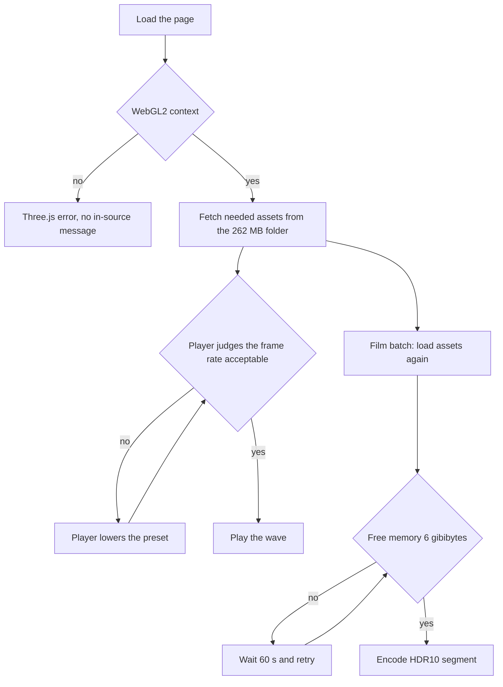
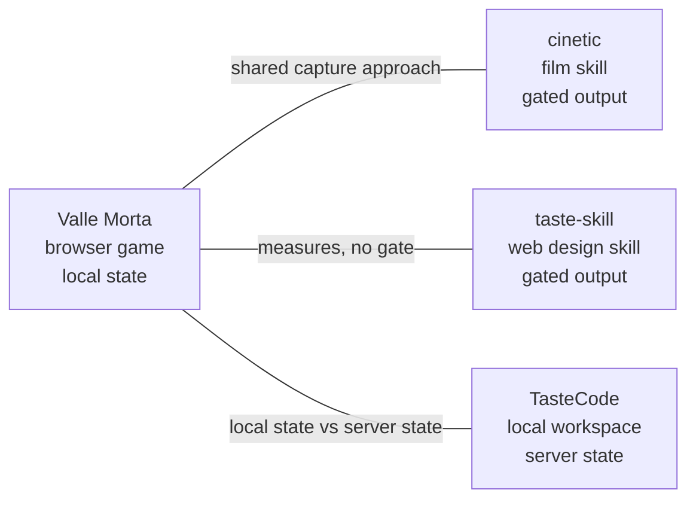

# Limits and comparison: what the machine cannot do

**Short answer.** The project has seven technical limits, plus a written record with four defects. The platform decides what can run. The asset folder decides what must load. The preset decides what one frame can draw. The state model, a profile and settings in browser storage, decides what survives a reload. The project rejects several common solutions to each limit. The rejections are consistent and cost something. The playtest and the performance tool measure the cost, but no check can stop a build.

This document records the limits, the rejected choices, the failure modes and the sibling comparison. It does not run the game. Unless marked as a disk measurement, numbers come from source reading. In this document, `README.md` means the source README at the repository root, not this package index.

## Terms used in this document

Four anti-aliasing terms appear here. Temporal anti-aliasing (TAA) blends several frames. Multisample anti-aliasing (MSAA) samples edges in hardware. Fast approximate anti-aliasing (FXAA) is a post-process edge filter (`src/engine/post.js:496`). Screen-space reflections (SSR) trace reflections from the visible frame.

High dynamic range 10-bit (HDR10) is a delivery format with the perceptual quantizer (PQ) transfer curve and the Recommendation BT.2020 primaries (`cinematic/capture.mjs:87`). The film writes these values, and libx265 encodes them. A level of detail (LOD) is a simpler mesh used at a distance (`src/game/zombies.js:31`).

A gate is a check that can stop a build; this project has none. The profile is saved progression and upgrades in browser storage (`src/game/progress.js:6-9`). A shot is one camera setup and time segment; the film has ten (`src/cinematic/film.js:1`). A segment is one encoded file, `seg_XX.mkv` (`cinematic/capture.mjs:83`). The walker is the basic infected type, with the `zombie.glb` model and 100 base health (`src/game/zombies.js:211`).

## The limits, in order of hardness

Hardness here is the cost and reach of a change. A limit is harder when removing it needs a new platform, a new pipeline or a new dependency. The first seven are technical limits. The eighth is the written record.

### 1. The platform is WebGL2

The game runs on three.js and Web Graphics Library 2 (WebGL2) (`README.md:3`). The renderer is a `THREE.WebGLRenderer` with no alternative backend (`src/engine/engine.js:21`). The README makes WebGL2 a requirement, and the browser must supply it.

This is the hardest limit. A browser without WebGL2 cannot run the game; a weak graphics processing unit (GPU) can use a lower preset. The source has no software fallback and no 2D canvas path.

### 2. The asset folder is 262 megabytes

The project forbids premade assets, so every visual asset is generated by code (`docs/DESIGN.md:7`). The `public/` folder is about 262 megabytes (MB) on disk. The figure is a static size reading of `public/`, not a download measurement. The texture folder is about 147.6 MB, the model folder about 52.8 MB, the terrain folder about 46.1 MB and the audio folder about 15.3 MB. The parts sum to 261.8 MB.

The textures are JPG files. The terrain is PNG and a binary mesh. The models are binary glTF files, and each infected model is about 8 MB. The rifle is about 6.7 MB. The folder has 68 texture files across the 22 physically based rendering sets that the README names (`README.md:5`).

There is no graphics-processor texture compression extension in the source. The search finds no Khronos Texture 2 (KTX2) or Basis file and no loader for either. KTX2 is a container for graphics-processor textures, and Basis Universal is a compressed texture format. The browser decodes each Joint Photographic Experts Group (JPG) and Portable Network Graphics (PNG) file to an uncompressed image. The file size is therefore not the memory cost. A 2048 by 2048 texture at four bytes per pixel uses 16 MB, whatever its JPG size. That figure counts the base level only. Mipmaps, alignment and the decoded bitmap add more, so 16 MB is a lower bound.

This is the second hardest limit. The download is large, and the decoded set is larger. The project accepts this cost to keep the no-premade rule.

### 3. The preset fixes the frame cost

A frame budget is the work one frame may do in the target time. The quality table has four presets. Each preset sets that cost. The fields are the drawing-buffer `scale`, the `msaa` sample count, the `shadow` map width and `shadowRange` half extent, and the cloud panorama `pano` size and `cloudSteps`. They also include the `ao` and `vol` switches, the volume `volSteps` and `volScale` divisor (`src/engine/post.js:400-404`), the texture-layer `texSize`, the `grass` density (`src/world/vegetation.js:960`) and the `aniso` limit. The `far` field is defined but never read.

```text
# src/engine/engine.js:9-14
export const QUALITY = {
  low:    { scale: 0.6,  msaa: 0, shadow: 1024, shadowRange: 55, pano: [1024, 256], cloudSteps: 36, ao: false, vol: true, volSteps: 14, volScale: 4, texSize: 512,  grass: 0.35, aniso: 2,  far: 0.5 },
  medium: { scale: 0.75, msaa: 0, shadow: 2048, shadowRange: 70, pano: [2048, 512], cloudSteps: 48, ao: true,  vol: true, volSteps: 18, volScale: 3, texSize: 1024, grass: 0.6,  aniso: 4,  far: 1 },
  high:   { scale: 1.0,  msaa: 2, shadow: 4096, shadowRange: 130, pano: [3072, 768], cloudSteps: 56, ao: true,  vol: true, volSteps: 22, volScale: 3, texSize: 1024, grass: 0.85, aniso: 16,  far: 1 },
  ultra:  { scale: 1.0,  msaa: 4, shadow: 4096, shadowRange: 130, pano: [4096, 1024], cloudSteps: 72, ao: true, vol: true, volSteps: 30, volScale: 2, texSize: 2048, grass: 1.0,  aniso: 16, far: 1 },
};
```

The renderer sets a pixel ratio of 1 (`src/engine/engine.js:22`). The canvas does not follow the device pixel ratio. The internal scale sets the drawing-buffer width and height: both sides are multiplied by `scale`. A low preset at 0.6 scale therefore renders 0.36 of the pixels of a full frame. That count ignores the lower sample count and its lower cost.

A texture array is one graphics-processor texture with many layers. `texSize` is the size of each layer. `loadMaterialArrays` allocates `size * size * 4 * names.length` bytes and copies each bitmap into it (`src/engine/textures.js:42-57`). The `4` is the four bytes of one pixel, and `names.length` is the layer count. The ground and building materials pass `q.texSize` (`src/world/terrain.js:337`, `src/world/bld/material.js:125`). The art is 1024 or 2048 pixels (`tools/texgen/registry.py:4-25`), so ultra upsamples 1024 art and adds no detail.

The source has no dynamic resolution and no frame-time history that could drive one. The player must change the preset.

The shadow rig is one directional light with one shadow camera. In light space the camera is a square box centred on the active camera, with a half extent of 55 to 130 metres from the preset. Its depth runs from 1 to 700 metres from the light.

```text
# src/engine/engine.js:119-127
  _updateShadowRig() {
    const range = this.q.shadowRange;
    const cam = this.sun.shadow.camera;
    cam.left = -range; cam.right = range; cam.top = range; cam.bottom = -range;
    cam.near = 1; cam.far = 700;
    cam.updateProjectionMatrix();
    // The shadow volume is centred on the viewer and snapped to shadow texels. It must not follow
    // the view direction: a volume pushed ahead of the camera drops and regains the shadows at its
    // rim while the player turns.
```

The box is snapped to shadow texels to stop crawling. It does not follow the view direction, for the reason in the comment. The cost is a hard edge at the range boundary: a building beyond 130 metres on high casts no shadow. The source has no cascaded shadow map.

### 4. The population is capped and the central processing unit (CPU) is single-threaded

`maxActive` is the list capacity, 26 (`src/game/zombies.js:266`), and the list includes corpses. The director takes `min(zombies.maxActive - 2, 7 + 2 * wave)`, so 24 at most and two entries stay free (`src/game/game.js:512`). A spawn checks `list.length >= maxActive` and calls `_recycle()` (`src/game/zombies.js:455`). `_recycle` releases and removes the oldest dead body (`src/game/zombies.js:431-438`). If none is dead, the spawn returns null and the director waits.

Each infected model has four level-of-detail versions. `LOD_CELL` holds vertex-merge cell sizes in metres; 0 keeps the full mesh, and 0.02, 0.045 and 0.1 average positions in grid cells (`src/game/zombies.js:31`, `src/game/zombies.js:54-80`). The distance thresholds are 3.2, 8 and 20 metres (`src/game/zombies.js:30-32`). A 10 percent margin up and an 8 percent margin down stop flicker (`src/game/zombies.js:809-810`).

```text
# src/game/zombies.js:31-32
const LOD_CELL = [0, 0.02, 0.045, 0.1];
const LOD_DIST = [3.2, 8, 20];
```

The source contains no Web Worker. Terrain, layout, buildings, infected, collision and rendering all run on the main thread. The bake and texture generator are separate programs, which the running game does not use.

### 5. The state is local and small

The game has no server. `index.html` loads one canvas, one interface container and one module script. State that survives a reload is in `localStorage`. The profile has the key `valle-morta-profile` (`src/game/progress.js:6`). The settings have the key `valle-morta-settings` (`src/ui/ui.js:14`).

Both paths handle blocked storage. The profile creates a memory store when `localStorage` throws. `defaultStorage` returns a local object, and `Progress` keeps it for the page load. A reload loses it.

```text
# src/game/progress.js:167-169
  try { const s = window.localStorage; s.getItem(PROFILE_KEY); return s; } catch (e) { /* private mode, no window */ }
  const mem = {};
  return { getItem: (k) => (k in mem ? mem[k] : null), setItem: (k, v) => { mem[k] = String(v); } };
```

The settings load defaults on an error and save inside a try block.

```text
# src/ui/ui.js:12-15
export function loadSettings() {
  try { return { ...DEFAULTS, ...JSON.parse(localStorage.getItem('valle-morta-settings') || '{}') }; } catch (e) { return { ...DEFAULTS }; }
}
function saveSettings(s) { try { localStorage.setItem('valle-morta-settings', JSON.stringify(s)); } catch (e) { /* private mode */ } }
```

The fallback keeps the game playable in a private window, but progress and settings do not persist, and the source gives no warning.

`PROFILE_VERSION = 1` marks the profile shape (`src/game/progress.js:7`), but the source does not branch on it and defines no migration table. `clean()` builds a profile from known fields, drops unknown fields and clamps values (`src/game/progress.js:139-164`). A newer profile read by older code therefore loses the rest. A schema change must add a migration.

### 6. The image path is real-time and partial

The renderer is forward: it draws each object once with its final shader. It draws the scene to a high dynamic range target with a depth texture. It computes ambient occlusion at half size and blurs it. It marches volumetric fog into a smaller target. It composites scene, occlusion and volume, builds a bloom pyramid, and applies the tone curve and grade. The game path ends with fast approximate anti-aliasing (FXAA) and a sharpen. It has no global illumination pass; ambient light comes from a probe and a cloud panorama.

The water does not use screen-space reflections. It reflects the cloud panorama along the reflected vector and darkens low angles with a hill term. The term is 20 percent of the ambient light plus 10 percent of the fog colour (`src/world/water.js:262`).

```text
# src/world/water.js:255-261
  vec3 R = reflect(-V, N);
  R.y = abs(R.y) * 0.97 + 0.03;
  R = normalize(R);
  vec3 sky = skyRefl(R);
  float sunVis = vmCloudShadow(vWorld);
  vec3 amb = vmAmbient(vec3(0.0, 1.0, 0.0));
  // mountains and trees stand all around the valley: low reflection angles are dark
```

This is deliberate. A reflection of the player or a building is not in the water. The source mixes from the dark colour to the sky with the weight `smoothstep(0.06, 0.3, R.y + noise)`, where `noise` is a small texture value (`src/world/water.js:263`).

The final image pass has FXAA and a contrast adaptive sharpen. The sharpen reads the four neighbour pixels, measures the local minimum and maximum, and gives a stronger correction where the contrast is low (`src/engine/post.js:351-360`). There is no TAA and no temporal history buffer.

```text
# src/engine/post.js:493-499
    this.tone.render(r, t.ldr);
    const f = this.final.uniforms;
    f.tLDR.value = t.ldr.texture; f.uTexel.value.set(1 / t.ldr.width, 1 / t.ldr.height);
    f.uSharpen.value = s.sharpen; f.uFXAA.value = s.fxaa ? 1 : 0;
    r.setRenderTarget(output);
    if (!output && outW) r.setViewport(0, 0, outW, outH);
    this.final.render(r, output);
```

The lack of temporal anti-aliasing (TAA) is a limit on thin geometry and on motion. Multisample anti-aliasing (MSAA) at the high and ultra presets lowers edge aliasing in space. The film averages three sub-frames to lower aliasing and motion blur. The game has no temporal accumulation.

The source contains no occlusion-culling pass. The terms `occlusion` and `occluder` match only the ambient occlusion pass (`src/engine/post.js:1`) and a baked probe (`src/world/props.js:180`). The terrain, far mesh and vegetation set `frustumCulled = false` (`src/world/terrain.js:424`, `src/world/terrain.js:469`, `src/world/vegetation.js:878`), which disables frustum culling. The far shader discards fragments inside 508 metres (`src/world/terrain.js:464`). The local terrain is a six-level clipmap; level 0 draws the full inner mesh, and outer levels draw rings (`src/world/terrain.js:387-400`). The vegetation uses alpha test on instanced tufts (`src/world/vegetation.js:840-856`). None of this is occlusion culling.

### 7. The capture is expensive and resumable

The film is 45 seconds at 24 fps. Each output frame is the average of three jittered sub-frames (`src/cinematic/film.js:385`). The jitter moves the camera projection by a fixed pixel offset, and each sub-frame is tone-mapped to PQ before the average (`src/cinematic/film.js:27`, `src/cinematic/film.js:527-533`). The arithmetic gives 1,080 output frames and 3,240 sub-frame renders at 3840 by 2160. It is a batch job, not a real-time preview.

The capture script resumes after a stop. It writes each shot to a `.part.mkv` file and renames it to `seg_XX.mkv` after the encoder exits with code 0 (`cinematic/capture.mjs:114`). On a rerun, an existing segment is skipped. A stalled or crashed shot throws; the script closes the browser, waits 90 seconds and opens a new browser (`cinematic/capture.mjs:150-154`).

```text
# cinematic/capture.mjs:84-87
  if (fs.existsSync(seg)) { log(`shot ${i + 1} already rendered`); return; }
  while (os.freemem() < 6 * 1024 ** 3) { log('low memory, waiting 60 s'); await sleep(60000); }
  const part = seg.replace('.mkv', '.part.mkv');
  // The page delivers finished frames as planar 10-bit BT.2020 Y'CbCr 4:2:0, so no filters are needed.
```

Planar means each component has its own plane. Y'CbCr is one luma and two chroma components, and 4:2:0 stores chroma at half width and half height. The film converts each averaged frame to this layout, so the encoder takes it as it is and no colour conversion filter is needed (`src/cinematic/film.js:519-523`).

The memory gate waits while free memory is below 6 gibibytes. This protects a shared laptop, but the render can wait a long time on a small machine, with no upper bound.

The encoder is `libx265`, the open-source High Efficiency Video Coding (HEVC) encoder, with the PQ transfer, the BT.2020 primaries and a limited range (`cinematic/capture.mjs:88-91`). A limited range stores luma from 16 to 235, not 0 to 255, which is the standard video range. The primaries define the red, green and blue points; BT.2020 uses wide primaries. The film writes PQ values and encodes them as HDR10, not as a tone-mapped preview.

### 8. The written record (not a technical limit)

This section is not a technical limit. It records four defects in the written record: the licence field, two audio claims and the head-shot claim. The project has a design document with rules (`docs/DESIGN.md:1-14`). The rules bind the author, but no automated check enforces them.

## Rejected choices

The project rejects several common solutions. Each rejection leaves evidence in the source or in a rule. For an absent feature, an absent code path is evidence, not proof of deliberate rejection.

```text
# docs/DESIGN.md:7-8
- No premade 3D assets or textures. Geometry, textures, rigs and animation are generated by code (JS or Blender scripts in `tools/`).
- Sounds are licensed recordings from online sources only (CC0 or CC BY, recorded in `public/assets/audio/CREDITS.md`). Never synthesise a sound.
```

| Rejected choice | Evidence | Consequence |
|---|---|---|
| Premade three-dimensional (3D) assets and textures | `docs/DESIGN.md:7` | A tool layer of 250 files (`tools/`) and a 262 MB public folder. |
| Synthesised sound | `docs/DESIGN.md:8` | A licensed audio library with a credits file. |
| A physics engine | `src/game/collision.js:1-5` | Custom capsule and bounding volume hierarchy (BVH) collision. |
| A server or multiplayer | `index.html:10-13` | State in `localStorage` only. |
| WebGPU, a newer browser graphics interface | `src/engine/engine.js:21` | A WebGL2-only renderer. |
| Texture compression | No KTX2 or Basis loader | JPG and PNG decode at load. |
| TAA and SSR | `src/engine/post.js:496`, `src/world/water.js:255` | FXAA and a sky reflection. |
| Dynamic resolution | `src/engine/engine.js:9-14` | Four fixed presets. |
| Cascaded shadows | `src/engine/engine.js:119-127` | One shadow box of 55 to 130 metres. |
| A unit-test suite | `package.json:6-10` | Generator checks and capture tools only. |
| Touch and gamepad input | `docs/DESIGN.md:18-32` | A desktop keyboard and mouse game. |

The first row removes licence risk for the art and adds the tool layer, the bake time and the download size. The project states the rule (`docs/DESIGN.md:7`); the cost follows. The tool layer is 250 tracked files, a package count and not a source line.

The physics row is a performance choice. Collision is one BVH over the static meshes, the terrain height field and a short list of movable boxes. The player is a vertical capsule that the system pushes out of the static meshes (`src/game/collision.js:197-199`).

```text
# src/game/collision.js:1-4
// Static world collision: a single BVH over every collider mesh the world
// modules registered, plus the terrain height field and a short list of
// movable boxes (supply crates).
import * as THREE from 'three';
```

There is no rigid-body solver and no ragdoll. A dead body is an animation. On ground, the death code samples the terrain at four points, fits a plane through the heights and tilts the corpse (`src/game/zombies.js:713-724`). The infected avoid each other with a steering push, not contact impulses. Two overlapping bodies push apart along the line between them, scaled by the overlap, the mass share and the frame time (`src/game/zombies.js:1013-1022`). This keeps the CPU cost low and the behaviour predictable, but bodies can overlap. A supply crate is a solid box that the player can open (`src/game/game.js:21`, `src/game/game.js:70`). The source defines no push interaction for it or other props.

The server row is a scope choice. A game with no account and no network play ships as a static folder. Progress stays in one browser profile, not one machine.

## Failure modes

### Missing WebGL2

The source creates the renderer and uses it (`src/engine/engine.js:21`). If three.js cannot create a context, no fallback, error screen or text exists.

### Missing asset

The sound system is tolerant. A missing manifest or a missing sound plays nothing and does not stop the game.

```text
# src/game/audio.js:1-3
// Audio: Web Audio playback of the licensed sound library listed in
// public/assets/audio/manifest.json. Every lookup is tolerant: a missing
// sound or manifest simply plays nothing.
```

The infected system tolerates a missing model. The `zombie` set is the villager base body, and `zombie.glb` is present (`src/game/zombies.js:209`, `src/game/zombies.js:277`). `spawn` uses a type's own set or the base set (`src/game/zombies.js:456`). A borrowed body is scaled by `tall`, widened by `bulk` and tinted (`src/game/zombies.js:200-203`, `src/game/zombies.js:461-467`, `src/game/zombies.js:480`). If `zombie.glb` is missing, the loader logs a message and uses a grey capsule (`src/game/zombies.js:286-292`). The source does not define a colour-map fallback. A missing asset degrades the look, not the logic.

### Full body list

The director keeps a spawn queue. A request at 26 entries calls recycle. If no body can be recycled, the request returns null (`src/game/zombies.js:455`). The director keeps the queued entry and tries on a later frame. The wave waits: a soft failure that protects the frame rate.

### Blocked storage

The profile and the settings use a memory store or the defaults when `localStorage` throws (`src/game/progress.js:167`, `src/ui/ui.js:14`). The game runs, but the progress is lost when the page closes, with no notice.

### Low memory during capture

The film waits while free memory is below 6 gibibytes, with no timeout (`cinematic/capture.mjs:85`).

### No automatic quality fallback

The game has no dynamic resolution and no automatic preset change. A machine that cannot hold 60 frames per second (fps) at the high preset needs a lower preset from the player. The design target is 60 fps at 1280 by 720 on the high preset on an integrated Radeon 780M (`docs/DESIGN.md:10`).

### A shader compile error

The source defines no shader error path. `engine.render` precompiles the scene in a `try`/`catch` and ignores the error (`src/engine/engine.js:161-162`). A compile failure produces a three.js console error; a failed precompile leaves the program to compile on the first draw. The game replaces no material and shows no message. This package compiled no shader.

## Comparison with three sibling projects

The exploration collection has three sibling packages that turn a source project into a measured workflow. The paths point one level above this package.

| Project | Form | State owner | Check style | Output |
|---|---|---|---|---|
| Valle Morta | Browser game | `localStorage` | Measurements and pictures | Game plus one 45 second film |
| cinetic | Agent Skill for short films | The film project | Gates and a review round | A 3 to 90 second film |
| taste-skill | Agent Skill for web design | The built page | Browser checks behind a Stop hook | A checked web page |
| TasteCode | Local desktop workspace | A local server | Typed protocol validation | The agent workspace and its design editing screen |

cinetic is a production system for short films made from code. The skill supplies a contract, a scene bank, a direction deck, a music pipeline, a sound kit, gates and a review round (`../../cinetic/markdown/README.md:3`). It outputs a film of 3 to 90 seconds. Valle Morta also makes a film, but as one output of a larger game. The film seeds `Math.random` for each shot, so a rerun follows the same sequence (`src/cinematic/film.js:475`). It is resumable, with no gate.

taste-skill turns design taste into checks a machine runs. A Stop hook stops the agent from ending work before the gate passes (`../../taste-skill/markdown/README.md:7-10`). Valle Morta has measurement tools but no gate. The playtest (`tools/playtest.mjs`) prints frame numbers, the performance tool (`tools/perf.mjs`) prints before-and-after changes, and the contact sheets (`tools/sheet.mjs`) wait for a human. A bad frame does not fail a build.

TasteCode puts a local server in charge of state and orchestration. Every client is a thin renderer over a typed protocol (`../../tastecode/markdown/README.md:14-17`). Valle Morta has no server and no protocol; its profile is in `localStorage`, so it runs one page with no account and no reconnect.

The shared pattern is automation around a page or a server. Cinetic, taste-skill and Valle Morta use a headless browser; TasteCode uses its local server. Cinetic renders frames, taste-skill checks a page, and Valle Morta drives a play session and a film. Cinetic and taste-skill attach a check to the end of the work; Valle Morta makes a check a report for a person.

## Two diagrams

The first diagram shows the load, play and film path, and where the platform, quality and memory limits act. The decision on frame rate is a human judgement; the source has no threshold. The second diagram shows the four projects and the relation each one shares with Valle Morta.





The labels state what Valle Morta shares with each sibling. The TasteCode label marks the contrast: browser state against server state.

## Aha: the no-premade rule is also a memory rule

**Aha:** The project states the no-premade rule as an art rule. The rule is also a memory and network rule. The browser cannot run the generators, so it must receive their output as files. Because every model and texture is generated in the repository, the assets ship as files in `public/`. That folder is 262 MB, and the rule that removes licence risk adds a large download and a large decoded footprint.

The rule and the frame cost explain several choices. The terrain uses a packed height field and a small binary far mesh. The buildings are merged into chunks, the vegetation is instanced, and the infected use four LOD levels and a cap of 26. Some choices cut memory and download cost; some cut frame cost. The cap and the LOD levels do both.

The film is the other side of the rule. It renders at 3840 by 2160 with three sub-frames per output frame. A larger output cannot recover detail the art never had. The film uses ultra by default (`cinematic/capture.mjs:31`), whose texture layers are 2048 pixels. A 2048 map keeps its detail; a 1024 map is upsampled. The finest art is 2048 pixels, so detail stops there.

## Defects found in the source

### The licence field conflicts with the licence file

`package.json:14` says `"license": "ISC"`. `LICENSE:1` says Massachusetts Institute of Technology (MIT), and `README.md:71` says MIT. The manifest field is wrong or stale. This package follows the licence file and the README, and records the conflict.

```text
# package.json:6-14
  "scripts": {
    "dev": "vite",
    "build": "vite build",
    "preview": "vite preview",
    "bake:terrain": "node tools/bake-terrain.mjs"
  },
  "keywords": [],
  "author": "",
  "license": "ISC",
```

### The README audio limit is stale

`README.md:61` says there is no church bell recording and no wood-footstep sound. The checkout has both. `bell_toll.mp3` is listed in the credits (`public/assets/audio/CREDITS.md:132`). The four wood step files are listed at `public/assets/audio/CREDITS.md:94-97`. The game maps the wood surface to `step_wood` (`src/game/game.js:171`). It preloads both sounds (`src/game/game.js:276`). It plays the bell at the start of a run (`src/game/game.js:378`).

The README line does not match the files. A reader who trusts it will think the sound is missing when it is present. This package treats the files and the credits as the record.

### The README audio licence claim is too broad

`README.md:65` says all sounds other than the music are Creative Commons Zero (CC0). The credits file records six exceptions. Three roll sounds and three hard-landing sounds use material from the Super Foley Pack under Creative Commons Attribution (CC BY) 3.0 (`public/assets/audio/CREDITS.md:88-93`). The file states the attribution requirement at line 5. The CC0 claim is therefore too broad. This package follows the credits rows.

### The README head shot claim is too broad

`README.md:31` says "Head shots kill". The damage function guarantees a head-shot kill only when the infected type starts with 100 health or less (`src/game/zombies.js:674`). Base health is the starting health of the type. In that branch the function sets the damage to at least the remaining health, so the hit always kills. A hit can still kill without the guarantee when its damage is at least the remaining health. The walker has 100 base health and the runner has 60. The brute has 450 and the boss has 2600 (`src/game/zombies.js:225`, `src/game/zombies.js:232`). A rifle head shot multiplies its 36 base damage by the head multiplier 4, which is 144 (`src/game/weapon.js:32`). That does not kill a brute. A sniper head shot multiplies its 220 base damage by the head multiplier 3, which is 660 (`src/game/weapon.js:68`). That does kill a brute but not a boss.

The README sentence is a summary, not a damage table. The design document gives the multipliers (`docs/DESIGN.md:45-47`). This package follows the code.

## What the source does not define

These negative claims come from a reading, not a run. The reading looked for the named symbols and files in `src`, `tools`, `cinematic`, `docs`, `public`, `index.html` and `package.json`. A negative claim does not prove that a browser or future version cannot supply the behaviour.

- The source does not define a WebGL2 support check or a player-facing error message.
- The source does not define a dynamic resolution rule or an automatic preset change.
- The source does not define a target frame time for each preset. The design document gives one target for the high preset.
- The source does not define a texture compression path.
- The source does not define a versioned profile migration. `clean()` rebuilds a valid profile from known fields (`src/game/progress.js:139-164`).
- The source does not define a timeout for the film memory wait.
- The source does not define an automated visual pass or fail gate.
- The source does not define a continuous integration (CI) configuration. The checkout has no `.github` folder and no other CI file.
- The source does not define touch or gamepad controls.
- The source does not define a shader compile error path.

## Reading the limits as a design

The limits form a consistent design. The platform is one browser page. The art is generated, so the tool layer and the download are large. The render budget is bounded by four presets, a body cap, LOD levels and merged geometry. The state is local and small, and the film reuses the live game.

The rejected choices follow the same logic. A physics engine, a server, texture compression, TAA, SSR and dynamic resolution would each solve one limit, and each would add a dependency, a failure path or a cost. The project picks fewer mechanisms and accepts the gaps.

The quality method has one weak point. The tools measure and photograph the game, but no gate can fail a build. A human must read the numbers and the sheets. This is the main difference from cinetic and taste-skill, and the main risk. This index maps the five deep dives and states the non-claims.
