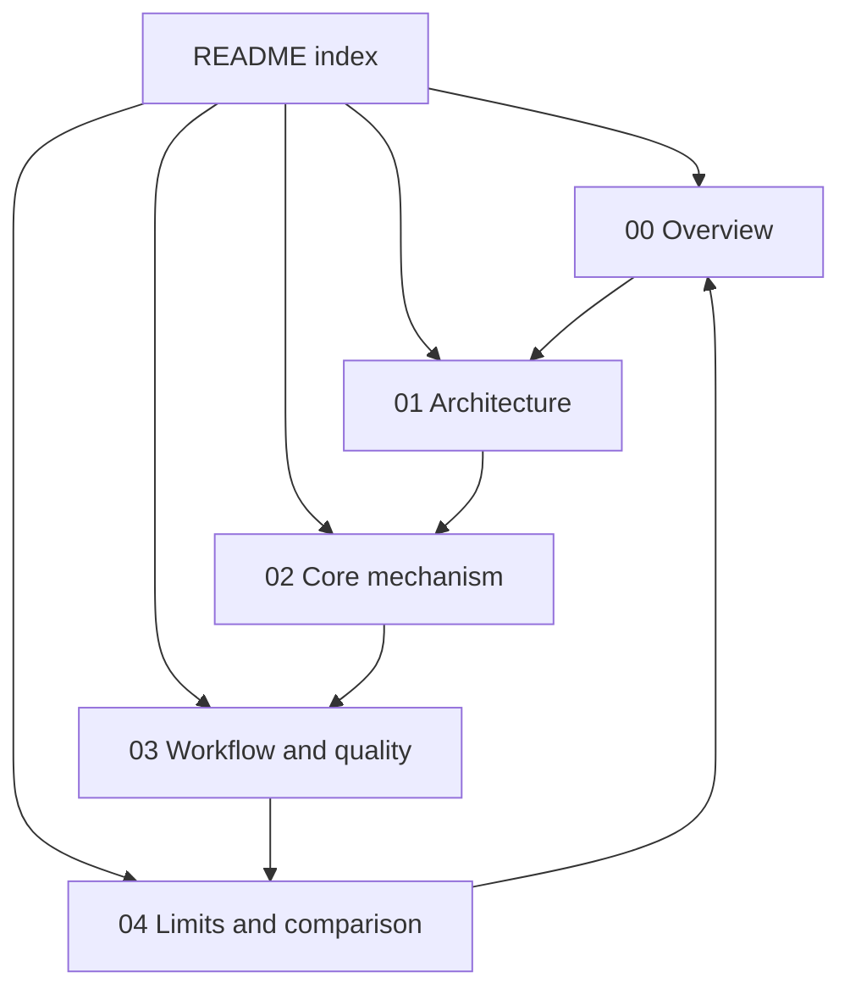

# valle-morta: a browser game made from code

**Thesis.** Valle Morta is a first-person zombie survival shooter in a war-ruined alpine valley. It runs in a browser on Web Graphics Library 2 (WebGL2). Every visual asset comes from code in the repository. The game is not only a scene. It is a pipeline. One layout function supplies the ground heights. One bake writes them to terrain files, and the world reads those files. The minimap uses one orthographic render of the real scene. One material patch supplies the fog, the cloud shadow and the surface hooks. One shared update function runs the game, the tools and the film. The live loop passes the measured frame time as the `dt` value. The tools and the film pass a fixed time, so a run is repeatable.

The tools are the runnable scripts in `tools/` that drive the game page in a headless browser. A headless browser is a browser with no visible window. The film code is `src/cinematic/film.js`; it drives the same game at a fixed step. The capture script is `cinematic/capture.mjs`. The Blender scripts generate models in Blender, a 3D modelling program, and do not render the film. A bake is an offline tool run that writes an asset file. The flow field is a navigation grid that stores walking distance to the player. Each cell points down the steepest slope of that distance (`src/game/zombies.js:173-174`). A preset is one of four fixed quality settings: low, medium, high and ultra.

This package reads that pipeline. It has six documents. Five are deep dives, and this file is the index. In this package, `README.md` citations mean the source README at the repository root, not this index. A citation with a line number points to the source checkout; a table link opens a package document. This index is at `/Users/darkvoid/Dev/explorations/src.aidesign/src.leonnix/valle-morta/markdown`. The checkout is a separate folder at `/Users/darkvoid/GitSources/src.aidesign/src.leonnix/valle-morta`. The package does not run the game. It does not open a browser, start Vite, run a generator, launch Blender, or render the film. Claims about the game come from a static reading of the checkout at pin `64471ca`. A pin is the commit that the reading used. File counts and the work plan come from the package brief `spec.md`, which sits one directory above `markdown/`. The brief is not part of the checkout.

The tracked-file total of 524 comes from `git ls-files`, which lists tracked files only. The folder split comes from the package brief. The word counts for the five deep dives come from `wc -w`; this index has no fixed length. A `wc -w` count includes the code blocks. A snippet is one fenced `text` source block. The brief asks for 3,000 to 5,000 words per deep dive, so a figure of exactly 5,000 records the measured length and is not a target.

## The source in one table

| Property | Value |
|---|---|
| Location | `/Users/darkvoid/GitSources/src.aidesign/src.leonnix/valle-morta` |
| Pin | `64471ca`, the commit used for this reading |
| Tracked files | 524 |
| File split | `src` 39, `tools` 250, `public` 225, `cinematic` 2, `docs` 1, root files 7. The film module is one of the 39 `src` files. The top-level `cinematic` folder holds the capture script and a PowerShell script. Root files are the seven files beside these folders, such as `index.html` and `package.json`. |
| Version | `1.0.0` (`package.json:3`) |
| Licence | Massachusetts Institute of Technology (MIT) for code and generated assets (`LICENSE:1`, `README.md:71`). The music is Creative Commons Attribution 4.0 (CC BY 4.0). Most other sounds are Creative Commons Zero (CC0), but six impact sounds are CC BY 3.0 (`public/assets/audio/CREDITS.md:5`, `public/assets/audio/CREDITS.md:88-93`). |
| Manifest licence field | The ISC identifier (`package.json:14`). The source gives no full name for ISC. It conflicts with the licence file. |
| Renderer | three.js 0.187.0 on WebGL2 (`package.json:17`, `README.md:3`). three.js is a browser 3D library. |
| Physics | three-mesh-bvh 0.9.18, a bounding volume hierarchy (BVH), which is a tree of boxes that speeds collision queries (`package.json:18`) |
| Build tool | Vite 8.3.8 (`package.json:22`) |
| Capture tool | puppeteer-core 25.17.0 (`package.json:21`), a headless browser driver for screenshots, the playtest and the film capture |
| Design record | `docs/DESIGN.md`, 1,277 words from `wc -w` |

The package manifest (`package.json`) gives the identity. Its description field is empty (`package.json:5`).

```text
# package.json:1-4
{
  "name": "valle-morta",
  "version": "1.0.0",
  "description": "",
```

The README gives the rule that shapes the whole project. It also names 22 physically based rendering (PBR) texture sets. PBR is a shading model with a measured surface response. A texture set is the colour, normal and roughness maps for one material.

```text
# README.md:3-5
A first-person zombie survival shooter set in a war-ruined alpine valley, running in the browser on three.js (WebGL2).

Every visual asset is generated by code in this repository: the eroded mountain range, the valley, the ruined village and its church, the broken bridge, the river, grass and trees, the tank wreck, the rifle, the infected and all 22 PBR texture sets. No premade models or textures are used. Sound effects and music are licensed third-party recordings (see Credits).
```

The frame loop gives the shared spine. The game update, the terrain update, the world updaters and the render run in that order.

```text
# src/main.js:144-148
    } else if (game.state !== 'paused') game.update(dt);
    const wdt = game.state === 'paused' ? 0 : dt;
    terrain.update(engine.camera);
    for (const u of world.updaters) u(wdt, engine.camera, engine.time);
    engine.render(wdt);
```

## The map

The six documents divide the machine by question. This index states the map, the reading order and the non-claims. The overview answers what the player does. Architecture answers how the code is arranged. The core mechanism document answers how one frame and one valley are made. The workflow document answers how one wave is played and checked. The limits document answers what the project cannot do and how it compares with three sibling packages in the same exploration collection: cinetic, taste-skill and TasteCode.



An arrow points to the document that continues the argument. The arrow from limits back to overview closes the loop: the limits show where the pipeline stops, and the comparison places it beside its siblings.

## The six documents

| File | Question it answers | Words | Snippets |
|---|---|---:|---:|
| This index | What is this package, and how do I read it? | not fixed | 3 |
| [`00-overview.md`](00-overview.md) | What does the player do minute by minute, and what shipped? | 5,000 | 14 |
| [`01-architecture.md`](01-architecture.md) | How do the engine, world, game, interface, film and tools fit together? | 4,998 | 20 |
| [`02-core-mechanism.md`](02-core-mechanism.md) | How does one frame and one procedural valley work end to end? | 5,000 | 17 |
| [`03-workflow-and-quality.md`](03-workflow-and-quality.md) | How does one wave run from spawn to death, and what checks it? | 5,000 | 10 |
| [`04-limits-and-comparison.md`](04-limits-and-comparison.md) | What are the limits, the rejected choices, the failure modes and the comparisons? | 4,991 | 12 |

Every deep dive has at least two Mermaid diagrams and at least one `**Aha:**` paragraph. An Aha paragraph states an insight that the earlier sections set up. Every quoted source block starts with a citation that gives the source path and the line range. The quoted lines match the source byte for byte.

## Reading order

1. Start with [`00-overview.md`](00-overview.md). It gives the player loop, the four infected types (walker, runner, brute and boss), the three weapons (rifle, pistol and sniper) and the two modes (survival and operation). It also gives the shipped parts and the non-claims.
2. Read [`01-architecture.md`](01-architecture.md) next. It draws the five in-game code groups (engine, world, game, interface and main), the film layer and the offline tool layer. It follows the boot from `index.html` to the first frame.
3. Read [`02-core-mechanism.md`](02-core-mechanism.md) for the two long traces. The first trace follows one frame from the browser animation callback (`requestAnimationFrame`) to the presented frame. The second follows the valley from the mountain bake to the grass.
4. Read [`03-workflow-and-quality.md`](03-workflow-and-quality.md) for one wave and the quality loop. It covers spawn placement, pack behaviour, the shot, the hit test for each body part, the kill, the supply crate and the run summary. It then covers the playtest (`tools/playtest.mjs`), the performance comparison (`tools/perf.mjs`), the contact sheets (grids of captured frames from `tools/sheet.mjs`) and the film.
5. End with [`04-limits-and-comparison.md`](04-limits-and-comparison.md). It records the 262 megabyte (MB) asset folder, the four presets, the single shadow box and the missing gate. The shadow box is one shadow map for the whole scene. It also records the profile and settings in browser storage. A gate is a check that can stop a build. It compares the project with cinetic, taste-skill and TasteCode.

A reader who wants one mechanism should read [`02-core-mechanism.md`](02-core-mechanism.md). A reader who wants the quality method should read [`03-workflow-and-quality.md`](03-workflow-and-quality.md). A reader who wants the honest limits should read [`04-limits-and-comparison.md`](04-limits-and-comparison.md). The order follows five questions: what the player does, how the code is arranged, how the mechanisms work, how the work is checked, and where the project stops.

## What makes the project interesting

The first mechanism is the one material patch. The engine patches the three.js shader chunks in one setup step. Every material that uses the patched shaders gets the shared fog, the cloud shadow, the world position and the surface hooks (`src/engine/materials.js:1-40`). A shader chunk is a named piece of three.js shader source, such as the fog block. A surface hook is a small function attached to a material that edits its shader source. The second mechanism is the one terrain height function. The bake imports `designHeight`, the layout function that returns the ground height, from the layout module (`tools/bake-terrain.mjs:11`, `tools/bake-terrain.mjs:257`; `src/world/layout.js:508-590`). The layout calls it, and the building code calls it. Collision and the flow field read the baked grid through `terrain.heightAt` (`src/world/terrain.js:494-502`). The flow field rebuilds every 0.45 seconds around the player (`src/game/zombies.js:785-786`). The minimap does not read the height function. It renders one orthographic image of the real scene once, at load (`src/ui/minimap.js:1-2`, `src/ui/minimap.js:27-44`). The third mechanism is the shared update function. The playtest (`tools/playtest.mjs`) and the film call `game.update` with a fixed time, and the live loop calls it with the frame time (`src/main.js:134-157`, `src/cinematic/film.js:494-498`).

The material patch, the shared height function and the fixed time explain most of the repository. The material patch gives the world one set of fog and cloud-shadow rules. The shared height function gives the terrain, the buildings and the collision one ground. The fixed time lets a tool repeat a run step for step. The layout uses the fixed seed 20261 (`src/world/layout.js:16`), and the erosion uses seed 4711 (`tools/bake-terrain.mjs:181`). Erosion is the simulated water flow that cuts the mountain shape. Fixed seeds make the same world on each run, if the same code and inputs are used.

## What this package does not claim

- No game, build, generator, browser, playtest or film was run. No frame was rendered.
- The visual quality is not evaluated. The README says the look is an approximation of photographic references, not a match (`README.md:59`).
- The audio is not listened to. The credits file is the record (`public/assets/audio/CREDITS.md:1-10`).
- No performance measurement was made. The design target is 60 frames per second at 1280 by 720 on the high preset on an integrated Radeon 780M (`docs/DESIGN.md:10`).
- Runtime behaviour is inferred from the source. It is not observed.
- The 262 MB figure is a `du` reading of the `public/` folder on the checkout. It is not a measured download.

## Defects found during the reading

The detailed record is in [`04-limits-and-comparison.md`](04-limits-and-comparison.md). Four items matter at the index level.

1. The manifest licence field says `ISC` (`package.json:14`). The licence file says MIT (`LICENSE:1`), and the README says MIT (`README.md:71`). The package follows the file and records the conflict.
2. The README says there is no church bell recording and no wood-footstep sound (`README.md:61`). The checkout contains both. The credits list `bell_toll.mp3` and four `step_wood` files (`public/assets/audio/CREDITS.md:94-97`, `public/assets/audio/CREDITS.md:132`). The source preloads both and calls the bell sound at the start of a run (`src/game/game.js:276`, `src/game/game.js:378`).
3. The README says "Head shots kill" (`README.md:31`). The code guarantees a head-shot kill only when the infected type starts with 100 health or less (`src/game/zombies.js:674`). In that branch it sets the damage to at least the remaining health. A rifle head shot multiplies its 36 base damage by the head multiplier 4, which is 144. That does not kill a brute with 450 health or a boss with 2600 health. A sniper head shot multiplies its 220 base damage by the head multiplier 3, which is 660. That kills a brute but not a boss (`src/game/weapon.js:32`, `src/game/weapon.js:68`; the damage trace is in [`03-workflow-and-quality.md`](03-workflow-and-quality.md)).
4. The README says all sounds other than the music are CC0 (`README.md:65`). The credits file records six impact sounds under CC BY 3.0 (`public/assets/audio/CREDITS.md:88-93`).

## The one-sentence version

Valle Morta is a code-generated browser shooter whose terrain bake, material patch and shared update function tie the world, the game, the film and the tools into one machine. This package teaches that machine and records where it stops.
