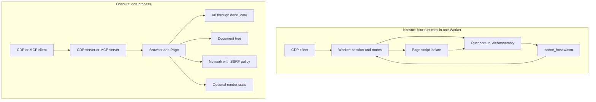
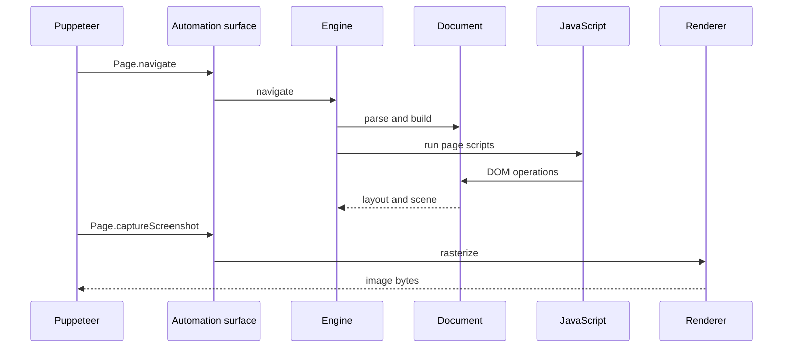

# Browsers without a desktop

This page is the shared index for two explorations of browser engines that do not run a desktop browser. One explores Kitesurf, an experimental engine that runs on Cloudflare Workers. One explores Obscura, a Rust headless browser that runs as a normal process. Each exploration lives in its own directory with its own documents, its own index, and its own generated HyperText Markup Language (HTML) tree.

| Exploration | What it covers | Start here |
|-------------|----------------|------------|
| [Kitesurf](src.kitesurf/html/README.html) | A Cloudflare Worker that answers the Chrome DevTools Protocol (CDP). A Rust core compiled to WebAssembly owns the document. Page scripts run in loaded worker isolates with a TypeScript Document Object Model (DOM) shim. A renderer turns a recorded scene into pixels | [Overview](src.kitesurf/html/00-overview.html), then [the engine Worker](src.kitesurf/html/04-engine-worker-and-cdp.html) |
| [Obscura](src.obscura/html/README.html) | A ten-crate Rust workspace with one binary. V8 through `deno_core` runs page JavaScript. CDP and the Model Context Protocol (MCP) are the two automation surfaces. Layout, paint, screenshots, and Portable Document Format (PDF) output sit behind build features | [Overview](src.obscura/html/00-overview.html), then [the CDP server](src.obscura/html/06-cdp-server.html) |

## The short answer

Both engines answer one question: **can a browser be small, isolated, and scriptable without shipping Chromium?**

They answer it in opposite directions. Obscura keeps the usual shape of a browser: one operating-system process, real V8, one document tree, one network stack. It removes the desktop shell, the graphics stack, and the compatibility surface that a person needs. Kitesurf keeps almost nothing of that shape. It puts the engine inside a Worker, splits the document and the script into different isolates, and replaces the process boundary with messages.

The external contract is the same in both projects. Puppeteer and Playwright connect over CDP. The pages differ inside.

| Question | Kitesurf answer | Obscura answer |
|----------|-----------------|----------------|
| Where does the engine run? | A Cloudflare Worker, with a loaded worker for each page and each renderer | A Linux, macOS, or Windows process, or a container |
| Which language owns the document? | Rust compiled to WebAssembly | Rust compiled to a native binary |
| Which engine runs page JavaScript? | The Worker runtime runs the page-script bundle and the DOM shim. Code generated at runtime, such as `Runtime.evaluate`, `eval`, `new Function`, and computed `import()`, runs on Boa inside the core | V8 through `deno_core`, with an explicit operation table |
| How does JavaScript reach the tree? | Typed Remote Procedure Call (RPC) to the core, and a DOM fast path in the core | Rust operations registered with V8 |
| How is a pixel produced? | The core records a scene. `scene_host.wasm` rasterizes it | The optional `render` crate lays out, shapes text, and paints with tiny-skia |
| Which address policy applies? | Fetch limits and frame rules in the Worker. The platform controls the network | A shared server-side request forgery (SSRF) deny-set in a dependency-free crate |
| What is the main limit? | Cloudflare Dynamic Workers and their paid plan. No desktop operating system and no threads | A subset of Chromium behaviour. No full media stack and no compositor |
| What proves compatibility? | Web Platform Tests (WPT), end-to-end (E2E) tests, and expected-failure lists | The project test suite, a reproduction corpus, and its own documentation of gaps |

## The lineage

The Obscura README states that Cloudflare began Kitesurf by porting Obscura to Workers. That sentence explains many shared choices. Both projects parse with a standards parser from the Servo family. Both use CDP as the only external automation contract. Both keep a separate extraction path that turns a document into text or Markdown. Both treat rendering as a capability that can be absent.

The port changed the hard problem. In Obscura the hard problem is compatibility with Puppeteer and Playwright on one process. In Kitesurf the hard problem is isolation inside a platform that has no process, no threads, and a metered central processing unit (CPU) budget. The Kitesurf documents call this the Worker execution model. The Obscura documents call their model the single-process model.

The sequence is the same for both engines. Only the participant named "Automation surface" changes. In Obscura it is a WebSocket server inside the same process. In Kitesurf it is a Worker that owns a WebSocket session and calls three other runtimes.

## What both engines agree on

1. **A standard parser is not optional.** Browser-compatible error recovery matters more than a small custom parser. `html5ever` supplies that recovery in both projects.
2. **Page JavaScript must be real JavaScript.** Obscura uses V8. Kitesurf uses the Worker runtime for the page-script bundle and embeds Boa for code that the page generates at runtime. Neither project interprets a subset by hand.
3. **The automation protocol is the product boundary.** A client library must not need a special Software Development Kit (SDK). CDP supplies that boundary in both projects.
4. **Rendering is a separate concern.** Obscura gates it with a Cargo feature. Kitesurf gates it with a scene format and a second WebAssembly module.
5. **Extraction is a first-class output.** Obscura exposes `LP.getMarkdown` and `--dump markdown`. Kitesurf exposes a Markdown path for agents and a native command-line tool.

## Where they differ

**The unit of isolation.** Obscura isolates pages inside one process. Each page owns its own V8 isolate, and the stealth build adds address policy. Kitesurf isolates a page in a loaded worker. That worker has its own memory and its own lifetime, so one page's crash does not damage another page's script state.

**The JavaScript strategy.** Obscura has one engine. Kitesurf has two. The page's own scripts run through the page-script bundle on the Worker runtime. Code that the page or a client generates at runtime calls `ks_eval_cdp` in the core, and Boa evaluates it there. The core records the rule as an invariant: runtime code generation never runs in the parent Worker. The deep dive in [03 Script runtime](src.kitesurf/html/03-script-runtime-and-dom-shim.html) explains the split and its budgets.

**The security model.** Obscura blocks private network addresses in every transport, and a stealth build blocks tracker domains. Kitesurf relies on the platform for network isolation, and it enforces script policy with a shared gate: Subresource Integrity (SRI), Content Security Policy (CSP), JavaScript MIME checks, the Referrer Policy table, and the iframe sandbox capability set. The two models protect different things. Obscura protects the server from the page. Kitesurf protects the page from other pages and from untrusted script.

**The cost model.** Obscura pays memory for V8 and for the optional render crate. Kitesurf pays CPU time for every Worker call and counts Dynamic Worker instances. Obscura's README reports its numbers as product claims. Kitesurf's documents report its limits as platform limits.

## Reading the pair

A reader who wants to understand how a browser engine works should start with the [Obscura overview](src.obscura/html/00-overview.html). It keeps the familiar shape: parser, tree, V8, network, CDP, renderer. The [Kitesurf overview](src.kitesurf/html/00-overview.html) then shows which parts survive when the operating system disappears.

A reader who wants to compare CDP implementations should read [Obscura 06](src.obscura/html/06-cdp-server.html) and [Kitesurf 04](src.kitesurf/html/04-engine-worker-and-cdp.html) in that order. The first shows the domain dispatch inside one process. The second shows the same commands across four runtimes.

A reader who wants the rendering story should read [Obscura 07](src.obscura/html/07-rendering-and-output.html) and [Kitesurf 05](src.kitesurf/html/05-rendering-pipeline.html). The first paints with tiny-skia. The second records a display list and rasterizes it in a second WebAssembly module.

## What this index does not claim

The two projects are not versions of one product. They share a lineage, a protocol, and several library choices. They do not share a code base, a release schedule, or a compatibility target. Each exploration states its own limits, and each exploration reports the project's own claims as claims.

Neither exploration ran the engines. Every statement comes from the source at the pinned commit, the tests, the build files, or the project documents. Where the source and a project document disagree, the exploration names both and follows the source.
