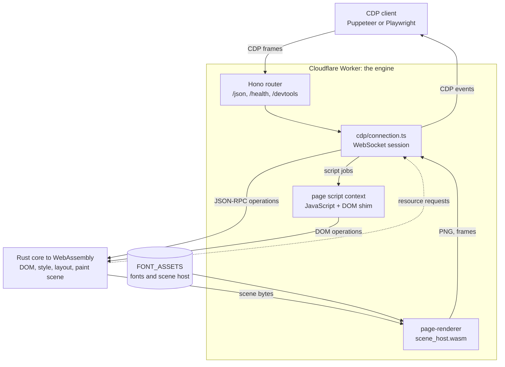
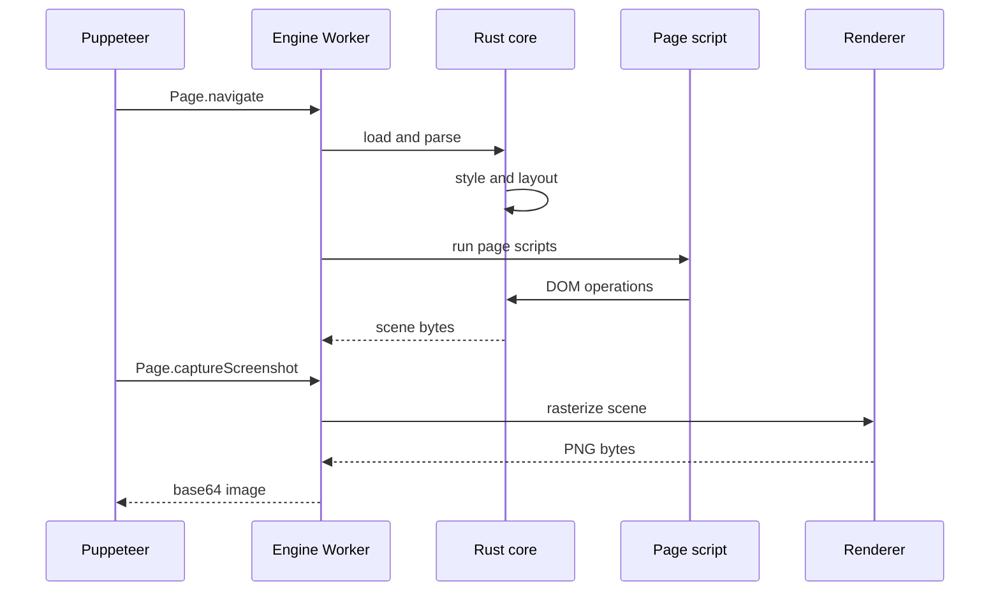

# 00 Overview: a browser engine inside a Worker

Kitesurf is an experimental browser engine that runs on Cloudflare Workers. It parses HyperText Markup Language (HTML) and applies Cascading Style Sheets (CSS). It runs page JavaScript and records a paint scene. It answers the Chrome DevTools Protocol (CDP) over a WebSocket. It does this without Chrome and without a browser container. The thesis of this exploration is that Kitesurf is not a browser in the usual sense. It is four cooperating runtimes joined by narrow protocols. A Worker owns the connection. A Rust core compiled to WebAssembly owns the document. An isolated script context owns page JavaScript. A renderer turns a recorded scene into pixels. Every design decision in the repository follows from one constraint. The engine must fit inside the Cloudflare Workers execution model. In that model memory is small, Central Processing Unit (CPU) time is metered, and no operating-system process exists.

This document gives the problem, the four runtimes, the two protocols that join them, and the reading guide. Later documents give the mechanism.

## The problem

A normal headless browser carries a desktop engine and a desktop operating system inside a container. That model costs hundreds of megabytes of memory and seconds of start time. It also gives an agent a browser that behaves almost exactly like a human browser, because it is one.

A Worker has different rules. It has a bounded heap, a metered central processing unit (CPU) budget, and no threads. It cannot start a child process. It can, however, run WebAssembly and open a WebSocket. Kitesurf uses those two capabilities to build a browser-shaped service:

1. The Worker terminates the CDP WebSocket and keeps the session state.
2. Rust code compiled to WebAssembly parses and lays out the page.
3. Page JavaScript runs in a separate isolate with a shim that implements a large part of the Document Object Model (DOM) in TypeScript.
4. A renderer records a scene in the core and rasterizes it with a second WebAssembly module.

The trade is explicit. Kitesurf is compatible with CDP clients such as Puppeteer, not with every browser behaviour. The repository measures that gap with Web Platform Tests (WPT), end-to-end (E2E) tests, and its own expected-failure lists.

## Four runtimes, two protocols

The following diagram shows the four runtimes and the boundary between them. The arrows are protocols, not function calls.



| Runtime | Language | Owns | Talks to |
|---------|----------|------|----------|
| Engine Worker | TypeScript | Routes, CDP session, cookies, limits | The CDP client and the other three runtimes |
| Page script context | TypeScript | `window`, `document` shim, timers, fetch | The core, through generated Remote Procedure Call (RPC) types |
| Rust core | Rust to WebAssembly | Tree, style, layout, scene recording | The engine and the renderer |
| Renderer | TypeScript and WebAssembly | Rasterization, image and font assembly | The engine |

The two protocols are the CDP frame format on the outside and an internal typed RPC on the inside. The internal protocol has its own package, `packages/jsrpc-types`, so both sides of the boundary compile against one definition.

## One page, end to end

A client connects to `/devtools/browser`. The Worker upgrades the request and hands the socket to `handleWebSocket` (`packages/engine/src/index.ts:87-93`). The version endpoint tells Puppeteer where to connect:

```ts
// packages/engine/src/index.ts:183-191
function discoveryVersion(c: Context<EngineApp>): Response {
  const url = new URL(c.req.url);
  const host = c.req.header("host") ?? url.host;
  const scheme = url.protocol === "https:" ? "wss" : "ws";
  return Response.json({
    ...VERSION_INFO,
    webSocketDebuggerUrl: `${scheme}://${host}/devtools/browser`,
  });
}
```

The advertised identity is deliberately Chrome-shaped, because Puppeteer checks it:

```ts
// packages/engine/src/index.ts:30-37
const VERSION_INFO = {
  Browser: "Kitesurf/0.0.1",
  "Protocol-Version": "1.3",
  "User-Agent":
    "Mozilla/5.0 (X11; Linux x86_64) AppleWebKit/537.36 (KHTML, like Gecko) Chrome/145.0.0.0 Safari/537.36",
  "V8-Version": "12.0.0",
  "WebKit-Version": "537.36",
};
```

The client then sends `Target.createTarget`, `Page.navigate`, `Runtime.evaluate`, and `Page.captureScreenshot` in the usual order. Each command becomes a handler under `packages/engine/src/cdp/`. A handler that needs the document calls the Rust core. A handler that needs page JavaScript calls the script context. A screenshot handler asks the renderer to rasterize the current scene.

From the client's side the sequence is short:



The README gives the same flow in ten lines:

```js
// README.md:76-84
const browser = await puppeteer.connect({
  browserWSEndpoint: "ws://127.0.0.1:8787/devtools/browser",
});

const page = await browser.newPage();
await page.goto("https://example.com/");
await page.screenshot({ path: "page.png" });

await browser.disconnect();
```

## The scene is the contract

The most important internal boundary is the scene. The core does not draw. It records a display list: boxes, text runs, images, clips, and paint order. The renderer consumes that list. The same split appears in the native command-line tool, which can replay a recorded scene without a network or a Worker.

The renderer WebAssembly module is served by the Worker itself:

```ts
// packages/engine/src/index.ts:123-128
app.get("/rbi/scene_host.wasm", (c) =>
  serveRbiAsset(c.env.env, "/rbi/scene_host.wasm", "application/wasm"),
);
app.get("/rbi/scene_host.json", (c) =>
  serveRbiAsset(c.env.env, "/rbi/scene_host.json", "application/json; charset=utf-8"),
);
```

**Aha:** The scene is the only artefact that crosses from the core to the pixel path. That is why the same engine can answer a CDP screenshot, produce a partial frame during streaming, and feed the native playback tool. A change to the scene format is a change to every consumer at once.

## The Worker as host

The Worker is not only a router. It enforces admission, serves assets, and holds the resource limits. The limits are declared next to the code that runs under them:

```jsonc
// packages/engine/wrangler.jsonc:1-24
{
  "$schema": "../../node_modules/wrangler/config-schema.json",
  "name": "kitesurf",
  "main": "src/index.ts",
  "compatibility_date": "2026-09-11",

  "compatibility_flags": ["global_fetch_strictly_public"],

  "rules": [
    {
      "type": "Text",
      "globs": ["**/*.glue.js", "**/*.css", "**/*.dat"],
      "fallthrough": true,
    },
  ],

  "observability": {
    "enabled": true,
  },

  "limits": {
    "cpu_ms": 300000,
    "subrequests": 1000000,
  },
```

Two custom middlewares run before any route. The first asks the embedding host whether to admit the request. The second sends every WebSocket upgrade to the CDP handler:

```ts
// packages/engine/src/index.ts:109-116
app.use(async (c, next) => {
  const { env, ctx, host } = c.env;
  const rejected = await host.admit?.(c.req.raw, env, ctx);
  if (rejected) return rejected;
  await next();
});

app.use(async (c, next) => {
```

The upgrade path has its own origin check:

```ts
// packages/engine/src/index.ts:87-96
upgrades.all("*", (c) =>
  !cdpUpgradeOriginAllowed(c.req.raw, c.env.env)
    ? c.text("CDP connections from this origin are not allowed", 403)
    : traceSpan(c.env.env.HOST_TRACER, "ws.connect", () =>
        handleWebSocket(c.req.raw, c.env.env, c.env.ctx, undefined, {
          host: c.env.host,
        }),
      ),
);
```

Three retired paths return 404 on purpose, so an old client fails clearly instead of reaching a handler that no longer exists:

```ts
// packages/engine/src/index.ts:105-107
for (const retired of ["/tui", "/tui/*", "/rbi/ws"]) {
  app.all(retired, (c) => c.text("not found", 404));
}
```

## Build and run

Kitesurf uses two package managers on purpose. Bazel builds Rust, WebAssembly, and the bundles. pnpm installs JavaScript dependencies and starts the development server. The scripts make the split visible:

```json
// package.json:17-22
    "dev": "pnpm --filter @kitesurf/engine dev",
    "dev:memprof": "pnpm --filter @kitesurf/engine dev:memprof",
    "dev:tracing": "docker compose -f docker/compose.dev.yml up tracing",
    "dev:wpt": "pnpm --filter @kitesurf/engine dev:wpt",
    "bench:scene": "node scripts/bench-scene-record.mjs",
    "build": "bazel run //packages/engine:dev_build",
```

The full gate set is one command:

```json
// package.json:32-36
    "check": "bazel test //:check && bazel run //scripts:workspace_checks",
    "types:lint": "tsc -p scripts/lint/tsconfig.json",
    "test:vitest": "bazel test //packages/engine:vitest",
    "test:rust": "bazel test //packages/core:host_tests",
    "test:unit": "bazel test //packages/engine:vitest //packages/core:host_tests //packages/kitesurf-cli:lib_test //packages/kitesurf-cli:bin_test",
```

Locally the engine listens on port 8787 and answers a health check:

```bash
// README.md:48
pnpm run dev
```

```text
// README.md:51-52
The engine listens on `http://127.0.0.1:8787`. Visit
`http://127.0.0.1:8787/health` to confirm that it is running.
```

The README sentence ends the same loop that this document opened: a CDP client connects, a page loads, and a screenshot returns. The difference is where each step runs.

## Vocabulary

| Term | Meaning in this repository |
|------|----------------------------|
| CDP | Chrome DevTools Protocol. The JSON message protocol that Puppeteer and Playwright speak |
| Worker | A Cloudflare Workers isolate. The engine runs as one |
| Core | The Rust crate in `packages/core`, compiled to WebAssembly |
| Page script | The JavaScript context that runs the page's own scripts. It is not the Worker context |
| DOM shim | The TypeScript implementation of DOM interfaces in `packages/dom-shim` |
| Scene | The recorded display list that the core produces and the renderer consumes |
| Renderer | `packages/page-renderer` plus `scene_host.wasm`. It turns a scene into pixels |
| RBI | The renderer binary interface: the asset set at `/rbi/` |
| WPT | Web Platform Tests. The shared browser conformance suite |
| E2E | End to end. A test that drives the engine through a real CDP connection |

## Reading guide

Read this document for the shape. Then follow one of three paths:

- **The engine path.** [04-engine-worker-and-cdp](04-engine-worker-and-cdp.md) explains the Worker, the CDP command loop, and the session state.
- **The document path.** [02-rust-core](02-rust-core.md) explains the tree, the style system, layout, and the scene. [03-script-runtime-and-dom-shim](03-script-runtime-and-dom-shim.md) explains how page JavaScript reaches that tree.
- **The pixel path.** [05-rendering-pipeline](05-rendering-pipeline.md) follows the scene into the rasterizer. [06-network-and-security](06-network-and-security.md) explains what the page may fetch and what the engine blocks.

The build, the gates, and the limits are in [01-repository-and-build](01-repository-and-build.md) and [08-testing-gates-and-limits](08-testing-gates-and-limits.md). The native tool is in [07-cli-playback-and-access](07-cli-playback-and-access.md).

## What this exploration does not claim

Kitesurf is explicitly experimental, and the repository says so. It requires Cloudflare Dynamic Workers, which are part of a paid plan. It does not claim full browser compatibility. It does not ship a Chromium binary, and it cannot run one inside a Worker. The documents record the compatibility surface as the source defines it, including the parts that are missing.
