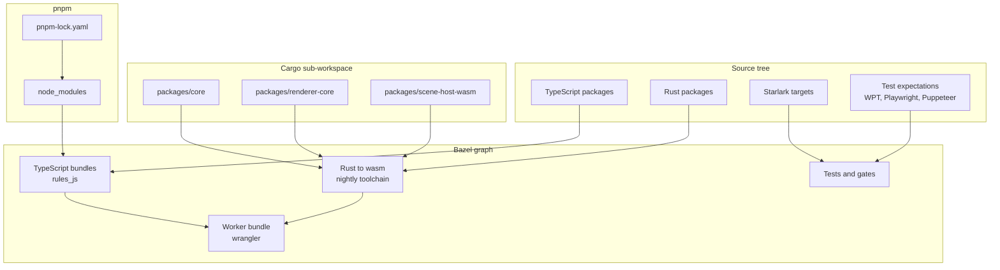
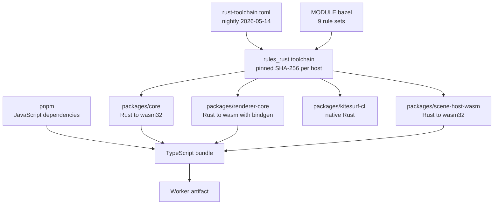

# 01 Repository and build: two build graphs in one tree

The Kitesurf repository is one tree with two build graphs. Bazel owns the whole repository: the Rust to WebAssembly builds, the TypeScript bundles, the Worker bundle, the tests, and the deploy. Cargo owns a smaller sub-workspace of three related Rust crates. pnpm owns only the JavaScript dependency installation. The thesis of this document is that this split is not duplication. Each tool answers a question that the other cannot answer well. Bazel answers "what is the complete artefact and which checks must pass before it ships". Cargo answers "how do I run one Rust unit test on my host machine". pnpm answers "which exact package versions are installed".

This document maps the tree, explains each build graph, and lists the gates. The mechanisms inside each package are in later documents.

## The problem

A browser engine mixes four languages: Rust, TypeScript, WebAssembly, and Starlark. It also has four kinds of test: Rust unit tests, TypeScript unit tests, end-to-end tests over a real WebSocket, and conformance suites from other projects.

A single tool must produce one deployable Worker bundle from all of that. The bundle contains:

- a Rust core compiled to WebAssembly;
- a second rasterizer compiled to WebAssembly;
- TypeScript bundles for the engine, the page script, the DOM shim, the page renderer, and the page workers;
- a font cache and a scene-host module;
- optionally, the prebuilt Chrome DevTools frontend.

The repository also patches several third-party Rust crates. A patch must apply the same way on every machine and in Continuous Integration (CI). That requirement alone rules out a hand-written shell build.



## The tree

| Path | Holds | Build owner |
|------|-------|-------------|
| `packages/engine` | The Cloudflare Worker, the CDP routes, the session state, and the asset server | Bazel |
| `packages/page-script` | The per-page TypeScript runtime and the CDP DOM and evaluation routing | Bazel |
| `packages/dom-shim` | The in-isolate Document Object Model (DOM) in TypeScript | Bazel |
| `packages/core` | Rust to WebAssembly on Blitz: tree, style, layout, paint, scene, Boa evaluation | Bazel and Cargo |
| `packages/renderer-core` | The smaller rasterizer slice of the core | Bazel and Cargo |
| `packages/scene-host-wasm` | The native command-line rasterizer | Bazel and Cargo |
| `packages/page-renderer` | The stateless raster worker | Bazel |
| `packages/worker-script` | The loaded worker for a page's `new Worker()` | Bazel |
| `packages/script-gate` | The shared script policy: integrity, Content Security Policy, Multipurpose Internet Mail Extensions (MIME) checks | Bazel |
| `packages/jsrpc-types` | The type-only contract for the internal Remote Procedure Call (RPC) | Bazel |
| `packages/kitesurf-cli` | The Rust terminal client, with its own Cargo workspace | Bazel and Cargo |
| `tests` | The Web Platform Tests (WPT) revision, the allow-list, and the expectation files | Bazel |
| `scripts` | The test runners, the lint rules, the patch materializer, and the deploy script | Bazel |
| `bazel` | The Starlark rules: Rust checks, execution platforms, the remote-execution client | Bazel |

The package list matters because the repository instructions call this a pnpm monorepo. It is a monorepo for the JavaScript packages. The Rust crates form a separate Cargo workspace with three members.

## The root manifest pins the toolchain

The root `package.json` is private and pins the package manager:

```json
// package.json:1-7
{
  "name": "kitesurf",
  "private": true,
  "version": "0.0.1",
  "license": "Apache-2.0",
  "packageManager": "pnpm@9.15.4",
  "scripts": {
```

The scripts are thin front ends. Each script either calls Bazel or calls one Node.js script. No script performs its own compilation.

```json
// package.json:22-24
    "build": "bazel run //packages/engine:dev_build",
    "build:dist": "bazel build //packages/engine:dist",
    "build:wasm:memprof": "bazel run //packages/engine:dev_build && bazel run //packages/core/pkg:stage_memprof && KITESURF_MEMPROF=1 pnpm --dir packages/page-script run build",
```

`build` stages a development build into the source tree, so `wrangler dev` can read it. `build:dist` produces the release bundle without staging it into the source tree.

## The Bazel graph

The module file names every external rule set:

```python
# MODULE.bazel:1-16
"""Public Kitesurf build and test graph."""

module(name = "kitesurf")

bazel_dep(name = "aspect_rules_js", version = "3.5.1")
bazel_dep(name = "bazel_lib", version = "3.7.2")
bazel_dep(name = "bazel_skylib", version = "1.9.0")
bazel_dep(name = "platforms", version = "1.1.0")
bazel_dep(name = "rules_cc", version = "0.2.17")
bazel_dep(name = "rules_nodejs", version = "6.7.7")
bazel_dep(name = "rules_rust", version = "0.74.0")
bazel_dep(name = "rules_shell", version = "0.6.1")

# Patched registry crates are downloaded and patched by Bazel rather than copied from Cargo paths.
single_version_override(
    module_name = "rules_rust",
```

The last line starts an override that applies a patch to the Rust rules themselves. The patch is in `bazel/rust/rules_rust-patched-crates.patch`. The repository needs it because Bazel downloads and patches the vendored crates, and it does not read the local Cargo patch table.

The Rust toolchain is pinned twice, and both pins must name the same nightly:

```python
# MODULE.bazel:28-32
# The nightly in rust-toolchain.toml, for every host the graph builds on: Linux x86-64 (CI),
# Linux arm64 and macOS arm64.
RUST_NIGHTLY = "nightly/2026-05-14"

RUST_NIGHTLY_SHA256S = {
```

The module file also carries a Secure Hash Algorithm 256-bit (SHA-256) digest for every toolchain archive on every supported host. Bazel therefore downloads exact bytes and cannot silently use a different build.

The Bazel configuration sets the strict environment and the two Rust settings that make the nightly pin work:

```text
# .bazelrc:1-11
common --incompatible_strict_action_env
# Aspect's rulesets otherwise report usage data from every repository fetch.
common --repo_env=DO_NOT_TRACK=1
# rules_rust registers one toolchain per channel, and rust-toolchain.toml pins a nightly: without
# this the host toolchain that builds proc-macros and build scripts never matches.
common --@rules_rust//rust/toolchain/channel=nightly
# The clippy and rustfmt aspects default to empty configs; use the files cargo reads.
common --@rules_rust//rust/settings:clippy.toml=//:clippy.toml
common --@rules_rust//rust/settings:rustfmt.toml=//:rustfmt.toml
# Like cargo, a crate's dependents start on its metadata, not its codegen.
common --@rules_rust//rust/settings:pipelined_compilation=true
```

**Aha:** The build sets `pipelined_compilation`. This means a crate's dependents start from its metadata before its code is compiled. The setting is the reason a cold build of the three Rust crates finishes in minutes instead of tens of minutes. The same setting is why a change to a public type can fail in a dependent before the changed crate finishes compiling.



The diagram shows two toolchains in one graph. Bazel compiles the Rust crates for WebAssembly, and pnpm supplies the JavaScript packages that the bundle imports. The native command-line tool is the only Rust target that does not go through WebAssembly.

The repository also defines a remote-execution configuration named `bazelflare`. The configuration sends actions to a Remote Execution API server that runs on Cloudflare Containers. It is optional. A local build without `--config=bazelflare` runs every action on the local machine.

## The Cargo sub-workspace

The root `Cargo.toml` declares three members and explains a subtle rule:

```toml
# Cargo.toml:1-19
# Cargo workspace for the repo's wasm crates. Artifacts include
# kitesurf-core (engine/PageScript), scene-host-wasm (CLI), and
# renderer-core (PageRenderer).
# The slice crates #[path]-include core source files, so
# [workspace.dependencies] below is what keeps the shared dep versions
# from drifting between the builds — a drifted version means the shared
# files compile against different APIs per artifact (this bit for real:
# a hand-mirrored dep list once missed core's getrandom 0.2).
#
# Excluded: host-side tool crates with their own toolchains and locks.
# The materialised vendor-patched crates under packages/core/target are
# NOT listed — exclude only matches exact package dirs and those paths
# are versioned; the materialiser instead stamps an empty [workspace]
# table into each tree so the walk-up never reaches this manifest.
[workspace]
resolver = "2"
members = ["packages/core", "packages/renderer-core", "packages/scene-host-wasm"]
exclude = ["scripts/memprof-rewriter", "vendor/wasm-memprof/instrumentor"]
```

Three details in that block explain the shape of the build.

1. The renderer and the command-line rasterizer compile source files from the core with the `#[path]` attribute. They are slices, not forks. The shared dependency table keeps their versions equal.
2. The materialized patched crates under `packages/core/target` are not members. The materializer writes an empty `[workspace]` table into each crate, so a Cargo command started there does not walk up to this manifest.
3. The memory-profiler tools use their own toolchains and locks, so they are excluded.

The toolchain pin exists for one technical reason. The WebAssembly target does not ship a standard library built for unwinding. The repository needs unwinding because a panic must not kill the page. The comments give the full argument:

```toml
# rust-toolchain.toml:1-9
# Repo-wide nightly pin (rustup walks up from CWD, so this covers
# every cargo invocation in the repo). Required to compile core and
# renderer-core with `panic = "unwind"` on wasm32-unknown-unknown:
# that target lacks a precompiled libstd built with unwinding, so we
# need `-Zbuild-std` (nightly-only) to rebuild std + panic_unwind
# ourselves. See packages/core/.cargo/config.toml for the build flags
# (renderer-core symlinks it; scene-host-wasm has no member
# config — it builds abort on the plain prebuilt std, just on this
# same pinned compiler).
```

The crate configuration then asks Cargo to rebuild the standard library:

```toml
# packages/core/.cargo/config.toml:32-35
[unstable]
build-std = ["std", "panic_unwind"]
# `build-std-features = ["panic_immediate_abort"]` would shrink the
# unwind tables but defeat the purpose — leave it off.
```

The `[unstable]` table is a nightly-only feature. That is why the repository pins a nightly and not a stable release. The profile moved to the workspace root, and it deliberately has no `panic` key, because `scene-host-wasm` must stay on the WebAssembly default of abort.

| Crate | Panic strategy | Why |
|-------|----------------|-----|
| `packages/core` | Unwind | A page script can panic and the live tree must survive. The panic becomes a JavaScript error |
| `packages/renderer-core` | Unwind | It includes the same source slice and the same bridge |
| `packages/scene-host-wasm` | Abort | It is a command-line tool. A panic ends the process, and unwind tables only add size |
| `packages/kitesurf-cli` | Host default | It is a native binary, not WebAssembly |

## pnpm owns only the dependencies

The pnpm workspace has one unusual member and one security guardrail:

```yaml
# pnpm-workspace.yaml:1-10
packages:
  - packages/*
  - packages/core/pkg # generated wasm-bindgen output; package.json is committed

# Supply-chain guardrail: only these deps may run install/postinstall
# scripts. pnpm 10 reads it here (not package.json's pnpm.onlyBuiltDependencies).
onlyBuiltDependencies:
  - esbuild
  - sharp
  - workerd
```

The guardrail is important. A dependency cannot run a script at install time unless its name is in that list. The list has three names: the bundler, the image library, and the local runtime. Every other package installs as plain files.

*pnpm-lock.yaml* is a tracked file with its own gate. The gate fails when the lock file and the manifests disagree. Document [08](08-testing-gates-and-limits.md) covers that gate.

## The build targets

Three targets matter to a developer.

**`//packages/engine:dev_build`** stages a development build into the source tree. The target collects the wasm, the bundles, the scene assets, and the fonts, then calls a Node.js script that copies them to the paths that `wrangler dev` reads.

```python
# packages/engine/BUILD.bazel:174-195
# `bazel run` it before `wrangler dev`: copies the built wasm, bundles and RBI files to the
# source-tree paths the dev server reads (scripts/stage-dev-build.mjs).
js_binary(
    name = "dev_build_tool",
    entry_point = "//scripts:stage_dev_build",
)

host_run(
    name = "dev_build",
    data = [
        ":inspector",
        ":rbi_json",
        ":rbi_wasm",
        "//packages/core/pkg:pkg",
        "//packages/dom-shim:pkg",
        "//packages/page-renderer:pkg",
        "//packages/page-script:pkg",
        "//packages/renderer-core:wasm_pkg",
        "//packages/worker-script:pkg",
    ],
    tool = ":dev_build_tool",
)
```

The `data` list is the complete set of artefacts that the development server needs. A developer can read it as a manifest of the deployable engine.

**`//packages/engine:dist`** produces the release bundle. **`//packages/engine:deploy`** uploads the bundle to the account that `wrangler` is logged in to. The deploy adds `--config=devtools` at the command line, so the prebuilt Chrome DevTools frontend is always in a deployed engine.

| Target | Output | Staging |
|--------|--------|---------|
| `:dev_build` | Development assets in the source tree | Yes, by a Node.js script |
| `:dist` | Release bundle in the Bazel output tree | No |
| `:deploy` | Uploaded Worker and assets | No |
| `:e2e` | An end-to-end run against the Bazel build | No |

## The gates

The root `BUILD.bazel` defines two test suites. The first suite is `check`. It proves that the manifests, the lock files, the generated declarations, and every package's types and bundles agree.

```python
# BUILD.bazel:165-195
test_suite(
    name = "check",
    tests = [
        ":cargo_lock_test",
        ":lockfile_test",
        ":no_dts_test",
        ":ts_coverage_test",
        "//packages/core/pkg:memprof_build",
        "//packages/dom-shim:build",
        "//packages/dom-shim:no_explicit_any",
        "//packages/dom-shim:types",
        "//packages/engine:types",
        "//packages/engine:types_e2e",
        "//packages/engine:types_e2e_demos",
        "//packages/engine:types_fixtures_worker",
        "//packages/jsrpc-types:types",
        "//packages/page-renderer:build",
        "//packages/page-renderer:types",
        "//packages/page-script:build",
        "//packages/page-script:types",
        "//packages/scene-host-wasm:abi_test",
        "//packages/script-gate:test",
        "//packages/script-gate:types",
        "//packages/worker-script:build",
        "//packages/worker-script:types",
        "//packages/worker-script:types_strict",
        "//scripts:helpers_test",
        "//scripts:lint_test",
        "//scripts:lint_types",
    ],
)
```

Three entries deserve attention.

- `:no_dts_test` fails when a package ships a hand-written declaration file. The repository generates declarations from source instead.
- `:ts_coverage_test` checks that each `tsconfig` includes the package's source. A file outside every project would escape type checking.
- `//packages/scene-host-wasm:abi_test` checks the scene binary interface, because the renderer assets cross a version boundary at run time.

The second suite is `rust_lint`. It runs clippy, rustfmt, a control-flow nesting rule, and a comment policy over every Rust package:

```python
# BUILD.bazel:197-206
# The Rust lint gates: clippy, rustfmt, control-flow nesting and the comment policy over every
# package's Rust sources. CI runs `bazel test //:rust_lint`; they need no cargo install.
test_suite(
    name = "rust_lint",
    tests = [
        "//bazel/rust:clippy_test",
        "//bazel/rust:comments_test",
        "//bazel/rust:fmt_test",
        "//bazel/rust:nesting_test",
        "//packages/core:clippy_test",
```

The nesting rule is unusual. It fails a function that nests control flow too deeply. The comment policy is unusual too: it enforces a style for comments at the point where the code owns the rule.

Two checks cannot run as Bazel tests, because they read every tracked file in the workspace. They run as one command instead:

```js
// scripts/workspace-checks.mjs:11-15
const CHECKS = ["check-public-imports.mjs", "check-license-headers.mjs"];

for (const check of CHECKS) {
  const result = spawnSync(process.execPath, [resolve(import.meta.dirname, check)], {
    stdio: "inherit",
```

`check-public-imports.mjs` stops a package from importing another package's private path. `check-license-headers.mjs` checks the licence header on every source file. The `check` script runs both, after the Bazel suite:

```json
// package.json:32
    "check": "bazel test //:check && bazel run //scripts:workspace_checks",
```

## What the gates do not prove

The gates prove that the tree is consistent, not that the engine renders a page correctly. That second question belongs to three other suites: the Web Platform Tests, the Playwright suite, and the Puppeteer suite. Each suite has a pinned revision and a JSON expectation file. A failure that the expectation file already lists is not a new failure. A pass that the expectation file lists as a failure is a change that needs an update.

Document [08](08-testing-gates-and-limits.md) explains how the runners shard, bucket, and merge those suites. It also states the limits that remain.

## Related documents

- [00 Overview](00-overview.md) gives the four runtimes and the two protocols.
- [02 Rust core](02-rust-core.md) starts inside the largest build input.
- [04 Engine Worker](04-engine-worker-and-cdp.md) explains what the `dev_build` assets become at run time.
- [08 Testing gates and limits](08-testing-gates-and-limits.md) explains each suite and its expectations.
