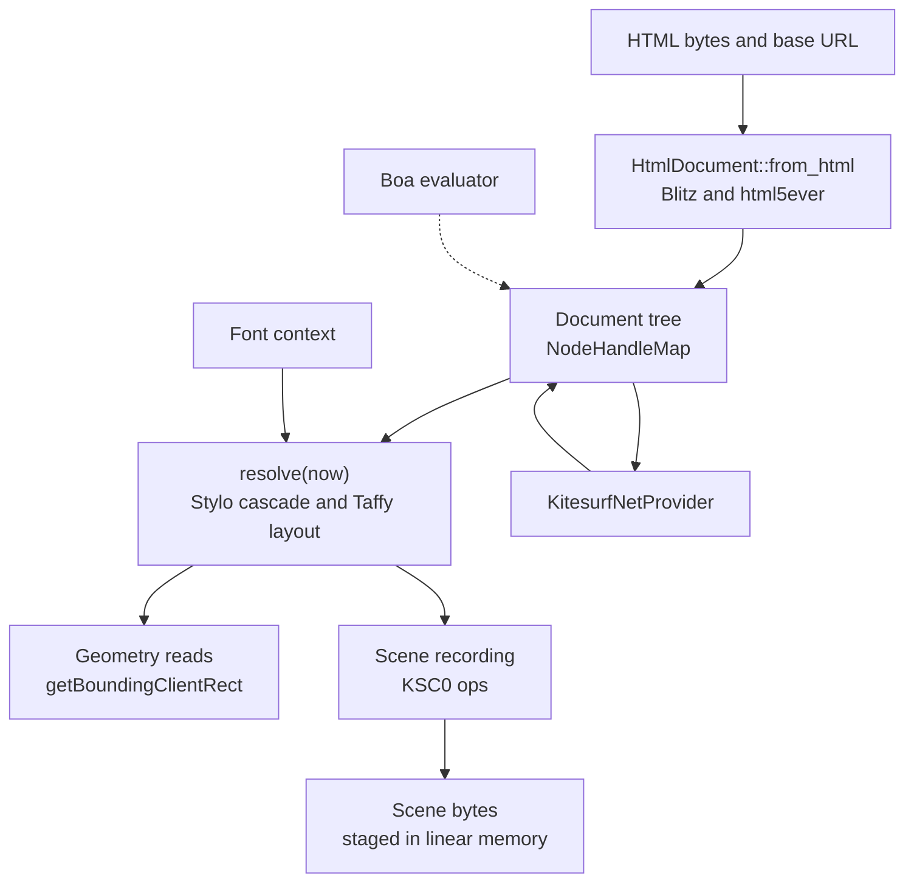
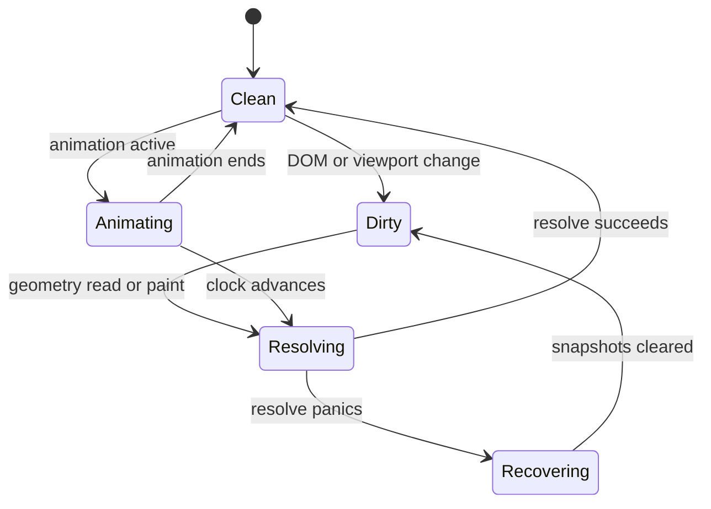

# 02 Rust core: one page, one handle, one scene

The Rust core is the part of Kitesurf that owns a page. It parses HyperText Markup Language (HTML), applies Cascading Style Sheets (CSS), computes layout, records a paint scene, and answers questions about geometry. It also hosts the Boa evaluator, the resource bridge, and the terminal renderer. The thesis of this document is that the core has one job and one shape. The job is to keep one document consistent. The shape is a single WebAssembly object, `DomHandle`, that owns every part of that document and hands out no Rust pointers.

The core is built on the Blitz project. Blitz supplies the document container, the Stylo style engine, the Taffy layout engine, Parley text shaping, and the Vello central processing unit (CPU) rasterizer. Kitesurf adds the page model, the stable node handles, the scene encoder, the fetch bridge, the animation bookkeeping, the terminal mode, and the Boa bridge. Later documents explain the script side and the renderer side. This document stays inside the core.

## The problem

A browser engine that runs in one isolate must survive three hazards that a desktop engine does not face.

1. **The host can free the handle at any time.** JavaScript holds the object. When JavaScript drops it, Rust must release the tree without leaving a dangling reference in the evaluator.
2. **A panic must not end the isolate.** A malformed page, an unsupported style value, or a bad numeric input can panic inside style or layout. The isolate must recover and keep the page alive.
3. **Geometry reads must be cheap and repeatable.** A page script can read a bounding rectangle thousands of times. Each read cannot trigger a full re-layout.

The core answers all three with one design: a single `DomHandle` with interior mutability, a dirty flag, a panic boundary, and stable integer handles.



## The handle

The core module has one sentence of purpose:

```rust
// packages/core/src/lib.rs:5-6
//! Wasm-facing document core: owns page DOM state and exposes style, layout,
//! paint, and resource APIs.
```

The handle owns the document and every piece of state that must stay consistent with it:

```rust
// packages/core/src/lib.rs:338-358
#[wasm_bindgen]
pub struct DomHandle {
    // Rc so the boa→blitz fast path (dom_fastpath.rs) can hold a Weak
    // and never dangle if JS frees the handle: upgrade fails → slow path.
    doc: Rc<RefCell<HtmlDocument>>,
    /// Maps blitz node IDs to the stable IDs JavaScript and CDP see. Shared with the Boa fast
    /// path, which mints IDs for nodes it returns.
    node_handles: Rc<RefCell<NodeHandleMap>>,
    /// The document URL; relative URLs resolve against it.
    base_url: String,
    /// Set by DOM and viewport changes; the next geometry read runs a resolve.
    layout_dirty: Cell<bool>,
    /// A transition or animation was running at the last resolve, so later reads resolve again
    /// even when the DOM is unchanged.
    animating: Cell<bool>,
    /// Animation clock of the last resolve. An animating page skips a resolve when the clock has
    /// not advanced.
    last_resolve_now: Cell<f64>,
    /// Bumped by every resolve that succeeded (a panicked one leaves it), so a size
    /// poll can tell "nothing relaid out since I looked" without re-reading geometry.
    layout_epoch: Cell<u32>,
```

The `Rc` is deliberate. The Boa fast path holds only a `Weak` reference to the same document. If JavaScript frees the handle, `upgrade()` fails and the evaluator takes the slow path. There is no use-after-free.

**Aha:** The handle is not a pointer to a document. It is a session of document state. It carries the dirty flag, the animation clock, the layout epoch, the transition events, the sticky offsets, the resource caches, and the staged scene. Two handles mean two pages. One handle means one consistent view.

## Stable node identifiers

JavaScript and the Chrome DevTools Protocol (CDP) cannot hold Rust node references. They hold integers. The core keeps a two-way map:

```rust
// packages/core/src/lib.rs:52-79
pub(crate) struct NodeHandleMap {
    next_external: u32,
    internal_by_external: HandleMap<u32, NodeId>,
    external_by_internal: HandleMap<NodeId, u32>,
    external_by_opaque: HandleMap<usize, u32>,
}

impl NodeHandleMap {
    fn seeded(doc: &BaseDocument) -> Self {
        let root = doc.root_node().id;
        let mut map = Self {
            next_external: 1,
            internal_by_external: HandleMap::from_iter([(0, root)]),
            external_by_internal: HandleMap::from_iter([(root, 0)]),
            external_by_opaque: HandleMap::from_iter([(root.as_u64() as usize, 0)]),
        };
        for (id, _) in doc.tree().iter() {
            if id != root {
                map.external_for(id);
            }
        }
        map
    }

    #[inline]
    pub(crate) fn resolve(&self, external: u32) -> Option<NodeId> {
        self.internal_by_external.get(&external).copied()
    }
```

The root is external identifier 0. Every other node receives the next free identifier. The third map is the interesting one. It maps the opaque value that carries a generation number to the external identifier. Style transitions can report a node that was removed and whose slot was reused. The opaque map keeps the old identifier stable until the event is drained.

## Parse

One constructor builds a page:

```rust
// packages/core/src/lib.rs:463-486
    /// Invalid URLs and URLs that cannot serve as a base use `https://kitesurf.local/`.
    #[wasm_bindgen(constructor)]
    pub fn new(html: &str, base_url: &str) -> DomHandle {
        use blitz_traits::shell::Viewport;
        let _ks_span =
            tracing::info_span!("wasm.parse_document", html_bytes = html.len()).entered();

        let net_provider = Arc::new(crate::resources::net::KitesurfNetProvider::new());

        let resolved_base = match url::Url::parse(base_url) {
            Ok(u) if !u.cannot_be_a_base() => base_url.to_string(),
            _ => "https://kitesurf.local/".to_string(),
        };

        let config = DocumentConfig {
            base_url: Some(resolved_base.clone()),
            html_parser_provider: Some(Arc::new(HtmlProvider)),
            net_provider: Some(net_provider.clone()),
            viewport: Some(Viewport::new(1280, 720, 1.0, emulated_color_scheme())),
            font_ctx: Some(crate::resources::fonts::get_or_init_font_context()),
            node_capacity_hint: Some(estimate_node_capacity(html)),
            dims_only_images: DIMS_ONLY_IMAGES.load(Ordering::Relaxed),
            ..Default::default()
        };
```

Four details matter.

- The base URL is validated. A value that cannot serve as a base becomes `https://kitesurf.local/`.
- The viewport starts at 1280 by 720 at scale 1.0. The renderer sets the real viewport later.
- The node capacity hint is estimated from the byte count before parsing, so the tree allocates once and does not grow repeatedly.
- `dims_only_images` lets the renderer isolate skip image decoding. It still needs the image dimensions for layout.

## Resolve

The core never lays out the page on every call. It lays out only when the layout is dirty or an animation is running:

```rust
// packages/core/src/lib.rs:634-650
    fn resolve_until_images_settle(&self) {
        let count_pending = || match self.doc.try_borrow() {
            Ok(d) => d.as_ref().pending_images_count(),
            Err(_) => 0,
        };
        const MAX_RESOURCE_SETTLE_PASSES: usize = 3;
        let mut prev_pending = count_pending();
        for _ in 0..MAX_RESOURCE_SETTLE_PASSES {
            self.ensure_layout();
            let pending = count_pending();
            if pending == 0 || pending == prev_pending {
                break;
            }
            prev_pending = pending;
            self.layout_dirty.set(true);
        }
    }
```

The loop has a bound of three passes. A pass repeats only when the number of pending images fell but did not reach zero. A pass stops immediately when the count is stable. This prevents an infinite loop when an image never arrives.

The main resolve runs inside a panic boundary:

```rust
// packages/core/src/lib.rs:675-697
        let result = std::panic::catch_unwind(std::panic::AssertUnwindSafe(|| {
            let waapi_running = {
                let mut waapi = self.waapi.borrow_mut();
                !waapi.is_empty() && waapi.sample(doc.as_mut(), now * 1000.0)
            };
            doc.as_mut().resolve(now);
            // Inside the same borrow: stylo retires a finished
            // transition during resolve, so the diff has to run before
            // anything else can touch the document.
            let animating = doc.as_ref().has_active_animations() || waapi_running;
            // Mint the external handle while the target's live generation is
            // still available. TransitionStates then keeps that handle if the
            // slot is removed and reused before the event is drained.
            let mut states = self.transition_states.borrow_mut();
            let mut events = self.transition_events.borrow_mut();
            let mut node_handles = self.node_handles.borrow_mut();
            style::transitions::collect_events(
                doc.as_ref(),
                now,
                &mut states,
                &mut events,
                |opaque| node_handles.external_for_live_opaque(doc.as_ref(), opaque),
            );
```

The success path updates the flags and the epoch:

```rust
// packages/core/src/lib.rs:723-731
        match result {
            Ok(animating) => {
                self.layout_dirty.set(false);
                self.animating.set(animating);
                self.last_resolve_now.set(now);
                self.layout_epoch
                    .set(self.layout_epoch.get().wrapping_add(1));
                self.apply_sticky(true);
            }
```

The failure path takes the opposite action. It clears the style snapshots and asks the document to recover from a layout panic. The tree stays alive. The next read tries again.



The epoch is the cheap refresh signal. A script that polls a size can read `layoutEpoch()`. If the value did not change, no box moved, so the script skips every geometry read.

## Geometry without relayout

A geometry read resolves only when the dirty flag is set or an animation is running:

```rust
// packages/core/src/layout/geometry.rs:860-869
    #[wasm_bindgen(
        js_name = "getBoundingClientRect",
        unchecked_return_type = "KsLayoutRect | null"
    )]
    pub fn get_bounding_client_rect(&self, node_id: u32) -> Result<JsValue, JsError> {
        if self.layout_mode.get() == LayoutMode::Off {
            return serde_wasm_bindgen::to_value(&Rect::ZERO)
                .map_err(|e| JsError::new(&e.to_string()));
        }
        self.ensure_layout();
```

`LayoutMode::Off` is a real mode. A caller that only needs the Document Object Model (DOM) can skip style and layout completely. In that mode the rectangle is zero, not an error.

The same module holds hit testing, scrolling, sticky offsets, and the geometry debug dump. The layout crate contains no policy. It reads the resolved document and answers questions.

## Resources

The core does not perform network requests. It queues them for the page script, and the page script performs them with the fetch rules of the platform:

```rust
// packages/core/src/resources/net.rs:18-25
#[wasm_bindgen]
extern "C" {
    /// Request IDs and resource labels are consumed by PageScript's fetch bridge.
    // FFI: build-wasm rewrites this declaration to a module-private import so page
    // code cannot call or replace the bridge.
    #[wasm_bindgen(js_namespace = ["globalThis", "__ks_state"], js_name = "fetchResource")]
    fn js_fetch_resource(request_id: u32, url: &str, kind: &str, cors_mode: &str);
}
```

The build rewrites this import so that page code cannot call or replace the bridge. That rewrite is a security control, not an optimization. Without it, a page script could replace `fetchResource` and intercept every request from the layout engine.

Data URLs are handled inside the core. Every other scheme that is not `http` or `https` settles the handler as unfetchable. A font that arrives from the network is stripped for the session before use.

## The scene

A screenshot never asks the core to draw. It asks the core to record:

```rust
// packages/core/src/paint/render.rs:666-684
    #[wasm_bindgen(js_name = "renderScene")]
    pub fn render_scene(
        &self,
        scroll_x: i32,
        scroll_y: i32,
        overdraw_top: u32,
        overdraw_bottom: u32,
        omit_background: bool,
        client_wire: bool,
    ) -> Vec<u8> {
        self.render_scene_inner(
            (scroll_x, scroll_y),
            overdraw_top,
            overdraw_bottom,
            omit_background,
            client_wire,
            false,
        )
    }
```

Four variants exist. The plain variant copies the bytes into a new JavaScript array. The raw variant keeps raw image bytes. The staged variant writes the scene into core memory and returns only its length:

```rust
// packages/core/src/paint/render.rs:706-736
    /// Keeps the raw scene in linear memory; `stagedScenePtr` locates its
    /// bytes until the next call. JS can copy them into a pooled ArrayBuffer
    /// instead of allocating one for every canvas frame.
    #[wasm_bindgen(js_name = "renderSceneRawStaged")]
    pub fn render_scene_raw_staged(
        &self,
        scroll_x: i32,
        scroll_y: i32,
        overdraw_top: u32,
        overdraw_bottom: u32,
        omit_background: bool,
        client_wire: bool,
    ) -> u32 {
        let scene = self.render_scene_inner(
            (scroll_x, scroll_y),
            overdraw_top,
            overdraw_bottom,
            omit_background,
            client_wire,
            true,
        );
        let len = scene.len() as u32;
        *self.staged_scene.borrow_mut() = scene;
        len
    }

    /// Address of the last staged scene in linear memory.
    #[wasm_bindgen(js_name = "stagedScenePtr")]
    pub fn staged_scene_ptr(&self) -> u32 {
        self.staged_scene.borrow().as_ptr() as u32
    }
```

The staged path exists because a canvas can produce sixty scenes per second. Allocating a fresh JavaScript array for every frame would put the garbage collector on the hot path. The page renderer copies the bytes into a pooled buffer instead.

## The scene format

The format is called KSC0. It is a versioned binary stream, not a public interface:

```rust
// packages/core/src/paint/scene_record.rs:5-8
//! Encodes the KSC0 paint stream consumed by `scene_decode`.
//! `finish_framed` writes its header and image/font resources. The encoder and
//! decoder share wire constants, with round-trip tests checking their agreement.
//! KSC0 is co-versioned with its decoder, not a stable public format. Integers are LE.
```

The header gives the version, the viewport, the scroll position, the operation count, the resource offset, and the render band:

```rust
// packages/core/src/paint/scene_record.rs:30-35
pub const HEADER_MAGIC: [u8; 4] = *b"KSC0";
/// Bump on any wire change; the decoder and the CLI's rasterizer manifest require an exact match.
pub const WIRE_VERSION: u32 = 16;
/// u32 fields after magic: version, viewport w/h, scroll x/y, op count (informational, excludes
/// `Part`), resource offset (0 = none, else ends the op stream), render-band top y and height.
pub const HEADER_SIZE: usize = 40;
```

The operation set is small: push a layer, push a clip layer, pop a layer, fill, stroke, glyph run, box shadow, text run, and part. Each operation carries its fields in a fixed order. Paths use one of two precisions. A path uses signed 16-bit eighths of a pixel when every point fits, and 32-bit floats otherwise. This choice keeps a typical scene small.

**Aha:** The wire version is 16 and the decoder requires an exact match. The format changes often because the encoder and the decoder ship together in one Worker. A stable public format would need a compatibility layer and a deprecation policy. A co-versioned private format can change every week instead, and the round-trip tests catch a mismatch before deploy.

## Terminal mode

The core can also paint to a terminal. One module holds that path:

```rust
// packages/core/src/tty.rs:5-14
//! Terminal rendering: maps paint scenes to cells and handles terminal input and
//! chrome.

pub(crate) mod ansi;
pub(crate) mod grid;
pub(crate) mod input;
// The render-mode model (pixels vs characters, and what happens to
// images) and the modal that picks one.
pub(crate) mod modes;
pub(crate) mod omni;
```

Terminal mode replaces the user-agent stylesheet with a cell-based sheet, sets a cell grid, and maps the scene to characters. The native command-line client uses this path. Document [07](07-cli-playback-and-access.md) explains the client.

## Invariants of the core

The repository instructions state several rules that the code must keep. These rules matter to every later document.

| Invariant | Consequence |
|-----------|-------------|
| Runtime code generation runs on Boa inside the page isolate | The parent Worker never compiles a page string |
| A panic unwinds and the page survives | The release profile keeps `panic = "unwind"`, and resolve catches it |
| A node identifier is stable for the life of the node | The opaque map keeps an identifier after a slot is reused |
| The scene format is co-versioned | Encoder and decoder share constants and a version check |
| The parent Worker holds no per-connection state across sockets | Session state lives in the WebSocket closure |

## Related documents

- [01 Repository and build](01-repository-and-build.md) explains how this crate is built with `build-std` and unwinding.
- [03 Script runtime and DOM shim](03-script-runtime-and-dom-shim.md) explains the other side of the node handle and the Boa bridge.
- [05 Rendering pipeline](05-rendering-pipeline.md) explains what consumes the KSC0 scene.
- [06 Network and security](06-network-and-security.md) explains the request rules that the resource bridge obeys.
