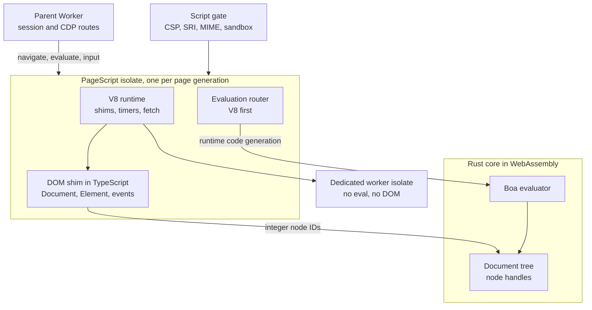
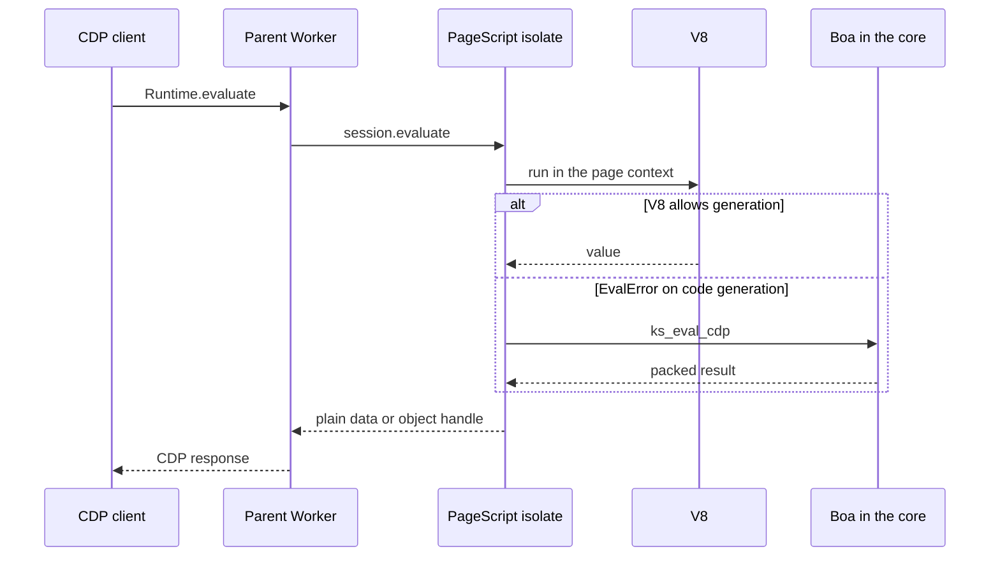

# 03 Script runtime and DOM shim: two isolates, one document

A page's JavaScript never touches the Rust core directly. It runs in a loaded worker isolate. The Document Object Model (DOM) it sees is a TypeScript shim built over the core's stable node identifiers. The two sides speak one typed Remote Procedure Call (RPC) session, and every value that crosses the boundary is either plain data or an explicit capability. The thesis of this document is that this split is the engine's security model. The page's code owns its isolate. The core owns the document. Neither can reach into the other except through a method that the session declares.

This document covers the page-script isolate, the DOM shim, the evaluation split between V8 and Boa, the shared script gate, and the separate isolate for page-created workers. Later documents cover the parent Worker and the renderer.

## The problem

Three constraints shape the script side.

1. **There is no native DOM in a Worker.** No `document` object exists. Every DOM operation is a function call into the core.
2. **Third-party code must not gain authority by accident.** A page loads scripts from many origins. A script that could return a live function to the parent Worker would gain a handle into the engine.
3. **Runtime code generation is untrusted.** `eval`, `new Function`, and computed `import()` take a string from the page. The engine must run that string somewhere that cannot corrupt the session.

The design answers each constraint with a boundary.



## The session

One module is the entry point for a page generation. Its header states the contract in one paragraph:

```ts
// packages/page-script/src/index.ts:5-7
// PageScript loaded-worker entrypoint for navigation, evaluation, and CDP session methods.
// Each generation runs in one pinned JSRPC session; returns must be plain data or bytes, because a
// returned function becomes a live capability that extends the session.
```

The class is a Cloudflare Workers entrypoint. It implements an interface that is declared in a type-only package, so the parent Worker and the isolate compile against the same contract:

```ts
// packages/page-script/src/index.ts:3035-3038
export class PageScript extends WorkerEntrypoint implements PageScriptSession {
  async fetch(_req: Request) {
    return new Response("PageScript", { status: 404 });
  }
```

The `fetch` handler returns 404. The isolate is not reachable by HyperText Transfer Protocol (HTTP) from outside. Only the bound RPC session reaches it.

The interface is the whole surface. It is worth reading in full, because every page behaviour that the parent Worker can request appears here:

```ts
// packages/jsrpc-types/src/page-script.ts:214-221
export interface PageScriptSession {
  /** Resolves at DOMContentLoaded while the session continues the resource drain. */
  navigate(html: string, url: string, opts?: NavigateOptions): Promise<NavigateSummary>;
  /** Waits for the bounded resource drain, `load`, and post-load tasks during navigation.
   * Resource draining has a 25-second budget; teardown can return partial results.
   * A pipelined call waits for `navigate` to publish the drain.
   */
  awaitLoad(): Promise<LoadCompletion>;
```

Three properties follow from that shape.

- `navigate` resolves early, at `DOMContentLoaded`. The caller can read the page before every image has arrived.
- `awaitLoad` is a separate call. It waits for the drain, and the drain has a 25-second budget.
- The drain can return partial results. A teardown path exists because a page may never finish loading.

**Aha:** The session's return rule is the isolation mechanism. A method may return plain data, bytes, or an object that the isolate explicitly marks as an `RpcTarget`. A returned ordinary function becomes a live capability, because the RPC system keeps it reachable for later calls. The engine never returns an ordinary function across the boundary. The page therefore cannot hand the parent Worker a callable handle into its isolate, and the parent cannot reach page state except through a declared method.

The session carries more than navigation. It holds console draining, cookie synchronization, binding installation, iframe content, frame bitmaps, message delivery, evaluation, object handles, and property reads. Each method is typed in the same file. The isolate and the parent Worker cannot disagree about a signature, because both import it.

## The DOM shim

The shim builds the page's global objects over the wasm handle. One function does the work per navigation:

```ts
// packages/dom-shim/src/index.ts:904-908
/** Builds the per-navigation DOM globals and PageScript hooks over the supplied wasm DOM. */
export const buildDocument: (
  dom: DomHandle,
  opts: BuildDocumentOpts,
) => ReturnType<typeof buildDocumentBody> = buildDocumentBody;
```

The body starts by installing session state and two hooks:

```ts
// packages/dom-shim/src/index.ts:291-297
const buildDocumentBody = function buildDocument(dom: DomHandle, opts: BuildDocumentOpts) {
  initState(dom, opts.pageUrl, opts.initialCookieString, opts);
  installDetachedWrapperHooks(dom);
  installCurrentScriptHook();
  const getCurrentUrl =
    typeof opts.getCurrentUrl === "function" ? opts.getCurrentUrl : () => opts.pageUrl;
  ksState().lastMutationAt = Date.now();
```

The function returns a bag of constructors, accessors, and hooks. The parent isolate installs that bag on the global scope. The exports at the end of the module show what the isolate also needs from the shim. They cover model-context tools, control-value setting, encoding helpers, and detached-wrapper sweeping. They also cover animation scheduling and the inline-handler gate.

| Shim area | Modules | What it supplies |
|-----------|---------|------------------|
| Tree and nodes | `document.ts`, `node-base.ts`, `parser.ts`, `range.ts`, `traversal.ts` | Node types, traversal, ranges, parsing helpers |
| Elements | `element/`, `input-types.ts`, `select-dropdown.ts`, `file-input.ts` | Element classes, form controls, named access |
| Events | `events/`, `event-handler-names.ts`, `trust.ts` | Event dispatch, handler attributes, trusted events |
| Style and layout | `style-declaration.ts`, `layout/`, `css-typed-om.ts` | Inline style, geometry reads, typed style objects |
| Collections and records | `collections.ts`, `record.ts`, `form-data.ts` | Live collections, records, form data |
| Graphics | `canvas2d.ts`, `xpath.ts` | Canvas two-dimensional context, XPath |
| Glue | `index.ts`, `state.ts`, `fastpath.ts`, `mutations/` | Global bag, session state, DOM fast path, mutation log |

The shim has more than forty entries. The page-script package that installs it has more than sixty source files. That size is the cost of a browser DOM written in TypeScript: every interface, every collection, and every event phase is a separate implementation.

Two details in the shim are not obvious.

The first is named access. A form control with `name="0"` must not win over the array index. The shim decides with a strict pattern:

```ts
// packages/dom-shim/src/index.ts:287-289
// A canonical array index stays the indexed getter's, ahead of a control named "0".
const isArrayIndex = (name: string): boolean =>
  /^(?:0|[1-9]\d*)$/.test(name) && Number(name) < 4294967295;
```

The second is the fast path. The core mints external identifiers for nodes that the Boa evaluator returns, and the shim resolves them without a round trip. The module `fastpath.ts` installs that route. Document [02](02-rust-core.md) explains the core side of the same map.

## The evaluation split

A page has two ways to ask for an evaluation. It can call a script that it declared, or it can generate code at run time. The engine routes the two cases differently.

Normal script execution uses the isolate's V8 runtime. Classic scripts are wrapped in modules: the package contains `__ks_user_classic_regular.ts` and `__ks_user_classic_async.ts`, so the wrapper code is a build input and not a string built at run time. Modules are baked in the same way, through `baked-module.ts`.

Generated code cannot run in the parent Worker. It goes to Boa inside the core. The router tries V8 first and falls back on one specific error:

```ts
// packages/page-script/src/eval-helpers.ts:283-298
  } catch (error) {
    if (
      error instanceof Error &&
      error.name === "EvalError" &&
      typeof error.message === "string" &&
      error.message.includes("Code generation from strings disallowed")
    ) {
      result = await boaEvalFallback(
        typeof expression === "string" ? expression : "undefined",
        awaitPromise,
        returnByValue,
      );
    } else {
      result = packException(error);
    }
  }
```

The fallback is a thin adapter over one wasm call:

```ts
// packages/page-script/src/eval-helpers.ts:238-249
export async function boaEvalFallback(
  expression: string,
  awaitPromise: boolean | undefined,
  returnByValue: boolean,
): Promise<EvalResultBody> {
  try {
    const boaResult = await ks_eval_cdp(expression, awaitPromise !== false, returnByValue);
    return packBoaResult(boaResult, returnByValue);
  } catch (error) {
    return packException(error instanceof Error ? error : new Error(String(error)));
  }
}
```

The other end is a wasm export in the core:

```rust
// packages/core/src/js/boa_eval.rs:1278-1281
#[wasm_bindgen]
pub fn ks_eval_cdp(src: String, await_promise: bool, return_by_value: bool) -> Promise {
    arm_v8_ran();
    let ks_span = tracing::info_span!("wasm.boa_eval", src_bytes = src.len(), engine = "boa");
```

Three facts about that export matter.

- It returns a `Promise`, so the caller yields instead of blocking the isolate.
- It takes a lock before it enters the context. Two page tasks can interleave at an await point, and the Boa context is not reentrant.
- The lock is acquired inside a panic-safe wrapper. Document [02](02-rust-core.md) explains why a panic must become an error.



The `arm_v8_ran()` call at the top of the export records that a V8 attempt happened before Boa ran. The engine uses that record to prove the routing rule in tests: a Boa evaluation is always preceded by a V8 refusal, never by a direct decision to use Boa.

### When Boa runs a classic script

Some pages classify a classic script for Boa rather than V8. Boa has its own global object, so the source is rewritten before it runs. The rewrite cannot use a full parser, so it uses a bounded scan:

```ts
// packages/script-gate/src/classic-scan.ts:16
// This bounded scan recognizes common top-level declarations; it is not a JavaScript parser.
```

The adapter then hoists compliant declarations onto `window`, while five names stay blocked:

```ts
// packages/page-script/src/boa-classic.ts:13-20
const BLOCKED_GLOBAL_NAMES = new Set([
  "module",
  "exports",
  "require",
  "window",
  "globalThis",
  "self",
]);
```

The blocked names are the ones that a CommonJS wrapper or a sloppy-mode script may redefine. If the rewrite hoisted them, the page could replace the Boa global object from inside a script. The adapter keeps them where they are, so a declaration of `window` in page source cannot rebind the evaluator's global.

## The script gate

Every script must pass a shared gate before it runs. The gate is one package with no DOM dependency, so the parent Worker and the page isolate apply the same rules.

The gate can be skipped, but only for a narrow case:

```ts
// packages/script-gate/src/gate.ts:75-81
export function scriptGateIsNoop(ctx: ScriptGateContext): boolean {
  return (
    ctx.policies.length === 0 &&
    ctx.reportOnlyPolicies.length === 0 &&
    !ctx.documentUrl.startsWith("https:")
  );
}
```

The noop case needs an insecure document and no policy at all. A page served over HTTPS always takes the gate, even when it sends no policy. That rule prevents a downgrade attack in which a missing header becomes permission.

The gate is built from headers and meta tags. Meta policies are not comma split, because each meta tag is one policy:

```ts
// packages/script-gate/src/gate.ts:53-58
/** Builds enforced and report-only policies; meta CSP entries are not comma-split. */
export function buildScriptGateContext(
  documentUrl: string,
  sources: ScriptGateSources = {},
): ScriptGateContext {
  // Meta CSP is one policy per tag; its commas must not be split into extra policies.
```

| Module | Rule that it enforces |
|--------|-----------------------|
| `csp.ts` | Source lists, inline hashes, nonces, `strict-dynamic` |
| `sri.ts` | Subresource Integrity digests at `sha256`, `sha384`, and `sha512` |
| `mime.ts` | JavaScript and module type checks, plus `nosniff` |
| `sandbox.ts` | The iframe `sandbox` attribute as a capability set |
| `frame-policy.ts` | Embedding policy and committed origin checks |
| `referrer-policy.ts` | The Referrer Policy decision for requests and documents |
| `digest.ts` | A source digest that survives a script rewrite |
| `gateway-headers.ts` | Internal response markers that the fetch path reads |
| `classic-scan.ts` | Top-level declarations for the Boa globalizer |

The sandbox module shows the style of the whole package. It models four capabilities and grants nothing for the tokens that it does not model:

```ts
// packages/script-gate/src/sandbox.ts:12-27
// A missing attribute imposes no restrictions; an empty one imposes every restriction.
export const SANDBOX_ALLOW_ALL: SandboxRestrictions = Object.freeze({
  scripts: true,
  sameOrigin: true,
  forms: true,
  topNavigation: true,
});

// allow-popups, allow-top-navigation-by-user-activation and the other unmodeled tokens grant
// nothing: this engine has no popup or user-activation path, so leaving them blocked fails closed.
const TOKEN_FIELDS = new Map<string, keyof SandboxRestrictions>([
  ["allow-scripts", "scripts"],
  ["allow-same-origin", "sameOrigin"],
  ["allow-forms", "forms"],
  ["allow-top-navigation", "topNavigation"],
]);
```

The parser is bounded, because a page controls the attribute. No token is longer than 32 characters, and no attribute contributes more than 64 tokens. A token outside the map changes nothing.

## Page-created workers

A page can create a worker with `new Worker()`. That worker gets its own isolate, because the Worker runtime supplies one, and it gets a different runtime profile:

```ts
// packages/worker-script/src/index.ts:5-7
// Runs page-created dedicated workers in their own loaded-worker isolate.
// The script runs on V8 as sloppy CJS, without native eval or a boa fallback; there is no DOM or
// core wasm. `fetch` uses the page's fetch shim, so worker requests take the page's gateway route.
```

Four consequences follow from that comment.

- The worker has no Boa path. A generated-code call inside a dedicated worker fails instead of falling back.
- The worker has no DOM shim and no core wasm. It cannot reach the document at all.
- Network requests still take the page's gateway route, because the fetch shim is installed from `page-script/fetch-shim`.
- The worker module carries its own scope and shim files (`scope.ts`, `shims.ts`, `__ks_worker_script.ts`).

A nested worker therefore cannot bypass the page's request policy by starting a fresh session. It inherits the route.

## Isolate kills

A page generation can be ended by force. The parent Worker must then tell a real kill from a cancelled call. One shared constant carries that meaning:

```ts
// packages/jsrpc-types/src/shared.ts:9-11
// Prefix of the `[ks-kill] <tail token> <reason>` line logged before `killIsolate`
// aborts. workerd reports the cancelled RPC as hung; the tail treats it as the kill.
export type IsolateKillMarker = "[ks-kill]";
```

The isolate writes the marker, then calls `abortIsolate`. The platform reports the pending RPC as hung. The reader recognises the marker and treats the call as a kill, not as a fault. This is how the engine ends a runaway page without turning the teardown into an error path.

## Budgets and limits

The script side has explicit bounds. These are the ones that the source states.

| Bound | Value | Where it protects |
|-------|-------|-------------------|
| Resource drain | 25 seconds | `awaitLoad` and navigation teardown |
| Sandbox token length | 32 characters | Attribute parsing |
| Sandbox token count | 64 | Attribute parsing |
| Image settle passes | 3 | Core resolve, per document [02](02-rust-core.md) |
| Navigate HTML preview | Fixed character count | Diagnostics only, never the document |

The navigate preview is worth a note. The isolate records a short prefix of the page source for tracing. The preview has its own limit constant, so a diagnostics record cannot grow with the page.

The larger limit is structural. The page isolate is a Dynamic Worker. Its instancing costs central processing unit (CPU) time and counts against the plan. Document [08](08-testing-gates-and-limits.md) states the platform limits that follow.

## What this document did not explain

The parent Worker owns the WebSocket, the CDP dispatch, and the bindings between targets. Document [04](04-engine-worker-and-cdp.md) covers it. The renderer isolates are separate entrypoints with their own contracts. Document [05](05-rendering-pipeline.md) covers them.

## Related documents

- [01 Repository and build](01-repository-and-build.md) lists the build target for each package in this document.
- [02 Rust core](02-rust-core.md) explains the document and the Boa context that the isolate calls.
- [04 Engine Worker and CDP](04-engine-worker-and-cdp.md) explains the caller of this session.
- [06 Network and security](06-network-and-security.md) explains the fetch route that the shims use.
