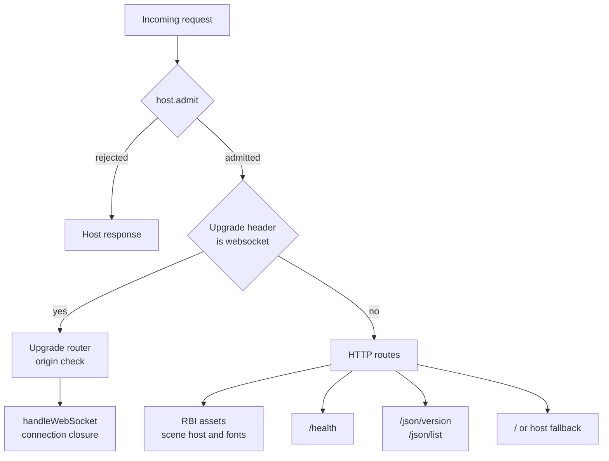
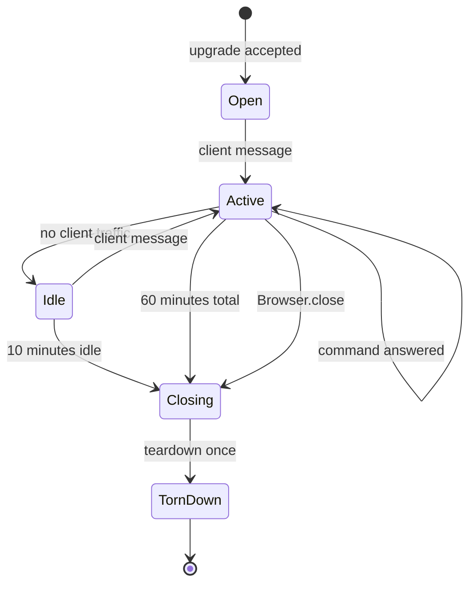
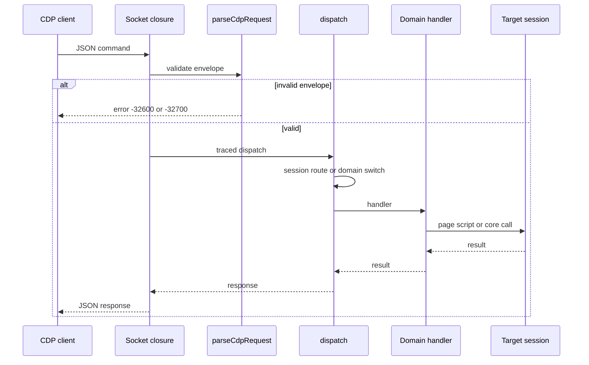

# 04 Engine Worker and CDP: one socket, one closure

The parent Worker is a router. It accepts HyperText Transfer Protocol (HTTP) requests, serves a few assets, and upgrades one path to a WebSocket. After the upgrade, all state for that Chrome DevTools Protocol (CDP) client lives in one JavaScript closure. There is no browser process, no supervisor, and no shared table between connections. The thesis of this document is that the engine earns compatibility by answering the protocol, not by keeping a browser process. A client sends a command. A handler answers it from connection state and four other runtimes.

This document covers the Worker entry, the routing table, the connection closure, command dispatch, target and session state, teardown, and the host hooks for embedding. Document [03](03-script-runtime-and-dom-shim.md) covers the isolate that a navigation creates.

## The problem

CDP assumes a browser that lives longer than a request.

1. **A client attaches once and sends many commands.** Chromium keeps targets, sessions, and sockets in a process. A Worker receives one invocation per request, so the connection must keep its state in the invocation that accepted the socket.
2. **Clients probe domains before they use them.** Puppeteer and Playwright enable several domains during attach. A method-not-found during attach can abort the whole session.
3. **Assets live outside the Worker.** Fonts and the rasterizer module arrive from a platform binding, not from the code bundle.
4. **A crash must not leak isolates.** Every page isolate, renderer, and dedicated worker is a lease. A socket that closes must release them all.



## The entry

The Worker entry is one class with a protected host method. An embedding Worker extends the class and replaces the host:

```ts
// packages/engine/src/index.ts:228-236
export class KitesurfEngine extends WorkerEntrypoint<Env> {
  protected host(): EngineHost {
    return DEFAULT_ENGINE_HOST;
  }

  override async fetch(request: Request): Promise<Response> {
    const traced = armLocalTracing(this.env, this.ctx, request);
    return traced ? traced(() => this.#fetch(request)) : this.#fetch(request);
  }
```

The module also exports four Worker classes that the platform resolves by name: the loopback outbound for page subresource fetches, the deny-all outbound for the renderer, the span sink, and the page-script log tail.

```ts
// packages/engine/src/index.ts:20-25
// Loopback service binding for PageScript subresource fetches.
export { SandboxOutbound } from "./eval/outbound.ts";
// Deny-all gateway used as the pageRenderer's globalOutbound.
export { DeniedOutbound } from "./eval/denied-outbound.ts";
export { SpanSink } from "./eval/span-sink.ts";
export { PageScriptTail } from "./eval/page-script-tail.ts";
```

The outbound classes are the network policy in class form. The renderer gets a deny-all gateway, so a rasterizer cannot make a request even if a page tries to make it. The page isolate gets a loopback gateway that applies the connection's rules.

## The routing table

The Worker uses Hono for routing. Two routers exist: one for upgrades and one for plain requests.

The upgrade router admits every path, but only after an origin check:

```ts
// packages/engine/src/index.ts:87-95
upgrades.all("*", (c) =>
  !cdpUpgradeOriginAllowed(c.req.raw, c.env.env)
    ? c.text("CDP connections from this origin are not allowed", 403)
    : traceSpan(c.env.env.HOST_TRACER, "ws.connect", () =>
        handleWebSocket(c.req.raw, c.env.env, c.env.ctx, undefined, {
          host: c.env.host,
        }),
      ),
);
```

The origin check is a browser security control, not a convenience. Without it, any web page could open a CDP socket to an exposed engine and drive the visitor's headless browser.

The plain router runs the host admission hook before every route. It then sends upgrade requests to the upgrade router:

```ts
// packages/engine/src/index.ts:116-121
app.use(async (c, next) => {
  if (c.req.header("upgrade")?.toLowerCase() === "websocket") {
    return upgrades.fetch(c.req.raw, c.env);
  }
  await next();
});
```

| Route | Answer |
|-------|--------|
| `/` | A landing page, an inspector redirect, or the host fallback |
| `/health` | A fixed text line |
| `/json/version` | The browser version record and the WebSocket address |
| `/json`, `/json/list` | One page target |
| `/json/protocol` | An empty object |
| `/rbi/scene_host.wasm` | The rasterizer module |
| `/rbi/scene_host.json` | The rasterizer manifest |
| `/rbi/fonts/*` | A font asset |
| `/__fixtures/*` | A test binding, when the deployment has one |
| Any upgrade request | The CDP connection |
| `/tui`, `/tui/*`, `/rbi/ws` | A fixed 404 |

The last row is deliberate. Three old routes return 404 instead of falling through to a handler:

```ts
// packages/engine/src/index.ts:105-107
for (const retired of ["/tui", "/tui/*", "/rbi/ws"]) {
  app.all(retired, (c) => c.text("not found", 404));
}
```

A retired route must fail at the router. If it fell through, a stale client would reach the host fallback and might receive a page instead of an error.

## Discovery

A client finds the engine through enumeration files. The version record is a literal:

```ts
// packages/engine/src/index.ts:29-37
// Puppeteer reads the protocol version and WebSocket endpoint from /json/version.
const VERSION_INFO = {
  Browser: "Kitesurf/0.0.1",
  "Protocol-Version": "1.3",
  "User-Agent":
    "Mozilla/5.0 (X11; Linux x86_64) AppleWebKit/537.36 (KHTML, like Gecko) Chrome/145.0.0.0 Safari/537.36",
  "V8-Version": "12.0.0",
  "WebKit-Version": "537.36",
};
```

The record claims a Chrome version and a V8 version. The engine runs no V8 in the parent Worker. The claim is part of the compatibility surface: a client library may read the user agent string and choose a code path.

The list endpoint builds the WebSocket address from the request:

```ts
// packages/engine/src/index.ts:183-191
function discoveryVersion(c: Context<EngineApp>): Response {
  const url = new URL(c.req.url);
  const host = c.req.header("host") ?? url.host;
  const scheme = url.protocol === "https:" ? "wss" : "ws";
  return Response.json({
    ...VERSION_INFO,
    webSocketDebuggerUrl: `${scheme}://${host}/devtools/browser`,
  });
}
```

The protocol schema endpoint is an empty object:

```ts
// packages/engine/src/index.ts:222
app.get("/json/protocol", () => Response.json({}));
```

**Aha:** An empty protocol schema is a working compatibility decision. Puppeteer and Playwright carry their own protocol types at build time, so they never fetch the schema. A tool that generates bindings from `/json/protocol` receives nothing and must fail at build time, not at run time. The engine therefore states what it implements in its own types and answers the schema endpoint with the smallest possible valid answer.

## The connection

One function owns the socket. Its comment and signature state the lifetime rule:

```ts
// packages/engine/src/cdp/connection.ts:69-84
/**
 * Accepts a CDP WebSocket request and returns a 101 response with its session ID.
 * `ctx.waitUntil` keeps connection state alive until the socket closes or errors.
 */
export async function handleWebSocket(
  request: Request,
  env: Env,
  ctx: ExecutionContext,
  onCtx?: (dispatchCtx: DispatchCtx) => void,
  opts?: {
    exemptIdleDeadline?: boolean;
    externalOutbound?: ExternalOutbound;
    onDispatch?: (dispatch: (req: CdpRequest) => Promise<CdpResponse>) => void;
    host?: EngineHost;
  },
): Promise<Response> {
```

The connection identity is a short random string. The same string is the analytics session identifier and the log correlation key.

The closure then creates a promise that never settles until the socket ends:

```ts
// packages/engine/src/cdp/connection.ts:151-156
  // The WebSocket owns this closure's state; keep the invocation alive until close or error.
  const wsLifetime = new Promise<void>((resolve) => {
    server.addEventListener("close", () => resolve());
    server.addEventListener("error", () => resolve());
  });
  ctx.waitUntil(wsLifetime);
```

`ctx.waitUntil` is the mechanism that lets a request-scoped runtime host a long-lived session. The platform keeps the invocation alive while the promise is pending.

Four deadlines and intervals bound the session:

```ts
// packages/engine/src/cdp/connection.ts:63-67
const IDLE_SESSION_MS = 10 * 60_000;
const MAX_SESSION_MS = 60 * 60_000;
const BACKGROUND_EVENT_DRAIN_INTERVAL_MS = 200;
const CDP_CONNECTION_ID_LENGTH = 10;
const CDP_DEBUG_SESSION_ID_PREFIX_CHARS = 6;
```

The idle rule closes a socket after ten minutes without client traffic. The maximum rule closes it after one hour, whatever the traffic. The 200 millisecond interval pumps background events and drains the network tracker.



The expiry check reads both limits and closes with code 1001:

```ts
// packages/engine/src/cdp/connection.ts:324-341
  const closeIfExpired = (): boolean => {
    if (deadlineFired || wsClosing) return deadlineFired;
    const now = Date.now();
    const idleExempt = opts?.exemptIdleDeadline === true;
    const reason =
      now - sessionOpenedAt > maxSessionMs
        ? `kitesurf: session exceeded ${maxSessionMs} ms`
        : !idleExempt && now - lastClientMessageAt > idleMs
          ? `kitesurf: idle for ${idleMs} ms with no client CDP traffic`
          : null;
    if (reason === null) return false;
    deadlineFired = true;
    console.warn(`[kitesurf-ws] closing session ${connectionId}: ${reason}`);
    try {
      server.close(1001, reason);
    } catch {}
    return true;
  };
```

The reason string travels to the client. A client that logs the close reason learns why the session ended.

## The command path

Each socket message is parsed and traced, then dispatched:



Envelope validation is separate from parameter validation:

```ts
// packages/engine/src/cdp/types.ts:58-64
/**
 * Validates the JSON envelope only; command handlers must still validate their parameters.
 * Parse and envelope errors return CDP error replies instead of throwing.
 */
export function parseCdpRequest(
  text: string,
): { ok: true; request: CdpRequest } | { ok: false; error: CdpEnvelopeError } {
```

The split matters. Envelope errors use the protocol error codes `-32700` for a parse failure and `-32600` for an invalid request. A handler error becomes `-32000`. An unknown method becomes `-32601`. A handler never throws to the socket handler.

The dispatcher starts with one hard-coded answer and three session routes:

```ts
// packages/engine/src/cdp/dispatch.ts:74-93
export async function dispatch(ctx: DispatchCtx, req: CdpRequest): Promise<CdpResponse> {
  const [domain] = req.method.split(".", 1);

  ctx.browser.networkEvents.drain();

  try {
    if (req.method === "Browser.getVersion") {
      return {
        id: req.id,
        result: {
          protocolVersion: "1.3",
          product: "Chrome/145.0.0.0",
          revision: "@kitesurf",
          userAgent:
            "Mozilla/5.0 (X11; Linux x86_64) AppleWebKit/537.36 (KHTML, like Gecko) Chrome/145.0.0.0 Safari/537.36",
          jsVersion: "12.0.0",
        },
        sessionId: req.sessionId,
      };
    }
```

`Browser.getVersion` does not read connection state. It is a constant.

A session identifier can route a command before the domain switch. Three routes exist: the renderer session, the engine session, and an out-of-process iframe session:

```ts
// packages/engine/src/cdp/dispatch.ts:104-111
    if (req.sessionId) {
      const oopif = findOopifFrameBySession(ctx, req.sessionId);
      if (oopif) {
        const result = await handleOopifSession(ctx, req, oopif.target, oopif.frame);
        ctx.browser.networkEvents.drain();
        return { id: req.id, result: result ?? {}, sessionId: req.sessionId };
      }
    }
```

The renderer and engine sessions exist because a flat session can attach to the rasterizer or to the engine itself. A client that attaches to the renderer target sends its commands to the same socket with a different session identifier.

## Domains

The domain switch has three groups.

**Implemented domains** have handlers in separate modules: `Target`, `Page`, `Runtime`, `DOM`, `Network`, `Storage`, `Log`, `Fetch`, `Input`, `Kitesurf`, `WebMCP`, `Debugger`, `CSS`, `Accessibility`, and `Emulation`. The `Target` and `Page` handlers are the largest. `page.ts` alone has more than 5,500 lines.

**One extension point.** The `Kitesurf` domain is public, and a host may add methods to it. Public methods win. The host sees only the commands that the public handler declines:

```ts
// packages/engine/src/cdp/dispatch.ts:139-156
      case "Kitesurf": {
        result = await handleKitesurf(ctx, req);
        if (result === CDP_COMMAND_UNHANDLED) {
          // Public handlers win; the host only sees commands they decline.
          const extension = ctx.commandExtension;
          if (!extension) {
            ctx.browser.networkEvents.drain();
            return methodNotFound(req);
          }
          const extended = await extension(ctx, req);
          if (!extended.handled) {
            ctx.browser.networkEvents.drain();
            return methodNotFound(req);
          }
          result = extended.result;
        }
        break;
      }
```

**A fixed answer of an empty object for domains that clients probe.** Thirty-eight domain names are listed, and each one returns `{}`:

```ts
// packages/engine/src/cdp/dispatch.ts:195-208
      case "Page-CSP":
      case "Performance":
      case "PerformanceTimeline":
      case "Preload":
      case "Profiler":
      case "Schema":
      case "Security":
      case "ServiceWorker":
      case "Tethering":
      case "Tracing":
      case "WebAudio":
      case "WebAuthn":
        result = {};
        break;
```

The list is the attach contract. `Schema.getDomains`, `Performance.enable`, `Security.enable`, and `ServiceWorker.enable` all succeed. A client that calls such a domain during attach never receives an error. A client that expects real data from it receives an empty object. `Page-CSP` in that list shows that the list is mechanical: it is derived from the protocol, not from a judgement about each domain.

## Targets and sessions

The connection state is one object. It is not a browser. It is the minimum that the protocol needs:

```ts
// packages/engine/src/cdp/types.ts:107-126
export interface BrowserState {
  targets: Map<string, TargetState>;
  sandboxOutbound: SandboxOutboundOverride;
  autoAttach: boolean;
  flatten: boolean;
  cookies: CookieJar;
  contexts: Map<string, { cookieJar: CookieJar }>;
  nextBrowserContextId: number;
  screencasts: Map<string, ScreencastState>;
  styleCache: StyleCache;
  imageCache: Map<string, { bytes: Uint8Array; contentType: string; fetchedAt: number }>;
  networkEvents: NetworkEventTracker;
  layoutMode: "full" | "off";
  cdpDebug: boolean;
  isolateCapOverrides?: PageIsolateCapOverrides;
  connectionMode: "page" | "browser";
  ttyKeyboard?: boolean;
  preNavScripts: Map<string, string>;
  learnedInsertedScripts: LearnedScripts;
  pendingBindings: Set<string>;
```

Three fields show that this object is a policy register, not a window manager. `layoutMode` can be `off`, and then the core skips style and layout. `preNavScripts` holds scripts that run before a document. `learnedInsertedScripts` remembers scripts that the page inserted, so the engine can prefetch them on a later navigation.

A target is one document and its runtimes:

```ts
// packages/engine/src/cdp/types.ts:281-297
export interface TargetState {
  targetId: string;
  type: "page" | "browser";
  browserContextId?: string;
  sessions: Set<string>;
  url: string;
  title: string;
  html: string;
  dom: DomHandle | null;
  docScan: DocScan | null;
  domEpoch: number;
  loaderId: string;
  frameId: string;
  isolatedWorlds?: Array<{ name: string; frameId: string; id: number }>;
  defaultContextId: number;
  retiredContextIds?: Set<number>;
  pendingNavAbort?: AbortController | null;
```

The target holds the document handle, the document scan, the frame map, the page script stub, the page script lease, and a navigation generation. The generation counter is the mechanism that separates one document from the next. When a navigation starts, the counter increases. A late message from the old isolate carries the old number and is dropped.

## Teardown

One teardown function releases everything, and it runs from whichever event arrives first:

```ts
// packages/engine/src/cdp/connection.ts:438-449
  // A socket can terminate with an error, a close, or both. Release everything once, from
  // whichever arrives first; the platform may never send the close.
  let tornDown = false;
  function teardownConnection(): void {
    if (tornDown) return;
    tornDown = true;
    wsClosing = true;
    browser.wsClosing = true;
    // Stop scene streams before retiring their targets and renderer.
    stopSceneStreams(browser);
    for (const state of browser.screencasts.values()) state.stopped = true;
    browser.screencasts.clear();
```

The order is not arbitrary. Scene streams stop before their targets retire, because a stream holds a target reference. The renderer manager closes rather than drops, so an in-flight capture fails instead of starting a new manager:

```ts
// packages/engine/src/cdp/connection.ts:450-454
    // Close rather than drop the renderer manager, so a capture still running fails instead of
    // creating a new manager and loading a renderer after the connection is gone.
    try {
      browser.rendererManager?.close("engine WS closed");
    } catch {}
```

For each target, the loop aborts a pending navigation, increases the generation, cancels wheel queues, tears down out-of-process iframe stubs, retires the page script stub, and releases the DOM handles. The abort comes first for a specific reason: an in-flight navigation would otherwise load and publish a page script after the loop has passed its target. Nothing would then kill that isolate.

## Host hooks

The engine is designed to be embedded. One interface lists every point where a host can change behaviour:

```ts
// packages/engine/src/host.ts:29-38
export interface EngineHost {
  /** Handles unmatched routes; return `null` to keep the engine's 404 response. */
  serveFallback?(url: URL, env: Env): Promise<Response | null>;
  /** Creates a session telemetry sink; factory and sink errors are reported, not rethrown. */
  telemetry?: TelemetryFactory;
  /**
   * Runs before routing; a response rejects the request. Unset admits every
   * request.
   */
  admit?(request: Request, env: Env, ctx: ExecutionContext): Promise<Response | null>;
```

The remaining hooks cover connection options, attribution headers, CDP extensions, request blocking, egress, the session store, and page isolate modules. The page isolate hook is the most unusual:

```ts
// packages/engine/src/host.ts:69-76
  /**
   * Extra modules for each page isolate, and the name of a Durable Object class one exports.
   * The engine generates the entry module, since the class lookup reads only its exports.
   */
  pageIsolate?: {
    modules?: Record<string, string>;
    hostClassName?: string;
  };
```

The engine generates the isolate entry when a host names a class. Engine modules win over host modules, so a host can add to the isolate but cannot replace its runtime. Document [03](03-script-runtime-and-dom-shim.md) explains what those modules are.

The default host serves one thing: a landing page at the root. Every other path keeps the engine 404. An embedding Worker therefore owns its own root.

## Budgets

Every runtime a connection starts is a lease. One counter tracks all of them, and the maximum is a small number:

```ts
// packages/engine/src/eval/worker-budget.ts:7-13
export const MAX_DYNAMIC_WORKERS = 4;

export const RENDERER_RESERVED_SLOTS = 1;

export const NAVIGATE_HEADROOM_SLOTS = 1;

export const MAX_CONCURRENT_OOPIF = 1;
```

The numbers encode a policy. Four isolates exist at once. One slot stays free for a renderer, and one stays free so a navigation can always start. Only one out-of-process iframe can run. The budget is an engine policy, not a platform limit, and document [08](08-testing-gates-and-limits.md) explains why the policy is stricter than the platform.

The page isolate has two caps and one request limit:

```ts
// packages/engine/src/eval/page-script.ts:100-107
export const PAGE_SCRIPT_SUBREQUEST_CAP = 10_000;

const PAGE_SCRIPT_CPU_TIME_MS_CAP = 300_000;

export interface PageIsolateCapOverrides {
  cpuMs?: number;
  wallMs?: number;
}
```

The CPU cap rides the loader's limit. The wall-clock cap arms a kill timer. A deployment can lower either value with an environment variable, and a per-connection override can lower it again. No configuration can raise the effective value above the plan maximum.

## Limits

| Limit | Value | Effect |
|-------|-------|--------|
| Idle session | 10 minutes | Socket closes with code 1001 |
| Maximum session | 60 minutes | Socket closes with code 1001 |
| Background drain | 200 milliseconds | Events pump at this interval |
| Dynamic worker leases | 4 | Page, renderer, iframe, and dedicated worker share the count |
| Concurrent iframes | 1 | A second iframe is denied |
| Page subrequests | 10,000 | Per page isolate |
| Page CPU | 300,000 milliseconds | Default maximum, lower with a cap |
| Protocol schema | Empty | Clients must carry their own types |

Two limits are not visible in a table. The first is that the parent Worker holds no per-connection state across sockets. A new socket is a new browser in every sense. The second is that the engine answers the protocol faster than it implements it. A method in the empty-object list succeeds and does nothing, and no client can detect that from the response.

## Related documents

- [01 Repository and build](01-repository-and-build.md) explains how the Worker bundle is produced.
- [03 Script runtime and DOM shim](03-script-runtime-and-dom-shim.md) explains the isolate that a navigation loads.
- [05 Rendering pipeline](05-rendering-pipeline.md) explains the renderer session and the scene stream.
- [08 Testing gates and limits](08-testing-gates-and-limits.md) explains the tests that hold this surface in place.
