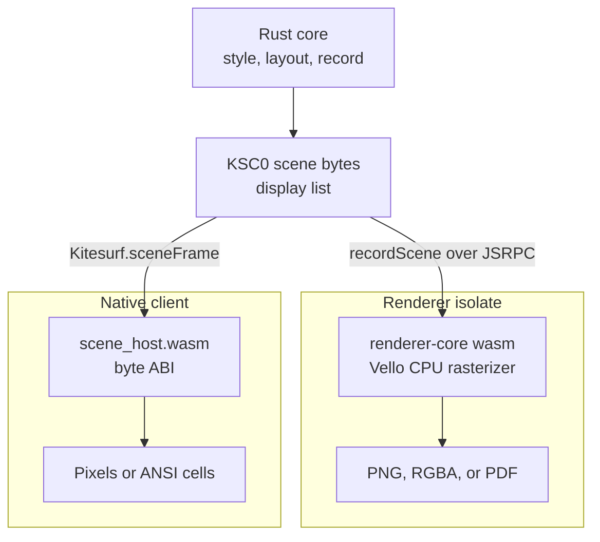
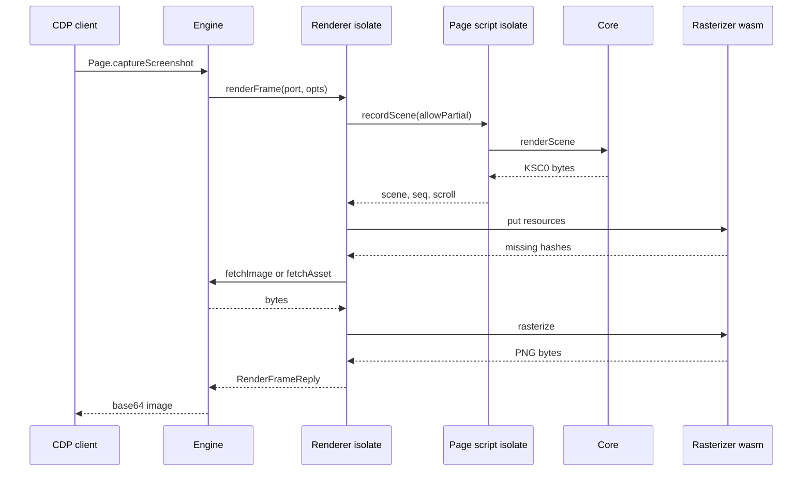

# 05 Rendering pipeline: record once, replay anywhere

Kitesurf never draws a page inside the isolate that owns the document. The core records a display list called a scene. Three different consumers replay that scene: a renderer isolate that produces pixels, a native client that rasterizes on its own machine, and a terminal grid that produces characters. The thesis of this document is that the scene is the product boundary. Pixels are one output of the scene, and they are never the only one. This design moves raster work off the metered Worker and lets one recorded frame serve a screenshot, a live stream, and a terminal.

Document [02](02-rust-core.md) explains the recorder. This document explains the three consumers, the two rasterizer modules, the byte interface for the native client, and the limits that keep a scene inside one message.

## The problem

A browser engine that runs in a Worker has four output requirements and one cost problem.

1. **A screenshot needs pixels**, once, for a client that will store the image.
2. **A screencast needs frames**, many per second, with backpressure.
3. **A Portable Document Format (PDF) file needs vector output**, not a bitmap.
4. **A terminal needs characters**, at a cell grid.
5. **Central processing unit (CPU) time is metered.** A full raster of a long page on every frame would consume the budget that the page itself needs.

One recorded scene answers all four output requirements. The core pays for style, layout, and recording once. Each consumer pays only for the conversion that it needs.



## Recording

Recording happens in the core and is described in [02](02-rust-core.md). Two properties matter to every consumer.

The scene is versioned and private. Version 16 is the current wire version, and a decoder rejects another version. Encoder and decoder ship in the same build, so the format can change often.

The scene is bounded by the read cap. The engine refuses a scene larger than one read buffer and sends an empty scene instead:

```ts
// packages/engine/src/cdp/scene-stream.ts:113-121
// A scene over the read cap is dropped rather than failing the stream, so report it once per
// stream instead of once per frame.
function warnSceneBudget(stream: Stream, sceneBytes: number): void {
  if (stream.warnedSceneBudget) return;
  stream.warnedSceneBudget = true;
  console.warn(
    `kitesurf: scene of ${sceneBytes} bytes over ${MAX_CONCURRENT_READ_BYTES} bytes; sending an empty scene`,
  );
}
```

A scene over the cap becomes an empty scene with one log line. The warning fires once per stream, not once per frame, so a heavy page does not flood the log. The stream continues, so one heavy frame does not end a session.

## The renderer isolate

The renderer is a stateless Worker entrypoint. It replays one scene per call:

```ts
// packages/page-renderer/src/index.ts:5-7
// Replays PageScript scene records into screenshot, screencast, and PDF output.
// The renderer pulls scenes over direct JSRPC. Raster panics are caught so the resource cache
// survives, but the cached Vello renderer is dropped.
```

Two facts in that comment are design decisions.

- **The renderer pulls.** The engine does not push a scene into the renderer. The renderer calls back into the page script and asks for a scene. The page script owns the core handle, so the pull direction keeps one owner for the document.
- **A raster panic drops the cached renderer but keeps the resource cache.** Fonts and images are expensive to fetch. A bad scene must not force the whole cache to load again.

The entrypoint reserves the first frame before any page renders:

```ts
// packages/page-renderer/src/index.ts:420-434
export class PageRenderer extends WorkerEntrypoint<RendererEnv> implements PageRendererRpc {
  constructor(ctx: ExecutionContext, env: RendererEnv) {
    super(ctx, env);
    // Preallocate the initial viewport to avoid first-frame Wasm heap growth.
    if (!reservedFromEnv) {
      reservedFromEnv = true;
      const raw = env?.KS_INITIAL_RES;
      const dimensions = typeof raw === "string" ? /^(\d+)x(\d+)$/.exec(raw) : null;
      if (dimensions) {
        try {
          rasterizer.reserveFrame(Number(dimensions[1]), Number(dimensions[2]));
        } catch {}
      }
    }
  }
```

The reservation is a heap preallocation. WebAssembly memory can grow, but growth moves the buffer and copies it. A preselected viewport avoids that cost on the first frame.

### Partial frames

A screencast sends many frames that differ in a small area. The renderer asks for a partial scene only when its retained base is provably valid:

```ts
// packages/page-renderer/src/index.ts:483-502
    // Request partial scenes only while JavaScript and Wasm agree on the retained base key.
    const baseValid =
      partialKey !== "" &&
      retainedKey === partialKey &&
      retainedSeq >= 0 &&
      rasterizer.retainedFrameKey() === partialKey;
    let recordReply: Awaited<ReturnType<RenderPort["recordScene"]>>;
    try {
      recordReply = await timed(
        "record",
        port.recordScene({
          omitBackground: opts.omitBackground === true,
          images: opts.images === "encoded" ? "encoded" : "raw",
          ...(typeof opts.sinceSeq === "number" ? { sinceSeq: opts.sinceSeq } : {}),
          ...(opts.clip ? { clip: opts.clip } : {}),
          ...(baseValid
            ? { allowPartial: true, allowScrollShift: true, baseSeq: retainedSeq }
            : {}),
        }),
      );
```

Two independent stores must agree before the request. JavaScript records the key and the sequence. The rasterizer records the key of the frame it holds. If either disagrees, the renderer asks for a full scene.

The scene may also report that nothing changed:

```ts
// packages/page-renderer/src/index.ts:516-518
    if (recordReply?.unchanged === true) {
      return { unchanged: true, seq, scrollX, scrollY };
    }
```

The caller answers a screencast poll with "unchanged" instead of sending the same image again. A poller that encodes the same image a second time answers unchanged too, unless the scroll position changed. The scroll offset is part of the frame identity because a scroll over a blank page is still a new frame.

### Resources come from the caller

The renderer does not fetch fonts or images itself. It returns the hashes that it is missing, and the engine supplies the bytes:

```ts
// packages/page-renderer/src/index.ts:153-161
const MISSING_RESOURCE_HEADER_BYTES = 4;
const MISSING_RESOURCE_ENTRY_BYTES = 9;
const MISSING_RESOURCE_KIND_BYTES = 1;
const MISSING_RESOURCE_HEADER_LITTLE_ENDIAN = true;
const IMAGE_RESOURCE_KIND = 2;
const FONT_DATA_RESOURCE_KIND = 3;
const MAX_RESOURCE_PULL_ROUNDS = 2;
const DEFAULT_RASTER_FORMAT = "png";
const DEFAULT_RASTER_QUALITY = 80;
```

The pull loop has a bound of two rounds. A scene that still misses resources after two rounds renders with what it has, and the format reports the missing items. The bound prevents a page that references a never-ending chain of images from keeping the renderer busy.



## Two rasterizer modules

Two WebAssembly modules replay scenes. They share the same Rust source files, but they build different interfaces.

`renderer-core` is the module inside the renderer isolate. It exposes classes to JavaScript through `wasm-bindgen`:

```rust
// packages/renderer-core/src/lib.rs:5
//! PageRenderer's trimmed Wasm entry point for scene replay, rasterization, and PDF output.
```

`scene-host-wasm` is the module that the native client and the terminal use. It exposes a byte interface with no JavaScript bindings. The library comment is explicit about that split:

```rust
// packages/scene-host-wasm/src/lib.rs:5
//! Exposes the CLI's byte-oriented Wasm ABI for scene replay and terminal rendering.
```

The shared files are included with `#[path]`, not copied:

```rust
// packages/renderer-core/src/paint.rs:8-13
#[allow(
    dead_code,
    reason = "PageRenderer uses the decode path; kitesurf-core checks the full decoder."
)]
#[path = "../../core/src/paint/scene_decode.rs"]
pub(crate) mod scene_decode;
```

Each inclusion carries an `allow(dead_code)` reason. The reason states which module uses the code and which module validates it. The core has the full decoder and the full recorder. The slices have the parts that they need.

| Module | Interface | Consumer | Panic strategy |
|--------|-----------|----------|----------------|
| `packages/core` | `wasm-bindgen` exports | Page script isolate | Unwind |
| `packages/renderer-core` | `wasm-bindgen` classes | Renderer isolate | Unwind |
| `packages/scene-host-wasm` | `ks_alloc`, `ks_call`, `ks_free` | Native client and terminal | Abort |

**Aha:** The scene makes raster CPU optional. A screenshot pays raster cost inside one renderer isolate, which is a separate Dynamic Worker with its own budget. A live stream pays almost no raster cost in the Worker at all, because the client rasterizes. The engine only encodes and sends the display list. This is why the scene format must be compact and versioned: it crosses a network boundary and a version boundary, unlike a normal browser's internal display list.

## The byte interface

The native module has exactly three exported functions. One allocates memory, one releases it, and one performs every operation:

```rust
// packages/scene-host-wasm/src/lib.rs:51-70
/// FFI: The CLI consumes this byte ABI; keep operation IDs and payload layouts in sync with
/// `packages/kitesurf-cli/src/wasm.rs`.
/// Returns (output length << 32) | output pointer. The host owns the
/// returned allocation and must release it with ks_free.
/// 1=putResources, 2=missingResources, 3=full PNG,
/// 5=pendingFontAssets JSON, 6=putFontAsset,
/// 7=JSON raster diagnostics {error,missingFonts,missingImages,textRuns},
/// 8=pendingImages JSON, 9=abandonImage, 10=partial PNG,
/// 11=partial PNG cropped to the visible viewport.
/// 12=enable ANSI mode, 13=scene to ANSI (LE u32 cols/rows, f32 cell w/h),
/// 14=full RGBA (LE u32 width/height followed by premultiplied pixels).
/// 15=retain full frame ([seq u32, raw u32], scene),
/// 16=composite patch ([seq u32, base u32, x i32, y i32, raw u32], scene).
/// Retaining calls return the full viewport as PNG (raw=0) or RGBA (raw=1).
/// Font input starts with LE u32 path length, then UTF-8 path and font bytes.
/// Cropped input starts with LE u32 left/top/width/height, then the scene.
/// For nonempty input, `ptr` must name a live `len`-byte `ks_alloc` buffer.
/// `ks_call` borrows input until return and does not free that buffer.
#[no_mangle]
pub extern "C" fn ks_call(op: u32, ptr: u32, len: u32) -> u64 {
```

The return value packs a length and a pointer into one 64-bit integer. This is the smallest interface that a host language can call without a binding generator. The host writes input into guest memory, calls `ks_call`, reads the output, and calls `ks_free` twice: once for the input and once for the output.

Operation 4 is missing from the list. The gaps in a numbered application binary interface (ABI) are normal: an operation was removed and its number was not reused, because the client checks the numbers at build time.

The terminal path uses the same module. Operation 12 switches the module into character mode, and operation 13 converts a scene into characters. Operation 14 returns raw premultiplied pixels, so a client can composite without decoding Portable Network Graphics (PNG).

## The scene stream

A native client does not request a screenshot for each frame. It starts a stream, and the engine sends vector scenes with acknowledgement-based backpressure:

```ts
// packages/engine/src/rbi.ts:5-8
// Streams RBI scene frames and resources with acknowledgement-based backpressure. Clients get
// recorded vector scenes, not pixels, and rasterize them with the scene-host wasm. Each envelope
// below reaches CDP clients base64-encoded in a `Kitesurf.sceneFrame` event (cdp/scene-stream.ts).
```

The stream is a CDP extension, not part of the standard protocol. `Kitesurf.startSceneStream` starts it, and `Kitesurf.sceneFrame` delivers each envelope. The client returns credit with `Kitesurf.sceneFrameAck`. A negative acknowledgement asks for a full frame instead of a partial one.

An envelope has a fixed header:

```ts
// packages/engine/src/rbi.ts:22-30
// [type u8][codec u8][flags u8][seq u32 LE][width u16 LE][height u16 LE], then the payload.
const SCENE_ENVELOPE_HEADER_BYTES = 11;
const SCENE_ENVELOPE_SEQUENCE_OFFSET = 3;
const SCENE_ENVELOPE_WIDTH_OFFSET = 7;
const SCENE_ENVELOPE_HEIGHT_OFFSET = 9;
// A partial adds clip x/y/width/height and the base sequence as i32 LE after the header. The clip
// is in viewport space: the recorder reports document space and the sender subtracts the scroll,
// so the client keeps no scroll state. The client must have painted `baseSeq` to composite.
const PARTIAL_ENVELOPE_METADATA_BYTES = 20;
```

The clip travels in viewport space, and the engine subtracts the scroll before it sends. The client therefore keeps no scroll state of its own. A partial frame names the base sequence that it patches, and the client rejects it if it has not painted that base.

Resources travel in the same stream, keyed by hash:

```ts
// packages/engine/src/rbi-protocol.ts:5-8
// Rewrites RBI image and font references and tracks resources already sent to clients. Scenes
// reference glyphs, fonts and images by hash; the client fetches missing ones with
// `Kitesurf.getSceneResources` and receives a resource batch in this format.
```

A batch starts with a count and then a fixed entry header. Each entry is a kind byte, a 64-bit hash, a length, and a payload. Kind 2 is an image and kind 3 is font data. A glyph outline and metrics have their own kinds, so the client can shape text without a font file for the first paint.

The stream has hard limits:

```ts
// packages/engine/src/cdp/scene-stream.ts:103-111
const MIN_SCENE_STREAM_WIDTH = 320;
const MIN_SCENE_STREAM_HEIGHT = 240;
const MAX_SCENE_STREAM_HEIGHT = 1440;
const MAX_SCENE_STREAM_FPS = 60;
const DEFAULT_SCENE_STREAM_FPS = 60;
const MAX_SCENE_FRAME_SEQUENCE = 0xffff_ffff;
const MAX_SCENE_RESOURCE_REQUEST_ITEMS = 4096;
// Each resource request is an RPC into the page isolate.
const MAX_IN_FLIGHT_RESOURCE_REQUESTS = 2;
```

The viewport maximum is a hard limit on the stream, not on the page. A taller viewport can still render to a screenshot. The resource request limit bounds the fetch that a scene can cause, and the in-flight limit bounds parallel work.

## Terminal output

The terminal path does not produce pixels unless the terminal can display them. The core maps a scene to cells when the mode is a character mode, and each cell holds a character, a foreground colour, and a background colour. One module of the native ABI owns that path:

```rust
// packages/scene-host-wasm/src/tty.rs:5-6
//! kitesurf-core's terminal grid; `modes` is a stub with the one image mode the byte ABI
//! uses.
```

Two image modes exist: half blocks and Kitty. Half blocks use two coloured characters per cell. Kitty uses the terminal's own image protocol. The stub keeps the image enum, because the full mode logic belongs to the core.

Document [07](07-cli-playback-and-access.md) explains the client that consumes this path.

## Limits

| Limit | Value | Applies to |
|-------|-------|------------|
| Scene wire version | 16 | Encoder and decoder |
| Scene size | One read buffer | A larger scene becomes an empty scene |
| Resource pull rounds | 2 | One render call |
| Stream height | 1440 pixels | Live stream only |
| Stream rate | 60 frames per second | Live stream only |
| Resource items per request | 4096 | Resource batch |
| In-flight resource requests | 2 | Resource batch |
| PDF paper size | 816 by 1056 CSS pixels | Default page size |
| PDF margin | 0 CSS pixels | Default page margin |

The default PDF page is the standard Letter size at 96 dots per inch. The renderer converts the value from CSS pixels, so a caller can pass another size.

## Related documents

- [02 Rust core](02-rust-core.md) explains the recorder and the scene format.
- [01 Repository and build](01-repository-and-build.md) explains how the two wasm modules are built.
- [06 Network and security](06-network-and-security.md) explains how the renderer's image fetches are controlled.
- [07 CLI, playback and access](07-cli-playback-and-access.md) explains the native client that uses the byte interface.
