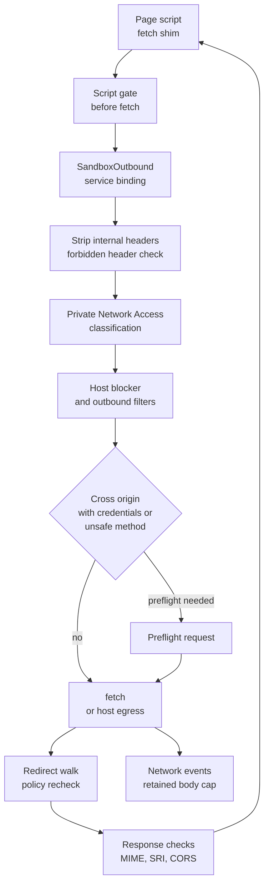
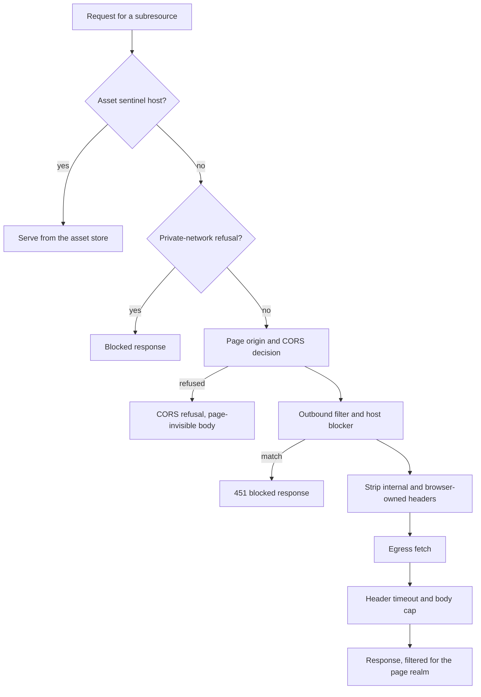

# 06 Network and security: one gateway, no trusted headers

Every request a page makes crosses one Worker class. The class is a service binding, not a hook that page code can replace. It receives the request, removes the page's claims about identity, and supplies the truth from the connection's committed state. The thesis of this document is that Kitesurf's network security is subtractive. The engine removes capability instead of adding a filter: it removes forbidden headers, private address spaces, blocked hosts, and scripts that fail policy before the request leaves the Worker.

This document covers the gateway, the header rules, the address policy, Cross-Origin Resource Sharing (CORS), cookies, the fetch-time script decision, and every cap. Document [03](03-script-runtime-and-dom-shim.md) covers the script gate itself.

## The problem

A page controls four things that a network layer must not believe.

1. **The page controls its request headers.** It can claim any `Origin`, `Referer`, or `Cookie` value.
2. **The page chooses the target address.** It can ask for `http://127.0.0.1/` or `http://10.0.0.1/`.
3. **The page chooses the script.** It can request a script from any origin with any response type.
4. **The page chooses the response size.** A slow or endless body can exhaust the isolate.

The engine must also support legitimate needs: a test client that intercepts requests, an operator that blocks a tracker domain, and a host that routes egress through a proxy.



## The gateway

The class has one purpose statement:

```ts
// packages/engine/src/eval/outbound.ts:5
// Applies page-origin, cookie, CORS, interception, and egress rules to page requests.
```

The engine reaches it in four shapes. Each shape exists because a different caller has a different capability:

```ts
// packages/engine/src/eval/outbound.ts:277-309
export function createSandboxOutboundOverride(
  exports: SandboxOutboundExports,
  env: SandboxOutboundEnv,
  externalOutbound?: ExternalOutbound,
  egress?: ExternalOutbound,
): SandboxOutboundOverride {
  const seal = (props: CallerOutboundProps): OutboundProps => ({
    ...props,
    externalOutbound,
    egress: externalOutbound ? undefined : egress,
    engineIsolateId: engineIsolateId(),
  });
  return {
    external: externalOutbound !== undefined,
    parent(props) {
      const sealed = seal(props);
      return {
        fetch: (request: Request) => SandboxOutbound.handle(env, sealed, request),
      } as Fetcher;
    },
    loaded(props) {
      return exports.SandboxOutbound({ props: { ...seal(props), pageRealm: true } });
    },
    session(props) {
      const sealed = { ...seal(props), pageRealm: true };
      return async (req) =>
        rpcSafeResponse(await SandboxOutbound.handle(env, sealed, sessionRequest(req)));
    },
    final(request) {
      return directExternalFetch(externalOutbound ?? egress, request);
    },
  };
}
```

Read the four shapes as a capability ladder.

- `parent` is the engine's own path in the parent Worker.
- `loaded` is a page isolate calling the binding as a Worker.
- `session` is a direct RPC call from the page script.
- `final` bypasses the engine's policy and exists only for a host egress transport.

The `pageRealm` flag is the difference between "the engine asks" and "the page asks". Only a page-realm request loses headers and must satisfy CORS.



The order matters twice. The private-network test runs before any request leaves the engine, so a blocked address produces no network event. The header strip runs after the policy checks and before egress, so a blocked request never reaches the host with an internal header attached.

## Internal headers do not cross

The engine marks its own headers with a prefix and removes that prefix in both directions:

```ts
// packages/engine/src/eval/outbound.ts:54-63
const RESOURCE_KEY_HEADER = "x-kitesurf-resource-key";
const IMAGE_WIDTH_HEADER = "x-kitesurf-image-width";
const IMAGE_HEIGHT_HEADER = "x-kitesurf-image-height";
const FONT_KEY_HEADER = "x-kitesurf-font-key";

function stripKitesurfHeaders(headers: Record<string, string>): void {
  for (const name of Object.keys(headers)) {
    if (name.toLowerCase().startsWith("x-kitesurf-")) delete headers[name];
  }
}
```

A page that sends `x-kitesurf-resource-key` gains nothing. The gateway removes every header with that prefix before egress. Internal names therefore cannot be used as a channel between the page and the engine.

## Header truth

A page cannot set a header that the user agent owns. The forbidden set is a literal list:

```ts
// packages/engine/src/eval/forbidden-headers.ts:5-30
// Fetch §2.2.2 forbidden request-headers: names page script cannot set,
// because the user agent owns them.

const FORBIDDEN_NAMES = new Set([
  "accept-charset",
  "accept-encoding",
  "access-control-request-headers",
  "access-control-request-method",
  "connection",
  "content-length",
  "cookie",
  "cookie2",
  "date",
  "dnt",
  "expect",
  "host",
  "keep-alive",
  "origin",
  "referer",
  "set-cookie",
  "te",
  "trailer",
  "transfer-encoding",
  "upgrade",
  "via",
]);
```

The checker also covers every `proxy-` and `sec-` name, and it rejects a method override header with a forbidden method:

```ts
// packages/engine/src/eval/forbidden-headers.ts:32-47
const METHOD_OVERRIDE_NAMES = new Set([
  "x-http-method",
  "x-http-method-override",
  "x-method-override",
]);
const FORBIDDEN_METHODS = new Set(["CONNECT", "TRACE", "TRACK"]);

/** Whether page script may not set this header on a request. */
export function isForbiddenRequestHeader(name: string, value: string): boolean {
  const lower = name.toLowerCase();
  if (FORBIDDEN_NAMES.has(lower) || lower.startsWith("proxy-") || lower.startsWith("sec-")) {
    return true;
  }
  if (!METHOD_OVERRIDE_NAMES.has(lower)) return false;
  return value.split(",").some((method) => FORBIDDEN_METHODS.has(method.trim().toUpperCase()));
}
```

The outgoing request is then rebuilt. The page's headers are copied, internal headers are dropped, forbidden headers are dropped in the page realm, and the identity headers are written from engine state:

```ts
// packages/engine/src/eval/outbound.ts:1539-1554
  const headers = new Headers();
  for (const [k, v] of original.headers.entries()) {
    const lower = k.toLowerCase();
    if (lower.startsWith("x-kitesurf-")) continue;
    if (pageRealm && isForbiddenRequestHeader(lower, v)) continue;
    headers.set(k, v);
  }
  if (!headers.has("user-agent")) headers.set("user-agent", BROWSER_UA);
  if (!headers.has("accept")) headers.set("accept", defaultAcceptFor(resourceType));
  // The fetch shim adds Origin where Fetch requires it (non-GET, cross-origin); the
  // gateway keeps the header but supplies the committed value, not the page's.
  if (pageRealm && original.headers.has("origin")) headers.set("origin", pageOrigin || "null");
  if (!headers.has("origin") && !pageOrigin && !suppressOpaqueDefaultOrigin) {
    headers.set("origin", "null");
  }
  if (corsMode) headers.set("origin", pageOrigin || "null");
```

**Aha:** The `Origin` header survives only as a shape, never as a value. The page must send the header so that the request looks like a browser request, and the gateway replaces its value with the committed origin. The same rule applies to `Referer`, which the gateway computes from the current document and the document's Referrer Policy. A page can therefore change the shape of its request, but not the identity that the server sees.

## The address policy

Private Network Access (PNA) is a classification rule. A document may not reach an address space that is more private than its own:

```ts
// packages/engine/src/eval/private-network.ts:51-65
/** Why a request from `initiatorOrigin` may not reach `target`, or null when it may.
 *  An opaque or unknown initiator counts as public. */
export function privateNetworkRefusal(target: URL, initiatorOrigin: string): string | null {
  const targetSpace = addressSpaceOf(target);
  if (targetSpace === "public") return null;
  let initiatorSpace: AddressSpace = "public";
  try {
    if (initiatorOrigin) initiatorSpace = addressSpaceOf(new URL(initiatorOrigin));
  } catch {}
  if (RANK[targetSpace] >= RANK[initiatorSpace]) return null;
  return (
    `kitesurf: a ${initiatorSpace} document may not reach the ${targetSpace} address ` +
    `${target.host} (set KITESURF_ALLOW_PRIVATE_NETWORK=1 to allow it)`
  );
}
```

The message carries the opt-in name, so an operator reads the fix in the error.

The module states its own limit in its header:

```ts
// packages/engine/src/eval/private-network.ts:5-7
// Private Network Access: a document may not reach an address space more private than its own.
// Only hostnames and IP literals are classified; a public name that resolves to a private
// address is not caught here.
```

This limit is real and must be stated plainly. A public Domain Name System (DNS) name that resolves to `10.0.0.1` passes this check. The engine does not resolve names before it classifies them. A deployment that needs that protection must enforce it at the network layer.

## Host blockers and filters

A host can supply a blocker. The engine computes the request facts and asks the host for a verdict:

```ts
// packages/engine/src/request-blocker.ts:83-100
/**
 * Classifies an http(s) URL against a host blocker. Other schemes, unparseable
 * URLs and an absent blocker are never blocked.
 */
export function classifyRequest(
  blocker: RequestBlocker | undefined,
  url: string,
  pageHost: string,
  resourceType: ResourceType,
): RequestBlockVerdict | null {
  if (!blocker) return null;
  let parsed: URL;
  try {
    parsed = new URL(url);
  } catch {
    return null;
  }
  if (parsed.protocol !== "http:" && parsed.protocol !== "https:") return null;
```

The third-party test uses a public suffix list, not a simple string comparison. Two hosts are first-party when their registrable domains are equal, so `a.example.co.uk` and `b.example.co.uk` are first-party while `example.com` and `example.org` are not.

The policy check runs before egress:

```ts
// packages/engine/src/eval/outbound.ts:254-275
export function outboundPolicyRefusal(
  connectionId: string,
  url: string,
  resourceType: string,
  pageHost: string,
  skipRequestBlocker: boolean,
): OutboundPolicyRefusal | null {
  if (!connectionId) return null;
  const filters = getOutboundFilters(connectionId);
  if (filters) {
    const decision = shouldBlock(filters, url, resourceType);
    if (decision.blocked) return { kind: "filter", reason: decision.reason };
  }
  if (skipRequestBlocker) return null;
  const verdict = classifyRequest(
    getRequestBlocker(connectionId),
    url,
    pageHost,
    parseResourceType(resourceType),
  );
  return verdict ? { kind: "blocker", reason: verdict.reason, matched: verdict.matched } : null;
}
```

A blocked request answers 451 and reports the matched entry in the CDP log. A filter and a blocker are different mechanisms. A filter is a CDP `Network.setBlockedURLs` rule. A blocker is a host function.

## CORS

The engine implements the CORS check itself. It returns a reason string, so a client can see why a response was refused:

```ts
// packages/engine/src/eval/cors.ts:229-250
export function corsCheck(
  headers: Headers,
  requestOrigin: string,
  credentialsInclude: boolean,
): string | null {
  const aca = headers.get("access-control-allow-origin");
  if (aca === null) return "cors-missing-origin";
  const trimmed = stripHttpWhitespace(aca);
  if (trimmed === "*") {
    if (credentialsInclude) return "cors-wildcard-with-credentials";
    return null;
  }
  if (trimmed !== requestOrigin) {
    if (trimmed.includes(",")) return "cors-multiple-origins";
    return "cors-origin-mismatch";
  }
  if (credentialsInclude) {
    const acc = headers.get("access-control-allow-credentials");
    if (acc !== "true") return "cors-credentials-not-allowed";
  }
  return null;
}
```

The wildcard case with credentials is a separate reason. A browser must refuse it, because a wildcard cannot name a single origin for a credentialed request.

Preflight results are cached, with a fixed maximum:

```ts
// packages/engine/src/eval/cors.ts:260-262
const preflightCache = new Map<string, PreflightEntry>();

const PREFLIGHT_CACHE_MAX = 512;
```

The cache key includes a partition, the origin, the URL, and the credentials mode. A cached entry therefore cannot serve a request with a different credentials mode.

## Cookies

The cookie jar keeps the same limits that browsers use, and one stricter one:

```ts
// packages/engine/src/cookies.ts:9-11
const MAX_COOKIE_BYTES = 4096;
const MAX_COOKIES_PER_HOST = 180;
const MAX_COOKIES_TOTAL = 3000;
```

The byte limit is the standard per-cookie size. The host limit is the Chromium maximum. The total limit bounds one connection, because a connection has one jar. A page cannot grow the jar without limit by creating hosts.

The jar is connection-scoped. It is not shared between sockets, so one client cannot read another client's cookies.

## The script decision at fetch time

A script request runs two checks: one before the fetch and one after the response. The first covers Content Security Policy (CSP) and mixed content:

```ts
// packages/script-gate/src/gate.ts:142-155
      if (ctx.upgradeInsecureRequests && target.protocol === "http:") {
        target.protocol = "https:";
        url = target.toString();
        upgradedTo = url;
      } else {
        return {
          allowed: false,
          reason: "mixed-content",
          message:
            `Mixed Content: the page at ${ctx.documentUrl} was loaded over ` +
            `HTTPS, but requested an insecure script ${request.url}. ` +
            `This request has been blocked; the content must be served over HTTPS.`,
        };
      }
```

An `upgrade-insecure-requests` policy upgrades the URL instead of blocking it. Without that policy, a script over insecure HyperText Transfer Protocol from a secure document is mixed content, and the gate blocks it.

The second check runs after the response. It compares the fetched bytes with the Subresource Integrity (SRI) digest, checks the Multipurpose Internet Mail Extensions (MIME) type, and re-applies the policy to a redirect target. Document [03](03-script-runtime-and-dom-shim.md) explains the shared gate package.

## Caps and timeouts

The engine bounds every read, every cache, and every wait.

| Bound | Value | Source |
|-------|-------|--------|
| Document bytes | 16 mebibytes (MiB) | `read-capped.ts` |
| Stylesheet bytes | 8 MiB | `read-capped.ts` |
| Concurrent read bytes | 48 MiB | `read-capped.ts` |
| Per-connection read bytes | 24 MiB | `read-capped.ts` |
| Stored resource entry | 8 MiB | `resource-store.ts` |
| Stored resources | 16 MiB | `resource-store.ts` |
| Stored fonts | 16 MiB, 256 entries | `resource-store.ts` |
| Retained network requests | 500 | `network-events.ts` |
| Retained body bytes | 12 MiB | `network-events.ts` |
| Asset cache entry | 1 MiB | `outbound.ts` |
| Asset cache total | 4 MiB | `outbound.ts` |
| Post data | 8 MiB | `outbound.ts` |
| Response body buffer | 256 kibibytes (KiB) | `outbound.ts` |
| Egress header wait | 10 seconds | `outbound.ts` |
| Document header wait | 25 seconds | `outbound.ts` |
| Pixel body wait | 10 seconds | `outbound.ts` |
| Preflight cache | 512 entries | `cors.ts` |

The timeouts are not uniform. A document gets 25 seconds because a slow first byte is common on the open web. An image body gets 10 seconds because a pixel fetch must not delay a frame.

```ts
// packages/engine/src/eval/outbound.ts:136-141
const EGRESS_HEADERS_TIMEOUT_MS = 10_000;
const DOCUMENT_HEADERS_TIMEOUT_MS = 25_000;

const PIXEL_BODY_DEADLINE_MS = 10_000;
const SLOW_EGRESS_HEADERS_THRESHOLD_MS = 2_000;
const MAX_SLOW_HEADER_URL_PREVIEW_CHARS = 160;
```

The slow-egress threshold is a diagnostic, not a limit. A request that waits more than two seconds for headers produces a log line with a bounded URL preview.

## Interception

A client can pause a request and decide its fate. The `Fetch` domain enables interception, and the engine parks the request until the client answers. The parked request holds a reference to the connection, and teardown drains every parked request. Without that drain, a closed socket would leave a request waiting for a verdict that never arrives.

Retained bodies are capped for the same reason. A client that enables network capture receives bodies, but only 500 requests and 12 MiB per connection. Document [04](04-engine-worker-and-cdp.md) explains the command path that enables the domain.

## Limits

1. **No pre-resolution address check.** PNA classifies hostnames and literals only, as stated above.
2. **No transport fingerprint control.** The stealth problem belongs to a host egress transport. The engine's own transport is the platform fetch.
3. **One egress address.** Every request leaves from the deployment's network, not from a residential address.
4. **No trusted header from the page.** A site that reads `Origin` sees the committed origin, not the page's claim. This is a security gain and a compatibility cost: a page cannot impersonate another origin even when a test wants it to.
5. **The blocker is synchronous.** A host cannot perform a network lookup inside classification. It receives the URL and the request facts only.

## Related documents

- [03 Script runtime and DOM shim](03-script-runtime-and-dom-shim.md) explains the script gate and the fetch shim.
- [04 Engine Worker and CDP](04-engine-worker-and-cdp.md) explains the connection state that the policy reads.
- [05 Rendering pipeline](05-rendering-pipeline.md) explains the resource pulls that obey these caps.
- [08 Testing gates and limits](08-testing-gates-and-limits.md) explains how these rules are tested.
