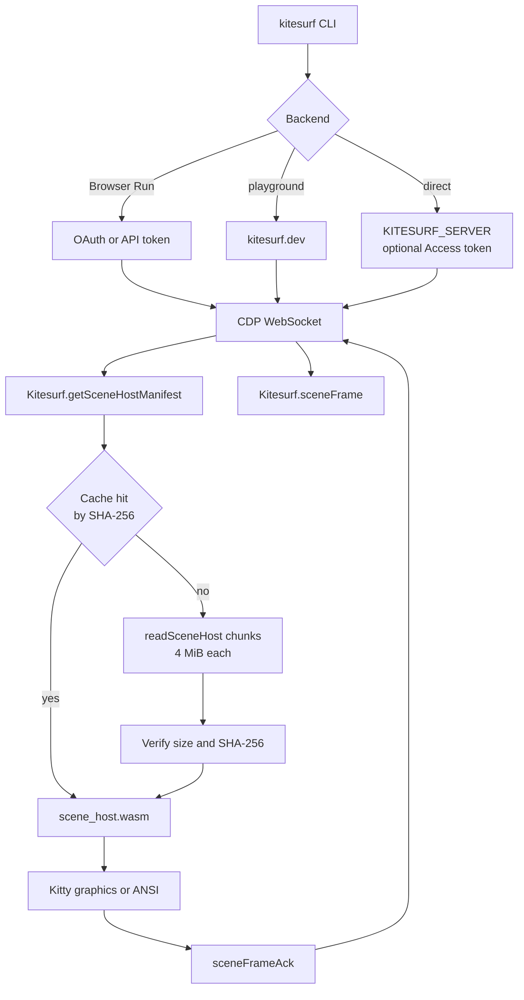
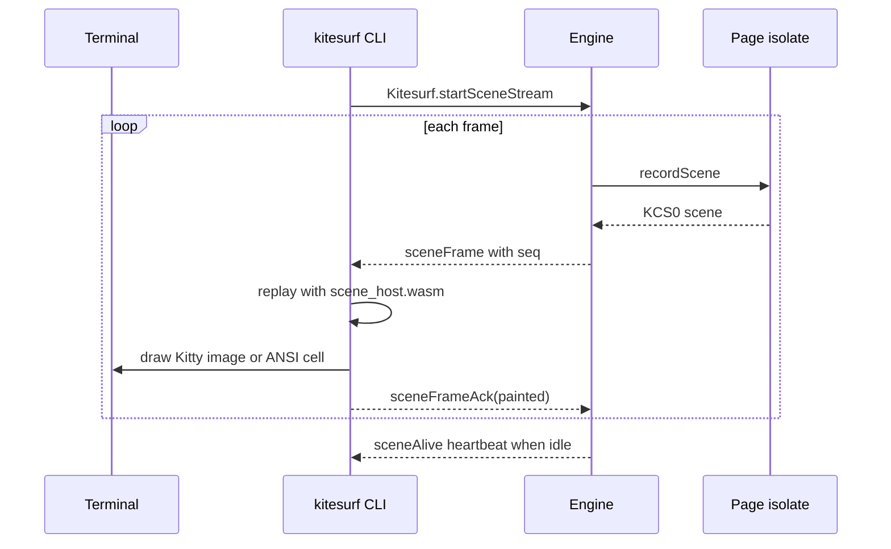

# 07 CLI, playback and access: a second browser that owns the pixels

The native client is called `kitesurf`. It opens a site in a terminal. It does not ask the engine for an image. It asks the engine for drawing commands, downloads the rasterizer that the engine names, checks that rasterizer against a hash, and draws the page locally. The thesis of this document is that the client is a second, small browser implementation with two jobs only: it owns input and pixels. Access to the engine is a separate concern with three backends and four credential sources.

This document covers the three connection backends, Cloudflare OAuth and the credential store, the rasterizer download and its verification, the font cache, playback modes, and the terminal interface. Document [05](05-rendering-pipeline.md) explains the scene that the client replays.

## The problem

A terminal has no browser surface. A Worker has no way to draw.

1. **The engine cannot draw to a terminal.** It runs in a data centre and streams bytes.
2. **The client must know the scene format exactly.** A mismatch between encoder and decoder is not a display glitch, it is a crash.
3. **A downloaded program is a security risk.** The client executes a WebAssembly module from the network.
4. **Access is gated in several layers.** Cloudflare Browser Run, Cloudflare Access, and a local engine each use different credentials.

The design answers each item with one rule. The client pulls the scene. The engine names the rasterizer. The client verifies a hash. Access resolves before the socket opens.



## The three backends

The parser produces a `Backend` value with two cases, and the playground case becomes a direct connection to a fixed host:

```rust
// packages/kitesurf-cli/src/cli.rs:69-75
pub const PLAYGROUND: &str = "https://kitesurf.dev";

#[derive(Debug, PartialEq)]
pub enum Backend {
    BrowserRun,
    Direct(reqwest::Url),
}
```

| Backend | How it is selected | Credential |
|---------|--------------------|------------|
| Browser Run | The default | OAuth from the operating system keyring, or `KITESURF_API_TOKEN` |
| Playground | `--playground` | None |
| Direct | `KITESURF_SERVER` | None, or `CF_ACCESS_TOKEN` |

The precedence rules are explicit and narrow:

```rust
// packages/kitesurf-cli/src/access.rs:45-60
        let account = env("CLOUDFLARE_ACCOUNT_ID");
        if let Some(id) = &account {
            validate_account_id(id)?;
        }
        let api_token = env("KITESURF_API_TOKEN");
        let saved_oauth = api_token.is_none();
        let (id, token) = match api_token {
            Some(token) => (
                account.ok_or("KITESURF_API_TOKEN requires CLOUDFLARE_ACCOUNT_ID")?,
                token,
            ),
            None => {
                let (saved_account, token) = saved.await?;
                (account.unwrap_or(saved_account), token)
            }
        };
```

Three rules follow. An API token always wins over a saved login. An API token requires an explicit account identifier. `CLOUDFLARE_API_TOKEN` is not read at all, so a Wrangler deployment token does not silently take the place of the user's login.

The connection adds its own limits:

```rust
// packages/kitesurf-cli/src/access.rs:14-18
const ACCESS_HEADER: &str = "Cf-Access-Token";

const HTTP_TIMEOUT: Duration = Duration::from_secs(30);
const WS_CONNECT_TIMEOUT: Duration = Duration::from_secs(15);
const MAX_ASSET_REDIRECTS: usize = 10;
```

The Access token travels only on the WebSocket handshake and on font requests to the same origin. A direct connection requires HyperText Transfer Protocol Secure (HTTPS), with one exception: loopback over plain HyperText Transfer Protocol is allowed for local development.

## OAuth and the credential store

Login uses the Authorization Code flow with Proof Key for Code Exchange (PKCE) and the Secure Hash Algorithm 256-bit (S256) method. The client is public, so no secret ships with the binary. Three values define the flow.

- The callback address is `http://localhost:8976/oauth/callback`.
- The client waits up to five minutes for the callback.
- The client requests two product scopes and `offline_access`.

The saved record holds the account, the access token, the refresh token, and the expiry. The operating system stores that record: Keychain on macOS, Credential Manager on Windows, and Secret Service on Linux. Saved credentials are separate for each OAuth client identifier, because a staging client has its own token audience.

The client recovers from three failures without losing the user's work.

1. **A token near expiry refreshes before a new connection.**
2. **A rejected refresh grant starts login again** and then opens the requested page.
3. **A 401 from Browser Run starts login once** and retries the connection.

The error messages separate the causes:

```rust
// packages/kitesurf-cli/src/main.rs:41-49
                tungstenite::Error::Http(response) if response.status().as_u16() == 401 => {
                    "CDP authentication failed (HTTP 401). Run 'kitesurf login' again or check your API token.".into()
                }
                tungstenite::Error::Http(response) if response.status().as_u16() == 403 => {
                    "CDP access denied (HTTP 403). Check the selected account and Browser Rendering - Edit permission.".into()
                }
                tungstenite::Error::Http(response) if response.status().as_u16() == 429 => {
                    "Browser session limit or rate limit reached (HTTP 429). Try again later.".into()
                }
```

A `401` is a credential problem. A `403` is a permission problem. A `429` is a capacity problem. Each message names the next action.

## The rasterizer download

The client does not ship a rasterizer. It asks the engine for one:

```rust
// packages/kitesurf-cli/src/scene_host.rs:13-29
const CHUNK_BYTES: usize = 4 * 1024 * 1024;
const MAX_HOST_BYTES: usize = 32 * 1024 * 1024;

#[derive(Debug, Deserialize)]
pub(crate) struct Manifest {
    pub(crate) abi: u32,
    #[serde(rename = "wireVersion")]
    pub(crate) wire_version: u32,
    wasm: String,
    sha256: String,
    bytes: usize,
    /// Ops 15/16 (retain, composite) exist, so graphics mode can request partial scenes and
    /// send the composited viewport as an ordinary Kitty image. ANSI mode and older hosts get
    /// full frames.
    #[serde(default, rename = "retainedFrames")]
    pub(crate) retained_frames: bool,
}
```

The manifest is a contract in four fields. The application binary interface (ABI) number must be 3 or 4. The file name must be `scene_host.wasm`. The digest must be 64 hexadecimal characters. The size must be non-zero and at most 32 MiB. The client rejects anything else before it downloads a byte:

```rust
// packages/kitesurf-cli/src/scene_host.rs:41-58
impl Manifest {
    fn validate(&self) -> Result<()> {
        if !matches!(self.abi, 3 | 4)
            || self.wasm != "scene_host.wasm"
            || self.sha256.len() != 64
            || !self.sha256.bytes().all(|byte| byte.is_ascii_hexdigit())
            || self.bytes == 0
            || self.bytes > MAX_HOST_BYTES
        {
            return Err("unsupported or invalid scene-host manifest".into());
        }
        Ok(())
    }

    fn matches(&self, bytes: &[u8]) -> bool {
        bytes.len() == self.bytes && format!("{:x}", Sha256::digest(bytes)) == self.sha256
    }
}
```

```text
# packages/kitesurf-cli/README.md:15-21
By default, CDP connects through the official Browser Run API with
`browser=kitesurf`. After connecting, the CLI asks that engine for its
scene-host manifest over CDP. On a cache miss it downloads the matching
Wasm in chunks of up to 4 MiB, verifies its size and SHA-256, and caches
it by hash. A cache hit only needs the manifest. This also applies to
playground and direct/local connections, so each engine supplies its own
rasterizer. Scene wire-version checks remain in place before replay.
```

The download arrives in chunks of at most 4 MiB. Each chunk carries its own digest and offset. The cache is keyed by digest, so a second run with the same engine needs only the manifest.

**Aha:** The client and the engine cannot disagree about the scene format, because the engine supplies the decoder as well as the encoder. The wire version, the ABI number, and the SHA-256 digest replace a shared build artifact. An engine upgrade that changes the scene format also changes the manifest, and the client downloads a matching rasterizer. The price is a hard failure: an engine that does not implement `Kitesurf.getSceneHostManifest` stops an older client, and the client does not fall back to another engine's rasterizer.

The cache directory follows the X Desktop Group (XDG) Base Directory specification:

```rust
// packages/kitesurf-cli/src/playback.rs:48-54
pub(crate) fn cache_directory() -> Result<PathBuf> {
    Ok(var_os("XDG_CACHE_HOME")
        .map(PathBuf::from)
        .or_else(|| var_os("HOME").map(|home| PathBuf::from(home).join(".cache")))
        .ok_or("no cache directory")?
        .join("kitesurf"))
}
```

The client keeps two caches under that path: fonts and the rasterizer. A third path for a temporary download would be simpler, and it is why the rasterizer is cached by digest: a re-download on every run would dominate start time.

## Fonts

Fonts arrive from two places, and the difference matters.

- **A page font** that the page declares with `@font-face` travels in the scene resource batch. The engine fetched it, so the client does not.
- **A built-in font** that the page uses without declaring it comes from the engine's font origin.

For Browser Run, the font origin is `https://kitesurf.dev/rbi/fonts/`, and that path needs no API token. For a direct connection, the client fetches `/rbi/fonts/` from the engine origin and sends `CF_ACCESS_TOKEN` when it is set. A font redirect must stay on the same origin, and a redirect away from it is refused.

```text
# packages/kitesurf-cli/README.md:29-32
Built-in fonts are cached on disk in `$XDG_CACHE_HOME/kitesurf/fonts/`, or
`~/.cache/kitesurf/fonts/` when `XDG_CACHE_HOME` is unset. Each entry stores
the font bytes, their SHA-256 and size, and the server's ETag. On a later
run, the CLI checks the local bytes and sends `If-None-Match`; an HTTP 304
```

The cache keeps the bytes, the digest, the size, and the server's entity tag. A later run sends `If-None-Match`. An HTTP 304 reuses the local bytes. A damaged entry or a changed digest triggers a full download. A cache write failure does not stop rendering, and `--debug` reports it. One font is capped at 16 MiB.

## Playback

The client validates its options at the public boundary:

```rust
// packages/kitesurf-cli/src/lib.rs:79-91
    /// Create playback settings.
    /// Returns `InvalidPlaybackFps` unless `fps` is in the inclusive range 1-60.
    pub fn new(
        url: impl Into<String>,
        mode: PlaybackMode,
        seconds: Option<Duration>,
        display: bool,
        debug: bool,
        fps: u8,
    ) -> std::result::Result<Self, InvalidPlaybackFps> {
        if !(MIN_FPS..=MAX_FPS).contains(&fps) {
            return Err(InvalidPlaybackFps(fps));
        }
```

The rate limit is not advisory. A caller cannot create a playback session above 60 frames per second, because that is the engine's stream maximum, and the client would only add latency.

Two modes exist. The default, `Kitty`, draws images with the Kitty graphics protocol. An ANSI mode draws text cells, and every glyph becomes selectable terminal text. ANSI mode works in any terminal. Kitty mode needs a terminal that supports the protocol, such as Ghostty.

Graphics mode uses damage rectangles. A partial scene patches a retained viewport, and the client sends the composited viewport as one ordinary Kitty image. The client still displays a complete image each time. Three events force a full scene: a navigation, a resize, and a missing base frame. ANSI mode always takes full scenes, because a character cell that changes one colour still changes the whole grid line.

A stall detector bounds silence:

```rust
// packages/kitesurf-cli/src/playback.rs:45-46
// before deadlines are checked, so slow work does not turn queued heartbeats into stalls.
const SCENE_STALL_TIMEOUT: Duration = Duration::from_secs(5);
```

The engine sends a heartbeat when no scene changes. If five seconds pass with no heartbeat and no frame, the client treats the stream as stalled.



## The terminal interface

The client owns the terminal and draws its own chrome. A stats bar shows connection state, frame rate, and accounted server memory. Control-B toggles the bar, and Control-C exits.

The memory number needs a warning that the client itself gives. It is the engine's accounted memory across the engine, the page isolates, and the renderer. It omits untracked allocations, so it is not the Worker's total memory use. The client reports the number that the engine can account for.

## Limits

| Limit | Value | Where |
|-------|-------|-------|
| Playback rate | 1 to 60 frames per second | `PlaybackOptions::new` |
| Rasterizer size | 32 MiB | Manifest validation |
| Rasterizer chunk | 4 MiB | Download loop |
| Font size | 16 MiB | Font cache |
| Access handshake | 15 seconds | Direct connection |
| Access HyperText Transfer Protocol call | 30 seconds | Font and account calls |
| Asset redirects | 10 | Access token path |
| Stall timeout | 5 seconds | Playback loop |
| OAuth callback wait | 5 minutes | Login |
| OAuth callback port | 8976 | Login |

Three limits are not in the table. The client needs a terminal that supports Kitty graphics for the default mode. The client needs an unlocked keyring and a D-Bus session for login on Linux. The client does not fall back to another rasterizer when the engine's manifest is absent, so a version mismatch is a clear error, not a slow path.

## Related documents

- [04 Engine Worker and CDP](04-engine-worker-and-cdp.md) explains the commands that the client sends.
- [05 Rendering pipeline](05-rendering-pipeline.md) explains the scene and the byte interface that the client calls.
- [06 Network and security](06-network-and-security.md) explains the font origin and the request rules.
- [08 Testing gates and limits](08-testing-gates-and-limits.md) explains the tests for the client parser and the artifact path.
