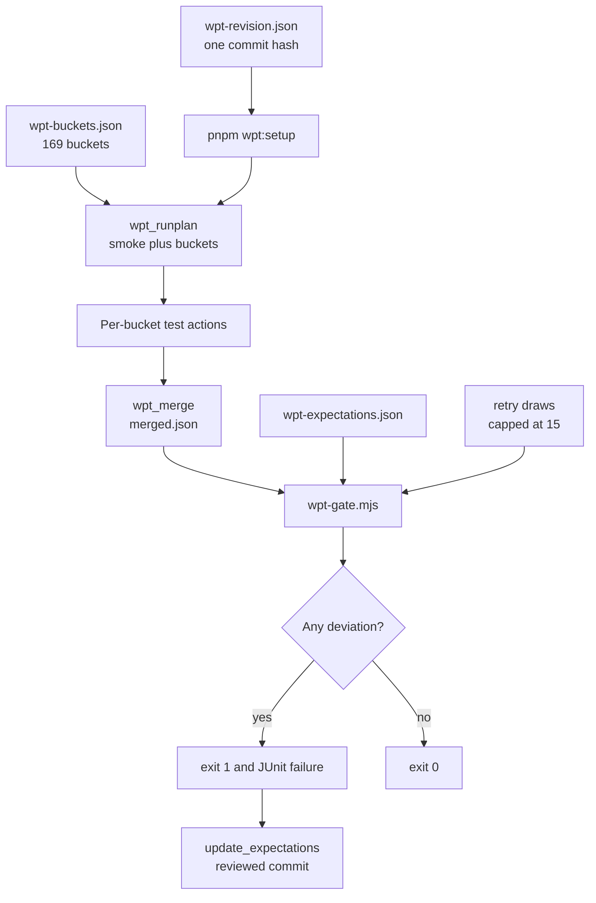
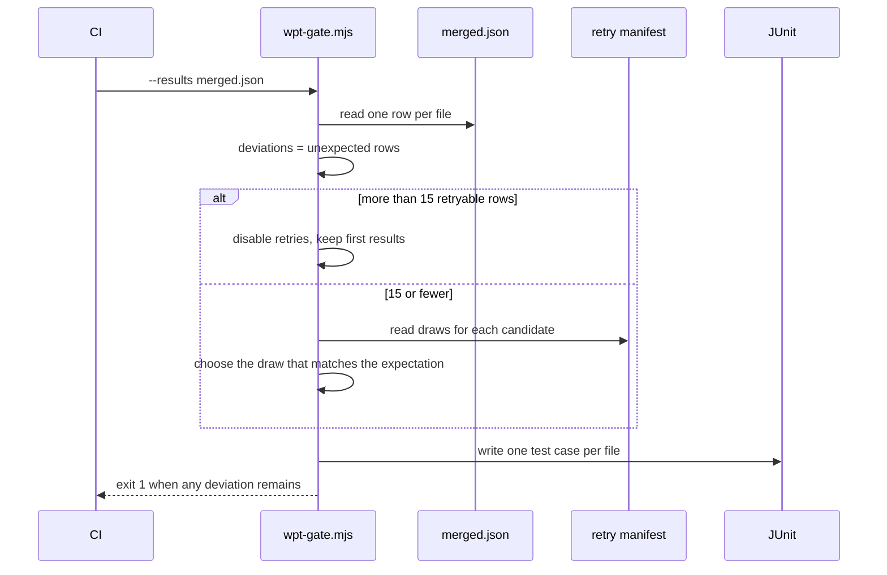

# 08 Testing, gates and limits: a pinned ratchet

Kitesurf does not claim browser compatibility. It measures compatibility against four test suites and records the result in files that a person reviews. A gate compares the current run with those files. The gate fails on any difference, and it fails on an improvement as well as a regression. The thesis of this document is that the test system is a ratchet. Each accepted difference moves one pin, in one commit, with a reason. The suite is large, the corpus is public, and the engine cannot drift without a visible commit.

This document covers the four suites and the pinned Web Platform Tests (WPT) corpus. It covers the bucket run plan, the expectation files, and the three gate programs. It also covers retries, the static checks, and the limits that the test system accepts.

## The problem

A compatibility claim is expensive to test in four ways.

1. **The corpora are large.** WPT alone holds about 11,795 test files in the selected set.
2. **Most tests fail today.** An engine with a partial Document Object Model (DOM) and one script evaluator cannot pass the majority of WPT.
3. **A flaky platform blurs the result.** A dynamic Worker can be evicted or time out without a page fault.
4. **Upstream churn is constant.** WPT changes every week, and a moving corpus makes every run different.

The design answers each item with a checked-in file.

- The test list is a fixed, reviewed selection.
- The expected result is a fixed, reviewed value.
- A timeout is a separate outcome with a separate retry route.
- The corpus revision is a pin, and it moves in its own pull request.



## The four suites

| Suite | Unit of test | Selection file | Count | Gate |
|-------|--------------|----------------|-------|------|
| WPT | One HTML file from a pinned corpus | `tests/wpt-tests.json` | 11,795 files | `scripts/wpt-gate.mjs` |
| Playwright | One spec file and one named test | `tests/pw-tests.json` | 123 files, 619 pinned tests | `scripts/pw-gate.mjs` |
| Puppeteer | One `.test` file | `tests/pptr-tests.json` | 10 files, 79 pinned tests | Not in the repository gate |
| Engine end-to-end | One `.e2e.test.ts` file | Glob in `packages/engine/test/e2e` | 563 files in 6 shards | `scripts/e2e-gate.mjs` |

The four suites test different things. WPT tests standards conformance with small pages. Playwright and Puppeteer test the Chrome DevTools Protocol (CDP) client libraries against the engine. The end-to-end suite tests the engine's own behaviour, including the scene stream and the terminal grid.

WPT is the largest and the slowest. Its selection is not the whole corpus, it is a list of files that the engine can find. The run is split into buckets, and each bucket is a separate action.

## The pinned corpus

The corpus is a commit hash, not a branch:

```json
// tests/wpt-revision.json:1-5
{
  "revision": "6efb1b12b95725c026cb1f5a451138345cfca937",
  "bumpedAt": "2026-08-29T21:38:58-04:00",
  "note": "The WPT corpus this suite is measured against. Bump it with `pnpm wpt:setup --update`, in its own pull request: upstream churn then lands once, reviewed, instead of reddening the gate on every run."
}
```

The note is the design. Upstream churn arrives once, in a commit that a person reads. If the corpus tracked a branch, every new WPT file could change the result of a run, and the gate would report work that no engine change caused.

The bucket file records the cost of a bucket, so the run plan can balance it:

```json
// tests/wpt-buckets.json:1-5
{
  "engines": 2,
  "budgetMs": 35000,
  "maxTests": 96,
  "buckets": [
```

Each item in the bucket array has a name, a first test, a test count, and an estimate. The estimates come from real runs. The bucket file is generated, and its `first` field makes a bucket reproducible: the run starts at one known file.

## Buckets and the run plan

A bucket is a contiguous range of test files. The plan places the smoke bucket first, then every other bucket in name order:

```python
# tests/wpt/BUILD.bazel:54-66
wpt_runplan(name = "runplan", buckets = ["smoke"] + sorted(BUCKETS.keys()))

wpt_merge(
    name = "merged",
    buckets = sorted(BUCKETS.keys()),
    visibility = ["//scripts:__pkg__"],
)

wpt_merge(
    name = "merged_full",
    buckets = sorted(BUCKETS.keys()),
    full = True,
)
```

The smoke bucket is a hand-written list. It holds tests that fail loudly when the engine breaks: flexbox layout, node cloning, and encoding. The smoke bucket is a fast signal. The merged target is the full result.

Two merge targets exist. `merged` holds the pass and fail state that the gate compares. `merged_full` holds the full output, including subtests, for a person who must investigate one file. The split keeps the gate input small and the diagnostic input complete.

The retry settings are Bazel build settings, so a retry run is a separate, recorded action:

```python
# tests/wpt/BUILD.bazel:68-70
retry_tests_setting(name = "retry_test", build_setting_default = [])
retry_int_setting(name = "retry_draws", build_setting_default = 3)
retry_string_setting(name = "retry_nonce", build_setting_default = "")
```

A retry draw is a second run of one named test. Three draws are the default. The nonce prevents a cached action from answering a new draw.

## Expectations

An expectation file maps a test identifier to an outcome and a reason. The WPT file holds 9,696 entries:

```json
// tests/wpt-expectations.json:1-5
{
  "/FileAPI/blob/Blob-array-buffer.any.html": {
    "expected": "PASS",
    "reason": null
  },
```

A Playwright entry uses the spec file and the test title as one identifier:

```json
// tests/pw-expectations.json:1-5
{
  "elementhandle-bounding-box.spec.ts::should force a layout": {
    "expected": "FAIL",
    "reason": "Error: expect(received).toEqual(expected) // deep equality"
  },
```

The reason field carries the failure message, not a comment. The message is the evidence that the pin was set from a real observation. A pinned `FAIL` with a message from another test is a mistake that a reviewer can see.

An outcome has four values: `PASS`, `FAIL`, `SKIP`, and, in a result file, `TIMEOUT`, `ERROR`, and `CRASH`. The expectation file uses the first three. The result file uses all six.

## The WPT gate

The gate does not run tests. It reads the merged result and the expectations, and it computes a deviation list:

```ts
// scripts/wpt-gate.mjs:42-47
/** @param {Record<string, {unexpected: boolean}>} byFile @returns {[string, object][]} */
export function deviations(byFile) {
  return Object.entries(byFile)
    .filter(([, entry]) => entry.unexpected)
    .sort(([left], [right]) => (left < right ? -1 : left > right ? 1 : 0));
}
```

The `unexpected` flag is set upstream, when the merge compares a result with an expectation. The gate then sorts the deviations and prints one line per deviation:

```text
  FAIL → PASS  /css/css-flexbox/align-content-horiz-001a.html
```

The summary separates two kinds of unexpected result:

```ts
// scripts/wpt-gate.mjs:91-103
function summarize(byFile) {
  const rows = Object.values(byFile);
  const unexpectedPass = rows.filter(
    (entry) => entry.unexpected && entry.expected !== "PASS" && entry.outcome === "PASS",
  ).length;
  const unexpected = rows.filter((entry) => entry.unexpected).length;
  return {
    total: rows.length,
    expected: rows.length - unexpected,
    unexpectedFail: unexpected - unexpectedPass,
    unexpectedPass,
  };
}
```

**Aha:** An unexpected pass is a failure of the gate. A test that now passes is a test whose pin is wrong. The gate refuses to call the suite green until a person moves that pin and records why the test passes now. A gate that accepted improvements would slowly lose its pins, because every unrecorded improvement would be a place where the result is no longer checked. This is why the gate's message names the rebaseline command: `bazel run //tests/wpt:update_expectations`.

The gate writes a Java Unit (JUnit) report, so a continuous integration (CI) system reads the result as a test result. One unexpected file becomes one failed test case, and the failure message names the expected and the actual outcome.

## Retries

A dynamic Worker can fail without a page fault. A timeout, a crash, and an error are the three outcomes that the gate treats as retryable:

```ts
// scripts/wpt-gate.mjs:14
const RETRIED = new Set(["TIMEOUT", "CRASH", "ERROR"]);
```

A retry is not unconditional. The gate counts the retryable deviations first, and it disables retries when the count is above a cap:

```ts
// scripts/wpt-gate.mjs:49-55
/** @param {Record<string, {outcome: string, unexpected: boolean}>} byFile @param {number} [cap] @returns {{tests: string[], mass?: number}} */
export function retryCandidates(byFile, cap = RETRY_CAP) {
  const tests = deviations(byFile)
    .filter(([, entry]) => RETRIED.has(entry.outcome))
    .map(([test]) => test);
  return tests.length > cap ? { tests: [], mass: tests.length } : { tests };
}
```

The cap is 15, and an environment variable can change it:

```ts
// scripts/wpt-draws.mjs:17-22
/** @param {{outcome: string, subPass?: number}} left @param {{outcome: string, subPass?: number}} right @returns {number} */
export function betterFirst(left, right) {
  return rank(left.outcome) - rank(right.outcome) || (right.subPass ?? 0) - (left.subPass ?? 0);
}

export const RETRY_CAP = parseInt(process.env.WPT_COMPARE_RETRY_CAP ?? "15", 10) || 15;
```

The cap has a purpose. Fifteen retryable failures look like flakiness. Fifty look like a broken platform, and a retry would spend the whole budget without a better answer. When the count is above the cap, the gate retries nothing and keeps the first result. It also prints one note with the count.

When retries are allowed, the gate picks the draw that matches the expectation. If no draw matches, it picks the best draw:

```ts
// scripts/wpt-gate.mjs:64-87
  for (const test of tests) {
    const entry = byFile[test];
    const rows = (draws[test] ?? []).filter(Boolean);
    if (!rows.length) {
      notes.push(`${test}: no retry draw attempted it; gate the first result`);
      continue;
    }
    const row =
      rows.find((candidate) => candidate.outcome === entry.expected) ??
      [...rows].sort(betterFirst)[0];
    const unexpected = row.outcome !== entry.expected;
    output[test] = {
      ...row,
      expected: entry.expected,
      unexpected,
      retried: entry.outcome,
      retryDraws: rows.map(drawLabel),
    };
    notes.push(
      unexpected
        ? `${test}: no draw matched ${entry.expected}`
        : `${test}: retry passed; treat first result as a flake`,
    );
  }
```

"Best" needs an order. The severity ranking is a fixed scale:

```ts
// scripts/wpt-draws.mjs:10-10
const SEVERITY = { PASS: 0, FAIL: 1, TIMEOUT: 2, ERROR: 3, CRASH: 4 };
```

A tie on outcome goes to the draw with more passing subtests. A retry that passes is not silenced. The JUnit report records the first outcome and every draw in a `system-out` element, so a flake stays visible after the gate is green.



## The Playwright gate

The Playwright gate has three inputs: the results, the allow-list, and the expectations. Its first job is the same as the WPT job:

```ts
// scripts/pw-shared.mjs:61-68
export function deviations(results, expectations) {
  const output = [];
  for (const [id, actual] of Object.entries(results)) {
    const expected = expectations[id]?.expected ?? "PASS";
    if (actual !== expected) output.push({ id, expected, actual });
  }
  return output;
}
```

The second job is coverage. A pinned test that did not run is as important as a test that failed:

```ts
// scripts/pw-shared.mjs:71-85
export function coverageGaps(results, specs, expectations) {
  const selected = new Map(specs.map((entry) => [entry.file, entry.only && new Set(entry.only)]));
  const filesWithResults = new Set(Object.keys(results).map((id) => id.split("::")[0]));
  const emptyFiles = [...selected.keys()].filter((file) => !filesWithResults.has(file));
  const missingPins = Object.entries(expectations)
    .filter(([id, value]) => {
      if (value.expected === "SKIP" || id in results) return false;
      const file = id.split("::")[0];
      if (!selected.has(file)) return false;
      const only = selected.get(file);
      return !only || only.has(leafTitle(id));
    })
    .map(([id]) => id);
  return { emptyFiles, missingPins };
}
```

Two gap types follow. An empty file is a selected spec that produced no result. A missing pin is a pinned test that the run did not include. A test that the allow-list excludes on purpose is not a missing pin, because the `only` set names the tests that a file runs. A `SKIP` pin is also not a gap, because it says that the test does not apply.

The allow-list is a JSON file with 123 entries. A spec outside the list does not run at all. A spec on the list can name a subset with `only`. The list is the first gate, and the expectations are the second.

## Puppeteer

The Puppeteer suite has ten selected test files and 79 pinned tests:

```json
// tests/pptr-tests.json:1-12
[
  "click.test",
  "elementhandle.test",
  "evaluation.test",
  "injected.test",
  "jshandle.test",
  "locator.test",
  "navigation.test",
  "queryhandler.test",
  "queryselector.test",
  "waittask.test"
]
```

The selection is small compared with Playwright, and the two suites test the same CDP surface through different client code. Puppeteer exercises `Page.click`, `ElementHandle`, and the `JSHandle` lifetime rules. Playwright exercises `Locator`, `expect`, frames, and interception.

## The end-to-end suite

The engine has 563 end-to-end files. They run in six shards, and each shard is one cacheable action. The shard boundary is a sorted file path:

```python
# tests/e2e/defs.bzl:13-21
def _shard_of(path, starts):
    index = 0
    for candidate, start in enumerate(starts):
        if start <= path:
            index = candidate
    return index

def e2e_shards(tests, helpers, starts, helper_deps = [], exec_properties = E2E):
    """Create one cacheable vitest action for each contiguous test-file range."""
```

A file belongs to the last shard whose start path is less than or equal to the file path. The rule is deterministic, so the same file always lands in the same shard. A shard is a contiguous range, not a round-robin set. A contiguous range has better cache behaviour, because a changed file invalidates one range.

The shard count is fixed in a file that also states how to regenerate it:

```python
# tests/e2e/shards.bzl:1-10
"""Public engine e2e shard boundaries. Regenerate after measuring with scripts/e2e-shards.mjs."""

E2E_SHARD_STARTS = [
    "",
    "test/e2e/demos/lifecycle-demo.e2e.test.ts",
    "test/e2e/demos/screencast-raf-pacing.e2e.test.ts",
    "test/e2e/iframe-legacy-charset.e2e.test.ts",
    "test/e2e/scene-stream-idle-frames.e2e.test.ts",
    "test/e2e/tty-wheel-grid.e2e.test.ts",
]
```

A shard that has no file becomes a build failure, not an empty action. The definition refuses it case with a `fail` call. The first shard holds the small tests, and the later shards start at a slow test, so the wall-clock time is balanced.

Three vitest workers run in parallel:

```python
# tests/e2e/defs.bzl:7
E2E_WORKERS = 3
```

Each shard writes three outputs: `report.json`, `shard.json`, and `vitest.log`. The gate reads the first two:

```ts
// scripts/e2e-gate.mjs:5
// Judge the public e2e shards and emit a JUnit report for their test results.
```

A shard can fail without a failed test. A setup error, an import error, or a worker crash leaves `assertionResults` empty and sets the file status to `failed`. The gate records that case as a test called `(file)`, so the failure cannot be lost. A non-zero vitest exit also fails the gate even when every recorded test passed.

## Static gates

Two Bazel suites hold the checks that need no browser.

The `check` suite holds 26 targets. It covers the lock files, the declaration files, type coverage, the memory profiler build, the bundle builds for each package, and one application binary interface (ABI) test:

```python
# BUILD.bazel:165-195
test_suite(
    name = "check",
    tests = [
        ":cargo_lock_test",
        ":lockfile_test",
        ":no_dts_test",
        ":ts_coverage_test",
        "//packages/core/pkg:memprof_build",
        "//packages/dom-shim:build",
        "//packages/dom-shim:no_explicit_any",
        "//packages/dom-shim:types",
        "//packages/engine:types",
        "//packages/engine:types_e2e",
        "//packages/engine:types_e2e_demos",
        "//packages/engine:types_fixtures_worker",
        "//packages/jsrpc-types:types",
        "//packages/page-renderer:build",
        "//packages/page-renderer:types",
        "//packages/page-script:build",
        "//packages/page-script:types",
        "//packages/scene-host-wasm:abi_test",
        "//packages/script-gate:test",
        "//packages/script-gate:types",
        "//packages/worker-script:build",
        "//packages/worker-script:types",
        "//packages/worker-script:types_strict",
        "//scripts:helpers_test",
        "//scripts:lint_test",
        "//scripts:lint_types",
    ],
)
```

Three entries are worth a note. `no_dts_test` refuses a `.d.ts` file in the TypeScript sources, because a hand-written declaration can hide a type error. `types_strict` compiles the Worker script package in strict mode. `scene-host-wasm:abi_test` checks the byte interface against the client's copy, which is the only automated guard on a hand-maintained operation list.

The `rust_lint` suite holds 29 targets: four checks for each of seven Rust packages, plus one checker test:

```python
# BUILD.bazel:197-203
# The Rust lint gates: clippy, rustfmt, control-flow nesting and the comment policy over every
# package's Rust sources. CI runs `bazel test //:rust_lint`; they need no cargo install.
test_suite(
    name = "rust_lint",
    tests = [
        "//bazel/rust:clippy_test",
        "//bazel/rust:comments_test",
```

The four checks are clippy, rustfmt, control-flow nesting, and the comment policy. The nesting check bounds control flow depth, and the comment policy enforces the style of the source comments. Both are project rules that a formatter cannot express, so they are tests.

## Limits

| Limit | Value | Consequence |
|-------|-------|-------------|
| WPT corpus history | One commit hash | A corpus change needs its own pull request |
| WPT selected files | 11,795 | The selection is fixed, not the whole corpus |
| WPT buckets | 169 | Each bucket is one action |
| Bucket time budget | 35 seconds | A bucket over budget must be split |
| Bucket test maximum | 96 | A bucket over the maximum must be split |
| Retry cap | 15 tests | Above the cap, no test is retried |
| Retry draws | 3 | Each draw is a separate action with a nonce |
| Playwright selection | 123 spec files | A spec outside the allow-list does not run |
| Playwright pinned tests | 619 | An unrun pin is a coverage gap |
| Puppeteer selection | 10 files | Fixed list |
| End-to-end shards | 6 | A shard with no file fails the build |
| End-to-end workers | 3 vitest workers | Fixed per shard |
| Static check targets | 26 in `check`, 29 in `rust_lint` | Two suites |

Four limits are not in the table.

1. **The Puppeteer suite has no gate program.** Its expectations exist, but the repository gate does not read them. A Puppeteer regression is visible in a report, not in a failing Bazel target.
2. **The gate trusts the merge step.** The `unexpected` flag is computed before the gate reads the file. A defect in the merge would move the verdict.
3. **A retry can hide a slow failure.** The gate records the draws, but a test that times out on the first run and passes on the third run still costs the first run's time.
4. **A bucket estimate is not a rule.** The 35-second budget and the 96-test maximum are planning values. The build does not fail when a bucket crosses them.

## Related documents

- [01 Repository and build](01-repository-and-build.md) explains the Bazel targets and the pinned toolchain that run these suites.
- [03 Script runtime and DOM shim](03-script-runtime-and-dom-shim.md) explains the DOM surface that WPT measures.
- [04 Engine Worker and CDP](04-engine-worker-and-cdp.md) explains the protocol that the Playwright and Puppeteer suites drive.
- [05 Rendering pipeline](05-rendering-pipeline.md) explains the scene stream that the end-to-end suite checks.
- [07 CLI, playback and access](07-cli-playback-and-access.md) explains the client side that the ABI test guards.
