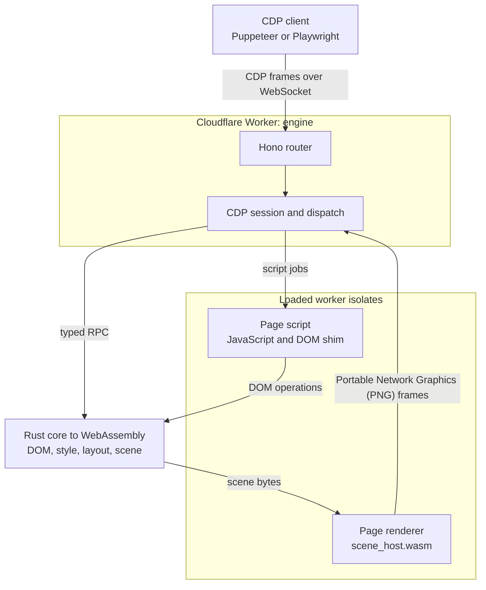
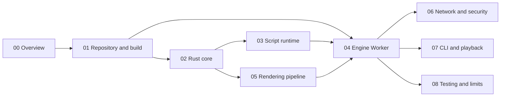

# Kitesurf: a browser engine inside a Cloudflare Worker

Kitesurf is an experimental browser engine that runs as a Cloudflare Worker. It parses HyperText Markup Language (HTML), applies Cascading Style Sheets (CSS), runs page JavaScript, records a paint scene, rasterizes the scene, and answers the Chrome DevTools Protocol (CDP) over a WebSocket. It does this without Chrome and without a browser container.

The thesis of this exploration is that Kitesurf is not one program. It is four runtimes joined by two narrow protocols. The Worker owns the connection and the session. A Rust core compiled to WebAssembly owns the document. A separate script context owns page JavaScript, with a TypeScript Document Object Model (DOM) shim that forwards work to the core. A renderer turns a recorded scene into pixels. Every design choice follows from the execution model of a Worker: small memory, metered central processing unit (CPU) time, no threads, and no child process.

This set explains the repository at `/Users/darkvoid/GitSources/src.Browsers/kitesurf` at commit `4a2903813a22b08d4f3cc64a4b35339d0293a5d1` (2026-11-13), version `0.0.1`. Every claim traces to a file in that snapshot.

Read [00 Overview](00-overview.md) first for the full picture. This page gives the shape, the reading paths, and the limits.

## The three separations

**1. The host is separate from the engine.** The Worker terminates the connection, serves assets, admits requests, and holds the limits. The document engine is Rust that compiles to WebAssembly. The Worker calls into it with typed messages, not with process calls.

**2. The page script is separate from the engine.** Page JavaScript runs in its own isolate. The isolate has no direct access to the Rust tree. Every DOM operation crosses a generated Remote Procedure Call (RPC) boundary. The policy checks in `packages/script-gate` are bundled into both sides, so the two sides cannot disagree about script rules.

**3. The scene is separate from the pixel.** The core does not draw. It records a display list of boxes, text runs, images, clips, and paint order. The renderer consumes that list. The same list feeds a CDP screenshot, a streaming frame, and the native playback tool.

Each separation answers one constraint. The first answers the Worker sandbox. The second answers script isolation and policy. The third answers the split between document work and pixel work.



## What is in the snapshot

The repository holds 11 package directories. The project README names eight of them in its package table. The other three are the type package for the internal RPC, the shared script-policy gate, and the entry point for page-spawned workers.

```text
# package.json:17-22
    "dev": "pnpm --filter @kitesurf/engine dev",
    "dev:memprof": "pnpm --filter @kitesurf/engine dev:memprof",
    "dev:tracing": "docker compose -f docker/compose.dev.yml up tracing",
    "dev:wpt": "pnpm --filter @kitesurf/engine dev:wpt",
    "bench:scene": "node scripts/bench-scene-record.mjs",
    "build": "bazel run //packages/engine:dev_build",
```

The packages fall into five groups.

| Group | Packages | Job | Document |
|-------|----------|-----|----------|
| Rust engine | `core` | Parse, style, lay out, record the scene | [02 Rust core](02-rust-core.md) |
| Renderer | `page-renderer`, `renderer-core`, `scene-host-wasm` | Rasterize a recorded scene | [05 Rendering pipeline](05-rendering-pipeline.md) |
| Worker | `engine` | HTTP routes, CDP session, cookies, limits | [04 Engine Worker and CDP](04-engine-worker-and-cdp.md) |
| Page isolates | `page-script`, `dom-shim`, `script-gate`, `worker-script` | JavaScript, DOM shim, policy, page workers | [03 Script runtime](03-script-runtime-and-dom-shim.md) |
| Shared and native | `jsrpc-types`, `kitesurf-cli` | One RPC contract, one terminal client | [07 CLI and playback](07-cli-playback-and-access.md) |

The build, the gates, and the limits are in [01 Repository and build](01-repository-and-build.md) and [08 Testing, gates, and limits](08-testing-gates-and-limits.md). The network policy and the frame rules are in [06 Network and security](06-network-and-security.md).

## Reading order



Three paths exist, and each path stands alone.

- **The engine path.** Read [04](04-engine-worker-and-cdp.md) after [01](01-repository-and-build.md). It explains the routes, the command loop, the session state, and the admission checks.
- **The document path.** Read [02](02-rust-core.md) and then [03](03-script-runtime-and-dom-shim.md). It explains the tree, the style system, the layout, the scene format, and the bridge to JavaScript.
- **The pixel path.** Read [05](05-rendering-pipeline.md) after [02](02-rust-core.md). It explains the renderer, the fonts, the capture modes, and the native playback.

A reader who wants the security model should read [06](06-network-and-security.md). The document covers Content Security Policy (CSP), Subresource Integrity (SRI), framing, iframes, and fetch limits.

## Build and run

The repository uses two build tools on purpose. Bazel builds the Rust, the WebAssembly, and the bundles. pnpm installs the JavaScript dependencies and starts the development server.

```bash
# README.md:220-226
pnpm run build                    # bazel run //packages/engine:dev_build
pnpm run check                    # type checks, bundles, and repository checks
pnpm run test:unit                # engine vitest and Rust host tests
pnpm run test:e2e <file-substring>
pnpm run format:check             # oxfmt; pnpm run format rewrites the same files
pnpm run format:rust              # format Rust with Bazel's pinned rustfmt
pnpm run lint                     # oxlint, the custom lint rules, and Rust lint
```

A client connects to the engine with the standard CDP endpoint:

```js
// README.md:76-84
const browser = await puppeteer.connect({
  browserWSEndpoint: "ws://127.0.0.1:8787/devtools/browser",
});

const page = await browser.newPage();
await page.goto("https://example.com/");
await page.screenshot({ path: "page.png" });

await browser.disconnect();
```

The engine listens on port 8787 by default. The port is configurable with `KITESURF_PORT`. Local development needs Node.js 22 or newer, pnpm 9.15.4, Bazelisk, and GNU tar on macOS. A Cloudflare deployment needs the Workers Paid plan, because each page and each renderer starts in a Dynamic Worker.

## The deployment warning

The project README gives a direct warning. The engine has no authentication of its own. A person who has the Worker address can open DevTools, connect a CDP client, send outbound requests on the account, and spend the account's CPU time.

```text
# README.md:261-265
> [!WARNING]
> Do not deploy Kitesurf without authentication in front of it. Use
> [Cloudflare Access](https://developers.cloudflare.com/workers/configuration/routing/workers-dev/#manage-access-to-workersdev)
> (Cloudflare Zero Trust) or another authentication layer. The engine has no
> authentication of its own. A person who has the URL can:
```

Document [04](04-engine-worker-and-cdp.md) explains the one guard that exists inside the engine: the CDP upgrade origin check. Document [06](06-network-and-security.md) explains the page-level controls.

## What this exploration does not claim

Kitesurf is experimental and the repository says so. It is compatible with CDP clients, not with every browser behaviour. The project measures the gap with Web Platform Tests (WPT), end-to-end (E2E) tests, and its own expected-failure lists. This exploration reports those numbers as the repository states them. It does not run the suite.

The exploration does not cover Cloudflare Dynamic Workers as a product, Workerd internals, or the paid hosting plan. It also does not cover Chrome DevTools frontend internals. The frontend is a prebuilt Google artefact that the engine can serve.

## Related exploration

The sibling directory [src.obscura](../../src.obscura/markdown/README.md) explains Obscura, a Rust headless browser that runs as a normal process. The two projects share a goal and differ in one main constraint. Obscura keeps the engine in one process and adds V8. Kitesurf moves the engine into a Worker and replaces V8 with a separate JavaScript runtime. The Obscura README states that Cloudflare began Kitesurf by porting Obscura to Workers. The two explorations therefore read well as a pair.
