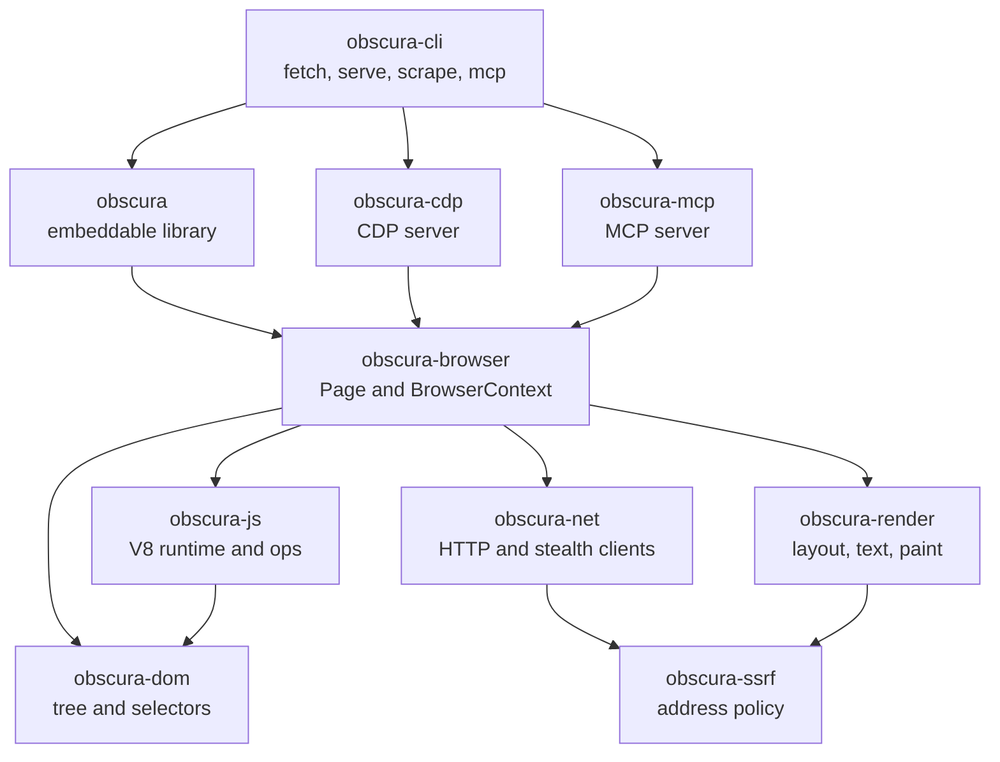
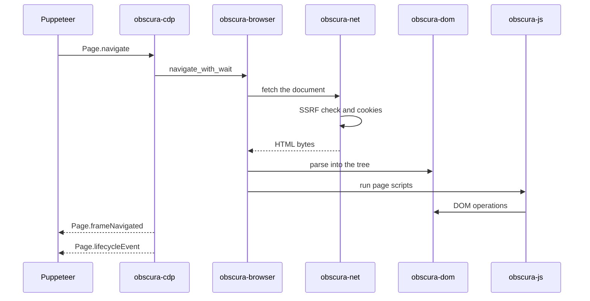

# 00 Overview: a small browser that speaks a large protocol

Obscura is a headless browser engine written in Rust for web scraping and Artificial Intelligence (AI) agent automation. It parses HyperText Markup Language (HTML) and applies Cascading Style Sheets (CSS). It runs page JavaScript on the V8 engine and answers the Chrome DevTools Protocol (CDP). It can also render screenshots and Portable Document Format (PDF) files. The thesis of this exploration is that Obscura wins compatibility by choosing one large interface and narrowing everything behind it. The large interface is CDP, because Puppeteer and Playwright already speak it. Behind that interface the project implements a deliberate subset: its own document tree, a fixed JavaScript bridge, a request policy, and an optional renderer. The result is a binary near seventy mebibytes (MiB) that starts instantly, instead of a Chromium build of several hundred mebibytes.

This document gives the problem, the ten workspace crates, the two features that change the binary, and the reading guide.

## The problem

A scraping system needs four things from a browser. It needs a correct document tree, real JavaScript execution, and a network stack it can control. It also needs an automation protocol that existing client libraries already implement. Chromium supplies all four at a high cost in memory, start time, and attack surface. A purpose-built engine can supply a useful subset at a much lower cost, but only if it keeps the automation protocol intact.

Obscura makes that trade in four decisions:

1. Use `html5ever` for parsing, so the tree follows the same tokenizer and tree-builder rules as Servo and Firefox.
2. Use V8 through `deno_core`, so page JavaScript is real JavaScript, not an interpreter.
3. Use CDP as the only external automation surface, so Puppeteer, Playwright, and the Model Context Protocol (MCP) server all reuse one command path.
4. Put rendering and stealth behind build features, so the default scraping binary stays small.

## The workspace

The repository is a Cargo workspace with ten members. One member, `obscura-ssrf`, has no dependencies on purpose, so every transport can enforce the same private-address policy.

```toml
# Cargo.toml:1-14
[workspace]
resolver = "2"
members = [
    "crates/obscura-dom",
    "crates/obscura-ssrf",
    "crates/obscura-net",
    "crates/obscura-browser",
    "crates/obscura-cdp",
    "crates/obscura-js",
    "crates/obscura-mcp",
    "crates/obscura-render",
    "crates/obscura-cli",
    "crates/obscura",
]
```

The architecture document groups them by job:

````text
# docs/Architecture-overview.md:1-1
Obscura is a workspace of nine crates.

```
obscura-cli       CLI entry point. fetch, serve, scrape, mcp.
obscura-cdp       Chrome DevTools Protocol server. WebSocket, dispatch, domain handlers.
obscura-browser   Page type, navigation, lifecycle events.
obscura-js        V8 runtime via deno_core. bootstrap.js + Rust ops.
obscura-dom       DOM tree implementation.
obscura-net       HTTP client, stealth client, cookie jar, robots cache, tracker blocklist.
obscura-mcp       Model Context Protocol server.
obscura-render    CSS cascade, retained layout, text shaping, and CPU paint.
obscura           Embeddable Rust library API (Browser, Page, Element, CookieStore).
```
````

**Aha:** The architecture document says "nine crates" and lists nine names. The workspace declares ten members, and the missing name is `obscura-ssrf`. The policy crate is intentionally invisible in the overview because it is not a layer in the request flow; it is a rule that three other crates import. This is the first example of a small documentation drift that the later documents correct against the source.

The crate graph is a short chain with two side branches:



| Crate | Owns | Depends on |
|-------|------|------------|
| `obscura-dom` | The tree, parsing, selectors, style data | `html5ever`, `selectors`, `cssparser` |
| `obscura-ssrf` | The address deny-set | Nothing |
| `obscura-net` | Requests, cookies, robots, tracker blocking | `obscura-ssrf` |
| `obscura-browser` | Page and context lifecycles | DOM, JavaScript, network, render |
| `obscura-js` | The V8 isolate and the operation table | DOM, network, optional render |
| `obscura-cdp` | WebSocket, sessions, domains, events | Browser |
| `obscura-mcp` | Agent tools over the Model Context Protocol | Browser |
| `obscura-render` | CSS cascade, layout, text, paint, PDF | DOM, optional paint |
| `obscura-cli` | The `obscura` binary and its subcommands | CDP, MCP, browser |
| `obscura` | The public Rust library | Browser |

The public library surface is small and explicit:

```rust
// crates/obscura/src/lib.rs:24-32
pub use browser::Browser;
pub use config::BrowserConfig;
pub use cookie::{Cookie, CookieStore};
pub use error::Error;
pub use page::Page;

// Request/response interception types (issue #306).
pub use obscura_browser::{InterceptedRequest, InterceptResolution};
pub use obscura_net::{RequestCallback, RequestInfo, ResourceType, Response, ResponseCallback};
```

## One navigation

A CDP client sends `Page.navigate`. The command crosses four crates. The flow is the spine of this exploration:



The architecture document states the same path and adds the lock rule: all pages in one process share one V8 isolate, and a mutex serializes work.

````text
# docs/Architecture-overview.md:74-78
## Single V8 isolate

All pages in a process share one V8 isolate. The isolate is single-threaded by design.

`obscura_js::v8_lock::global()` is a `tokio::sync::Mutex` that serializes V8 work. A handler that wants to run JS must acquire the lock first:

```rust
let _guard = obscura_js::v8_lock::global().lock().await;
page.evaluate(expr).await
```

````

The quoted document is stale on this point. The source gives each page its own isolate and each connection its own lock. [01 Workspace and architecture](01-workspace-and-architecture.md) records the change and the two issues that forced it. The connection limit below is therefore a limit on connections, not on isolates.

The consequence is visible in the command-line tool. The `serve` subcommand accepts a worker count and a connection limit, because each connection is expensive:

```rust
// crates/obscura-cli/src/main.rs:68-95
#[derive(Subcommand)]
enum Command {
    Serve {
        #[arg(short, long, default_value_t = 9222)]
        port: u16,

        // Bind address. Defaults to 127.0.0.1 (loopback only) for safety.
        // Set to 0.0.0.0 to listen on all interfaces (e.g. inside a Docker
        // container where you want the port to be reachable from the host
        // via -p mapping).
        #[arg(long, default_value = "127.0.0.1")]
        host: String,

        #[arg(long)]
        proxy: Option<String>,

        #[arg(long)]
        user_agent: Option<String>,

        #[arg(long, default_value_t = 1)]
        workers: u16,

        /// Maximum live CDP connections. Each connection runs on its own OS
        /// thread with its own V8 isolates, so this bounds the server's thread
        /// and memory footprint. Connections beyond the limit are refused with
        /// a 503 rather than queued. With --workers N the limit applies to each
        /// worker process, so the server-wide maximum is N times this value.
        #[arg(long, default_value_t = obscura_cdp::DEFAULT_MAX_CONNECTIONS)]
```

The binary name, version, and purpose come from one attribute block:

```rust
// crates/obscura-cli/src/main.rs:14-19
#[derive(Parser)]
#[command(
    name = "obscura",
    version = env!("OBSCURA_BUILD_VERSION"),
    about = "Obscura - A lightweight headless browser for web scraping and automation",
)]
```

## Two features change the binary

The default build is the scraping build. Two Cargo features add capability at a cost in binary size and dependencies.

```toml
# crates/obscura-js/Cargo.toml:8-17
[features]
default = []
# Builds obscura-net with its stealth (wreq) HTTP client and lets scripted
# fetch()/XHR be routed through it so JS-level requests carry the same Chrome
# TLS fingerprint and client hints as stealth navigation.
stealth = ["obscura-net/stealth"]
# Builds the obscura-render layout layer and exposes real box geometry to JS
# (getBoundingClientRect, elementFromPoint, offset*), and with paint enabled,
# rasterizes screenshots. Off by default so the scraping build stays lean.
render = ["dep:obscura-render", "obscura-render/paint"]
```

| Feature | Off | On |
|---------|-----|----|
| `render` | No layout, no paint, no screenshots | Layout, geometry in JavaScript, paint, capture |
| `stealth` | The default HTTP client | The `wreq` client, TLS impersonation, tracker blocking |

The browser crate gates its own exports on the same features, so a caller cannot name a type that the build did not compile:

```rust
// crates/obscura-browser/src/lib.rs:7-21
#[cfg(feature = "render")]
pub mod pdf;
pub mod profiles;

pub use context::BrowserContext;
pub use lifecycle::{LifecycleState, WaitUntil};
pub use obscura_js::HTML_TO_MARKDOWN_JS;
#[cfg(feature = "render")]
pub use obscura_js::{
    validate_capture_region, AnimationSample, AnimationSampleMode, AnimationSampleTime,
    CaptureError, CaptureRegion,
};
pub use page::{url_matches_cdp_pattern, NetworkEvent, Page, PageError};
#[cfg(feature = "render")]
pub use pdf::{RasterPdfError, RasterPdfOptions, RasterPdfPageRange};
```

## The address policy is shared

Every transport must agree on which addresses it may reach. The policy crate explains why it exists:

```rust
// crates/obscura-ssrf/src/lib.rs:1-8
//! The SSRF policy every Obscura transport shares: which IP addresses an
//! outbound request may never reach, and the process-wide env opt-in that
//! lifts the restriction for local testing.
//!
//! This crate has no dependencies on purpose. `obscura-net` (reqwest and wreq
//! transports) and `obscura-render` (the synchronous compatibility loader for
//! images and fonts) both enforce the same deny-set from here, so the checks
//! can never disagree.
```

The escape hatch is an environment variable, and the new command-line flag is combined with it rather than replacing it:

```rust
// crates/obscura-ssrf/src/lib.rs:12-26
/// Process-wide opt-in via env var. Older flow that issue #4 introduced. The
/// new `--allow-private-network` CLI flag (issue #33) sets a per-client field
/// that is OR'd with this so existing scripts and Docker setups that pin the
/// env var keep working unchanged.
pub fn env_allows_private_network() -> bool {
    matches!(
        std::env::var("OBSCURA_ALLOW_PRIVATE_NETWORK")
            .ok()
            .as_deref()
            .map(str::trim)
            .map(str::to_ascii_lowercase)
            .as_deref(),
        Some("1") | Some("true") | Some("yes") | Some("on")
    )
}
```

## Vocabulary

| Term | Meaning in this repository |
|------|----------------------------|
| CDP | Chrome DevTools Protocol. The automation protocol that Puppeteer and Playwright use |
| MCP | Model Context Protocol. The tool protocol that an AI agent uses |
| V8 | The JavaScript engine from the Chromium project |
| Isolate | One V8 JavaScript heap and execution context |
| Operation | A Rust function that V8 can call through `deno_core` |
| Page | One document with its tree, scripts, storage, and network state |
| Target | The CDP name for a page or another debuggable object |
| SSRF | Server-Side Request Forgery. A request that makes a server reach an address it should not reach |
| Stealth | The build mode that changes the transport fingerprint and blocks trackers |
| Retained layout | A layout result kept between captures and invalidated by changes |

## Reading guide

- [01-workspace-and-architecture](01-workspace-and-architecture.md) gives the crate boundaries and the feature flags in detail.
- [02-dom-and-html](02-dom-and-html.md) explains the tree. [03-javascript-runtime](03-javascript-runtime.md) explains the V8 bridge.
- [04-browser-page-lifecycle](04-browser-page-lifecycle.md) follows one page from navigation to storage.
- [05-network-ssrf-and-stealth](05-network-ssrf-and-stealth.md) explains the request policy and the fingerprint.
- [06-cdp-server](06-cdp-server.md) explains the protocol loop.
- [07-rendering-and-output](07-rendering-and-output.md) explains layout, paint, screenshots, and PDF output.
- [08-mcp-cli-and-operations](08-mcp-cli-and-operations.md) explains the agent-facing server and the binary.
- [09-testing-and-limits](09-testing-and-limits.md) states what the tests prove and what remains unsupported.

## What this exploration does not claim

Obscura does not claim full Chromium compatibility. The repository documents several gaps itself: iframe content compositing, Playwright frame locators, and some HTML sandbox policies. The README performance table is a project claim, not a measurement this exploration repeated. The documents distinguish a measured value in the source from a marketing claim in the README.
