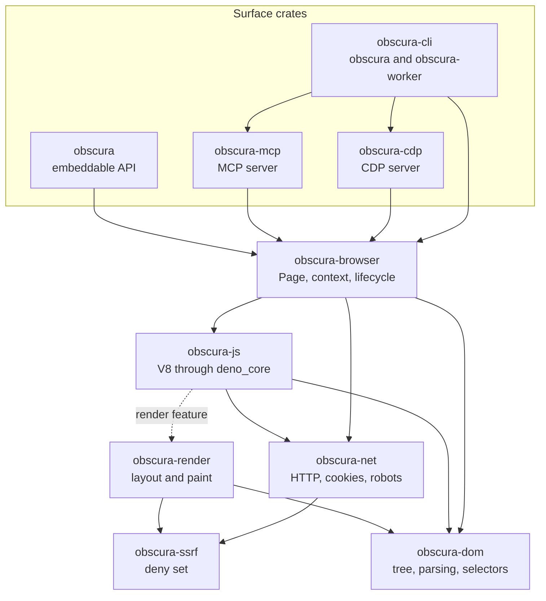
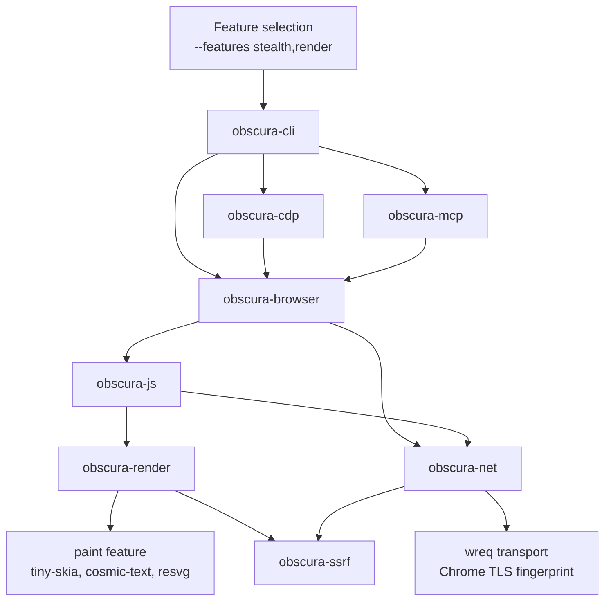

# 01 Workspace and architecture: ten crates on one ladder

Obscura is a Cargo workspace of ten crates and two binary targets. One crate owns the document, one owns the browser state, one owns each external surface, and one crate is a public Rust Application Programming Interface (API). Each optional capability enters through a feature flag that propagates down the dependency chain. The thesis of this document is that the crate graph is the architecture. The graph is a ladder with no cycles, and the feature flags follow the same ladder. A reader who knows the graph can say which crate is allowed to call which, and which code the default build leaves out.

The repository documentation describes the workspace as nine crates. The tenth crate is `obscura-ssrf`, and it matters because it is the only crate with no dependencies. This document records that correction and the other places where the checked-in source is newer than the prose.

This document covers the crate list, the dependency ladder, the feature matrix, and the panic strategy. It also covers the compile-time and run-time split of options, and the ownership of the JavaScript isolate. Later documents cover each layer.

## The problem

A browser has four competing goals.

1. **The default build must be small.** The project sells a 30-megabyte process and a 70-mebibyte (MiB) binary, and those numbers depend on leaving whole subsystems out.
2. **The optional subsystems must be real.** A screenshot must be a real layout and a real raster, not a placeholder.
3. **The layers must not reach sideways.** A Document Object Model (DOM) crate must not know about the network, because that knowledge would make the DOM untestable in isolation.
4. **The automation surfaces are independent.** The Chrome DevTools Protocol (CDP) server, the Model Context Protocol (MCP) server, the command-line tool, and the embeddable library all need the same browser, and no surface may own it.

The answer is one crate per layer and one direction of dependency.



## The ten crates

The workspace manifest lists every member, and the list is the source of truth:

```toml
# Cargo.toml:1-14
[workspace]
resolver = "2"
members = [
    "crates/obscura-dom",
    "crates/obscura-ssrf",
    "crates/obscura-net",
    "crates/obscura-browser",
    "crates/obscura-cdp",
    "crates/obscura-js",
    "crates/obscura-mcp",
    "crates/obscura-render",
    "crates/obscura-cli",
    "crates/obscura",
]
```

| Crate | Kind | Source files | Lines | Job |
|-------|------|--------------|-------|-----|
| `obscura-dom` | Library | 5 | 5,804 | Parse HyperText Markup Language (HTML), hold the tree, match selectors, serialize |
| `obscura-ssrf` | Library | 1 | 139 | One deny set for private addresses, with no dependencies |
| `obscura-net` | Library | 9 | 6,862 | HTTP, cookies, robots, encoding, interception, blocklist |
| `obscura-browser` | Library | 9 | 14,227 | Page, context, navigation, lifecycle, profiles, PDF |
| `obscura-js` | Library | 14 | 39,877 | V8 runtime, operations, modules, markdown, WebCrypto |
| `obscura-render` | Library plus one binary | 8 | 72,927 | Cascading Style Sheets (CSS), layout, text shaping, CPU paint |
| `obscura-cdp` | Library | 22 | 16,424 | WebSocket server, dispatch, domains |
| `obscura-mcp` | Library | 3 | 3,980 | MCP server, standard input and output, HTTP |
| `obscura-cli` | Two binaries | 5 | 3,954 | Command-line tool and worker process |
| `obscura` | Library | 7 | 547 | Public Rust API |

The line counts exclude test files. Two numbers dominate: `obscura-render` holds about 73,000 lines behind a feature flag, and `obscura-js` holds about 40,000 lines that every build compiles. The render layer is the largest crate in the repository, and the default build does not contain it.

The prose documentation lists nine crates and omits `obscura-ssrf`:

> Obscura is a workspace of nine crates.
>
> `obscura-cli` is the command-line entry point with `fetch`, `serve`, `scrape`, and `mcp`. `obscura-cdp` is the Chrome DevTools Protocol server. `obscura-browser` holds the page type, navigation, and lifecycle events. `obscura-js` is the V8 runtime through `deno_core`. `obscura-dom` holds the tree. `obscura-net` holds the HTTP client, the stealth client, the cookie jar, the robots cache, and the tracker blocklist. `obscura-mcp` is the Model Context Protocol server. `obscura-render` holds the Cascading Style Sheets cascade, layout, text shaping, and CPU paint. `obscura` is the embeddable Rust library API.
>
> (`docs/Architecture-overview.md:1-13`)

The list stops at nine because `obscura-ssrf` is not a layer that a reader visits. The crate states its own reason for existence:

```rust
// crates/obscura-ssrf/src/lib.rs:1-8-8
//! The SSRF policy every Obscura transport shares: which IP addresses an
//! outbound request may never reach, and the process-wide env opt-in that
//! lifts the restriction for local testing.
//!
//! This crate has no dependencies on purpose. `obscura-net` (reqwest and wreq
//! transports) and `obscura-render` (the synchronous compatibility loader for
//! images and fonts) both enforce the same deny-set from here, so the checks
//! can never disagree.
```

Server-Side Request Forgery (SSRF) is the attack in which a page makes the browser fetch an address that only the server can reach. Two transports enforce the rule, and both must agree. A zero-dependency crate is the only way to share the rule without making one transport depend on the other.

There is also a folder that is not a crate. `crates/test-support/allocations.rs` is a test-only allocator that counts bytes per thread. It has no `Cargo.toml`, it is not a workspace member, and three test files include it with `#[path]`. A reader who counts folders finds eleven, and a reader who counts members finds ten.

## The ladder

Each crate declares its neighbours, and the manifest shows the direction:

```rust
// crates/obscura-browser/src/lib.rs:1-11
pub mod accessibility;
pub mod context;
mod fork_virtual_url;
mod idle_deadline;
pub mod lifecycle;
pub mod page;
#[cfg(feature = "render")]
pub mod pdf;
pub mod profiles;

pub use context::BrowserContext;
```

`pdf` exists only under the render feature. The browser crate does not implement PDF itself. It maps a page to a raster print and hands the result to `obscura-js`, which owns the render bridge.

The layer below is the parser and the tree:

```rust
// crates/obscura-dom/src/lib.rs:1-13
#[macro_use]
extern crate html5ever;

pub mod tree;
pub mod tree_sink;
pub mod selector;
pub mod serialize;

pub use tree::{
    AttachShadowError, Attribute, DomTree, Node, NodeData, NodeId, ShadowRoot,
    ShadowRootMode,
};
pub use tree_sink::{parse_fragment, parse_fragment_with_context, parse_html, parse_srcdoc};
```

Four modules and two exports. The tree is a node arena with `NodeId` handles, the sink builds that arena from the parser tokens, the selector matches CSS selectors, and the serializer writes the tree back to HyperText Markup Language. The crate depends on `html5ever`, `selectors`, `cssparser`, and `servo_arc`, and on no Obscura crate at all.

The network layer owns every protocol, and it too has no Obscura dependency except the deny set:

```rust
// crates/obscura-net/src/lib.rs:1-14
pub mod client;
pub mod cookies;
pub mod encoding;
pub mod interceptor;
pub mod robots;
pub mod blocklist;
#[cfg(feature = "stealth")]
pub mod wreq_client;

pub use client::{
    env_allows_private_network, is_forbidden_ip, CallbackRegistry, ObscuraHttpClient,
    ObscuraNetError, RequestCallback, RequestCredentials, RequestInfo, RequestMode,
    ResourceRequest, ResourceType, Response, ResponseCallback, SsrfGuardResolver,
};
```

Seven modules, and one of them is conditional. `wreq_client` is the stealth transport, and it exists only with the `stealth` feature. The public re-exports repeat the same condition with `#[cfg(feature = "stealth")]` further down the file.

The JavaScript layer is the largest mandatory crate:

```rust
// crates/obscura-js/src/lib.rs:1-10
pub mod cdp_watchdog;
pub mod frame;
mod import_map;
pub mod indexed_db;
pub mod markdown;
pub mod module_loader;
pub mod ops;
pub mod runtime;
pub mod v8_flags;
mod write_stream;
```

`ops` is the Rust side of the bridge, `runtime` is the isolate, `frame` holds child realms, `module_loader` resolves modules, `cdp_watchdog` bounds a command, and `markdown` holds the extraction script. `import_map` and `write_stream` are private, because no layer above needs them.

The public API crate is deliberately thin:

```rust
// crates/obscura/src/lib.rs:18-28
mod browser;
mod config;
mod cookie;
mod error;
mod page;

pub use browser::Browser;
pub use config::BrowserConfig;
pub use cookie::{Cookie, CookieStore};
pub use error::Error;
pub use page::Page;
```

Five private modules and five public types. The crate is 547 lines. It is a façade over `obscura-browser` and `obscura-net`, and it exists so an embedder can depend on one crate with a stable name.

## Features on the same ladder

A feature flag is a compile-time option. Obscura uses three: `stealth`, `render`, and, inside the render crate, `paint`. Each one propagates down the ladder, never sideways.

The JavaScript crate declares the two entry points:

```toml
# crates/obscura-js/Cargo.toml:8-17
[features]
default = []
# Builds obscura-net with its stealth (wreq) HTTP client and lets scripted
# fetch()/XHR be routed through it so JS-level requests carry the same Chrome
# TLS fingerprint and client hints as stealth navigation.
stealth = ["obscura-net/stealth"]
# Builds the obscura-render layout layer and exposes real box geometry to JS
# (getBoundingClientRect, elementFromPoint, offset*), and with paint enabled,
# rasterizes screenshots. Off by default so the scraping build stays lean.
render = ["dep:obscura-render", "obscura-render/paint"]
```

Two facts are visible in the feature list. `default = []` means the default build has no stealth and no render. `render` turns on `obscura-render/paint` at the same time, so the layout layer is never present without the paint layer.

The browser crate forwards both:

```toml
# crates/obscura-browser/Cargo.toml:8-11
[features]
default = []
stealth = ["obscura-net/stealth", "obscura-js/stealth"]
render = ["obscura-js/render", "dep:image"]
```

The browser adds one dependency of its own: `image`, with the JPEG and Portable Network Graphics (PNG) decoders. The decoder is needed for the browser-level screenshot path, so it belongs to this level.

The CDP crate states why its flag exists:

```toml
# crates/obscura-cdp/Cargo.toml:12-17
[features]
default = []
stealth = ["obscura-browser/stealth"]
# Enable Page.captureScreenshot via obscura-render. Propagates render to
# obscura-browser so Page::screenshot is available.
render = ["obscura-browser/render", "dep:image", "dep:jpeg-encoder", "dep:png", "dep:fast_image_resize"]
```

The `Page.captureScreenshot` command needs an encoder that the browser layer does not need. The CDP crate adds JPEG and PNG encoders and a resizer for `Page.captureScreenshot` with a clip and a scale.

The command-line crate is the top of the ladder, and it enables everything that a user asked for:

```toml
# crates/obscura-cli/Cargo.toml:16-19
[features]
default = []
stealth = ["obscura-browser/stealth", "obscura-net/stealth", "obscura-mcp/stealth"]
render = ["obscura-browser/render", "obscura-cdp/render", "obscura-mcp/render"]
```

The surface crates repeat the flag because each surface has its own manifest. A single flag at the top still expands into five crate flags, and Cargo resolves it once.

The embeddable API crate shows the intended default for a library user:

```toml
# crates/obscura/Cargo.toml:10-14
[features]
default = ["api"]
api = ["obscura-browser", "obscura-net", "tokio"]
stealth = ["api", "obscura-browser/stealth"]
render = ["api", "obscura-browser/render"]
```

The `obscura` crate defaults to `api`, not to `stealth` or `render`. A user who wants a screenshot must ask for it. This is the opposite of a browser that always ships a compositor.



**Aha:** The feature ladder is trustworthy because the dependency ladder has no cycles. A flag can only add a crate that its own crate already may use. If `obscura-dom` needed the network, then `render` would pull a HyperText Transfer Protocol (HTTP) client into the layout layer, and the "lean default" claim would be false. The acyclic graph is what keeps each optional subsystem removable.

## The render layer

The render crate states the design in its own header:

```rust
// crates/obscura-render/src/lib.rs:1-12
//! obscura-render: the optional scoped render layer for Obscura.
//!
//! Obscura's default build has no layout or paint engine, which is the source
//! of its speed and low memory. This crate adds a render layer behind a feature
//! flag: real CSS box geometry (so getBoundingClientRect, elementFromPoint, and
//! IntersectionObserver return true values) and, with the paint feature,
//! rasterized PNG screenshots.
//!
//! Phase 1 (this file): the layout core. A `LayoutNode` tree plus a viewport is
//! laid out with taffy and the resulting border-box geometry is returned per
//! node. Later phases build the `LayoutNode` tree from the live DOM + computed
//! styles, feed geometry back to JS, and add text + paint.
```

The header says "Phase 1" and "later phases", and the file no longer matches that text. The crate now holds the later phases: `css`, `style`, `border`, `dom`, `inline`, and `paint` are separate modules, and the source is about 73,000 lines. The comment is stale, and the source is the authority.

`paint` is a second flag inside the render crate, and its list shows what a real raster needs:

```toml
# crates/obscura-render/Cargo.toml:9-14
[features]
default = []
# Rasterize the laid-out tree to a pixmap (tiny-skia) with text (cosmic-text
# shaping + line breaking, ab_glyph fallback) and images.
# Off by default; the layout core (getBoundingClientRect etc.) works without it.
paint = ["dep:obscura-ssrf", "dep:tiny-skia", "dep:ab_glyph", "dep:cosmic-text", "dep:swash", "dep:image", "dep:ureq", "dep:base64", "dep:resvg", "dep:usvg", "dep:url", "dep:wuff"]
```

`paint` adds 12 dependencies: a rasterizer, two text stacks, an image decoder, a Synchronous HTTP client, a Scalable Vector Graphics (SVG) rasterizer, and a Web Open Font Format (WOFF) decoder. Geometry alone needs none of them.

## Two binaries

The command-line crate builds two programs from one library:

```toml
# crates/obscura-cli/Cargo.toml:8-14
[[bin]]
name = "obscura"
path = "src/main.rs"

[[bin]]
name = "obscura-worker"
path = "src/worker.rs"
```

`obscura` is the user tool with the `fetch`, `serve`, `scrape`, and `mcp` subcommands. `obscura-worker` is the unit that a process pool runs, so a container can start one worker per page. Both link the same crates, and the split keeps the worker startup path free of the full command parser.

## The panic rule

One workspace-level setting is an architectural rule, not a performance choice:

```toml
# Cargo.toml:68-73
# Unwinding (the Rust default) is REQUIRED for the anti-panic protocol: ops wrap
# their bodies in std::panic::catch_unwind so a panic degrades to an error return
# instead of unwinding into V8's FFI frame and aborting the process. panic="abort"
# would turn every catchable op panic into a hard crash.
[profile.release]
panic = "unwind"
```

A Rust panic that crosses a Foreign Function Interface (FFI) frame into V8 is undefined behaviour in practice. The project catches panics at the operation boundary and returns an error to JavaScript. That catch is impossible under `panic = "abort"`, so the release profile must unwind. The trade is a larger binary and slower unwinding paths, and the project accepts it.

The distribution profile keeps the size target:

```toml
# Cargo.toml:75-80
[profile.release-dist]
inherits = "release"
opt-level = "s"
lto = "fat"
codegen-units = 1
strip = "symbols"
```

`opt-level = "s"` optimizes for size, `lto = "fat"` links across crates, one codegen unit gives the strongest cross-module optimization, and symbols are stripped. The profile inherits `panic = "unwind"` from `release`.

## Patched dependencies

Two upstream crates are vendored, and both patches carry a reason:

```toml
# Cargo.toml:61-66
[patch.crates-io]
# Keep the grid shrink-to-fit correction local until it lands upstream.
taffy = { path = "vendor/taffy" }
# Carry the same canonical variable-font coordinates through shaping and
# rasterization until the upstream API exposes them.
cosmic-text = { path = "vendor/cosmic-text" }
```

The Taffy patch corrects a grid sizing rule in the layout engine. The cosmic-text patch carries variation-axis coordinates from shaping to rasterization, because the upstream API drops them. Both patches are local until the upstream change lands, and both are inside the render path, so the default build never compiles them.

## Isolate ownership

The architecture document describes one shared V8 isolate and one global lock. It says that all pages in a process share one isolate, that `obscura_js::v8_lock::global()` is a `tokio::sync::Mutex` which serializes V8 work, and that a handler must take that lock before it runs JavaScript (`docs/Architecture-overview.md:74-83`).

The source no longer has `v8_lock::global()`, and it no longer has one isolate for the process. Each `Page` owns its own `JsRuntime`, and each runtime owns an isolate:

```rust
// crates/obscura-cdp/src/dispatch.rs:756-768
    // Issue #430: keep this connection's V8 work serialized on its own thread.
    //
    // Every CDP handler below may call into a per-Page `JsRuntime` (each owning
    // its own V8 Isolate). With the thread-per-connection server each connection
    // runs on its own OS thread, so isolates never collide across connections.
    // Within one connection, though, a nav task spawned by
    // `process_with_interception` runs while this processor keeps pumping other
    // CDP messages, so two of this connection's pages could still interleave V8
    // work on this one thread and trip
    // `heap->isolate() == Isolate::TryGetCurrent()`. The per-connection lock
    // (`ctx.v8_lock`) keeps each handler contiguous: V8 fully exits one Isolate
    // before the next of this connection's pages is allowed in. It is
    // per-connection, not process-wide, so other connections run in parallel.
```

The lock is a field of the connection context, not a global:

```rust
// crates/obscura-cdp/src/dispatch.rs:129
    pub v8_lock: Arc<tokio::sync::Mutex<()>>,
```

Three facts follow, and they change the model that the prose describes.

1. **Isolation is per page.** Two pages cannot corrupt each other's JavaScript state, because each has its own isolate and heap.
2. **The lock is per connection.** Two clients run V8 work in parallel, because each connection has its own lock and its own operating-system thread.
3. **The lock is not a safety proof.** The source says that a `tokio` mutex is released around await points inside a V8 operation, so it does not keep the enter and exit pair contiguous. A navigation defers foreign messages to a queue instead.

The runtime pays for this design with explicit isolate entry. The source explains the failure that forced it:

```rust
// crates/obscura-js/src/runtime.rs:437-458
/// A [`JsRuntime`] whose isolate is entered for the duration of one operation.
///
/// V8 requires the isolate that owns a context to be the thread's *current*
/// one whenever that context is entered or left, and rusty_v8's scopes do not
/// arrange that themselves -- they only ever pass the isolate explicitly. What
/// made it work by accident was rusty_v8 entering an isolate when it is
/// constructed and leaving it entered for life: with a single page, that page's
/// isolate is trivially the current one.
///
/// With two pages it is not. The isolates form a stack, only the newest is
/// current, and the consequences were both immediate and fatal:
///
/// - running any script on the *older* page aborted the process
///   (`Check failed: heap->isolate() == Isolate::TryGetCurrent()`), so a second
///   page effectively disabled the first;
/// - dropping either page aborted too, because rusty_v8 requires isolates to
///   be dropped in reverse construction order -- a contract an embedder holding
///   independent `Page` objects cannot keep (#756).
///
/// So the isolate is exited once construction finishes and entered again only
/// around work that touches V8. Entries are then properly nested no matter how
/// many pages exist or what order they are used and dropped in.
```

This is the main correction that the exploration records. The checked-in documentation says one isolate and one global lock. The checked-in source says one isolate per page, one lock per connection, and an explicit enter and exit protocol. The source also names two issues, `#430` and `#756`, so the change is deliberate and tracked.

## The runtime shape

The other architectural rule is about asynchronous work:

```text
# docs/Architecture-overview.md:166-170
## Workspace conventions

- One crate per layer. Cross-crate calls go through the layer above, not sideways.
- All async is `tokio` with a `LocalSet` because V8 is `!Send`.
- All DOM ops go through `op_dom` to keep the JS/Rust boundary narrow.
```

V8 is not `Send`, so a runtime cannot move between threads. A `LocalSet` pins each page's futures to one thread, and the server gives each connection its own thread. This rule explains why the CDP server is thread-per-connection rather than task-per-connection.

## Limits

1. **Ten crates, not nine.** The prose omits `obscura-ssrf`. The workspace member list is the authority.
2. **`crates/test-support` is not a crate.** It has one source file, no manifest, and no workspace membership.
3. **`obscura-render` is the largest crate and is absent by default.** Its 72,927 lines support a feature that most builds do not compile.
4. **The architecture overview's isolate section is stale.** The code uses one isolate per page.
5. **The render crate header still says "Phase 1".** The module list and the line count show the later phases.
6. **The dependency ladder has one shortcut.** `obscura-js` depends on `obscura-render` directly, because the render bridge lives in the JavaScript layer. The diagram shows it as a dotted edge.

## Related documents

- [00 Overview](00-overview.md) gives the system in one picture.
- [02 DOM and HTML](02-dom-and-html.md) explains the bottom of the ladder.
- [03 JavaScript runtime](03-javascript-runtime.md) explains the isolate and the operation table.
- [04 Browser and page lifecycle](04-browser-page-lifecycle.md) explains the crate in the middle.
- [05 Network, SSRF, and stealth](05-network-ssrf-and-stealth.md) explains the two transports and the shared deny set.
- [06 CDP server](06-cdp-server.md) explains the connection model that this document cites.
- [07 Rendering and output](07-rendering-and-output.md) explains what the largest crate does.
