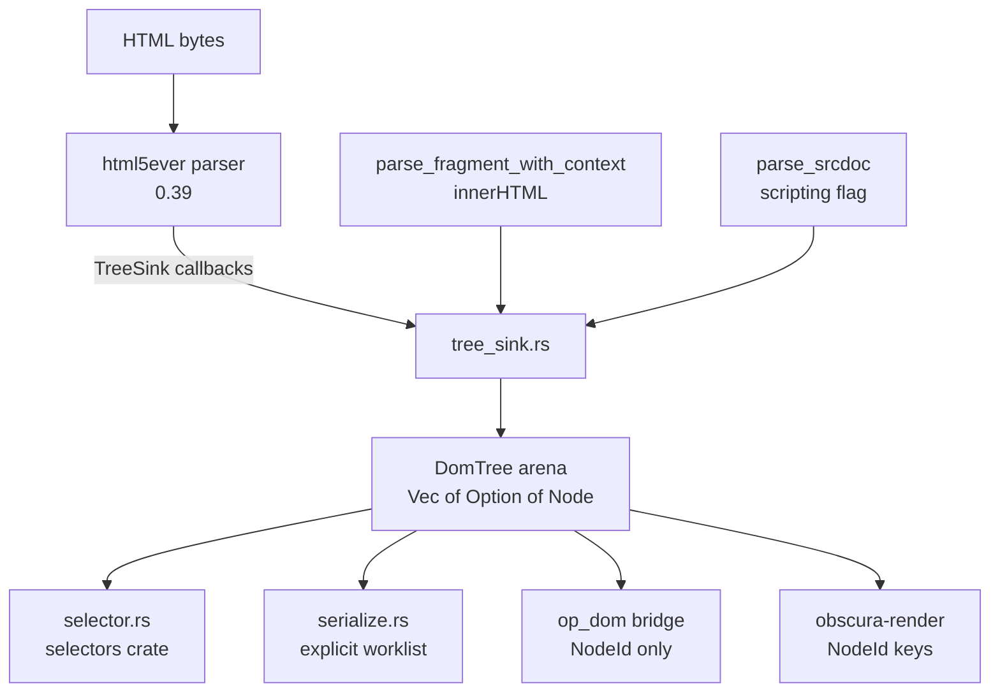
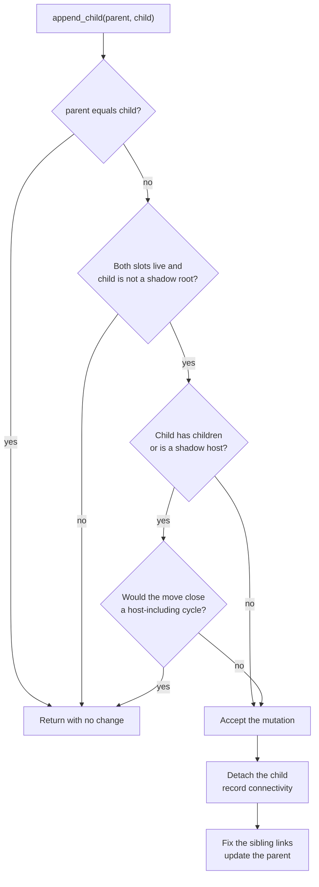

# 02 DOM and HTML: an arena with integer handles

`obscura-dom` parses HyperText Markup Language (HTML) with the same parser family that Servo uses. It stores the result in one arena of nodes. Every other crate sees the tree through a 32-bit `NodeId`, and no other crate can reach the arena directly. The thesis of this document is that the arena is the contract. The parser, the selector matcher, the serializer, the JavaScript bridge, and the renderer all agree on one integer handle, and the tree behind that handle is private.

This document covers the node model, the Document Object Model (DOM) tree, and its hidden state. It covers the parser entry points, selector matching, and the selector cache. It also covers serialization without recursion, the cycle guards, and the extraction script. Document [03](03-javascript-runtime.md) explains the JavaScript side that calls into this crate.

## The problem

A browser DOM has four requirements that pull against each other.

1. **The parser must be exactly right.** A page depends on the standard parse algorithm, including its error recovery.
2. **Mutation must be cheap.** A framework creates and moves thousands of nodes while a page loads.
3. **The host language must not corrupt the tree.** JavaScript can request any mutation, including a cyclic one.
4. **Deep trees must not abort the process.** A recursion over a 100,000-level tree exhausts the thread stack, and that failure cannot be caught.

The design answers each item with one rule.

- Use a standard parser and implement its tree sink.
- Store nodes in a vector and link them with indices.
- Reject a mutation that would create a cycle.
- Walk the tree with an explicit stack, never with recursion.



## The node model

A handle is a newtype over an unsigned 32-bit integer:

```rust
// crates/obscura-dom/src/tree.rs:7-22-22
#[derive(Clone, Copy, Debug, PartialEq, Eq, Hash)]
pub struct NodeId(pub(crate) u32);

impl NodeId {
    pub fn new(val: u32) -> Self {
        NodeId(val)
    }

    pub fn index(self) -> usize {
        self.0 as usize
    }

    pub fn raw(self) -> u32 {
        self.0
    }
}
```

The field is crate-private, so only this crate can make a handle from a raw value that it did not allocate. The hash and copy derives let a handle be a map key in every layer above.

A node has one of six data shapes:

```rust
// crates/obscura-dom/src/tree.rs:97-120
pub enum NodeData {
    Document,
    Doctype {
        name: String,
        public_id: String,
        system_id: String,
    },
    Element {
        name: QualName,
        attrs: Vec<Attribute>,
        template_contents: Option<NodeId>,
        mathml_annotation_xml_integration_point: bool,
    },
    Text {
        contents: String,
    },
    Comment {
        contents: String,
    },
    ProcessingInstruction {
        target: String,
        data: String,
    },
}
```

Four details in that enum carry weight.

- `QualName` holds a namespace, a prefix, and a local name, so HyperText Markup Language, Scalable Vector Graphics (SVG), and MathML live in one tree without a second node type.
- `template_contents` is a separate node id, because the parser puts template children in a separate document fragment.
- The MathML annotation flag is stored per element, because the parser's integration-point rule changes how children are parsed inside it.
- `Document` is a node like any other, so the tree has exactly one root and one code path.

The links are plain indices:

```rust
// crates/obscura-dom/src/tree.rs:122-134
#[derive(Clone, Debug)]
pub struct Node {
    pub id: NodeId,
    /// Shadow-including document connectivity, maintained incrementally on
    /// insertion/removal so hot DOM mutation paths do not walk every ancestor.
    pub connected: bool,
    pub parent: Option<NodeId>,
    pub first_child: Option<NodeId>,
    pub last_child: Option<NodeId>,
    pub prev_sibling: Option<NodeId>,
    pub next_sibling: Option<NodeId>,
    pub data: NodeData,
}
```

The `connected` flag is the interesting field. A browser must answer `isConnected` for any node. A naive answer walks every ancestor to the document, and a framework that builds a detached subtree of 10,000 nodes then makes that walk quadratic. The tree maintains the flag on insert and remove instead, so the answer is a field read. The comment states that reason.

## The tree and its hidden state

The tree is one `RefCell` around one struct:

```rust
// crates/obscura-dom/src/tree.rs:248-263
pub struct DomTree {
    inner: RefCell<DomTreeInner>,
}

/// Host-fetched author CSS kept outside the page-visible DOM.
///
/// A linked stylesheet may participate in rendering even when the response is
/// not origin-clean. Keeping those bytes here prevents a synthetic `<style>`
/// node from exposing them through ordinary DOM APIs.
#[derive(Clone, Debug, Default)]
pub struct ExternalStylesheet {
    pub sources: Vec<Arc<str>>,
    pub origin_clean: bool,
    /// CSSOM edits are rule-owned, never mutations of the owner's DOM text.
    pub cssom_rules: Option<Vec<Arc<str>>>,
}
```

A synchronous `RefCell` is a deliberate choice. The tree is not shared across threads, and JavaScript calls are synchronous inside one isolate. The alternative, `RwLock`, would add atomic operations on the hottest path for no gain.

The inner struct is where the design is visible:

```rust
// crates/obscura-dom/src/tree.rs:273-293-293
pub(crate) struct DomTreeInner {
    pub(crate) nodes: Vec<Option<Node>>,
    pub(crate) free_list: Vec<u32>,
    pub(crate) document: NodeId,
    pub(crate) id_index: HashMap<String, NodeId>,
    form_controls: HashMap<NodeId, FormControlState>,
    external_stylesheets: HashMap<NodeId, ExternalStylesheet>,
    external_stylesheet_generation: u64,
    hovered: Option<NodeId>,
    /// Shadow roots are arena nodes with their own child list. They are kept
    /// outside the ordinary parent links so light-tree traversal never crosses
    /// into a shadow tree by accident.
    shadow_roots: HashMap<NodeId, ShadowRoot>,
    shadow_roots_by_host: HashMap<NodeId, NodeId>,
    /// Full-document HTML parsing enables declarative shadow roots. Fragment
    /// parsing (including innerHTML) deliberately leaves this false.
    pub(crate) allow_declarative_shadow_roots: bool,
    // Whether the document was parsed in (full) quirks mode. In quirks mode CSS
    // class and id selectors match ASCII-case-insensitively.
    pub(crate) quirks: bool,
}
```

Six facts follow from this struct.

1. **Node slots are reused.** `free_list` holds indices of freed slots, and `new_node` pops one before it appends.
2. **There is an id index.** `getElementById` and a bare `#id` selector read a hash map, not the tree.
3. **Form state is not an attribute.** `value`, `checked`, and `indeterminate` live in `form_controls`, because a property and an attribute are different things.
4. **External stylesheet bytes are hidden.** A page cannot read a cross-origin stylesheet's text, so the bytes live beside the tree and never become a `<style>` node.
5. **Shadow roots are not children.** A host has a separate edge to its root, so a light-tree walk cannot enter a shadow tree by accident.
6. **Declarative shadow roots are a parse mode.** A full document enables them; an `innerHTML` fragment does not.

The serializer uses the same hidden state to choose the content of a `<template>`:

```rust
// crates/obscura-dom/src/serialize.rs:28-39
    // The node whose children represent `node_id`'s markup. For a <template>
    // that is its contents document, since the parser puts template children
    // there rather than under the element (issue #463); for everything else it
    // is the node itself.
    fn content_source(&self, node_id: NodeId) -> NodeId {
        self.with_node(node_id, |n| match &n.data {
            NodeData::Element { template_contents: Some(contents), .. } => Some(*contents),
            _ => None,
        })
        .flatten()
        .unwrap_or(node_id)
    }
```

## Parsing

Three entry points exist, and each one sets a different parse mode.

A full document enables declarative shadow roots:

```rust
// crates/obscura-dom/src/tree_sink.rs:354-363
pub fn parse_html(html: &str) -> DomTree {
    use html5ever::tendril::TendrilSink;
    use html5ever::{parse_document, ParseOpts};

    let tree = DomTree::new();
    tree.set_allow_declarative_shadow_roots(true);
    parse_document(tree, ParseOpts::default())
        .from_utf8()
        .one(html.as_bytes())
}
```

An `iframe srcdoc` document is a full document with two flags. Standards mode is implied by the parser's `iframe_srcdoc` option, and the scripting flag comes from the iframe's sandbox state:

```rust
// crates/obscura-dom/src/tree_sink.rs:365-374
/// Parse an iframe srcdoc with its standards-mode and scripting rules.
pub fn parse_srcdoc(html: &str, scripting_enabled: bool) -> DomTree {
    use html5ever::tendril::TendrilSink;
    let tree = DomTree::new();
    tree.set_allow_declarative_shadow_roots(true);
    let mut opts = html5ever::ParseOpts::default();
    opts.tree_builder.iframe_srcdoc = true;
    opts.tree_builder.scripting_enabled = scripting_enabled;
    html5ever::parse_document(tree, opts).from_utf8().one(html.as_bytes())
}
```

A fragment needs a context element, and the reason is a real parser rule:

```rust
// crates/obscura-dom/src/tree_sink.rs:381-398
/// Parse an HTML fragment using the supplied context element.
///
/// The tree builder's insertion mode depends on this context. Treating every
/// `innerHTML` assignment as body content drops table-only elements such as a
/// top-level `<tr>` and mis-parses select/template fragments. Browsers instead
/// use the receiver element as the fragment parsing context.
pub fn parse_fragment_with_context(html: &str, context_name: QualName) -> DomTree {
    use html5ever::tendril::TendrilSink;
    use html5ever::{parse_fragment, ParseOpts};
    let tree = DomTree::new();
    // Obscura's fragment parser backs innerHTML in a scripting-enabled
    // document. html5ever 0.39 makes that context flag explicit; keeping it
    // true preserves browser parsing for context-sensitive content such as
    // <noscript>.
    parse_fragment(tree, ParseOpts::default(), context_name, vec![], true)
        .from_utf8()
        .one(html.as_bytes())
}
```

The context element is the receiver of the assignment. `table.innerHTML = "<tr>"` parses in a table context, and `div.innerHTML = "<tr>"` does not create a row. A single body context would get the first case wrong, and the comment says so.

The parser also reports quirks mode into the tree, where selector matching can read it:

```rust
// crates/obscura-dom/src/tree_sink.rs:289-293
    fn set_quirks_mode(&self, mode: QuirksMode) {
        // Only full quirks mode makes CSS class/id selectors case-insensitive;
        // limited-quirks behaves like no-quirks for selector matching.
        self.set_quirks(mode == QuirksMode::Quirks);
    }
```

`limited-quirks` is the mode with a standards doctype but legacy table behaviour. Selector case-insensitivity is a full-quirks rule only, so the two modes collapse to one boolean here.

The tree sink also decides which elements may host a declarative shadow root. The check is a copy of the browser allowlist, and it lives at the parser boundary:

```rust
// crates/obscura-dom/src/tree_sink.rs:11-15-15
/// DOM's valid-shadow-host-name predicate. Gecko's
/// `nsContentUtils::IsValidShadowHostName` uses this same HTML allowlist plus
/// valid custom-element names; keeping the check at the parser boundary makes
/// an invalid declarative template fall back to an ordinary inert template.
fn is_valid_shadow_host(tree: &DomTree, id: NodeId) -> bool {
```

An invalid host does not fail the parse. The `<template shadowrootmode>` element becomes an ordinary template, which is the same result that a browser gives.

## Selector matching and its cache

The selector engine is the `selectors` crate with a local implementation of its trait set:

```rust
// crates/obscura-dom/src/selector.rs:17-31-31
#[derive(Debug, Clone, PartialEq, Eq)]
pub struct ObscuraSelector;

impl parser::SelectorImpl for ObscuraSelector {
    type ExtraMatchingData<'a> = ();
    type AttrValue = CssString;
    type Identifier = CssString;
    type LocalName = CssLocalName;
    type NamespaceUrl = CssNamespace;
    type NamespacePrefix = CssString;
    type BorrowedLocalName = CssLocalName;
    type BorrowedNamespaceUrl = CssNamespace;
    type NonTSPseudoClass = PseudoClass;
    type PseudoElement = PseudoElement;
}
```

The crate implements the trait, not the engine. The matching algorithm, the specificity rules, and the error cases come from Servo's crate, so they match a real browser for the parts that the crate covers. The local types supply the parser hooks: a string type with a precomputed hash, a local-name type, and namespace types.

Parsing is cached per thread:

```rust
// crates/obscura-dom/src/selector.rs:640-648
// repeatedly polling for elements) the parse cost adds up to tens
// of ms per page. Cap of 256 entries fits a typical page's distinct
// selectors without unbounded memory growth.
thread_local! {
    static SELECTOR_CACHE: std::cell::RefCell<
        std::collections::HashMap<String, std::sync::Arc<SelectorList<ObscuraSelector>>>,
    > = std::cell::RefCell::new(std::collections::HashMap::with_capacity(64));
}
const SELECTOR_CACHE_CAP: usize = 256;
```

The cache key is the selector text. The value is a shared, parsed list. A thread-local store is correct because each isolate runs on one thread, and a shared store would need a lock on the query path.

The eviction rule is stated plainly in the code:

```rust
// crates/obscura-dom/src/selector.rs:657-675
pub fn parse_selector(selector: &str) -> Result<SelectorList<ObscuraSelector>, String> {
    // Hot path: cached. Cold path: parse + insert.
    if let Some(cached) = SELECTOR_CACHE.with(|c| c.borrow().get(selector).cloned()) {
        return Ok((*cached).clone());
    }
    let parsed = parse_selector_uncached(selector)?;
    let cached = std::sync::Arc::new(parsed.clone());
    SELECTOR_CACHE.with(|c| {
        let mut cache = c.borrow_mut();
        // Crude eviction: if at cap, dump the whole table. A real LRU
        // would be more memory-friendly but selectors are small and 256
        // is comfortably above a single page's distinct-selector count.
        if cache.len() >= SELECTOR_CACHE_CAP {
            cache.clear();
        }
        cache.insert(selector.to_string(), cached);
    });
    Ok(parsed)
}
```

The eviction clears the whole table. That is a cache with a cliff, not a least-recently-used cache. The comment defends the choice with the expected working set: a page uses fewer than 256 distinct selectors, so the cliff is rare.

A bare `#id` selector skips the engine and reads the index:

```rust
// crates/obscura-dom/src/selector.rs:710-718
        // Fast path: a bare "#id" selector resolves through the id index in O(1)
        // instead of scanning every descendant. The index holds the first element
        // in tree order per id, which is exactly what the full scan would return.
        // In quirks mode `#id` matches ASCII-case-insensitively, but the id
        // index is keyed on the exact-case id, so skip the fast path and let the
        // selector engine (below) do the case-insensitive match.
        if !self.is_quirks() {
            if let Some(id) = simple_id_selector(selector) {
                match self.get_element_by_id(id) {
```

The condition is narrow on purpose. The fast path applies only to an unquoted identifier with no escape, no combinator, no comma, and no case folding. Anything else takes the full engine, so the fast path cannot change a result.

The index itself is best-effort, and the accessor repairs it:

```rust
// crates/obscura-dom/src/tree.rs:1608-1616
    pub fn get_element_by_id(&self, id: &str) -> Option<NodeId> {
        let indexed = self.inner.borrow().id_index.get(id).copied();
        if indexed.is_some_and(|node| self.containing_shadow_root(node).is_none()) {
            return indexed;
        }

        // Creation happens before insertion, so the O(1) best-effort index can
        // point at a shadow descendant. Never expose that node through
        // document.getElementById; recover the first matching light-tree
```

A node is created before it is inserted, so the index can name a node that later enters a shadow tree. `document.getElementById` must not return a shadow descendant, so the accessor checks the shadow relation and falls back to a walk.

## Serialization without recursion

`outerHTML` and `innerHTML` are the inverse of the parser, and they must survive a hostile tree. The serializer therefore uses a heap worklist:

```rust
// crates/obscura-dom/src/serialize.rs:3-26-26
// A unit of pending serialization work. Held on an explicit heap stack instead
// of the call stack so a deeply nested tree cannot overflow the thread stack and
// abort the process (a stack overflow is a hard abort that `op_dom`'s
// catch_unwind cannot recover). `descendants()` is iterative + capped for the
// same reason; the serializer must be too.
enum SerializeWork {
    // Serialize this node; `include_self` mirrors the old recursive param.
    Node(NodeId, bool),
    // Emit a previously-opened element's closing tag, after its children.
    CloseTag(String),
}

impl DomTree {
    pub fn outer_html(&self, node_id: NodeId) -> String {
        let mut buf = String::new();
        self.serialize_worklist(vec![SerializeWork::Node(node_id, true)], &mut buf);
        buf
    }

    pub fn inner_html(&self, node_id: NodeId) -> String {
        let mut buf = String::new();
        self.serialize_worklist(self.child_work(self.content_source(node_id)), &mut buf);
        buf
    }
```

The `CloseTag` item exists because the worklist is last-in-first-out. A closing tag must come after the children, so it is pushed as a separate item that runs later.

**Aha:** The DOM layer's real threat model is the Rust stack, not JavaScript. A stack overflow is a process abort, and `catch_unwind` cannot recover from it, because the guard page is not a panic. A page with one very deep chain, such as 200,000 nested `<div>` elements, would therefore kill a shared server process if any recursive walk ran on the tree. Both the serializer and the descendant iterator are iterative for this reason, and both carry a cap. This is why `serialize.rs` imports a work item type at all: the obvious implementation is a ten-line recursive function.

The iterator cap is the node count of the whole arena:

```rust
// crates/obscura-dom/src/tree.rs:1278-1303
    pub(crate) fn descendants_iter(&self, node_id: NodeId) -> impl Iterator<Item = NodeId> + '_ {
        let mut next = self.with_node(node_id, |node| node.first_child).flatten();
        let mut siblings = Vec::new();
        let mut remaining = self.node_slot_count();
        std::iter::from_fn(move || {
            let current = next.take()?;
            if remaining == 0 {
                eprintln!("obscura: descendants iterator cap hit at node {} - tree has a cycle", node_id.index());
                siblings.clear();
                return None;
            }
            remaining -= 1;
            let (child, sibling) = self
                .with_node(current, |node| (node.first_child, node.next_sibling))
                .unwrap_or_default();
            if let Some(child) = child {
                if let Some(sibling) = sibling {
                    siblings.push(sibling);
                }
                next = Some(child);
            } else {
                next = sibling.or_else(|| siblings.pop());
            }
            Some(current)
        })
    }
```

The bound is structural. A valid tree has at most one node per slot, so a walk cannot exceed `node_slot_count()` steps. A walk that reaches the bound proves a cycle, and the iterator stops instead of looping forever. On a valid tree the check never fires, so the hot path changes by one decrement.

## Mutation guards

The tree refuses any mutation that would create a cycle:

```rust
// crates/obscura-dom/src/tree.rs:889-930
    pub fn append_child(&self, parent_id: NodeId, child_id: NodeId) {
        // Per DOM spec, appending a node to itself is a HierarchyRequestError;
        // here we treat it as a no-op rather than panic. Without this the
        // sibling-pointer fixup below sets the node's prev_sibling to itself
        // and every later child-walk loops forever (same failure mode that
        // insert_before's self-cycle guard was added to prevent).
        if parent_id == child_id {
            return;
        }
        // A ShadowRoot is never itself an ordinary child, and moving a host
        // below its own root would create a cycle even though the root's parent
        // pointer is null. Follow both ordinary parents and root-to-host edges.
        let (parent_connected, child_connected) = {
            let inner = self.inner.borrow();
            let parent_exists = inner
                .nodes
                .get(parent_id.index())
                .is_some_and(Option::is_some);
            let child_exists = inner
                .nodes
                .get(child_id.index())
                .is_some_and(Option::is_some);
            // A leaf which is not a shadow host cannot be an inclusive
            // ancestor of the destination parent. Detached framework tree
            // construction appends thousands of freshly-created leaves; doing
            // a complete parent walk for each one makes a deep chain O(n²).
            // Non-leaves and shadow hosts retain the full host-including cycle
            // check, where reparenting really can create a cycle.
            let child_can_be_ancestor = inner
                .nodes
                .get(child_id.index())
                .and_then(|entry| entry.as_ref())
                .is_some_and(|child| child.first_child.is_some())
                || inner.shadow_roots_by_host.contains_key(&child_id);
            if !parent_exists
                || !child_exists
                || inner.shadow_roots.contains_key(&child_id)
                || (child_can_be_ancestor
                    && Self::would_create_host_including_cycle(&inner, parent_id, child_id))
            {
                return;
            }
```

Two rules are enforced before any pointer changes.

- A node cannot become its own child.
- A node cannot move below one of its own descendants, where "descendant" follows shadow-root host edges as well as parent edges.

The leaf shortcut is a performance rule with a proof. A node with no children and no shadow root cannot be an ancestor of anything, so it cannot close a cycle. A framework that appends 10,000 new leaves pays one field check for each leaf, not a parent walk. A node with children keeps the full walk.



## Extraction

The repository has two extraction paths. A page can ask the browser for Markdown through the Chrome DevTools Protocol (CDP), and the command-line tool can dump Markdown. Both run one script:

```rust
// crates/obscura-js/src/markdown.rs:5-18
/// JS expression that walks `document.body` and returns a markdown string.
/// Must be evaluated against a Page that has a fully-bootstrapped JS runtime.
pub const HTML_TO_MARKDOWN_JS: &str = r#"
(function() {
    function toMd(el, depth) {
        if (!el) return '';
        var out = '';
        if (el.nodeType === 3) return el.textContent || '';
        if (el.nodeType !== 1) return '';
        var tag = (el.tagName || '').toLowerCase();
        var children = '';
        var cn = el.childNodes || [];
        for (var i = 0; i < cn.length; i++) children += toMd(cn[i], depth);
        children = children.replace(/\n{3,}/g, '\n\n');
```

The script is a JavaScript string in Rust source, not a separate file. It runs inside the page realm, so it sees the page's own DOM, including any mutation that a script made. It is a converter for reading, not a serializer: it drops scripts and styles, keeps text, and maps a fixed tag list to Markdown.

The string is the whole implementation of the extraction feature. There is no Rust DOM walk for Markdown, and the same constant is re-exported by `obscura-browser` for the CDP layer and by the command-line tool. Two callers, one script, no duplicate rules.

## Limits

1. **A `NodeId` is not a generation-checked handle.** Node slots are reused from `free_list`, so an id that outlives a `remove` can name a different node. The source guards the bulk removal path against a double free, but it does not add a generation counter.
2. **The selector cache clears at 256 entries.** A page with more distinct selectors pays a full reparse.
3. **The selector fast path is one line.** A bare `#id` is the only indexed query. Every other selector scans.
4. **The extraction script is a fixed mapping.** It covers a known tag list. A tag outside the list becomes its children, not a Markdown construct.
5. **The serializer's buffer is unbounded.** A very large tree produces a very large string. The caller enforces any size limit, not the DOM.
6. **The tree is single-threaded by construction.** `RefCell` is not `Sync`, so the tree cannot move between threads or pages.

## Related documents

- [01 Workspace and architecture](01-workspace-and-architecture.md) places this crate at the bottom of the dependency ladder.
- [03 JavaScript runtime](03-javascript-runtime.md) explains `op_dom`, the bridge that carries a `NodeId`.
- [04 Browser and page lifecycle](04-browser-page-lifecycle.md) explains who parses and when.
- [07 Rendering and output](07-rendering-and-output.md) explains how the render layer reads the tree.
