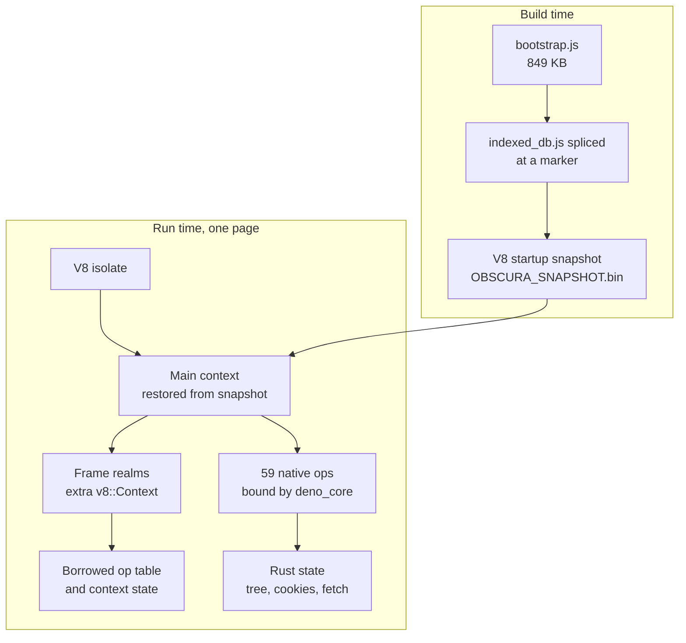
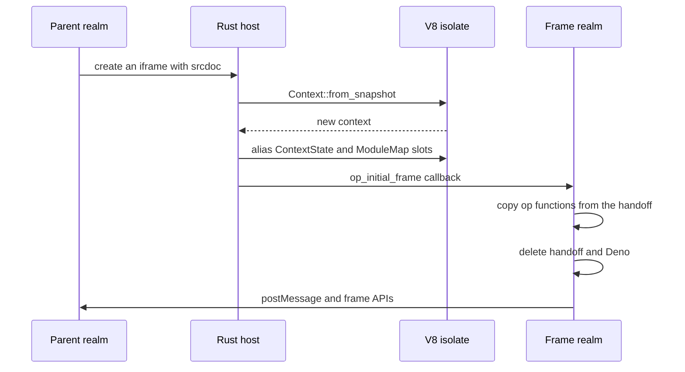

# 03 JavaScript runtime: a snapshot, an op table and no reachable bridge

Obscura runs page JavaScript on V8 through `deno_core`. Each page owns its own isolate. The browser environment, which is about 849 kilobytes of JavaScript, is not parsed when a page opens. It is compiled into a V8 startup snapshot at build time and restored from bytes at run time. The Rust side exposes 59 operations, and the page cannot reach any of them. The bootstrap captures the bridge in a private closure. The host then deletes the public globals before page script runs. The thesis of this document is that the runtime is defined by its two boundaries. The build-time boundary turns JavaScript into an immutable snapshot. The run-time boundary turns native work into an operation call that page script cannot address directly.

This document covers the snapshot build, the isolate, the operation table, the anti-panic rule, the frame realms, the timers and watchdogs, the module loader, and the limits. Document [02](02-dom-and-html.md) explains the tree behind `op_dom`. Document [04](04-browser-page-lifecycle.md) explains who owns a runtime.

## The problem

A script runtime inside a browser engine has five hard requirements.

1. **Startup must be fast.** A page that waits 100 milliseconds for its engine to parse its own shims is already slow.
2. **The bridge must be narrow.** Every native call is a place where page input reaches Rust.
3. **A page fault must not kill the process.** A bad script, a panic, or a runaway loop must stay inside one page.
4. **Isolation must be real.** Two pages must not share mutable JavaScript state.
5. **Network work must fit an event loop.** A module graph and a `fetch` call arrive asynchronously, and V8 is not `Send`.

The design answers each item with one mechanism.

| Requirement | Mechanism |
|-------------|-----------|
| Fast startup | One V8 startup snapshot, built once |
| Narrow bridge | One string-dispatch operation plus 58 typed operations |
| Page fault containment | `catch_unwind`, a heap guard, a watchdog that terminates one isolate |
| Isolation | One isolate per page, one realm per frame |
| Async network work | `deno_core` module loader and a `tokio` `LocalSet` |



## The snapshot

The binary embeds the snapshot as a byte array:

```rust
// crates/obscura-js/src/runtime.rs:46-55
static SNAPSHOT: &[u8] = include_bytes!(env!("OBSCURA_SNAPSHOT_PATH"));

/// Serialize first initialization (#430), then allow two snapshot restorations
/// at a time. Unbounded construction increases CPU and peak memory contention.
static ISOLATE_CREATE_LOCK: std::sync::Mutex<()> = std::sync::Mutex::new(());
static ISOLATE_CREATE_SECOND_LOCK: std::sync::Mutex<()> = std::sync::Mutex::new(());
static NEXT_ISOLATE_CREATE_SLOT: std::sync::atomic::AtomicUsize =
    std::sync::atomic::AtomicUsize::new(0);
static ISOLATE_INITIALIZED: std::sync::atomic::AtomicBool =
    std::sync::atomic::AtomicBool::new(false);
```

The first isolate creation is serialized. Later ones are allowed in pairs. The reason is in the comment: an unbounded number of simultaneous restorations raises central processing unit (CPU) time and peak memory. A server that starts 50 pages at once would otherwise run 50 snapshot restorations on the same cores.

The snapshot is a build artifact:

```rust
// crates/obscura-js/build.rs:13-20
    // Detect cross-compilation: build script runs on host, target differs.
    let target = std::env::var("TARGET").unwrap_or_default();
    let host = std::env::var("HOST").unwrap_or_default();
    let is_cross = target != host;

    let bootstrap_source = include_str!("js/bootstrap.js")
        .replace("/* INDEXED_DB */", include_str!("js/indexed_db.js"));
    let bootstrap_js = bootstrap_source.as_str();
```

Two source files become one script. `bootstrap.js` holds the browser environment, and `indexed_db.js` holds the Indexed Database implementation. The build splices the second into a marker in the first, so the shipped environment is one file with no run-time include.

A cross-compilation deserves a note, because a snapshot is architecture-specific. The build script says so and uses a target-specific `mksnapshot` tool:

```text
// crates/obscura-js/build.rs:23-29
        // Cross-compilation: the host V8 (linked into this build script) produces
        // snapshots for the host architecture, which crash on the target when
        // deserializing due to architecture-specific heap layout differences.
        //
        // Solution: use the target-specific `mksnapshot` tool (built by V8's GN
        // build system) which runs on the host but generates snapshots for the
        // target architecture. Then wrap the raw blob in deno_core's format.
```

A host-built snapshot restores a heap layout with host pointer sizes. That crashes on a different target. The `mksnapshot` route produces a target-compatible blob from the host machine.

The run-time construction then uses the snapshot:

```rust
// crates/obscura-js/src/runtime.rs:674-696
            // ICU falls back to the host OS locale when no default is set,
            // so Intl.* formats and resolvedOptions().locale leaked the
            // operator's real locale (an en-AU host showed en-AU) while
            // navigator.language and Accept-Language say en-US. Pin the one
            // locale the other surfaces claim (#734). This is process-global.
            // Set it under the first-creation lock, before parallel restorations.
            if !ISOLATE_INITIALIZED.load(std::sync::atomic::Ordering::Relaxed) {
                deno_core::v8::icu::set_default_locale("en-US");
            }

            let mut runtime = JsRuntime::new(RuntimeOptions {
                extensions: if cfg!(obscura_external_bootstrap) {
                    vec![deno_core::Extension {
                        name: "obscura_bootstrap",
                        ..Default::default()
                    }, build_extension()]
                } else {
                    vec![build_extension()]
                },
                module_loader: Some(module_loader),
                startup_snapshot: Some(SNAPSHOT),
                ..Default::default()
            });
```

The locale line is a fingerprint fix. International Components for Unicode (ICU) reads the host locale when the program does not set one. A page would then see the operator's locale in `Intl.DateTimeFormat().resolvedOptions().locale` while `navigator.language` reports `en-US`. One process-wide setting makes both surfaces agree.

**Aha:** The snapshot is why the runtime is both fast and constrained. The browser environment is parsed once, at build time, and every page restores it as a memory image. A page therefore pays only for its own scripts. The constraint is that everything that V8 makes global must be correct before the first restore: the locale, the flags, and the bootstrap itself. The source enforces that order with a one-shot lock and an atomic flag, because a late call to `V8::set_flags_from_string` is a fatal error rather than a no-op.

The flag rule is explicit:

```rust
// crates/obscura-js/src/v8_flags.rs:17-28
/// Apply user-supplied V8 flags exactly once, before the first isolate is
/// created.
///
/// `flags` is a raw V8 flag string in the same form V8/Chromium/Node accept
/// (e.g. `"--max-old-space-size=4096 --max-semi-space-size=64"`). An empty or
/// whitespace-only string is a no-op and does not consume the one-shot guard,
/// so a later non-empty call still takes effect.
///
/// V8 ignores `set_flags_from_string` once the platform is initialized, so the
/// first non-empty call must run before any `JsRuntime` is constructed.
/// Subsequent calls are silently dropped.
pub fn set_v8_flags(flags: &str) {
```

The documentation of the function says that later calls are dropped. The implementation keeps the call from reaching V8 at all, because V8's real behaviour is worse than the documentation. The comment in the guard names the actual failure: `V8_Fatal` and a `SIGTRAP` that ends the process. A warning replaces the abort.

## The isolate

One runtime is one isolate. The type holds the isolate and every V8-backed field above it:

```rust
// crates/obscura-js/src/runtime.rs:258-299
pub struct ObscuraJsRuntime {
    state: Rc<RefCell<ObscuraState>>,
    object_store: HashMap<String, String>,
    evaluation_recipes: HashMap<String, String>,
    object_counter: u64,
    import_map: Rc<RefCell<ImportMap>>,
    /// Loader-owned signal for pending dynamic-import graph fetches. This is
    /// intentionally separate from page fetch/XHR activity so analytics does
    /// not hold screenshot readiness open.
    module_load_activity: std::sync::Arc<ModuleLoadActivity>,
    /// Thread-safe handle to this runtime's V8 isolate, captured at
    /// construction. Lets a watchdog be armed from `&self` (the CDP dispatcher
    /// only holds `&Page` on the hot path) and is stable for the isolate's life.
    isolate_handle: IsolateHandle,
    /// Signals that V8 approached its configured heap limit. The callback
    /// terminates the current script and temporarily raises the limit just
    /// enough for V8 to unwind instead of aborting the worker process.
    heap_limit_state: std::sync::Arc<HeapLimitState>,
    /// Browser module-map evaluation is idempotent. deno_core 0.350 asserts if
    /// the same ModuleId is evaluated twice, so retain the first outcome for
    /// duplicate script tags and roots already seen by Obscura.
    module_evaluations: HashMap<deno_core::ModuleId, Result<(), String>>,
    /// Append-only record owned by the module loader. A cursor around each
    /// graph load identifies the dependency specifiers that become evaluated
    /// with its root.
    loaded_module_specifiers: Rc<RefCell<Vec<String>>>,
    /// Successful graph evaluation also evaluates every dependency. Remember
    /// those URLs so a dependency later encountered as a top-level script is a
    /// browser-style no-op instead of a second deno_core `mod_evaluate` call.
    evaluated_module_specifiers: HashMap<String, Result<(), String>>,
    /// The bound op table, taken from bootstrap at construction and removed from
    /// the global in the same step. Child frame realms are handed this object so
    /// their shims can call ops; nothing else can reach it, including page
    /// script.
    ops_handoff: Option<deno_core::v8::Global<deno_core::v8::Value>>,
    // Pending commands are runtime-owned, not client handles that releaseObjectGroup can discard.
    pending_cdp_evaluations: HashMap<String, v8::Global<v8::Value>>,
    // Keep the runtime last: custom `Drop` enters its isolate, then every
    // V8-backed field above is released before `OwnedIsolate` performs the
    // matching exit and disposes the isolate.
    js_runtime: JsRuntime,
}
```

The field order is a safety rule, and the last comment states it. Rust drops fields in declaration order. Every V8 handle must drop before the isolate that owns it, so `js_runtime` is last. A custom `Drop` also enters the isolate, so each handle is released while its isolate is the current one.

The isolate entry protocol is described in [01](01-workspace-and-architecture.md). The important point here is that the runtime is constructed, then exited, and entered again only around work that touches V8. The wrapper type that does this is `EnteredRuntime`.

## The private bridge

The bootstrap reads the deno_core bridge once and keeps it in a closure variable:

```javascript
// crates/obscura-js/js/bootstrap.js:4-8
// deno_core installs its privileged bridge in the page's V8 context. Capture
// it in this private bootstrap closure. The host removes the public global
// after deno_core finishes binding ops and before any page script runs. All
// browser APIs below close over this reference.
const __obscuraCore = globalThis.Deno.core;
```

Every browser Application Programming Interface (API) in the file closes over `__obscuraCore`. Page script cannot name that variable, because it is inside the bootstrap function scope.

A second global exists for child realms, and its own comment explains the handoff:

```javascript
// crates/obscura-js/js/bootstrap.js:112-118
// Handoff for child frame realms. deno_core binds ops into the main context
// only, so a realm restored from the snapshot arrives with its own empty
// private core reference. The host reads this to take the main realm's bound op table
// and to find each new realm's own table to fill, then deletes the global in
// the same step, so page script never sees it (see runtime.rs
// `take_ops_handoff` / `share_ops_with_realm`).
globalThis.__obscura_core_handoff = __obscuraCore;
```

The host reads it and deletes it before page script runs:

```rust
// crates/obscura-js/src/runtime.rs:796-827
    /// Takes the ops object bootstrap handed out, and removes the handoff from
    /// the global so page script can never reach `Deno.core.ops`.
    ///
    /// Bootstrap keeps the core reference in a private const. Once deno_core
    /// has bound the ops, this removes both public globals before page code can
    /// run, leaving the handoff as the host's only route to child realms.
    fn take_ops_handoff(&mut self) -> Option<deno_core::v8::Global<deno_core::v8::Value>> {
        use deno_core::v8;

        let main = self.runtime().main_context();
        let mut entered = self.runtime();
        let isolate = entered.v8_isolate();
        v8::scope!(let scope, isolate);
        let context = v8::Local::new(scope, main);
        let scope = &mut v8::ContextScope::new(scope, context);

        let handoff_key = v8::String::new(scope, "__obscura_core_handoff")?;
        let deno_key = v8::String::new(scope, "Deno")?;
        let ops_key = v8::String::new(scope, "ops")?;
        let global = context.global(scope);

        let core = global.get(scope, handoff_key.into())?;
        let core = core.to_object(scope)?;
        let ops = core.get(scope, ops_key.into())?;
        if !ops.is_object() {
            return None;
        }
        let ops = v8::Global::new(scope, ops);
        global.delete(scope, handoff_key.into());
        global.delete(scope, deno_key.into());
        Some(ops)
    }
```

Three lines do the security work: two `delete` calls and one saved handle. The page's global object no longer has `Deno`, and it no longer has `__obscura_core_handoff`. The only reference to the operation table is a Rust `v8::Global`.

The result is a page environment with browser APIs but no native bridge. `document.querySelector` works, because the shim closes over the bridge. `Deno.core.ops.op_dom("...")` fails, because `Deno` is undefined.

## The operation table

The extension registers 59 operations:

```rust
// crates/obscura-js/src/ops.rs:7760-7764
pub fn build_extension() -> Extension {
    let mut ops = vec![
        op_dom(),
        op_script_mark_started(),
        op_script_try_start(),
```

The first operation is the general DOM route. The others are typed: cookies, storage, Indexed Database, fetch, navigation, frames, bindings, console, crypto, timers, and input. One operation is a dispatcher over a command string:

```rust
// crates/obscura-js/src/ops.rs:2093-2106
    state: &OpState,
    #[string] cmd: String,
    #[string] arg1: String,
    #[string] arg2: String,
    frame_id: u32,
) -> String {
    let shared = frame_state(state, frame_id);
    // Anti-panic boundary: a panic in a DOM op would unwind through deno_core
    // into V8's FFI frame, where V8_Fatal calls abort(3) and takes the whole
    // engine (and every CDP client) down. Catch it so one malformed selector or
    // inconsistent tree node degrades to a null result for that single call.
    // No per-call clone: on the happy path this is just a landing pad, so the
    // hot DOM path (querySelector/getAttribute/...) pays nothing measurable.
    std::panic::catch_unwind(std::panic::AssertUnwindSafe(move || {
```

The signature takes strings and returns a string. The command name selects a branch, and the two arguments carry the parameters. The reply is JavaScript Object Notation (JSON) text that the shim parses. The frame identifier selects the realm.

That shape is a deliberate trade.

- **The cost is parsing.** Every DOM operation crosses a JSON boundary, and a string argument must be escaped.
- **The gain is one native entry point.** A new DOM method is a new branch in `op_dom_inner`, not a new V8 binding. The operation count stays small, and the shim owns the API surface.
- **The gain is the panic boundary.** One `catch_unwind` covers every DOM operation, so a malformed selector returns `null` instead of aborting the process.

The `catch_unwind` is not a general safety net for all native code. The comment in `Cargo.toml` explains the same rule at the workspace level, and [01](01-workspace-and-architecture.md) quotes it.

## Frame realms

An `iframe srcdoc` gets a real V8 context inside the same isolate. The context is restored from the same snapshot:

```rust
// crates/obscura-js/src/runtime.rs:763-794
    /// The startup snapshot already contains the whole bootstrap (see
    /// `build.rs`), so a context restored from it arrives with every DOM class
    /// and shim installed. Building a realm is therefore a context restore, not
    /// a re-parse of the whole bootstrap.
    ///
    /// The new context has no ops: deno_core binds those into the main context
    /// only. Use [`Self::share_ops_with_realm`] to give it the same `Deno.core`
    /// object, which is legal because native function objects are shareable
    /// between contexts of one isolate.
    pub(crate) fn create_realm_context(
        &mut self,
    ) -> Option<deno_core::v8::Global<deno_core::v8::Context>> {
        let context = {
            let mut entered = self.runtime();
            let isolate = entered.v8_isolate();
            deno_core::v8::scope!(let scope, isolate);
            let context = deno_core::v8::Context::from_snapshot(
                scope,
                1,
                deno_core::v8::ContextOptions::default(),
            )
            .or_else(|| {
                deno_core::v8::Context::from_snapshot(
                    scope,
                    0,
                    deno_core::v8::ContextOptions::default(),
                )
            })?;
            deno_core::v8::Global::new(scope, context)
        };
        Some(context)
    }
```

`from_snapshot` takes a context index. The call tries index 1 and falls back to index 0. That is a version tolerance: the snapshot may contain one or two contexts, depending on how it was built.

A realm needs more than an operation table. deno_core keeps per-context state in two embedder-data slots, and a snapshot context has null slots. The source aliases the main context's pointers:

```rust
// crates/obscura-js/src/runtime.rs:851-871
    /// Points a child realm's `Deno.core.ops` at the main realm's ops object.
    ///
    /// A realm restored from the snapshot has its own `Deno.core` with an empty
    /// ops table, and its bootstrap captured that exact object, so filling the
    /// `ops` table on it is enough to give every shim in that realm a working
    /// op surface. The functions are shared, not copied: same isolate.
    /// deno_core's isolate-global promise-reject and dynamic-`import()`
    /// callbacks read per-context state from V8's `ContextState` and
    /// `ModuleMap` embedder-data slots in the *current* context. A
    /// snapshot-created frame realm leaves those slots null, so a promise
    /// rejection or dynamic import inside a frame null-dereferenced in
    /// deno_core's `clone_rc_raw` and segfaulted the whole process (#850, #841).
    /// Alias the main context's slot pointers into the frame context so those
    /// callbacks resolve to the main realm's state instead of crashing.
    ///
    /// Safe: the frame context only *borrows* these pointers. The callbacks
    /// `clone_rc_raw` (increment then drop) them — net-zero on the strong count
    /// — and obscura never tears a frame context down through deno_core's
    /// `Rc::from_raw` destroy path (only the main realm owns and frees the Rc),
    /// so no double-free is possible.
    pub(crate) fn share_deno_context_state_with_realm(
```

The comment is a proof of memory safety, and it names two issues. A frame realm borrows the pointers. The main realm owns and frees them. The callbacks increment and decrement the count, so the net change is zero.

The bootstrap side then copies the operation table into the child realm's own object:

```javascript
// crates/obscura-js/js/bootstrap.js:15392-15397
  const frameId = __obscuraCore.ops.op_initial_frame(_realmFrameId, (child, id, sandboxOpaque) => {
    opaque = sandboxOpaque;
    const core = child.__obscura_core_handoff;
    for (const name of Object.keys(__obscuraCore.ops)) core.ops[name] = __obscuraCore.ops[name];
    delete child.__obscura_core_handoff;
    delete child.Deno;
```

The child gets the same native functions, not copies of the code. The two globals are deleted in the child as well. A sandbox without `allow-same-origin` gets an opaque realm, and the source checks the attribute before it builds the realm.



## Fault containment

The runtime has three guards, and each one bounds a different failure.

**The heap guard** acts before V8's own out-of-memory abort:

```rust
// crates/obscura-js/src/runtime.rs:155-173
fn install_heap_limit_guard(
    runtime: &mut JsRuntime,
    isolate_handle: IsolateHandle,
    state: std::sync::Arc<HeapLimitState>,
) {
    runtime.add_near_heap_limit_callback(move |current_limit, _initial_limit| {
        let _ = state.restore_limit.compare_exchange(
            0,
            current_limit,
            std::sync::atomic::Ordering::SeqCst,
            std::sync::atomic::Ordering::SeqCst,
        );
        state
            .tripped
            .store(true, std::sync::atomic::Ordering::SeqCst);
        isolate_handle.terminate_execution();
        current_limit.saturating_add(HEAP_LIMIT_RECOVERY_HEADROOM_BYTES)
    });
}
```

The callback stores the limit, marks the trip, terminates the script, and raises the limit by a fixed headroom. The raise is the important part: V8 must allocate a little memory to unwind. A script that hits the cap therefore ends with an error, and the process survives.

**The command watchdog** bounds a remote command:

```rust
// crates/obscura-js/src/cdp_watchdog.rs:1-11
//! Shared per-command V8 watchdog for the CDP server.
//!
//! One long-lived watchdog thread bounds every in-flight V8 command with a
//! deadline, instead of spawning and joining a thread per command (which adds
//! ~240us per command on the hot dispatch path). `arm` and `disarm` are a mutex
//! plus a condvar notify, in the low microseconds.
//!
//! With the thread-per-connection server (issue #430) several connections can
//! have a command armed at the same time (one isolate per connection, each on
//! its own OS thread), so a single global slot would let one connection's arm
//! overwrite another's and leave that command unbounded. The watchdog therefore
```

One thread, a map of armed slots, and a condition variable. A slot holds a deadline and an `IsolateHandle`. When a deadline passes, the thread calls `terminate_execution` on that one isolate. The default command budget is 60 seconds, and `OBSCURA_CDP_COMMAND_TIMEOUT_MS` changes it.

**The error classifier** decides whether an event-loop error ends the page:

```rust
// crates/obscura-js/src/runtime.rs:184-193
/// deno_core reports a task's uncaught exception and an unhandled promise
/// rejection as an event-loop error, but a browser treats both as page-local:
/// window.onerror / unhandledrejection fire and later tasks still run. Only
/// engine-level failures (watchdog termination, the heap cap, an exhausted
/// task budget) make the loop itself unusable. (#699)
pub fn is_fatal_event_loop_error(error: &str) -> bool {
    error.contains("execution terminated")
        || error.contains("heap limit exceeded")
        || error.contains("task budget")
}
```

A page that throws an exception is not an engine failure. A page that V8 terminated is. The classifier draws that line by the error text, which is brittle in general and stable here, because all three strings come from deno_core or from this crate.

## Modules and network work

The module loader owns a separate activity counter:

```rust
// crates/obscura-js/src/module_loader.rs:22-30
/// Observable network activity for ES-module graphs.
///
/// deno_core keeps dynamic-import state inside its private module map. The
/// browser lifecycle still needs to distinguish a genuinely idle page from a
/// graph whose fetch future is being advanced in short event-loop slices. A
/// loader-owned counter provides that signal without treating unrelated
/// fetch/XHR analytics as render-blocking work.
#[derive(Debug, Default)]
pub(crate) struct ModuleLoadActivity {
```

The counter exists because the lifecycle needs one question answered: is a module graph still loading? A general fetch counter would answer "yes" for an analytics beacon and would hold a screenshot open for no reason. The loader's counter covers exactly the imports that can delay a page's readiness.

The loader also resolves imports through an import map and through a proxy. A classic script gets a code cache:

```rust
// crates/obscura-js/src/runtime.rs:75-103
const CLASSIC_CODE_CACHE_BYTES: usize = 32 * 1024 * 1024;
// ponytail: bounded FIFO; only add LRU bookkeeping if eviction profiles justify it.
static CLASSIC_CODE_CACHE: std::sync::Mutex<std::collections::VecDeque<ClassicCodeCacheEntry>> =
    std::sync::Mutex::new(std::collections::VecDeque::new());

fn cached_classic_code(origin: &str, name: &str, source: &str) -> Option<std::sync::Arc<[u8]>> {
    let cache = CLASSIC_CODE_CACHE.lock().unwrap_or_else(|error| error.into_inner());
    cache.iter().rev().find(|entry| {
        entry.origin == origin && entry.name == name && entry.source == source
    }).map(|entry| entry.data.clone())
}

fn remember_classic_code(origin: &str, name: &str, source: &str, data: &[u8]) {
    let bytes = origin.len() + name.len() + source.len() + data.len();
    if bytes > CLASSIC_CODE_CACHE_BYTES {
        return;
    }
    let mut cache = CLASSIC_CODE_CACHE.lock().unwrap_or_else(|error| error.into_inner());
    cache.retain(|entry| entry.origin != origin || entry.name != name);
    let mut used = cache.iter().map(ClassicCodeCacheEntry::bytes).sum::<usize>();
    while used + bytes > CLASSIC_CODE_CACHE_BYTES || cache.len() >= 64 {
        let Some(old) = cache.pop_front() else { break };
        used -= old.bytes();
    }
    cache.push_back(ClassicCodeCacheEntry {
        origin: origin.to_string(), name: name.to_string(), source: source.to_string(),
        data: std::sync::Arc::from(data),
    });
}
```

The cache holds compiled V8 code, keyed by origin, name, and source text. It is a process-wide `Mutex`, because compiled code is not page state. The bound is 32 MiB and 64 entries, with first-in-first-out eviction. The comment uses the word `ponytail` for a deliberately minimal design; the author accepts a FIFO until a profile shows a need for least-recently-used order.

The key includes the source text, not only the URL. A changed script therefore gets a new entry, and a cached entry can never stand in for different bytes.

## Limits

| Limit | Value | Where |
|-------|-------|-------|
| Native operations | 59 | `build_extension` |
| Bootstrap source | About 849 KiB | `js/bootstrap.js` |
| Indexed Database source | About 39 KiB | `js/indexed_db.js` |
| Classic code cache | 32 MiB and 64 entries | Classic script cache |
| Concurrent isolate restorations | 2 after the first | Creation locks |
| CDP command budget | 60 seconds | `OBSCURA_CDP_COMMAND_TIMEOUT_MS` |
| Heap recovery headroom | A fixed byte allowance | `install_heap_limit_guard` |
| Locale pin | `en-US` | First isolate creation |

Five limits are not in the table.

1. **The op reply is a JSON string.** A large DOM response costs a parse in JavaScript, and the bridge has no binary path.
2. **A frame realm shares one isolate.** A page with many iframes shares one heap and one thread, so one frame can exhaust the budget of all of them.
3. **The heap guard is a near-limit callback.** It acts just below the limit. A single allocation larger than the headroom can still fail before V8 calls the callback.
4. **The command watchdog terminates the isolate.** It does not unwind the Rust stack. The page is left in a terminated state until it is reset.
5. **A sandboxed frame with no `srcdoc` gets no realm.** The bootstrap returns false for that case, so the frame has no document to script.

## Related documents

- [01 Workspace and architecture](01-workspace-and-architecture.md) explains the crate ladder, the isolate entry protocol, and the panic rule.
- [02 DOM and HTML](02-dom-and-html.md) explains the tree that `op_dom` commands mutate.
- [04 Browser and page lifecycle](04-browser-page-lifecycle.md) explains navigation, the script deadline, and `awaitLoad`-style waits.
- [06 CDP server](06-cdp-server.md) explains the dispatcher that arms the command watchdog.
