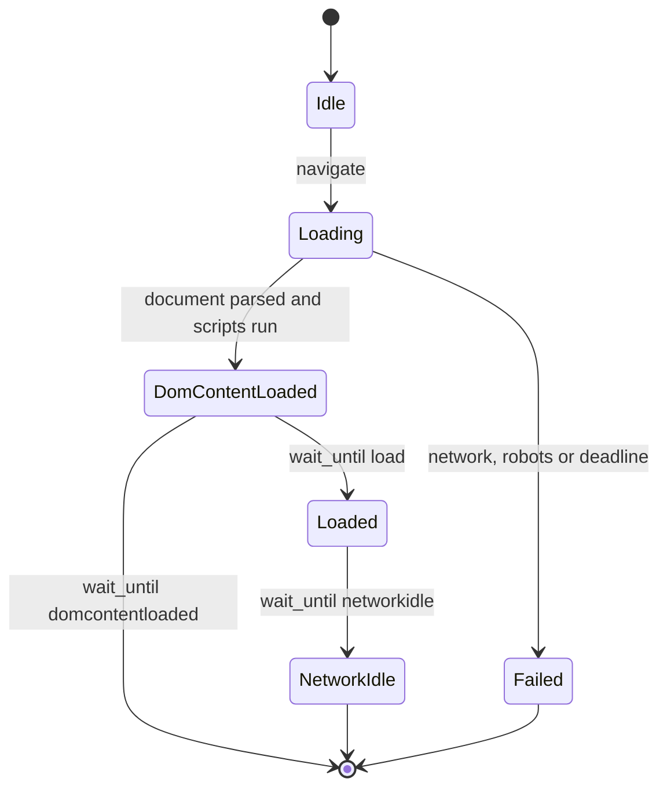
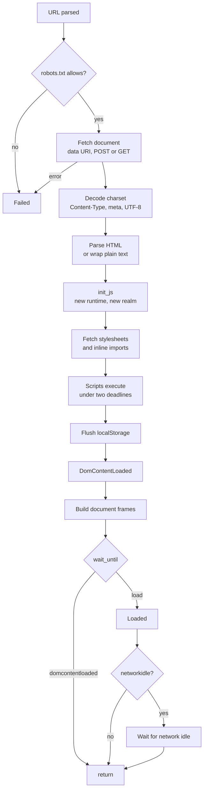
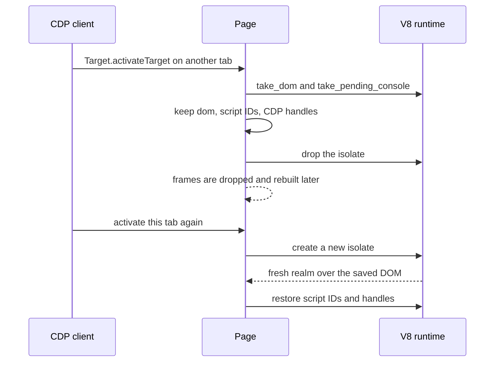

# 04 Browser and page lifecycle: four clocks and one state machine

A page in Obscura is a `Page` object that owns a document tree, one JavaScript runtime, and a lifecycle state. Navigation is not one request. It is a pipeline with four independent time limits: a navigation deadline, a script-execution deadline, a network-idle deadline, and a settle window. The thesis of this document is that the lifecycle state is the only part a client can observe. The clocks decide whether the state is reached at all. The code keeps them separate on purpose. A client asks for `load`, `domcontentloaded`, or `networkidle0`, and the server translates that word into a state machine transition and a set of deadlines.

This document covers the page and context objects, the four clocks, the navigation pipeline, script execution, frame building, tab suspension, and persistent storage. Document [03](03-javascript-runtime.md) explains the runtime that a page owns. Document [06](06-cdp-server.md) explains the protocol that reads the lifecycle.

## The problem

A headless browser has five lifecycle requirements that conflict with each other.

1. **A page must be observed at a defined moment.** A client that reads the document tree while it is still parsing sees a different page.
2. **A page must not run without a limit.** A page can issue a synchronous loop, a redirect chain, or an endless timer.
3. **A frame belongs to a document.** A frame is not a top-level page, and it must not add a second unbounded budget.
4. **A tab switch must not lose state.** Chromium keeps a background tab alive, and a client that switches back must find its handles intact.
5. **Storage must outlive a document.** `localStorage` belongs to an origin, not to a realm.

The design answers each item with one mechanism.

| Requirement | Mechanism |
|-------------|-----------|
| A defined observation point | `LifecycleState` and `WaitUntil` |
| A bounded page | Four deadlines and a watchdog per phase |
| Frames belong to a document | `PendingFrameWork` queue with a bounded number of rounds |
| A tab switch keeps state | `suspend_js` and `resume_js` around a retained DOM |
| Storage outlives a document | Storage in `BrowserContext` and `Page`, not in the realm |

## The two objects

A `BrowserContext` holds what pages share:

```rust
// crates/obscura-browser/src/context.rs:7-23
pub struct BrowserContext {
    pub id: String,
    pub cookie_jar: Arc<CookieJar>,
    /// `localStorage` backing store, keyed by origin. Owned by the context
    /// rather than by a V8 realm, so an entry written in one document is still
    /// there in the next (issue #678).
    pub local_storage: Arc<OriginStorage>,
    pub indexed_db: Arc<obscura_js::indexed_db::IndexedDbStorage>,
    pub http_client: Arc<ObscuraHttpClient>,
    pub user_agent: String,
    pub platform: String,
    pub ua_platform: String,
    pub ua_platform_version: String,
    pub proxy_url: Option<String>,
    pub robots_cache: Arc<RobotsCache>,
    pub obey_robots: bool,
    pub stealth: bool,
```

The context is the profile. Cookies, `localStorage`, Indexed Database, the HyperText Transfer Protocol client, and the robots cache are shared by every page in it. Two contexts share nothing mutable. `isolated_copy` gives a second context its own network state, and an incognito copy starts empty.

A `Page` holds what belongs to one tab:

```rust
// crates/obscura-browser/src/page.rs:239-251
pub struct Page {
    pub id: String,
    pub frame_id: String,
    pub url: Option<Url>,
    pub dom: Option<DomTree>,
    /// Live child frame realms, in creation order. Declared before `js` on
    /// purpose: a realm holds a V8 handle into that isolate, and fields drop in
    /// declaration order, so the frames must go first.
    pub frames: Vec<FrameRealm>,
    pub js: Option<ObscuraJsRuntime>,
    pub lifecycle: LifecycleState,
    pub http_client: Arc<ObscuraHttpClient>,
    pub context: Arc<BrowserContext>,
```

The comment on `frames` is a safety rule, and it repeats the rule in [03](03-javascript-runtime.md) for the runtime struct. Rust drops fields in declaration order. A frame realm holds a V8 handle into the page isolate, so the frames must drop before the isolate does. The order is not stylistic; the reverse order would free a handle after its isolate is gone.

`session_storage` is the one store on the page rather than on the context:

```rust
// crates/obscura-browser/src/page.rs:252-256
    /// `sessionStorage` backing store, keyed by origin. Owned by the Page rather
    /// than by the realm: `init_js` runs on every navigation and on CDP target
    /// switching, but a session entry must survive both while never leaving the
    /// tab (issue #678).
    session_storage: Arc<OriginStorage>,
```

The three storage lifetimes are therefore distinct. A cookie belongs to the context and to the disk. A `localStorage` entry belongs to the context and to the origin. A `sessionStorage` entry belongs to the page and to the origin, and it dies with the tab.

## The state machine

Six states are visible:

```rust
// crates/obscura-browser/src/lifecycle.rs:1-9
#[derive(Debug, Clone, Copy, PartialEq, Eq)]
pub enum LifecycleState {
    Idle,
    Loading,
    DomContentLoaded,
    Loaded,
    NetworkIdle,
    Failed,
}
```

The query words are separate, because a client's word is not a state:

```rust
// crates/obscura-browser/src/lifecycle.rs:25-31
#[derive(Debug, Clone, Copy, PartialEq, Eq)]
pub enum WaitUntil {
    Load,
    DomContentLoaded,
    NetworkIdle0,
    NetworkIdle2,
}
```

```rust
// crates/obscura-browser/src/lifecycle.rs:33-42
impl WaitUntil {
    pub fn from_str(s: &str) -> Self {
        match s {
            "domcontentloaded" => WaitUntil::DomContentLoaded,
            "networkidle0" | "networkIdle" | "networkidle" => WaitUntil::NetworkIdle0,
            "networkidle2" => WaitUntil::NetworkIdle2,
            _ => WaitUntil::Load,
        }
    }
}
```

The parser is total. An unknown word becomes `Load`, not an error, because the Puppeteer and Playwright clients send their own spellings and a rejected word would fail a client for a cosmetic reason.



`is_loaded` treats `Loaded` and `NetworkIdle` as the same answer for a caller that asks whether the page is ready. `is_network_idle` is strict, because a screenshot after a network-idle wait must not run during `Loaded`.

## The four clocks

| Clock | Default | Scope | Override |
|-------|---------|-------|----------|
| Navigation deadline | 30 seconds | One `navigate` call, including the whole client-navigation chain | `OBSCURA_NAV_TIMEOUT_MS` or a page-scoped timeout |
| Script-execution deadline | 30 seconds | The script phase of one document | `OBSCURA_SCRIPT_DEADLINE_MS` |
| Script phase watchdog | Deadline plus 1 second | Terminates the isolate | None |
| Network-idle deadline | 5 seconds | The network-idle wait, with a 500 millisecond quiet window | None |
| Settle quiescence window | 150 milliseconds | The post-load event-loop pass | `OBSCURA_STRICT_SETTLE` |
| Frame rounds | 8 rounds of 50 milliseconds | Attaching frames to a document | None |

The navigation deadline is the outermost one:

```rust
        // Hard ceiling on a single end-to-end navigation. Without this a slow
        // primary fetch or a runaway settle loop can hold the V8 lock for
        // arbitrarily long (we've measured 60+ seconds on JS-heavy news
        // sites), wedging every other in-flight CDP request because the
        // dispatcher holds the lock across the entire handler. 30 seconds
        // matches reqwest's default per-request timeout — the worst case is
        // one slow primary GET plus one slow JS-redirect chain step. Override
        // with `OBSCURA_NAV_TIMEOUT_MS=NN`, or set a page-scoped deadline when
        // the automation request already has an explicit timeout.
        let nav_timeout = self.navigation_timeout();
        let nav_timeout_ms = duration_millis_u64(nav_timeout);
```

The comment names the second cost that a deadline removes. The central dispatch loop holds a lock on the page across a command, so a navigation that runs for 60 seconds also blocks every other command on that page. The deadline is not only a user-experience rule; it is a concurrency rule.

The script deadline has a different shape, because a JavaScript deadline cannot rely on a future:

```rust
        // Hard backstop over the WHOLE script-execution phase. Inline scripts
        // run back-to-back with no await between them, so neither the soft
        // deadline above (only checked between scripts) nor the per-script guard
        // can interrupt a page that burns the budget across many synchronous
        // scripts (the real-world SPA / anti-bot busy-loop hang). This watchdog
        // terminates the isolate if cumulative synchronous script work overruns.
        let exec_wd = self
            .js
            .as_mut()
            .map(|js| js.arm_watchdog(std::time::Duration::from_millis(script_deadline_ms + 1000)));
```

The soft deadline is checked between scripts. A page whose first inline script never returns passes no check, so the hard watchdog is the only thing that ends it. One second of separation lets a script that finishes just at the soft deadline avoid termination.

The network-idle wait has its own watchdog, armed `500` milliseconds past the deadline:

```rust
    async fn wait_for_network_idle(&mut self, threshold: u32) {
        // Same hazard as the post-script settle: a synchronous poll can pin
        // the thread past the 5s network-idle deadline, so arm a watchdog
        // that terminates the isolate ~500ms past it.
        let netidle_wd = self
            .js
            .as_mut()
            .map(|js| js.arm_watchdog(std::time::Duration::from_millis(5500)));
        let deadline = tokio::time::Instant::now() + tokio::time::Duration::from_secs(5);
```

The same hazard appears three times in the code. A Tokio timeout cancels a future at an `await` point. It cannot cancel synchronous work. Every phase that can run synchronous page work therefore gets a watchdog, and the watchdog acts on the V8 isolate rather than on the Rust task.

**Aha:** The four clocks are not four variants of "wait for the page". They measure different failure modes. The navigation deadline bounds the network. The script deadline bounds the parser and the page code. The idle deadline bounds a page whose traffic never settles. The settle window bounds asynchronous work after the load event. A design with one clock must set it to the slowest phase, and then a slow network hides a hanging script. Four clocks let each phase fail on its own terms.

## The navigation pipeline

The public entry point is small, and both wait variants share one implementation:

```rust
// crates/obscura-browser/src/page.rs:3017-3020
    pub async fn navigate(&mut self, url_str: &str) -> Result<(), PageError> {
        self.navigate_with_wait(url_str, crate::lifecycle::WaitUntil::Load)
            .await
    }
```

The outer function applies the deadline. The inner function applies the client-navigation chain:

```rust
    async fn navigate_with_wait_post_inner(
        &mut self,
        url_str: &str,
        wait_until: crate::lifecycle::WaitUntil,
        method: &str,
        body: &str,
        initial_referrer: &str,
    ) -> Result<(), PageError> {
        // file:// is a local file read. Every client route (CLI, CDP's
        // Page.navigate/reload/history and Target.createTarget, the MCP
        // tools) ends up here, so the context's opt-in is enforced once
        // instead of being copied into each handler, where a route that
        // missed its copy read local files (#1069).
        if url_is_file_scheme(url_str) && !self.context.allow_file_access {
            return Err(PageError::NetworkError(format!(
                "file:// navigation is disabled for this browser context: {url_str}"
            )));
        }
```

The file gate is in this function because this function is the single entry point for every route. The comment records the alternative: a copy of the check in each handler, one of which will be forgotten. That bug is issue `#1069`, and the fix moved the check down to the shared path.

The chain loop handles page script that navigates during a load:

```rust
// crates/obscura-browser/src/page.rs:3343-3354
        let chain_limit = self.navigation_chain_limit();
        for chain in 0..chain_limit {
            self.navigate_single(
                &current_url,
                wait_until,
                &current_method,
                &current_body,
                &document_referrer,
            )
            .await?;
            if let Some((next_url, next_method, next_body)) = self.take_pending_navigation() {
                if cross_scheme_to_file(&current_url, &next_url) {
```

The limit is 10 by default, and the first navigation counts. A page that sets `location` on every load hits the limit and gets an error:

```rust
// crates/obscura-browser/src/page.rs:3386-3392
                if chain + 1 == chain_limit {
                    // Hit the cap and the page still wants to keep
                    // chaining. Surface that as an error instead of
                    // returning Ok(()) so callers can distinguish a
                    // successful load from a navigation storm.
                    return Err(PageError::TooManyClientNavigations(chain_limit));
                }
```

An ordinary HyperText Transfer Protocol redirect is not a link in this chain. The network layer follows 3xx responses, and its own limit reports `TooManyRedirects`. The chain counts only navigations that page script starts, which is the case that can loop forever.

Inside one chain step, the pipeline runs in a fixed order:



Two steps deserve attention. The first is the plain-text rule:

```rust
        // A non-HTML text response is a plain-text document, not an HTML one
        // that happens to hold text: every `<word>` in a .txt or .md body
        // would otherwise be parsed as an element and its contents dropped
        // from textContent (#1231). Chrome wraps the decoded text in a
        // single <pre> instead.
```

A text file is wrapped in one `pre` element. Without the rule, an angle bracket in a text file silently deletes text, and a client that asks for the page text gets a partial document.

The second is the order of script execution and the ready state:

```rust
// crates/obscura-browser/src/page.rs:3623-3629
        // Spec: DOMContentLoaded fires AFTER parser-blocking scripts run,
        // not before. Skipping execute_scripts() on the DCL path meant
        // every inline <script> in the page was silently dropped: form
        // listeners never registered, frameworks never bootstrapped,
        // page.click() handlers were no-ops. Now scripts run regardless
        // of waitUntil and DCL means "DOM parsed AND scripts executed".
        self.execute_scripts().await;
```

The comment states a design choice with a cost. `DomContentLoaded` means "the parser finished and the document's scripts have run". A browser would fire the event at the parser boundary and run blocking scripts before it. The server runs scripts first and sets the state after, because a client that asked for the early state still expects a usable page. The early state is therefore later than its name.

## Script execution

The script phase collects every script element first, then drives two queues:

```rust
// crates/obscura-browser/src/page.rs:2167-2177
    async fn drive_pending_scripts(
        js: &mut ObscuraJsRuntime,
        deadline: tokio::time::Instant,
        pending: fn(&mut ObscuraJsRuntime) -> bool,
        label: &str,
    ) -> bool {
        while pending(js) {
            let Some(remaining) = deadline.checked_duration_since(tokio::time::Instant::now())
            else {
                return false;
            };
```

The two queues are parser-blocking scripts and load-delaying scripts. They stay separate because they have different lifecycle meaning. A parser-blocking script must finish before the document is complete. A load-delaying script, such as a `defer` script, must finish before the load event but can overlap with later parsing work.

A page script that throws does not stop the pump:

```rust
                Ok(Err(error)) => {
                    if obscura_js::runtime::is_fatal_event_loop_error(&error) {
                        tracing::warn!("{label} script event loop failed: {error}");
                        return false;
                    }
                    // A load-delaying script threw or left an unhandled
                    // rejection. Chrome reports the error and runs the rest;
                    // killing the pump would strand every still-pending script
                    // (#699). The absolute deadline above bounds a page that
                    // errors on every turn.
                    tracing::warn!("{label} script task error, continuing: {error}");
                    tokio::task::yield_now().await;
                }
```

The classifier from [03](03-javascript-runtime.md) decides the branch. A page error is page-local. A terminated isolate, a heap-limit stop, or an exhausted task budget is engine-level.

The parser marks every script element before any page code runs:

```rust
// crates/obscura-browser/src/page.rs:2384-2387
        // HTML scripts have an "already started" flag. Mark every
        // parser-discovered script before running page code so React/Next
        // hydration can move or hoist those nodes without appendChild
        // executing them a second time.
```

This is the "already started" flag from the HTML standard. A framework often moves a script element during hydration. Without the mark, the move would execute the script again, and a page would double its own initialization.

## Frames

A document's frames are built during navigation, not during a later settle:

```rust
// crates/obscura-browser/src/page.rs:3755-3760
    /// Builds the child frames of the document that just loaded.
    ///
    /// Loading a document includes loading the frames in it, so this belongs to
    /// navigation rather than to `settle`: a CDP client that only navigates
    /// would otherwise be told the page has no frames, because nothing had
    /// given them realms yet.
```

The comment names a real client failure. Puppeteer and Playwright send `Page.navigate` with no `waitUntil` value, so the navigation returns at the earliest state. A frame built only during settle would not exist for those clients.

The build is bounded:

```rust
        // How many rounds of "attach a frame, let it start its own" to follow.
        // A frame can add a frame, so this needs a bound rather than a loop
        // until quiet: a page that adds one on every turn would never finish.
        const ROUNDS: usize = 8;
        const ROUND_MS: u64 = 50;
```

One round attaches each fetched frame, gives it a realm, and lets it run. The loop stops when a round does nothing. The round count and the per-round time are the frame clock from the table above.

`advance_frames` also delivers messages:

```rust
    /// Moves the frame tree forward by one step: give any fetched frame
    /// document a realm, then hand on any message waiting for a realm.
    ///
    /// Reports whether anything happened, so a caller can pump again. A new
    /// frame runs scripts that can post, and a message usually causes a reply,
    /// so neither queue is finished until both are quiet.
    async fn advance_frames(&mut self) -> bool {
```

The return value is the loop condition. A frame that posts a message during its first script keeps the loop alive, and a frame that does nothing lets it end.

## Settling

`settle` drives deferred work after the load event:

```rust
    /// Drive the JS event loop after navigation so deferred work can run:
    /// pending timers (setTimeout / setInterval), queued microtasks, in-flight
    /// fetches, and completion callbacks such as testharness's
    /// `add_completion_callback`. Returns as soon as the loop goes idle, or
    /// after `max_ms`. Without this the page is observed exactly as it stood at
    /// the load event, before any async work settles, which silently strands
    /// timer-driven tests and dynamic pages.
```

The loop uses a quiescence window, not an empty queue:

```rust
// crates/obscura-browser/src/page.rs:3095-3101
                    // A deno_core event loop remains "busy" for any future timer,
                    // including analytics intervals and animation loops which do
                    // not make the page more ready. Require a short window without
                    // observable document/network/script activity instead. The
                    // absolute caller budget and V8 watchdog still bound both
                    // asynchronous work and synchronous microtask storms.
                    let _ = js.run_event_loop_until_quiescent(remaining, 150).await;
```

A page with a one-second analytics interval is never idle in the strict sense. It is quiet for 150 milliseconds, and that is the signal the server uses. The alternative, waiting for an empty queue, would wait until the page is closed.

The loop alternates with frame work, because a frame that attaches can start more work:

```rust
// crates/obscura-browser/src/page.rs:3082-3086
        // Pump, then give any frame document that finished fetching a realm of
        // its own. Attaching one runs its scripts, which can start timers,
        // fetches and further frames, so keep alternating until no new frame
        // appears or the budget is gone (issue #600).
        loop {
```

A strict mode exists for tests:

```rust
// crates/obscura-browser/src/page.rs:3092-3094
                if std::env::var_os("OBSCURA_STRICT_SETTLE").is_some() {
                    Self::settle_runtime_for_duration(js, remaining).await;
                } else {
```

Set `OBSCURA_STRICT_SETTLE` to pump the loop for the full duration instead of stopping at quiescence. The mode is a test tool, not a production setting, because it makes every page cost its full budget.

## Suspension and resumption

A tab switch in Chromium keeps the tab alive. Obscura does not keep a V8 isolate for a background tab, so it keeps everything else and rebuilds the runtime:

```rust
// crates/obscura-browser/src/page.rs:4772-4793
        let started_script_ids = js.started_script_ids();
        self.navigation_timing = js.navigation_timing();
        // Preserve console messages logged before suspension: dropping the
        // runtime below would otherwise lose any not yet drained (#971).
        let pending_console = js.take_pending_console_messages();
        self.suspended_cdp_object_state = js.take_cdp_object_state();
        let dom = js.take_dom();
        if let Some(dom) = dom {
            self.dom = Some(dom);
            self.suspended_started_script_ids = started_script_ids;
        } else {
            self.suspended_started_script_ids.clear();
        }
        // Every frame realm holds a V8 handle into this isolate, so the frames
        // go before the runtime does — the same order init_js keeps on a new
        // document. Suspending is a teardown of the realm the frames live in,
        // and a realm cannot be suspended and resumed the way the page's DOM
        // can, so they are rebuilt when the page next loads a document.
        self.pending_frame_work.clear();
        self.frames.clear();
        self.suspended_console_messages.extend(pending_console);
        self.js = None;
```

The DOM survives, and the runtime does not. Four pieces of state cross the gap: the DOM tree, the set of started script identifiers, the CDP object handles, and undrained console messages. `resume_js` builds a new runtime and restores them:

```rust
// crates/obscura-browser/src/page.rs:4796-4807
    pub fn resume_js(&mut self) {
        if self.js.is_some() {
            return;
        }
        let started_script_ids = std::mem::take(&mut self.suspended_started_script_ids);
        let cdp_object_state = std::mem::take(&mut self.suspended_cdp_object_state);
        self.init_js();
        if let Some(js) = &mut self.js {
            js.restore_started_script_ids(&started_script_ids);
            js.restore_cdp_object_state(cdp_object_state);
        }
    }
```



A frame is not saved. A frame realm is a V8 context, and a context cannot be detached and reattached. The frames are rebuilt on the next document load.

## Persistent storage

A storage file name must be stable and must not collide:

```rust
/// Filename-safe stem for an origin: a sanitized prefix for readability plus the
/// full FNV-1a digest of the origin, so `https://a-b.example` and
/// `https://a_b.example` cannot share a file.
fn storage_file_stem(origin: &str) -> String {
    let prefix: String = origin
        .chars()
        .take(48)
        .map(|c| if c.is_ascii_alphanumeric() || c == '.' { c } else { '_' })
        .collect();
    let mut digest: u64 = 0xcbf2_9ce4_8422_2325;
    for byte in origin.as_bytes() {
        digest ^= u64::from(*byte);
        digest = digest.wrapping_mul(0x0000_0100_0000_01b3);
    }
    format!("{prefix}-{digest:016x}")
}
```

A sanitized prefix alone would merge two origins that differ only in a character that the sanitizer maps to an underscore. The 64-bit digest from the Fowler–Noll–Vo (FNV) 1a hash of the full origin prevents that. The prefix is for a human who reads the directory.

Writes are atomic and content-driven:

```rust
    /// Flush `localStorage` to `{storage_dir}/localStorage`. Only the origins
    /// that changed since the last successful write are touched, and an origin
    /// that lost its last entry has its file removed so a restart cannot
    /// resurrect it. The store is only marked clean once every touched origin
    /// reached the disk, so a failed write is retried instead of lost.
    pub fn save_local_storage(&self) {
```

The rule has three parts. A clean store is skipped. A dirty origin is written. A store becomes clean only after the disk write succeeds. A crash therefore loses at most the write that was in flight, and the next flush retries the failed one.

The profile picks a stable identity:

```rust
/// Pick the profile for a new browser context.
///
/// The default is a single stable profile. Cycling through different browser
/// identities from one address is itself a bot signal (a real address maps to a
/// stable device), and the rotated profile does not yet carry a matching TLS or
/// timezone fingerprint, so rotation is opt-in:
///   OBSCURA_PROFILE=<index>   pin a specific profile from PROFILES
///   OBSCURA_ROTATE_PROFILE=1  pick a random profile per context
pub fn select_profile() -> &'static BrowserProfile {
```

The default is profile zero, and different identities from one address are a detection signal rather than a defence. Rotation is available and opt-in, and the comment states its limitation: Transport Layer Security (TLS) and time zone do not rotate with it.

## Limits

| Limit | Value | Where |
|-------|-------|-------|
| Navigation deadline | 30 seconds | `DEFAULT_NAVIGATION_TIMEOUT_MS` |
| Script deadline | 30 seconds | `OBSCURA_SCRIPT_DEADLINE_MS` |
| Script watchdog | Deadline plus 1 second | `execute_scripts_with_module_budget` |
| Network-idle deadline | 5 seconds | `wait_for_network_idle` |
| Network-idle quiet window | 500 milliseconds | `wait_for_network_idle` |
| Settle quiescence | 150 milliseconds | `settle` |
| Frame rounds | 8 | `build_document_frames` |
| Frame round time | 50 milliseconds | `build_document_frames` |
| Client-navigation chain | 10 documents | `DEFAULT_NAVIGATION_CHAIN_LIMIT` |
| Stylesheet import depth | 4 | `MAX_STYLESHEET_IMPORT_DEPTH` |
| Stylesheet resources | 128 | `MAX_STYLESHEET_RESOURCES` |
| Response body entries | A page-scoped maximum | `response_body_entry_limit` |

Four limits are not in the table. A script deadline does not stop synchronous work; only the watchdog does. A navigation deadline does not cancel the fetch; it cancels the navigation future. A frame budget bounds the frame tree, not the work inside one frame. A suspend drops the runtime, so a page that a client leaves for a long time loses its timers.

## Related documents

- [01 Workspace and architecture](01-workspace-and-architecture.md) explains how the crates and binaries fit together.
- [02 DOM and HTML](02-dom-and-html.md) explains the tree that a document installs.
- [03 JavaScript runtime](03-javascript-runtime.md) explains the isolate that a page creates and drops.
- [05 Network, SSRF and stealth](05-network-ssrf-and-stealth.md) explains the fetch path and the robots cache.
- [06 CDP server](06-cdp-server.md) explains the commands that read the lifecycle and the tab-switch path.
