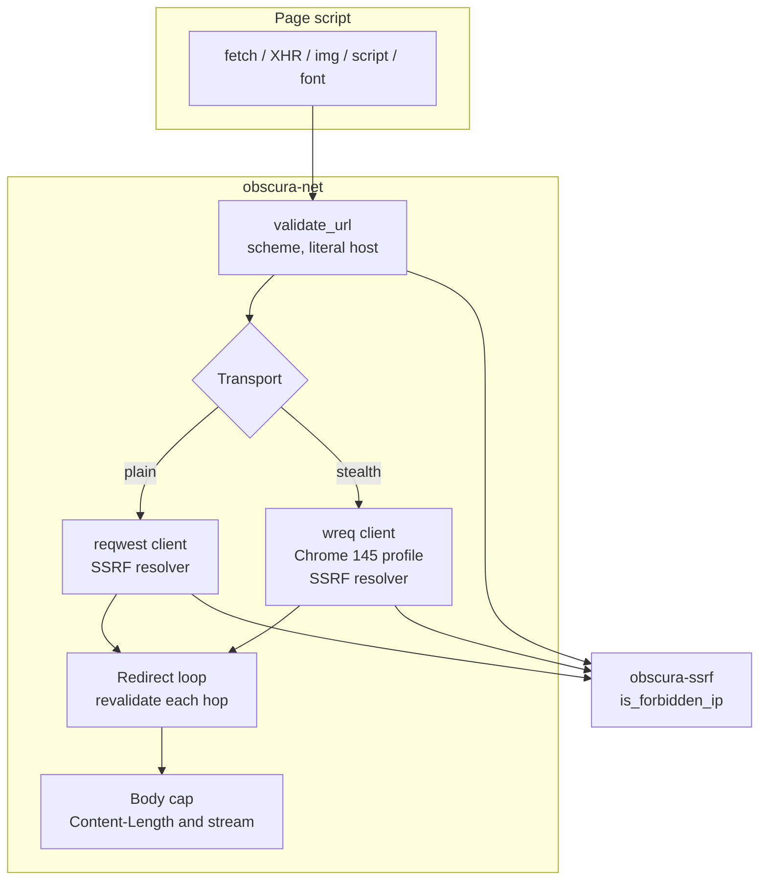
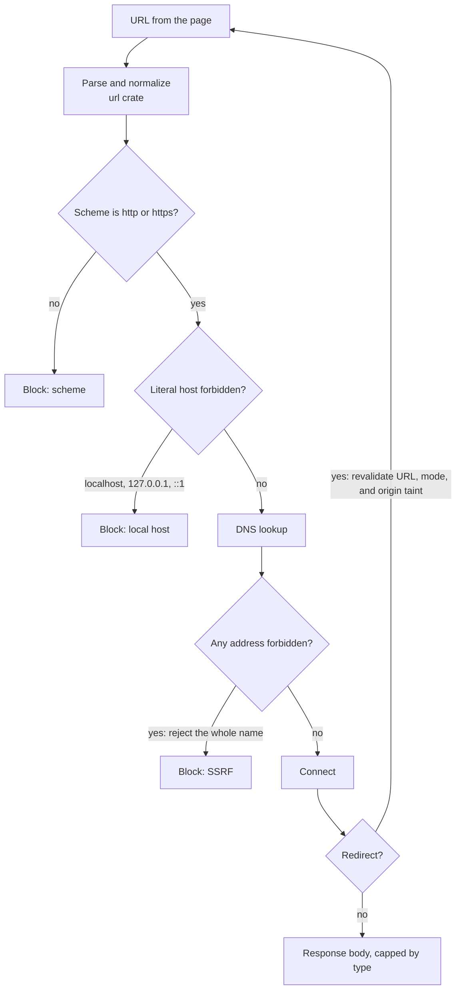

# 05 Network, SSRF and stealth: one deny-set and two transports

Every outbound request in Obscura passes the same Server-Side Request Forgery (SSRF) policy. The policy lives in a crate with no dependencies, and it answers one question: may this Internet Protocol (IP) address receive a request from the engine? A host name check is not enough, because a name can resolve to a private address. The engine therefore checks the address twice: once against the literal host and once inside the Domain Name System (DNS) resolver, using the very addresses the client will dial. The thesis of this document is that the network layer is built around one shared deny-set and two transports. The plain transport uses `reqwest`. The stealth transport uses `wreq` with a Chrome fingerprint. Both transports call the same guard, so a better Transport Layer Security (TLS) fingerprint never buys a weaker policy.

This document covers the deny-set, the two checks, the manual redirect loop, the body limits, cookies, robots rules, the stealth identity, and the operator hint. Document [04](04-browser-page-lifecycle.md) explains how navigation uses the client. Document [07](07-rendering-and-output.md) explains the image and font loader that uses the same guard.

## The problem

An engine that fetches arbitrary addresses on behalf of a user has five requirements.

1. **A page must not reach the host's private network.** The engine often runs on a server with a metadata endpoint, a database, and an administrative interface.
2. **A public name must not become private later.** A name that resolves to a public address at check time can resolve to a private address at connect time.
3. **Every request path must obey the same rule.** Navigation, script, stylesheet, image, font, `fetch`, and `XMLHttpRequest` all reach the network.
4. **A redirect must not bypass the rule.** A public server can redirect to a private address.
5. **A response must not exhaust memory.** A large body from any address can end the process.

The design answers each item with one mechanism.

| Requirement | Mechanism |
|-------------|-----------|
| No private-network reach | One deny-set in `obscura-ssrf` |
| No rebinding | A DNS resolver that checks the addresses it returns |
| One rule for every path | Both transports install the same resolver and call `validate_url` |
| No redirect bypass | Manual redirect loop that revalidates every hop |
| No memory exhaustion | A per-request body cap with a streaming check |



## One deny-set, three consumers

The policy crate is deliberately empty of dependencies:

```rust
// crates/obscura-ssrf/src/lib.rs:1-8
//! The SSRF policy every Obscura transport shares: which IP addresses an
//! outbound request may never reach, and the process-wide env opt-in that
//! lifts the restriction for local testing.
//!
//! This crate has no dependencies on purpose. `obscura-net` (reqwest and wreq
//! transports) and `obscura-render` (the synchronous compatibility loader for
//! images and fonts) both enforce the same deny-set from here, so the checks
//! can never disagree.
```

Three consumers use it: the plain client, the stealth client, and the renderer's synchronous resource loader. The comment gives the reason: two copies of a deny-set drift, and the copy that drifts is always the one that is not on the tested path.

The deny-set covers more than `std`'s own predicates:

```rust
// crates/obscura-ssrf/src/lib.rs:35-56
pub fn is_forbidden_ip(ip: IpAddr) -> bool {
    match ip {
        IpAddr::V4(v4) => {
            let o = v4.octets();
            v4.is_loopback()
                || v4.is_private()
                || v4.is_link_local()
                || v4.is_broadcast()
                || v4.is_documentation()
                || v4.is_unspecified()
                || v4.is_multicast()
                || o[0] == 0
                // std's is_private() covers only RFC1918, so add the IANA
                // special-purpose ranges that also host internal services and
                // are common SSRF targets:
                //   100.64.0.0/10  CGNAT / RFC6598 — cloud metadata (e.g.
                //                  Alibaba 100.100.100.200) lives here.
                //   198.18.0.0/15  benchmarking / RFC2544.
                //   192.88.99.0/24 6to4 relay anycast / RFC7526.
                || (o[0] == 100 && (64..=127).contains(&o[1]))
                || (o[0] == 198 && (o[1] == 18 || o[1] == 19))
                || (o[0] == 192 && o[1] == 88 && o[2] == 99)
```

Each added range has a reason in the comment. The carrier-grade network address translation range matters because Alibaba Cloud places its instance metadata endpoint at `100.100.100.200`, which `is_private` does not cover. The engineering range matters because a test fleet uses it. The deny-set is a list of observed attack surfaces, not a copy of one language's classification.

IPv6 needs the same care, because an IPv4 address can hide inside it:

```rust
// crates/obscura-ssrf/src/lib.rs:78-83
            // Unwrap IPv4-mapped (::ffff:a.b.c.d) and IPv4-compatible (::a.b.c.d)
            // forms and re-check the embedded v4 so e.g. [::ffff:127.0.0.1] or
            // [::ffff:169.254.169.254] cannot slip past the v6 arm.
            if let Some(v4) = v6.to_ipv4_mapped().or_else(|| v6.to_ipv4()) {
                return is_forbidden_ip(IpAddr::V4(v4));
            }
```

The same function also unwraps the network address translation prefix from RFC 6052, the 6to4 prefix, and Teredo. Each form carries an IPv4 address at a different bit offset, and each one is re-checked against the IPv4 arm.

## The two checks

The first check is a literal host check on the Uniform Resource Locator (URL):

```rust
// crates/obscura-net/src/client.rs:675-692
            // Octal, hex, decimal and overlong IPv4 spellings ("0x7f000001",
            // "0177.0.0.1", "2130706433") never reach this arm: for the http
            // and https schemes the url crate normalizes them to Host::Ipv4,
            // which is checked above. This arm is a belt-and-braces check on
            // names, and the resolver re-checks whatever the name resolves to.
            url::Host::Domain(domain) => {
                let lower_domain = domain.to_lowercase();
                if lower_domain == "localhost"
                    || lower_domain.ends_with(".localhost")
                    || lower_domain == "127.0.0.1"
                    || lower_domain == "::1"
                {
                    return Err(ObscuraNetError::Network(format!(
                        "Access to localhost domain '{}' is not allowed",
                        domain
                    )));
                }
            }
```

The comment names an invariant of the URL library: it normalizes octal, hexadecimal, decimal, and overlong IPv4 spellings into `Host::Ipv4`. The literal check therefore cannot be fooled by `http://2130706433/`, because the parser has already produced `127.0.0.1`.

The second check is in the resolver:

```rust
// crates/obscura-net/src/client.rs:597-610
/// DNS resolver that performs the lookup and then rejects the whole request if
/// ANY resolved address is in the SSRF deny-set. This closes the DNS-rebinding
/// bypass a host-string check alone cannot: a public name that resolves to
/// 127.0.0.1 / 169.254.169.254 / an RFC1918 address is blocked at connect time,
/// using the very addresses the client will dial. When private access is
/// permitted (`--allow-private-network` or `OBSCURA_ALLOW_PRIVATE_NETWORK`) the
/// lookup passes through unfiltered.
///
/// Implemented for both transports: `reqwest::dns::Resolve` just below, and
/// `wreq::dns::Resolve` in `wreq_client.rs`, so `--stealth` never trades the
/// guard away for a better TLS fingerprint.
pub struct SsrfGuardResolver {
    pub(crate) allow_private: bool,
}
```

The implementation rejects the whole name when any returned address is forbidden:

```rust
// crates/obscura-net/src/client.rs:618-641
impl Resolve for SsrfGuardResolver {
    fn resolve(&self, name: Name) -> Resolving {
        let allow = self.allow_private || env_allows_private_network();
        let host = name.as_str().to_string();
        Box::pin(async move {
            let addrs: Vec<SocketAddr> = tokio::net::lookup_host((host.as_str(), 0))
                .await
                .map_err(|e| -> Box<dyn std::error::Error + Send + Sync> { Box::new(e) })?
                .collect();
            if !allow {
                if let Some(bad) = addrs.iter().find(|sa| is_forbidden_ip(sa.ip())) {
                    return Err(format!(
                        "SSRF blocked: '{}' resolves to forbidden address {}",
                        host,
                        bad.ip()
                    )
                    .into());
                }
            }
            let iter: Addrs = Box::new(addrs.into_iter());
            Ok(iter)
        })
    }
}
```

The word `ANY` is accurate. A name that returns both a public and a private address is rejected, not filtered to the public one. Filtering would create a difference between the set of addresses the checker saw and the set the client dials, which is exactly the gap that a rebinding attack needs.

**Aha:** The guard has to sit at the DNS resolution step, not at the URL check, and it has to reject rather than filter. A URL check sees a name. A resolver sees the addresses that the connection will use. Rejecting the whole name keeps one invariant: every address the client can dial has already passed the check.



The loop on the right is the reason the checks cannot live in one place. A redirect produces a new URL, and the client must repeat the scheme check, the literal host check, and the resolver check for the new hop.

## One client builder, two transports

The plain transport builds one client and installs the guard:

```rust
// crates/obscura-net/src/client.rs:1070-1080
            let mut builder = Client::builder()
                .redirect(Policy::none())
                .timeout(self.timeout)
                .danger_accept_invalid_certs(false)
                // Read a folded header line (obs-fold) as browsers do instead of
                // failing the response.
                .http1_allow_obsolete_multiline_headers_in_responses(true)
                // SSRF guard: reject hostnames that resolve to a private/loopback IP.
                .dns_resolver(Arc::new(SsrfGuardResolver::new(self.allow_private_network)))
;
```

`Policy::none()` is the first important line. The library does not follow redirects, because the engine follows them itself. The timeout is 30 seconds by default, and certificate verification is never disabled.

The stealth transport uses a different library with an emulated browser profile:

```rust
// crates/obscura-net/src/wreq_client.rs:215-221
        let emulation_opts = wreq_util::Emulation::builder()
            .profile(wreq_util::Profile::Chrome145)
            .platform(wreq_util::Platform::Windows)
            .build();

        let mut builder = wreq::Client::builder()
            .emulation(emulation_opts)
```

The emulation changes the TLS handshake, the HyperText Transfer Protocol version and headers, and the header order. A site that fingerprints the connection sees a Chrome client, not a Rust client. The guard is installed on this builder too, in the same position, with the same resolver type implemented for the other library's trait.

## Redirects

Every hop passes the gate again:

```rust
// crates/obscura-net/src/client.rs:1406-1413
        let mut current_url = url.clone();
        let mut redirects = Vec::new();
        // Follow up to 20 redirects, matching the Fetch spec and the fetch()/XHR
        // path in obscura-js. `0..=max_redirects` makes max_redirects+1 requests
        // (the initial one plus 20 hops), so the 20th redirect is still followed
        // and only the 21st fails. The old `0..max_redirects` made 20 requests
        // total and thus followed only 19 (WPT redirect-count: 20 must pass).
        let max_redirects = 20;
```

The boundary comment is a Web Platform Tests (WPT) note. The test suite has a case named `redirect-count`, and it requires that the twentieth redirect is followed. An exclusive range made the client stop one hop early, and the test caught it.

The hop handling does three checks:

```rust
// crates/obscura-net/src/client.rs:1607-1618
            if status.is_redirection() {
                if let Some(location) = resp.headers().get(reqwest::header::LOCATION) {
                    let location_str = location.to_str().map_err(|_| {
                        ObscuraNetError::Network("Invalid redirect Location header".into())
                    })?;
                    let next_url = current_url.join(location_str).map_err(|e| {
                        ObscuraNetError::Network(format!("Invalid redirect URL: {}", e))
                    })?;
                    validate_url(&next_url, self.allow_private_network)?;
                    validate_request_mode(&request, &next_url)?;
                    redirect_tainted |=
                        redirect_taints_origin(&request, &current_url, &next_url);
```

Three checks run before the next request exists. The URL check applies the scheme rule and the literal host rule. The request-mode check applies the Fetch mode, such as `same-origin`. The taint check records that the chain left its initiator origin, and a tainted chain serializes its `Origin` header as `null`.

A 301, 302, or 303 response turns the request into a `GET` and drops the body. That is the Fetch rule, and it matters for a form submission that a server redirects to a result page.

## Body limits

A response is bounded before it is read:

```rust
// crates/obscura-net/src/client.rs:793-812
fn reject_oversized_content_length(
    headers: &HeaderMap,
    url: &Url,
    limit: usize,
) -> Result<(), ObscuraNetError> {
    let Some(value) = headers.get(reqwest::header::CONTENT_LENGTH) else {
        return Ok(());
    };
    let Ok(value) = value.to_str() else {
        return Ok(());
    };
    if value
        .trim()
        .parse::<u64>()
        .is_ok_and(|length| length > limit as u64)
    {
        return Err(response_too_large(url, limit));
    }
    Ok(())
}
```

A declared length is a fast rejection, and it is not trusted as the only check. The stream is checked as it arrives:

```rust
// crates/obscura-net/src/client.rs:814-835
async fn read_reqwest_body_limited(
    mut response: reqwest::Response,
    url: &Url,
    limit: usize,
) -> Result<Vec<u8>, ObscuraNetError> {
    reject_oversized_content_length(response.headers(), url, limit)?;
    let capacity = response
        .content_length()
        .and_then(|length| usize::try_from(length).ok())
        .unwrap_or(0)
        .min(limit);
    let mut body = Vec::with_capacity(capacity);
    while let Some(chunk) = response.chunk().await.map_err(|error| {
        ObscuraNetError::Network(format!("Failed to read body: {}", error_chain(&error)))
    })? {
        if chunk.len() > limit.saturating_sub(body.len()) {
            return Err(response_too_large(url, limit));
        }
        body.extend_from_slice(&chunk);
    }
    Ok(body)
}
```

A missing or false `Content-Length` header therefore cannot exceed the limit. The allocation is capped at the limit, so a declared 4 GiB body does not reserve 4 GiB.

The limit depends on the resource type:

```rust
// crates/obscura-net/src/client.rs:245-252
            max_response_bytes: match resource_type {
                ResourceType::Stylesheet | ResourceType::Font => 16 * 1024 * 1024,
                ResourceType::Script | ResourceType::Other => 32 * 1024 * 1024,
                ResourceType::Document
                | ResourceType::Image
                | ResourceType::Xhr
                | ResourceType::Fetch => 64 * 1024 * 1024,
            },
```

A stylesheet and a font are capped at 16 MiB, a script at 32 MiB, and a document, image, or `fetch` response at 64 MiB. A module script takes its cap from `OBSCURA_FETCH_MAX_BODY_BYTES`, because a large single-page application bundle that exceeds 32 MiB would otherwise fail to load while the same bytes load through `fetch`.

## Cookies

The jar is keyed by domain, then by name and path:

```rust
// crates/obscura-net/src/cookies.rs:27-33
pub struct CookieJar {
    /// domain -> (name, path) -> entry. RFC 6265 §5.3 identifies a cookie by
    /// (name, domain, path); the outer map scopes by domain and the inner key
    /// carries name+path so same-name cookies on different paths coexist
    /// instead of clobbering each other.
    cookies: RwLock<HashMap<String, HashMap<(String, String), CookieEntry>>>,
}
```

The nested map follows RFC 6265. A site commonly sets two cookies with the same name at different paths, and a flat map keyed by name would lose one.

A stored cookie also remembers whether it is host-only:

```rust
// crates/obscura-net/src/cookies.rs:49-53
    /// Cookies set without a Domain attribute are host-only: sent to the exact
    /// origin host and never to subdomains. `serde(default)` keeps persisted
    /// cookie files from before this field existed loadable.
    #[serde(default)]
    host_only: bool,
```

The `serde` default is a migration rule. An old cookie file has no such field, and the default value keeps the file readable instead of discarding every saved cookie.

Domain matching follows the case-insensitive rule, and `canonical_domain` removes a leading dot before a lookup. `SameSite` values are normalized to title case, and an unknown value becomes `Lax`, which is the stricter of the common defaults.

## Robots rules

Robots support is opt-in per context, and the cache is bounded:

```rust
// crates/obscura-net/src/robots.rs:4-8
/// Origins whose robots.txt rules are kept per context; past this the oldest is
/// evicted and refetched if visited again.
const MAX_ROBOTS_ENTRIES: usize = 4096;
/// Bytes of a robots.txt body that are parsed (Google's documented limit).
const MAX_ROBOTS_BODY_BYTES: usize = 500 * 1024;
```

The byte limit is Google's documented parse limit, so the engine reads the same part of the file that the largest crawler reads. The cache holds 4096 origins in insertion order and evicts the oldest. The allow rule wins over the deny rule, which matches the common reading of the standard.

A blocked navigation sets `LifecycleState::Failed` and returns an error that names the file:

```text
Blocked by robots.txt: <url>
```

## Stealth

The stealth transport is a second library, not a second policy. Three constants tie the JavaScript identity to the transport identity:

```rust
// crates/obscura-net/src/wreq_client.rs:64-73
// The wreq emulation (Profile::Chrome145, Platform::Windows) sends this exact
// UA and sec-ch-ua-platform "Windows" on the wire. navigator has to report the
// same identity, otherwise the TLS/HTTP layer and the JS layer disagree and a
// site cross-checks the mismatch as a bot signal.
#[cfg(feature = "stealth")]
pub const STEALTH_NAVIGATOR_PLATFORM: &str = "Win32";
#[cfg(feature = "stealth")]
pub const STEALTH_UA_PLATFORM: &str = "Windows";
#[cfg(feature = "stealth")]
pub const STEALTH_UA_PLATFORM_VERSION: &str = "15.0.0";
```

The transport sends a Chrome user agent and a `sec-ch-ua-platform` header. The page reads `navigator.platform`, `navigator.userAgentData.platform`, and the platform version. A site can compare both layers, so the constants must agree with the emulated profile.

**Aha:** Stealth is an identity-consistency problem, not a header problem. The engine has four places where a site can observe its identity: the TLS handshake, the HyperText Transfer Protocol headers, `navigator` values, and the page's own script environment. A change to one place is a signal unless the other three change with it. That is why the stealth flag selects one profile and passes the matching constants to the page, and why profile rotation is opt-in.

The certificate store takes special care:

```rust
// crates/obscura-net/src/wreq_client.rs:247-257
        // Two deliberate constraints:
        //
        // 1. `tls_cert_store` is used, NOT `tls_options`. `emulation()` overwrites `tls_options`
        //    wholesale ("This will overwrite the existing configuration"), so setting TLS options
        //    here would silently discard the Chrome fingerprint — the whole point of this client.
        //    `tls_cert_store` is a separate field on the config and composes with emulation.
        //
        // 2. Opt-in only. Supplying a store REPLACES the webpki roots (see `set_cert_store` in
        //    `tls/conn/ext.rs`), it does not add to them. Applying it unconditionally would break
        //    every ordinary site whenever the bundle is incomplete. With neither variable set,
        //    behaviour is byte-for-byte what it was before.
```

Two rules follow. A custom certificate store must use a field that composes with the emulation, because the obvious field overwrites the fingerprint. A custom store must be opt-in, because it replaces the default roots instead of extending them.

The tracker blocklist is a static domain set:

```rust
// crates/obscura-net/src/blocklist.rs:5-16
const PGL_LIST: &str = include_str!("pgl_domains.txt");

fn blocklist() -> &'static HashSet<&'static str> {
    static BLOCKLIST: OnceLock<HashSet<&str>> = OnceLock::new();
    BLOCKLIST.get_or_init(|| {
        let mut set = HashSet::with_capacity(4000);
        for line in PGL_LIST.lines() {
            let domain = line.trim();
            if !domain.is_empty() && !domain.starts_with('#') {
                set.insert(domain);
            }
        }
```

The match walks parent domains:

```rust
// crates/obscura-net/src/blocklist.rs:24-40
pub fn is_blocked(host: &str) -> bool {
    let bl = blocklist();

    if bl.contains(host) {
        return true;
    }

    let mut domain = host;
    while let Some(pos) = domain.find('.') {
        domain = &domain[pos + 1..];
        if bl.contains(domain) {
            return true;
        }
    }

    false
}
```

A list entry for `doubleclick.net` also blocks `ads.doubleclick.net`, because the loop removes one label at a time. The list is compiled into the binary and parsed once into a `OnceLock`.

Tracker blocking is on by default in stealth mode and off otherwise. `OBSCURA_BLOCK_TRACKERS=0` turns it off, and the parser accepts `0`, `false`, `no`, and `off`.

## The operator hint

A denied local address gets a hint, and a denied metadata address does not:

```rust
// crates/obscura-net/src/operator_hint.rs:5-10
/// Hint for an operator-facing error, not a policy change. CLI and stdio MCP
/// opt into presenting it; remote transports should keep the original error.
/// Inspect the actual denied host, not the initial navigation URL, since a
/// redirect can lead elsewhere. Metadata and other special-purpose ranges
/// deliberately receive no opt-out suggestion.
pub fn private_network_error_hint(mut error: &str) -> Option<&'static str> {
```

The hint tells an operator that `--allow-private-network` exists. The function offers that hint only for loopback, private, and unique-local addresses. A metadata endpoint such as `169.254.169.254`, `100.100.100.200`, or `fd00:ec2::254` gets no suggestion, because the engine will not coach an operator into opening the one address that holds cloud credentials.

The function also strips repeated `Network error: ` prefixes. A page fetch can wrap a navigation error, and a client should not see the prefix chain instead of the cause.

## Limits

| Limit | Value | Where |
|-------|-------|-------|
| Request timeout | 30 seconds | Client builder |
| Redirects | 20 hops | Redirect loop |
| Document body | 64 MiB | `ResourceRequest::navigation` |
| Script body | 32 MiB | `ResourceRequest::subresource` |
| Stylesheet or font body | 16 MiB | `ResourceRequest::subresource` |
| Resource cache | 256 entries and 64 MiB | `RESOURCE_CACHE_MAX_ENTRIES` |
| Robots cache | 4096 origins | `MAX_ROBOTS_ENTRIES` |
| Robots body parsed | 500 KiB | `MAX_ROBOTS_BODY_BYTES` |
| Tracker list | About 4000 domains | `pgl_domains.txt` |

Four limits are not in the table. The deny-set has no opt-out at the page level; only the context flag or the environment variable lifts it. The resolver rejects a name, so a host with one private address and one public address is unreachable. The body limit applies to the decoded bytes, so a compressed response can be smaller on the wire than the limit. The stealth identity is one fixed profile, so a site that expects a different Chrome version sees a mismatch no matter how many other surfaces agree.

## Related documents

- [01 Workspace and architecture](01-workspace-and-architecture.md) explains the feature ladder that turns the stealth transport on.
- [04 Browser and page lifecycle](04-browser-page-lifecycle.md) explains the navigation path that calls this client.
- [07 Rendering and output](07-rendering-and-output.md) explains the synchronous loader that shares the deny-set.
- [08 MCP, command line and operations](08-mcp-cli-and-operations.md) explains the flags that control these policies.
- [09 Testing and limits](09-testing-and-limits.md) explains the tests for the guard and the redirect boundary.
