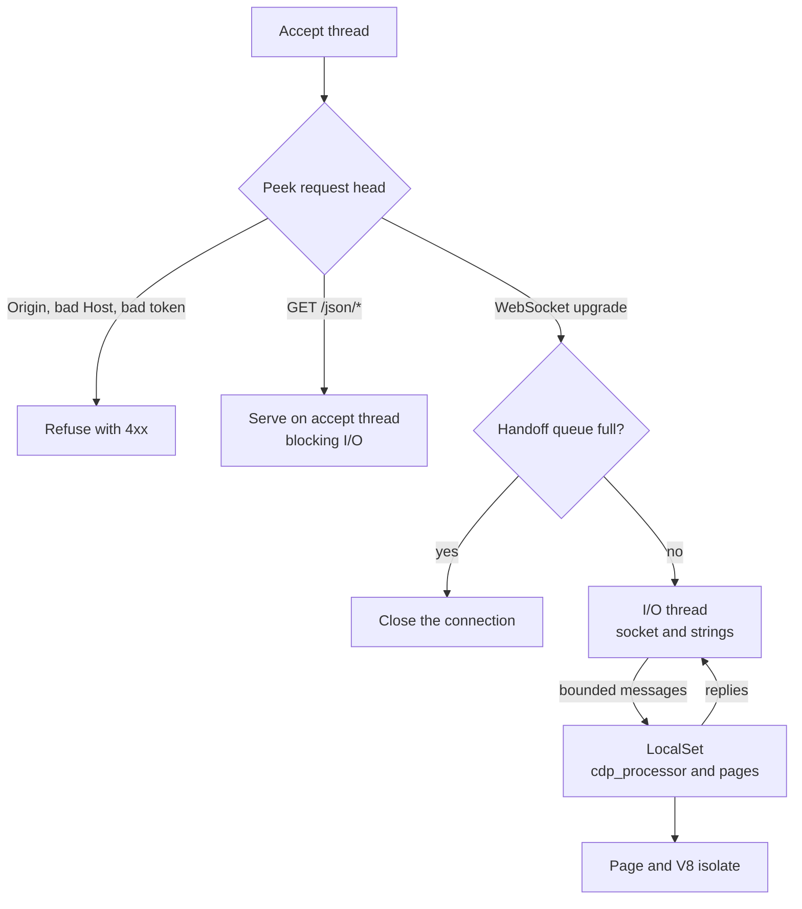
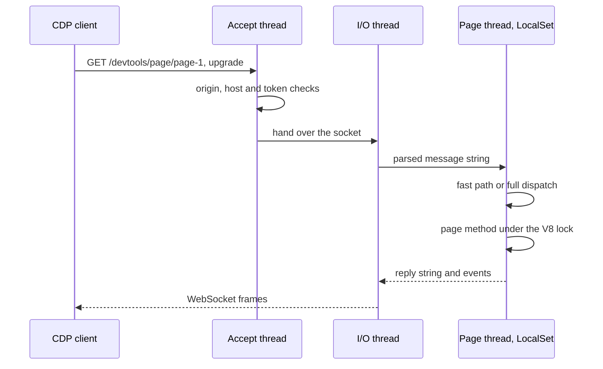

# 06 CDP server: a local control socket that assumes a hostile browser

The Chrome DevTools Protocol (CDP) server lets Puppeteer, Playwright, and custom tools drive the browser. It listens on a Transmission Control Protocol (TCP) port, and any process on the machine can connect. That fact drives the whole design. A web page can also send requests to `127.0.0.1`, so the server refuses any request that carries an `Origin` header, checks the `Host` header against the address it bound, and requires a bearer token when one is configured. The thesis of this document is that the server is not a web service. It is a local control socket with one client type, one protocol, and a threat model that starts from a hostile browser tab.

This document covers the connection gate, the two-thread connection model, the protocol path, the page and session model, command dispatch, interception, and the limits. Document [04](04-browser-page-lifecycle.md) explains what a page does when a command moves it. Document [03](03-javascript-runtime.md) explains the watchdog that bounds a command.

## The problem

A protocol server for a browser engine has five requirements.

1. **It must accept the real clients.** Puppeteer and Playwright send their own command sequences, and a rejected command fails a user's test.
2. **It must not be reachable from a web page.** A page on any origin can reach a loopback port.
3. **One connection must not block another.** A slow navigation on one connection must not freeze the control plane.
4. **A page must stay on one thread.** V8 isolates are not `Send`, and moving one between threads aborts the process.
5. **Queues must be bounded.** A stalled client or a stalled navigation must not grow a queue without a limit.

The design answers each item with one mechanism.

| Requirement | Mechanism |
|-------------|-----------|
| Real clients | Full CDP method set plus a fast path for no-op methods |
| No page access | `Origin` refusal, `Host` check, optional token |
| No cross-connection blocking | One operating system thread per connection, each with its own runtime |
| One thread per page | A `current_thread` Tokio runtime and a `LocalSet` per connection |
| Bounded queues | Caps on connections, handoffs, deferred messages, and pending evaluations |

## The control gate

The gate runs before the protocol:

```rust
// crates/obscura-cdp/src/server.rs:151-170
fn control_refusal(
    head: &str,
    bind_ip: std::net::IpAddr,
    port: u16,
    forwarded: Option<(std::net::IpAddr, u16)>,
    auth_token: Option<&str>,
) -> Option<ControlRefusal> {
    if header_value(head, "origin").is_some() {
        return Some(ControlRefusal::BrowserOrigin);
    }
    if !header_value(head, "host")
        .is_some_and(|host| host_matches_bind(host, bind_ip, port, forwarded))
    {
        return Some(ControlRefusal::ForeignHost);
    }
    if !bearer_authorized(head, auth_token) {
        return Some(ControlRefusal::Unauthorized);
    }
    None
}
```

The first rule refuses a request that has an `Origin` header at all. It does not compare the origin against a list. A real CDP client is a native program, and a native program has no origin. A browser tab that posts to the port always sends one, so the presence of the header is enough to identify the client type.

The second rule compares the `Host` header with the bound address and port. The comparison accepts a loopback name when the server binds to a loopback address, and it accepts a forwarded address and port when a proxy supplies one. A request with `Host: attacker.example` is refused even when it arrives over the loopback interface.

The third rule is optional:

```rust
// crates/obscura-cdp/src/server.rs:66-74
fn control_token_from_env() -> anyhow::Result<Option<String>> {
    let token = std::env::var("OBSCURA_CDP_TOKEN")
        .ok()
        .filter(|value| !value.is_empty());
    if token.as_ref().is_some_and(|value| value.len() < 32) {
        anyhow::bail!("OBSCURA_CDP_TOKEN must be at least 32 bytes");
    }
    Ok(token)
}
```

A token shorter than 32 bytes is a startup error, not a warning. The comparison uses a constant-time function:

```rust
// crates/obscura-cdp/src/server.rs:76-84
fn constant_time_eq(left: &str, right: &str) -> bool {
    if left.len() != right.len() {
        return false;
    }
    left.bytes()
        .zip(right.bytes())
        .fold(0u8, |difference, (left, right)| difference | (left ^ right))
        == 0
}
```

**Aha:** The server treats every request as if a web page wrote it, because a web page can reach a loopback port. The `Origin` rule is not a cross-origin policy; it is a client-class test. A correct cross-origin policy would need a list of allowed origins and would still admit a malicious page on an allowed origin. Refusing the header outright admits only native clients, which is the entire set the server wants.

## The HTTP control plane

Three read-only endpoints exist:

```rust
// crates/obscura-cdp/src/server.rs:1107-1122
    let endpoint = if head.contains("/json/version") {
        Some("version")
    } else if head.contains("/json/list") || head.contains("/json\r\n") || head.contains("/json HTTP") {
        Some("list")
    } else if head.contains("/json/protocol") {
        Some("protocol")
    } else {
        None
    };

    if let Some(ep) = endpoint {
        // The request head is already sitting in the kernel receive buffer;
        // switch back to blocking mode for the synchronous /json serve.
        let _ = stream.set_nonblocking(false);
        return handle_http_json_blocking(stream, port, ep, head);
    }
```

These endpoints are served on the accept thread with blocking input and output:

```rust
// crates/obscura-cdp/src/server.rs:1087-1092
/// Dispatch a freshly-accepted TCP connection on the dedicated accept thread.
///
/// The connection's request head has already been peeked by the accept loop
/// (`peek_request_head`) and is passed in as `head`:
/// - HTTP (`GET /json/*`): serve synchronously via blocking I/O so the
///   response is never stalled by the LocalSet.
```

The reason is in the second half of the sentence. If the version endpoint waited on the connection's `LocalSet`, then a page that runs a long script would also delay the endpoint that a client uses to discover the browser.

The version body reports a Chrome identity:

```rust
// crates/obscura-cdp/src/server.rs:1158-1165
        "version" => serde_json::to_string_pretty(&json!({
            "Browser": "Chrome/145.0.0.0",
            "Protocol-Version": "1.3",
            "User-Agent": "Mozilla/5.0 (X11; Linux x86_64) AppleWebKit/537.36 (KHTML, like Gecko) Chrome/145.0.0.0 Safari/537.36",
            "V8-Version": "14.5.0.0",
            "WebKit-Version": "537.36",
            "webSocketDebuggerUrl": format!("ws://{}/devtools/browser", authority),
        }))?,
```

The protocol version is `1.3`, which is the version that the modern clients negotiate. The browser string is the Chrome version that the transport emulates, so a client that reads `/json/version` and then chooses a behaviour sees one consistent identity.

One limit is worth stating. The `/json/list` endpoint returns a fixed `page-1` entry, not the live target list. A client that needs the real targets uses `Target.getTargets` on the WebSocket. The endpoint exists so that a client's discovery step succeeds, and it does not claim to be an enumeration.

## Two threads per connection

Each connection gets two threads and one `LocalSet`:

```rust
// crates/obscura-cdp/src/server.rs:799-805
/// Run each connection's `cdp_processor` (with its own `CdpContext` and pages)
/// on a dedicated `current_thread` Tokio runtime and `LocalSet`. A second thread
/// handles WebSocket I/O independently. Confining a connection's pages
/// to one thread is what removes the #430 abort; the interception handshake and
/// the nav `spawn_local` all stay on this one thread, so no cross-thread V8
/// plumbing is needed.
fn run_connection(
```

The split is deliberate:

```rust
// crates/obscura-cdp/src/server.rs:851-854
            // Socket I/O must not share the renderer's LocalSet: a synchronous
            // V8/layout task otherwise delays even replies already queued by a
            // completed navigation. Keep all page/isolate work on this thread,
            // and move only Send protocol strings and the socket to an I/O thread.
```

A page thread runs V8. A V8 task can hold the thread for as long as a script runs, so a reply that is already computed cannot reach the socket from that thread. The input and output thread owns the socket, and the two threads exchange only strings through a channel.

The processor runs inside the `LocalSet` future:

```rust
// crates/obscura-cdp/src/server.rs:898-905
            let local = tokio::task::LocalSet::new();
            local.block_on(&rt, async move {
                // Run the processor in the connection future. A self-waking
                // LocalSet task can run 61 times before Tokio services I/O,
                // starving fetch under a continuously ready page scheduler.
                let processor = cdp_processor(
                    msg_rx, default_context, shutdown_notify,
                );
```

The `select!` after this code races the processor against the input thread's completion. When either side ends, the processor is dropped and the connection is torn down.



## The page and session model

One connection owns a map from sessions to pages:

```rust
// crates/obscura-cdp/src/dispatch.rs:51-66
pub struct CdpContext {
    pub pages: Vec<Page>,
    pub sessions: HashMap<String, String>, // session_id -> page_id
    /// Current document loader per page. Navigation events and later
    /// script-initiated Network events must share this id; inventing a loader
    /// for each fetch breaks DevTools request grouping.
    pub current_loader_ids: HashMap<String, String>,
    /// Pages whose initial navigation event sequence has been emitted. A page
    /// is created already loaded (about:blank), but Chrome emits that load's
    /// events when the client attaches; Page.enable emits them once per page
    /// so clients waiting on the initial load (chromiumoxide, #833) unblock.
    pub nav_events_emitted: std::collections::HashSet<String>,
    /// Child frame ids already reported to the client, per page, so each frame
    /// is announced once and a frame that goes away can be retracted.
    pub announced_frames: HashMap<String, Vec<String>>,
    pub pending_events: Vec<CdpEvent>,
```

Four pieces of state exist because a client expects them. A session maps to a page, not to a page and a frame, because the client addresses the rest of the hierarchy through frame identifiers. A loader identifier lets the network events of one navigation group together. A page that was created on `about:blank` still needs its load events when a client attaches, or a client that waits for the first load event waits forever. A frame that is announced must later be retracted, or the client keeps a stale frame in its model.

The context also holds per-session subscriptions, because events are session-scoped in the protocol:

```rust
// crates/obscura-cdp/src/dispatch.rs:85-90
    pub binding_sessions: HashMap<String, Vec<String>>, // binding name -> session ids
    /// Sessions that called Runtime.enable. Console and exception events are
    /// page-scoped but only delivered to these subscribers.
    pub runtime_enabled_sessions: HashSet<String>,
    /// Page.setLifecycleEventsEnabled subscriptions, independent of Runtime.
    pub(crate) lifecycle_enabled_sessions: HashSet<String>,
```

A binding is a callback that page script calls by name. Two sessions can register the same name, and the event must go back to each one. The comment records the failure of the alternative: a single subscriber chosen from a hash map gives the event to whichever session the iteration happened to visit first.

## Command dispatch

The dispatcher takes the per-connection V8 lock, and it does one unwrap before the lock:

```rust
// crates/obscura-cdp/src/dispatch.rs:748-754
    // headless_chrome (and older Puppeteer) wrap every CDP call inside
    // Target.sendMessageToTarget. Unwrap and recurse BEFORE acquiring the
    // per-connection V8 lock — the recursive dispatch will acquire it for the
    // inner call, and tokio Mutex is not reentrant.
    if req.method == "Target.sendMessageToTarget" {
        return dispatch_send_message_to_target(req, ctx).await;
    }
```

A non-reentrant lock and a recursive call are a deadlock. The unwrap happens first, and the inner call takes the lock once.

Before the full dispatcher runs, a fast path answers methods that need no page state:

```rust
// crates/obscura-cdp/src/server.rs:2264-2275
    let result = match req.method.as_str() {
        "Network.enable" | "Network.setCacheDisabled" | "Network.setRequestInterception" |
        "Page.setInterceptFileChooserDialog" |
        "Runtime.runIfWaitingForDebugger" | "Runtime.discardConsoleEntries" |
        "Performance.enable" | "Log.enable" | "Security.enable" |
        "Emulation.setTouchEmulationEnabled" |
        "CSS.enable" | "Accessibility.enable" | "ServiceWorker.enable" |
        "Inspector.enable" | "Debugger.enable" | "Profiler.enable" |
        "HeapProfiler.enable" | "Overlay.enable" | "Storage.enable" |
        "Target.setAutoAttach" => {
            Some(json!({}))
        }
```

These methods are subscription requests or capability probes. A client sends them during startup, and each one would otherwise take the page lock and run a page method that does nothing. An empty object is the correct reply, because the protocol defines the result as empty.

A pending evaluation is handled differently:

```rust
// crates/obscura-cdp/src/server.rs:2195-2203
    let is_awaited = matches!(req.method.as_str(), "Runtime.evaluate" | "Runtime.callFunctionOn")
        && req.params.get("awaitPromise").and_then(|value| value.as_bool()) == Some(true);
    let response = if pending_runtime.as_ref().is_some_and(|pending| pending.len() >= MAX_DEFERRED_MESSAGES) && is_awaited {
        crate::types::CdpResponse::error(req.id, -32000, "Too many pending evaluations".into(), req.session_id.clone())
    } else if pending_runtime.is_some() {
        dispatch::dispatch_with_deferred(&req, ctx, Some(&mut evaluation)).await
    } else {
        dispatch::dispatch(&req, ctx).await
    };
```

An awaited promise takes more than one event-loop turn. The command becomes a `PendingRuntimeReply`, and the processor finishes it when the evaluation is ready. The cap turns a client that sends thousands of awaited evaluations into an error response, not into memory growth.

## Interception

A paused request needs its own queue:

```rust
// crates/obscura-cdp/src/server.rs:21-24
// PR #36 comment 4341743194: the deferral queue in `process_with_interception`
// must be bounded so a stalled navigation cannot OOM the process. When the cap
// is reached we return an explicit error response rather than silently dropping.
const MAX_DEFERRED_MESSAGES: usize = 256;
```

A navigation that is paused for interception cannot run another command on the same `LocalSet` without breaking V8's "current isolate" rule. Commands that arrive during the pause go into this queue, and the processor drains the queue at the top of the next iteration, when no navigation is in flight.

The WebSocket handoff queue has a separate cap:

```rust
// crates/obscura-cdp/src/server.rs:33-41
// The WS-stream forwarding channel must also be bounded: if the LocalSet
// (CDP processor + nav tasks) stalls, the accept thread keeps pushing
// `std::net::TcpStream`s into the queue. An unbounded channel would let
// that queue grow without limit and OOM the process. With a bounded
// capacity, when the LocalSet is saturated the accept thread closes the
// new connection on the spot instead of buffering it — the kernel TCP
// backlog still absorbs short-term spikes, but a long-term stall now
// fails loudly at accept time rather than silently piling up FDs.
const MAX_PENDING_WS_HANDOFFS: usize = 128;
```

The alternative is a file descriptor leak that no error reports. A closed connection is visible to the client, and the client can retry.

## Live connections

The accept loop also bounds live connections:

```rust
// crates/obscura-cdp/src/server.rs:43-53
// Cap on *live* CDP connections, each of which costs one OS thread and its own
// V8 isolates. `MAX_PENDING_WS_HANDOFFS` above bounds only the handoff queue —
// connections that have already been handed off are unbounded without this.
//
// 128 matches the handoff bound and is well above any real client fan-out
// (Playwright/Puppeteer use one connection per browser). Threads are what this
// actually bounds: with arenas capped by `cap_malloc_arenas`, 128 idle
// connections cost 146 threads, 33.2 GiB of reserved address space and 51 MiB
// resident -- and nearly all of that 33.2 GiB is V8's process-wide sandbox,
// which is there at zero connections. Override with `--max-connections`.
pub const DEFAULT_MAX_CONNECTIONS: usize = 128;
```

Two numbers matter more than the connection count. Each connection starts its own V8 platform work, and V8 reserves address space per process, not per isolate. The 33.2 GiB figure is mostly the process-wide sandbox, so the marginal cost of the first connection is large and the marginal cost of the hundredth is small.

A connection at the cap gets an explicit refusal:

```text
HTTP/1.1 503 Service Unavailable
X-Obscura-Reason: max-connections
```

The client sees a reason it can retry. A bare reset would look like a network fault.



## Limits

| Limit | Value | Where |
|-------|-------|-------|
| Live connections | 128 | `DEFAULT_MAX_CONNECTIONS` |
| Pending handoffs | 128 | `MAX_PENDING_WS_HANDOFFS` |
| Deferred messages | 256 | `MAX_DEFERRED_MESSAGES` |
| Token minimum | 32 bytes | `control_token_from_env` |
| Command budget | 60 seconds | `OBSCURA_CDP_COMMAND_TIMEOUT_MS` |
| Screencast rate | 30 frames per second | Processor interval |
| Shutdown drain | 3 seconds | `SHUTDOWN_DRAIN_MS` |
| WebSocket write buffer | 0 bytes | Connection setup |

Four limits are not in the table. The `/json/list` endpoint reports one stub page, so target discovery needs the WebSocket. A pending evaluation holds its result until the client reads it or the connection closes. The deferral queue returns errors instead of growing, so a client that sends commands during a paused navigation can see `-32000`. A connection owns its own cookie jar and merges a delta at exit, so two connections never overwrite each other's cookies.

## Related documents

- [01 Workspace and architecture](01-workspace-and-architecture.md) explains the crate that contains the server.
- [03 JavaScript runtime](03-javascript-runtime.md) explains the command watchdog and the isolate.
- [04 Browser and page lifecycle](04-browser-page-lifecycle.md) explains navigation and tab switching.
- [08 MCP, command line and operations](08-mcp-cli-and-operations.md) explains the flags that start the server.
- [09 Testing and limits](09-testing-and-limits.md) explains the protocol tests and the load limits.
