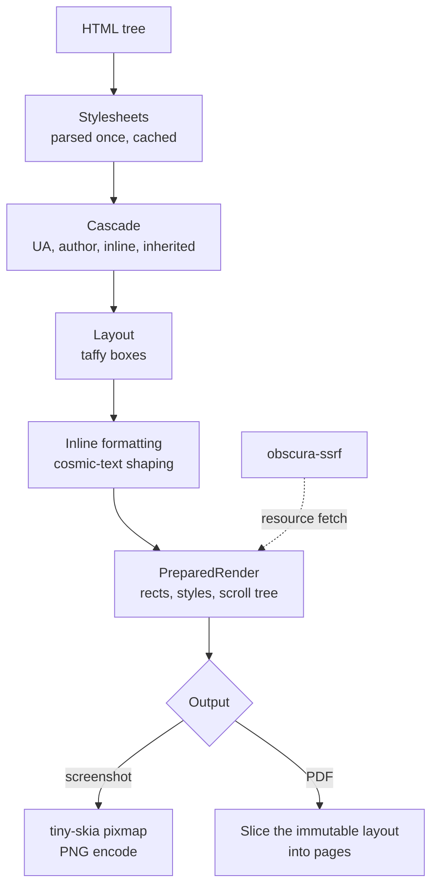
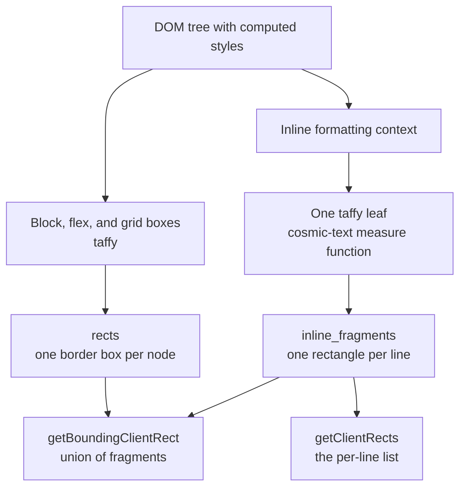

# 07 Rendering and output: two features, one deterministic pipeline

Obscura's default build has no layout engine and no rasterizer. A page still runs its scripts, still mutates a document tree, and still returns `null` from `getBoundingClientRect`. The render layer is optional, and it is split into two prices. Layout alone gives true box geometry and true computed styles. The `paint` feature adds text shaping, image decoding, and a Portable Network Graphics (PNG) rasterizer. The thesis of this document is that the renderer buys determinism by refusing three inputs that a normal browser accepts. Those inputs are the operating system's fonts, the machine's Graphics Processing Unit (GPU), and any resource that has not passed the network policy.

This document covers the cascade, the layout tree, inline text, painting, resource loading, animation sampling, capture limits, and Portable Document Format (PDF) output. Document [02](02-dom-and-html.md) explains the tree that this layer reads. Document [05](05-network-ssrf-and-stealth.md) explains the guard that its loader shares.

## The problem

A server-side renderer has five requirements.

1. **Geometry must be true when a client asks.** A client calls `getBoundingClientRect`, `elementFromPoint`, and `IntersectionObserver`.
2. **The default build must stay small.** Many users only scrape text and never take a screenshot.
3. **Output must repeat.** The same document on two hosts must produce the same bytes, or a test cannot compare an image.
4. **Resources are untrusted.** An image Uniform Resource Locator (URL) is page input, and it reaches the same network as a navigation.
5. **Output must be bounded.** A page can ask for a 100,000-pixel-tall screenshot.

The design answers each item with one mechanism.

| Requirement | Mechanism |
|-------------|-----------|
| True geometry | A `taffy` layout pass with computed styles |
| A small default build | Empty default features; `paint` is opt-in |
| Repeatable output | Embedded fonts, pure-Rust rasterization, no CPU-specific paths |
| Untrusted resources | The shared SSRF guard in the renderer's own loader |
| Bounded output | Explicit pixel, dimension, and byte caps |

## Two features

The feature list states the split:

```toml
# crates/obscura-render/Cargo.toml:9-14
[features]
default = []
# Rasterize the laid-out tree to a pixmap (tiny-skia) with text (cosmic-text
# shaping + line breaking, ab_glyph fallback) and images.
# Off by default; the layout core (getBoundingClientRect etc.) works without it.
paint = ["dep:obscura-ssrf", "dep:tiny-skia", "dep:ab_glyph", "dep:cosmic-text", "dep:swash", "dep:image", "dep:ureq", "dep:base64", "dep:resvg", "dep:usvg", "dep:url", "dep:wuff"]
```

Layout depends on `taffy` and the document crate only. Paint adds eight dependencies, including the rasterizer, the text engine, the image decoders, the vector graphics tools, and the synchronous loader. A user who only needs geometry pays for none of them.

The crate header still calls itself "Phase 1", and that label is out of date:

```text
// crates/obscura-render/src/lib.rs:1-12
//! obscura-render: the optional scoped render layer for Obscura.
//!
//! Obscura's default build has no layout or paint engine, which is the source
//! of its speed and low memory. This crate adds a render layer behind a feature
//! flag: real CSS box geometry (so getBoundingClientRect, elementFromPoint, and
//! IntersectionObserver return true values) and, with the paint feature,
//! rasterized PNG screenshots.
//!
//! Phase 1 (this file): the layout core. A `LayoutNode` tree plus a viewport is
//! laid out with taffy and the resulting border-box geometry is returned per
//! node. Later phases build the `LayoutNode` tree from the live DOM + computed
//! styles, feed geometry back to JS, and add text + paint.
```

The last paragraph describes a plan that the other files already carry out. `css.rs` is 10,431 lines, `style.rs` is 11,183 lines, `dom.rs` is 22,482 lines, `inline.rs` is 5,673 lines, and `paint.rs` is 19,669 lines. Read the header as history, not as a description of the crate.



## The cascade

A stylesheet precomputes an index for every selector class:

```rust
// crates/obscura-render/src/css.rs:2412-2436
pub struct Stylesheet {
    rules: Vec<Rule>,
    /// Rules whose subject can match this stylesheet's featureless shadow
    /// host. Kept separate because a host is outside the shadow tree's normal
    /// selector index and must only be matched with that tree's explicit host
    /// scope.
    host_rules: Vec<usize>,
    /// `::slotted()` rules are matched against assigned light children with
    /// this stylesheet's host supplied as the selector tree scope.
    slotted_rules: Vec<usize>,
    invalidation_map: InvalidationMap,
    registered_custom_properties: HashMap<String, RegisteredCustomProperty>,
    /// Index zero is the unconditional sentinel.
    container_conditions: Vec<ContainerConditionNode>,
    /// Every offset from each `@keyframes` rule. The opacity sampler resolves
    /// property-specific segments at the stylesheet's explicit sample time.
    keyframes: HashMap<String, Keyframes>,
    animation_sample_time: crate::AnimationSampleTime,
    by_root: Vec<usize>,
    by_id: HashMap<String, Vec<usize>>,
    by_class: HashMap<String, Vec<usize>>,
    by_attribute: HashMap<String, Vec<usize>>,
    by_local: HashMap<String, Vec<usize>>,
    universal: Vec<usize>,
    candidate_slot_count: usize,
```

The indexes are the reason a page with 10,000 elements and 5,000 rules does not compare every rule with every element. An element offers its identifier, its classes, its attributes, and its tag name, and the matcher takes the union of the matching buckets. The universal bucket is the fallback, and it is usually small.

The cascade walks the tree with an explicit stack:

```rust
// crates/obscura-render/src/dom.rs:2623-2631
/// Compute the UA + author style for every element in preorder, maintaining
/// `matcher`'s ancestor filter as we descend so descendant-combinator rules
/// fast-reject correctly. Non-element nodes (text, comments) are skipped but
/// still walked through, since an element may be their descendant.
/// Per-node half of the style cascade: compute and record the style for
/// one node and report the values its subtree inherits. Split out of
/// `cascade_walk` so the traversal can run on an explicit work stack
/// instead of one native frame per DOM level.
fn cascade_node_style(
```

The last sentence repeats the rule from [02](02-dom-and-html.md). A recursive walk would use one native frame per document level, and a deep tree would exhaust the Rust stack. The work stack keeps the memory cost in the heap.

A retained style is reused unless the node is fresh:

```rust
// crates/obscura-render/src/dom.rs:2665-2668
    let reuse_style = is_element
        && fresh_styles.is_some_and(|fresh| !fresh.contains(&id))
        && styles.contains_key(&id)
        && custom_properties.contains_key(&id);
```

A mutation marks the affected nodes as fresh. Every other node keeps its computed style, and a whole-subtree mutation does not invalidate the rest of the document. This is the mechanism behind a fast second capture of an unchanged page.

## Layout

The layout result is one structure with several maps:

```rust
// crates/obscura-render/src/dom.rs:307-316
pub struct DomLayout {
    pub rects: HashMap<NodeId, Rect>,
    /// Native grid track extents beyond the content box, including unoccupied
    /// tracks. Only element scroll containers expose these through CSSOM.
    grid_overflow: HashMap<NodeId, Rect>,
    /// Per-line border-box fragments for ordinary non-replaced inline
    /// elements. `rects` retains their union for `getBoundingClientRect()`;
    /// this list is the source for background/border painting and
    /// `getClientRects()` as wrapping support is extended.
    pub inline_fragments: HashMap<NodeId, Vec<Rect>>,
```

The `rects` map returns one rectangle per node. The `inline_fragments` map returns several, because a wrapped inline element has one box per line. `getBoundingClientRect` reads the union and `getClientRects` reads the list.

`taffy` lays out block, flex, and grid boxes. An inline formatting context becomes one `taffy` leaf:

```rust
// crates/obscura-render/src/inline.rs:1-14
//! Real inline text layout via cosmic-text (HarfBuzz-class shaping through
//! rustybuzz + UAX#14 line breaking), replacing the earlier approximation
//! that split each text node into one taffy flex item per word.
//!
//! The model matches how real browsers separate formatting contexts: taffy
//! lays out the *block/flex/grid* boxes, and an *inline formatting context*
//! (a box whose children are all inline-level text/spans) collapses to a
//! single taffy leaf whose measure function line-breaks its shaped text at
//! whatever width taffy offers. Line wrapping, alignment, and intrinsic
//! sizing then come from a real text engine instead of flexbox tricks.
//!
//! Fonts are loaded from embedded bytes by default, never implicitly from the
//! OS, so layout remains deterministic unless the operator supplies fonts.
```

The earlier approximation made every word a flex item. That model wrapped at word boundaries and lost the shaping of a run, so kerning, ligatures, and bidirectional text were wrong. The current model shapes the whole run and asks the text engine for line breaks at the width that `taffy` offers.



The two output maps answer two different questions. A caller that asks for one box gets the union. A caller that asks for line boxes gets the fragments.

**Aha:** Determinism is a dependency choice, not an output option. The renderer loads fonts from embedded bytes, rasterizes with pure Rust, and shapes with the same library on every host. It therefore refuses the three inputs that make a normal browser's output machine-dependent: installed fonts, GPU drivers, and CPU-specific code paths. The price is a fixed font set, and the gain is a screenshot that a test can compare byte for byte.

The font rule is stated in the module header and enforced in the loader. A supplied font is loaded explicitly, and the operating system is never scanned.

## Painting

Painting takes a prepared render:

```rust
// crates/obscura-render/src/paint.rs:3243-3250
pub fn paint_prepared(
    tree: &DomTree,
    prepared: &mut PreparedRender,
    resources: &mut RenderResourceCache,
    scroll: (f32, f32),
) -> Option<Pixmap> {
    paint_prepared_with_surface_color(tree, prepared, resources, scroll, [255, 255, 255, 255])
}
```

The prepared render holds everything that a capture needs:

```rust
// crates/obscura-render/src/paint.rs:1038-1050
pub struct PreparedRender {
    viewport: (f32, f32),
    animation_sample: crate::AnimationSample,
    has_active_waapi_animations: bool,
    active_animation_impact: crate::AnimationEffectImpact,
    root_font_size: f32,
    base_url: Option<String>,
    has_dynamic_fonts: bool,
    content_size: (f32, f32),
    viewport_fixed: std::collections::HashSet<obscura_dom::tree::NodeId>,
    sticky: crate::StickyLayout,
    scroll_tree: crate::dom::ScrollTree,
    selected_images: HashMap<obscura_dom::tree::NodeId, SelectedImage>,
```

The paint call fills a `Pixmap` with the surface colour, then walks the tree in paint order. The scroll tree, the sticky layout, the fixed set, and the selected images are all decided before this call. Painting therefore does no network work and no layout work.

A prepared render can also advance a small class of animations without a relayout:

```rust
// crates/obscura-render/src/paint.rs:1082-1085
    /// Advance opacity/transform Web Animations without rebuilding normal-flow
    /// layout. Eligibility is intentionally strict: every target is sampled
    /// from retained pre-WAAPI cascade provenance, and every update passes
    /// preflight before the prepared render is mutated.
```

An opacity or transform animation changes the compositing stage only. The code advances those properties and rejects everything else, so a page with a spinning logo does not force a full layout on every frame.

## Resources

The paint feature includes a synchronous loader for images, fonts, and vector graphics. It can fetch bytes, so it applies the same guard as the page transport:

```rust
// crates/obscura-render/src/paint.rs:8125-8133
/// The renderer's copy of the SSRF gate every page transport applies. This
/// loader only runs for standalone callers (the `paint_file` tool, library
/// users rendering a bare DOM, a JS runtime with no page transport); a
/// page-owned runtime is cache-only and fetches through `obscura-net`, which
/// has its own resolver. Checking at resolution time covers literal
/// addresses, names that resolve to a private address (DNS rebinding), and
/// every redirect hop, since ureq resolves each connection through here.
/// `OBSCURA_ALLOW_PRIVATE_NETWORK` lifts the restriction, as it does for the
/// transports; the renderer has no per-context flag to consult.
```

The second sentence is the important one. A page-owned runtime does not use this loader at all; it uses the page transport, which already has the guard. The renderer's loader exists for standalone callers, such as the `paint_file` binary.

The loader presents a browser identity:

```rust
// crates/obscura-render/src/paint.rs:8114-8118
            // Present the same normal browser identity the engine uses for the
            // document. A bot-identifying UA got image requests filtered by CDNs
            // that gate on User-Agent (Akamai/Cloudflare image endpoints on
            // cnbc, techcrunch, arstechnica), so the images Chrome loads came
            // back blank; a real browser UA loads the same bytes Chrome does.
```

The comment records an observation from real pages. One content delivery network serves an image to Chrome and a blank response to a crawler. The screenshot then differs from the page. That difference is invisible in the engine's own logs.

The resource cache is bounded:

```text
// crates/obscura-render/src/paint.rs:30-31
const DEFAULT_RESOURCE_CACHE_ENTRIES: usize = 512;
const DEFAULT_RESOURCE_CACHE_BYTES: usize = 64 * 1024 * 1024;
```

The cache stores decoded bytes, so the byte cap is the one that bounds memory. A page with 600 images keeps the newest 512 entries.

## Capture limits

One capture has hard surface limits:

```rust
// crates/obscura-render/src/paint.rs:921-924
pub const MAX_CAPTURE_DIMENSION: u32 = 32_768;
pub const MAX_CAPTURE_PIXELS: u64 = 16 * 1024 * 1024;
pub const MAX_CAPTURE_SCALE: f32 = 16.0;
pub const MAX_CAPTURE_PEAK_BYTES: u64 = 128 * 1024 * 1024;
```

The peak byte cap covers the CSS-pixel raster and the scaled output together, before either allocation happens. A request for a 32,768-pixel square is refused at validation, not after the allocation.

A capture region can address content outside the live viewport:

```rust
// crates/obscura-render/src/paint.rs:875-882
pub struct CaptureRegion {
    pub x: f32,
    pub y: f32,
    pub width: f32,
    pub height: f32,
    pub scale: f32,
    output_size: Option<(u32, u32)>,
}
```

The scale is separate from the output size, because a protocol client can request a device scale and an exact output size in the same call. The two values must agree, and the constructor that takes an explicit size lets the protocol layer resolve the rounding once.

## PDF

The PDF encoder is honest about what it is:

```rust
// crates/obscura-browser/src/pdf.rs:1-5
//! Bounded raster-backed PDF export over the retained document-space painter.
//!
//! This deliberately does not claim CSS paged-media support. It preserves the
//! print-media layout, fits the full document width into the printable area,
//! and slices that immutable layout vertically across PDF pages.
```

Each page is an image, and the document is sliced at page boundaries. A CSS page break, an orphan rule, and a running header are not implemented, and the header says so. The output is still useful for a report, and a client that needs real paged media knows that this engine does not provide it.

The limits are explicit:

```text
// crates/obscura-browser/src/pdf.rs:14-19
const POINTS_PER_INCH: f32 = 72.0;
const MAX_PAPER_INCHES: f32 = 200.0;
const MAX_PDF_PAGES: usize = 250;
// Page ranges may select a small bounded subset from a much longer document.
// Keep the arithmetic/index space finite without charging unselected pages
// against the output-page limit.
```

Four limits bound the work: 200 inches of paper, 250 output pages, 16 million pixels per page, and 64 million pixels in total. A caller can select a page range from a document of up to one million pages without paying for the pages it did not select.

## Limits

| Limit | Value | Where |
|-------|-------|-------|
| Capture dimension | 32,768 pixels | `MAX_CAPTURE_DIMENSION` |
| Capture pixels | 16,777,216 | `MAX_CAPTURE_PIXELS` |
| Capture scale | 16.0 | `MAX_CAPTURE_SCALE` |
| Capture peak bytes | 128 MiB | `MAX_CAPTURE_PEAK_BYTES` |
| Resource cache entries | 512 | `DEFAULT_RESOURCE_CACHE_ENTRIES` |
| Resource cache bytes | 64 MiB | `DEFAULT_RESOURCE_CACHE_BYTES` |
| Resource fetch timeout | 10 seconds | `image_agent` |
| PDF paper | 200 inches | `MAX_PAPER_INCHES` |
| PDF output pages | 250 | `MAX_PDF_PAGES` |
| PDF pixels per page | 16,777,216 | `MAX_PDF_PAGE_PIXELS` |
| PDF total pixels | 67,108,864 | `MAX_PDF_TOTAL_RASTER_PIXELS` |
| PDF output bytes | 64 MiB | `MAX_PDF_OUTPUT_BYTES` |

Four limits are not in the table. The renderer has no font fallback beyond its embedded set, so a page that names an absent family gets a different face. The paint pass runs synchronously on the page thread, so a very large page blocks that connection. A capture with a scale above 1 multiplies the pixel count by the square of the scale. The PDF export is a raster, so its text is not selectable.

## Related documents

- [01 Workspace and architecture](01-workspace-and-architecture.md) explains the `paint` feature in the feature ladder.
- [02 DOM and HTML](02-dom-and-html.md) explains the tree and the stack rule that the cascade repeats.
- [05 Network, SSRF and stealth](05-network-ssrf-and-stealth.md) explains the guard and the operator hint.
- [08 MCP, command line and operations](08-mcp-cli-and-operations.md) explains the commands that request a capture.
- [09 Testing and limits](09-testing-and-limits.md) explains the render tests and the golden images.
