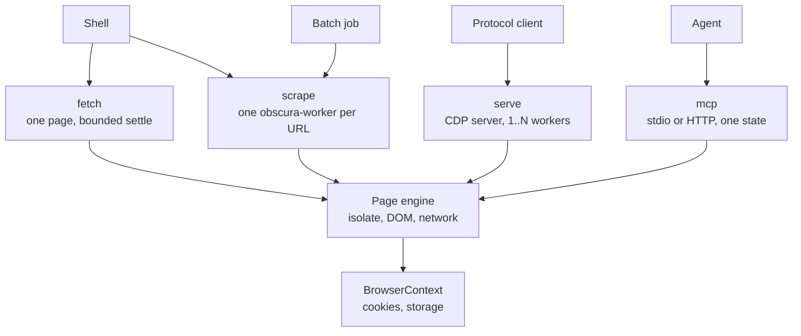
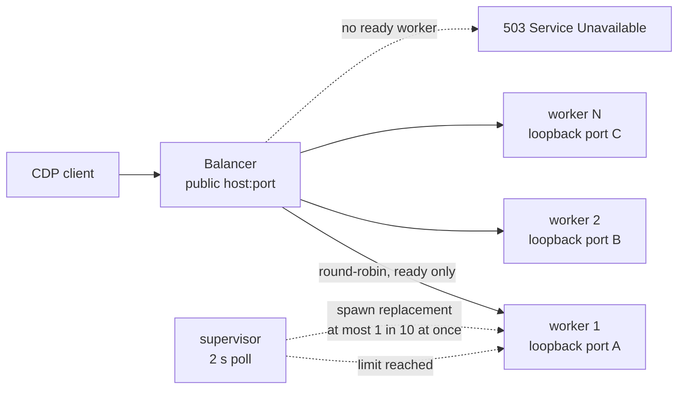
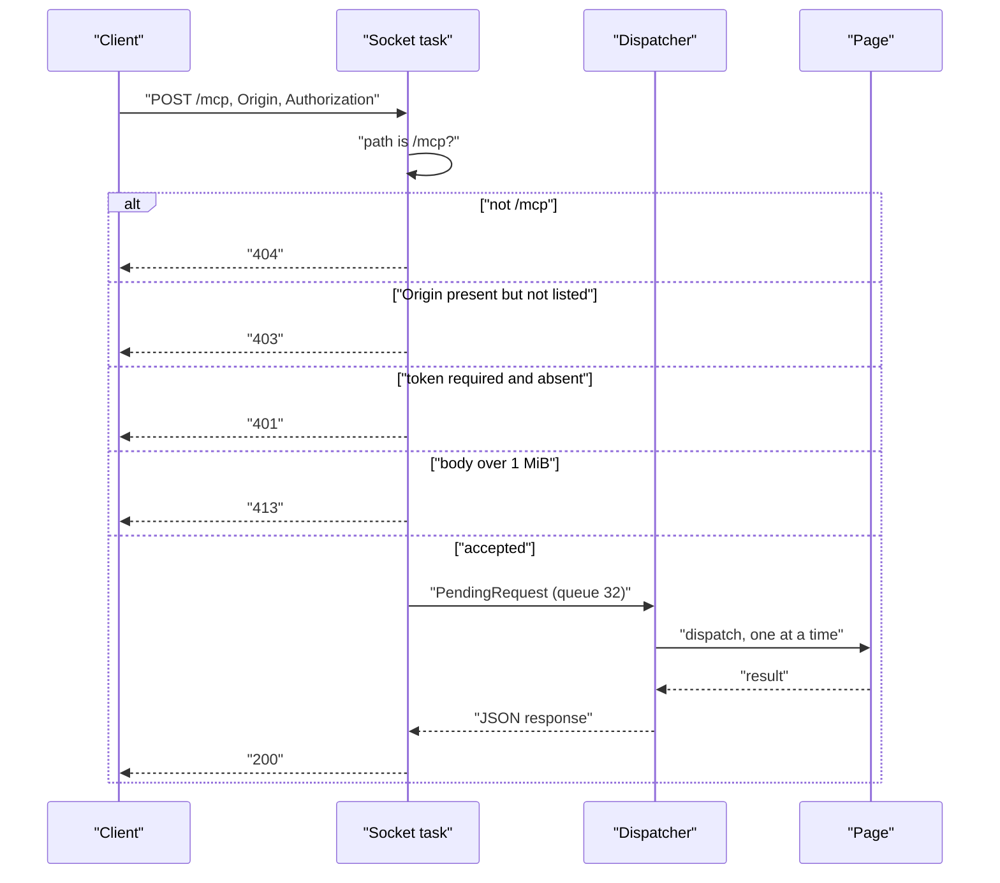

# 08 MCP, command line and operations: three front ends, one engine

Obscura has one browser engine and four ways to reach it. The Command Line Interface (CLI) has a one-shot `fetch`, a parallel `scrape`, a long-running `serve`, and an MCP server. The Chrome DevTools Protocol (CDP) server is the fifth surface, and [06](06-cdp-server.md) covers it. The thesis of this document is that the front ends do not share a concurrency model. Each front end chooses the process and page ownership that fits its workload. Each boundary between a caller and a page refuses work at a fixed limit instead of queueing it without bound.

This document covers the command surface, the `fetch` and `scrape` paths, the worker pool behind `serve`, the MCP transports, and the limits that an operator can set. Document [04](04-browser-page-lifecycle.md) explains the page that every front end drives. Document [06](06-cdp-server.md) explains the protocol server that the `serve` command starts.

## The problem

An operator and an agent ask for different things from the same engine.

| Caller | Workload | Needs |
|--------|----------|-------|
| Shell script | One page, one answer | A command that exits with a result |
| Batch job | Many pages, many processes | Bounded parallelism and a per-page timeout |
| Long-running service | Many protocol clients | A server that stays small for days |
| Agent | A sequence of small browser actions | A stable session with short replies |

One process model cannot serve all four. A single page per process gives isolation, but a batch of 10,000 URLs pays 10,000 startups. A single shared page gives a stable session, but one slow page blocks every caller. Obscura therefore builds four process shapes from the same engine, and it states the cost of each shape.

## Three front ends



The diagram shows the important split. `fetch`, `scrape`, `serve`, and `mcp` are four different commands with four different process shapes. All of them drive the same `Page` type from [04](04-browser-page-lifecycle.md), and all of them write cookies and storage through the same `BrowserContext`.

## The command surface

Global flags apply to every subcommand:

```rust
// crates/obscura-cli/src/main.rs:50-65
    #[arg(long)]
    storage_dir: Option<std::path::PathBuf>,

    /// Permit fetches to loopback, RFC1918, and link-local addresses.
    /// Default is to block them (SSRF fix from #4). Use this for local
    /// development against http://localhost:N or http://192.168.x.y.
    /// Equivalent to `OBSCURA_ALLOW_PRIVATE_NETWORK=1` but per-process
    /// and survives in command pipelines.
    #[arg(long, global = true)]
    allow_private_network: bool,

    /// Pass raw flags to V8, in the same form V8/Chromium/Node accept
    /// (e.g. `"--max-old-space-size=4096 --max-semi-space-size=64 --expose-gc"`).
    /// Applied once at startup before any isolate is created.
    #[arg(long, value_name = "FLAGS", allow_hyphen_values = true)]
    v8_flags: Option<String>,
```

Two of these flags deserve a note. `--allow-private-network` mirrors `OBSCURA_ALLOW_PRIVATE_NETWORK`, because the JavaScript side of the fetch path reads the environment variable directly. `--v8-flags` is applied once:

```rust
// crates/obscura-cli/src/main.rs:435-437
    let v8_flags = effective_v8_flags(args.v8_flags.as_deref());
    tracing::debug!("V8 flags: {}", v8_flags);
    obscura_js::set_v8_flags(&v8_flags);
```

The order is the rule. V8 refuses a flag change after its platform starts, as [03](03-javascript-runtime.md) explains, so the call must happen before the first isolate. A flag that arrives after a page exists cannot be applied.

Logging has three levels and one condition:

```rust
// crates/obscura-cli/src/main.rs:285-295
fn select_log_filter(verbose: bool, quiet: bool) -> &'static str {
    if verbose {
        "debug"
    } else if quiet {
        "off"
    } else {
        "warn"
    }
}

fn is_quiet_command(cmd: &Option<Command>) -> bool {
```

`--quiet` exists because some pages flood the log with per-page script warnings (issue #264). The default level is `warn`, so a normal run prints nothing unless the page or the network has a problem.

When the `serve` command binds a port, it prints a banner with the build version and the DevTools address:

```rust
// crates/obscura-cli/src/main.rs:267-283
fn print_banner(port: u16) {
    println!(
        r#"
   ____  _                              
  / __ \| |                             
 | |  | | |__  ___  ___ _   _ _ __ __ _ 
 | |  | | '_ \/ __|/ __| | | | '__/ _` |
 | |__| | |_) \__ \ (__| |_| | | | (_| |
  \____/|_.__/|___/\___|\__,_|_|  \__,_|
                   
  Headless Browser v{}
  CDP server: ws://127.0.0.1:{}/devtools/browser
"#,
        env!("OBSCURA_BUILD_VERSION"),
        port
    );
}
```

The banner prints only when the port is not zero. A port of zero asks the operating system for a free port, and a banner with a guessed port number would mislead the caller.

## Fetch and scrape

`fetch` has one positional URL or a `--file` list. It answers with one of seven dump formats:

```rust
// crates/obscura-cli/src/main.rs:246-265
enum DumpFormat {
    Html,
    Text,
    Links,
    Markdown,
    /// Stream the raw HTTP response body verbatim (binary-safe).
    /// Bypasses the browser/JS layer — useful for fetching images,
    /// JSON, JS, CSS, or any non-HTML resource (cf. issue #117).
    Original,
    /// One JSON object per line listing every sub-resource URL the
    /// rendered page references (script src, link href, img src,
    /// iframe src, media sources, embed/object data). Lets callers
    /// replay the asset graph with their own HTTP client when they
    /// need the originals alongside the page (cf. issue 124).
    Assets,
    /// Dump all cookies in the browser jar as a JSON array, including
    /// HttpOnly cookies that are inaccessible via document.cookie.
    /// Useful for extracting session tokens set by anti-bot challenges.
    Cookies,
}
```

`Original` bypasses the browser completely, so it keeps binary bytes and costs one Hypertext Transfer Protocol (HTTP) request. `Html`, `Text`, `Links`, and `Markdown` read the rendered document. `Assets` lists the sub-resources without fetching them. `Cookies` reads the jar, including `HttpOnly` cookies that a page script cannot see.

`--file` batch mode has a deliberate limit. Every URL in a batch is fetched raw, and the command prints one JSON status line per URL (issue #349). Rendered batch output requires `scrape`, because one rendered page per line would mix a browser lifetime with a streaming output format. Batch concurrency defaults to one and is configurable.

`scrape` renders many URLs in parallel. It spawns one `obscura-worker` process per URL, up to the concurrency limit:

| Option | Default | Effect |
|--------|---------|--------|
| `--concurrency` | 10 | Live `obscura-worker` processes |
| `--timeout` | 60 seconds | Per-URL deadline |
| `--format` | `json` | Output shape |
| `--eval` | none | Expression to run after settle |
| `--quiet` | off | Suppress progress output |

The read timeout is the smaller of the per-URL timeout and 30 seconds, and the shutdown request gets 5 seconds. A hung worker therefore cannot hold a scrape slot forever.

## Serve: one worker or many

`serve` starts a CDP server. Its connection limit is per worker and is a refusal:

```rust
// crates/obscura-cli/src/main.rs:90-96
        /// Maximum live CDP connections. Each connection runs on its own OS
        /// thread with its own V8 isolates, so this bounds the server's thread
        /// and memory footprint. Connections beyond the limit are refused with
        /// a 503 rather than queued. With --workers N the limit applies to each
        /// worker process, so the server-wide maximum is N times this value.
        #[arg(long, default_value_t = obscura_cdp::DEFAULT_MAX_CONNECTIONS)]
        max_connections: usize,
```

`DEFAULT_MAX_CONNECTIONS` is 128, as [06](06-cdp-server.md) records. The limit is per worker and is not divided by the worker count, because connections do not spread evenly. A divided limit would refuse a client while another worker still had room.

With `--workers 1` the process binds the public port itself and serves CDP directly. With `--workers N` the process becomes a Transmission Control Protocol (TCP) load balancer:



The balancer claims the public port before it starts any child, so another process cannot take the port during startup. It binds each worker to a loopback port that the operating system assigns. Workers never accept a public connection directly. The balancer forwards the public host and port in environment variables, which lets each worker's CDP security gate accept the forwarded host and still reject a foreign one, as [06](06-cdp-server.md) explains. The proxy goes through `OBSCURA_PROXY`, not through an argument, because an argument is visible in the process list to every local user (issue #366).

The balancer writes the 503 itself:

```rust
// crates/obscura-cli/src/main.rs:989-996
        let Some(conn) = pool::pick(&slots, &mut next_worker) else {
            tokio::spawn(async move {
                let mut client = client_stream;
                let _ = client.write_all(b"HTTP/1.1 503 Service Unavailable\r\nConnection: close\r\n\r\n").await;
                let _ = client.shutdown().await;
            });
            continue;
        };
```

A client receives an HTTP status, not a half-open socket. A load balancer or a retry loop can therefore tell "all workers are draining" from "the server is gone".

## The worker pool

Each worker has a supervisor and a recycle policy. Every limit is off by default:

```rust
// crates/obscura-cli/src/pool.rs:10-43
/// When a worker should be replaced. Every limit is off by default.
#[derive(Clone, Copy, Debug, Default)]
pub struct RecyclePolicy {
    pub max_connections: Option<usize>,
    pub max_rss_mb: Option<u64>,
    pub max_age: Option<Duration>,
}

impl RecyclePolicy {
    pub fn enabled(&self) -> bool {
        self.max_connections.is_some() || self.max_rss_mb.is_some() || self.max_age.is_some()
    }

    /// The first threshold that is exceeded, if any. `rss_mb` is `None` when it
    /// could not be sampled (non-Linux, process gone), which never recycles.
    pub fn reason(&self, served: usize, rss_mb: Option<u64>, age: Duration) -> Option<String> {
        if let Some(max) = self.max_connections {
            if served >= max {
                return Some(format!("served {served} connections (limit {max})"));
            }
        }
        if let (Some(max), Some(rss)) = (self.max_rss_mb, rss_mb) {
            if rss >= max {
                return Some(format!("rss {rss} MB (limit {max} MB)"));
            }
        }
        if let Some(max) = self.max_age {
            if age >= max {
                return Some(format!("age {}s (limit {}s)", age.as_secs(), max.as_secs()));
            }
        }
        None
    }
}
```

The precedence is connections, then memory, then age. The first reason wins, and the log states the value that crossed the limit. An unreadable memory value never triggers a recycle, because a failed sample is not evidence of a leak.

Memory is read from the Linux process status file:

```rust
// crates/obscura-cli/src/pool.rs:45-59
/// Resident set size of `pid` in MB. Linux only; `None` elsewhere.
pub fn rss_mb(pid: u32) -> Option<u64> {
    let status = std::fs::read_to_string(format!("/proc/{pid}/status")).ok()?;
    let kb: u64 = status
        .lines()
        .find_map(|line| line.strip_prefix("VmRSS:"))?
        .split_whitespace()
        .next()?
        .parse()
        .ok()?;
    Some(kb / 1024)
}

/// One worker process generation: the port it listens on and its live load.
pub struct Worker {
```

On macOS this function returns `None`, and the CLI prints a warning that `--worker-max-rss` is ignored. The option is not silently accepted.

Routing is round-robin over ready slots:

```rust
// crates/obscura-cli/src/pool.rs:146-153
/// Round-robin over ready workers, skipping crashed ones.
pub fn pick(slots: &[Arc<Slot>], next: &mut usize) -> Option<Connection> {
    (0..slots.len()).find_map(|_| {
        let worker = slots[*next % slots.len()].current();
        *next = next.wrapping_add(1);
        worker.ready.load(Ordering::Relaxed).then(|| worker.connection())
    })
}
```

`Connection` is a live-connection permit. The permit decrements the worker's active count when it is dropped, which is the signal that the worker is finally idle. A replaced worker stays reachable by its existing connections and by nothing else, so it drains without accepting new work.

A replacement is not a restart in place. The supervisor polls every 2 seconds and spawns a new worker on a fresh port. It waits up to 5 seconds for that port to bind, then swaps the slot. The old process finishes its live connections before a drain timeout kills it. The drain timeout defaults to 120 seconds. A fleet that reaches a limit together does not start every replacement at once; the process starts at most a tenth of the pool (minimum one) at a time.

Two constraints keep the shape honest:

- `--ready-file` requires exactly one worker, because a single ready file cannot describe a fleet.
- Every `--worker-max-*` option requires `--workers` greater than one, because a child process cannot replace the process that serves the only port.

A crashed worker is respawned with a 100 millisecond retry and no retry limit. The source states the trade: a fixed retry count would turn a transient failure into a permanent one, and a backoff would delay a healthy restart.

## The scrape worker protocol

The `obscura-worker` binary speaks newline-delimited JavaScript Object Notation (JSON) on standard input and standard output:

```rust
// crates/obscura-cli/src/worker.rs:8-27
#[derive(Debug, Deserialize)]
#[serde(tag = "cmd")]
enum WorkerCommand {
    #[serde(rename = "navigate")]
    Navigate {
        url: String,
        #[serde(default, rename = "waitUntil")]
        wait_until: NavigationWaitUntil,
    },
    #[serde(rename = "evaluate")]
    Evaluate { expression: String },
    #[serde(rename = "title")]
    Title,
    #[serde(rename = "dump_html")]
    DumpHtml,
    #[serde(rename = "dump_text")]
    DumpText,
    #[serde(rename = "shutdown")]
    Shutdown,
}
```

A scrape task sends `navigate`, optionally `evaluate`, then one dump command, then `shutdown`. The wait condition is a separate enum, and the comment states why:

```rust
// crates/obscura-cli/src/worker.rs:29-41
/// Keep the wire protocol strict: WaitUntil::from_str falls back to Load.
#[derive(Debug, Default, Deserialize)]
enum NavigationWaitUntil {
    #[default]
    #[serde(rename = "load")]
    Load,
    #[serde(rename = "domcontentloaded")]
    DomContentLoaded,
    #[serde(rename = "networkidle0")]
    NetworkIdle0,
    #[serde(rename = "networkidle2")]
    NetworkIdle2,
}
```

The page API parses a string and falls back to `Load` on an unknown value. The worker does not use that parser. An unknown value fails deserialization, so a typo in the parent process is a visible error, not a silent change of the wait condition.

Every reply has the same envelope:

```rust
// crates/obscura-cli/src/worker.rs:54-70
#[derive(Debug, Serialize)]
struct WorkerResponse {
    ok: bool,
    #[serde(skip_serializing_if = "Option::is_none")]
    result: Option<serde_json::Value>,
    #[serde(skip_serializing_if = "Option::is_none")]
    error: Option<String>,
}

impl WorkerResponse {
    fn success(result: serde_json::Value) -> Self {
        WorkerResponse { ok: true, result: Some(result), error: None }
    }
    fn error(msg: String) -> Self {
        WorkerResponse { ok: false, result: None, error: Some(msg) }
    }
}
```

A failed command does not end the process. The parent can record the error and continue, and the scrape result line carries the error next to the URL and the elapsed time.

## The MCP server

The MCP server is the agent surface. It exposes 36 tools, or 38 in a build with the `render` feature, which enables the paint layer and adds `browser_screenshot` and `browser_pdf`. The tool list is a single JSON literal, and that literal has a compile-time cost:

```rust
// crates/obscura-mcp/src/lib.rs:1-5
// The tools/list JSON literal expanded by serde_json::json! is large
// enough now (32 tool definitions) that the default macro recursion
// limit (128) overflows. Bumping for this crate only.
#![recursion_limit = "512"]
```

The comment is now out of date in its count. The literal holds 36 definitions, and a render build appends 2 more. The recursion limit still matters, because the `json!` macro nests one expansion level per array element and per object.

A tool reply has a budget:

```rust
// crates/obscura-mcp/src/lib.rs:20-24
/// Cap on text returned to the agent unless the caller passes a larger
/// `max_chars`. Agents waste context on multi-KB raw page dumps; this
/// keeps a single tool call from burning a window's worth of tokens.
/// Override via tool args.
const DEFAULT_TEXT_LIMIT: usize = 4000;
```

4,000 characters is a product decision about context, not a memory limit. A caller can raise it per call. `browser_snapshot` separately caps the URL and the title at 256 characters each.

The server state is one browser context with a set of tabs:

```rust
// crates/obscura-mcp/src/lib.rs:63-80
pub struct BrowserState {
    /// Open tabs keyed by tab_id (e.g. "tab-1"). BTreeMap so list ordering
    /// is stable across calls (agents reason about "tab #2" deterministically).
    tabs: std::collections::BTreeMap<String, Page>,
    /// The tab id every tool call operates on. None means there are no
    /// open tabs; the next page_mut() call creates one.
    active_tab: Option<String>,
    tab_counter: u32,
    context: Arc<BrowserContext>,
    user_agent: Option<String>,
    operator_network_hints: bool,
    console_messages: Vec<String>,
    /// Element-ref table from the last `browser_snapshot` on the ACTIVE
    /// tab. Agents click / fill / type by `ref` (e.g. `"e3"`) instead of
    /// guessing a CSS selector. Refs are stable within a snapshot; the
    /// table is wiped on every navigation / tab switch and refilled on
    /// the next snapshot call.
    interactive_refs: HashMap<String, NodeId>,
```

The `BTreeMap` is a deliberate choice for agent reasoning. Tab order is stable between calls, so "tab #2" means the same tab on every call. The `operator_network_hints` flag is set to true on the MCP path, so a blocked private address produces a hint that names the flag that permits it, as [05](05-network-ssrf-and-stealth.md) explains.

Element references are checked against the live document:

```rust
// crates/obscura-mcp/src/lib.rs:224-239
    fn ref_to_selector(&self, r: &str) -> Result<String, String> {
        let node_id = *self.interactive_refs.get(r).ok_or_else(|| format!(
                "unknown ref '{r}'; call browser_snapshot first to refresh the ref table"
            ))?;
        let selector = format!("[data-obscura-ref=\"{r}\"]");
        let same_node = self.active_tab.as_ref()
            .and_then(|id| self.tabs.get(id))
            .and_then(|page| page.with_dom(|dom| {
                dom.query_selector(&selector).ok().flatten() == Some(node_id)
            }))
            .unwrap_or(false);
        if !same_node {
            return Err(format!("stale ref '{r}'; call browser_snapshot to refresh the ref table"));
        }
        Ok(selector)
    }
```

The second check is the important one. A snapshot writes `data-obscura-ref="eN"` into the document. If the page re-renders and the attribute survives on a different node, the recorded identifier and the live node differ, and the call fails with an instruction. An agent that acts on a stale reference gets an error that tells it what to do, not a click on the wrong control.

A synthesized click or key press can queue a navigation. The MCP path settles that navigation before it replies:

```rust
// crates/obscura-mcp/src/lib.rs:183-217
    /// Consume a navigation that a synthesized interaction just queued,
    /// before the tool replies.
    ///
    /// A click on a submit button, an Enter keypress, or an evaluated
    /// `location.href` assignment does not issue a request by itself. It runs
    /// the page's own glue and leaves the navigation as pending state, which
    /// becomes a request only when a driving layer converts it. The CDP path
    /// already converts it, in `Input.dispatchMouseEvent` and after
    /// `Runtime.evaluate`, which is why the same click POSTs over CDP and
    /// does nothing over MCP (#618).
    ///
    /// [`Self::advance_active_page_tasks`] cannot cover this. It is armed
    /// after every dispatch, but it sits in a `biased` select behind
    /// `read_line`, so a client that sends its next tool call immediately,
    /// which an agent does, wins that race every time. The reply is also
    /// written before any pump turn could run, so the tool would answer
    /// "Clicked" while the request has not left the process.
    async fn settle_synthetic_navigation(&mut self) -> Result<(), String> {
        let navigated = self
            .page_mut()
            .process_pending_navigation()
            .await
            .map_err(|error| error.to_string())?;
        if navigated {
            // The ref table names elements in a document that has gone away.
            self.interactive_refs.clear();
            // One slice on the landed document, so a tool that reads the URL
            // or the text next sees the new page rather than an empty one.
            self.page_mut()
                .run_autonomous_event_loop_turn()
                .await
                .map_err(|error| error.to_string())?;
        }
        Ok(())
    }
```

This is a bug report written as a comment. An agent sends the next tool call within milliseconds, so a racing event-loop pump never runs before the next request arrives. The fix runs the pending navigation inside the tool call, and the reply is true when the client reads it.

Method dispatch is small:

```rust
// crates/obscura-mcp/src/lib.rs:242-252
pub(crate) async fn dispatch(method: &str, id: Value, params: &Value, state: &mut BrowserState) -> RpcResponse {
    match method {
        "initialize" => handle_initialize(id, params),
        "ping" => RpcResponse::ok(id, json!({})),
        "tools/list" => handle_tools_list(id),
        "tools/call" => handle_tool_call(id, params, state).await,
        "resources/list" => RpcResponse::ok(id, json!({"resources": []})),
        "prompts/list" => RpcResponse::ok(id, json!({"prompts": []})),
        _ => RpcResponse::err(id, -32601, format!("Unknown method: {method}")),
    }
}
```

The server advertises protocol version `2024-11-05`, one capability set (`tools`), and an empty resource list. It does not claim a capability that it does not implement.

The standard input transport is newline-delimited JSON with one pump race:

```rust
// crates/obscura-mcp/src/lib.rs:255-297
    let stdin = tokio::io::stdin();
    let stdout = tokio::io::stdout();
    let mut reader = BufReader::new(stdin);
    let mut writer = stdout;

    let mut state = BrowserState::new(proxy, user_agent, stealth);
    state.operator_network_hints = true;
    // Cookies and Web Storage are written on every navigation; this covers the
    // writes an agent makes after a page has settled, on the way out.
    let mut runtime_pump_armed = false;

    loop {
        // MCP stdio transport: newline-delimited JSON (one message per line)
        let mut line = String::new();
        let n = if runtime_pump_armed {
            tokio::select! {
                biased;
                read = reader.read_line(&mut line) => Some(read?),
                pump_result = state.page_mut().run_autonomous_event_loop_turn() => {
                    let pump_result = match pump_result {
                        Ok(reached_idle) => state.finish_active_page_turn(reached_idle).await,
                        Err(error) => Err(error),
                    };
                    match pump_result {
                        Ok(reached_idle) => runtime_pump_armed = !reached_idle,
                        Err(error) => {
                            runtime_pump_armed = false;
                            eprintln!("MCP page task failed: {error}");
                        }
                    }
                    None
                }
            }
        } else {
            Some(reader.read_line(&mut line).await?)
        };
        let Some(n) = n else {
            continue;
        };
        if n == 0 {
            state.context.save_storage();
            return Ok(());
        }
```

The `biased` keyword makes the read the first branch. A waiting client therefore gets its request served before the server runs another page turn. When the page is idle the pump disarms, so an idle server sleeps on the read and uses no processor. End of input saves storage before the process exits.

A tool failure is not a JSON-RPC error:

```rust
// crates/obscura-mcp/src/lib.rs:798-822
    let result = match name {
        "browser_navigate" => tool_navigate(args, state).await,
        "browser_snapshot" => tool_snapshot(args, state),
        "browser_click" => tool_click(args, state).await,
        "browser_fill" => tool_fill(args, state).await,
        "browser_type" => tool_type(args, state).await,
        "browser_press_key" => tool_press_key(args, state).await,
        "browser_select_option" => tool_select_option(args, state),
        "browser_evaluate" => tool_evaluate(args, state).await,
        "browser_wait_for" => tool_wait_for(args, state).await,
        "browser_wait_for_function" => tool_wait_for_function(args, state).await,
        "browser_network_requests" => tool_network_requests(state),
        "browser_console_messages" => tool_console_messages(state),
        "browser_close" => tool_close(state),
        // Tier 1 agent-UX additions
        "browser_markdown" => tool_markdown(args, state),
        "browser_links" => tool_links(args, state),
        "browser_interactive_elements" => tool_interactive_elements(args, state),
        "browser_back" => tool_back(state).await,
        "browser_forward" => tool_forward(state).await,
        "browser_reload" => tool_reload(state).await,
        "browser_get_cookies" => tool_get_cookies(args, state),
        "browser_set_cookie" => tool_set_cookie(args, state),
        "browser_clear_cookies" => tool_clear_cookies(state),
        "browser_wait_for_text" => tool_wait_for_text(args, state).await,
```

The mapping below it wraps both results in a successful response:

```rust
// crates/obscura-mcp/src/lib.rs:840-848
    match result {
        Ok(content) => RpcResponse::ok(id, json!({
            "content": [{ "type": "text", "text": content }]
        })),
        Err(e) => RpcResponse::ok(id, json!({
            "content": [{ "type": "text", "text": format!("Error: {e}") }],
            "isError": true
        })),
    }
```

The JSON-RPC envelope stays valid and the MCP content block carries `isError`. An agent sees the failure as tool output, so its turn continues. A JSON-RPC error would be a transport failure, and many clients abort the session on one.

## The MCP HTTP transport

`obscura mcp --http` starts a second transport on port 3000 by default. Its limits are constants, not options:

```rust
// crates/obscura-mcp/src/http.rs:12-29
/// Hard cap on a single MCP request body. The client-supplied `Content-Length`
/// is used to pre-size the read buffer; without a ceiling a request advertising
/// e.g. `Content-Length: 4294967296` makes the server allocate and zero-fill
/// that many bytes before reading any body — an unauthenticated OOM/DoS. One
/// MiB is far above any real JSON-RPC tool call.
const MAX_BODY_BYTES: usize = 1024 * 1024;
const MAX_REQUEST_LINE_BYTES: usize = 8 * 1024;
const MAX_HEADER_LINE_BYTES: usize = 16 * 1024;
const MAX_HEADER_BYTES: usize = 64 * 1024;
const MAX_BATCH_ITEMS: usize = 64;
const MAX_ID_BYTES: usize = 1024;
const MAX_CONNECTIONS: usize = 128;
const MAX_PENDING_REQUESTS: usize = 32;

/// Maximum time allowed to receive one complete HTTP request (request line,
/// headers, and body). The deadline is shared across all reads so a client
/// cannot keep the sequential MCP server occupied by slowly dribbling data.
const REQUEST_READ_TIMEOUT: Duration = Duration::from_secs(30);
```

The body cap exists because `Content-Length` is a client claim. A server that trusts it allocates the claimed size before it reads a byte. The read timeout has the same motivation in time: a client that sends one byte per second holds the single dispatcher forever.

A non-loopback bind requires authentication:

```rust
// crates/obscura-mcp/src/http.rs:276-288
pub async fn run(host: String, port: u16, proxy: Option<String>, user_agent: Option<String>, stealth: bool) -> Result<()> {
    let addr: std::net::SocketAddr = format!("{}:{}", host, port).parse()?;
    let auth_token = token_from_env()?;
    if !addr.ip().is_loopback() && auth_token.is_none() {
        anyhow::bail!(
            "refusing to expose MCP without authentication; set OBSCURA_MCP_TOKEN to at least 32 bytes"
        );
    }
    let listener = TcpListener::bind(&addr).await?;
    tracing::info!("MCP HTTP server on http://{}:{}/mcp", host, port);
    if auth_token.is_some() {
        tracing::info!("MCP bearer authentication enabled");
    }
```

The token is read from `OBSCURA_MCP_TOKEN` and must be at least 32 bytes. The comparison is constant-time:

```rust
// crates/obscura-mcp/src/http.rs:70-87
fn constant_time_eq(left: &str, right: &str) -> bool {
    if left.len() != right.len() {
        return false;
    }
    left.bytes()
        .zip(right.bytes())
        .fold(0u8, |difference, (left, right)| difference | (left ^ right))
        == 0
}

fn bearer_authorized(header: Option<&str>, expected: Option<&str>) -> bool {
    match expected {
        None => true,
        Some(expected) => header
            .and_then(|value| value.strip_prefix("Bearer "))
            .is_some_and(|provided| constant_time_eq(provided, expected)),
    }
}
```

A length mismatch returns early, and a matching length compares every byte in one pass. The early return leaks the length and nothing else.

A loopback bind is not authentication. Any local web page can send a request to `127.0.0.1:3000`, so the server also tests the `Origin` header:

```rust
// crates/obscura-mcp/src/http.rs:234-261
/// Origin allowlist for browser callers, read from `OBSCURA_MCP_ALLOWED_ORIGINS`
/// (comma-separated). Unset/empty refuses browser callers; native clients do
/// not send Origin and remain unaffected.
fn allowed_origins_env() -> Option<String> {
    std::env::var("OBSCURA_MCP_ALLOWED_ORIGINS")
        .ok()
        .filter(|s| !s.trim().is_empty())
}

/// Whether a request's `Origin` is permitted. A request with no `Origin`
/// (native, non-browser MCP clients) is always allowed — the same-origin
/// policy only constrains browser callers. When an allowlist is configured, a
/// browser `Origin` must match one of its entries (case-insensitive); this
/// stops a malicious local web page from driving the loopback MCP port.
fn origin_allowed(origin: Option<&str>, allowlist: Option<&str>) -> bool {
    match origin {
        None => true,
        Some(o) => match allowlist {
            None => false,
            Some(list) => {
                let o = o.trim();
                list.split(',')
                    .map(str::trim)
                    .any(|a| !a.is_empty() && a.eq_ignore_ascii_case(o))
            }
        },
    }
}
```

A request without `Origin` is a native client, and it is allowed. A request with `Origin` must match the allowlist, and an unset allowlist refuses every browser caller. The Cross-Origin Resource Sharing (CORS) response never emits a wildcard for this endpoint.

The request gate runs in a fixed order:



The routing code is literal about the order:

```rust
// crates/obscura-mcp/src/http.rs:377-395
        // ── routing ──────────────────────────────────────────────────────────
        if path != "/mcp" {
            respond(&mut writer, 404, b"{\"error\":\"not found\"}").await?;
            break;
        }

        // Origin gate: when OBSCURA_MCP_ALLOWED_ORIGINS is configured, a browser
        // request from a non-listed origin is refused before it can drive the
        // browser session (mitigates a malicious local web page issuing
        // cross-origin POSTs to the loopback MCP port). The permissive default
        // and no-Origin native clients are unaffected.
        if !origin_allowed(origin.as_deref(), allowed_origins) {
            respond(&mut writer, 403, b"{\"error\":\"origin not allowed\"}").await?;
            break;
        }
        if method != "OPTIONS" && !authorized {
            respond(&mut writer, 401, b"{\"error\":\"authentication required\"}").await?;
            break;
        }
```

The path test comes first, so a scanner that probes other paths cannot learn whether a token exists. The `OPTIONS` method skips authentication, because a browser preflight cannot send the bearer header. It still passes the origin gate.

The body is read only when the request can reach the handler:

```rust
// crates/obscura-mcp/src/http.rs:188-209
    // Only consume a body for a POST that can reach the MCP route. Invalid
    // paths and forbidden origins retain the existing early-response behavior.
    let authorized = bearer_authorized(authorization.as_deref(), auth_token);
    let body = if method == "POST"
        && path == "/mcp"
        && origin_allowed(origin.as_deref(), allowed_origins)
        && authorized
        && content_type_is_json
    {
        match content_length {
            None => RequestBody::MissingLength,
            // Reject the client-supplied size before allocating the body.
            Some(len) if len > MAX_BODY_BYTES => RequestBody::TooLarge,
            Some(len) => {
                let mut body = vec![0u8; len];
                reader.read_exact(&mut body).await?;
                RequestBody::Read(body)
            }
        }
    } else {
        RequestBody::NotRead
    };
```

A refused request therefore costs no allocation. The size test runs before the `vec!` call, and `RequestBody::TooLarge` carries no buffer.

A batch is bounded by item count:

```rust
// crates/obscura-mcp/src/http.rs:500-511
    if let Some(batch) = msg.as_array() {
        if batch.is_empty() || batch.len() > MAX_BATCH_ITEMS {
            return json!({"jsonrpc":"2.0","id":null,"error":{"code":-32600,"message":"Invalid Request"}});
        }
        let mut results = Vec::new();
        for item in batch {
            if let Some(r) = process_one(item, state).await {
                results.push(r);
            }
        }
        return Value::Array(results);
    }
```

A JSON-RPC batch is the standard way to send many calls in one body. It is also a multiplication of work, so the item count has a ceiling. The identifier has its own cap at 1,024 bytes, and an array or object identifier is invalid.

One dispatcher drives all connections. The accept loop holds at most 128 live sockets, each socket sends one request at a time into a 32-slot queue, and the dispatcher serves them in arrival order. That is the whole concurrency model, and the next paragraph explains why it cannot be different.

**Aha:** The MCP server is deliberately sequential because a `Page` is not `Sync`. Parallel tool calls would mean two threads mutating one document tree, one JavaScript isolate, and one cookie jar. Obscura answers with a queue instead of a lock: 128 sockets wait on 32 request slots, and one dispatcher owns the page. The cost is one slow tool call that delays every other connection. The gain is that no tool call can ever observe a half-mutated page. The same reasoning appears in [06](06-cdp-server.md), where each CDP connection owns its page on a dedicated thread, and the server never shares one page between connections.

The HTTP transport has a keep-alive branch for Server-Sent Events (SSE). A `GET` with `Accept: text/event-stream` receives a stream and a comment every 15 seconds. The write half is detached to its own task, because the dispatcher is sequential and an inline keep-alive loop would wedge the accept loop.

## Limits

| Limit | Value | Where |
|-------|-------|-------|
| Fetch timeout | 30 seconds | `--timeout` |
| Fetch settle | 5 seconds, adaptive | `--wait` |
| Fetch batch concurrency | 1 | `--concurrency` |
| Scrape concurrency | 10 | `--concurrency` |
| Scrape worker timeout | 60 seconds | `--timeout` |
| Scrape read timeout | smaller of the timeout and 30 seconds | `run_parallel_scrape` |
| CDP connections per worker | 128 | `DEFAULT_MAX_CONNECTIONS` |
| Worker drain | 120 seconds | `--worker-drain-timeout` |
| Worker recycle poll | 2 seconds | `RECYCLE_POLL` |
| Worker startup deadline | 5 seconds | `wait_for_serve_worker` |
| Replacement concurrency | one tenth of the pool, minimum one | `recycles` |
| MCP body | 1 MiB | `MAX_BODY_BYTES` |
| MCP batch items | 64 | `MAX_BATCH_ITEMS` |
| MCP identifier | 1,024 bytes | `MAX_ID_BYTES` |
| MCP connections | 128 | `MAX_CONNECTIONS` |
| MCP pending requests | 32 | `MAX_PENDING_REQUESTS` |
| MCP request read | 30 seconds | `REQUEST_READ_TIMEOUT` |
| MCP bearer token | 32 bytes minimum | `token_from_env` |
| MCP text reply | 4,000 characters | `DEFAULT_TEXT_LIMIT` |

## Limits not in the table

Six behaviours are consequences of the design, not options.

- **`scrape` pays one V8 startup per URL.** A concurrency of 10 means 10 V8 instances and 10 copies of the engine. A single URL failure costs one process, not the run.
- **Worker recycling is off by default.** A `serve` process that runs for weeks keeps its memory unless the operator sets a limit. The tool does not guess a policy.
- **Memory recycling is a Linux feature.** `--worker-max-rss` reads `/proc/<pid>/status`, and other systems ignore it with a warning.
- **MCP refuses an excess connection by dropping the socket.** It does not send a status line, because the accepted stream has not been read yet. The CDP server sends a 503 in the same situation, as [06](06-cdp-server.md) records.
- **One slow MCP tool call delays every other connection.** The dispatcher is sequential by construction.
- **`fetch --file` returns raw bytes only.** A rendered batch requires `scrape`, and its per-URL cost includes a process start.

## Related documents

- [01 Workspace and architecture](01-workspace-and-architecture.md) lists the CLI, MCP, and browser crates.
- [03 JavaScript runtime](03-javascript-runtime.md) explains why V8 flags must be applied before any isolate.
- [04 Browser page lifecycle](04-browser-page-lifecycle.md) explains the page that `fetch`, `scrape`, `serve`, and `mcp` drive.
- [05 Network, SSRF and stealth](05-network-ssrf-and-stealth.md) explains `--allow-private-network` and the operator hint.
- [06 CDP server](06-cdp-server.md) explains the protocol surface behind `serve`.
- [07 Rendering and output](07-rendering-and-output.md) explains the capture that `--screenshot` requests.
- [09 Testing and limits](09-testing-and-limits.md) explains the tests for these limits.
