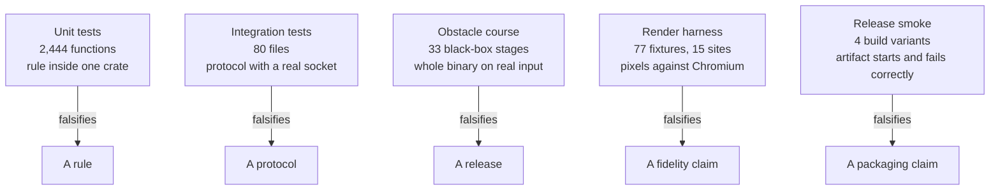
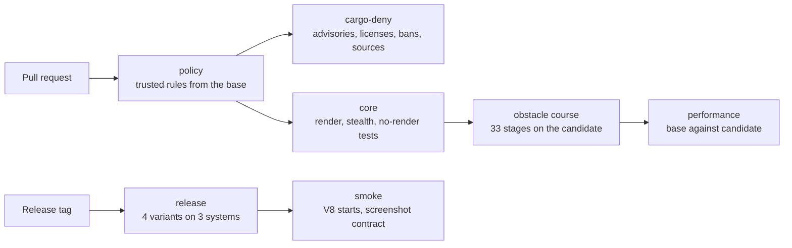

# 09 Testing and limits: four gates, four questions

Obscura ships four test gates, and no gate is a larger copy of another. Twenty-four hundred test functions check rules inside the engine. Eighty integration files check protocols between the engine and a caller. A pinned 33-stage obstacle course checks whole releases against real pages. A render harness checks pixels against Chromium on 77 fixtures and 15 live sites. The thesis of this document is that each gate falsifies a claim that the cheaper gates cannot address. A passing unit suite is not evidence that the binary starts. A passing obstacle course is not evidence that a page looks correct.

This document covers the test taxonomy and the process rule that shapes the unit tests. It covers the registry guard and the Continuous Integration (CI) trust model. It also covers the feature matrix, the obstacle course, the render fidelity harness, and the release smoke test. Document [04](04-browser-page-lifecycle.md) and [06](06-cdp-server.md) name the behaviours that these tests pin.

## The problem

A browser engine can fail in places that a normal library does not have.

| Failure | Where it hides |
|---------|----------------|
| A DOM op panics inside a V8 callback | Only in a process that runs the engine |
| A connection slot leaks on teardown | Only after many connections in one process |
| A release ships a mismatched snapshot | Only in the packaged binary |
| A layout is wrong but stable | Only against another engine |
| A change doubles latency | Only against an older build |

A single test tool cannot reach all five. A unit test cannot see a released artifact. A pixel comparison cannot see a leaked file descriptor. The suite therefore repeats the same behaviour at several altitudes and accepts the cost of repetition.



## The process rule

The engine holds one V8 JavaScript engine isolate per process. That fact decides the test runner. `cargo test` puts every test in one binary and runs it in one process, so a second runtime test would meet a started V8 platform and fail. The project uses `cargo nextest`, which starts one process per test:

```rust
// crates/obscura-cdp/tests/integration.rs:1-21
// One link of the browser engine. Nextest still starts a process per test.
macro_rules! integration_tests {
    ($($module:ident),* $(,)?) => {
        $(mod $module;)*

        #[test]
        fn every_integration_file_is_registered() {
            use std::collections::BTreeSet;
            let registered: BTreeSet<String> = [$(stringify!($module).to_owned(),)*]
                .into_iter().collect();
            let files: BTreeSet<String> = std::fs::read_dir(
                concat!(env!("CARGO_MANIFEST_DIR"), "/tests"),
            ).unwrap().map(|entry| entry.unwrap().path())
                .filter(|path| path.extension().is_some_and(|ext| ext == "rs"))
                .map(|path| path.file_stem().unwrap().to_str().unwrap().to_owned())
                .filter(|name| name != "integration")
                .collect();
            assert_eq!(registered, files, "register new test files in integration_tests!");
        }
    };
}
```

The macro does two jobs. It compiles all 42 Chrome DevTools Protocol (CDP) test files into one binary, which avoids linking the engine 42 times. It also generates a guard test that compares the macro list with the directory. A developer who adds a test file and forgets the list gets a failing test, not a silently skipped file.

The counts on 2026-11-15 are:

| Item | Count |
|------|-------|
| Test functions (`#[test]` plus async) | 2,444 |
| Plain synchronous tests | 1,623 |
| Async tests | 821 |
| Integration test files | 80 |
| Crates with a `tests` directory | 8 |
| Render fixtures | 77 |
| Representative sites | 15 |

The async count is larger than a plain `cargo test` world because most engine work is asynchronous. A test that navigates a page uses `#[tokio::test(flavor = "current_thread")]`, because the page owns a `LocalSet` and is not `Send`:

```rust
// crates/obscura-browser/tests/unhandled_rejection.rs:37-39
#[tokio::test(flavor = "current_thread")]
async fn rejected_background_promise_does_not_stop_the_page_event_loop() {
    std::env::set_var("OBSCURA_ALLOW_PRIVATE_NETWORK", "1");
```

The `current_thread` flavour is not a style choice. The page runtime uses `LocalSet` and single-threaded tasks, as [03](03-javascript-runtime.md) explains. The environment variable allows the test server on loopback, because the default network policy blocks private addresses, as [05](05-network-ssrf-and-stealth.md) records. The test states the exception; it does not change a global default.

## Tests as the executable form of the documents

The best test headers state a claim in the same form as a document section. Four examples map directly onto earlier chapters.

```rust
// crates/obscura-cdp/tests/max_connections_cap.rs:1-17
//! `--max-connections` bounds the thread-per-connection server.
//!
//! Each CDP connection owns an OS thread and its pages' V8 isolates, so without
//! a cap a client can grow the server's thread count and memory without limit.
//! The cap must do three things, and this test pins all three:
//!
//! 1. connections up to the limit are accepted and usable;
//! 2. the one past the limit is refused with an explicit `503` carrying
//!    `X-Obscura-Reason: max-connections`, not dropped with a bare reset;
//! 3. closing a connection frees its slot, so the server recovers rather than
//!    wedging shut once it has ever been full.
//!
//! (3) is the one that actually bites: a slot leaked on any connection-teardown
//! path would only show up as a server that stops accepting after N lifetime
//! connections, which no other test would catch.
//!
//! Run with `cargo nextest run -p obscura-cdp -E 'test(max_connections_cap)'`.
```

The third item is the lesson. A test for a refusal is easy, because the refusal is immediate. A test for recovery is hard, because the fault appears only after a slot leaks on one of several teardown paths. The header says which item the authors expect to break, and that is the item that [06](06-cdp-server.md) describes.

The MCP transport has the same shape:

```rust
// crates/obscura-mcp/tests/sse_stream_does_not_wedge.rs:1-9
//! Regression test: an open SSE stream (`GET /mcp` with
//! `Accept: text/event-stream`) must not wedge the whole MCP HTTP server.
//!
//! The server serves connections sequentially on the single current-thread
//! runtime (the browser session is `!Send`). The SSE keep-alive is an infinite
//! ping loop, so if it is held inline it never returns and the `accept()` loop
//! never runs again — every later request hangs forever. The keep-alive carries
//! no browser state, so it must be detached and the connection handler must
//! return, leaving the accept loop free.
```

This test pins the consequence of the sequential dispatcher from [08](08-mcp-cli-and-operations.md). The keep-alive must be detached, or one idle event stream blocks every later tool call. The test opens a stream and then sends a second request.

The worker pool has its own invariants:

```rust
// crates/obscura-cli/tests/serve_worker_recycle.rs:1-3
//! `serve --workers N --worker-max-*` replaces workers that pass a threshold
//! without failing any session: replacements keep the pool at N, and a replaced
//! worker keeps serving the connections it already had until they close.
```

The file is gated to Linux with `#![cfg(target_os = "linux")]`, because the memory signal comes from `/proc/<pid>/status`. The test is honest about its platform.

The render suite guards against a different kind of regression:

```rust
// crates/obscura-render/tests/layout_test.rs:1-4
//! Regression test: a Hacker-News-shaped nested `<table>` layout must come out
//! right using only the general engine (UA defaults + real CSS cascade), with
//! no per-site hardcoded selectors. This guards against reintroducing the
//! site-specific hacks that used to live in obscura-render for this exact markup.
```

A site-specific hack makes one page correct and the engine less general. The test uses the site's shape but not its name, and it asserts the general path. The project rule is the same in [07](07-rendering-and-output.md): never add hostname-specific layout or style behaviour.

| Test file | Claim | Document |
|-----------|-------|----------|
| `max_connections_cap.rs` | A refusal is a 503 and a closed slot returns | [06](06-cdp-server.md) |
| `file_navigation_gate.rs` | A CDP client cannot read local files without the flag | [04](04-browser-page-lifecycle.md) |
| `concurrent_page_isolation.rs` | Two connections do not share a document or an isolate | [03](03-javascript-runtime.md) |
| `sse_stream_does_not_wedge.rs` | An idle stream does not block the next request | [08](08-mcp-cli-and-operations.md) |
| `serve_worker_recycle.rs` | A replaced worker drains and the pool keeps its size | [08](08-mcp-cli-and-operations.md) |
| `box_shadow_screenshot.rs` | A paint feature reaches a Portable Network Graphics (PNG) file | [07](07-rendering-and-output.md) |

## The CI trust model

A pull request contains code that the CI server will execute. The workflow starts from that assumption.



The policy job judges before anything builds, and it judges with rules that the pull request cannot change. The performance job runs only after the core job passes, so a slow candidate that fails a behaviour test never reaches the benchmark.

```yaml
# .github/workflows/ci.yml:8-12
# Pull requests execute contributor-controlled build scripts, proc macros,
# tests, and binaries. They must never receive a write token or repository
# secrets. Publishing remains isolated in the tag-only release workflows.
permissions:
  contents: read
```

The permission is read-only for every pull request job. Publishing is a separate tag-only workflow. A test that needs a secret cannot run on a pull request, and a contributor cannot exfiltrate a token through a build script.

The policy check has a second layer. The policy script and the dependency configuration come from the base revision, not from the pull request:

```yaml
# .github/workflows/ci.yml:55-58
          policy_root="$RUNNER_TEMP/obscura-policy"
          mkdir -p "$policy_root"
          git show "$base_sha:scripts/ci/pr_policy.py" > "$policy_root/pr_policy.py"
          git show "$base_sha:deny.toml" > "$policy_root/deny.toml"
```

A pull request cannot weaken the rule that judges it. The workflow also replaces a pull-request-supplied `deny.toml` with the trusted copy before the audit runs. The policy script is pure Python with no shell evaluation of pull-request data:

```python
# scripts/ci/pr_policy.py:1-10
#!/usr/bin/env python3
"""Fast, deterministic PR policy checks with no shell evaluation of PR data."""

from __future__ import annotations

import argparse
import re
import subprocess
import sys
from pathlib import Path, PurePosixPath
```

The policy blocks workflow triggers that run with a write token, unpinned actions, secret references in pull-request workflows, and binary artifacts:

```python
# scripts/ci/pr_policy.py:17-21
MAX_CONTROL_FILE_BYTES = 2 * 1024 * 1024
ALWAYS_BLOCKED_WORKFLOW_ADDITIONS = (
    "pull_request_target",
    "workflow_run",
)
```

The `pull_request_target` trigger runs in the base repository context and can receive a write token. `workflow_run` has similar power. Both are blocked without a maintainer decision. Every action reference must be a full 40-character commit identifier, and every Docker reference must carry a `sha256` digest, so a moved tag cannot change what the CI server runs.

The change classifier decides whether the expensive jobs run:

- A change to a manifest, a lock file, `deny.toml`, or the workflow itself sets both `runtime` and `audit`.
- A change to documentation, Markdown, or issue templates sets neither.
- Every other path sets `runtime`.
- Rename detection is disabled, so moving code into a documentation-looking path cannot hide it.

The audit runs `cargo-deny` for advisories, licenses, bans, and sources. This is the supply-chain gate: a new dependency with a forbidden license fails before a test runs.

## The feature matrix

Obscura ships four binary variants, and each variant has a different contract:

| Variant | Features | Contract |
|---------|----------|----------|
| Default | `api` | Text and DOM work, no layout, no screenshots |
| Render | `render` | Layout, screenshot, and Portable Document Format (PDF) |
| Stealth | `stealth` | The `wreq` Transport Layer Security (TLS) client and tracker blocking |
| No-render stealth | `stealth`, no render | Stealth behaviour in the small build |

The core job builds and tests the render variant first:

```yaml
# .github/workflows/ci.yml:167-171
      - name: Build render release
        run: cargo build --release -p obscura-cli --bins --features render

      - name: Test render configuration
        run: cargo nextest run --release --features render --no-fail-fast
```

Then it tests the stealth transport with one careful exception:

```yaml
# .github/workflows/ci.yml:202-210
      - name: Test the stealth transport
        run: |
          # The gzip fixture binds loopback. Keep the ordinary suite under the
          # default SSRF policy, then opt in only for that single focused test.
          cargo nextest run --release -p obscura-net --features stealth \
            --no-fail-fast -- --skip stealth_client_decodes_gzip_response
          OBSCURA_ALLOW_PRIVATE_NETWORK=1 cargo nextest run --release \
            -p obscura-net --features stealth \
            stealth_client_decodes_gzip_response --no-fail-fast
```

The default suite stays under the production network policy. Only the one test that needs a loopback server receives the exception, and it receives it as an environment variable on one command. A global relaxation would hide a regression in every other test.

The no-render build is checked with its own reasoning:

```yaml
# .github/workflows/ci.yml:223-227
          cargo nextest run --release -p obscura --no-fail-fast
          cargo nextest run --release --workspace --exclude obscura \
            --exclude obscura-render \
            --no-default-features --no-fail-fast
          cargo check --release -p obscura-render --no-default-features
```

The `obscura` library keeps its default `api` feature, because an empty feature set is not a supported configuration. The render crate gets a `cargo check` without the paint fixtures, because those fixtures need the paint feature. The matrix therefore tests each supported shape and refuses to invent an unsupported one.

## The obstacle course

The authoritative behavioural gate is outside the repository. It is a separate pinned project with 33 stages, and every stage must pass:

```yaml
# .github/workflows/ci.yml:184-188
      - name: Require all 33 obstacle stages
        run: |
          OBSCURA_BIN="$RUNNER_TEMP/obscura-ci/obscura-pr" \
            python3 obscura-benchmark/obstacle-course/run.py \
              --json --runs 1 --warmup 0 > "$RUNNER_TEMP/obscura-ci/obstacle-candidate.json"
```

The course serves local fixtures, so it is offline and deterministic. The workflow checks out a fixed commit, not a branch. A change to the course cannot silently change the gate.

The performance job compares the candidate with the base revision on the same runner:

```python
# scripts/ci/compare_obstacle.py:14-15
MAX_RESULT_BYTES = 10 * 1024 * 1024
EXPECTED_STAGE_COUNT = 33
```

A result file over 10 MiB is refused, and a result with a different stage count is refused. The comparer then measures regressions, improvements, and latency ratios:

```python
# scripts/ci/compare_obstacle.py:78-89
    regressions = sorted(name for name in base if base[name]["pass"] and not candidate[name]["pass"])
    improvements = sorted(name for name in base if not base[name]["pass"] and candidate[name]["pass"])
    ratios = []
    slow = []
    for name in sorted(base):
        base_ms = float(base[name]["median_ms"])
        candidate_ms = float(candidate[name]["median_ms"])
        if base_ms > 0:
            ratio = candidate_ms / base_ms
            ratios.append(ratio)
            if ratio > 1.20 and candidate_ms - base_ms > 10:
                slow.append((name, base_ms, candidate_ms, ratio))
```

A stage is reported as slow when the candidate is more than 1.20 times the base and the absolute increase is more than 10 milliseconds. The two-part test avoids a warning from a sub-millisecond stage where a tiny absolute change is a large ratio.

The exit rules are strict:

```python
# scripts/ci/compare_obstacle.py:112-116
    if regressions:
        raise SystemExit("candidate introduces new obstacle-course failures")
    if candidate_passed != EXPECTED_STAGE_COUNT:
        failed = sorted(name for name, result in candidate.items() if not result["pass"])
        raise SystemExit(f"candidate fails the release obstacle course: {', '.join(failed)}")
```

A new failure fails the job. A candidate that passes 32 of 33 also fails, because the count must equal the constant. A latency warning does not fail the job, because the noise floor is about plus or minus 10 percent and a hard latency gate would be unstable on shared runners.

The base and candidate each run three measured passes with one warm-up, and the runs are interleaved. Interleaving removes a slow machine period as a cause of a false difference.

## The render fidelity harness

The render harness compares two engines on the same fixture:

```bash
# render-repros/run.sh:1-15
#!/usr/bin/env bash
# Render every repro fixture in obscura and Chromium side by side.
# Usage: ./run.sh [outdir]   (default: ./out)
set -uo pipefail
ROOT="$(cd "$(dirname "$0")/.." && pwd)"
BIN="${OBSCURA_BIN:-$ROOT/target/release/obscura}"
CHROME="${CHROME_BIN:-}"
PYTHON="${PYTHON_BIN:-python3}"
DIR="$(cd "$(dirname "$0")" && pwd)"
OUT="${1:-$DIR/out}"
mkdir -p "$OUT"
status=0
for f in "$DIR"/*.html; do
  n=$(basename "$f" .html)
  if ! OBSCURA_SHOT_W=900 OBSCURA_SHOT_H=1000 OBSCURA_ALLOW_PRIVATE_NETWORK=1 \
```

Each of the 77 fixtures is captured at 900 by 1,000 pixels with a 60-second process limit and a 2-second settle. The Chromium capture uses an explicit executable path, so a different browser build cannot enter by accident.

The comparison has a stated philosophy:

```python
# render-repros/check.py:1-10
#!/usr/bin/env python3
"""Check deterministic repro behavior and report native-coordinate image deltas.

Behavior assertions are based on solid-color component geometry, so font
anti-aliasing does not decide pass/fail. Pair metrics are diagnostics only:
they use the full equal-sized canvas with no registration, cropping, blank-page
exclusion, or opaque aggregate "parity" verdict.
Structural diagnostics include both lossy row/column projections and a
bidirectional nearest-edge distance that preserves two-dimensional placement.
"""
```

The behaviour assertions use solid-colour boxes, not text. A font difference cannot fail a test that checks the position and size of a coloured rectangle. The pair metrics against Chromium are diagnostics. There is no single "parity" number, because a single number hides the difference between a missing image, a moved box, and a clipped panel.

The real-site suite has its own rules:

```bash
# render-repros/representative-suite/run.sh:14-18
  echo "Set CAPTURE_MODE=live to leave animations and runtime state unfrozen." >&2
  echo "CAPTURE_MODE defaults to deterministic (Chromium animations sampled at T=0)." >&2
  echo "Representative fidelity runs default to SETTLE_MS=3000." >&2
  echo "For a zero-settle diagnostic, explicitly set SUITE_MODE=latency SETTLE_MS=0." >&2
  echo "Latency mode retains raw images/metrics but excludes them from fidelity evidence." >&2
```

Deterministic mode samples a Chromium animation at time zero, so a carousel does not move between the two captures. The default settle is 3,000 milliseconds. A zero-settle run is labelled latency mode and is excluded from fidelity evidence, because a page that has not settled cannot support a visual comparison.

## The release gate

The release workflow builds four variants on three operating systems and runs each binary once:

```yaml
# .github/workflows/release.yml:135-146
      - name: Smoke test release binaries (V8 snapshot)
        # Run the V8 path once so a release never ships a binary that crashes at
        # isolate init from a mismatched snapshot (issue #290). The data: URL
        # keeps it offline. Every target here is native, so the runner can
        # execute all variants it just built.
        shell: bash
        run: |
          for VARIANT in default stealth no-render no-render-stealth; do
            BIN=dist/$VARIANT/obscura
            [ -f "$BIN.exe" ] && BIN="$BIN.exe"
            "$BIN" fetch "data:text/html,<title>ok</title>" --eval "1+1"
          done
```

The smoke test covers two claims. A binary with a mismatched V8 snapshot fails at isolate start, and only the packaged artifact can show that. A no-render binary must reject `--screenshot`, so the workflow runs the command, checks that it fails, and checks that no file appeared. The release check is a contract test on the artifact, not a repeat of the unit suite.

**Aha:** The gates are ordered by what they can falsify, not by what they cover. A unit test can prove that a rule is correct, and it cannot prove that the rule survives a packaged binary. The obstacle course can prove that a release works on 33 real behaviours, and it cannot prove that a flex box matches Chromium. The render harness can prove that a box matches, and it cannot prove that a connection slot is freed. Because no gate is a superset of another, the suite cannot be shortened without deleting a question that no other gate asks.

## Limits

| Limit | Value | Where |
|-------|-------|-------|
| Obstacle stages | 33, all required | `EXPECTED_STAGE_COUNT` |
| Obstacle result size | 10 MiB | `MAX_RESULT_BYTES` |
| Obstacle latency warning | 1.20 times base and over 10 milliseconds | `compare_obstacle.py` |
| Obstacle measured runs | 3 with 1 warm-up | CI workflow |
| Policy control file | 2 MiB | `MAX_CONTROL_FILE_BYTES` |
| Render fixtures | 77 | `render-repros/*.html` |
| Representative sites | 15 | `sites.txt` |
| Fixture viewport | 900 by 1,000 pixels | `run.sh` |
| Fixture process limit | 60 seconds | `run.sh` |
| Fixture settle | 2 seconds | `run.sh` |
| Site settle | 3,000 milliseconds | `run.sh` |
| Render test profile | release only | CI workflow |

## Limits not in the table

Seven rules are process constraints rather than constants.

- **`cargo test` is not a supported runner for runtime tests.** One process per binary meets a started V8 platform on the second test.
- **The Web Platform Tests (WPT) live in the companion repository.** The project reports subtest pass percentage, not whole-file pass, because one file can mix passing and failing subtests.
- **A pixel distance is a tripwire, not a verdict.** A low distance can hide a missing element behind a blank region, and a high distance can come from a font that the renderer refuses by design.
- **Debug builds are not a fidelity gate.** The render tests run in release mode, because optimisation changes layout timing and paint output.
- **Do not run `cargo fmt` over the tree.** The tree is not rustfmt-clean, and a bulk format would bury the change under unrelated edits.
- **Linux-only tests are declared as such.** The worker recycle test is compiled only on Linux, because it reads `/proc`.
- **Performance claims need interleaved runs.** The noise floor is about 10 percent, so a single run of each build cannot support a claim.

## Related documents

- [03 JavaScript runtime](03-javascript-runtime.md) explains the isolate rule that forces process isolation.
- [04 Browser page lifecycle](04-browser-page-lifecycle.md) explains the file gate and the navigation chain that tests pin.
- [05 Network, SSRF and stealth](05-network-ssrf-and-stealth.md) explains the private-network policy and the `wreq` transport.
- [06 CDP server](06-cdp-server.md) explains the connection limit and the 503 refusal.
- [07 Rendering and output](07-rendering-and-output.md) explains the render features and the capture limits.
- [08 MCP, command line and operations](08-mcp-cli-and-operations.md) explains the worker pool and the sequential dispatcher.
