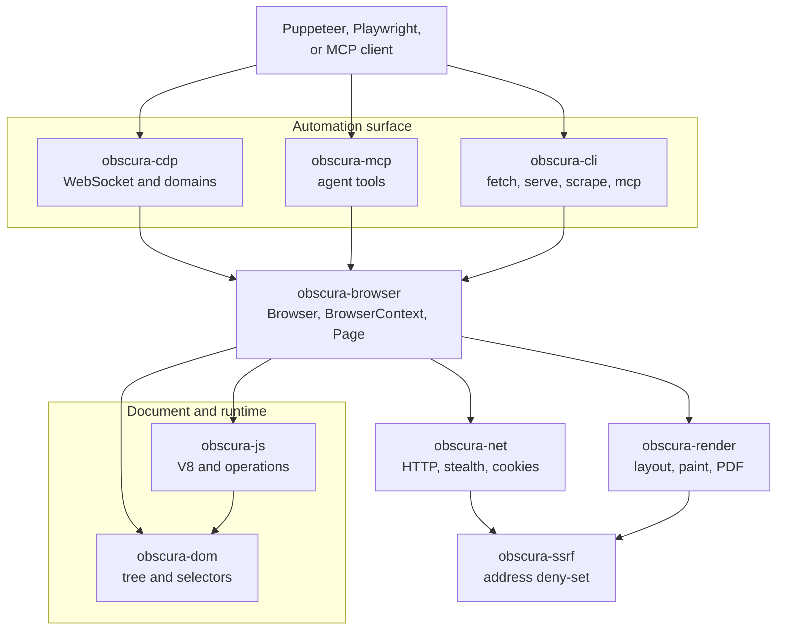
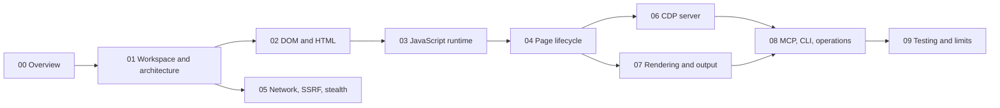

# Obscura: a small browser behind a large protocol

Obscura is a headless browser engine written in Rust for web scraping and Artificial Intelligence (AI) agent automation. It parses HyperText Markup Language (HTML) with `html5ever`, runs page JavaScript on the V8 engine through `deno_core`, applies Cascading Style Sheets (CSS), answers the Chrome DevTools Protocol (CDP), renders screenshots and Portable Document Format (PDF) files, and serves the Model Context Protocol (MCP) to agents.

The thesis of this exploration is that Obscura buys compatibility by choosing one large interface and narrowing everything behind it. The large interface is CDP, because Puppeteer and Playwright already implement it. Behind that interface the project keeps a deliberate subset: its own document tree, a fixed JavaScript bridge, a shared request policy, and an optional renderer. The result is a binary near seventy mebibytes (MiB) that starts in milliseconds instead of the seconds that a Chromium build needs.

This set explains the repository at `/Users/darkvoid/GitSources/src.Browsers/obscura` at commit `09790944a405ba81a7df27bc2577c6b0db283900` (2026-10-21), version `0.1.0`. Every claim traces to a file in that snapshot.

Read [00 Overview](00-overview.md) first for the full picture. This page gives the shape, the reading paths, and the limits.

## The four decisions

**1. Parse with a real parser.** The tree uses `html5ever`, the parser from the Servo project. Error recovery follows the standard, so a broken page produces the same tree that Firefox and Servo produce.

**2. Run real JavaScript.** Page scripts run on V8, not on an interpreter. Every call into the tree crosses an explicit operation table. A panic in an operation becomes an error, not a process abort, because the release profile keeps `panic = "unwind"`.

**3. Enforce one request policy.** A crate named `obscura-ssrf` has no dependencies by design. The `obscura-net` transports and the `obscura-render` resource loader all use the same deny-set. Private addresses stay blocked unless the operator opts in.

**4. Gate cost with build features.** The `render` feature adds layout, paint, geometry in JavaScript, screenshots, and PDF output. The `stealth` feature replaces the transport with a fingerprinting client. A scraping build with neither feature stays small.



## What is in the snapshot

The Cargo workspace declares ten members. The directory `crates/test-support` is not a member and holds one Rust source file for allocation tests, so the workspace has ten crates and one extra support folder.

| Crate | Job | Document |
|-------|-----|----------|
| `obscura-dom` | HTML parsing, the tree, CSS selectors, style data | [02 DOM and HTML](02-dom-and-html.md) |
| `obscura-js` | V8, the operation table, Web Application Programming Interface bindings | [03 JavaScript runtime](03-javascript-runtime.md) |
| `obscura-browser` | Navigation, page lifecycle, cookies, storage, interception | [04 Page lifecycle](04-browser-page-lifecycle.md) |
| `obscura-net` | HTTP, the stealth transport, cookies, robots, tracker blocking | [05 Network, SSRF, stealth](05-network-ssrf-and-stealth.md) |
| `obscura-ssrf` | The shared address deny-set and the environment opt-in | [05 Network, SSRF, stealth](05-network-ssrf-and-stealth.md) |
| `obscura-cdp` | WebSocket, sessions, targets, domain handlers | [06 CDP server](06-cdp-server.md) |
| `obscura-render` | CSS cascade, layout, text shaping, paint, PDF | [07 Rendering and output](07-rendering-and-output.md) |
| `obscura-mcp` | The MCP server and its agent tools | [08 MCP, CLI, operations](08-mcp-cli-and-operations.md) |
| `obscura-cli` | The `obscura` and `obscura-worker` binaries | [08 MCP, CLI, operations](08-mcp-cli-and-operations.md) |
| `obscura` | The embeddable Rust library | [01 Workspace and architecture](01-workspace-and-architecture.md) |

The workspace layout, the feature flags, and the data flow are in [01](01-workspace-and-architecture.md). The tests, the reproduction corpus, and the unsupported areas are in [09 Testing and limits](09-testing-and-limits.md).

## Build shapes

A release build chooses one of four shapes. The default release archive includes the renderer. A bare `cargo build` does not, because every crate in the workspace sets `default = []`, so the renderer must be requested with `--features render`. Stealth is never present by default.

```text
# README.md:158-163
| Archive suffix | Rendering | Stealth transport |
|----------------|-----------|-------------------|
| none | Yes | No |
| `-stealth` | Yes | Yes |
| `-no-render` | No | No |
| `-no-render-stealth` | No | Yes |
```

From source, the same four shapes come from Cargo features:

```bash
# README.md:184-194
# Rendering
cargo build --release -p obscura-cli --bins --features render

# Rendering and stealth
cargo build --release -p obscura-cli --bins --features render,stealth

# No rendering
cargo build --release -p obscura-cli --bins --no-default-features

# No rendering, with stealth
cargo build --release -p obscura-cli --bins --no-default-features --features stealth
```

A stealth build compiles BoringSSL, so it needs C++ build tools that a plain render build does not need. The repository lists CMake, Clang, and the libclang development libraries.

## Reading order



Three paths exist, and each path stands alone.

- **The protocol path.** Read [06](06-cdp-server.md) after [04](04-browser-page-lifecycle.md). It explains sessions, targets, the command loop, and the compatibility surface.
- **The document path.** Read [02](02-dom-and-html.md), then [03](03-javascript-runtime.md). It explains the tree, selectors, extraction, the V8 bridge, and the operation table.
- **The pixel path.** Read [07](07-rendering-and-output.md) after [02](02-dom-and-html.md). It explains the cascade, retained layout, text shaping, capture, screencast, and PDF output.

A reader who deploys the browser should read [05](05-network-ssrf-and-stealth.md) and [08](08-mcp-cli-and-operations.md). The first explains the address policy and the fingerprint. The second explains the server flags, the worker recycling, and the MCP tools.

## The surface that clients see

The CDP server has explicit handlers for fifteen domains, from `Target` and `Page` to `Accessibility` and `HeapProfiler`. It accepts eleven more domains as no-ops, because Puppeteer sends methods such as `Audits.enable` before any user code runs. The table lists the main ten.

| Domain | Main methods |
|--------|--------------|
| `Target` | Create, close, and attach to a target. Create and dispose a browser context |
| `Page` | Navigate, frame tree, lifecycle events, screenshot, screencast, print to PDF |
| `Runtime` | Evaluate, call a function on an object, get properties, add a binding |
| `DOM` | Get the document, query a selector, get outer HTML, resolve a node |
| `Network` | Enable, set and get cookies, set extra headers, override the user agent |
| `Fetch` | Enable, continue, fulfill, fail, take the response body as a stream |
| `IO` | Read and close a streamed body |
| `Storage` | Get, set, and delete cookies |
| `Input` | Dispatch a mouse event and a key event |
| `LP` | Convert the document to Markdown |

The MCP server exposes the same engine as 36 tools, or 38 in a build with the `render` feature. The first group covers navigate, snapshot, click, fill, type, key press, option select, evaluate, wait, network requests, console messages, and close. The other group covers Markdown, links, interactive elements, history, cookies, text waits, forms, scrolling, attributes, counts, extraction, tabs, search, and storage state. Document [08](08-mcp-cli-and-operations.md) gives the full list and the reply budget.

```bash
# README.md:430-430
obscura --v8-flags "--max-old-space-size=4096" fetch <url>
```

## Limits the repository states

The README makes a public claim about speed and memory. This exploration reports the claim and does not repeat the measurement. Documents [07](07-rendering-and-output.md) and [09](09-testing-and-limits.md) separate a measured value in the source from a marketing number in the README.

```text
# README.md:278-282
The current implementation covers block, inline, flex, grid, table, float,
positioning, overflow, transform, text, image, SVG, canvas, background, border,
and animation paths. It remains an evolving independent
engine: long-tail CSS, some Web APIs, media playback, compositor effects, and
platform font rasterization may differ from Chromium. The existing
```

The repository also names concrete gaps in its own documentation: iframe content compositing, Playwright frame locators, and some sandbox policies. Document [09](09-testing-and-limits.md) collects them.

## What this exploration is not

It is not a user guide. The official documentation is at `docs.obscura.sh`. The `docs/` folder in the snapshot holds 23 Markdown files, including a summary and an index. This exploration cites them where they define behaviour that the code leaves implicit.

It is not a security audit. Document [05](05-network-ssrf-and-stealth.md) explains the address policy, the proxy path, and the stealth transport. It does not test them against an attacker.

It does not run the code. Every claim comes from the source, the tests, the build files, or the project documents. Document [09](09-testing-and-limits.md) states which measurements the project reports and which ones this exploration did not reproduce.

## Related exploration

The sibling directory [src.kitesurf](../../src.kitesurf/markdown/README.md) explains Kitesurf, a browser engine that runs on Cloudflare Workers. The Obscura README states that Cloudflare began Kitesurf by porting Obscura to Workers. The two projects share the CDP surface and differ in one main constraint. Obscura keeps one process with V8. Kitesurf splits the engine into a Worker, a WebAssembly core, and a script isolate, and replaces V8 with a smaller JavaScript runtime. Read the pair to see how one protocol survives two very different hosts.
