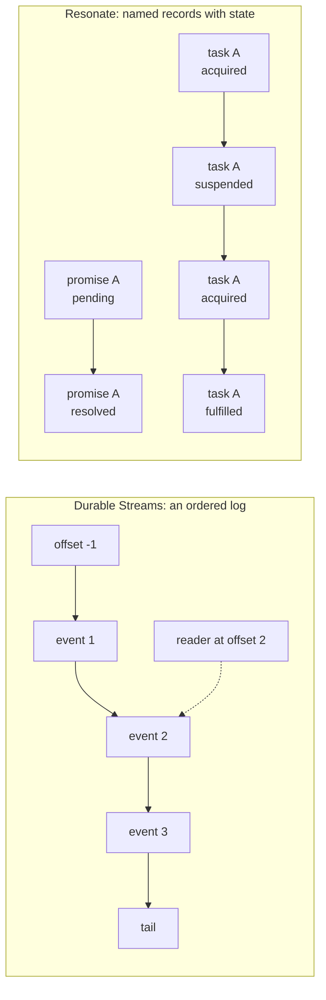
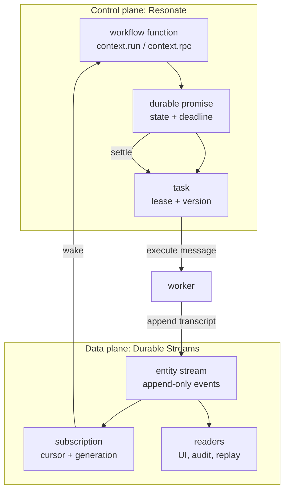
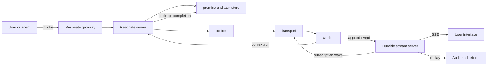

# Durable streams and durable promises

This page is the shared index for five explorations. One explores Electric and
its Durable Streams protocol. One explores Resonate and its durable promises.
One explores celld, a self-hosted Cloudflare Workers platform. One explores
TanStack DB, the reactive client store that consumes synced data. One explores
Rivet, an orchestrator for stateful processes that it calls Actors. The page
also answers the question that joins them: how does each system defer work,
which one is better at what, and how can they work together.

| Exploration | What it covers | Start here |
|-------------|----------------|------------|
| [Electric and Durable Streams](src.electric/html/README.html) | The Electric Sync engine, the agents platform, the Durable Streams protocol, and every package in both repositories | [Overview](src.electric/html/00-overview.html), then [how the runtime sets up a stream](src.electric/html/04-how-the-runtime-sets-up-a-stream.html) |
| [Resonate](src.resonate/html/README.html) | The formal specification, the Rust server core, the Postgres and Zig servers, five Software Development Kits (SDKs), and the durable promise protocol | [Overview](src.resonate/html/00-overview.html), then [durable promises and tasks](src.resonate/html/03-durable-promises-and-tasks.html) |
| [celld](src.celld/html/README.html) | A self-hosted Workers runtime: the fleet, the cell, the bucket, Durable Objects, every service, ownership, security, and limits | [Overview](src.celld/html/00-overview.html), then [Resonate S3 and celld](src.celld/html/11-resonate-s3-and-celld.html) |
| [TanStack DB](tanstackdb/html/README.html) | Collections, live queries, optimistic mutations, sync adapters, and framework bindings | [README](tanstackdb/html/README.html) |
| [Rivet](src.rivet/html/README.html) | Actors as durable processes: the control plane, Pegboard scheduling, Gasoline durable execution, per-Actor SQLite in Depot, UniversalDB, Epoxy replication, Guard, RivetKit, and the seven sibling repositories | [Overview](src.rivet/html/00-overview.html), then [Pegboard scheduling](src.rivet/html/04-pegboard-scheduling.html) |

## The short answer

**A durable stream is an ordered log.** It stores bytes at offsets. A reader
keeps an offset and asks for everything after it. The server does not know what
the bytes mean. It does not know which work is waiting. It only knows that
offset 100 is before offset 200.

**A durable promise is a named record with a lifecycle.** It stores a promise,
a task, a state, and a deadline. The server knows what is pending. It knows who
waits for whom. It can wake a worker when a dependency settles.

The two systems are therefore not competitors. They are two different answers to
one question: **where does the durable memory of a distributed program live?**

celld is not a third answer to that question. It is a platform that implements
Cloudflare Workers. Its durable memory is one SQLite database per cell, backed by
a transaction log in the same kind of bucket that Resonate uses for documents.
The [celld exploration](src.celld/html/README.html) compares the two storage
models directly.

Rivet is not a third answer either. It is a runtime for durable processes. Its
Actor is a task with a key and durable state, and the scheduler can move it
between nodes. Its durable memory is one SQLite database per Actor, written
through a log into UniversalDB. The [Rivet exploration](src.rivet/html/README.html)
compares it with Cloudflare Durable Objects, Kubernetes, and the promise systems
on this page.

| Question | Durable Streams answer | Resonate answer |
|----------|------------------------|-----------------|
| What is the durable object? | A byte sequence at a URL | A promise record at an identifier |
| What is the unit of change? | An append | A state transition |
| What does the server track? | Offsets and subscription cursors | Promise state, task state, callbacks, deadlines |
| Can old states be read again? | Yes, every byte remains | No, only the current record remains |
| Who decides what runs next? | A client or a wake service outside the stream server | The server, through tasks and timeouts |
| How is waiting expressed? | A held offset or a subscription | A suspended task with a callback list |



## Part 1: how Durable Streams works

The full detail is in the Electric exploration. The essential facts follow.

A stream is a URL-addressable, append-only sequence of bytes. The protocol
defines seven stream operations:

| Operation | Method and path | Effect |
|-----------|-----------------|--------|
| Create | `PUT /{stream}` | Creates a stream, or returns the existing one when the configuration matches |
| Append | `POST /{stream}` | Adds bytes at the tail |
| Close | `POST /{stream}` with `Stream-Closed: true` | Moves the stream to its terminal state |
| Read | `GET /{stream}?offset=...` | Catch-up read, long-poll read, or Server-Sent Events (SSE) read |
| Head | `HEAD /{stream}` | Returns metadata and the tail offset |
| Delete | `DELETE /{stream}` | Deletes the stream, or soft-deletes a source that live forks still reference |
| Fork | `PUT /{stream}` with `Stream-Forked-From` | Creates a stream that inherits the source prefix up to the fork offset |

Source: `durable-streams/PROTOCOL.md` sections 5.1 to 5.8.

An offset is opaque, persistent, unique, and strictly increasing. Offsets also
sort in lexicographic order, so a client can compare two offsets without
understanding their structure. Two sentinel values exist: `-1` means the start
of the stream and `now` means the current tail.

Source: `durable-streams/PROTOCOL.md:1184-1248`.

Durable Streams adds two mechanisms that matter for this comparison.

**Idempotent producers.** An append can carry three headers: `Producer-Id`,
`Producer-Epoch`, and `Producer-Seq`. The server keeps the last accepted
sequence number for each producer in each epoch. A retry with the same tuple
returns the previous result instead of writing a second copy. A new epoch is a
new generation of the same producer. The first append in a new epoch must
bootstrap the producer state.

Source: `durable-streams/PROTOCOL.md:361-498`.

**Subscriptions.** A subscription is a durable cursor over one or more streams.
It lives under the reserved path `/__ds/subscriptions/{id}`. It has a type of
`webhook` or `pull-wake`. It holds one accepted offset per linked stream. When a
linked stream advances past its accepted offset, the subscription produces a
wake with a `wake_id` and a `generation`. A worker claims the wake, processes
the data, and acknowledges the new offset. The lease lasts from 1 second to 10
minutes and defaults to 30 seconds.

Source: `durable-streams/PROTOCOL.md:818-1184`.

The word "subscription" is important. The stream server does not run code. It
does not know what a handler is. It only knows that a cursor moved and that a
target must be told. The decision to run an agent, a tool, or a model call
belongs to the application.

Electric's agents platform builds that application on top of the primitive. The
`agents-server` creates one stream per entity at `/{type}/{id}/main`. The
`agents-runtime` opens that stream during a wake, builds an idempotent producer
named `entity-${entityUrl}`, materializes the stream into typed collections, and
runs the handler.

Source: `packages/agents-server/src/entity-manager.ts:636-858`,
`packages/agents-runtime/src/process-wake.ts:434-558`.

## Part 2: how Resonate works

Resonate is a server for durable promises and durable functions. A promise is a
record with an identifier, a state, a parameter, a value, tags, a deadline, and
the times it was created and settled. The five promise states are `pending`,
`resolved`, `rejected`, `rejected_canceled`, and `rejected_timedout`.

Source: `spec/spec/01-protocol/types.lean:18-40`.

A task is the executable half of the same object. It has a state, a version, a
lease duration, a process identifier, a lease deadline, a retry deadline, and a
list of promises that resumed it. Its five states are `pending`, `acquired`,
`suspended`, `halted`, and `fulfilled`.

Source: `spec/spec/01-protocol/types.lean:42-50`.

A promise and its task share one row. They are one object with two faces. This
is not a database detail. It is the design: every task the machine writes is
written at a promise identifier, so a task without its promise cannot exist.

Source: `spec/spec/02-abstract/state.lean:13-60`.

Tags decide what a promise is for. The tag `resonate:target` makes a promise a
task. The tag `resonate:timer` makes the deadline resolve the promise instead of
rejecting it. `resonate:scope` and `resonate:external` decide whether a promise
is awaitable. Lineage tags record the call tree.

Source: `spec/spec/01-protocol/validation.lean` (tag predicates),
`spec/spec/02-abstract/state.lean:96-120`.

The protocol has 21 request kinds: six for promises, eleven for tasks, four for
schedules. Each request has an envelope with `kind`, `head`, and `data`. Each
response has a status code. The protocol version is `2026-04-01`.

Source: `spec/spec/01-protocol/types.lean:150-200`,
`impl/server/core/crates/resonate-core/src/types.rs:100-140`.

The server is built from plugins. A storage plugin answers protocol requests. A
worker plugin delivers messages to worker processes. A gateway plugin accepts
requests at an edge. The shipped binary registers six storage plugins, four
worker plugins, and three gateway plugins.

Source: `impl/server/core/src/main.rs:63-80`.

## Part 3: how each system defers

This is the heart of the comparison. Both systems defer. They defer in different
places, and the difference decides which problems each one solves.

### Durable Streams defers by position

A durable stream has no operation called "wait". It defers in three ways, and
all three are positional.

**1. A reader holds an offset.** A catch-up read from offset 42 returns data up
to the current tail and stops. A long-poll read from offset 42 waits until new
data arrives or a timeout expires. An SSE read from offset 42 keeps the response
open and pushes each new message. In every case the durable fact is the offset.
The connection is not durable. The reader can disconnect, crash, or move to
another machine, and resume from offset 42.

Source: `durable-streams/PROTOCOL.md:574-818`.

**2. A subscription holds an acknowledged offset.** A subscription is a cursor
that survives the worker. When the worker processes data up to offset 99, it
acknowledges 99. If the worker dies before the acknowledgement, the cursor stays
at the old offset and the work is delivered again. The wake has a generation
number. A late acknowledgement from an old generation receives `409 FENCED` and
cannot advance the cursor.

Source: `durable-streams/PROTOCOL.md:1004-1184`.

**3. The application arms time outside the stream.** A stream has no alarm. In
Electric's agents platform, time is a PostgreSQL table named `scheduled_tasks`
and a scheduler loop. A delayed send is a row with a `run_at` time. A cron
schedule is a stream path that encodes an expression. A scheduler instance
claims a row with a 30,000 millisecond lease. If it dies, `reclaimStaleClaims`
returns the row to another instance.

Source: `packages/agents-server/src/scheduler.ts:285,468-500`,
`packages/agents-server/src/runtime.ts:328-419`.

The consequence is simple. Durable Streams can tell you *that* something new
exists. It cannot tell you *when* to act in the future. The application must
build the clock.

### Resonate defers by state

Resonate has an operation called `task.suspend`. It is a durable await.

The sequence has five steps.

1. A worker acquires a task. The task moves from `pending` to `acquired` and its
   version increases by one.
2. The worker runs a function until the function waits on a promise that is not
   settled.
3. The worker sends `task.suspend` with the list of awaited promise identifiers.
   The server checks that none of them is already settled. If one is settled, the
   server returns status `300` and the worker continues immediately. Otherwise
   the server registers the task as a callback on each awaited promise, clears
   the lease, and moves the task to `suspended`.
4. When an awaited promise settles, an internal callback step removes the
   callback and resumes the task. The task moves to `pending` with a retry
   deadline. A retry step then emits an `execute` message to the task's target.
5. A worker acquires the task again. The version has increased. The worker
   re-executes from the start of the function, but every completed `context.run`
   returns its stored value from the durable promise. No side effect runs twice.

Source: `spec/spec/02-abstract/external.lean:271-307` for `task.suspend`,
`spec/spec/02-abstract/internal.lean:20-40` for `processCallback` and
`resumeOne`, `spec/spec/02-abstract/internal.lean:60-100` for the retry step.

Time is part of the server. Four kinds of deadline exist.

| Deadline | What it does | Default |
|----------|--------------|---------|
| Promise deadline | A pending promise past its deadline becomes resolved (timer) or rejected as timed out | Set by the caller per promise |
| Lease deadline | An acquired task whose lease expires returns to `pending` | Task Time to Live (TTL), default 15,000 milliseconds |
| Retry deadline | A pending task with no claim is offered again | Server retry interval, 30,000 milliseconds at the Command-Line Interface (CLI) |
| Schedule deadline | A cron occurrence creates its promise | Set by the cron expression |

Source: `impl/server/core/src/serve.rs:150-175` for the CLI defaults,
`spec/spec/02-abstract/internal.lean:42-105` for the four timeout steps,
`spec/spec/02-abstract/state.lean:230-245` for the retry default of 5,000
milliseconds in the abstract machine.

### The comparison in one table

| Property | Durable Streams | Resonate |
|----------|-----------------|----------|
| What is deferred | A read position | A task |
| Durable waiting object | Offset or cursor | Promise record plus callback list |
| Where the wait lives | Client or subscription | Server |
| How the wait ends | A new append | A promise settlement or a deadline |
| What the waiter holds | A connection or a cursor | Nothing; the task is a row |
| Can the waiter crash? | Yes, resume from the offset | Yes, the lease expires and the task is re-offered |
| Timeouts for waiting | Built by the application | Built into the server |
| Duplicate work | Prevented by producer tuple and cursor | Prevented by version fence and task state |
| History of past states | Complete | Not kept |

```mermaid
sequenceDiagram
    participant W as Worker
    participant DS as Durable Streams
    participant R as Resonate
    Note over W,DS: Stream deferral
    W->>DS: GET offset=42 (long-poll)
    DS-->>W: holds the response
    Note over DS: another writer appends
    DS-->>W: 200 with new data and tail offset
    W->>DS: POST callback ack offset=99
    Note over W,R: Resonate deferral
    W->>R: task.acquire
    R-->>W: task version 3
    W->>R: task.suspend (awaited = [p1, p2])
    R-->>W: 200 suspended; lease cleared
    Note over R: p1 settles later
    R->>W: execute task version 3
    W->>R: task.acquire version 3
    R-->>W: task version 4
```

## Part 4: what is great in each

### What is great in Durable Streams

**The server is simple and therefore portable.** The protocol is six operations
over HTTP. The reference repository has clients in TypeScript, Python, Go, Rust,
Java, Ruby, PHP, C#, Swift, and Elixir. A stream server can run in Node.js, in
Caddy, on Cloudflare Workers, behind a proxy, or inside a test process.

Source: `durable-streams/packages/` directory listing.

**History is free and exact.** Every byte remains. A late reader sees the same
sequence as an early reader. Debugging is replay. Auditing is replay. A new
projection is a new reader from offset `-1`.

**Fan-out is cheap.** One append serves every reader. The server does not track
per-consumer state beyond a subscription cursor. A thousand readers cost one
write and one thousand reads, and the reads do not change the data.

**Forking is constant time.** A fork inherits a prefix from a source stream
without copying bytes. The headers `Stream-Forked-From`, `Stream-Fork-Offset`,
and `Stream-Fork-Sub-Offset` define the branch point. A fork does not inherit
producer state, so a writer on the fork starts a new generation.

Source: `durable-streams/PROTOCOL.md:151-218`.

**Idempotency is at the transport.** A producer does not need to know the
application semantics of a message. It supplies a tuple and the server
deduplicates retries.

### What is great in Resonate

**Waiting is a first-class state.** A workflow can wait for a human approval for
ten days. No process stays alive. The task is a suspended row and the server
holds the callback list. When the approval settles the promise, the server
re-offers the task.

**Step results are exactly once.** `context.run` stores its result in a durable
promise. On recovery the SDK replays the function, but the call returns the
stored result. The model call, the payment, or the email does not run twice.

**The server owns time.** Lease deadlines, retry deadlines, promise deadlines,
and cron schedules are server state. The client does not need a timer service.

**Version fencing is precise.** Every task transition carries a version. A stale
worker that lost its lease cannot settle the promise. The server returns `409`.
This is stronger than a lease alone, because it detects the stale writer at the
moment of the write.

**The behaviour is specified.** The abstract machine is an executable Lean 4
definition. The catalogue has 92 properties. Thirty-one are proved outright. The
trace checker takes a recorded run and asks whether the machine can account for
it. A second checker uses Porcupine for linearizability.

Source: `spec/README.md`, `spec/valid/README.md`, `spec/valid/porc/README.md`.

## Part 5: where each is better

### Choose Durable Streams when

| Need | Why the stream wins |
|------|---------------------|
| Many readers of the same data | One append serves all readers; no per-reader server state |
| A complete audit or replay | Every state remains; reconstruction is reading |
| Token-by-token or event-by-event output | SSE reads push each append as it arrives |
| Several independent writers | Idempotent producers and per-writer sequence numbers |
| Cheap branching of a conversation | Fork copies no bytes |
| A simple, language-neutral protocol | Six operations over HTTP |
| A server that holds no workflow logic | The server is a log; logic is in clients |

### Choose Resonate when

| Need | Why the promise wins |
|------|----------------------|
| A long wait with no process | The task suspends; the server holds the callback |
| Exactly-once step effects | Completed steps return stored values on replay |
| Per-step retries and compensation | The task lifecycle and settlement rules are explicit |
| Deadlines and scheduled work | Timeouts and cron are server state |
| A call graph across services and languages | Promise identifiers and lineage tags form the graph |
| Detecting a stale worker | Version fencing rejects the old writer |
| A specified, testable engine | The abstract machine and trace checker define correctness |

### The honest limits of each

Durable Streams cannot suspend work. A stream can tell a wake service that data
arrived, but the wake service decides everything else. Electric's agents-server
therefore contains a hand-built task system: claims, leases, retry deadlines, a
scheduler, and idempotent producers. That is a durable execution engine written
beside the stream.

Resonate cannot serve a transcript to many readers. A promise record keeps only
its current state. It has no operation to read the sequence of past values. Its
`promise.search` and `task.search` return `501` in the abstract machine. A
dashboard that needs history must get it from somewhere else.

**Aha: each system contains a partial implementation of the other.** Electric's
agents-server implements durable execution on top of a log: `scheduled_tasks`,
`consumer_claims`, `wake_registrations`, and `entityDispatchState` are a task
lifecycle. Resonate implements a delivery log on top of a record store: the
`outbox` table holds `execute` and `unblock` messages, the retry deadline
re-emits a message that was not delivered, and the transports deliver it. Each
project needed the other's primitive and built a small version of it.

Source: `packages/agents-server/src/db/schema.ts:1-400` for the Electric
tables, `spec/spec/02-abstract/state.lean:130-150` for the Resonate outbox.

## Part 6: how both work together

The two systems fit at different layers. Put the stream in the data plane and
the promise in the control plane.



### Pattern 1: the stream is the workflow transcript

The durable function is the control flow. The stream is the record of what
happened. Each `context.run` appends its input and output to the entity stream
before it settles its promise. The promise gives exactly-once execution. The
stream gives replay, audit, and a live view for the user interface.

The division is clean. Resonate answers "what runs next". The stream answers
"what happened".

### Pattern 2: the stream is the task transport

Resonate's transports are HTTP push, HTTP long-poll, Google Cloud Pub/Sub, and a
bash worker. Each is a delivery channel. A Durable Streams pull-wake
subscription is also a delivery channel, and it has two properties the others do
not have: the consumer holds a durable offset, and the wake stream can be read
again after a crash.

A custom worker plugin can watch a durable stream. The server writes an
`execute` message to a wake stream. The worker reads from its last offset,
claims the subscription, calls `task.acquire`, runs the function, and
acknowledges the offset. If the worker dies, the offset does not advance and the
wake is delivered again.

The loss is the direct call. The gain is replay. A worker that was offline for
an hour can read every wake it missed, in order.

### Pattern 3: Resonate replaces the hand-built timer and claim system

Electric's agents-server has a scheduler with a 30,000 millisecond claim
expiry, a wake registry, consumer claims, and per-entity dispatch state.
Resonate already provides all four: task leases, retry deadlines, promise
deadlines, and schedules. A deployment can keep Durable Streams for event
storage and move the "when does the handler run" decision to Resonate.

The mapping is direct.

| Electric agents-server concept | Resonate concept |
|--------------------------------|------------------|
| `scheduled_tasks` row with `run_at` | Promise deadline or cron schedule |
| Scheduler claim with 30,000 millisecond expiry | Task lease with TTL and version |
| `wake_registrations` condition | Task suspended on an awaited promise |
| `consumer_claims` | Task `acquired` state |
| Idempotent cron producer | Occurrence identifier from `expand` |
| Signal as a stream event | Promise settlement |

### Pattern 4: fork for speculation, promise for commitment

A durable stream fork gives a cheap branch of a conversation or a plan. A
durable promise gives a single settlement point. Use the fork to run two
alternative agent paths without copying history. Use one promise per path to
record which path completed, and use a parent promise to join them.

A fork costs no bytes. A promise costs one row. The combination gives
speculative execution with a durable decision.

### Pattern 5: two idempotency layers

Durable Streams deduplicates an append by `Producer-Id`, `Producer-Epoch`, and
`Producer-Seq`. Resonate deduplicates a task transition by task version. Use
both.

The worker first acquires the task with a version. It runs the step. It appends
the result with a producer tuple derived from the promise identifier and the
step number. Then it fulfils the promise with the same version. A retry after a
crash hits one of three states:

1. The task was never acquired: acquire it now.
2. The task was acquired but the append did not land: the producer sequence does
   not match, so the append is safe to repeat.
3. The append landed but the fulfil did not: the promise is still pending, so
   the worker reads the stream, finds its own append, and fulfils without
   running the step again.

The result is end-to-end exactly-once effect, with the stream as the evidence.

## Part 7: how each solves the other's weakness

| Weakness | Who has it | How the other helps |
|----------|------------|---------------------|
| No durable wait | Durable Streams | Resonate suspends the task and resumes it on settlement |
| No timers | Durable Streams | Resonate promise deadlines, leases, retries, and schedules |
| No exactly-once step result | Durable Streams | Resonate returns the stored value on replay |
| No stale-writer detection | Durable Streams | Resonate version fencing rejects the old writer |
| No history | Resonate | The stream keeps every event; the promise keeps the decision |
| No fan-out to many readers | Resonate | The stream serves every reader from one append |
| No replay after a crash | Resonate | The stream's offset survives the worker |
| No cheap branching | Resonate | A stream fork copies no bytes |
| No audit trail for a workflow | Resonate | Every step appends to the stream |
| No way to show live progress | Resonate | The user interface reads the stream |

## Part 8: a combined reference architecture



The rules of the architecture are:

1. **One owner per fact.** The promise owns the decision. The stream owns the
   record. No fact has two owners.
2. **The stream is append-only.** It never mutates. A correction is a new event.
3. **The promise is mutable.** It records only the current state. History comes
   from the stream.
4. **The worker is stateless.** Its durable position is the task version and the
   stream offset. Both survive a crash.
5. **Time is server state.** No process sleeps. A deadline is a row.
6. **Delivery is at least once.** Duplicate delivery is safe because both
   layers deduplicate.

## Reading order

### Electric and Durable Streams

| Document | Why read it |
|----------|-------------|
| [Overview](src.electric/html/00-overview.html) | The thesis: an entity is its event stream |
| [Repository map](src.electric/html/01-repository-map.html) | Every package and where it lives |
| [System architecture](src.electric/html/02-system-architecture.html) | Control plane, data plane, execution plane |
| [The durable stream primitive](src.electric/html/03-the-durable-stream-primitive.html) | The protocol in depth |
| [How the runtime sets up a stream](src.electric/html/04-how-the-runtime-sets-up-a-stream.html) | Creation, opening, and storage |
| [Wake dispatch and lifecycle](src.electric/html/05-wake-dispatch-and-entity-lifecycle.html) | How work starts |
| [Security and permissions](src.electric/html/06-security-tenancy-and-permissions.html) | Principals, tenants, grants |
| [Critical assessment](src.electric/html/07-critical-assessment.html) | Limits and risks |

### Resonate

| Document | Why read it |
|----------|-------------|
| [Overview](src.resonate/html/00-overview.html) | Durable promises and durable functions |
| [Architecture](src.resonate/html/01-architecture.html) | Server, worker, and gateway plugins |
| [The protocol](src.resonate/html/02-the-protocol.html) | Every request and record |
| [Durable promises and tasks](src.resonate/html/03-durable-promises-and-tasks.html) | The state machine and suspension |
| [The formal specification](src.resonate/html/04-the-formal-specification.html) | The abstract machine and 92 properties |
| [The server core](src.resonate/html/05-the-server-core.html) | Composition and configuration |
| [Storage engines](src.resonate/html/06-storage-engines.html) | Six backends and the oracle |
| [Transports and workers](src.resonate/html/07-transports-and-workers.html) | Push, poll, Pub/Sub, bash |
| [The TypeScript SDK](src.resonate/html/09-the-typescript-sdk.html) | Generators, async functions, replay, and traces |
| [The other SDKs](src.resonate/html/10-the-other-sdks.html) | Python, Go, Java, and Rust clients |
| [Schedules, timers, and time](src.resonate/html/11-schedules-timers-and-time.html) | Every deadline |
| [The PostgreSQL server in one file](src.resonate/html/12-the-postgres-server-in-one-file.html) | The whole protocol in one SQL file |
| [The S3 server in Zig](src.resonate/html/13-the-s3-server-in-zig.html) | Durable state as S3 objects |
| [Critical assessment](src.resonate/html/16-critical-assessment.html) | Limits and risks |
| [The Rust SDK](src.resonate/html/19-the-rust-sdk.html) | The function macro, promise naming, retries, and replay |
| [Documents, rows, and partitions](src.resonate/html/21-documents-rows-and-partitions.html) | Blob and S3 documents, SQLite rows, ScyllaDB partitions, and Neo4j nodes |

### celld

| Document | What it covers |
|----------|----------------|
| [README](src.celld/html/README.html) | The thesis, the reading order, and the object layout |
| [Overview](src.celld/html/00-overview.html) | The node, the fleet, the cell, the deployment, and the two promises |
| [Repository map](src.celld/html/01-repository-map.html) | Every crate, module, package, and document |
| [System architecture](src.celld/html/02-system-architecture.html) | Listeners, routing, deployment, and the control plane |
| [The Worker runtime](src.celld/html/03-the-worker-runtime.html) | V8 isolates, bundles, events, bindings, gates, and limits |
| [Durable Objects](src.celld/html/04-durable-objects.html) | Identity, lifecycle, storage API, alarms, WebSockets, and facets |
| [Cell storage and durability](src.celld/html/05-cell-storage-and-durability.html) | SQLite, the transaction log, epochs, proofs, restore, and garbage collection |
| [Ownership, failure, and rebalancing](src.celld/html/06-ownership-failure-and-rebalancing.html) | Leases, fencing, takeover, self-fencing, pressure, and rebalancing |
| [The services](src.celld/html/07-the-services.html) | Key-Value, Queues, D1, R2, Workflows, Cron Triggers, static assets, containers, and sandboxes |
| [Deployment and operations](src.celld/html/08-deployment-and-operations.html) | The Wrangler subset, deploy, the command line interface, telemetry, and tests |
| [Security and tenancy](src.celld/html/09-security-and-tenancy.html) | The fleet trust model, peer authentication, the operator API, and isolation |
| [Limitations and compatibility](src.celld/html/10-limitations-and-compatibility.html) | Cloudflare gaps, hard limits, and operational risks |
| [Resonate S3 and celld](src.celld/html/11-resonate-s3-and-celld.html) | Two models for durable state in a bucket, point by point |
| [Work placement and sharding](src.celld/html/12-work-placement-and-sharding.html) | How Resonate distributes tasks and how celld places cells |
| [Glossary](src.celld/html/13-glossary.html) | Every term, spelled out |

### Rivet

| Document | What it covers |
|----------|----------------|
| [README](src.rivet/html/README.html) | The thesis, the four separations, the reading order, and the measurements |
| [Overview](src.rivet/html/00-overview.html) | The problem, the Actor, the request path, and the guarantees |
| [Repository map](src.rivet/html/01-repository-map.html) | Every workspace crate, package, and sibling repository |
| [Control plane](src.rivet/html/02-control-plane-architecture.html) | The binary, the services, the pools, and bootstrap |
| [Actors and lifecycle](src.rivet/html/03-actors-and-lifecycle.html) | Identity, create, start, sleep, wake, and destroy |
| [Pegboard scheduling](src.rivet/html/04-pegboard-scheduling.html) | Runner pools, allocation, envoy, and the runner protocol |
| [Gasoline](src.rivet/html/05-gasoline-durable-execution.html) | Workflows, activities, replay, and history |
| [Actor SQLite and Depot](src.rivet/html/06-actor-sqlite-and-depot.html) | The virtual file system, the page log, and compaction |
| [UniversalDB](src.rivet/html/07-universaldb-and-buckets.html) | The key space, transactions, and the RocksDB and PostgreSQL drivers |
| [Epoxy](src.rivet/html/08-epoxy-multi-region.html) | Per-key Fast Paxos, replicas, ballots, and multi-region commit |
| [Guard](src.rivet/html/09-guard-routing.html) | HTTP and WebSocket routing, TLS, and the reverse proxy |
| [RivetKit TypeScript](src.rivet/html/11-rivetkit-typescript.html) | Actor definition, registry, client, and React hooks |
| [Authentication](src.rivet/html/13-auth-and-namespaces.html) | Tokens, JSON Web Tokens, namespaces, and policy |
| [Deployment](src.rivet/html/15-deployment-and-self-hosting.html) | Self-host, Rivet Cloud, bring your own cloud, and storage |
| [Tests and limits](src.rivet/html/16-tests-benchmarks-and-limits.html) | The harness, the benchmarks, the limits, and the risks |
| [Comparison](src.rivet/html/18-comparisons.html) | Durable Objects, Kubernetes, and the durable promise systems |
| [Glossary](src.rivet/html/19-glossary.html) | Every term, spelled out |

### TanStack DB

| Document | What it covers |
|----------|----------------|
| [README](tanstackdb/html/README.html) | The thesis, the package map, and the reading order |
| [Overview](tanstackdb/html/00-overview.html) | The problem, the core idea, and the package map |
| [Architecture](tanstackdb/html/01-architecture.html) | The three layers: collections, live queries, and sync |
| [Collections](tanstackdb/html/02-collections.html) | The collection interface, indexes, and change tracking |
| [Live queries](tanstackdb/html/03-live-queries.html) | Incremental query results and subscriptions |
| [Mutations](tanstackdb/html/04-mutations.html) | Optimistic writes, confirmation, and rollback |
| [Sync engines](tanstackdb/html/05-sync-engines.html) | The adapter contract and the built-in engines |
| [Framework adapters](tanstackdb/html/06-framework-adapters.html) | The React, Vue, Svelte, and Solid bindings |
| [Persistence](tanstackdb/html/07-persistence.html) | Saved collections and restart behaviour |
| [Durable Streams and Electric](tanstackdb/html/08-durable-streams-and-electric.html) | How the two Electric systems feed TanStack DB |

### Sync engines

Two documents answer how a shape stays current from a database change stream.

| Document | Why read it |
|----------|-------------|
| [Electric, PostgreSQL, and PGlite](src.electric/html/sync-engines/01-electric-postgres-pglite.html) | The logical replication slot, the filter index, per-shape evaluation, column projection, the shape log, and PGlite |
| [SQLite, libSQL, and Turso](src.electric/html/sync-engines/02-sqlite-and-turso.html) | Why plain SQLite has no committed row-change stream, what libSQL and Turso expose, and the layer each source needs |

The short answer: PostgreSQL sends row changes through a logical replication slot. Electric keeps an index of shape filters in memory, finds the candidate shapes, and evaluates each filter on the old row and the new row. It does not re-run the shape query. It projects the row to the selected columns and appends only the changed columns to the shape's log. The log is disk-backed, so memory holds the index and the current window, not the history.

### The sync service in detail

The sync service has a README and eight documents. They start at its HTTP interface and follow each change from the PostgreSQL write-ahead log to the client.

| Document | Why read it |
|----------|-------------|
| [README](src.electric/html/sync-service/README.html) | The package map and the reading order |
| [Overview](src.electric/html/sync-service/00-overview.html) | What the service does and how it fits with Electric |
| [Architecture](src.electric/html/sync-service/01-architecture.html) | The stack, the supervision tree, and the request path |
| [HTTP API and shapes](src.electric/html/sync-service/02-http-api-and-shapes.html) | Every endpoint, parameter, and response |
| [Shape log and storage](src.electric/html/sync-service/03-shape-log-and-storage.html) | How a shape log is written, stored, and recovered |
| [Replication and consumers](src.electric/html/sync-service/04-replication-and-consumers.html) | Logical replication, filter evaluation, and live delivery |
| [Configuration and deployment](src.electric/html/sync-service/05-configuration-and-deployment.html) | Environment variables, defaults, and release layout |
| [Telemetry and observability](src.electric/html/sync-service/06-telemetry-and-observability.html) | OpenTelemetry, PromEx, and Sentry |
| [Testing and limitations](src.electric/html/sync-service/07-testing-and-limitations.html) | The test suites and the known limits |

### Laws and models

Two documents restate each system as numbered laws. Each law is a Behavior-Driven Development (BDD) case. Each document ends with a small Python model that runs the law set as tests.

| Document | Why read it |
|----------|-------------|
| [Laws of Durable Streams](src.electric/html/durable-streams/11-laws-entities-and-models.html) | 57 laws (DS-1 to DS-56, plus DS-39a), the offset and producer machines, the fork reference count, the delivery rules, and a 52-scenario model |
| [Laws of Durable Promises](src.resonate/html/18-laws-of-durable-promises.html) | 53 laws, the one-row anatomy, the SQLite and PostgreSQL tables, the constraints, and a 22-scenario model |

## Sources

- Durable Streams protocol: `/Users/darkvoid/GitSources/src.Electric/durable-streams/PROTOCOL.md`.
- Electric packages: `/Users/darkvoid/GitSources/src.Electric/electric/packages/`.
- Electric sync service: `/Users/darkvoid/GitSources/src.Electric/electric/packages/sync-service/`.
- PGlite and the PostgreSQL fork: `/Users/darkvoid/GitSources/src.Electric/pglite/` and `/Users/darkvoid/GitSources/src.Electric/postgres-pglite/`.
- TanStack DB: `/Users/darkvoid/GitSources/src.Electric/src.tanstack-db/`.
- SQLite and Turso: `/Users/darkvoid/GitSources/src.turso/libsql/` and `/Users/darkvoid/GitSources/src.turso/turso/`.
- Resonate specification: `/Users/darkvoid/GitSources/src.resonatehq/resonate/spec/`.
- Resonate server: `/Users/darkvoid/GitSources/src.resonatehq/resonate/impl/server/core/`.
- Resonate Postgres server: `/Users/darkvoid/GitSources/src.resonatehq/resonate/impl/server/postgres/resonate.sql`.
- Resonate S3 server: `/Users/darkvoid/GitSources/src.resonatehq/resonate/impl/server/s3/`.
- Resonate SDKs: `/Users/darkvoid/GitSources/src.resonatehq/resonate/impl/sdk/`.
- Resonate Rust SDK: `/Users/darkvoid/GitSources/src.resonatehq/resonate-sdk-rs/`.
- celld: `/Users/darkvoid/GitSources/src.s3/celld/`, commit `8702f6d186c77698dbfb30cf29e3b1922a88f008`, version 0.6.3.
- Rivet: `/Users/darkvoid/GitSources/src.Rivet/rivet/`, commit `4a58441c50d1ce20d8803cfb1ab7c3285a5141d6`, version 2.3.31, Apache-2.0.
- Rivet sibling repositories: `/Users/darkvoid/GitSources/src.Rivet/agents/`, `agentos/`, `workflows/`, `dynamic-apps/`, `open-orange/`, `durable-object-migrator/`, and `website/`.

## How to build this site

```bash
cd /Users/darkvoid/Dev/explorations/src.durable-streams
python3 -I build.py .
```

The single build converts every exploration `markdown` tree and this root page.
An exploration is a directory named `src.*` or `tanstackdb` that contains a
`markdown` directory. The output for each exploration is in its `html`
directory. The root output is `index.html` beside this file.
