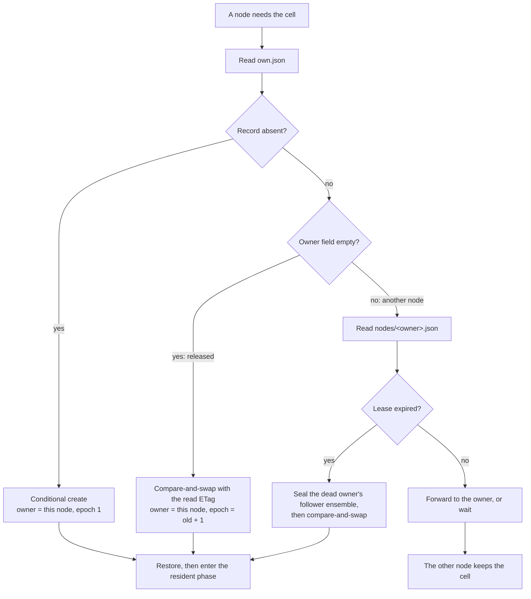

# Overview: one owner for each cell, one bucket for the fleet

celld is a self-hosted runtime for Cloudflare Workers and Durable Objects. It
turns an object store bucket into a Workers platform. The bucket holds the
deployments, the cell state, and the ownership records. A node is one `celld`
process on one machine. A fleet is the set of nodes that share one bucket. A
cell is one Durable Object instance: a named object with private SQLite
storage. A Worker is the application program that handles requests. V8 is the
JavaScript engine that runs the Worker code. Exactly one node serves a cell at
a time.

celld makes two promises:

1. Exactly one node serves a cell at a time, and only the node that holds the
   current epoch may acknowledge a write. Two machines never write the same
   database epoch. A node that loses ownership can keep writing to an old epoch
   prefix, but no restore reads that prefix and the node cannot acknowledge the
   write.
2. celld does not acknowledge a write until that write survives a failure. An
   acknowledged write is never lost.

Both promises need a bucket with conditional writes and ranged reads. They also
need a supervisor that restarts the process. celld does not use a membership
protocol, a failure detector, or a consensus service. It uses the bucket
instead.

Source: `docs/guarantees.md:1-7`, `README.md:16-35`.

## The four nouns

| Noun | Meaning | Where it lives |
|------|---------|----------------|
| Node | One `celld` process on one machine. It embeds V8 and runs Worker code. | A machine, with a node identifier such as `node-a` |
| Fleet | Every node that shares one bucket. One fleet runs one application. | The shared bucket |
| Cell | One Durable Object instance. It has a name of the form `Class:ID`. | `cells/<cell>/` in the bucket |
| Deployment | The Worker bundles and configuration that the fleet runs. | `deploy/current.json` and `deploy-blobs/` |

The cell name is the unit of placement, ownership, storage, and recovery. The
node is the unit of capacity. The fleet is the unit of trust. The bucket is the
unit of durability.

A cell scope is the text `Class:ID`. The class is the Durable Object class name
from the deployment. The identifier (ID) is 64 hexadecimal digits that celld
derives from the object name with a namespace key, or that the application
supplies. The bucket key is `cells/Class:ID/`, and the colon stays in the key.
[The services](07-the-services.md) gives the rule for each service class.

A node proves that it is alive with a lease. The lease is the object
`nodes/<node>.json`. It holds an expiry time, the node's advertised address,
its generation, and its load. The lease lives for `CELLD_TTL_MS`, and the
default is 10,000 milliseconds. The node renews the lease every one third of
that lifetime.
A peer reads the lease to decide whether the current owner is dead. A lease is
not an ownership record: the ownership record names the owner of one cell, and
the lease says whether that node process is alive.

The promises need a supervisor. A supervisor is an external process manager,
such as systemd, Docker with a restart policy, or Kubernetes. It restarts a node
that exits. A node that loses its lease fences itself and exits, so a supervisor
must restart it without an attempt limit, and it must wait at least one lease
lifetime between attempts. The wait stops a fast restart from racing the old
lease.

**Aha:** There is no cluster membership list. A node learns the fleet from
lease records in the bucket. The bucket is the only shared memory, so the
bucket is also the only coordination point.

## What happens to one request

The worker listener accepts a Hypertext Transfer Protocol (HTTP) request. A
stateless Worker request has no cell. When the Worker calls a Durable Object
binding, the binding names the class and the object name. celld derives the
64-hexadecimal-digit identifier from the name and builds the scope
`Class:ID`. That scope selects the cell. [System architecture](02-system-architecture.md)
follows the routing rule in full.

If this node owns the cell, the request enters the V8 isolate. If a peer owns
the cell, the node forwards the request over the internal listener. The
forwarded request carries a protocol version and a signature from the fleet
secret. The signature covers the method, the path, the body hash, the source
node, the target node, the time, and a nonce.

The V8 isolate runs the handler. The handler can read and write SQLite, call
`fetch`, open a WebSocket, or call another Worker. celld records each committed
SQLite transaction as a Lite Transaction (LTX) segment. The segment is the
replication unit.

The output gate is a hold in the shared decision layer (`crates/logic`). It
tracks every write that a response can reveal, and it releases the response only
when a durability proof covers all of them. The gate covers more than the
response body. It also covers an error, a streamed chunk, a raw Transmission
Control Protocol (TCP) write, and an R2 object mutation. It covers an error
because a thrown message can carry a value that the handler read. If the proof
cannot complete, the gate fails the response and the node writes
`celld output gate` to standard error. A client cannot act on a value that a
crash can still lose.

```mermaid
sequenceDiagram
    autonumber
    participant C as Client
    participant N as Owner node
    participant V as V8 isolate
    participant S as SQLite
    participant F as Follower node
    participant B as Bucket
    C->>N: HTTP request
    N->>V: deliver event
    V->>S: BEGIN, write, COMMIT
    S-->>N: committed LTX segment
    alt fleet proof
        N->>F: append segment
        F->>F: fsync
        F-->>N: durable
        N->>B: upload segment (later, in the background)
        N-->>C: response
    else bucket proof, one-node fleet
        N->>B: PUT cells/&lt;cell&gt;/ltx/e&lt;epoch&gt;/...
        B-->>N: 200 OK
        N->>B: read own.json once
        B-->>N: record names this node at this epoch
        N-->>C: response
    end
    Note over F,B: The follower is inactive during a bucket proof.
```

## Ownership is a bucket record, not a message

Each cell has one ownership record at `cells/<cell>/own.json`. The record has
two fields: the owner node name and a fencing epoch. A node claims a cell with a
conditional create when the record is absent. It claims an existing record with
a compare-and-swap against the record's entity tag (ETag). When two nodes race,
the store applies one conditional write and rejects the other.

```rust
// crates/celld/ownership_store.rs:21-31
#[derive(Serialize)]
struct OwnerWire<'a> {
    node: &'a str,
    epoch: u64,
}

#[derive(Deserialize)]
struct OwnerWireOwned {
    node: String,
    epoch: u64,
}
```

A released record has an empty node name. It still carries the newest epoch.
Epochs never reset. A released record therefore says "nobody owns this cell,
and the next owner starts at the next epoch." A clean handoff writes that record
after the old owner proves its data durable and seals its node log.

A missing record is different from a released record. If the record is absent
but LTX data exists under `cells/<cell>/ltx/`, the record was lost, for example
to a bucket lifecycle rule. A new record at epoch 1 would start the cell with an
empty database, so celld refuses to acquire the cell and writes
`celld ownership record lost`. A brand-new cell has no LTX data, so it can
start at epoch 1.

```rust
// crates/celld/ownership_store.rs:949-967
pub async fn cas_owner(
    &self,
    cell: &str,
    guard: CasGuard,
    epoch: u64,
) -> anyhow::Result<CasOutcome> {
    let key = format!("cells/{cell}/own.json");
    let body = serde_json::to_vec(&OwnerWire {
        node: &self.node,
        epoch,
    })?;
    let etag = match &guard {
        CasGuard::Absent => None,
        CasGuard::Match(etag) => Some(etag.as_str()),
    };
    match self.bucket.put_cas(&key, body, etag).await? {
        Some(_) => Ok(CasOutcome::Applied),
        None => Ok(CasOutcome::Rejected),
    }
}
```



Every activation advances the epoch. An activation is a takeover or a local
wake. The LTX path repeats the epoch: `cells/<cell>/ltx/e<epoch>/`. A node that
lost ownership can continue to write, but only under a superseded prefix. A
restore selects the current lineage. The key prefix makes the fence effective
without a lock service.

Four terms describe the takeover. The **node log** is the record of segments
that a node has acknowledged but not yet uploaded to the per-cell prefixes. It
lives in `nodes/<node>.json` and in bundles under `log/<node>/<generation>/`.
To **seal** a node log is to close it so that its session can no longer
acknowledge a new write. The **takeover gate** is the check of the prior
owner's node log before a restore. The gate seals the reachable followers,
uploads their retained segments, and marks the log sealed. A **restore** then
reads the epoch chain into SQLite. The **resident phase** is the state in which
the cell runs code on the new owner.

The gate exists because a fleet proof can acknowledge a write before the owner
uploads it. Without the gate, a new owner could restore a bucket that is missing
an acknowledged write. The gate turns the followers' copies into bucket objects
first.

A stale writer is harmless to the database, but its acknowledgements are not.
The stale writer appends to an old epoch prefix, and no restore reads that
prefix. The node must still self-fence, because a client acts on an
acknowledgement. The fence stops the node from acknowledging a write that a new
owner cannot see.

**Aha:** A stale writer is not an error to detect. It is a writer that appends
to a directory no reader will read. The ownership record and the conditional
write decide who is current. The key prefix then makes a loser harmless.

## The two durability proofs

celld has two ways to prove a write durable. The operator selects one with
`CELLD_DURABILITY`.

### Fleet proof

The default is `fleet`. The owner recruits up to two other nodes, as many as
are available, and sends each committed segment to them. These nodes are the
followers. The owner and its followers are the ensemble. A write is durable
when every recruited follower holds it on disk and has fsynced it. The owner
acknowledges the write then, and uploads the segment to the bucket later in the
background. If the owner dies before that upload, the takeover gate uploads the
followers' retained segments before the restore.

A node never counts itself as a follower. A fleet needs at least two running
nodes before a node can complete a fleet proof. A fleet of three or more nodes
holds three copies of an acknowledged write. A node with one follower keeps
acknowledging while that follower survives, and recruits a second follower when
one becomes available.

A fleet proof needs no ownership read at acknowledgement time. The follower
append and the takeover gate are the fence. A takeover seals the prior node-log
session before it restores. A stale owner therefore cannot complete another
fleet proof.

### Bucket proof

A single-node fleet has no follower. A multi-node fleet can also have no
follower while every peer is unavailable. Such a node requests the fleet
posture (permission to use the fleet proof) and does not get it. It
acknowledges each write only after the bucket upload completes. After the
upload, the node reads the ownership record once. This is the only read in the
proof. It acknowledges only if the record still names this node at this epoch.

That read is the part that makes partition safety. A paused process or a
skewed clock cannot pass it. The gate reads the record, not a clock.

The decision layer is the shared code in `crates/logic`. It holds the gated
write and waits for an `OwnershipVerified` event. The node performs the read
and sends that event when the record matches.

```rust
// crates/logic/types.rs:1186-1193
/// For bucket-proof acknowledgements, read `own.json` and answer whether it
/// still names this node at this epoch. The core holds the gated write
/// until `Event::OwnershipVerified` returns. Fleet-proof acks never
/// emit this — the ensemble seal is their fence.
VerifyOwnership {
    op: OpId,
    cell: CellId,
    epoch: Epoch,
},
```

The latency difference is large. The celld README reports about 90 ms for a
region-local bucket write, about 600 ms against a bucket that was not
region-local, and about 25 ms once a second node held the write. These numbers
are measurements from the project, not guarantees.

## The failure model

| Failure | What happens | What the client sees |
|---------|--------------|----------------------|
| The owner process stops | Its lease expires. A peer reads the record and claims the cell at the next epoch. The takeover gate recovers the prior node log first. | The next request waits for recovery, then succeeds |
| The owner loses the bucket network | It commits locally and cannot prove durability. It does not acknowledge. Its local watchdog sees that the expiry it published has passed, so it self-fences and exits with code 3. | The request fails or is cancelled |
| The ownership record is deleted | The node refuses the cell for 10 seconds and logs `celld ownership record lost` at most once in that interval. A node that still serves the cell keeps serving it. In bucket mode every write now fails the ownership read; in fleet mode the node can still prove writes through its followers. | Requests fail with an output gate error in bucket mode |
| The bucket store ignores a condition | At startup, the storage test refuses to serve. If a store begins to ignore conditions later, recovery can stall, and two owners can write one cell. | The node refuses to serve at startup; later, ambiguous failures |
| A follower stops | The owner keeps acknowledging while one follower remains. A takeover recovers the follower's retained segments. | No change if one follower remains |
| The node heap passes 90% | The node refuses new hibernatable WebSockets. Hibernatable WebSockets are connections that survive while the cell code does not run. The node sheds cells at the memory threshold, which is a separate level that the operator sets. | New WebSocket connections fail; clients reconnect |

The supervisor matters. A self-fenced node exits. Without a restart, the fleet
loses that capacity. The supervisor must restart without an attempt limit and
wait at least one lease lifetime between attempts.

## The services are cells

celld does not implement each service as a separate storage system. A Key-Value
(KV) namespace, a Queue, and a D1 database are each a cell, and each Workflow
instance is a cell. They inherit the same lease, replication, and failover as a
Durable Object. D1 is Cloudflare's managed SQL database, and R2 is Cloudflare's
object storage. R2 is the exception: an R2 binding reads, writes, and lists
objects directly in the fleet bucket.

| Service | Representation | Storage |
|---------|----------------|---------|
| Workers | A deployment bundle | `deploy/` and `deploy-blobs/` |
| Durable Objects | One cell for each object instance | Cell SQLite and LTX |
| KV | One cell for each namespace | Cell SQLite |
| Queues | One cell for each queue | Cell SQLite and alarms |
| D1 | One cell for each database | Cell SQLite |
| R2 | Objects behind a binding | The fleet bucket, directly |
| Workflows | One cell for each workflow instance | Cell SQLite |
| Cron Triggers | A fleet-wide schedule with one elected waker | `wake/` and the waker lease |
| Static assets | Files in the deployment | `deploy-blobs/` |
| Containers and sandboxes | A Durable Object that supervises a container | The cell plus the container runtime |

The design follows from the two promises. A service that needs a single writer
and a durable acknowledgement gets both for free when it is a cell. R2 needs
neither, because each object write is already a bucket write with its own
precondition. An R2 mutation still passes the output gate: the gate holds the
mutation until the source cell write is durable, so the object cannot change
before the state that explains it is safe.

Cron Triggers use one elected waker. A node claims the waker lease at
`wake/waker.json` with a conditional write. The holder scans `wake/entries/` and
enqueues the alarms that are due. If the holder dies, its lease expires and
another node claims it. [The services](07-the-services.md) gives the full path.

## What the bucket must provide

The bucket contract is small, but each item is necessary.

- A conditional create fails when the object exists.
- A conditional overwrite fails when the object changed after the read.
- A read after a successful write returns that write.
- A ranged read returns the requested bytes.
- For epoch garbage collection only, a listing after a successful write
  includes the written object. Epoch garbage collection is the owner's deletion
  of old `cells/<cell>/ltx/e<epoch>/` prefixes that no restore reads. The owner
  lists the prefixes, keeps the current chain and the recent epochs, and deletes
  the rest. A missing listing could make it delete a prefix that a new owner
  needs.

Amazon S3, Cloudflare R2, Tigris, Google Cloud Storage, and Azure Blob Storage
are qualified. Backblaze B2, Hetzner Object Storage, and DigitalOcean Spaces do
not implement the required conditional writes. A store that accepts the
conditional headers but ignores the condition fails late and silently. Every
node runs a storage test before it serves, and the test cannot be disabled.

The reserved prefixes are `probe/`, `cells/`, `nodes/`, `node-cells/`,
`fleet/`, `deploy/`, `deploy-blobs/`, `log/`, `wake/`, and `telemetry/`. They
hold the storage-test objects (`probe/`), the ownership records and LTX
(`cells/`), the node leases and node-log records (`nodes/`), a historical
node-to-cell index that celld no longer creates but still cleans (`node-cells/`),
the shared capacity sample and peer secret (`fleet/`), the deployment pointers
and metadata (`deploy/`), the deployment blobs (`deploy-blobs/`), the node-log
bundles (`log/`), the alarm hints and waker lease (`wake/`), and the telemetry
files (`telemetry/`). An application must not write under any of them. An
operator must not delete or expire objects under them, except under `probe/` and
`telemetry/`.

## Where to read next

- [Repository map](01-repository-map.md) shows every crate and module.
- [System architecture](02-system-architecture.md) follows a request through
  the node.
- [The Worker runtime](03-the-worker-runtime.md) explains V8, events, bindings,
  and limits.
- [Durable Objects](04-durable-objects.md) explains the application-facing
  contract.
- [Cell storage and durability](05-cell-storage-and-durability.md) explains the
  LTX format, epochs, restore, and garbage collection in depth.
- [Ownership, failure, and rebalancing](06-ownership-failure-and-rebalancing.md)
  explains leases, takeover, and pressure.
- [The services](07-the-services.md) explains how each service is a cell.
- [Deployment and operations](08-deployment-and-operations.md) explains the
  command line, health, and telemetry.
- [Security and tenancy](09-security-and-tenancy.md) explains the trust model.
- [Limitations and compatibility](10-limitations-and-compatibility.md) lists the
  gaps against Cloudflare.
- [Resonate S3 and celld](11-resonate-s3-and-celld.md) compares the two storage
  models. Resonate is a durable execution system that stores its origin
  document in an S3 bucket. [Work placement and sharding](12-work-placement-and-sharding.md)
  compares how each system decides which machine does the work.
