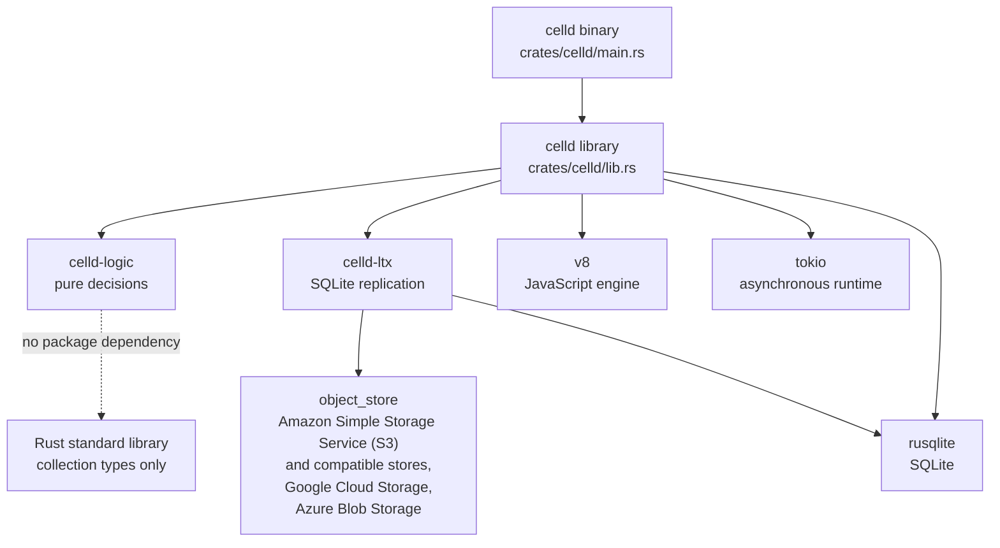

# Repository map

celld is a Rust workspace with three Cargo packages. The split is the architecture. The `celld-logic` package holds every decision and no effect. This document calls it the decision core. The `celld` package is the adapter host: it performs the effects that the core requests. The `celld-ltx` package is the replication engine that turns SQLite write-ahead log pages into objects in the object store. The `celld` package calls it for storage input/output.

This document uses three words. A package is one Cargo unit of source and metadata, named in a `Cargo.toml` manifest. A crate is one Rust compilation unit that a package produces. The package `celld-logic` produces the crate `celld_logic`. A directory is a source path under `crates/`. The table below gives all three names. The `celld` package produces two targets: the library crate `celld` and the binary `celld`.

Source: `Cargo.toml:1-5`, `crates/logic/Cargo.toml:1-11`.

The workspace comment states the rule:

```toml
# Cargo.toml:1-5
# Clean-sheet celld workspace. `crates/logic` owns all behavioral state and
# decisions; `crates/celld` is only an effect executor and adapter host.
[workspace]
resolver = "2"
members = ["crates/*"]
```

The `celld-logic` package repeats the rule in its package manifest:

```toml
# crates/logic/Cargo.toml:8-11
# Pure decision core: no async, I/O, clocks, randomness, locks, or dependencies.
[lib]
path = "lib.rs"
test = false
```

Those two comments are the key to the whole repository. A reader who knows which package owns a concern can predict where the code lives.

The `test = false` flag means that Cargo does not build a unit-test target for this library. The crate carries no `#[test]` functions of its own, and this is deliberate. The behaviour is exercised through the `celld` package. The simulator is test-only code in the `celld` package. It is compiled only when the internal `celld_internal_tests` configuration flag is set, and its source enters the build through `include!`. It drives `celld_logic::on_event` with a seeded scheduler. The clock, the randomness, and the object store are simulated interfaces that the scheduler drives. `docs/testing.md` describes the test layers.

**Aha:** The decision core declares no dependency. It links the Rust standard library, and its code uses only `std::collections` for data structures. It calls no standard-library service that opens a socket, reads a clock, or starts a thread. Time enters only as a field of an event. Randomness enters only as a value that an adapter supplies. This restriction is what lets a deterministic simulator drive the same code as a production node, without a mock of the operating system.

## The top level

```text
celld/
├── Cargo.toml              workspace, shared dependency versions, build profiles
├── Cargo.lock              the resolved dependency graph
├── Dockerfile              container image
├── README.md               what runs, how to install, how to operate a fleet
├── clippy.toml             lint configuration
├── crates/
│   ├── celld/              effect executor, adapters, V8 host, binary
│   ├── logic/              pure decision core
│   └── ltx/                SQLite to object-store replication
├── docs/                   guarantees, security, services, limits, tests
├── examples/               runnable Workers that exercise each feature
└── .github/workflows/      release workflow
```

Source: repository root at commit `8702f6d186c77698dbfb30cf29e3b1922a88f008`.

The repository has no separate controller, scheduler, or database server. All durable state is in an object store bucket. All coordination is a set of bucket records, and nodes write them with conditional writes. The main records are `cells/<cell>/own.json` (the ownership record), `nodes/<node>.json` (the node lease and the node-log record), `log/<node>/<generation>/` (log bundles), `fleet/` (the shared capacity sample and peer secret), `wake/` (alarm entries and the waker lease), `deploy/` (deployment pointers), and `telemetry/`. The chapters later in this exploration explain those records.

## Terms in this map

The rest of the exploration uses these terms. The [glossary](13-glossary.md) gives the full definitions.

| Term | Meaning |
|------|---------|
| Object store | The bucket that holds the durable records and log segments. |
| Durable Object | The application-facing object class that has identity, storage, and single-threaded events. |
| Cell | One Durable Object instance. Its scope is the text `Class:identifier`, where Class is the Durable Object class name and identifier is the 64-hexadecimal-digit object identity. The bucket key is `cells/Class:identifier/`. |
| Ownership record | The object `cells/<cell>/own.json`. It names the owner node and carries the cell's epoch. A conditional create or compare-and-swap changes it. |
| Epoch (ownership epoch) | The counter in a cell's ownership record. Each activation advances it. The epoch is the fence: a stale owner can write only to a superseded `e<epoch>` prefix, and no restore reads that prefix. |
| Follower | A node other than the owner that holds a copy of a segment on disk for a fleet durability proof. A follower is inactive during a bucket proof. |
| Replica | The storage destination for replication segments: a local directory or an object-store prefix. |
| Key-Value (KV) namespace | A named container of key-value pairs. A key is one name in a namespace. Each namespace is one cell. |
| Isolate | One V8 heap together with its JavaScript context. |
| Realm | The JavaScript state of one cell inside an isolate. One isolate can hold several realms. |
| Activation | The lifecycle step that starts a cell's runtime and makes it able to receive events. |
| Generation | One compiled deployment of a Worker script. |
| Fleet | The set of celld nodes that share one object store. |
| Node log | The record of the segments that a node acknowledged but has not yet uploaded to the per-cell prefixes. It lives in `nodes/<node>.json` and in `log/<node>/<generation>/` bundles. To seal it is to close it to new acknowledgements; another node then recovers its segments into the bucket. |
| Operator interface | The internal Hypertext Transfer Protocol (HTTP) routes for state, reload, drain, rebalance, and shutdown. An operator or a control service calls them; they are not the public Application Programming Interface (API). |
| Facet | A child object that uses its root cell's ownership and storage. |
| Binding | A named capability that the platform puts in a Worker's `env` object. |
| Effect | A command that asks an adapter to act outside the decision core, such as start a runtime, write a bucket object, or send a response. |
| Host | The `celld` process. In `celld-ltx`, "host" is the file-system and task interface that the process supplies. A host function is a Rust function behind the JavaScript-visible API. A V8 host is the part of `celld` that embeds V8, in `js.rs`. |
| Host channel | One typed request type and one sender that a cell runtime uses to hand work to a Rust host service. The JavaScript service layer calls Rust through these channels. |

## The three packages

The dependency graph is small and has no cycles.



The dotted edge marks a library relationship, not a Cargo dependency. `celld-logic` declares no dependency and links only the Rust standard library. It uses the standard collection types for its data structures and no external crate. The `object_store` node lists the remote backends in scope. The default build of `celld-ltx` enables only the S3 driver. The optional `gcs` and `azure` features add the other two.

| Directory | Package | Lines of Rust | Job | Depends on |
|-----------|---------|---------------|-----|------------|
| `crates/logic` | `celld-logic` 0.1.0 | 13,360 | Every behavioral decision and every durable state transition | Rust standard library only |
| `crates/celld` | `celld` 0.6.3 | 91,797 | Effect execution, network listeners, V8, storage adapters, command line | `celld-logic`, `celld-ltx`, V8, Tokio, SQLite |
| `crates/ltx` | `celld-ltx` 0.0.0 | 11,411 | SQLite write-ahead log capture, LTX (the binary segment format from the Litestream project) encoding, replica upload, restore | `rusqlite`, `object_store` |

Source: `Cargo.toml`, `crates/celld/Cargo.toml`, `crates/logic/Cargo.toml`, `crates/ltx/Cargo.toml`; line counts from the source tree.

The names are precise. The package `celld-logic` is the policy. The package `celld` is the mechanism. The package `celld-ltx` is the storage format and its transport.

## package: celld-logic

The crate root declares one rule. Every change to behavior passes through `on_event`. No adapter may change the state value directly.

```rust
// crates/logic/lib.rs:3-9
//! Clean-sheet celld decision core.
//!
//! [`on_event`] is the only way behavioral state advances. The production
//! executor and deterministic simulator both feed it events and perform the
//! returned effects. No adapter may mutate [`State`] directly.

use std::collections::{BTreeMap, BTreeSet, VecDeque};
```

The state type is one value. The event type is one enum. The effect type is one enum. The entry point is one function.

```rust
// crates/logic/lib.rs:643-836 (abridged)
pub struct State {
    // node identity, configuration, and lifecycle flags
    // the cell table
    // request and barrier indexes
    // admission, activation, eviction, and capacity queues
}

// crates/logic/lib.rs:6729-6740 (abridged)
pub fn on_event(state: &mut State, event: Event) -> Vec<Effect> {
    let mut effects = Vec::new();
    if let Some(now_mono_ms) = event_mono_ms(&event) {
        state.now_mono_ms = state.now_mono_ms.max(now_mono_ms);
    }
    if let Some(now_ms) = event_now_ms(&event) {
        state.now_ms = state.now_ms.max(now_ms);
    }
    match event {
        Event::StartNodeLease { now_ms, spec, .. } => {
            state.start_node_lease(now_ms, spec, &mut effects)
        }
        // every other event arm follows the same shape
    }
}
```

The fields group into four parts. The first part is node identity, configuration, and lifecycle flags. The second is the cell table. The third is the request and barrier indexes. The fourth is the admission, activation, eviction, and capacity queues. Admission is the step that reserves capacity for a request before an activation. A field is added only when a decision needs it, and the comments on each field state which decision.

The core mutates its own `State`. That mutation is not an effect. An effect is a command that asks an adapter to act outside the core. The effect enum covers work such as start a runtime, stop a runtime, read a bucket record, write a bucket record, arm a timer, send a response, or cancel a request.

The two clocks answer different questions. `now_ms` is wall-clock time. Lease records and alarm deadlines survive a restart, so they must use a clock that a restart does not reset. `now_mono_ms` is monotonic time. Request deadlines, eviction timers, and output timing measure durations inside one process. Each event can carry either value, or both.

The signature has three properties that matter:

1. It does not return a future. The decision is synchronous.
2. It does not take a clock. The event carries the time.
3. It returns effects. The core does not perform them.

The module list groups the decisions by concern.

| Module | What lives there |
|--------|------------------|
| `cell.rs` | Cell scope, cell identity, and activation rules |
| `gate.rs` | The activation gate and the phases of an activation |
| `isolate.rs` | What the host must give an isolate and what the isolate may return |
| `restore.rs` | Which log prefix and snapshot a restore reads |
| `durability.rs` | Which durability proof covers a commit |
| `output_gate.rs` | When a response may leave the node |
| `peer.rs` | Which peer may receive a forwarded request |
| `pressure.rs` | When a node is under memory pressure |
| `rebalance.rs` | Which cells a node donates and which nodes receive them |
| `drain.rs` | How a node leaves the fleet without losing a cell |
| `schedule.rs` | Alarms, cron triggers, and wake times |
| `wake.rs` | The durable wake entry and its retry rule |
| `sqlite.rs` | The SQL shape that the cell storage must create |
| `cache.rs` | The local cell cache and its eviction rule |
| `log_tier.rs` | Which log segments are local and which are remote |
| `log_evict.rs` | When a local log segment may be deleted |
| `epoch_gc.rs` | When an old epoch prefix may be removed |
| `sweep.rs` | The periodic cleanup work |
| `dead_node_reconciliation.rs` | How the fleet handles a node record that stopped renewing |
| `queue.rs` | Queue batching and delivery policy |
| `kv.rs` | Key-Value namespace semantics |
| `alarm.rs` | Durable Object alarm semantics |
| `cron.rs` | Cron Trigger semantics |
| `routing.rs` | Whether a failed peer dispatch may be re-sent |
| `http.rs` | The request and response model that the core reasons about |
| `format.rs` | Canonical formatting of identifiers and paths |
| `types.rs` | The event, effect, identifier, and configuration types |

Source: `crates/logic/lib.rs:11-36`, `crates/logic/types.rs:523`, `crates/logic/types.rs:1025`.

The two large files show where the complexity sits. `lib.rs` holds 7,107 lines and `types.rs` holds 1,305 lines. The other 26 modules are between 12 and 644 lines each.

**Aha:** The event enum carries time as data, not as a clock call. The two clock blocks at the start of `on_event` only move the stored clock forward. An event that arrives late cannot move the clock back. This rule stays inside the pure core, so the simulator and the production node cannot disagree about it.

## package: celld

The `celld` package is the adapter host. Its crate root says the executable owns one serial actor. Every adapter future sends a versioned completion event back to that actor.

```rust
// crates/celld/lib.rs:5-9
//! Effect adapters for the clean-sheet core.
//!
//! The executable owns one serial actor which is the only caller of
//! `celld_logic::on_event`. Adapter futures never borrow core state; they send
//! versioned completion events back through its mailbox.
```

The mailbox is the actor's inbound channel of events. An adapter future cannot borrow core state. It copies what it needs, runs the effect, and sends a completion event back. The completion is versioned: it carries the operation identifier (`OpId`). An `OpId` is the core's ticket for one in-flight operation. The core invalidates the ticket when it drains the operation (cancels it and releases its work), fences the node (loses ownership authority), or replaces the operation with a newer one. A completion whose ticket is unknown is stale, and the core ignores it.

The modules fall into eight groups. D1 is Cloudflare's managed SQLite database. R2 is Cloudflare's object storage. Workflows is Cloudflare's durable multi-step workflow service.

| Group | Modules | What they adapt |
|-------|---------|-----------------|
| Actor and executor | `actor.rs`, `actor/effects.rs`, `actor/local_request.rs`, `actor/production.rs` | The single event loop that calls `on_event` and starts effect futures |
| Network listeners | `main.rs`, `main/cli.rs`, `main/peer_tunnel.rs`, `main/websocket.rs` | Hypertext Transfer Protocol (HTTP), internal peer traffic, and WebSocket upgrades |
| Cell host and runtime | `cell_host.rs`, `cell_runtime.rs`, `cell_dispatch.rs`, `runtime.rs`, `pool.rs`, `generation.rs` | Isolate lifetime, module generation, and request dispatch into V8 |
| JavaScript and V8 | `js.rs`, `js/bootstrap.rs`, `js/modules.rs`, `js/crypto.rs`, `js/storage_ops.rs`, `js/r2_ops.rs`, `js/websocket.rs`, `js/tcp.rs`, `js/zlib.rs`, `js/html_rewriter.rs`, `js/input_gate_lifecycle.rs`, `js/v8_strings.rs`, `js/container.rs` | The Workers Application Programming Interface (API) surface |
| Storage and replication | `storage.rs`, `local_store.rs`, `ltx_repl.rs`, `ltx_replication.rs`, `replication.rs`, `bucket.rs`, `r2_store.rs`, `kv_blob.rs`, `ownership_store.rs`, `wake_entry.rs`, `wake_format.rs`, `wake.rs`, `node_log.rs`, `node_log/recovery_progress.rs` | SQLite files, LTX upload, bucket objects, and the node log |
| Fleet | `fleet.rs`, `peer_auth.rs`, `peer_probe.rs`, `drain_token.rs`, `dead_node_gc.rs`, `memory.rs` | Lease records, peer authentication, probing, and node death |
| Services | `control_plane.rs`, `operator_cell.rs`, `host_services.rs`, `host_channels.rs`, `kv_cli.rs`, `queue_cli.rs`, `queue_batching.rs`, `queue_policy.rs`, `d1_cli.rs`, `r2_cli.rs`, `cell_cli.rs`, `assets.rs`, `container.rs`, `docker.rs`, `js/services/kv.js` | Key-Value (KV), Queues, D1, R2, Workflows, static assets, containers, and the operator API |
| Operations | `cli_options.rs`, `cli_output.rs`, `env_vars.rs`, `telemetry.rs`, `otlp.rs`, `startup.rs`, `dev.rs`, `deploy.rs`, `deploy/python.rs`, `clean_reload.rs`, `machine.rs`, `protocol.rs`, `http_streams.rs`, `facet_streams.rs`, `ws_client.rs`, `ws_registry.rs` | Configuration, logs, metrics, deployment, and development mode |

Source: `crates/celld/lib.rs:11-102`, `crates/celld` directory tree.

The three replication modules are `ltx_repl.rs`, `replication.rs`, and `ltx_replication.rs`, and they have separate jobs. A resident cell is a cell whose runtime is active on this node. `ltx_repl.rs` is the in-process backend that drives `celld-ltx` for each resident cell. `replication.rs` holds the shared primitives that both the backend and the actor use, such as the cell database path and the storage credentials. `ltx_replication.rs` is the engine-neutral handle that the rest of the binary calls. The handle hides the backend type (`LtxRepl`), so the actor does not depend on one backend implementation.

The memory-pressure classifier is not in this package. It is `crates/logic/pressure.rs`. The `memory.rs` adapter measures the process and reports the sample. The decision stays in the core.

The module sizes show the concentration of work. `js.rs` is 12,682 lines. `node_log.rs` is 6,997 lines. `main.rs` is 5,677 lines. The JavaScript API and the node log are the two largest adapters.

The binary has one more architectural detail. It installs jemalloc in place of the system allocator, which is glibc malloc on the Linux image.

```rust
// crates/celld/main.rs:49-55
// glibc's malloc serializes its arenas behind futexes, and under load the
// sixteen worker threads spent up to half a millisecond blocked per
// acquisition. On a 16-core host jemalloc measured 20% more hello-world
// throughput than glibc (mimalloc 11%), and returned the ~7% of the machine
// that arena-lock sleeps reported as idle.
#[global_allocator]
static ALLOC: tikv_jemallocator::Jemalloc = tikv_jemallocator::Jemalloc;
```

An arena is a memory pool that malloc manages for one thread. A futex is a fast user-space lock. Under load, the sixteen worker threads waited behind the arena locks for up to half a millisecond for each acquisition. The comment compares three allocators on the same test. jemalloc reached 20% more throughput than glibc. mimalloc reached 11% more than glibc. jemalloc also recovered about 7% of the machine that had been reported as idle during the arena-lock sleeps.

The allocator choice is not cosmetic. The pressure classifier needs the difference between allocated bytes and resident bytes. The `stats` feature of the allocator exposes both values. The `background_threads` feature lets the allocator return freed pages to the operating system on a timer.

The data flow is one way. The `memory.rs` adapter reads the allocator statistics, the control group (cgroup) working set, and the process resident set size. It puts those values into a `Load` sample. The core classifies the sample in `logic/pressure.rs` and returns a shedding decision. The adapter measures. The core decides.

Source: `Cargo.toml` dependency comment for `tikv-jemalloc-ctl`, `crates/celld/main.rs:49-55`.

### The JavaScript service layer

Only one file in this directory is JavaScript source. Every other file in the `js/` directory is Rust. The Rust files implement the host functions behind the JavaScript-visible API: bootstrap, module loading, storage, cryptography, WebSocket, Transmission Control Protocol (TCP), and compression.

Cloudflare is the platform whose Workers API celld reproduces. A Worker is the application script that Cloudflare runs. A binding is a named capability in the `env` object, such as a Key-Value namespace or a queue producer.

```text
crates/celld/js/services/
└── kv.js
```

Source: `crates/celld/js/services/kv.js`.

The Key-Value service (KV) needs a small JavaScript shim. A shim is a thin JavaScript adapter. It gives a Worker the same binding shape as on Cloudflare: the same methods and properties on a namespace and on a key. A namespace is a named container of key-value pairs, and a key is one name in that namespace. The shim calls the Rust host functions through a host channel. A host channel is one typed request type and one sender that the cell runtime uses to hand work to a Rust host service. Queues, Cloudflare D1 (a managed SQLite database), R2 (object storage), Workflows (Cloudflare's durable multi-step workflow service), and the other services are implemented in Rust and exposed through these host channels.

## package: celld-ltx

`celld-ltx` is a vendored replication engine. It captures the SQLite write-ahead log as LTX segments, uploads them to a replica, and restores a database from those segments. A replica is the storage destination for segments: a local directory or an object-store prefix. LTX is the binary segment format from the Litestream project. A segment holds the database pages that one commit changed, not the whole database. RPO means recovery point objective. The package comment below states an RPO of zero.

```rust
// crates/ltx/Cargo.toml:1-8
# celld-ltx: in-process SQLite→object-store replication for celld.
#
# Vendored 2026-08-03 from rustyriver (github.com/mikenomitch/rustyriver,
# Apache-2.0), itself a Rust reimplementation of Litestream v0.5
# (github.com/benbjohnson/litestream, Apache-2.0) and the LTX format
# (github.com/superfly/ltx, Apache-2.0). See README.md. celld owns and evolves
# this snapshot; it does not track an upstream branch. It serves celld's RPO=0
# durability goal for every cell write.
```

RPO=0 means that no acknowledged write is lost. A follower is a node other than the owner that holds a copy of a segment on disk. A write is acknowledged only after its segment is durable on a follower or in the bucket. [Cell storage and durability](05-cell-storage-and-durability.md) explains the proof.

The module list separates the format, the capture loop, and the replica client.

| Module | Job |
|--------|-----|
| `ltx.rs` | The LTX file header, page header, trailer, and checksums |
| `codec.rs` | Encode and decode one LTX file |
| `wal.rs` | Read SQLite write-ahead log frames |
| `db.rs` | Open a database, set write-ahead log mode, and take checkpoints |
| `paged.rs`, `paged_vfs.rs` | The paged database view and its virtual file system |
| `replica.rs` | The sync loop and the restore entry point |
| `client/mod.rs`, `client/file.rs`, `client/object_store.rs` | Replica destinations |
| `client/bundle.rs`, `bundle.rs` | The celld bundle overlay: a bundle object holds several replica files (LTX files in the destination) in one object, so the tiering path uploads fewer objects. The overlay makes those packed rows look like ordinary per-cell files. |
| `client/epochs.rs` | The epoch prefix chain: one segment prefix for each ownership epoch, walked from the newest epoch down to an epoch that opens with a snapshot. |
| `compactor.rs`, `replica_compactor.rs`, `compaction_level.rs` | Log compaction. It merges adjacent LTX files into fewer files at a higher level, so a restore reads fewer objects. It creates new objects and never deletes a source object. |
| `host.rs` | The file system and task host interface that the `celld` process supplies |
| `replica_url.rs` | Replica Uniform Resource Locator (URL) parsing |
| `lz4_block.rs` | Block compression with LZ4, a lossless compression algorithm |
| `error.rs` | The error model |

Source: `crates/ltx/src/lib.rs:15-30`, `crates/ltx/src` directory tree.

The public surface is re-exported at the crate root, so the host can name `celld_ltx::Db`, `celld_ltx::Replica`, and `celld_ltx::restore` without knowing the module path.

```rust
// crates/ltx/src/lib.rs:60-84 (excerpt)
pub use db::Db;
pub use db::CheckpointMode;
pub use replica::Replica;
pub use replica::restore;
pub use client::ReplicaClient;
pub use ltx::FileInfo;
pub use client::file::FileReplicaClient;
```

The replica URL selects the destination. `replica_url.rs` parses two schemes: `file://` for a local directory and `s3://` for an Amazon Simple Storage Service (S3) endpoint. An R2 bucket uses the `s3://` scheme with the R2 endpoint. The `file` client is always compiled. The `object_store` client module is gated on the `s3` feature.

The feature flags select which `object_store` drivers a stand-alone build of `celld-ltx` compiles.

```toml
# crates/ltx/Cargo.toml:28-32
[features]
default = ["s3"]
s3 = ["object_store/aws"]
gcs = ["object_store/gcp"]
azure = ["object_store/azure"]
```

The default build of `celld-ltx` includes the S3 driver. The `gcs` and `azure` features add the Google Cloud Storage and Azure Blob Storage drivers. The `celld` package does not enable those two features. It enables only `s3`. For a `gs://` or `az://` fleet bucket, the `celld` package builds the store in `bucket.rs` and passes it to `celld_ltx::ObjectStoreClient::with_store`.

## The shared dependency policy

Every direct dependency version is declared once in the workspace manifest. A member crate adds only the features that it needs, and it lists a workspace dependency with `workspace = true`. The lock file also records transitive dependencies. Cargo can hold two versions of one package when two dependents require incompatible version ranges. The workspace policy prevents that for celld's own direct dependencies. It cannot control a transitive dependency that a library adds.

```toml
# Cargo.toml:33-35
# Every direct dependency lives here so the crates can never drift onto two
# versions of the same crate; members add their own features.
[workspace.dependencies]
```

The policy prevents a class of bug. If two crates resolve two versions of `rustls`, the binary holds two Transport Layer Security (TLS) stacks, and a security floor applies to only one of them. A security floor is a minimum version that the workspace forces through a direct dependency that the code never imports. The mechanism is a member entry. `crates/celld/Cargo.toml` declares `rustls-webpki.workspace = true`, and the code never imports the crate. Cargo treats the floor as a root requirement and selects one compatible version for `rustls` too. The workspace comment for `rustls-webpki` states this concern. CA means certificate authority.

```toml
# Cargo.toml (dependency comment)
# celld never imports rustls-webpki; this entry only sets a floor. 0.103.16
# rejects every chain through the eight eMudhra intermediate CA certificates
# whose private keys are public, and rustls itself accepts 0.103.14.
```

The floor is `rustls-webpki` version 0.103.16. The `rustls` crate accepts `rustls-webpki` 0.103.14. The comment states that the private keys for those eight intermediate certificates are public. Any chain through them is therefore untrustworthy. The floor forces 0.103.16, so the resolver cannot select 0.103.14.

Several dependencies are pinned to an exact version for a related reason. `fastwebsockets` is `=0.8.1`, `urlpattern` is `=0.4.2`, and `sqlite-vec` is `=0.1.9`. The manifest comments explain two of the pins.

```toml
# Cargo.toml (dependency comments, abridged)
# The feature is unstable by name, so a 0.8.x release can rename or drop it
# without upstream calling that a break, and a caret range would take it.
fastwebsockets = { version = "=0.8.1", ... }

# sqlite-vec is pre-v1, and its Rust binding is outside its compatibility
# policy. Pin the audited C amalgamation exactly.
sqlite-vec = "=0.1.9"
```

The `fastwebsockets` pin protects the `unstable-split` feature. That feature gives the read and write halves of a WebSocket as separate objects, and the peer tunnel needs the split. The feature is unstable by name. A 0.8.x release can rename or drop the feature, and the upstream project does not call that a breaking change. A caret range would then take the bad release. The exact version makes the upgrade a decision.

## Build profiles

The workspace defines two release profiles.

| Profile | Link time optimization | Codegen units | Incremental | Symbols | Use |
|---------|------------------------|---------------|-------------|---------|-----|
| `release` | `fat` | 1 | No | Stripped | Shipped binary |
| `lab` | `thin` | 16 | Yes | Line tables | Fast rebuild and profiling |

```toml
# Cargo.toml:9-14
[profile.release]
lto = "fat"
codegen-units = 1
opt-level = "s"
panic = "abort"
strip = true
```

The `lab` profile inherits `release` and changes the link settings, the code generation settings, and the debug settings.

```toml
# Cargo.toml:19-27
[profile.lab]
inherits = "release"
lto = "thin"
codegen-units = 16
incremental = true
strip = false
debug = "line-tables-only"
```

**Aha:** `opt-level = "s"` is a deliberate choice, not a default. The profile comment says: `opt-level "s" (not "z") — measure requests per second before trading further`. A smaller binary starts faster and uses less memory in a container, which matters when one node holds many cells.

## The examples directory

Each example is a small Worker and a `wrangler.jsonc` configuration. `wrangler.jsonc` is Cloudflare's deployment configuration file. The `.jsonc` suffix means JavaScript Object Notation with Comments (JSONC): JSON with comment lines allowed. The examples are the executable documentation of the binding surface.

| Example | Feature that it exercises |
|---------|---------------------------|
| `alarm` | Durable Object alarms |
| `async` | Asynchronous handlers and promises |
| `body` | Request and response bodies and streaming |
| `container` | A Durable Object that supervises a container |
| `counter` | Durable Object storage |
| `cron` | Cron Triggers |
| `d1` | The D1 SQL binding |
| `dynamic-worker-tails` | Dynamic Workers and tail events |
| `facets` | Durable Object facets |
| `hello` | The smallest Worker |
| `kv` | The Key-Value binding |
| `opencode` | A larger application that uses several bindings |
| `pi` | A larger application that uses several bindings |
| `python` | Python Workers |
| `queues` | Queue producers and consumers |
| `r2` | The R2 object binding |
| `router` | URL pattern routing |
| `rpc` | Remote procedure call to a Durable Object |
| `sandbox` | The sandbox runtime |
| `static-assets` | Static asset serving |
| `vectordb` | SQLite vector search |
| `wasm` | A WebAssembly module in a Worker |
| `webapi` | The Web API surface |
| `workflow` | Workflows |
| `wsclient` | An outbound WebSocket client |
| `wsecho` | A WebSocket echo server |

Source: `examples/` directory tree.

The examples are demonstration programs, not part of the automated test suite. The examples README says that they are not the complete compatibility test suite. A developer checks a binding by deploying one example with `celld deploy . --bucket <bucket>` and sending requests to it.

## The documentation directory

The repository carries its own design documents. They are part of the source, not a separate website.

| Document | What it states |
|----------|----------------|
| `docs/guarantees.md` | The two promises (one writer for each cell, no lost acknowledged write), the ownership record `cells/<cell>/own.json`, the fleet and bucket durability proofs, and the failure model |
| `docs/security.md` | The fleet trust model, peer authentication, and the operator API |
| `docs/limitations.md` | The known gaps against Cloudflare |
| `docs/cloudflare-compat.md` | The compatibility matrix |
| `docs/README.md` | How to run and operate a fleet |
| `docs/telemetry.md` | Metrics, traces, and logs |
| `docs/testing.md` | The test layers and the simulator |
| `docs/wasm.md` | WebAssembly support |
| `docs/services/*.md` | One document for each service |

Source: `docs/` directory tree.

The failure model is the table of failures and their outcomes. It covers an owner stop, a lost bucket network, a deleted ownership record, a store that ignores a condition, a follower stop, and memory pressure.

The exploration that you are reading cites these documents as secondary sources. When this exploration and the code disagree, the code is the authority and the code wins.

## The request path in one diagram

The repository map becomes useful when it predicts the path of one request.

```mermaid
sequenceDiagram
    autonumber
    participant C as Client
    participant M as main.rs listener
    participant A as actor.rs
    participant L as celld-logic
    participant E as actor/effects.rs
    participant V as runtime.rs, js.rs, V8
    participant S as storage.rs
    participant X as celld-ltx
    participant B as bucket

    C->>M: HTTP request
    M->>A: routed request event
    A->>L: on_event(state, event)
    L-->>A: effects, including activate and dispatch
    A->>E: start effect futures
    E->>V: create isolate and deliver event
    V->>S: read or write the cell SQLite database
    S->>X: commit and capture LTX segment
    X->>B: upload segment under cells/&lt;cell&gt;/ltx/e&lt;epoch&gt;/
    X-->>S: durable
    S-->>V: commit visible
    V-->>A: response event
    A->>L: on_event(state, response event)
    L-->>A: reply effect
    A-->>M: response
    M-->>C: HTTP response
```

The first effect list can include an immediate error reply when activation fails. A successful request gets its reply later. The handler answers first, and then the output gate releases the reply. The output gate is the `output_gate.rs` module in the decision core. It holds each response until a durability proof covers every write that the response can reveal. The diagram compresses that wait into the `reply effect` step.

The listener in `main.rs` receives the HTTP request and sends an event to the actor. The listener resolves the cell scope and puts it in the event. The actor calls `on_event`, and the core decides whether the route is local or remote. The `Route` type has the `Local` case and the `Remote` case. The arrows match the module groups in the tables above. The event loop is in `actor.rs`, and its effect futures are in `actor/effects.rs`. The decision is in `logic`. The runtime manager is in `runtime.rs`, and the V8 host is in `js.rs`. The database is in `storage.rs`. The replication is in `ltx_repl.rs` and the `celld-ltx` package. The upload uses the replica client in `celld-ltx`; the bucket adapter in `bucket.rs` handles celld's own records, such as ownership and deployment pointers.

The diagram shows the local path. If another node owns the cell, the actor forwards the call through the peer tunnel. The remote node runs the same actor path, including its own output gate.

## Where to go next

Start with [Overview](00-overview.md) if you have not read it. That file gives the full argument. The two promises and the four nouns are these. Promise one: exactly one node serves a cell at a time, and only the node that holds the current epoch may acknowledge a write. Promise two: celld acknowledges a write only after the write survives a failure, so an acknowledged write is never lost. The four nouns are node, fleet, cell, and deployment. A node is one `celld` process on one machine. A fleet is every node that shares one bucket. A cell is one Durable Object instance, with the scope `Class:identifier`. A deployment is the set of Worker bundles and configuration that the fleet runs.

- [System architecture](02-system-architecture.md) follows the request path in detail.
- [The Worker runtime](03-the-worker-runtime.md) explains V8, modules, bindings, and gates.
- [Durable Objects](04-durable-objects.md) explains the application-facing object model.
- [Cell storage and durability](05-cell-storage-and-durability.md) explains SQLite, LTX, and the proofs.
- [Ownership, failure, and rebalancing](06-ownership-failure-and-rebalancing.md) explains the fleet plane.
- [The services](07-the-services.md) explains KV, Queues, D1, R2, Workflows, and the rest.
- [Deployment and operations](08-deployment-and-operations.md) explains the deployment path and the command line.
- [Security and tenancy](09-security-and-tenancy.md) explains the trust model.
- [Limitations and compatibility](10-limitations-and-compatibility.md) states the gaps.
- [Resonate S3 and celld](11-resonate-s3-and-celld.md) compares the two durable-object designs.
- [Work placement and sharding](12-work-placement-and-sharding.md) compares how work is divided.
- [Glossary](13-glossary.md) defines every term that this exploration uses.

## Verification note

The line counts and file lists in this document come from the source tree at commit `8702f6d186c77698dbfb30cf29e3b1922a88f008`. A later commit can move a file or change a count. The source path remains the way to check.
