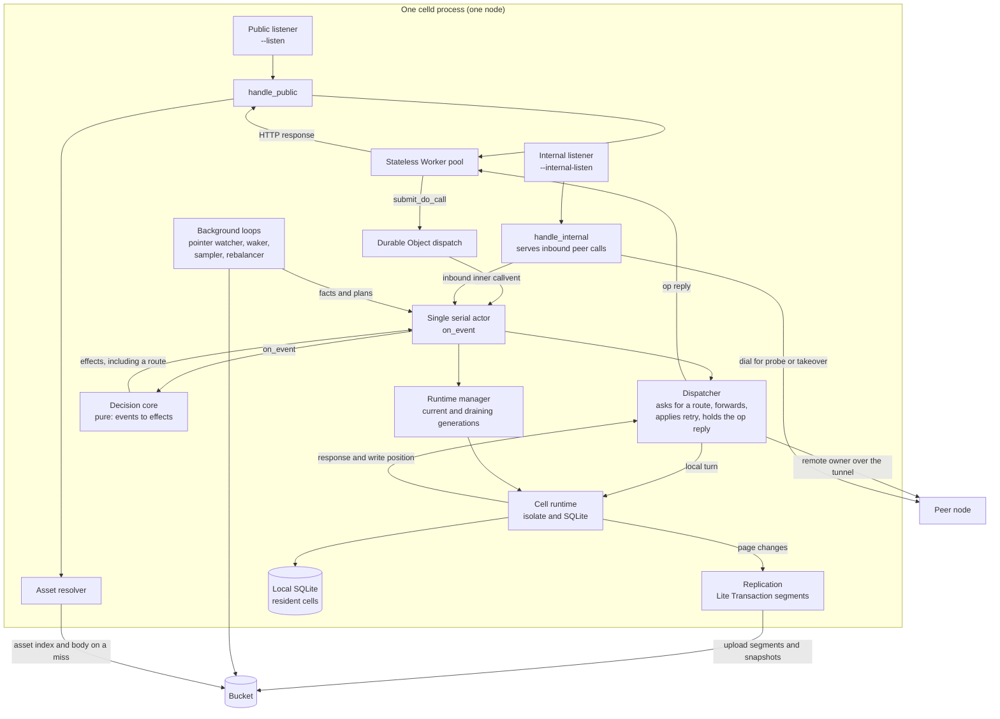
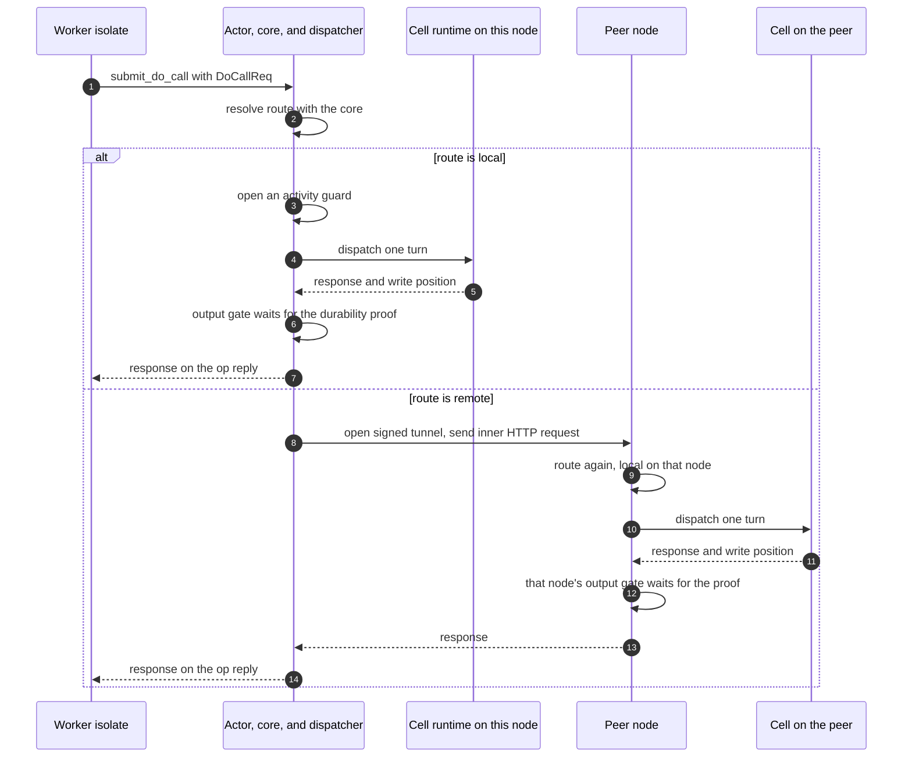
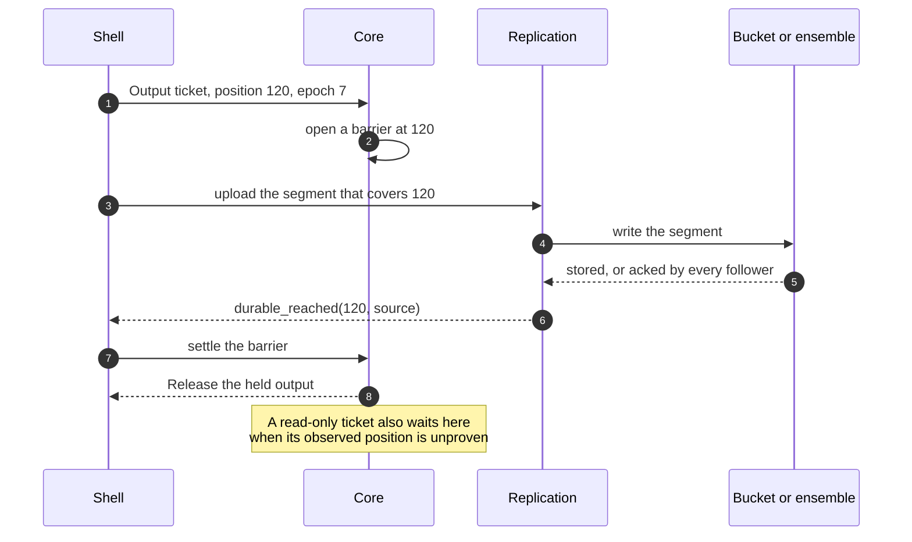

# System architecture

A celld node is one process. It opens two Hypertext Transfer Protocol (HTTP)
listeners, runs one serial actor loop, executes JavaScript in V8 isolates, keeps
SQLite databases for the cells that it owns, and reads and writes one object
store bucket. The process has no separate controller, scheduler, or database
server. The bucket holds every fact that survives a restart. V8 is the
JavaScript engine that celld embeds. A **turn** is one uninterrupted run of
JavaScript in a V8 isolate.

Two words in that summary need care. The actor is a Rust asynchronous task: a
future that the Tokio runtime schedules on a worker thread. Tokio is the Rust
library that provides the asynchronous runtime. In this document, "task" alone
always means that Rust future, never a task in the Resonate durable execution
system; [Resonate S3 and celld](11-resonate-s3-and-celld.md) covers that system.
"Serial" means the actor handles one input at a time, in arrival order, for the
whole node; it does not mean that the node serves one request at a time, because
V8 turns and bucket calls run outside the actor.

Every node can **accept** a request for any cell. Only the owner may **execute**
that request, because only the owner holds the cell's JavaScript instance and
SQLite database. A non-owner accepts the request and forwards it over a tunnel
that is signed when it is established and carries unsigned HTTP inside.
Ownership is one owner per cell, and the ownership record in the bucket says
which node that is.

This document follows the node from start-up to a served request. It covers the
listeners, the route decision, deployment adoption, and the background loops.
The isolate internals are in [the Worker runtime](03-the-worker-runtime.md).
Ownership and recovery are in
[ownership, failure, and rebalancing](06-ownership-failure-and-rebalancing.md).

## The words this document uses

| Word | Meaning |
|------|---------|
| Node | One celld process. A node has a name and one set of listeners. |
| Fleet | The set of nodes that share one bucket. A node learns the fleet from the node leases in the bucket. |
| Bucket | One object store bucket. It holds the deployment pointers, the ownership records, the cell logs, the snapshots, the node leases, the fleet capacity sample, the fleet secret, and the asset index, among other objects. The **fleet capacity sample** is one shared object in which nodes publish their load, so that placement decisions see the fleet. The **fleet secret** is the shared key that authenticates peer requests. A **snapshot** is a whole-database copy of a cell at one point, from which a restore can start without replaying every earlier segment. In this document, "object store" means a service that stores opaque objects under keys, such as Amazon Simple Storage Service (S3) or a compatible store. |
| Worker | The deployed JavaScript application script. The Worker is the code that the public listener runs. |
| V8 isolate | One JavaScript engine heap. V8 is the JavaScript engine that celld embeds. An isolate is not bound to a thread. |
| Cloudflare | The platform vendor that defines the Durable Objects programming model. celld implements a compatible subset of that model. |
| Durable Object (DO) | The object model that the application programs against: one class, one stable identifier, one serial event stream, and durable storage. |
| Class | One exported Durable Object class, such as `Order`. The class is the first part of a cell scope. |
| Cell | One Durable Object instance. A cell is a runtime object; its name is the cell scope. A cell is **resident** when this node runs it, **dormant** when an owner still names this node but no runtime is loaded, and **inactive** when no node holds it. |
| Cell scope | The string that names a cell, of the form `<class>:<identifier>`. It is also the storage key and the dispatch key. The **dispatch key** is the value that the dispatcher hashes to choose a cell and that the owning node uses to find the cell's runtime. |
| Resident cell | A cell whose SQLite database and JavaScript instance are on this node. |
| Activation | The operation that makes a cell resident, either at its first request or after an **eviction** or a move. An eviction unloads a resident cell from the memory of a node; an idle eviction keeps the ownership record and leaves the cell dormant, and a rebalancing eviction releases the record and leaves the cell inactive. A generation switch is not an activation and does not increase the epoch. |
| Generation | One compiled deployment that a node can serve. A node has one current generation and may still drain the generation before it. |
| Deployment | One version of a script and its bindings, stored under `deploy/<script>/<version>/`. A running node serves a **generation**: one deployment graph, which can hold several scripts at once. So a deployment names one version, while a generation names the set of deployments that a node serves together. |
| Pointer | The bucket object `deploy/current.json`. It names the deployment that the fleet must serve. |
| Core | The `celld-logic` Rust package. It holds the decision state machine. It performs no input or output and has no side effects; it is a pure function from events to effects. The actor gives the core the facts it reads, such as ownership records and load samples, as events; the core keeps them in its state but never fetches them itself. |
| Actor | The one Rust asynchronous task that calls the core. It sends events in and performs the effects that come out. |
| Shell | The rest of the `celld` Rust package: the adapters that open sockets, read and write SQLite, and call the bucket. |
| Effect | An instruction from the core to the shell, such as "write this bucket object" or "stop this process". |
| Event | One input to the core, such as an arriving request, a completed restore, or a load sample. `on_event` is the core function that takes one event and returns effects. |
| Ownership epoch (epoch) | The integer in the cell's ownership record at `cells/<cell>/own.json`. The record is a JavaScript Object Notation (JSON) object with two fields, `node` and `epoch`. The epoch increases at each activation. It is the fence: every write to the cell log carries the epoch, and a proof at an older epoch does not cover a newer one, so a stale owner cannot make its writes durable. |
| Lease | A record at `nodes/<node>.json` with an expiry time. It says that a node is alive and may own cells. The lease is the only fleet membership record. |
| Litestream | The open-source tool that streams SQLite write-ahead log pages to object storage. celld vendors a copy. |
| Lite Transaction (LTX) | The replication format that celld takes from Litestream in the `celld-ltx` Rust package. It copies SQLite page changes to the bucket as immutable segments. A segment is one bucket object that holds a run of page changes. |

Source: `crates/celld/lib.rs:5-9`.

The celld Cargo workspace has three packages. `celld-logic` is the Core; it is
pure and deterministic. `celld` is the Shell and the binary; it performs every
input and output. `celld-ltx` is the vendored replication code; it turns SQLite
pages into LTX segments and back. The exploration repository that holds this
document is separate: it also holds the Resonate study, so "workspace" in this
document always means the celld Cargo workspace, not the documentation
repository.

The local SQLite database is the live copy of a cell. The bucket holds the cell
log (the uploaded LTX segments), the snapshots, and the ownership record. A node
rebuilds a cell from the bucket after a failure. The local disk is a fast copy,
not the durable copy.

## The process in one view



The core is a library that the actor calls, so the diagram shows it as a
separate box only to make the two halves visible: the actor feeds it events and
performs the effects that come back. The cell runtime is where JavaScript and
SQLite run; the actor reaches it only through the dispatcher. The bucket edge
from the asset resolver is a read of the asset index and, on a miss, of the
body; a node caches a body on its own disk after the first read.

The actor is the only caller of `celld_logic::on_event`. The core decides
whether a cell is local, when a response may leave, and when a node must stop.
The actor carries those decisions to the shell as effects, and the adapters
perform them. The dispatcher never computes a route of its own; it asks the core
through the actor. The listener accepts bytes and returns bytes, and it keeps no
ownership table. The only ownership table is the set of `cells/<cell>/own.json`
records in the bucket, which the actor loads into the core's state as events.

## Start-up: the order that matters

A node runs in one of two modes. In **self-hosted mode** the operator supplies
the bucket, the endpoint, and the region. In **managed mode** the node enrolls
with a control service and receives installation storage credentials from it.

The start-up sequence is deliberate, but the steps are not all hard gates. Some
steps stop the node when they fail, one only warns, and one repeats until it can
continue.

1. Parse the arguments and choose an action: serve, diagnose, or manage an
   installation.
2. Raise the open-file limit and warn when the limit caps residency. The node
   does not refuse to start.
3. Bind the public listener and the internal listener. A bind failure stops the
   node here.
4. In managed mode, connect to the control service and resolve the storage
   credentials. The **control service** is the Cloudflare-managed service that
   enrolls a node and hands it credentials. An **installation** is one enrolled
   deployment of celld: its nodes, its bucket, and its control-plane record. In
   self-hosted mode, use the bucket that the operator supplied.
5. Open the bucket, prove that it answers, and probe the storage contract:
   conditional writes and ranged reads.
6. Wait for `deploy/current.json`. This step repeats. The node does not exit.
7. Load or create the fleet peer secret at `fleet/peer-auth.json`.
8. Walk the deployment graph. The graph is the primary script, its service
   bindings, and the queue attachments; the section on deployment adoption
   defines it.
9. Start replication.
10. Build the first generation.
11. Start the runtime manager with that generation.
12. Start the actor. The ownership scan and the wake scan arrive as the first
    events, and the background loops start beside the actor.
13. Serve.

The listeners bind before the bucket is opened. A node that cannot bind must
not touch the bucket and must not appear in a fleet. The function is named
`bind_ingress_listener` because the public listener is the ingress for client
traffic; the text calls it the public listener because that is the name that
operators configure with `--listen`. `unsafe_public_advertise` is the opt-in
flag that lets a node advertise a public address for its internal listener; the
next section explains why that is unsafe by default.

```rust
// crates/celld/main.rs:3656-3665
let ingress = celld::startup::bind_ingress_listener(&settings.listen).await?;
let internal =
    celld::startup::bind_internal_listener(&celld::startup::InternalListenerSettings {
        listen: settings.internal_listen.clone(),
        advertise: settings.advertise.clone(),
        unsafe_public_advertise: settings.unsafe_public_advertise,
    })
    .await?;
```

The file limit caps residency. The runtime reserves eight file descriptors for
each resident cell, so a process that may open 8,000 files can hold about 1,000
resident cells. `MIN_RESIDENT_CELLS` is the warning threshold, not a hard
ceiling, and the node logs the warning and continues.

```rust
// crates/celld/startup.rs:114-118
const FDS_PER_CELL: u64 = 8;

/// Below this the node cannot reach the density the runtime is designed for,
/// so say so at startup rather than at the failing activation.
const MIN_RESIDENT_CELLS: u64 = 1_000;
```

```rust
// crates/celld/startup.rs:144-153
let cells = limit.rlim_cur / FDS_PER_CELL;
if cells < MIN_RESIDENT_CELLS {
    warn!(
        event = "file_limit_bounds_residency",
        open_files = limit.rlim_cur,
        resident_cells = cells,
        "the open-file limit caps this node near {cells} resident cells; \
         raise it (ulimit -n {}, or LimitNOFILE= in the unit file)",
        MIN_RESIDENT_CELLS * FDS_PER_CELL
    );
}
```

The bucket probe is the next gate. It does not use a list request, because a
list request says nothing about write conditions or byte ranges. It tests the
two operations that a cell cannot work without: a conditional write and a
ranged read. A store that accepts the conditional headers and ignores the
condition can let two nodes own one cell, and the probe catches that.

```rust
// crates/celld/bucket.rs:1631-1653
pub(crate) async fn probe_startup_storage_steps(&self) -> anyhow::Result<StorageProbeVerdict> {
    match self.probe_cas_steps().await {
        Ok(StorageProbeVerdict::Conformant) => {}
        Ok(violation) => return Ok(violation),
        Err(error) if is_unsupported_operation(&error) => {
            return Ok(StorageProbeVerdict::Violation(
                "the store does not support conditional writes, so celld cannot acquire a cell"
                    .to_string(),
            ));
        }
        Err(error) => return Err(error),
    }

    match self.probe_range_steps().await {
        Err(error) if is_unsupported_operation(&error) || is_invalid_range_response(&error) => {
            Ok(StorageProbeVerdict::Violation(
                "the store does not honor ranged reads, so celld cannot read stored cell data"
                    .to_string(),
            ))
        }
        result => result,
    }
}
```

`probe_cas_steps` calls `cas_contract` for one key. The conditional-write test
has four steps against that key. Step 1 creates an absent object and must
succeed. Step 2 repeats the create and must fail. Step 3 updates with the
current token and must succeed. Step 4 repeats the update with the superseded
token and must fail. The token is the Entity Tag (ETag) that the store returns
from the previous write. A store that applies step 2 or step 4 cannot fence two
owners.

```rust
// crates/celld/bucket.rs:1679-1740 (excerpt)
/// The four steps, against one key. Steps 2 and 4 must be rejected;
/// a store that applies either one cannot fence.
async fn cas_contract(&self, key: &str) -> anyhow::Result<StorageProbeVerdict> {
    // 1. A create on an absent key applies, and answers the token that
    //    steps 3 and 4 need.
    let Some(token) = self.put_cas(key, b"probe-create".to_vec(), None).await? else {
        return Ok(StorageProbeVerdict::Violation(
            "the store rejected a conditional create of an object that does not exist".to_string(),
        ));
    };

    // 2. A create over the object step 1 wrote must be rejected.
    if self.put_cas(key, b"probe-recreate".to_vec(), None).await?.is_some() {
        return Ok(StorageProbeVerdict::Violation(format!(
            "the store overwrote an object although the write was conditional on that object \
             being absent; ... two nodes can own one cell"
        )));
    }

    // 3. An update that carries the current token applies, and that
    //    retires the token step 4 reuses.
    if self.put_cas(key, b"probe-update".to_vec(), Some(&token)).await?.is_none() {
        return Ok(StorageProbeVerdict::Violation(
            "the store rejected a conditional update that carried the current token".to_string(),
        ));
    }

    // 4. The token is stale now, so the update must be rejected. This
    //    step is the fencing contract itself.
    if self.put_cas(key, b"probe-stale".to_vec(), Some(&token)).await?.is_some() {
        return Ok(StorageProbeVerdict::Violation(format!(
            "the store applied a conditional write that carried a stale token; ... two nodes can \
             own one cell"
        )));
    }
    // ...
}
```

A transport error is different from a violation. The complete probe makes three
attempts. A violation on any attempt stops the node, because a store property
does not clear. A transport error on the first or second attempt causes a
retry. A transport error on the third attempt causes a warning, and the node
starts, because a store that does not answer is not proof that the store cannot
fence.

```rust
// crates/celld/fleet.rs:279-314 (excerpt)
const ATTEMPTS: usize = 3;
for attempt in 1..=ATTEMPTS {
    match bucket.probe_startup_storage_steps().await {
        Ok(StorageProbeVerdict::Conformant) => return Ok(()),
        Ok(StorageProbeVerdict::Violation(reason)) => { /* bail */ }
        Err(error) if attempt < ATTEMPTS => { /* warn and retry */ }
        Err(error) => {
            // warn "starting anyway"
            return Ok(());
        }
    }
}
```

The node then waits for a deployment. A self-hosted node can start before the
first `celld deploy`, so it calls `wait_for_deployment_pointer`, which reads
`deploy/current.json` every two seconds until the pointer exists. A managed node
calls `control_plane::wait_for_initial_deployment`, which also reads the
pointers, and in addition polls the control service every two seconds. When the
service hands it a deployment, the node applies it and writes the same
`deploy/current.json` pointer that a command-line deployment writes, so the
bucket pointer remains the single authority either way. The managed wait
returns when either a pointer exists or a poll applies a deployment. Neither
path exits, because a supervisor would restart an exiting node in a loop.

The proof that the bucket answers in step 5 comes from one of two functions.
A self-hosted node calls `validate_bucket`. A managed node calls
`validate_managed_bucket` instead. Both prove that the bucket answers; the
managed form also proves that the bucket belongs to the enrolled installation.

```rust
// crates/celld/fleet.rs:667-683
pub async fn wait_for_deployment_pointer(bucket: &Bucket) -> anyhow::Result<()> {
    let mut waited = false;
    loop {
        if bucket.get(CURRENT_POINTER_KEY).await?.is_some() {
            if waited {
                tracing::info!(event = "initial_deployment_found");
            }
            return Ok(());
        }
        if !waited {
            waited = true;
            tracing::info!(
                event = "awaiting_initial_deployment",
                "no deployment yet; run `celld deploy` and the node serves it \
                 without a restart"
            );
        }
        tokio::time::sleep(std::time::Duration::from_secs(2)).await;
    }
}
```

**Aha:** Start-up has no private path to a serving state. It calls the same two
functions that a live reload calls, `DeploymentGraph::load` and
`Generation::build`. The runtime manager installs the result at start-up, and
a later adoption replaces it. A deployment that a live node cannot adopt is
also a deployment that a new node cannot start. The reload path and the
start-up path therefore test each other on every deployment.

```rust
// crates/celld/main.rs:3810-3849 (excerpt)
let graph = DeploymentGraph::load(&client, node.clone()).await?;
// The same two calls a reload makes: there is no boot-only way from
// a deployment to a serving generation.
let generation = Generation::build(
    FIRST_GENERATION,
    graph,
    GenerationOptions {
        node: node.clone(),
        region: settings.region.clone(),
    },
)?;
let runtime = RuntimeManager::start(generation, RuntimeOptions { /* ... */ })?;
```

Source: `crates/celld/main.rs:3804-3849`,
`crates/celld/main.rs:890-895`.

## The two listeners

celld opens two listeners and terminates Transport Layer Security (TLS) on
neither. The operator's front-end proxy terminates TLS on the public listener.
The internal listener must sit on a trusted private network, such as a WireGuard
or Tailscale overlay. WireGuard is an encrypted virtual private network
protocol, and Tailscale is a product that builds a private network with it.

| Listener | Default address | Serves | Protection |
|----------|-----------------|--------|------------|
| Public | The first free port on `127.0.0.1` in the range 8080 through 8099 | The deployed Worker, plus the health path `/.well-known/celld/health` | A front-end proxy or the Worker's own code authenticates the user; celld itself adds no user authentication |
| Internal | A free ephemeral port on `127.0.0.1` | The peer protocol and the operator routes | A trusted private network; some routes also carry a signature |

The public listener reserves exactly one path, `/.well-known/celld/health`.
Every other path, including a plain `/health`, belongs to the Worker. The
internal listener answers 404 for an unknown path, so an unknown internal path
never falls through to the Worker. One internal route, `/do/<cell>`, does
deliberately forward a request to an application cell. It is a named operator
route, not a fallthrough, and it is listed in the route table below.

The two listeners share one address policy with three modes: an explicit socket
address, an automatic loopback port in the 8080 through 8099 range, or an
ephemeral loopback port that the operating system chooses. The public listener
defaults to the automatic range. The internal listener defaults to an ephemeral
port. The operator sets an explicit address with `--listen` or `CELLD_ADDR`
for the public listener, and `--internal-listen` or `CELLD_INTERNAL_ADDR` for
the internal listener. The automatic range exists for development, so a
developer can start several nodes without choosing ports by hand.

```rust
// crates/celld/startup.rs:17-26
const AUTO_LISTEN_START: u16 = 8080;
const AUTO_LISTEN_END: u16 = 8099;
const LISTEN_BACKLOG: u32 = 4_096;
```

The internal listener has one more check. It refuses an unspecified listen
address, which means the wildcard address `0.0.0.0` or `::`, without an explicit
`--advertise`, because peers need a concrete address to dial. It also refuses a
public advertise address unless the operator passes `--unsafe-public-advertise`.
The peer protocol carries application data without built-in TLS, and part of the
operator surface has no request authentication.

The listen address and the advertise address have different jobs. The listen
address is where this process accepts connections, and its default is loopback.
The advertise address is what the node writes into its lease and into its
replies, and it is the address that another node dials. A fleet on one host can
use loopback for both. A fleet on several hosts must set `--advertise` to an
address on the private network that the peers can reach; the loopback default is
not dialable from another host. A node that listens on the wildcard address must
state the advertise address, because the wildcard address is not a destination.

```rust
// crates/celld/startup.rs:227-247
if advertise.is_public_ip() && !settings.unsafe_public_advertise {
    return Err(anyhow!(
        "--advertise {advertise} is a public IP address; the internal listener \
         has an unauthenticated operator API, and peer HTTP carries application \
         data without built-in TLS. Use a private overlay, or pass \
         --unsafe-public-advertise to accept this exposure explicitly"
    ));
}
```

In that message, IP means Internet Protocol, and API means application
programming interface.

### The health gate

The public handler counts each request as in flight through `admit_public`.
`admit_public` refuses only while the node drains; it does not limit capacity.
The health path skips this count, because an orchestrator must be able to ask a
draining node for its state. A refused request gets 503, `Retry-After: 1`, and
`Connection: close`. The close ends the connection, and the front-end proxy or
the load balancer then retries against another node. Celld does not tell the
client which node to use; the routing layer owns that decision.

```rust
// crates/celld/main.rs:2824-2842
let _public_admission = if path == "/.well-known/celld/health" {
    None
} else {
    let Some(admission) = app.admit_public() else {
        let mut refused = response(
            StatusCode::SERVICE_UNAVAILABLE,
            "{\"ok\":false,\"draining\":true}",
        );
        refused.headers_mut().insert(
            hyper::header::RETRY_AFTER,
            hyper::header::HeaderValue::from_static("1"),
        );
        refused.headers_mut().insert(
            hyper::header::CONNECTION,
            hyper::header::HeaderValue::from_static("close"),
        );
        return Ok(refused);
    };
    Some(admission)
};
```

```rust
// crates/celld/main.rs:2850-2857
"/.well-known/celld/health"
    if !app.is_draining() && app.fleet_ready() && app.healthy().await =>
{
    response(StatusCode::OK, "{\"ok\":true}")
}
"/.well-known/celld/health" => response(StatusCode::SERVICE_UNAVAILABLE, "{\"ok\":false}"),
_ if app.runtime.is_some() => handle_ingress(request, app, connection).await,
_ => response(StatusCode::NOT_FOUND, "{\"error\":\"not_found\"}"),
```

A node that has no runtime, such as a diagnose-only process, answers 404 for
every non-health path. The health answer is a conjunction of three facts: the
node is not draining, the one-shot fleet readiness gate is open, and the actor
reports healthy.

The readiness gate is one-shot. A joining node evaluates it once per second
while the gate is closed. When the fleet is settled, the gate opens, and the
node never evaluates it again; the gate never closes for the life of the
process. While the gate is closed, the health path answers 503, so an
orchestrator or a load balancer keeps new public traffic away from this node.
The node still serves peer-forwarded requests for the cells that it already
owns. `drain::fleet_status` returns one blocking reason when the fleet is not
settled:

| Reason | Condition |
|--------|-----------|
| `Drain` | Another node holds a live drain token. A token is live while its expiry time is after now, and it is "another node's" when its node name differs from this node. |
| `Unreadable` | The drain token or the capacity sample could not be read. The gate treats an unreadable store as unsettled. |
| `SelfUnpublished` | The joining node has no live lease of its own, so it has not announced itself to the fleet. |
| `MemoryHeadroom` | Some live peer reports `pressured`, or reports `memory_headroom` as false. The reason names the first such node in name order. |
| `Restoration` | A drain token exists and some live node has more cold restores in flight than its pre-donor baseline plus one activation budget. A **cold restore** is a restore that starts from the bucket with no local copy. The **donor** is the node that writes the drain token and hands cells away; it **snapshots** that baseline into the token immediately before it begins, so "pre-donor baseline" is the restore count that the donor recorded before the move started. |
| `OwnershipSkew` | More than one incumbent exists and the busiest incumbent holds more than `ceil(total * (n + 1) / n²)` cells, where `n` is the incumbent count and `total` is their sum. An **incumbent** is a node whose lease is live and that already holds cells while the gate is evaluating. |

The activation budget is `max_activations`: eight times the available
parallelism, clamped to 16 through 128, and overridable with
`CELLD_ACTIVATIONS`. **Available parallelism** is the number of tasks that the
runtime can run at the same instant, normally the number of processor cores
that the process may use. Cold routes are object-store latency rather than
compute, so this number is far above the thread count by design.

`OwnershipSkew` has one exception. A node **contributes successor capacity** when
its lease is live, its lease advertises the paced handoff, and its resident cell
count is below the busiest incumbent's count. The **paced handoff** is the lease
field that says the node accepts a shutdown-adoption request: it can take
ownership of cells while another node drains. In that case the skew does not
block the gate, because the next drain can move ownership to this node. A node
that contributes capacity does not need the incumbents to rebalance first; that
requirement would be a closed loop, because an idle fleet moves ownership only
during a handoff. When the gate opens, the gate records its opening reason as
`successor_capacity` or `fleet_settled`. Those two values are not blocking
reasons; they are the two ways that settlement can be reached, and an operator
can use them to tell the two states apart.

The observation period is `CELLD_READY_FLEET_GATE_MS`, which defaults to 120,000
milliseconds. A value of 0 turns the gate off, so the node reports ready at
once. The period bounds how long a joining node keeps waiting for settlement
before it records the blocking reason. It cannot make an unsafe fleet ready:
after the period passes with the gate still closed, the node logs the blocking
reason once and keeps readiness closed. The one-shot design means that a later
fleet change never makes a ready node unready.

Source: `crates/celld/main.rs:4426-4511`, `crates/logic/drain.rs:46-126`.

## The public request path

The public handler makes two routing decisions before it calls the Worker. First,
a static asset may answer the path. This decision applies only to GET and HEAD.
Second, the request body must fit the body limit. A third check happens earlier:
`admit_public` counts the request as in flight and refuses it while the node
drains, as the health gate section describes.

```rust
// crates/celld/main.rs:2328-2360 (excerpt)
async fn handle_ingress(
    request: Request<Incoming>,
    app: AppHandle,
    connection: ConnectionWorkerRequests,
) -> HttpReply {
    if matches!(*request.method(), hyper::Method::GET | hyper::Method::HEAD) {
        // One snapshot for the asset decision and the Worker it may fall
        // into, so a deployment adopted mid-request cannot serve the new
        // generation's index with the old generation's Worker.
        let generation = app.runtime.as_ref().map(|runtime| runtime.generation());
        if let Some(resolver) = generation.as_deref().and_then(Generation::ingress_assets) {
            let path = request.uri().path();
            if !resolver.should_run_worker_first(path) {
                // serve the asset, or fall through to the Worker
            }
        }
    }
    // decode the request and run the Worker
}
```

The generation snapshot is the important line. A deployment can be adopted in
the middle of a request. The resolver comes from the snapshot, so the asset
decision and the asset response belong to one generation. When the decision is
"serve the asset", the handler returns before it reaches the Worker, so there is
no second generation to mix in. When the decision is "fall through", no asset
was served, and the Worker fetch may run whatever generation is current when it
starts. The invariant that the snapshot protects is therefore local to one
request: a decision made against one asset index must not answer with a Worker
from another generation. The failure it prevents is a page from one deployment
version that loads a module from another deployment version, which happens when
the asset decision comes from the old index and the Worker fetch comes from the
new generation.

The asset resolver has three outcomes: serve a file, return 404 when the script
is asset-only, or fall through to the Worker. A script is **asset-only** when
the deployment has no main module; a path with no file then answers 404 instead
of falling through. The resolver also holds **`run_worker_first`** rules. A path
that matches one of these rules goes to the Worker before the asset lookup.

The request Uniform Resource Locator (URL) is built from a guarded chain. The
path and query always come from the request target. The host comes from
`X-Forwarded-Host` only when the operator sets `CELLD_TRUST_FORWARDED_HEADERS`,
then from `Host`. Each value must pass `well_formed_host` before it is used. A
malformed value is dropped, not repaired. The scheme comes from
`X-Forwarded-Proto` under the same trust guard, and defaults to `http`.

The two header readers differ on purpose. `last_value` reads the last header
line and the last comma-separated value on that line; the forwarded headers use
it because a proxy appends to the chain, and the final field is the one the
closest trusted proxy wrote. `first_value` reads the first header line and the
first comma-separated value; `Host` uses it because a single host is expected,
and the first value is the one the request started with. The gate applies to
each source separately, so a malformed forwarded host falls through to `Host`
instead of discarding the whole chain. `celld.local` is the final fallback: it
is a placeholder that keeps the URL syntactically valid when the request
carries no usable host, not a name that resolves anywhere.

```rust
// crates/celld/main.rs:1887-1899 (excerpt)
let forwarded = |name: &str| trust_forwarded_headers.then(|| last_value(name)).flatten();

// The gate applies per source, not once at the end of the chain, so a
// malformed forwarded value falls through to `Host` instead of discarding
// the whole chain.
let host = forwarded("x-forwarded-host")
    .and_then(well_formed_host)
    .or_else(|| first_value("host").and_then(well_formed_host))
    .unwrap_or("celld.local");
let canonical = |scheme: &str| celld_logic::http::canonical_scheme(scheme);
let scheme = forwarded("x-forwarded-proto")
    .and_then(canonical)
    .unwrap_or("http");
```

The Worker entry always runs in the stateless pool. It does not run on a
"landing cell". A landing cell is a cell that would host the Worker entry only
to make an `env.NAMESPACE.get(id)` call resolve without a routing step. The
code records why it does not exist: a cell runs one fetch at a time, so under
real concurrency the entry cannot be on the cell it calls, and the routing
round-trip would cost a second hop. A Durable Object call already reaches the
owner with **fencing** (the ownership epoch that stops a stale owner) and the
**output gate** (the rule that withholds a reply until the write is proven).

```rust
// crates/celld/actor.rs:1558-1565
// The Worker entry is stateless — run it in the pool, always. Routing it
// to a "landing cell" existed only to make an `env.NS.get(id)` call
// resolve inline; but a cell runs one fetch at a time, so under any real
// concurrency the entry can't be on the cell it calls, and the routing
// round-trip is paid for nothing — on top of the DO call's own routing.
let fetching = runtime.fetch_worker_pool(url, method, body, headers, cancellation.clone());
```

The comment above writes the binding as `env.NS`; the prose uses
`env.NAMESPACE`. Both mean the binding name that the deployment configures for
one Durable Object namespace.

The body limit is checked before the Worker runs. A declared `Content-Length`
above the limit answers 413 at once. A streamed body has no declared length, so
the handler wraps the body in a counter and adds the size of each chunk as the
Worker reads it; the read fails with the same 413 error as soon as the total
passes the limit, and the Worker stops. The default limit is 1,073,741,824 bytes
(one gibibyte), and `CELLD_MAX_REQUEST_BODY_BYTES` can lower it but not raise it.

```rust
// crates/celld/main.rs:1701-1711
let declared = request
    .headers()
    .get(hyper::header::CONTENT_LENGTH)
    .and_then(|value| value.to_str().ok())
    .and_then(|value| value.parse::<u64>().ok());
if declared.is_some_and(|length| length > max_body_bytes as u64) {
    return Err(Box::new(response(
        StatusCode::PAYLOAD_TOO_LARGE,
        "request body too large",
    )));
}
```

Pool admission has three answers, not two. A refusal is saturation, and the node
answers 503 so the caller can retry or shed load. A build failure is a fault, and
the node answers 500. A **cell overload** is a third case: the target cell is
already running more work than it can accept, so the node answers 503 with
`Retry-After: 1` and `x-celld-overload: cell`. It does not mean that the node
lacks capacity.

```rust
// crates/celld/main.rs:2382-2399 (excerpt)
Err(error) if request_body_limit_error(&error) => {
    response(StatusCode::PAYLOAD_TOO_LARGE, "request body too large")
}
Err(error) if cell_overload_error(&error) => cell_overload_response(),
Err(error) => match error.downcast_ref::<celld::pool::AdmitError>() {
    // Saturation is not a failure of the request.
    Some(refused @ celld::pool::AdmitError::Refused(_)) => response(
        StatusCode::SERVICE_UNAVAILABLE,
        format!("Worker refused: {refused}"),
    ),
    // A build failure is a fault, not saturation.
    Some(celld::pool::AdmitError::Build(_)) | None => response(
        StatusCode::INTERNAL_SERVER_ERROR,
        format!("Worker failed: {error:#}"),
    ),
},
```

Source: `crates/celld/main.rs:2394-2412`, `crates/celld/actor.rs:1291`.

## From a Worker to a Durable Object

A Worker obtains a stub with `env.NAMESPACE.get(id)`. `NAMESPACE` is the binding
name that the deployment configures; the real name is whatever the script
declares. A `fetch` on that stub becomes a `DoCallReq`. The call does not go back
through the public listener. The JavaScript host operation calls
`submit_do_call`, which sends the request on an in-process channel to
`dispatch_do_call`.

The **dispatcher** is the part of the shell that consumes that channel. It asks
the core for a route, sends the call to the local runtime or to the owner over
the peer tunnel, applies the retry rule, and finally sends the result back to
the waiting JavaScript operation as an **op reply**. The call carries five
pieces of state. The cell scope names the target. The request is the method,
URL, headers, and body. The **request identity** is an optional number that ties
the call to one JavaScript request; the dispatcher uses it to attribute the call
and to deliver a cancellation. The **abort flag** says whether an explicit
JavaScript `AbortSignal` was attached, which decides whether a cancellation
reaches the handler or only stops this process from waiting. The **cancellation
channel** is a one-shot signal that fires when the caller goes away, so the
owner can stop work instead of finishing a response nobody will read. That is
five items: the scope, the request, the identity, the flag, and the channel.

The route is not computed in the listener. The actor asks the core for a route.
The core answers with one of two values.

```rust
// crates/logic/types.rs:895-904
pub enum Route {
    Local,
    Remote {
        node: NodeId,
        addr: String,
        epoch: Epoch,
        peer_protocol: u16,
    },
}
```

A local route dispatches into the cell runtime on this node. A remote route
carries everything that the forwarding path needs: the owner node, its internal
address, the **ownership epoch**, and the peer protocol version. The epoch
travels with the route so a stale route can be recognized without a second
directory read. The receiver compares the epoch in the route with the epoch in
its own ownership record for that cell. If the record names a different epoch,
the receiver answers `NotOwner`, and the sender takes the retry path. The
directory here is the fleet's ownership records in the bucket, not a local
table.

The diagram uses four terms that the paragraphs after it define: the activity
guard, the write position, the ticket, and the durability proof.



The **activity guard** tells the drain that a request is in flight on a cell.
It is dropped when the reply leaves, so a shutdown waits for the request or
cancels it. The **write position** is a fingerprint of the local SQLite state at
the time of the reply: the sum of the change counter, the data version, and the
schema cookie.

That position becomes a **ticket**. A ticket is one record that the shell sends
to the core for one output route: the route (`Channel`), the request identity,
the write position when the event that produced the output advanced the cell
log, the observed position when the output only read, and the activation epoch.
A streamed body takes one ticket for its head and one more for each chunk, so a
chunk produced after an earlier release cannot reveal a later write. The core
keeps a barrier for each cell at the highest ticket position that no proof yet
covers. A ticket that carries its own position opens a barrier at that
position. A read-only ticket trails the newest barrier already open on its cell,
so an ordinary read pays no durability latency. The core holds every ticket
behind its barrier until the shell reports a proof that covers the position.



A **durability proof** is one of two kinds, and the difference is the fence. A
**bucket proof** is a completed upload of the segment. The bucket only stores,
so the core sends `VerifyOwnership`: the shell reads `cells/<cell>/own.json` and
the gate opens only if the record still names this node at the ticket's epoch.
A stale owner that uploads into an orphaned prefix therefore fails closed, and
the reply is withheld rather than acknowledged into a lineage that a successor
already replaced. A **fleet proof** is an acknowledgement from the **follower
ensemble**. The follower ensemble is the small set of nodes that receive the
node's write-ahead log, the ordered log of committed page changes from which the
LTX segments come. The rule is write-all, ack-all: a fleet proof exists only
when every ensemble member has confirmed the position on disk. The **ensemble
seal** is the fence. A takeover seals the old member before it restores, and a
sealed member refuses appends at or below its seal mark, so a stale owner's
ack-all cannot complete. A fleet proof therefore needs no ownership read.

```rust
// crates/logic/types.rs:470-478
/// Which mechanism proved a gated write durable. The fences differ:
/// the fleet's follower ensemble arbitrates (a takeover seals a member first),
/// the bucket only stores — so bucket proofs verify ownership before any
/// reveal and fleet proofs do not need that extra read.
pub enum ProofSource { Fleet, Bucket }

// crates/logic/log_tier.rs:138-147
/// Write-all, ack-all: `next` may acknowledge only when every ensemble
/// member has confirmed it at the leader's fragment epoch.
pub fn ack_fleet_allowed(view: &LeaderView, ends: &BTreeMap<NodeId, Offset>, next: Offset) -> bool {
    !view.ensemble.is_empty()
        && view.ensemble.iter().all(|member| ends.get(member).is_some_and(|end| *end >= next))
}
```

The fleet proof is an opt-in mode, `CELLD_DURABILITY=fleet`. In the default
mode the bucket upload is the proof and the tiering path at once. In fleet mode
the two race, and whichever proof lands first opens the gate; the bucket upload
still runs, so every per-cell restore and compaction mechanism sees exactly the
objects that a bucket-only node would write. The consequence for a reader is
simple: a reply that says "written" has passed one of these two fences, and the
gate never releases a reply that reveals a write whose fence has not yet armed
or has already failed.

The remote path uses a tunnel. The establishment request carries a Hash-based
Message Authentication Code (HMAC) built with SHA-256 (Secure Hash Algorithm
256-bit). The signed text is nine newline-separated fields:

```text
cells-peer-request-v1
5
{method}
{path and query}
{hex SHA-256 of the body}
{source node}
{target node}
{timestamp in milliseconds}
{hex nonce}
```

The first field is `DOMAIN` and the second is `PROTOCOL_VERSION`. The signature
travels in `x-cells-peer-signature`, beside `x-cells-peer-version`,
`x-cells-peer-source`, `x-cells-peer-target`, `x-cells-peer-timestamp`,
`x-cells-peer-nonce`, and `x-cells-peer-body-sha256`. The receiver checks the
version first, then the node names, then the clock, then the body hash, then the
signature, and finally that the target names itself. The failures have distinct
answers: 401 for a missing or wrong signature, 409 for a replay or a wrong
target, 426 for an incompatible version, and 503 for a full replay cache. The
receiver accepts a 30,000 millisecond clock window and keeps a replay cache. A
nonce stays in the cache for two clock windows, and the cache holds at most
1,000,000 entries; a full cache refuses new requests rather than forgetting a
live nonce.

After the upgrade, the tunnel is a plain HTTP stream. The establishment is an
ordinary HTTP request to `/peer/tunnel` that carries the peer signature and asks
for a protocol upgrade. The answer upgrades the connection to a stream that
carries many inner requests, so one signed establishment covers every call on
that connection. The inner calls are not signed, which removes the per-call
signature cost and the per-call connection cost. The tunnel does not add
confidentiality. The private network remains the boundary for the inner bytes.
Node A overwrites the reserved `x-cells-*` control headers on the way in, and
node B strips them on the way out, so an application cannot smuggle one.

```rust
// crates/celld/peer_auth.rs:16-23
pub const PROTOCOL_VERSION: u16 = 5;
pub const PROTOCOL_VERSION_TEXT: &str = "5";
pub const RESPONSE_VERSION_HEADER: &str = "x-cells-peer-version";

const SECRET_KEY: &str = "fleet/peer-auth.json";
const SECRET_VERSION: u8 = 1;
const DOMAIN: &str = "cells-peer-request-v1";
const CLOCK_WINDOW_MS: u64 = 30_000;
```

`PROTOCOL_VERSION` is the wire compatibility number. A node writes it into its
lease and into every peer reply, and it refuses a peer with a different number.
`SECRET_VERSION` versions the stored secret file, not the protocol. `DOMAIN` is
part of the signed input, so a signature for this protocol cannot be replayed
into another HMAC use in the same process.

The fleet secret is a bucket object at `fleet/peer-auth.json`. A node loads it
or creates it after it finds the deployment pointer, so every node that can
read the bucket can authenticate to every other node. The bucket is the trust
root.

A second mechanism is separate. Each process generates an Ed25519 **probe key**.
Ed25519 is a public-key signature algorithm: a private key signs, and a public
key verifies. `/peer/probe` first requires the ordinary peer signature described
above; it is not an open route. The caller sends a 32-byte hexadecimal
challenge, and the node answers with a signature from the probe key over
`cells-peer-probe-v1\n{node}\n{advertise}\n{challenge}`. The caller chooses the
challenge and checks the answer against the public key that sits in the node
lease. A diagnostic therefore proves that the process behind an address is the
process that published the lease. The probe does not authenticate ordinary peer
requests; the fleet secret does that.

### The retry rule

A failed forward is dangerous. The owner may have run the handler and lost the
reply. Re-sending can then run the handler twice. celld classifies each failure
by how far the attempt got.

```rust
// crates/logic/routing.rs:20-30
pub enum Attempt {
    /// The peer answered that it no longer owns the cell. Nothing ran.
    NotOwner,
    /// The connection was never established. No bytes reached the owner.
    NeverConnected,
    /// The request was on the wire when the attempt failed. The owner may or
    /// may not have run it.
    Ambiguous,
}
```

The dispatcher allows one redispatch for `NotOwner` and one for `NeverConnected`,
counted separately, so a route that is both stale and unreachable still
terminates. The budget belongs to one observed owner generation, which is the
pair `(node, epoch)` that the route named. "Budget" here means that pair of two
allowances: one `NotOwner` retry and one `NeverConnected` retry. `Ambiguous` is
never retried.

```rust
// crates/logic/routing.rs:42-59
pub fn redispatch(&mut self, attempt: Attempt) -> bool {
    match attempt {
        Attempt::Ambiguous => false,
        Attempt::NotOwner if self.retried_not_owner => false,
        Attempt::NotOwner => {
            self.retried_not_owner = true;
            true
        }
        Attempt::NeverConnected if self.retried_never_connected => false,
        Attempt::NeverConnected => {
            self.retried_never_connected = true;
            true
        }
    }
}
```

The binary adds one refinement. A `NotOwner` answer does not redispatch at
once. The dispatcher remembers the `(node, epoch)` that answered and waits,
because a replacement process can bind the address of its predecessor while the
predecessor's lease is still visible. An immediate redispatch would resolve the
same stale generation and spend the safe retry before ownership moves. The wait
starts at 10 milliseconds and doubles to 250 milliseconds. After each wait, the
node invalidates the route and resolves it again. When the new route names a
different `(node, epoch)`, the dispatcher resets its budget and its wait ladder
and makes a fresh attempt. A "fresh attempt" is a new request with a new
allowance, because the old generation is gone. When the same generation comes
back, the node waits again without another redispatch, so the delay between
attempts grows but the budget does not. The loop ends when the route changes,
when the operation deadline passes, or when the client cancels.

One case is excluded from this budget. A route with `epoch == 0` names a
**candidate**, not an owner. Epoch zero is reserved: an ownership record never
holds it, because the first activation writes epoch 1. A candidate is a node
that the capacity sample says can take the cell while the cell restores, so the
core may produce a route to it before any ownership record exists. A peer
refusal for such a route proves that the attempt did not run, so it does not
consume the stale-route budget. The dispatcher invalidates the route, waits 25
milliseconds, and tries again within the same deadline. The core then excludes
the load sample of that candidate node from the next placement decision, so the
retry does not select the same candidate.

Source: `crates/celld/main.rs:433-557`.

## The internal surface

The internal listener serves the peer protocol and the operator routes. The
routes are one flat match, and each route has a narrow job. "Operator routes"
means the routes used by the `celld` command line interface and by a control
service; they are not part of the public application interface.

```rust
// crates/celld/main.rs:2879-2908 (excerpt)
"/peer/probe" => internal_probe(request, app).await,
"/peer/handoff" => internal_handoff(request, app).await,
_ if path.starts_with("/peer/log/") => internal_log(request, app, path.clone()).await,
"/state" => response(StatusCode::OK, app.snapshot().await),
"/reload" if request.method() != hyper::Method::POST => {
    response(StatusCode::METHOD_NOT_ALLOWED, "method not allowed")
}
"/reload" => internal_reload(app).await,
"/rebalance/pause" | "/rebalance/resume" => {
    internal_rebalance_switch(path == "/rebalance/pause")
}
"/shutdown" => {
    // begin a handoff, or a preserve-mode reload
}
```

Four words in the table need definitions first. A **released cell** is a cell
whose owner has released its ownership record so that a peer can claim it. The
**node log** is an append-only bucket log for one node session; a takeover seals
it, reads it, and marks it sealed. A **takeover** is the act by which one node
acquires a cell after the previous owner's lease expired, or after that owner
released the cell. **Preserve mode** is a shutdown that drains the request
shell, which is the part of the process that accepts and answers public
requests, but keeps the ownership records and the **local replica cache**, which
is the on-disk copy of the cell databases and their recent segments. Preserve
mode keeps them because the same logical node will start again at the same
address. A handoff shutdown releases the ownership records instead.

| Route | Purpose | Authentication |
|-------|---------|----------------|
| `/peer/probe` | Return a signed challenge response that proves the process identity | Peer signature; the response is signed with the probe key |
| `/peer/handoff` | Offer or accept a released cell | Peer signature |
| `/peer/log/*` | Seal, append, or tail the node log during takeover | Peer signature |
| `/peer/tunnel` | Establish a tunnel for cell fetch, Remote Procedure Call (RPC), and WebSocket traffic | Peer signature at establishment |
| `/peer/abort/*` | Cancellation for a forwarded request | Peer signature |
| `/state` | Dump node state, including the serving deployment | None |
| `/reload` | Adopt the pointer now, with force | None |
| `/rebalance/pause`, `/rebalance/resume` | Set the fleet-wide pause flag through this node's lease | None |
| `/shutdown` | Begin a graceful handoff or a preserve-mode reload | None |
| `/do/<cell>` | Send a direct request to an ordinary Durable Object | None; the private network is the boundary |
| `/cell/<cell>` | Report the current route for a cell | None |
| `/evict/<cell>` | Try to remove a resident cell and report the result | None |
| `/runtime/<cell>` | Drive a reserved runtime class | Peer signature |

All of these routes exist only on the internal listener. A request that names no
route on that listener answers 404, so an operator request cannot become an
application request.

The two scope routes are mirrors. `/do/` serves every ordinary Durable Object
and refuses every reserved class. `/runtime/` serves the reserved classes and
refuses every ordinary object. There are four reserved classes, all supplied by
the node's own runtime rather than by the deployed script:

| Reserved class | What its cells hold |
|----------------|---------------------|
| `__D1Database` | One D1 database. D1 is the Cloudflare managed SQLite database product; its **operator protocol** is the runtime's own interface to that database, separate from the application `fetch` interface, and it accepts arbitrary Structured Query Language (SQL). |
| `__KvNamespace` | One Key-Value (KV) namespace. |
| `__Queue` | One queue broker. |
| `__Workflow` | One workflow instance. |

The workflow class is script-scoped: the full class name is
`__Workflow.<script>`, so two cohosted scripts address different cells. A class
name may contain a dot because the cell scope splits on the first colon, not on
a dot; the class slot is everything before that colon, and the identifier is
everything after it.

A fifth runtime-owned cell is the cron cell at `.cron:<script>`. Its class slot
is `.cron`, which is a name that the runtime reserves, not an exported
JavaScript class. It is not in the table above because the node owns the cron
cell directly and no route serves it.

A reserved class holds application data and answers an operator protocol.
Without the two refusals, a signed operator request could drive a user's object
through a route with the wrong contract, or an unauthenticated request on the
private network could reach a reserved class's operator protocol. The `/do/`
route does serve ordinary application objects without a signature; its
protection is the private network, and its refusal exists so that the route can
never reach the operator surface.

Source: `crates/celld/main.rs:2923-2956`.

```rust
// crates/celld/main.rs:3026-3034 (excerpt)
if let Some(class) = celld::deploy::reserved_class_of(&cell) {
    let hint = celld::deploy::operator_hint(class);
    return Ok(response(
        StatusCode::FORBIDDEN,
        format!(
            "{{\"error\":\"{class} is a runtime class and is not reachable over /do/; {hint}\"}}"
        ),
    ));
}
```

A cell scope is more than a name. It becomes a path component in the data
directory and a key in the bucket, so the character set is a security fence. A
scope can contain only American Standard Code for Information Interchange (ASCII)
letters, digits, and the five characters `_`, `-`, `.`, `:`, and `$`. It cannot
contain `/` or `\`, so it can never be more than one path component. A scope is
at most 255 bytes. The values `.` and `..` are rejected outright.

```rust
// crates/logic/cell.rs:15-51
pub const MAX_CELL_SCOPE: usize = 255;
// ...
pub fn valid_cell_scope(scope: &str) -> bool {
    !scope.is_empty()
        && scope.len() <= MAX_CELL_SCOPE
        && scope != "."
        && scope != ".."
        && scope
            .bytes()
            .all(|b| b.is_ascii_alphanumeric() || matches!(b, b'_' | b'-' | b'.' | b':' | b'$'))
}
```

The `/do/` route accepts a bare instance name. `cell_scope` prefixes it with the
deployment's default Durable Object class. `default_do_class` returns a class
only when the deployment configures exactly one class. With zero classes or
with several, a bare name is an error, because the node cannot know which class
the caller means. A name that already contains `:` is used unchanged.

```rust
// crates/celld/cell_runtime.rs:144-160 (excerpt)
pub fn cell_scope(&self, id: &str) -> anyhow::Result<String> {
    if !celld_logic::cell::valid_cell_scope(id) {
        return Err(anyhow!("cell id is not a well-formed scope"));
    }
    if id.contains(':') {
        return Ok(id.to_string());
    }
    let generation = self.generation();
    let class = generation.default_do_class().ok_or_else(|| {
        anyhow!("a bare cell id requires exactly one configured Durable Object class")
    })?;
    let scope = format!("{class}:{id}");
    if !celld_logic::cell::valid_cell_scope(&scope) {
        return Err(anyhow!("cell id is not a well-formed scope"));
    }
    Ok(scope)
}
```

## Deployment adoption

The bucket pointer `deploy/current.json` is the authority. A deploy writes the
pointer last. A node reads the pointer and converges to it. A missed
notification from the managed control service only delays adoption by one poll
interval.

```rust
// crates/celld/protocol.rs:456-466
/// `deploy/current.json` — the fleet-wide pointer a node reads on startup.
/// Changing this is a deploy; nodes converge to it.
pub struct DeployPointer {
    /// Present on fleet-wide pointers. Older named pointers omit it.
    #[serde(default, skip_serializing_if = "Option::is_none")]
    pub script_name: Option<String>,
    pub version: String,
    pub prefix: String,
    pub rollout: Rollout,
}
```

The `prefix` is the base key of the deployment: `deploy/<script>/<version>`.
The manifest is at `<prefix>/manifest.json`, and the code blobs are beside it.
A **named pointer** is a pointer at `deploy/<script>/current.json`. It lets a
service-binding target move to a new version without moving the fleet-wide
pointer. The `script_name` field is present on a fleet-wide pointer and absent
on an older named pointer.

The pointer has a `rollout.percent` field. This version writes 100 for every
pointer. The field is a place for a future canary rollout, not a working
feature. Do not read it as a partial deployment.

The pointer's `version` is a content hash. It hashes the sorted module contents,
the exact metadata bytes, and the optional asset index. The metadata is the
normalized object that the deploy command builds from the supported
configuration keys. It does not copy `triggers`, so cron trigger expressions
are not an input. The raw upload framing is also not an input, because the
framing is not deterministic. Cron schedules are configuration that sits on top
of a version, and two senders that upload the same code and bindings therefore
compute the same version.

```rust
// crates/celld/protocol.rs:473-506 (excerpt)
/// Deployment identity: sorted module contents plus the serialized metadata,
/// never the raw upload framing (which is not deterministic). Every sender
/// must agree on this or identical code deploys as two versions depending on
/// the path used.
/// ...
/// Cron trigger expressions are deliberately NOT an input. A version names
/// the code and its bindings; a schedule is configuration layered on top.
pub fn deployment_version(
    modules: &[(String, Vec<u8>)],
    metadata_json: &[u8],
    asset_index: Option<&[u8]>,
) -> String {
    let mut sorted = modules.iter().collect::<Vec<_>>();
    sorted.sort_by(|left, right| left.0.cmp(&right.0));
    let mut hasher = Sha256::new();
    for (name, bytes) in sorted {
        hasher.update(name.as_bytes());
        hasher.update([0]);
        hasher.update(bytes);
    }
    hasher.update(metadata_json);
    // assets, then hex
}
```

A deployment is not one script. It is a graph. The primary script can name
service bindings. A **service binding** is a deployment configuration entry that lets the script
call another script by its binding name. When the target script is cohosted in
the same generation, the call stays in the process and has no network hop. When
the target is not cohosted, the call takes the ordinary cell route, local or
forwarded, like any other call to a cell. Each service binding names another
script with its own named pointer. A **queue consumer** is a script that
receives the messages of a queue. A queue carries an **attachment** at
`deploy/queues/<queue>/consumer.json`: a bucket record that binds the queue to
the exact deployment that consumes it. `DeploymentGraph::load` walks that graph
once, so start-up and reload cannot resolve the dependencies differently.

```rust
// crates/celld/generation.rs:108-116
pub struct DeploymentGraph {
    pub primary: LoadedDeployment,
    pub cohosted: Vec<LoadedDeployment>,
}
```

`LoadedDeployment` is one script that the node can run: its manifest, its
compiled options, its asset index, its crons, and its container specifications.
A **cohosted** script is a secondary script in the same generation. It runs in
the same process beside the primary script.

The walk refuses three defects. It refuses a script that resolves twice, because
one process would hold two bodies for one script. It refuses a queue
**attachment** that names a deployment version other than the version already
loaded for that queue's consumer script, because two records would then claim
one queue. It refuses a queue attachment whose consumer script declares that
queue in its manifest while the loaded deployment for that script does not list
the queue among its consumers, because the manifest and the loaded body disagree
about what the deployment consumes. Each refusal is a deploy error, not a
runtime surprise.

A cohosted script does not run its cron triggers. A **cron trigger** is a
schedule expression that the deployment configuration attaches to the script.
The node arms exactly one cron cell, and `Generation::cron_cell()` derives its
key from the script name of the node's own deployment. The node does not arm a
second cron cell for a cohosted script, and the reserved class dispatch reads
the one cron configuration of the generation. A cohosted script's expressions
would therefore resolve to the primary script's configuration and run the wrong
`scheduled` handler. The loader drops the cohosted schedule and logs a warning,
because a trigger that never fires and says nothing is the failure that the cron
feature exists to prevent.

```rust
// crates/celld/generation.rs:225-231
if !loaded.crons.is_empty() {
    tracing::warn!(
        script = %target,
        crons = %loaded.crons.join(", "),
        "a service binding target declares cron triggers; a node fires only its own deployment's schedule, so these never run here"
    );
}
```

### The generation switch

`Generation::build` compiles every script. It runs on a blocking thread. When it
succeeds, `adopt` replaces the current generation in one lock operation. A
generation owns the **pools** that serve it: one pool of isolates for stateless
requests, and one cell pool for each script. From the instant of adoption, new
stateless requests, new cell activations, asset lookups, service-binding
resolution, and queue dispatch use the new generation. The previous generation
stops taking new work and drains.

```rust
// crates/celld/runtime.rs:830-851 (excerpt)
pub fn adopt(&self, generation: Generation) -> Arc<Generation> {
    let next = Arc::new(generation);
    self.watch_generation(&next);
    install_container_specs(&next);
    let previous = {
        let mut generations = self.generations.write().expect("generation lock poisoned");
        let previous = std::mem::replace(&mut generations.current, next.clone());
        // Installed in the same instant the new one becomes current. A
        // call from an isolate of the previous generation must never
        // find neither, because `generation_by_id` answers "neither"
        // with the current generation and the call would cross.
        generations.draining.push(previous.clone());
        previous
    };
    previous.retire();
    next
}
```

`watch_generation` starts a task that frees the pools of a drained generation
after 30 seconds. `install_container_specs` installs the new container images
and starts their prewarm. `generation_by_id` maps an identifier to the current
or draining generation. The old generation stays in the map while it drains, so
a call from one of its isolates always resolves to a generation, never to
"neither".

Resident cells move at their next **safe point**. A safe point is a moment when
the cell has no active event, no regular or outbound WebSocket, no alarm firing,
and no open output barrier. A cell never changes generation while it is inside
an event. The core nominates a cell, stops it from taking new work, lets its
admitted work finish, and restarts it on the new generation at the same
ownership epoch. A cell that cannot reach a safe point, such as a regular
WebSocket or an endless request, keeps the old generation until the maximum age
passes. At that point the core cancels the cell's activity and restarts it.
`CELLD_DEPLOY_MAX_AGE_S` sets the maximum age and defaults to 60 seconds. Zero
forces every cell at the switch: the first **maintenance pass** after the
announcement cancels each cell that is not at a safe point. The maintenance pass
is the periodic core step that performs this kind of housekeeping, such as
retiring isolates and planning placements. The pass does not swap the isolate
inside a running turn; the turn ends first.

The reserved classes move at once. An **eager class** is a class whose cells the
core restarts without waiting for a safe point. The reserved classes are eager
because the node's own runtime implements their cells, not the deployed script,
so a forced restart cannot cut a user handler short. "At once" means without the
safe-point wait, not inside a running turn: the pass still cancels the cell's
activity and waits for that turn to end before it restarts the cell on the new
generation. The cron cell must also be restarted on the new generation before
the new schedule is armed, so a due occurrence cannot run the old `scheduled`
handler. The adoption sends `GenerationChanged` with `reserved_classes()` as the
eager classes, and only then arms the cron schedule.

A failed build changes nothing. The node keeps serving the current generation
and remembers the failed version. It does not retry that version on every poll,
because a broken bundle must not recompile every 30 seconds on every node. The
memory is cleared when the pointer names a different version or prefix, or when
an operator forces a reload. A failure to read the pointer is not a deployment
change, so it does not clear the memory; the node logs it and tries again on the
next tick.

```rust
// crates/celld/main.rs:924-936
Ok(pointer) => match &failed {
    Some(ReloadOutcome::Failed {
        version, prefix, ..
    }) if !request.force
        && version == &pointer.version
        && prefix == &pointer.prefix =>
    {
        failed.clone().expect("matched above")
    }
    _ => {
        adopt_deployment(&app, &bucket, &node, &region, pointer, request.force)
            .await
    }
},
```

`POST /reload` forces adoption even when the pointer is unchanged. This is how
an operator retries a version that failed to build, or reloads a graph that a
previous attempt could not resolve. The default poll interval is 30,000
milliseconds (`CELLD_DEPLOY_POLL_S`), and a managed control plane notification
only makes the watcher look now.

```mermaid
sequenceDiagram
    autonumber
    participant O as Operator or deploy agent
    participant B as Bucket
    participant W as Pointer watcher on each node
    participant G as Generation build
    participant R as Runtime manager
    participant A as Actor

    O->>B: PUT deploy/&lt;script&gt;/&lt;version&gt;/manifest.json
    O->>B: PUT deploy/current.json
    W->>B: GET deploy/current.json
    W->>B: DeploymentGraph::load
    B-->>W: primary script, cohosted scripts, queue attachments
    W->>G: build on a blocking thread
    G-->>W: compiled generation, or an error
    alt build succeeded
        W->>R: adopt
        R->>R: flip current, mark previous draining
        W->>A: GenerationChanged with reserved classes
        A->>A: move resident cells at safe points
        A->>A: restart reserved cells at once
        W->>A: arm the cron schedule
    else build failed
        W->>W: remember the failed version, keep serving
    end
```

## The background loops

The process runs several loops beside the request path. None of them holds
durable authority. A loop reads a fact and sends it to the actor, or it writes a
fact through a conditional bucket operation whose rule the core defines. The
sampler only measures. The rebalance loop asks a pure core function for a plan
and sends that plan to the actor. The pointer watcher is the one exception to
the read-or-conditional-write rule: it performs the adoption switch itself,
because adoption is one atomic swap of compiled state, not an ownership
decision. The core then moves cells to the new generation. Ownership, placement,
and release decisions stay in the core or in the conditional write that fences
them.

| Loop | Period | Job |
|------|--------|-----|
| Load sampler | 1,000 milliseconds | Trim the C heap, sample process metrics, send `SampleLoad` |
| Fleet sample and rebalance | 5,000 milliseconds (`CELLD_REBALANCE_INTERVAL_MS`) | Read or refresh the shared capacity sample, judge the paged-format gate, plan one batch of at most 32 dormant cells |
| Wake scan | 60,000 milliseconds (`CELLD_WAKER_TICK_MS`) | Find due alarms, hint their cells, and let the node that holds the waker role act for the fleet |
| Pointer watcher | 30,000 milliseconds (`CELLD_DEPLOY_POLL_S`) | Read `deploy/current.json` and adopt |
| Node lease renewal | Lease lifetime divided by three | Publish `nodes/<node>.json` with the new expiry and load |
| Dead node garbage collection | Each wake-scan tick | Retire the historical `node-cells/` index, and retire an expired membership record left by an older process generation |

The `node-cells/` index is compatibility debris: an older release recorded which
node held which cells there. Correctness no longer depends on it, because wake
entries and lazy ownership takeover cover the same work, so the cleanup pass
removes it. The same pass also removes **expired node-session records**: an
`nodes/<node>.json` body whose lease expired and whose process generation is no
longer running. That record has the same key as the live lease, so the pass
removes a body only after it proves that the lease is dead; the live lease is
not a record that this pass can retire.

The load sampler measures and posts; it decides nothing. The **latch**, the
ownership **target**, and the choice of **donor** are all in the core, so a
sequence of samples can be replayed. The latch is the state bit that remembers
that the node crossed its memory threshold. The target is the resident cell
count that balancing aims for. The donor is the node that releases cells; it is
the incumbent with the most residents at the instant the sample was taken, and
the core computes its **surplus** from that one sample. The surplus is the
number of resident cells above the donor's target, and the surplus is the pool
that a move batch draws from.

The balance step moves only a **dormant** cell: one whose owner still names this
node but whose runtime is not loaded. It sets a batch bound of 32 cells, which
`CELLD_REBALANCE_BATCH_CELLS` changes. The bound is deliberate. One cell whose
durability proof cannot finish stays in flight for a long time, and the densest
node is the only donor, so the planner must be able to work around that one cell
with the rest of the batch. A small batch also keeps its in-flight proofs inside
the release ceiling, so the handoff does not flood the store with writes.

The C heap trim is not cosmetic. SQLite frees pages back to the C allocator,
and the allocator keeps them on its free lists. The process resident set
therefore keeps memory that the database no longer uses. The sampler calls
`trim_c_heap_if_retained` on a blocking thread before it reads the metrics.

```rust
// crates/celld/main.rs:4398-4407
// What SQLite freed when a cell stopped stays on the C
// allocator's free lists, and the sample would count it as
// the node's: 5,000 hibernated cells kept RSS at 1.6 GB with
// 1.5 GB of it free (GCE, 2026-09-04). Trimmed here,
// ahead of the sample, on a blocking thread because a trim
// walks every free chunk.
let _ = tokio::task::spawn_blocking(celld::memory::trim_c_heap_if_retained).await;
let services = celld::asyncrt::services();
let sample =
    match tokio::task::spawn_blocking(move || services.sample_metrics()).await {
        Ok(sample) => sample,
        // ...
    };
```

In that measurement, GB means gigabyte, GCE means Google Compute Engine, and RSS
means resident set size.

The fleet sample is one shared bucket object at `fleet/capacity-v1.json`. It is a
**capacity sample**: a snapshot of every live node lease, used for placement and
for the bucket-format gate. A sample is **stale** when its age reaches one sample
interval, which is five seconds by default. A node that finds the sample stale
takes a short conditional **refresh claim** through a compare-and-swap on the
same object, then lists the leases and writes the new sample. The object has two
states. `Ready` holds the instant `started_ms` at which the scan began, and the
raw lease bodies as the refresher read them. `Refreshing` holds an expiry time
and the previous sample, so a reader whose tick lands inside a refresh answers
from the sample one interval older instead of losing the view. The claim is the
transition from `Ready` to `Refreshing`: the claimant replaces the old object
with a `Refreshing` value and keeps the token. When the scan finishes, the
completion writes a new `Ready` value with a new `started_ms` and the new lease
bodies. A refresh claim that fails at the compare-and-swap means that another
node won the claim; the loser reads once more and uses the winner's previous
sample or result.

The claim is bounded twice. A reader accepts the displaced previous sample only
while it is younger than three sample intervals, and the claim itself expires at
three intervals or 30 seconds, whichever is smaller. A refresher that dies
therefore costs the fleet no more than that bound. A scan that returns no lease
at all fails instead of publishing an empty fleet, because the refresher is
itself a live member; the refresh restores the previous sample and the next
reader retries at once. The refresher also keeps the lease bodies as raw JSON, so
a field that a newer release added survives a refresh by an older release during
a mixed-version rollout.

The sample carries the instant at which it was taken, and the reader judges every
lease at that instant. Judging the leases at the reader's own clock is unsafe,
because nodes started together renew in lock-step and an old view shows every
lease dead at once.

The same loop carries the **paged-format gate**. A **bucket format** is the
on-disk shape that a node uses to write one activation's replication lineage.
The word **epoch** in this paragraph means that lineage; it is the ownership
epoch used as the name of the bucket prefix, not a second counter. Bucket format
1 opens every epoch with a whole-database snapshot, so a restore reads one
epoch. Bucket format 2 lets an epoch **page in**: the node restores the previous
epoch, then continues that epoch's replication **chain** from a **marker** at
the cut, instead of copying a new whole-database snapshot. A format-1 reader
finds no snapshot in a format-2 epoch and cannot restore the cell. A node
therefore **writes in** a format only while every live lease reads that format.
"Writes in a format" means that the node opens new epochs with that format and
adds segments to them. The gate is closed when the node sees no live lease at
all, and a closed gate refuses the newer format, so one node cannot strand a
live peer that reads only the older one. A lease that has no format field reads
as `FIELDLESS_FORMAT`, which is 1, because every release before the field
existed read format 1. The loop runs even when balancing is off, because the
gate must still be judged.

```rust
// crates/logic/format.rs:33-40
pub fn fleet_reads(peers: &[CapacityPeer], now_ms: u64, format: u16) -> bool {
    let mut live = peers
        .iter()
        .filter(|peer| peer.expires_ms > now_ms)
        .peekable();
    live.peek().is_some()
        && live.all(|peer| peer.bucket_format.unwrap_or(FIELDLESS_FORMAT) >= format)
}
```

The node lease is the fleet's only membership record. Its top-level fields are
the node name, the expiry time, the internal address, the probe public key, the
peer protocol version, the paced-handoff flag, the process generation, the
folded node log, and one nested load object. The load object carries the sample
time, the owned cell count, the **placement weight**, which is the share of new
work that placement gives this node, the newest bucket format the node reads,
the resident cell count, the **host WebSocket count**, which is the number of
WebSocket transports that this node hosts across all cells, the resident set
size (RSS), the **allocator-adjusted in-use bytes**, which is the memory in use
after the C heap trim, the control group (cgroup) working set, the
central processing unit (CPU) percentage, the open file count and limit, the
pressure flag, the memory
headroom flag, the **shed cell count**, which is the number of cells that this
node unloaded to make room, the number of cold restores in flight, the
balancing-pause flag, the draining flag, and the running container count per
class. The renewal uses a conditional write against the record's ETag, so two
processes that share a node name cannot both renew.

```rust
// crates/celld/ownership_store.rs:993-1009 (excerpt)
let body = serde_json::to_vec(&NodeLeaseWire {
    node: record.node.clone(),
    expires_ms: record.expires_ms,
    addr: record.addr.clone(),
    probe_public_key: self.probe_public_key.clone(),
    peer_protocol: record.peer_protocol,
    paced_handoff: true,
    generation: record.generation.clone(),
    load: self.process_load(),
    log,
})?;
```

The `paced_handoff` flag says that this node accepts a signed shutdown-adoption
request and answers only after it publishes the requested cell. This release
always supports that handoff, so it writes `true` on every lease. The field
exists for a mixed-version fleet: a reader that sees `false`, or no field, knows
that the node cannot pace a handoff. The
`generation` field identifies the process incarnation that wrote the lease, not
the compiled generation of the deployment. This release uses the probe public
key as the incarnation value. A lease that has no generation field reads as its
probe public key, because an older writer publishes only the probe key, and an
empty generation would make its peers treat a live node as an unknown
incarnation for the length of a rollout. The **folded node log** is the last log
header that this node published. The lease carries it so a takeover can find the
log without a second read.

The default lease lifetime is 10,000 milliseconds (`CELLD_TTL_MS`). A node
renews at one third of that lifetime, so two renewals can fail before the lease
expires. When the lease expires and cannot be renewed, the node self-fences and
exits with code 3. A supervisor must restart it. Code 3 is reserved for a fence;
a control-plane credential failure exits with code 75.

The waker is an advisory role, not an election with a term. The role is a lease
at `wake/waker.json`, which holds one node name and an expiry time. A node may
claim the role when it already holds it, or when the current lease has expired.
Every tick, the node that holds the role renews it with a conditional write;
When the renewal fails, the role passes to whichever node claims it next. One
live node holds it, and that node wakes only the cells whose owner has stopped.
Every other node hints only its own dormant cells. A **hint** is a message to
the core that names a cell and a due time. An alarm is **due** when its due time
has passed and its wake entry sits in a **minute bucket** at or before the
current time. A minute bucket is one key group that holds every wake entry whose
due time falls in the same minute, so a list of that group returns exactly the
entries that are due now. The waker finds due entries by listing the immutable
wake objects in the bucket; it does not keep a local timer for another node's
cell. A separate cleanup pass pages through all wake publications, including
future ones, and advances a **monotone retirement record** as it reclaims old
objects. The retirement record is a bucket object that stores the last minute
already reclaimed; it only moves forward, so a later pass never re-reads a
minute that an earlier pass finished. Every decision about a hinted entry stays
in the core: a hint for a cell that this node already serves is ignored, and a
hint for a cell with a live owner resolves to that owner. The role is advisory
because correctness never depends on it: two wakers that race an activation
settle the race harmlessly through the ownership compare-and-swap.

## The managed control plane

The start-up section defined the two operating modes. Managed mode adds two
agents beside the request path. The deploy agent watches
the control service and turns a deploy command into bucket writes. The presence
agent reports the node's session, its advertised address, its credential
version, and a bounded snapshot of up to 50 cells. The bound keeps one report
small, and it marks the snapshot as a sample for operator display rather than an
authoritative inventory; the bucket and the leases remain the authority.
Credential rotation restarts the process with the rotated credential, because
the control-plane configuration is read once at start-up, and preserves the
**probe identity**: the process keeps the same probe key across the restart, so
the public key in its lease still matches the process after the restart and a
peer does not mistake it for a new incarnation. The **session** is the node's
enrollment identity at the control service. The **credential version** is the
counter that the control service returns with a credential, so a rotation is
visible to the node.

The managed path also reports a storage-contract violation to the control
service before the node stops. A self-hosted node only writes the error to its
log.

```rust
// crates/celld/fleet.rs:285-289
if managed {
    crate::control_plane::report_managed_runtime_state(
        crate::control_plane::ManagedRuntimeState::StorageContractViolated,
    );
}
```

The control plane is outside the durability path. The durability path is the
sequence that proves a write. First, the handler's transaction commits to local
SQLite. Second, the replication stream ships the segment that covers the
request's ticket, and either the bucket upload completes or the follower
ensemble acknowledges the segment. Third, for a bucket proof only, the node
reads `cells/<cell>/own.json` and confirms that the record still names this node
at this epoch. A fleet proof skips the third step, because the ensemble seal is
its fence. A node that loses its connection to the control service keeps
serving. It can still read the bucket, renew its lease, and serve its cells.
Only new deploys, new enrolments, and presence reports stop.

Source: `crates/celld/control_plane.rs:25-36`,
`crates/celld/main.rs:4687-4703`.

## What this architecture provides

No component on a node holds state that cannot be rebuilt from the bucket. The
listeners hold sockets. The actor holds the current decision state, and it
rebuilds that state from the bucket and the ownership records. The runtime
manager holds compiled generations, and it rebuilds them from the pointer.
Replication holds local log segments, and the bucket holds the uploaded copies.
Losing one node costs the fleet the cells that node owned, until a peer takes
them over, and costs nothing else.

The price is that durability is not local. A cell claim costs a conditional
bucket write. A deployment check costs a pointer read. A write acknowledgement
costs either a **bucket proof** (an upload followed by an ownership read) or a
**fleet proof** (the follower ensemble writes and confirms the segment). A local
read costs nothing, and a local commit costs nothing until its proof. The
architecture trades local coordination for object-store and peer latency, and it
lets any node be replaced at any time.

## Where to read next

- [The repository map](01-repository-map.md) explains the package layout.
- [The Worker runtime](03-the-worker-runtime.md) explains isolates, bundles,
  bindings, and the output gate.
- [Durable Objects](04-durable-objects.md) explains the application-facing cell
  model.
- [Cell storage and durability](05-cell-storage-and-durability.md) explains
  SQLite, Lite Transaction segments, epoch proofs, and restore.
- [Ownership, failure, and rebalancing](06-ownership-failure-and-rebalancing.md)
  explains leases, takeover, and placement.
- [The services](07-the-services.md) explains Key-Value, Queues, D1, R2,
  Workflows, Cron Triggers, assets, and containers. R2 is the Cloudflare object
  storage service.
- [Deployment and operations](08-deployment-and-operations.md) explains the
  deploy command, the command line interface, and telemetry.
- [Security and tenancy](09-security-and-tenancy.md) explains the trust model in
  full.
- [Limitations and compatibility](10-limitations-and-compatibility.md) lists the
  known gaps against Cloudflare.
- [Work placement and sharding](12-work-placement-and-sharding.md) compares the
  placement rules with the Resonate server. Resonate is a durable execution
  system whose source tree sits in the same exploration repository; its server
  distributes durable promises and tasks across its own worker processes.
