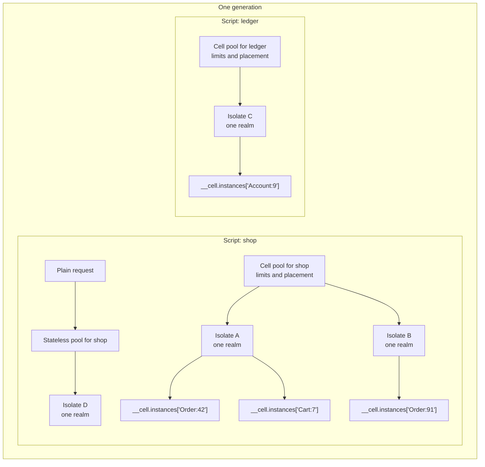
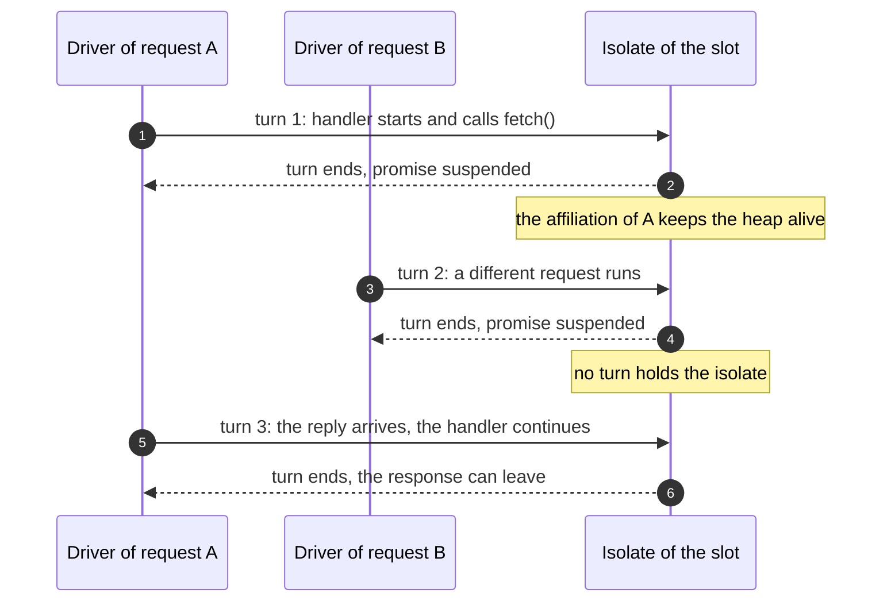
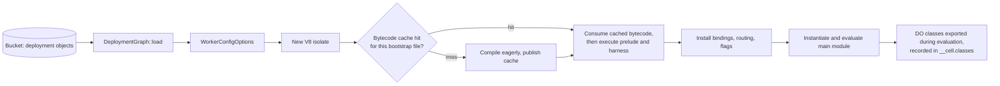
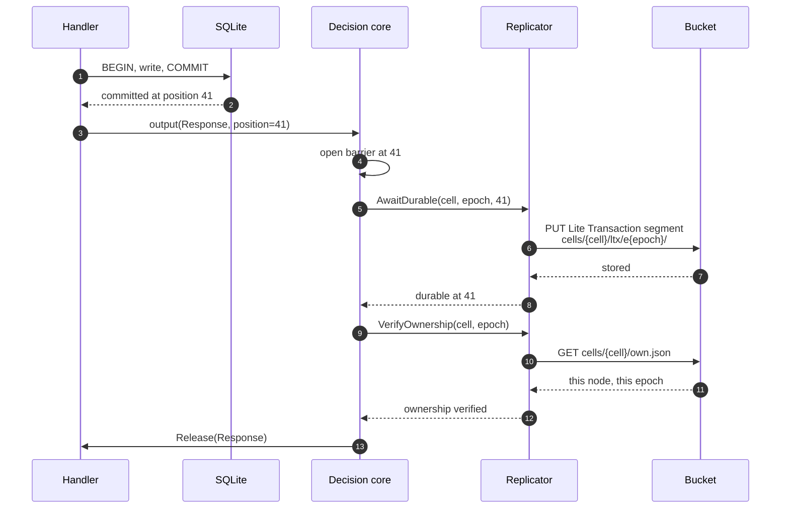

[The system architecture](02-system-architecture.md) shows the runtime manager
as one box in the process. This document opens that box. It explains what an
isolate is, what one turn does, who decides where a cell runs, how a cell
becomes a JavaScript object, how memory is bounded, and how the output gate
works. The output gate is the mechanism that holds a response until a
durability proof covers every write that the response can reveal. It appears
in detail near the end of this document.

The runtime has one job. It must run application JavaScript. It must not let
JavaScript decide anything about durability, ownership, or placement. The
decision core is the pure Rust crate that makes those decisions. It performs
no input or output. The shell performs the decisions.

Three Rust crates make up the system. The names in the source and the names of
the directories are not the same, so this document states the mapping once.
The decision core is the `celld-logic` crate, in the `crates/logic` directory,
and Rust code imports it as `celld_logic::`. The shell is the `celld` crate, in
`crates/celld`. The replication library is the `celld-ltx` crate, in
`crates/ltx`. A source reference in this document gives the full path from the
repository root, such as `crates/logic/isolate.rs`, which is a file in the
decision core.

The runtime manager is the part of the shell that follows the decision core.
It owns V8, the isolate pools, the timers, and the storage handles. In the
repository it is not one file: `crates/celld/runtime.rs`, `crates/celld/pool.rs`,
and `crates/celld/js.rs` divide the work. This document names the file each
mechanism lives in as it goes.

## The words this document uses

| Word | Meaning in celld |
|------|-------------------|
| Worker | One deployed JavaScript program. It has a name, a source, bindings, and compatibility flags. |
| Script | One JavaScript module graph that the runtime loads. A deployment has one primary script and zero or more service scripts. |
| Durable Object (DO) | The application class that keeps state between events. A Durable Object is identified by a class name and an identifier. Platform prose also uses "Durable Object" for one instance of the class. This document says "cell" when it means the instance. |
| Cell | One live Durable Object instance, named `<Class>:<identifier>`. The cell is the unit of ownership, storage, and durability. |
| Cell scope | The string that names one cell, in the form `<Class>:<identifier>`. Every table that holds cell state uses this string as its key. |
| Epoch | A counter that numbers each ownership tenure of a cell. A tenure is one node's holding of a cell. A new owner starts a new epoch, with a new storage prefix and a fresh copy of state. |
| Generation | One deployment: one primary script, its service scripts, their modules, bindings, compatibility flags, and isolate pools. |
| Isolate | One V8 engine instance. V8 is the JavaScript engine that celld embeds. An isolate owns one JavaScript heap. |
| Realm | One JavaScript global environment. A realm holds the module scope, the global object, and the `fetch` entry. |
| Heap | The JavaScript memory of one isolate. |
| Pool | A set of isolates that share one placement policy and one set of limits. |
| Slot | One position in a pool that holds one isolate. The pool-local index names that position. A process-wide heap identity names the heap in the retirement records, so a reused position still has a unique identity. |
| Placement | The decision that selects an isolate and a slot for a cell. |
| Turn | One synchronous entry into an isolate. |
| Lane | One queue of turn requests. A lane is either the stateless lane or the lane of one cell. The lane gives the turn permission to run. |
| Binding | A value that the runtime injects into the `env` object of a Worker, such as an object bucket, a database, a queue, or another Worker. |
| Host operation | A Rust function that the runtime exposes to JavaScript as a function parameter. The harness calls it by a fixed name, such as `__storage_get`. |
| Effect | One instruction from the decision core to the shell. Examples are "run this turn", "wait for this durability proof", and "release this cell". |
| Compatibility flag | A named switch that changes JavaScript behaviour to match a dated platform behaviour, not only a feature that is on or off. |
| Event | One delivered call into a cell: a Hypertext Transfer Protocol (HTTP) request, a scheduled alarm event, a WebSocket message (WebSocket is a long-lived two-way connection), a Remote Procedure Call (RPC), or a nested Worker call. |
| Alarm | One durable deadline that belongs to a cell. When the deadline passes, the cell receives an `alarm` event. |
| Facet | A child Durable Object that runs inside the cell that created it, which is its root cell. A facet has its own SQLite database and no ownership record of its own. |
| Ownership | The decision core's record that this node serves a cell at an epoch. |
| Harness | The JavaScript code that builds the Durable Object object model on top of host operations. It is a concatenation of `harness.js` and the service files that it includes. |
| Prelude | The JavaScript files that install Web Platform Application Programming Interfaces (APIs) before the harness runs. |
| Bytecode | The compiled form of a script that V8 can execute without parsing the source again. |
| Actor | The serial task in the shell that applies the effects the decision core emits, in order. |
| JavaScript actor | The per-scope abort record that the harness keeps in `__brokenActors`. It is not the shell actor. |
| Stub | A JavaScript handle that sends calls to a cell. |
| Driver | The loop that runs the turns of one event and waits for the next wake reason, which is the value that tells it why the wait ended. |
| Ticket | The unit of permission that the output gate gives to one output, or to one piece of a streamed output. |
| Barrier | A per-cell record that holds a position. A durability proof must reach that position before the gate can release the barrier's tickets. |
| Proof | Evidence that a set of writes survives a failure. |
| Affiliation | One admitted stateless request's claim on a pool slot and its heap. It raises the slot's request count until it drops. A cell takes a `Residency` instead. |
| Pin | To keep a request attached to one isolate until its promise settles. |
| Input gate | The per-cell order that admits one event at a time. It can be held across an `await`, because a critical section (a block that must not interleave with another event) stays closed while its callback waits. |
| Output gate | The per-cell rule that holds every output that can reveal cell state until the writes it can reveal are proven durable. |
| Sans-IO | Modelled as pure logic, without input or output. A sans-IO module returns decisions, and its caller performs them. |
| Workerd | The Cloudflare runtime that celld copies behaviour from. A comment that cites Workerd names the behaviour that celld matches. |
| Core | The decision core, the `celld-logic` crate. It is pure Rust. It performs no input or output. |
| Shell | The effect adapter, the `celld` crate. It owns V8, Tokio (the asynchronous Rust runtime), sockets, timers, and storage. |
| Replicator | The shell component that sends Lite Transaction (LTX) segments to followers and to the bucket. A follower is a peer node that stores another node's segments on local disk. |

The most important correction to the common mental model is this one. **One
isolate has one realm, not one realm per cell.** The realm is created once,
when the isolate is built. Every cell of that script uses it. Cells are
separated by a table in the harness, keyed by the cell scope.

```rust
// crates/celld/js.rs:2194-2213 (abridged)
pub struct WorkerIsolate {
    isolate: v8::SharedIsolate,
    runtime_state: Arc<ActorRuntimeState>,
    /// The one realm this isolate has: its context, and the entry `fetch`
    /// that lives in it.
    ///
    /// It was a `HashMap` keyed by cell, on the premise that a cell needs a
    /// realm of its own. It does not, and nothing ever put a second one in.
    /// The harness already keys instances by scope (`__cell.instances`), and
    /// Durable Objects **share** a context per script rather than getting one
    /// each — a context per cell would also duplicate the compiled module per
    /// cell, which is most of what sharing an isolate saves.
    realm: Realm,
    original_heap_limit: usize,
    compat: Compat,
```

Three fields in that struct need a word each. `v8::SharedIsolate` is the V8
isolate handle that several turns can enter in sequence without moving the
engine. `runtime_state` is the per-isolate state that the Rust host operations
read during a turn, such as the pending puts of each cell. `compat` holds the
compatibility flags of the deployment. The comment says that the realm field
"was a `HashMap` keyed by cell". The removed map was a map of realms: the first
design gave every cell a realm of its own, and nothing ever put a second realm
in that map.

A realm is exactly two handles in the runtime.

```rust
// crates/celld/js.rs:2232-2235
struct Realm {
    context: v8::Global<v8::Context>,
    fetch: v8::Global<v8::Function>,
}
```

A handle is a V8 reference that stays valid between turns. A `Local` handle is
valid only while one V8 scope is active. A `Global` handle is pinned, so the
context and the `fetch` function stay alive after the turn that created them
returns. Each turn converts the two globals back into locals with
`v8::Local::new`. That conversion is legal only while the isolate is locked.
The pool takes the isolate lock for the whole turn. Each `Worker` method that
touches JavaScript enters the realm with `v8::ContextScope` while that lock is
held. The lock and the realm therefore travel together: the lock is held for
the whole synchronous turn, and the realm is entered inside it.

## The shape



The labels map to the types as follows. `Isolate A` to `Isolate D` are
`WorkerIsolate` values inside a `Slot`. `Cell pool for shop` and
`Cell pool for ledger` are `Pool` values, and each pool is keyed by its script
name. The
`__cell.instances[...]` boxes are entries in one JavaScript table, not
separate realms.

Three rules follow from the diagram.

1. A pool belongs to one script. Cells of different scripts never share an
   isolate. Cells of one script share a pool.
2. A pool holds isolates, not cells. An isolate holds one realm and a table
   of cell instances. Up to 32 cells can live in one isolate
   (`MAX_CELLS_PER_ISOLATE` in `crates/celld/runtime.rs:456`).
3. A stateless request does not own an isolate or a realm. It holds a claim
   on the isolate that ran its first turn. That claim keeps its suspended
   promise alive. The diagram shows the stateless pool of the `shop` script
   for this rule.

The `Generation` struct records the pools.

```rust
// crates/celld/generation.rs:281-293 (abridged)
pub struct Generation {
    pub(crate) id: GenerationId,
    pub(crate) version: String,
    pub(crate) prefix: String,
    pub(crate) script_name: String,
    pub(crate) stateless: crate::runtime::StatelessRuntime,
    pub(crate) services: HashMap<String, crate::runtime::StatelessRuntime>,
    pub(crate) cell_configs: HashMap<String, Arc<WorkerConfig>>,
    pub(crate) cell_isolates: HashMap<String, Arc<crate::pool::Pool>>,
    pub(crate) default_do_class: Option<Arc<str>>,
    pub(crate) assets: HashMap<String, AssetResolver>,
    pub(crate) containers: Vec<container::ContainerSpec>,
    pub(crate) fence_image: Option<String>,
}
```

The fields divide the runtime into groups. `id` names this generation inside
the process. `version` is the deployment version string, and `prefix` is the
bucket prefix of the deployment. `script_name` is the primary script, which is
the script of the Worker entrypoint. `stateless` is the pool that runs that
script: the entrypoint and every plain request. `services` holds one such pool
for each script reached through a service binding. `cell_configs` holds one
configuration for each Durable Object class. `cell_isolates` holds one cell
pool for each script name. `default_do_class` names the class that the runtime
uses when a cell scope has no class prefix. `assets` resolves static files,
`containers` lists container specifications, and `fence_image` names the
`celld-fence` container image that a node runs to stop a previous owner's
container. The last field is described in [The services](07-the-services.md).

The cell pools are built from `cell_configs`, which has one entry per class.
The `collect` call keeps one pool for each script name, so several classes of
one script collapse to one pool. A dropped pool is not wasted work: `cell_pool`
only builds empty structures, and a pool holds no isolate until the first
turn.

```rust
// crates/celld/generation.rs:605-614
let stateless = service_pools[&primary_script].clone();
let cell_isolates: HashMap<String, Arc<crate::pool::Pool>> = cell_configs
    .values()
    .map(|config| {
        (
            config.script_name.clone(),
            crate::runtime::cell_pool(config.clone()),
        )
    })
    .collect();
```

`primary_script` and `service_pools` come from the loop above this snippet:
the first script of the deployment is the primary script, and `service_pools`
holds the stateless pool that each script built.

The field comment above `cell_isolates` says that it is "the same `Pool` the
stateless path admits into". The constructor shown here does not do that. It
calls `cell_pool`, and `cell_pool` builds a new `Pool`. The two pools load the
same script with the same configuration, and they use the same numeric limits,
because both call `pool_limits()`. They do not share slots, counters, or
queues. This document follows the constructor, because the constructor is the
code that runs.

The separate pool is deliberate, not an oversight. A cell pool never admits a
plain request, so its `max_requests` and `max_stateless` limits are never
consulted: cell growth passes `None` for the cap. A cell pool also starts
empty, has no warm call, and uses `reap_empty` after an eviction instead of the
paced 30-second reap. Both mechanisms appear under
[Retirement and freeing](#retirement-and-freeing). The stateless pool keeps a
warm isolate and retires at most one isolate per pass. One pool cannot do both
jobs.

## A turn, not a thread

An isolate is not a thread. The JavaScript (JS) that it runs is not bound to
one. The runtime has one multi-threaded Tokio runtime, the asynchronous Rust
runtime. That runtime owns every socket and every timer. Any Tokio worker can
enter any isolate.

```rust
// crates/logic/isolate.rs:1-8
//! The isolate pool, reified sans-IO.
//!
//! celld runs JS on a set of isolates that grow and shrink with demand. An
//! isolate is not bound to a thread: `v8::Locker` installs the entering
//! thread's per-isolate state, so any worker can take an isolate and run a
//! turn in it. What an isolate *is* bound to is the JS state it holds, and
//! that is what every decision here is about.
```

"Sans-IO" means that the module models the decisions without input or output.
It returns a decision, and its caller performs the input or output. The
`v8::Locker` is V8's per-isolate lock. It installs the entering thread's
per-isolate state, so a thread that holds the lock can use the isolate's
handles.

A turn is one synchronous entry into the isolate. The entry function takes a
closure that is synchronous by type. This makes it impossible to hold the
isolate across an `await`.

```rust
// crates/celld/pool.rs:228-236
    /// Enter the isolate for one turn and run `f` inside it.
    ///
    /// Only the gate is awaited; `f` is synchronous by type, so holding the
    /// isolate across an await is unwritable rather than a rule a comment
    /// asks callers to remember.
    pub async fn turn<T>(&self, f: impl FnOnce(&mut js::Worker) -> T) -> T {
        self.turn_in(TurnLane::Stateless, f).await
    }
```

A cell turn uses a different lane. The lane name is the cell scope. In the
comment above, "the gate" is the lane permit and the isolate mutex. The
closure `f` is synchronous by its type, so no caller can hold the isolate
across an `await`.

```rust
// crates/celld/pool.rs:238-243
    /// Enter one cell turn through a round-robin lane for that cell. A hot
    /// cell can retain its next place, but it cannot take the next place from
    /// another cell that already waits on the same isolate.
    pub async fn turn_cell<T>(&self, scope: &str, f: impl FnOnce(&mut js::Worker) -> T) -> T {
        self.turn_in(TurnLane::Cell(scope.to_string()), f).await
    }
```

The scheduler has one lane for stateless work and one lane for each cell.
That is N+1 lanes for N cells on one isolate, where N is the number of cells
that currently hold state in the isolate. The scheduler belongs to one slot,
so each isolate has its own ready queue. It runs a fair round robin between
lanes that have waiters.

"Fair" has a precise meaning here. A lane is a queue of waiters, not a single
requester. A hot cell is a cell that keeps issuing turns. When a turn ends,
`release` puts the lane back at the end of the ready queue if the lane still
has waiters. It then wakes exactly one waiter from the lane at the front. A
hot cell therefore keeps its queue of waiters, but it cannot jump ahead of a
lane that already waits. The lane that was just served goes to the back, so
its next turn starts only when every earlier lane has had one turn.

Cancellation needs no special path. A cancelled waiter drops its receiver,
which closes the sender that the scheduler holds for it. `release` reads that
closed sender and skips it. If the lane still has waiters, `release` puts the
lane back in the ready queue and tries the next lane. The skipped sender never
consumes a turn: no waiter woke, so the scheduler must grant the turn again.

```rust
// crates/celld/pool.rs:65-68
enum TurnLane {
    Stateless,
    Cell(String),
}
```

```rust
// crates/celld/pool.rs:87-110 (abridged)
impl TurnScheduler {
    async fn acquire(&self, lane: TurnLane) -> TurnPermit<'_> {
        let receive = {
            let mut schedule = self.schedule.lock().expect("turn scheduler poisoned");
            if schedule.current.is_none() {
                schedule.current = Some(lane);
                None
            } else {
                let (send, receive) = tokio::sync::oneshot::channel();
                if !schedule.waiting.contains_key(&lane) && schedule.current.as_ref() != Some(&lane)
                {
                    schedule.ready.push_back(lane.clone());
                }
                schedule.waiting.entry(lane).or_default().push_back(send);
                Some(receive)
            }
        };
        if let Some(receive) = receive {
            // Cancellation leaves a closed sender in this lane. `release`
            // skips it, so a dropped waiter cannot strand the active token.
            let _ = receive.await;
        }
        TurnPermit(self)
    }
```

The release is the other half of the fairness rule.

```rust
// crates/celld/pool.rs:112-145 (abridged)
fn release(&self) {
    let mut schedule = self.schedule.lock().expect("turn scheduler poisoned");
    let current = schedule.current.take().expect("a released turn has a lane");
    if schedule
        .waiting
        .get(&current)
        .is_some_and(|waiters| !waiters.is_empty())
    {
        schedule.ready.push_back(current);
    }
    while let Some(lane) = schedule.ready.pop_front() {
        let (send, keep_lane) = {
            let waiters = schedule.waiting.get_mut(&lane).expect("a ready lane waits");
            (waiters.pop_front().unwrap(), !waiters.is_empty())
        };
        if !keep_lane {
            schedule.waiting.remove(&lane);
        }
        if send.send(()).is_ok() {
            schedule.current = Some(lane);
            return;
        }
        // A cancelled waiter left a closed sender. Skip it and keep the lane.
        if keep_lane {
            schedule.ready.push_back(lane);
        }
    }
}
```

The permit is the token that proves that a lane was granted. It is not `Copy`,
and it releases the lane when it drops.

```rust
// crates/celld/pool.rs:85, 147-151
struct TurnPermit<'a>(&'a TurnScheduler);

impl Drop for TurnPermit<'_> {
    fn drop(&mut self) {
        self.0.release();
    }
}
```

The invariant in `release` is `expect("a released turn has a lane")`. A permit
exists only after `acquire` made its lane current, and only the holder of the
permit can call `release`, so the expectation holds.

The turn also holds the isolate's asynchronous lock. The lane permit decides
the order of turns on the normal path, so the mutex is free when a turn takes
it. The mutex is not redundant. `free_retired` uses a `try_lock` on the same
mutex to prove that no turn holds the isolate before it drops the heap, and
the mutex is what makes the V8 `Locker` beneath it uncontended: a thread holds
the mutex before it takes the V8 lock.

```rust
// crates/celld/pool.rs:245-268 (abridged)
    async fn turn_in<T>(&self, lane: TurnLane, f: impl FnOnce(&mut js::Worker) -> T) -> T {
        struct Counted<'a>(&'a Slot);
        impl Drop for Counted<'_> {
            fn drop(&mut self) {
                self.0.turns.fetch_sub(1, Ordering::Relaxed);
            }
        }
        self.turns.fetch_add(1, Ordering::Relaxed);
        let _turn = Counted(self);
        let _scheduled = self.turn_scheduler.acquire(lane.clone()).await;
        let mut worker = self.worker.lock().await;
        let worker = match worker.as_mut() {
            Some(worker) => worker,
            None => panic!("entered isolate {} after it was freed", self.id),
        };
        let previous = CURRENT_SLOT.replace(Some(self.me.clone()));
        let result = f(worker);
        CURRENT_SLOT.set(previous);
        result
    }
```

A slot has three identities. `id` is the index inside its own pool. Two pools
can use the same number. `heap_id` is the process-wide identity that the node
Actor and pressure policy report. `me` is a weak reference from the slot to
itself.

`CURRENT_SLOT` is a thread-local weak reference. A thread-local is storage
private to one operating-system thread. A weak reference does not keep its
target alive. The slot builds `me` with `Arc::new_cyclic`, because a slot
cannot hold a strong reference to itself without never being freed. During a
turn, `CURRENT_SLOT` holds the running slot. A host operation inside the turn
can therefore find the slot that owns the isolate and upgrade the weak
reference to a strong one. This is how a facet, or a nested call, reaches the
heap that is running it. The code saves the previous value and puts it back.
If a turn in another slot starts on the same thread, the inner turn restores
the outer slot before it returns.

The restore runs only on normal return. A panic skips it. The build sets
`panic = "abort"` (`Cargo.toml:13`), so a panic ends the process and no later
turn reads the stale value.

Between turns, a request holds no isolate. It holds only its affiliation,
which is a memory claim and not a processor claim. A memory claim keeps the
heap alive and counts as one request on the slot. It does not reserve a number
of bytes and it does not reserve a turn. A processor claim reserves the right
to run. The affiliation gives the first. The turn lane gives the second, for
one turn at a time. A handler that waits for a network reply stops nothing
else in the isolate.



The arrow "turn ends, promise suspended" means two things. The isolate lock is
free again, so another turn can run. The heap stays alive because request A
still holds its affiliation. This interleaving is the reason the design uses
turns. It gives one heap to many requests without one blocked handler blocking
the heap. It also means the JavaScript concurrency model is cooperative, as it
is in other Worker platforms.

## Three quantities and two claims

The pool reports four fields for each isolate. Three are quantities. The
fourth is a state flag. Each one drives a different decision.

```rust
// crates/logic/isolate.rs:53-74 (abridged)
/// What the shell observes about one isolate.
pub struct IsolateLoad {
    /// Turns in flight: waiting for this isolate plus the one running in it.
    /// Released across an await, so this is CPU demand rather than total
    /// outstanding work.
    pub turns: usize,
    /// Requests whose JS state lives here, running or awaiting. Each one
    /// pins a promise and its closures in this isolate's heap.
    pub requests: usize,
    /// Cells hosted here: realms this isolate holds, one per cell.
    ///
    /// The third quantity, and unlike the other two it does not come back on
    /// its own. A request ends; a cell stays until it is evicted or handed
    /// to another node.
    pub cells: usize,
    /// The shell has stopped affiliating new work and is draining this
    /// isolate.
    pub retiring: bool,
}
```

The `cells` comment reads "realms this isolate holds, one per cell". That
wording is loose, and it contradicts the realm rule above. The runtime holds
one realm for the isolate, not one for each cell. The field counts cells that
hold state in this isolate. Each such cell costs one entry in the instance
table and one open database in SQLite, the embedded database engine that
accepts Structured Query Language (SQL) statements. A cell stays until it is
evicted or handed to another node. The field does not count JavaScript
contexts, because there is only one context.

`turns` also needs a precise reading. The counter goes up before the turn
waits on its lane, so it counts the turn that runs and the turns that queue
for the isolate. The pool uses it as a measure of central processing unit
(CPU) demand. A handler that waits for a network reply has already given its
turn back, so its wait does not raise `turns`. The number of unfinished
requests can therefore be larger than `turns`. `requests` counts that larger
set: every request whose JavaScript state must stay in the heap, running or
waiting, because each such request pins a promise and its closures.

A stateless request takes an `Affiliation`. It lasts for the life of the
request. The affiliation is what admission counts, and what keeps the heap
alive while a promise is suspended in it.

A cell takes a `Residency`. It lasts until the cell is evicted or moves to
another node. The two types exist because the two claims have different
lifetimes. A request that finishes gives its memory back. A cell does not give
its memory back until something removes it.

```rust
// crates/celld/pool.rs:458-483
/// A request's claim on the isolate that ran its first turn.
pub struct Affiliation(Arc<Slot>);

impl Drop for Affiliation {
    fn drop(&mut self) {
        self.0.requests.fetch_sub(1, Ordering::Relaxed);
        // Exactly one admission waiter per freed slot: `notify_one` hands
        // the capacity to a single parked request, where waking them all
        // would stampede `admit` on every release.
        self.0.freed.notify_one();
        // The last request out of a retiring isolate is what lets it free.
        // Freeing here would drop a V8 isolate inside whatever turn dropped
        // this affiliation, so the pool's maintenance task does it.
        if self.0.is_retiring() {
            if let Some(reclaim) = &self.0.reclaim {
                reclaim.notify_one();
            }
        }
    }
}
```

The drop is the whole of the release. It decrements the count, wakes one
admission waiter, and rings the reclaim bell when the isolate is retiring. It
does not free the heap, because a drop can run inside another turn.

`self.0.freed` is the pool's admission bell. The pool clones it into every
slot, so a drop can ring it without a reference to the pool. It is the same
`Notify` that `admit_or_wait` waits on. The comment "exactly one admission
waiter per freed slot" means one waiter per freed request capacity: one
request left the slot's `requests` count, so one parked admission may take its
place. Waking all waiters would make every one of them read the same free
capacity and race for it.

The slot keeps two cell counters. The residency keeps one bit that says
whether it reached adoption. `cells` goes up when the pool reserves the slot,
before any storage is open. `adopted_cells` goes up when the cell's storage
opens successfully. Consider two reservations, X and Y. X reserves first and Y
reserves second, but Y opens its database first. With one counter that only
adoption raises, Y's drop would make the count reach zero while X still holds
its reservation and has not yet adopted. With two counters, `adopted_cells`
reaches zero only after both adoptions finish, so the
heap collection boundary waits for the slower reservation. `max_cells` is the
per-isolate cell cap that the pool passed at reservation. Adoption uses it for
its boundary check and calls `settle_heap` when the adopted count reaches the
cap. The drop does not read it. The drop of a residency uses its bit to decide
whether it must decrement `adopted_cells`; it always decrements `cells`.

```rust
// crates/celld/pool.rs:485-537 (abridged)
/// A cell's claim on the isolate that holds its realm.
///
/// The counterpart of [`Affiliation`], and the difference between them is
/// the whole reason both exist: an affiliation lasts one request, a
/// residency lasts until the cell is evicted or moves node.
pub struct Residency {
    slot: Arc<Slot>,
    max_cells: usize,
    adopted: bool,
}

impl Drop for Residency {
    fn drop(&mut self) {
        if self.adopted {
            self.slot.adopted_cells.fetch_sub(1, Ordering::Relaxed);
        }
        self.slot.cells.fetch_sub(1, Ordering::Relaxed);
    }
}
```

Adoption runs one turn. The steps are ordered, and the code shows where each
step happens.

```rust
// crates/celld/pool.rs:505-525 (abridged)
pub(crate) async fn adopt(
    mut self,
    cell: &str,
    storage: js::CellStorage<'_>,
) -> Result<(Self, celld_logic::wake::AlarmSnapshot)> {
    anyhow::ensure!(!self.adopted, "cell residency already adopted");
    let slot = self.slot.clone();
    let alarm = slot
        .turn(|worker| -> Result<celld_logic::wake::AlarmSnapshot> {
            let alarm = worker.own_cell(cell, Some(storage))?;
            // There is no await between adoption and accounting. Cancellation
            // before this turn drops only the reservation; afterward, the
            // residency owns both counters, including on an error unwind.
            self.adopted = true;
            let adopted = slot.adopted_cells.fetch_add(1, Ordering::Relaxed) + 1;
            debug_assert!(adopted <= self.max_cells);
            if adopted == self.max_cells {
                worker.settle_heap();
            }
            Ok(alarm)
        })
        .await?;
    Ok((self, alarm))
}
```

The numbered steps follow. `house` is the `Residency` constructor on the
slot: it raises `cells`, takes the per-isolate cell cap, and returns a
reservation with `adopted = false`.

1. `house` increments `cells` before this call and returns a residency with
   `adopted = false`.
2. The turn runs `worker.own_cell`. That call opens the cell's SQLite database
   and clears everything the isolate still holds for an earlier residency of
   the same scope. It does not build the JavaScript instance; that happens
   lazily on the first event.
3. The same turn sets `adopted = true` and increments `adopted_cells`. No
   `await` separates step 2 from step 3, so no cancellation can land between
   them.
4. When `adopted_cells` reaches `max_cells`, the turn calls `settle_heap`, which
   runs a heap collection.
5. If the future is dropped before the turn runs, the drop sees
   `adopted = false` and decrements only `cells`. If `own_cell` returns an
   error, the `?` leaves before `adopted = true` is set, so the same drop path
   runs.

## Who decides placement

Six names carry this section. Two name decisions, three name core types, and
one names a shell type.

The decisions are:

- **Admission** — accept a stateless request, or refuse it.
- **Placement** — choose the isolate that runs the request or hosts the cell.

The types are:

- `PoolLoad` — the snapshot that every decision reads: the load of every
  isolate in **one pool**, plus one set of limits. A pool belongs to one
  script, so `PoolLoad` never spans two scripts. The node has one pool per
  script, and each pool admits and places on its own.
- `Placement` — either `Existing(id)` or `Grow`.
- `Refusal` — either `NodeFull`, which means the node-wide request ceiling is
  reached, or `NodePressured`, which means the node is shedding memory.
- `Residency` — the shell type that records the claim that one isolate holds
  one cell.

Two shell types wrap those core types. `AdmitError` is either
`Refused(Refusal)` or `Build(error)`, where `Build` carries an isolate that
could not be constructed at all. `Residency` is the value that `house`
returns: a slot, the per-isolate cell ceiling, and an `adopted` flag that
turns true after the guest takes the cell.

Admission and placement are one decision. The runtime cannot admit a request
and then find no place for it, because one function answers both questions
against one snapshot. A build failure is a different outcome. `Build` means
that the isolate could not be constructed at all, so no affiliation was handed
out and the request is refused before it runs.

```rust
// crates/logic/isolate.rs:182-203
pub fn admit(load: &PoolLoad, shedding: bool) -> Result<Placement, Refusal> {
    if let Some(max) = load.limits.max_requests {
        let held: usize = load.isolates.iter().map(|l| l.requests).sum();
        if held >= max {
            return Err(if shedding {
                Refusal::NodePressured
            } else {
                Refusal::NodeFull
            });
        }
    }
    Ok(if shedding {
        place_without_growing(load)
    } else {
        place(load)
    })
}
```

The `shedding` argument separates the two refusals. It is true when the node
is over a memory ceiling. In that state a full pool answers `NodePressured`
instead of `NodeFull`, and placement uses `place_without_growing`. The node
gives resources back; it does not take more work.

A stateless request goes to the isolate with the fewest turns in flight. The
pool grows when that isolate already has two turns in flight or more, and the
pool is below its live-isolate ceiling. `CELLD_MAX_STATELESS_ISOLATES` sets
that ceiling. The default is the number of processor cores that the process
may use (`std::thread::available_parallelism`), and the value is four when the
system refuses to answer.

`grow_at = 2` is a constant in `crates/celld/runtime.rs`, not an environment
setting. The same block holds `shrink_under = 1` and
`MAX_CELLS_PER_ISOLATE = 32`. The comment in the source says why: the two turn
thresholds form one hysteresis policy, and two independent settings would let
an operator break it.

```rust
// crates/logic/isolate.rs:229-247 (abridged)
pub fn place(load: &PoolLoad) -> Placement {
    match load.live().min_by_key(|(_, l)| l.turns) {
        // No isolate, or every one of them is draining.
        None => Placement::Grow,
        Some((id, l)) => {
            if l.turns >= load.limits.grow_at && load.live_count() < load.limits.max_stateless {
                Placement::Grow
            } else {
                // At the ceiling the pool queues. Refusing work is
                // admission's job: see `worker::may_admit`.
                Placement::Existing(id)
            }
        }
    }
}
```

The comment names `worker::may_admit`. No such function exists in the tree, so
read the sentence as intent rather than as a reference. The refusal belongs to
`isolate::admit`, and the queuing path is `Pool::admit_or_wait`, described
below.

Do not confuse that queue with the turn lane. The turn lane queues *turns* on
an isolate that already accepted a request. `admit_or_wait` queues *requests*
before any isolate accepts them. The first bound is the isolate's fairness; the
second bound is the node's memory.

Under memory pressure, the pool stops growing while an isolate exists to use.
The one case that still grows is a pool with no live isolate. The `None` arm
must grow there, because no isolate exists to run the request; the rule is
"do not build another heap", not "refuse to serve". This matches the selector
comment: it "will not build an isolate while one exists to use".

```rust
// crates/logic/isolate.rs:206-216
/// [`place`], except that it will not build an isolate while one exists to
/// use. The node is over a memory ceiling; another heap is the last thing it
/// needs.
fn place_without_growing(load: &PoolLoad) -> Placement {
    match load.live().min_by_key(|(_, l)| l.turns) {
        Some((id, _)) => Placement::Existing(id),
        None => Placement::Grow,
    }
}
```

A cell goes to the fullest isolate that still has room. This packing rule
looks backwards. The reason is eviction. A heap comes back only when an
isolate has no cell left to hold. If placement spread new cells onto the
emptiest isolate, eviction would empty one heap and placement would refill it.
The heap would never reach zero cells, and retirement would never free it.
Packing keeps the number of partly filled heaps small, so each heap that
retirement chooses is likely to empty.

The tie-break `(l.cells, Reverse(id))` puts a new cell on the isolate with the
smaller slot index when the cell counts are equal. `Reverse` inverts the
comparison of the identifier, so the largest key belongs to the smallest
index. A grown slot is appended to the pool vector, so a smaller index
normally means an older isolate. A reused index is the exception, because
`grow` reuses the position of a freed slot. The tie-break only decides where
a new cell goes, so an approximate age is enough.

A worked example makes the direction clear. Isolates A (`id = 0`),
B (`id = 1`), and C (`id = 2`) hold 31, 32, and 31 cells, with
`max_cells = 32`. The filter removes B. The remaining keys are
`(31, Reverse(0))` and `(31, Reverse(2))`. `max_by_key` compares
`Reverse(0)` with `Reverse(2)`; the
inverted order makes `Reverse(0)` the larger key. The new cell therefore goes
to A, the oldest isolate with room.

```rust
// crates/logic/isolate.rs:264-296 (abridged)
/// There is no separate cell-isolate ceiling. The node-wide resident and RSS
/// limits decide whether this node can host another cell. Once ownership has
/// admitted the cell, placement always provides enough isolates to preserve
/// the per-isolate limit.
pub fn place_cell(load: &PoolLoad) -> Placement {
    match load
        .live()
        .filter(|(_, l)| l.cells < load.limits.max_cells)
        .max_by_key(|(id, l)| (l.cells, std::cmp::Reverse(*id)))
    {
        // No isolate, or every one of them is draining.
        None => Placement::Grow,
        Some((id, _)) => Placement::Existing(id),
    }
}
```

The pool wraps these decisions. Stateless growth is capped at
`max_stateless`, and the cap is checked again under `slots.write()`. The second
check is necessary because admission reads a snapshot that it does not hold.
Every request that saw the same pre-growth snapshot would otherwise decide to
grow. Under load, a cap of two produced sixteen isolates, and the breach grew
with offered concurrency. The re-check makes a late grow return an existing
slot instead, and the worker that this call built is dropped on return. The
isolate is built before the lock is taken, because loading a script runs
JavaScript and can take milliseconds. Holding the pool lock across that work
would stall every other placement on the node.

`resolve` is the small gear between a decision and a slot. For
`Placement::Existing(id)` it returns the slot. For `Placement::Grow` it calls
`grow(cap)`. In `admit_locked`, the `?` after `admit` converts a `Refusal` into
an `AdmitError` through `impl From<Refusal> for AdmitError`. The `.map_err`
after `resolve` converts a failed build into `AdmitError::Build`.

Cell growth passes no cap, because ownership has already agreed that this
node serves the cell and node memory is bounded before placement. `house`
cannot fail, so `place_cell` returns a residency for every successful
`resolve`. A cell start can still fail earlier, in `resolve`, if the isolate
cannot be built.

```rust
// crates/celld/pool.rs:688-693
    fn admit_locked(&self, shedding: bool) -> Result<Affiliation, AdmitError> {
        let placement = celld_logic::isolate::admit(&self.load(), shedding)?;
        self.resolve(placement, Some(self.limits.max_stateless))
            .map(|slot| slot.affiliate())
            .map_err(AdmitError::Build)
    }
```

```rust
// crates/celld/pool.rs:730-744 (abridged)
    pub fn place_cell(&self) -> Result<Residency> {
        let _maintenance = self.maintenance.write().expect("pool poisoned");
        let placement = celld_logic::isolate::place_cell(&self.load());
        // Cell isolates have no arbitrary total cap. The resident-cell and
        // RSS limits bound node memory before placement. The lock keeps this
        // reservation exact and prevents maintenance from retiring the slot.
        Ok(self.resolve(placement, None)?.house(self.limits.max_cells))
    }
```

The middle gear between "admit" and "refuse" is a bounded wait.

```rust
// crates/celld/pool.rs:695-735 (abridged)
    /// [`admit`](Self::admit), except a request that finds the node full
    /// waits — bounded — for a slot instead of being refused at once.
    ///
    /// The wait is the middle gear between "admit" and "refuse". At
    /// overload the parse-and-503 path costs about half a served request,
    /// so a node refusing 200k times a second spends its cores saying no.
    /// A parked waiter costs nothing until an `Affiliation` drop hands it
    /// the slot.
    pub async fn admit_or_wait(&self, shedding: bool) -> Result<Affiliation, AdmitError> {
        let deadline_ms =
            crate::asyncrt::mono_ms().saturating_add(self.admission_wait.as_millis() as u64);
        loop {
            let freed = self.freed.notified();
            match self.admit(shedding) {
                Err(AdmitError::Refused(Refusal::NodeFull)) => {
                    tokio::pin!(freed);
                    crate::asyncrt::select_biased! {
                        "a slot freed in the same instant as the deadline goes to the caller";
                        _ = &mut freed => {},
                        _ = crate::asyncrt::sleep_until(deadline_ms) => {
                            return Err(AdmitError::Refused(Refusal::NodeFull));
                        }
                    }
                }
                other => return other,
            }
        }
    }
```

Four details make the wait correct. First, only `NodeFull` parks. A
`NodePressured` refusal returns at once, because pressure means give resources
back, not hold callers. Second, the deadline is computed once, before the
loop, so a wake that loses the race for the freed slot cannot extend the
wait. Third, the notify future is armed before the admission check, so a slot
that frees between the failed check and the park cannot produce a lost wakeup.
A `Notified` future records its notification in itself when it is created, so
the wait that starts later still sees a notification that arrived in between.
Fourth, `select_biased!` prefers a freed slot when a slot and the deadline are
ready in the same instant, because a slot that freed exactly as the deadline
expired is a slot the caller can use.

`select_biased!` is a celld macro, not a Tokio macro. The runtime's own
`select!` is fair and rejects `biased;` at compile time. `select_biased!`
therefore requires a non-empty reason string as its first token, and it always
takes the first ready branch. The macro accepts only a string literal in that
position, so a caller cannot leave the reason out.

`mono_ms()` returns monotonic milliseconds since the execution domain
started. An execution domain is the asynchronous runtime instance that owns
the timers and tasks. The deadline is an absolute value in that clock, so it
does not move when the wall clock moves. `saturating_add` prevents a wrap at
the top of the `u64` range.

`CELLD_ADMISSION_WAIT_MS` sets the wait. The default is 1000 milliseconds.
Zero restores refuse-at-once behaviour. Without the wait, a node refusing
200,000 times a second spends its cores on parse and refusal. A parked waiter
costs nothing until an affiliation drop hands it a slot.

```rust
// crates/celld/engine_api.rs:862-877
/// How long a stateless request may wait for a free `max_requests` slot
/// before it is refused. Zero restores the old refuse-at-once behaviour.
/// The default is one second: long enough that a saturated node converts
/// its refusal storm into kernel-buffer queueing, short enough that a
/// caller learns the truth before it matters.
pub fn admission_wait() -> std::time::Duration {
    // Not `env_usize`, which filters zero out — zero is meaningful here.
    let ms = crate::env_vars::with_default("CELLD_ADMISSION_WAIT_MS", 1000u64)
        .expect("validated CELLD_ADMISSION_WAIT_MS");
    std::time::Duration::from_millis(ms)
}
```

The limits are one policy, not independent settings.

```rust
// crates/celld/runtime.rs:453-478
pub fn pool_limits() -> celld_logic::isolate::PoolLimits {
    const GROW_AT: usize = 2;
    const SHRINK_UNDER: usize = 1;
    const MAX_CELLS_PER_ISOLATE: usize = 32;
    let cores = std::thread::available_parallelism()
        .map(|n| n.get())
        .unwrap_or(4);
    celld_logic::isolate::PoolLimits {
        // These thresholds form one hysteresis policy, so they are constants
        // rather than two independently configurable values.
        grow_at: GROW_AT,
        shrink_under: SHRINK_UNDER,
        max_stateless: env_usize("CELLD_MAX_STATELESS_ISOLATES").unwrap_or(cores),
        max_requests: env_usize("CELLD_MAX_REQUESTS"),
        // This is an engine blast-radius policy. The resident-cell and RSS
        // limits are the operator controls for node memory.
        max_cells: MAX_CELLS_PER_ISOLATE,
    }
}
```

| Decision | Quantity balanced | Trigger | Can refuse |
|----------|-------------------|---------|------------|
| Stateless admission | `requests`, node-wide | `CELLD_MAX_REQUESTS` reached | Yes, 503 |
| Stateless waiting | `requests`, node-wide | a request leaves the pool, bounded by the admission wait | Yes, after the wait |
| Stateless placement | `turns` | least loaded isolate | No |
| Stateless growth | `turns` and live isolates | `grow_at` = 2 and below the ceiling | No |
| Cell placement | `cells` | fullest isolate below 32 | No |
| Cell growth | `cells` | every isolate at 32 | No |
| Retirement | `requests` | pool can absorb the turns | No |
| Heap free | `turns`, `requests`, `cells` | all zero and the isolate is retiring | No |

Two warnings follow from the table.

First, `max_stateless` is a cap on **live isolates in one stateless pool**, not
a cap on stateless requests and not a node-wide cap. The primary script and
each service-binding script have their own pool, so each has its own copy of
the cap. A cell host lives in a cell pool, not in a stateless pool, so it does
not count against this cap. Within a cell pool, the only growth cap is the
per-isolate cell limit of 32. A stateless request that arrives when the node-wide `requests` limit is
reached waits in `admit_or_wait` for a request to leave the pool. When every
isolate is above `grow_at` but the node is below its limits, the request
queues for the least loaded isolate instead; it does not grow the pool.

Second, cell placement has no total cap. The node-wide resident-cell limit and
the resident set size (RSS) memory limit decide whether a node can host
another cell. The resident set size is the amount of physical memory that the
process currently holds. Placement is called only after ownership has agreed
that this node serves the cell, so it always finds or builds a home, unless
the isolate build itself fails.

## Retirement and reclaiming heaps

The pool only grows unless something gives heaps back. Three paths give them
back. Ordinary retirement shrinks an idle stateless pool. Generation
retirement removes every heap of a superseded deployment. Condemnation removes
an isolate whose guest can no longer run. The first two are policies. The third
is a failure response.

The maintenance task is the thing that carries out ordinary retirement and
condemnation. `Worker::start` spawns one task for the pool. That task calls
`reap` every 30 seconds and also waits on the pool's reclaim bell. When the
bell rings, the task calls `free_drained` immediately instead of waiting for
the next 30-second tick. If an admission or a cell start holds the pool guard,
the task retries after 10 milliseconds; the constant `RECLAIM_RETRY` sets that
delay (`crates/celld/runtime.rs:45`). The task holds only a weak reference
to the pool, so it ends when the pool is dropped.

Ordinary retirement selects at most one isolate per pass. It never selects an
isolate that holds a cell.

```rust
// crates/logic/isolate.rs:311-351 (abridged)
/// **An isolate hosting a cell is never a candidate.** Retiring rests on the
/// victim emptying itself, and requests do that because they answer. A cell
/// does not: it stays until it is evicted or handed to another node, neither
/// of which retirement can cause. Choosing one would mark it retiring
/// forever — refused new work, never drained, never freed — which is a
/// smaller pool and a leak at the same time.
pub fn retire(load: &PoolLoad) -> Option<IsolateId> {
    let live = load.live().count();
    if live == 0 {
        return None;
    }

    let turns: usize = load.live().map(|(_, l)| l.turns).sum();
    let remaining = live - 1;
    if turns > remaining.saturating_mul(load.limits.shrink_under) {
        return None;
    }

    load.live()
        .filter(|(_, l)| l.cells == 0)
        .min_by_key(|(id, l)| (l.requests, std::cmp::Reverse(*id)))
        .map(|(id, _)| id)
}
```

The victim is the isolate with the fewest requests. When two isolates have
the same count, the newest isolate loses, so a pool that grew for a burst
gives back what the burst added. "Newest" here means the larger slot index,
which is normally the slot that `grow` appended last. A reused index can
break that order, but the choice is only a tie-break among isolates with equal
load.

A retirement is worth starting only when the remaining pool can absorb the
current turns. That is the hysteresis band. Growth starts at two turns in
flight. Retirement starts only when the remaining pool has one turn per
isolate or less on average, which the code writes as
`turns <= (live - 1) * shrink_under`. With `shrink_under` equal to one, the
band between growth and retirement prevents a pool from growing and shrinking
on the same load.

A heap is freed only when it is provably empty. No turn, no affiliation, and
no cell.

```rust
// crates/logic/isolate.rs:330-332
pub fn may_free(load: &IsolateLoad) -> bool {
    load.retiring && load.turns == 0 && load.requests == 0 && load.cells == 0
}
```

The `cells` term is not redundant. Ordinary retirement never selects a housed
isolate, but a generation-wide retirement marks every isolate, housed or not.
Freeing a housed isolate would drop every resident cell in it.

```rust
// crates/celld/pool.rs:806-822 (abridged)
    /// Retire every isolate, housed or not: the pool belongs to a superseded
    /// application generation and must take no new work. Stateless slots
    /// free as their affiliations drop; a slot hosting cells frees once the
    /// last of them has moved to a newer generation, which `may_free`
    /// enforces by refusing a housed isolate.
    pub fn retire_all(&self) {
        let _maintenance = self.maintenance.write().expect("pool poisoned");
        self.retired.store(true, Ordering::Relaxed);
        for slot in self.slots.read().expect("pool poisoned").iter() {
            if !slot.retiring.swap(true, Ordering::Relaxed) {
                tracing::info!(isolate = %slot.heap_id, slot = slot.id, "isolate retiring");
            }
        }
        self.free_retired();
    }
```

Two smaller functions carry that pass. `retire_one` asks `retire` for one
victim and marks it as retiring. `free_retired` then walks every slot, asks
`may_free`, and takes the worker only when `try_lock` succeeds. `try_lock` is
correct here rather than blocking: a held lock means a turn is running, so the
isolate is not drained and this pass has nothing to do. Taking the worker
drops it, and the drop frees the V8 heap. The slot stays in the vector with no
worker, and `grow` reuses that index.

Cell pools use a different maintenance pass. They retire and free every empty
isolate after an eviction, which is the removal of a cell from this node by the
ownership layer. An empty cell heap has no warm request capacity worth keeping.

```rust
// crates/celld/pool.rs:793-804 (abridged)
    /// Retire every empty isolate. Cell pools use this after eviction because
    /// an empty cell heap carries no warm request capacity worth preserving.
    pub fn reap_empty(&self) {
        let Ok(_maintenance) = self.maintenance.try_write() else {
            tracing::debug!(
                event = "isolate_reap_skipped",
                "a cell start holds the pool; empty isolates wait for the next pass"
            );
            return;
        };
        while self.retire_one() {}
        self.free_retired();
    }
```

The third path is for a broken isolate. The guest is the JavaScript program
that runs in the isolate. If the guest can no longer run, the runtime condemns
the isolate.

```rust
// crates/celld/pool.rs:433-452 (abridged)
    pub(crate) fn condemn(&self, reason: &str) -> bool {
        let Some(reclaim) = &self.reclaim else {
            return false;
        };
        if !self.retiring.swap(true, Ordering::Relaxed) {
            tracing::warn!(isolate = %self.heap_id, slot = self.id, reason, "isolate condemned");
        }
        reclaim.notify_one();
```

A condemned isolate stops taking new work. The next placement grows a fresh
isolate instead. Without this path, a dead isolate would fail each request in
about one millisecond, so it would carry the fewest turns, and `place` would
send it almost every request. The source comment records the concrete
failure: on a four-isolate node, the periodic pass retired the three healthy
isolates first, one per 30-second pass, so one fatal Python error failed that
node's traffic for 94 seconds. celld also runs Python Workers, and this
document covers the JavaScript path; the Python guest uses the same pool and
the same heap limits. The bell exists to prevent that. It frees the
heap as soon as the isolate drains, not at the next periodic pass, because a
guest that fails on every start would otherwise hold one dead heap for each
failure until the next tick, and a Python heap is tens of megabytes.

A cell pool has no maintenance task on the bell. A condemned cell isolate
still takes no new cell, and it frees when its cells leave. Python Workers
cannot declare cells, so this case belongs to stateless pools in practice.

## Building an isolate

A **bootstrap file** is a JavaScript source file that the celld binary embeds
at build time. It is not part of any deployment. The prelude, the harness, and
the six post-harness files are bootstrap files.

A new isolate pays for execution, not for compilation. The prelude files and
the harness compile once per process and are cached as bytecode. The cache is
a process-wide table keyed by the name of each fixed bootstrap file, such as
`harness.js` or `url.js`. Those names are the same for every Worker, so the
word "script" in the cache comment means one of these bootstrap files, not an
application Worker. A new isolate consumes the cache and executes it.

The quoted phrase "every cell wake pays a fresh isolate" describes the cold
case. A wake that finds a free place in an existing isolate calls
`place_cell`, which returns `Existing`, and the pool builds nothing. A fresh
isolate is built only when every live isolate already holds 32 cells, or when
the cell pool has no isolate at all. The cache matters because that cold case
is the expensive one.

```rust
// crates/celld/js/bootstrap.rs:11-23 (abridged)
/// Per-process compiled-bytecode cache for the fixed bootstrap scripts.
/// Every cell wake pays a fresh isolate, and without this each one re-parses
/// and re-compiles the same ~23k lines of prelude + harness — the single
/// largest slice of cold-wake latency. The first isolate compiles eagerly and
/// publishes the cache; every later isolate consumes it and only executes.
///
/// Keyed by script name alone. Each script compiles as a function whose
/// parameter list is `op_names()`, and V8's cache check does not cover that
/// list, so a cache is only valid while the list is the same for every
/// isolate of the process. `op_names()` is fixed at build time; an op that
/// varies per worker would have to enter the key.
type BootstrapCache = std::collections::HashMap<&'static str, std::sync::Arc<Vec<u8>>>;
```

The comment counts about 23,000 lines of prelude and harness. The bootstrap
source is compiled into the binary. There is no network fetch at cold start.

```rust
// crates/celld/js/bootstrap.rs:25-30
macro_rules! static_source {
    ($name:ident, $file:literal) => {
        static $name: v8::OneByteConst =
            v8::String::create_external_onebyte_const(include_bytes!($file));
    };
}
```

The macro embeds each file with `include_bytes!`, so the bytes become a static
array in the binary. `create_external_onebyte_const` then makes a V8 string
that reads those bytes in place, with no copy at run time.

Fourteen bootstrap files use this macro. Eight are the prelude, which installs
before the harness: text encoding; Uniform Resource Locator (URL) and URL
search parameters; `atob` and `btoa`, the two base64 text encoders (`atob`
decodes text to binary, `btoa` encodes binary to text); headers; streams;
writable streams; and text-encoding streams. Six install after the harness,
because they build on its event target, its `fetch`, and its timers: message
channels; event sources; the cache; sockets; the Hypertext Markup Language
(HTML) rewriter; and crypto. The harness itself is a separate concatenation of
`harness.js` and `services/kv.js`, where KV means key-value.

The compile path has three cases.

1. **Cache hit.** The table holds bytecode for this bootstrap file. V8
   consumes that bytecode with `ConsumeCodeCache`.
2. **Cache name, no entry.** This is the first compile in this process. V8
   compiles with `EagerCompile`, and the runtime publishes the result into
   the table. Eager compilation is necessary here: a lazy cache would push
   the compile cost of each function body into the first request that calls
   it, which is the cost that warming exists to remove.
3. **No cache name.** This is a builtin module, not a bootstrap file. V8
   keeps its lazy compilation with `NoCompileOptions`, because most of a
   builtin module is never called.

```rust
// crates/celld/js/bootstrap.rs:162-207 (abridged)
pub(super) fn run_internal_script<'s>(
    scope: &mut v8::PinScope<'s, '_>,
    cache: Option<&'static str>,
    code: v8::Local<'s, v8::String>,
    arguments: &InternalArguments<'s>,
) -> Result<v8::Local<'s, v8::Value>> {
    let name = cache.unwrap_or("lazy script");
    let cached = cache.and_then(|name| bootstrap_code_cache().lock().unwrap().get(name).cloned());
    let function = match cached {
        Some(bytes) => {
            let data = v8::script_compiler::CachedData::new(&bytes);
            let mut source = v8::script_compiler::Source::new_with_cached_data(code, None, data);
            let function = v8::script_compiler::compile_function(
                scope, &mut source, &arguments.names, &[],
                CompileOptions::ConsumeCodeCache, NoCacheReason::NoReason,
            )
            .ok_or_else(|| anyhow!("bootstrap compile {name}"))?;
            function
        }
        // Eager for a cached bootstrap script: a lazily-compiled cache would
        // push function-body compile cost back into every consumer's first
        // request. A lazy script keeps V8's lazy compile.
        None => {
            let mut source = v8::script_compiler::Source::new(code, None);
            let options = match cache {
                Some(_) => CompileOptions::EagerCompile,
                None => CompileOptions::NoCompileOptions,
            };
            // ... compile_function with `options`, then publish the cache
        }
    };
```

The first compile publishes its bytecode after V8 produces it.

```rust
// crates/celld/js/bootstrap.rs:211-216
if let Some((name, data)) = cache.zip(function.create_code_cache()) {
    bootstrap_code_cache()
        .lock()
        .unwrap()
        .insert(name, std::sync::Arc::new(data.to_vec()));
}
```

The cache key is the bootstrap file name. It is safe because the compiled
function's parameter list is `op_names()`, and `op_names()` is fixed when the
binary is built. `op_names()` returns one name for each host operation. The
internal arguments then compile each bootstrap file as a function whose
parameters are `__celld` followed by one binding for each operation, in table
order. V8's cache check does not cover the parameter list, so a cache stays
valid only while that list is the same for every isolate in the process. If an
operation could differ per Worker, the operation name would have to become
part of the key.

Parameters are used instead of globals for three reasons. A bundle cannot name
`__do_call` and address a cell it holds no stub for, because the operation is
not a global. A loaded Worker, which is a Worker that the application creates
at run time through the Worker Loader, with `globalOutbound: null` cannot
reach the host at all except through the capabilities in its `env`.
`globalOutbound` is the setting that controls the global `fetch` of a script,
and a null value removes that function. A parameter is also a binding that user
code cannot replace.

Built-in modules are lazy in a different sense. A builtin is installed as a
property on the global object with a getter. The module compiles the first
time something reads that property. A Worker that never touches `node:zlib`
never compiles it. Builtins are ECMAScript (ES) modules: JavaScript modules
with `import` and `export` syntax, compiled only on first use.

```rust
// crates/celld/js/modules.rs:1-9
//! ES module resolution and compilation.
//!
//! A specifier is either a builtin, whose source this module holds, or an
//! import of another worker, which resolves through the loader. Most builtins
//! are lazy: a module compiles the first time something reads its global, so
//! a worker that never touches `node:zlib` never compiles it.
```

A deployment supplies the main module and any sibling modules. The loader
accepts three module kinds. A text module is UTF-8 content, where UTF-8 means
Unicode Transformation Format, 8-bit: an encoding that stores each character
in one to four bytes. A sibling ES module is JavaScript source in a second
file. A Wasm module is WebAssembly: a binary instruction format that the
runtime compiles to machine code. Wrangler is the Cloudflare command-line
deployment tool whose configuration format celld accepts, and the Worker
Loader is the binding that loads Worker code at run time. The module bytes
arrive from the deployment graph, so the loader never fetches source from the
network.

```rust
// crates/celld/engine_api.rs:271-282
pub enum ModuleSource {
    /// UTF-8 content served as `export default "<content>"` (wrangler's Text
    /// rule), registered under the given specifier verbatim.
    Text(String),
    /// JS source compiled as a sibling ES module (Worker Loader multi-module
    /// bundles), registered under both `name` and `./name`.
    EsModule(String),
    /// Wasm bytes served as a module whose default export is the compiled
    /// `WebAssembly.Module` (Wrangler's `CompiledWasm` rule), registered
    /// under both `name` and `./name`.
    Wasm(bytes::Bytes),
}
```

Text modules are registered with the JavaScript Object Notation (JSON) string
form. JSON is a text format for values. Registration through JSON escapes the
content correctly, so a quote or a newline in the file cannot break the
module source.

The worker configuration carries the bindings and the compatibility flags.

```rust
// crates/celld/engine_api.rs:300-315
pub struct WorkerConfigOptions {
    pub src: String,
    pub script_name: String,
    pub do_classes: Vec<String>,
    pub bindings: Vec<(String, String)>,
    pub r2_bindings: Vec<(String, String)>,
    pub d1_bindings: Vec<(String, String)>,
    pub kv_bindings: Vec<(String, String)>,
    pub queue_bindings: Vec<QueueBinding>,
    pub queue_consumers: Vec<protocol::QueueConsumerConfig>,
    pub workflow_bindings: Vec<WorkflowBinding>,
    pub vars: Vec<(String, String)>,
    pub node: String,
    pub modules: Vec<(String, ModuleSource)>,
    pub compat: Compat,
}
```

The fields group by purpose. `src` is the source of the main module, and
`script_name` is the name that the deployment uses for it. `modules` holds the
sibling modules. `bindings` holds plain text bindings. `r2_bindings` holds
object storage bindings, where R2 is the object storage service that the
platform exposes. `d1_bindings` holds SQLite database bindings, where D1 is
the hosted database service that is backed by SQLite. `kv_bindings` holds
key-value bindings; KV means key-value. `queue_bindings` lets a Worker send to
a queue, and `queue_consumers` tells the runtime how to deliver a queue to
this Worker. `workflow_bindings` binds a Workflow service. `vars` holds plain
variables that appear in `env`.

`WorkerConfigOptions` does not carry the main module name. The builder that
builds the worker configuration sets `main_module_name` separately with
`with_main_module_name` (`crates/celld/js.rs:2106-2107`), and the loader
compiles and registers the main module under that name (`:5865`).

Three fields are easy to misread.

- `do_classes` is the list of Durable Object classes that the module exports.
  The loader reads each class from the module namespace and registers it in
  `__cell.classes`. A class that the module does not export fails the load.
- `node` is this node's identity. `inject_routing(scope, node)` uses it to
  tell the harness which cells are local. It is not the Node.js
  compatibility setting.
- `compat` changes JavaScript behaviour, not only feature availability. A
  compatibility flag can change what a method deletes, how a binary frame is
  typed, or whether a message is parsed as JSON.

Compatibility flags include `delete_all_deletes_alarm`, `js_rpc`,
`fetcher_get_put_delete`, `sqlite_vec`, `websocket_standard_binary_type`, and
`queue_json_messages`, among others. Each flag corresponds to a documented
platform difference. `delete_all_deletes_alarm` makes `storage.deleteAll()`
remove the alarm as well as the stored keys. `js_rpc` allows RPC on a class
that does not extend `DurableObject`. `fetcher_get_put_delete` enables those
three methods on a fetcher. `sqlite_vec` enables the SQLite vector extension.
`websocket_standard_binary_type` selects the binary frame type.
`queue_json_messages` delivers a queue message as parsed JSON.

The JavaScript spelling is not the configuration spelling. The configuration
field is `js_rpc`, in snake case. The harness exposes the same flag as
`__cell.compat.jsRpc`, in camel case, because JavaScript code reads it. The
other flags follow the same pattern: `fetcher_get_put_delete` becomes
`fetcherGetPutDelete`, and `queue_json_messages` becomes `queueJsonMessages`.

The **deployment graph** is the set of bucket objects that one deployment
writes: the manifest, the module blobs, the deployment pointer, the named
pointers, and the queue attachments. `DeploymentGraph::load` reads those
objects and turns them into `WorkerConfigOptions`, so the module bytes reach
the isolate from a local read and never from the network.



The load order is fixed, and the snippet gives each step in order.

1. Create the context.
2. Install the host operations as function parameters (`install_ops`).
3. Install the prelude, then the harness with its six post-harness files,
   then the lazy globals.
4. Inject the compatibility globals and the storage compatibility globals.
   This step must come before the main module, because a bundle can read
   `Cloudflare.compatibilityFlags` at module scope.
5. Compile the main module.
6. Register the builtin stubs, the text modules, the Wasm modules, and the
   loader modules. Registration comes after compilation because a module's
   imports are resolved during instantiation, not during compilation.
7. Instantiate and evaluate the module.

Only after step 7 can a cell instance exist.

```rust
// crates/celld/js.rs:5849-5874 (abridged)
        let (context, fetch) = {
            v8::scope!(let hs, &mut isolate);
            let context = v8::Context::new(hs, Default::default());
            let cs = &mut v8::ContextScope::new(hs, context);
            // ...
            let arguments = install_ops(scope);
            install_prelude(scope, &arguments)?; // Web Platform APIs
            install_harness(scope, &arguments)?; // DO object model + minimal Response
            install_lazy_globals(scope)?;
            // A global, so it must exist before the module evaluates: bundles
            // read Cloudflare.compatibilityFlags at module scope.
            inject_compatibility_flags(scope, compat)?;
            inject_storage_compatibility(scope, compat)?;

            let module = match compile_module(scope, &config.main_module_name, src) {
                Some(m) => m,
                None => return Err(anyhow!("compile: {}", exc!(scope))),
            };
            register_stubs(scope, &config); // cloudflare:*/node:* + text modules
            register_wasm_modules(scope, &config.modules);
            register_loader_modules(scope, &config, module);
            // ... instantiate and evaluate
```

Each stateless pool builds its first isolate at startup, not on the first
request. That covers the primary script and every service-binding script,
because each one starts its own `Worker`. A cell pool builds no isolate at
startup. Two reasons drive the eager build. A node whose script does not load
must fail at boot, not on every request. And the compile cost must not land on
the first client.

```rust
// crates/celld/runtime.rs:2724-2743 (abridged)
    pub fn start(
        config: Arc<WorkerConfig>,
        node: Arc<str>,
        region: Arc<str>,
    ) -> anyhow::Result<Self> {
        let build = {
            let config = config.clone();
            move || Worker::load_config(config.clone())
        };
        let isolates = Arc::new(crate::pool::Pool::new(
            pool_limits(),
            admission_wait(),
            Box::new(build),
        ));
        // Eagerly, so a script that does not load fails here rather than on
        // every request, and so the first request does not pay for compiling
        // it. Growth past this one stays lazy.
        isolates.warm().context("stateless Worker failed to load")?;
```

`warm` builds one slot. It is not the only isolate. It is the only eager
one. A cell pool has no warm call, because a cell pool starts empty and grows
when the first cell arrives.

## How a cell becomes an object

A cell is a scope string of the form `Class:identifier`. The harness keeps one
instance for each scope. The first event that needs the scope builds the
instance and keeps it in a table.

`__cell` is the namespace object that the harness uses for the whole isolate.
Every cell of the script shares it. Its main members are `instances`, the
table of live cell objects; `classes`, the Durable Object classes that the
main module exports; `env`, the bindings object that handlers receive;
`compat`, the compatibility flags in camel case; `doExports`, a boolean for
each class that says whether it extends `DurableObject`; `facetConfigs`, the
identity and properties of each facet; `idNames`, the stored name of each
cell; and `containers`, the classes that declare a container.

```js
// crates/celld/js/harness.js:2870-2887
function _instance(scope) {
  let inst = __cell.instances[scope];
  if (!inst) {
    const className = scope.split(":")[0];
    const cls = __cell.classes[className];
    if (!cls) throw new Error("no DO class " + className);
    const state = new DurableObjectState(scope);
    inst = new cls(state, __cell.env);
    Object.defineProperty(inst, "__celldState", { value: state });
    // Workerd worker-rpc.c++ getTargetInfo(): RPC needs `extends
    // DurableObject` unless the js_rpc compat flag is on. Decided
    // once here; dispatch reads a boolean.
    state._rpcOk = __cell.compat.jsRpc ||
      __cell.doExports[className] === true;
    __cell.instances[scope] = inst;
  }
  return inst;
}
```

The table is keyed by the full scope, not by the class and identifier
separately. Two cells of different classes in the same isolate therefore
cannot collide. Two isolates never hold the same cell, because ownership
assigns each cell to one node and the pool assigns it to one slot.

Two hidden links make reset safe. `__celldState` is a non-enumerable property
on the instance that points back to its `DurableObjectState`; the reset code
compares it with the state that failed, so it deletes only its own instance.
`state._rpcOk` is decided once, at construction. Remote procedure calls are
allowed when the `js_rpc` flag is on, or when the class extends
`DurableObject`; the dispatch path reads a boolean and does not repeat the
check.

The state object is the application-visible half of the cell. It owns storage,
the cell identifier, the facet table, and the container handle when the class
declares one. `__cell.idNames[scope]` holds the name when the identifier came
from `idFromName(name)` and the name is at most 1024 bytes. A longer name is
dropped, so `ctx.id.name` is `undefined`, but the full name still seeds the
routing hash (`crates/celld/js/harness.js:5162-5169`).

```js
// crates/celld/js/harness.js:2582-2603 (abridged)
class DurableObjectState {
  constructor(scope) {
    this._scope = scope;
    this._aborted = false;
    this.storage = new DurableObjectStorage(scope, this);
    this.facets = new DurableObjectFacets(this);
    this._gate = Promise.resolve();
    this._blockDepth = 0;
    const facet = __cell.facetConfigs[scope];
    this._facetDepth = facet?.depth ?? 0;
    const separator = scope.indexOf(":");
    const className = separator < 0 ? scope : scope.slice(0, separator);
    this.id = facet === undefined
      ? new DurableObjectId(
        className, separator < 0 ? scope : scope.slice(separator + 1),
        __cell.idNames[scope])
      : typeof facet.id === "string" ? facet.id : new DurableObjectId(...facet.id);
    this.props = facet?.props;
    // A class outside `containers` has no `ctx.container`, which is what
    // the `@cloudflare/containers` constructor checks.
    if (__cell.containers[className]) this.container = new Container(scope);
  }
```

The fields of the state object divide the cell's public surface. `_scope` is
the cell scope. `_aborted` becomes true when a failed critical section resets
the object. `storage` is the `DurableObjectStorage` facade. `facets` manages
child facets. `_gate` is the promise that `_ready()` awaits, so a constructor
block finishes before the first event runs. `_ready()` is a harness method
that returns `_gate`, and the event path awaits it before it calls a handler
(`crates/celld/js/harness.js:2797`). `_blockDepth` counts nested
`blockConcurrencyWhile` calls. `_facetDepth` records how deep a facet sits
below its root. `id` is the `DurableObjectId`. `props` is the facet's property
bag. `container` exists only when the class is listed in `__cell.containers`.

Opening the cell is a separate step, and it happens before the instance is
built. `own_cell` opens the cell's SQLite database and restores the persisted
identifier name. It also clears everything that the isolate still holds for an
earlier residency of the same scope, so no state can span two epochs. The
instance itself is built lazily by `_instance` when the first event arrives.

```rust
// crates/celld/js.rs:6123-6149 (abridged)
    /// Take a cell into this isolate or give it back.
    ///
    /// Taking it opens the cell's SQLite -- which the isolate owns, not the
    /// caller -- and restores the persisted id name. Giving it back releases
    /// what the isolate holds for the residency and closes the database, so
    /// state cannot span two epochs.
    pub fn own_cell(
        &mut self,
        cell: &str,
        storage: Option<CellStorage<'_>>,
    ) -> Result<celld_logic::wake::AlarmSnapshot> {
        let compat = self.inner.as_ref().expect("live worker isolate").compat;
        let (mut locker, _cells) = self.lock();
        v8::scope!(let hs, &mut *locker);
        let realm = self.realm(hs);
        let context = realm.context;
        let cs = &mut v8::ContextScope::new(hs, context);
        let tc = std::pin::pin!(v8::TryCatch::new(cs));
        let alarm = adopt_cell(&mut tc.init(), cell, storage, compat)?;
        Ok(observe_alarm(cell, alarm))
    }
```

The give-back side is `__cell.release`. It removes everything that belongs to
the residency rather than to the isolate, so a new instance inherits nothing
from an earlier epoch.

Two details of `own_cell` need a name. `self.inner` is the `WorkerIsolate`
inside the outer `Worker` (`crates/celld/js.rs:2190-2192`). `self.lock()`
returns the V8 `Locker` and an `Installed` guard; the guard is the `_cells`
binding in the snippet, and it makes the isolate's cells reachable while the
lock is held (`:2266-2268`).

```js
// crates/celld/js/harness.js:3956-3970 (abridged)
const __cellRelease = (scope) => {
  __cell.instances[scope]?.ctx?.facets?._release();
  delete __cell.instances[scope];
  delete __cell.idNames[scope];
  delete __cell.facetConfigs[scope];
  __brokenActors.delete(scope);
  __cellBlocks.delete(scope);
  // ... release stub entries and revive handles
};
```

`__cellBlocks` is the per-scope block record that `blockConcurrencyWhile`
keeps. The release deletes it, so a new epoch starts with no open block.

Storage is asynchronous in JavaScript and synchronous underneath. Each method
converts the JavaScript value, calls a Rust function, and returns a promise.
The Rust function reads or writes the cell's SQLite database directly. There
is no separate storage server and no network hop for a local read.

```js
// crates/celld/js/harness.js:1601-1626 (abridged)
async get(k) {
  this._assertTransactionActive("get");
  if (!this._transactionControl) await Promise.resolve();
  if (!this._flushPendingPuts()) return;
  const key = Array.isArray(k) ? JSON.stringify(k) : String(k);
  return __readStoredValue(this._scope, key, () => __storage_get(...));
}
async put(k, val) {
  __storage_queue_put(this._scope, k, val);
  await Promise.resolve();
  this._flushPendingPuts();
}
```

The two methods show the asynchronous bridge. `get` reads through a host
operation and converts the stored bytes back to a JavaScript value. `put`
does not write at once: it appends to a pending buffer, yields one microtask,
and then flushes the buffer to SQLite. The microtask boundary is what lets an
earlier put finish first. It also makes the write reach SQLite before the
caller can roll back a transaction, and the input gate admits no other event
in between, so a later rollback cannot overtake the write.

`_flushPendingPuts` returns `false` when the transaction already ended, either
because an admitted put resumed after its boundary or because the cell
aborted. In that case the call returns at once and does not flush a later
scope. `__readStoredValue` is the harness helper that converts the stored
bytes: a plain value becomes a value, and a stored map becomes a `Map`.

A facet is a child cell of a root cell, not a child realm. It has its own
object identifier and its own SQLite database, which sits under the root's
storage path. It has no ownership of its own: it moves with its root and never
appears in the ownership record or in placement. A facet of the script's own
class runs in the isolate that holds its root, so the root and the facet share
one realm. `own_embedded_cell` opens the facet database and records the facet
in `__cell.facetConfigs` with its identifier, properties, and depth.
`__cell.release` releases the facets when the root leaves, because nothing
else would close them. A facet of a class from another script runs in that
script's isolate instead, which is why the facet path carries the root's
storage identity with it.

## The driver loop

One task drives one request. The task enters the isolate for each turn.
Between turns it waits on the request's own operations, the client's
cancellation, the handler budget, a gated reply, or a cross-entry gate
change.

```rust
// crates/celld/runtime.rs:2249-2270 (abridged)
async fn drive_worker(
    slot: &crate::pool::Slot,
    job: crate::WorkerJob,
    trace: Option<crate::telemetry::TraceContext>,
    budget: Duration,
    mut after_turn: impl FnMut(&js::InFlight),
    on_finish: impl FnOnce(&js::InFlight),
) {
    let mut ops = Ops::new();

    let (begun, started) = slot.turn(|worker| worker.turn_begin(job, trace)).await;
    // Nothing is in flight; the reply already carries the error.
    let Some(mut entry) = begun else {
        drop(started);
        return;
    };
    if entry.keeps_native_ops() {
        adopt(&mut ops, started);
    } else {
        drop(started);
        abort_ops(&mut ops, &mut entry);
    }
```

The first turn returns two values. `begun` is the entry, or `None` when the
turn produced only an error reply. `started` is the operations that the first
turn began. If the entry keeps native operations, the driver adopts them. If
it does not, the driver drops and aborts them before the next event runs.
`after_turn` runs after every turn, including the first, while the driver
continues. `on_finish` runs once when the entry finishes, just before the
driver reports the result.

`adopt` converts each started operation into a future and puts that future in
`Ops`, the set that the wait polls. `abort_ops` clears `Ops` and calls
`entry.abandon()`. Abandon cancels the native futures and removes their
JavaScript resolvers together, so a failed handler cannot leave a resolver
that would resume it after the event has closed.

The wait is one function. It is the only place that waits for the request's
own outstanding work. Entering an isolate also waits, but that wait is for the
turn lane, not for an event. Every other step either holds the isolate or does
arithmetic.

```rust
// crates/celld/runtime.rs:2330-2356 (abridged)
enum Wake {
    /// One of its own ops finished.
    Op(u64, Result<asyncrt::OpOut, String>),
    /// The detached output-gate waiter sent, or abandoned, the final reply.
    GatedReply(Result<js::GatedReplyCompletion, tokio::sync::oneshot::error::RecvError>),
    /// The handler has answered, so cancel its detached reply gate.
    CancelGatedReply,
    /// A cross-entry claim changed, or subscribing closed a retirement gap.
    CrossEntryGateChanged,
    /// Its client hung up, or shutdown forced the complete event to retire.
    Cancelled { shutdown: bool },
    /// It ran past the handler budget without answering.
    Expired,
    /// Nothing outstanding could ever move it.
    Idle,
    /// A nested Worker entrypoint is pending without native work.
    PendingEventIdle,
    /// Nothing of its own is outstanding, but another event of the same cell
    /// still could settle it. Look in and see.
    Poll,
}
```

Each variant names one reason to run again. `Op` means that a native
operation settled. `GatedReply` means that the detached output-gate waiter
returned the final reply. `CancelGatedReply` means that the handler has
answered, so the detached gate is no longer needed. `CrossEntryGateChanged`
means that another event changed the gate state. `Cancelled` means that the
client disconnected, or that a shutdown retired the event. `Expired` means
that the handler budget ran out. `Idle` means that nothing that this event
owns can ever move it. `PendingEventIdle` means that a nested Worker
entrypoint is pending without native work. `Poll` means that nothing of this
event is outstanding, but another event of the same cell could still settle
it, so the driver looks in and checks.

The loop consumes each wake, then decides whether to keep the native operations
of the turn. The loop ends when the entry reports that it has finished.

```rust
// crates/celld/runtime.rs:2273-2325 (abridged)
while !entry.finished() {
    let started = match wake_with_cross_entry_gate(&mut ops, &mut entry, budget).await {
        Wake::Op(op, result) => {
            slot.turn(|worker| worker.turn_deliver(&mut entry, op, result)).await
        }
        Wake::GatedReply(completion) => {
            entry.finish_gated_reply(completion);
            Vec::new()
        }
        Wake::CancelGatedReply => {
            entry.cancel_gated_reply();
            Vec::new()
        }
        Wake::CrossEntryGateChanged => {
            entry.finish_cross_entry_gates();
            Vec::new()
        }
        Wake::Cancelled { shutdown } => {
            let started = slot.turn(|worker| {
                if shutdown {
                    worker.turn_cancel_for_shutdown(&mut entry)
                } else {
                    worker.turn_cancel(&mut entry)
                }
            }).await;
            entry.cancel_gated_reply();
            started
        }
        Wake::Expired => {
            entry.time_out(budget);
            Vec::new()
        }
        Wake::Idle => {
            entry.stuck();
            Vec::new()
        }
        Wake::PendingEventIdle => {
            slot.turn(|worker| worker.turn_cancel_pending_events(&mut entry)).await
        }
        Wake::Poll => slot.turn(|worker| worker.turn_poll(&mut entry)).await,
    };
    if entry.keeps_native_ops() {
        adopt(&mut ops, started);
    } else {
        drop(started);
        abort_ops(&mut ops, &mut entry);
    }
    after_turn(&entry);
}
```

Three kinds of arm appear in the loop. `Op`, `Cancelled`, `PendingEventIdle`,
and `Poll` enter the isolate for another turn, and that turn may start new
native operations. `GatedReply`, `CancelGatedReply`, and
`CrossEntryGateChanged` only move gate state, so they start no work and their
`started` list is empty. `Expired` and `Idle` finish the entry in a failed
state; a later `after_turn` reports it. After every arm, the driver keeps the
new operations only when the entry says that it can carry them, and otherwise
it aborts them. The same conversion applies to the first turn, which is why the
start of the function runs it once before the loop. The handler budget is
checked by the wait, so the loop itself does no clock arithmetic.

The wait is wrapped, not duplicated. `wake_with_cross_entry_gate` prepares a
subscription to cross-entry gate changes, calls `wake`, and converts a state
change into `Wake::CrossEntryGateChanged`.

```rust
// crates/celld/runtime.rs:2367-2383
async fn wake_with_cross_entry_gate(
    ops: &mut Ops,
    entry: &mut js::InFlight,
    budget: Duration,
) -> Wake {
    let wait = entry.prepare_cross_entry_gate_wait();
    match wait
        .wait(wake(ops, entry, budget), |wake| matches!(wake, Wake::Idle))
        .await
    {
        js::input_gate_lifecycle::WaitOutcome::StateChanged => Wake::CrossEntryGateChanged,
        js::input_gate_lifecycle::WaitOutcome::Ordinary(wake) => wake,
    }
}
```

The handler budget is 300 seconds by default. The environment variable is
`CELLD_HANDLER_BUDGET_S`. A zero or negative value is rejected at startup.

```rust
// crates/celld/engine_api.rs:879-887
pub fn handler_budget() -> std::time::Duration {
    static BUDGET: OnceLock<std::time::Duration> = OnceLock::new();
    *BUDGET.get_or_init(|| {
        std::time::Duration::from_secs(
            crate::env_vars::positive_or("CELLD_HANDLER_BUDGET_S", 300)
                .expect("validated CELLD_HANDLER_BUDGET_S"),
        )
    })
}
```

`Expired` is produced in one case: the capped wait expires, and the cap is
equal to the remaining handler budget. When the entry is cancellable, the wait
is capped at `CANCELLATION_TICK`, which is 10 milliseconds. After each cap,
the driver reads the cancellation flag and loops without spending budget. A
cancellation is therefore observed within about 10 milliseconds of a wait
boundary. It never interrupts a running synchronous turn, because the closure
must return before the driver can read the flag.

The budget covers the handler, not the whole request. When the handler
settles, the reply gate and `waitUntil` work stop being charged to it. A
`waitUntil` promise is registered with `__registerWaitUntil`.

```js
// crates/celld/js/harness.js:10986-10992
const __registerWaitUntil = __celld.__registerWaitUntil = (promise) => {
  const tracked = Promise.resolve(promise).catch((error) => {
    console.error("waitUntil rejected", error);
  });
  __wait_until(tracked);
};
```

`__registerWaitUntil` is the application-facing function. `__wait_until` is
the host operation that registers the tracked promise with the driver, so the
event stays alive until the promise settles. The `catch` prevents an unhandled
rejection from failing the process; the rejection is logged and does not
change the response.

## The input gate

A Durable Object must not run two events at the same time. The input gate
enforces this, and it is per cell. The gate lives in the decision core as
`celld_logic::gate::InputGate`; the harness calls into it through host
operations. A turn lane schedules CPU time. The input gate orders events. The two are related but not the same. A lane permit
is held for one turn. The input gate can be held across an `await`, because a
critical section remains closed while its callback waits.

```js
// crates/celld/js/harness.js:2607-2611
  blockConcurrencyWhile(f) {
    // The native context binds the gate and its operations to one driver.
    // Its async continuations keep that driver even inside a foreign turn.
    return __with_input_gate_context(() => this._blockConcurrencyWhile(f));
  }
```

`__with_input_gate_context` is a host operation. It runs the callback with an
input-gate context. The context is a pair: the event that started the block,
and the driver that runs that event. The pair travels with the callback's
asynchronous continuations. A continuation can later run inside another
event's turn, but it still releases the gate on behalf of the origin event. A
nested block inherits its driver. A new block uses the event that is driving
the current turn. The gate shuts in the calling turn, before the promise is
awaited, so no event can enter between the call and the close. This is what
lets another event run a microtask checkpoint without stealing the block. A
microtask checkpoint is the V8 step that drains the queue of promise reactions
(`tc.perform_microtask_checkpoint()`, `crates/celld/js.rs:4408`).

A transaction uses the gate. Without it, a second event could read
uncommitted rows, or join the open transaction on the same connection, or
lose a write at a rollback. The harness comment records this bug as issue 714.
The failure chain is concrete. A nested block starts a transaction and does
not await it. The outer block returns, and the gate opens. Another event
writes into the still-open transaction. The transaction then rolls back, and
the write that celld had already acknowledged disappears. The outer block now
drains every nested block before it releases the gate, so the hold lasts as
long as any block under it.

```js
// crates/celld/js/harness.js:1915-1922 (abridged)
    // Workerd runs the callback under blockConcurrencyWhile: the input gate
    // shuts, so no other event starts in the object while the transaction is
    // open. Without it another event's reads saw uncommitted rows, its
    // writes joined the open transaction on the same connection, and a
    // rollback discarded a write celld had already acknowledged (#714).
```

A critical section can outlive its event. The gate then has a claim that
belongs to an event which has already answered. The lifecycle for this claim
has two states.

```rust
// crates/celld/js/input_gate_lifecycle.rs:29-44 (abridged)
/// Whether this event can still originate work that another event runs.
/// Retirement is terminal: a stale promise reaction cannot add a new claim
/// after the event has closed its resources.
enum CrossEntryGateLifecycle {
    Accepting {
        active: usize,
    },
    /// A lifecycle cancellation retired the event while claims still existed.
    /// The claims retain only the allocation until their owners drop them;
    /// they cannot keep the event or its resources active after shutdown.
    Retired {
        outstanding: usize,
    },
}
```

The driver subscribes before it rechecks retirement. If the order were
reversed, a claim that starts and ends during the check would be missed, and
the event would wait with no source of progress.

A failed critical section resets the object. The harness discards the
instance, cancels pending storage writes, and lets the next event build a new
one. The reset is the price of an exception that leaves the object's memory in
an unknown state.

```js
// crates/celld/js/harness.js:2763-2776
  _resetAfterConcurrencyFailure(error) {
    if (this._aborted) return;
    this._aborted = true;
    __storage_cancel_pending_puts(this._scope);
    const instance = __cell.instances[this._scope];
    if (instance && instance.__celldState === this)
      delete __cell.instances[this._scope];
    // Under a stub-mediated caller (this scope is not the current
    // event) the failure breaks the actor, as Workerd joins it
    // into the on-abort promise; a direct event keeps reset-only
    // semantics -- its caller sees the rejection itself.
    if (__currentActorScope() !== this._scope)
      __actorBreak(this._scope, error);
  }
```

Three host operations do the work. `__storage_cancel_pending_puts` drops the
queued puts that have not reached SQLite, so a failed transaction cannot flush
after the reset. `__currentActorScope()` returns the scope of the event that is
running now. `__actorBreak(scope, error)` marks the actor for that scope as
broken and aborts every stub that targets it. The branch matters: a direct
event keeps reset-only semantics, because its caller sees the rejection. A
stub-mediated caller needs the actor break, because no caller is present to
observe the failure.

The instance check matters. If another event has already replaced the
instance, this reset must not delete the replacement.

The harness also imposes a 30-second limit on one `blockConcurrencyWhile`
call. A call that exceeds it is cancelled and the object is reset. The timeout
prevents a stuck critical section from holding the input gate forever.

```js
// crates/celld/js/harness.js:2734-2762 (abridged)
const timerId = __timer_alloc();
let settled = false;
const timeout = __op_timer(timerId, 30_000).then(() => {
  if (!settled) {
    throw new Error(
      "A call to blockConcurrencyWhile() in a Durable Object waited for " +
      "too long. The call was canceled and the Durable Object was reset.");
  }
});
return Promise.race([Promise.resolve(result), timeout]).then(
  (value) => {
    settled = true;
    __timer_cancel(timerId);
    this._blockDepth--;
    return value;
  },
  (error) => {
    settled = true;
    __timer_cancel(timerId);
    this._blockDepth--;
    this._resetAfterConcurrencyFailure(error);
    throw error;
  },
);
```

The limit is per block, not per event. A nested block gets its own timer, so a
drain of nested blocks is bounded by the last one that started. `settled`
prevents the timer from raising an error after the callback has already
returned. The timer is cancelled on both success and failure, so a completed
block leaves no timer behind.

## The output gate

Every route that can reveal cell state passes one function. The routes are
enumerated in the decision core, not in the runtime.

Four words carry the rest of this section. An **output** is any value that
can leave the process and reveal cell state. The `Channel` enum below gives
the full list: a response body, a `fetch` request, a WebSocket frame, a service
call, a cell call, an object-storage operation, a raw socket write, a queue
delivery, a `storage.sync()` reply, or an error message that quotes state. A
**position** is the number that the storage layer reports for a commit. It
orders writes and proofs. A **barrier** is a core record that holds one or
more outputs until a durability proof reaches the barrier's position. A
**proof** is the storage layer's statement that a position is durable.

```rust
// crates/logic/types.rs:417-450 (abridged)
pub enum Channel {
    /// The answer to the cell event itself: an HTTP response, a cell RPC
    /// reply, or a peer-served reply. A response whose body streams takes one
    /// ticket for its head and one more for each chunk.
    Response,
    /// `fetch()` from a handler to a third party.
    Fetch,
    /// A frame from a `webSocketMessage` handler, captured by the host and
    /// released from the cell's barrier queue.
    WsHibernatable,
    /// A frame on a socket the isolate opened and polls itself.
    WsSelf,
    /// A service-binding call, `env.NAME.fetch()` or its RPC form.
    Service,
    /// A call to another cell: its `fetch` or one of its RPC methods.
    CellRpc,
    /// An operation that changes an application R2 bucket.
    R2,
    /// A connection, write, TLS upgrade, or shutdown on a raw TCP socket.
    Tcp,
    /// A leased Queue batch leaving its broker for a consumer Worker.
    Queue,
    /// The promise `storage.sync()` returns to the handler.
    Sync,
}
```

The variants name the egress routes. `Response` is the answer to the event
itself: an HTTP response, where HTTP means Hypertext Transfer Protocol, or a
cell remote procedure call (RPC) reply. `Fetch` is an outbound HTTP request
from a handler. `WsHibernatable` and `WsSelf` are WebSocket (Ws) frames;
`WsHibernatable` is captured by the host, and `WsSelf` belongs to a socket
that the isolate polls. `Service` is a call through a service binding.
`CellRpc` is a call to another cell. `R2` is an operation on an object-storage
bucket. `Tcp` is a raw Transmission Control Protocol socket operation,
including a Transport Layer Security (TLS) upgrade. `Queue` is a leased queue
batch that leaves its broker for a consumer. `Sync` is the promise that
`storage.sync()` returns to the handler; the promise settles after the shell
confirms that the pending writes are durable, so a handler can wait for
durability before it answers.

Alarms are deliberately not a channel. An alarm settles inside the core,
without a shell output: the core records the alarm result itself, so a channel
variant could not carry it.
An alarm still opens a barrier in the same per-cell map. A read-only output
that trails the newest barrier therefore waits behind an alarm's unproven
write exactly as it waits behind a request's.

The rule is one sentence. Nothing that reveals a cell's state may leave the
process while that cell has a write it cannot prove durable.

The implementation has one choke point because the earlier design had three.
A core reader gate, a shell WebSocket queue, and an in-handler position check
each had a different view of the outstanding writes. One channel could miss a
write that another mechanism knew about.

```rust
// crates/logic/output_gate.rs:92-136 (abridged)
    pub(crate) fn output(
        &mut self,
        request: RequestId,
        channel: Channel,
        position: Option<u64>,
        observed: Option<u64>,
        epoch: Option<Epoch>,
        effects: &mut Vec<Effect>,
    ) {
        let held = Held { request, channel };
        // Authority is checked here, not only at request start: a handler can
        // start under a live node lease and reach its output after that lease
        // expired.
        if !self.node_authoritative() {
            effects.push(Effect::Release {
                request,
                channel,
                result: Err(RequestError::NodeFenced),
            });
            return;
        }
        if let Some(sampled) = epoch {
            if self
                .resident_cell(request)
                .is_none_or(|(_, current)| current != sampled)
            {
                effects.push(Effect::Release {
                    request,
                    channel,
                    result: Err(RequestError::DurabilityUnproven),
                });
                return;
            }
        }
        match (position, observed) {
            (Some(position), _) => self.open_write_barrier(held, position, effects),
            (None, Some(observed)) => match self.resident_cell(request) {
                Some((cell, epoch)) if self.proven_covers(&cell, epoch, observed) => {
                    self.trail_open_barrier(held, effects)
                }
                Some((cell, epoch)) => self.hold_observed(held, cell, epoch, observed, effects),
                None => effects.push(Effect::Release {
                    request,
                    channel,
                    result: Err(RequestError::DurabilityUnproven),
                }),
            },
            (None, None) => self.trail_open_barrier(held, effects),
        }
    }
```

The names in that function are the whole mechanism. `Held` is the shell
identity of one withheld output: its request and its channel. The channel is
part of the key, so a request that holds a response and a WebSocket frame has
two separate waiters. `node_authoritative()` asks the decision core whether
this node still holds a live lease. `resident_cell(request)` returns the cell
and epoch on which the request is active. `open_write_barrier` inserts a
barrier under a new operation identifier and emits `AwaitDurable`.
`proven_covers` checks that a verified proof exists at the same epoch and at a
position at or above the observation. `trail_open_barrier` attaches the output
to the newest barrier on the cell, or releases it at once when no barrier
exists. `hold_observed` either joins a barrier that already covers the
observation or opens a barrier at the observed position.

The function does not branch on the channel. It stores the channel and
applies the same rule to every route. Per-channel code lives in the runtime
and is limited to how an effect is held and how it is released.

The three arguments describe three different facts.

- `position` is the committed position of a write that this output reveals.
  A `Some` position opens a barrier and waits for a proof at that position.
- `observed` is the newest committed position that a read-only output saw.
  A read-only output can reveal a commit that has no proof yet, because the
  writer takes its ticket only when it answers.
- `epoch` is the ownership epoch that the output sampled. If the cell is no
  longer resident at that epoch, the output fails rather than acknowledges a
  discarded write.

A read-only output with `observed` does one of three things. If a verified
proof already covers the observation, it trails the newest barrier on its
cell, and it releases at once when no barrier is open. If a barrier on the
cell at the same epoch already covers the observation, it joins that barrier
as a follower. Otherwise it opens a barrier at the observed position. The
proof then belongs to the reader. The writer's later ticket still opens its
own barrier, but a proof that reaches the reader's observed position also
reaches every earlier position, including the writer's committed position, so
one durable fact settles both.

A writer opens a barrier at its committed position. The runtime asks the
storage layer to prove that position durable. A reader that observed a commit
that no barrier covers opens its own barrier at the observed position; a
barrier that a writer opens later at a higher position covers the reader only
if its proof reaches the observation.



The ownership read after a bucket proof is not optional. The storage layer
replicates the cell's SQLite database as a series of Lite Transaction (LTX)
segments. The prefix `e7/` is shorthand for `cells/<cell>/ltx/e7/`, the
segment prefix for epoch 7. A segment under that prefix is not durable if the
prefix is orphaned, which means that the node that wrote it no longer holds the
cell. The bucket cannot refuse a stale writer, because a write
to an object store has no knowledge of ownership. The read confirms that
`cells/<cell>/own.json`, the ownership record, still names this node at this
epoch. Without that confirmation, a writer that had already lost the cell
could acknowledge a write that the new owner never restores.

A fleet proof takes a different path. A fleet is the set of nodes that share
one bucket. The ensemble is the set of nodes that hold replicas of the cell.
The ensemble orders and acknowledges the write. A
takeover seals a member, which means that the member stops accepting the old
owner's writes, before it restores state. A stale owner therefore cannot
collect the acknowledgements it needs, and the ensemble fails closed. The gate
settles without the extra ownership read, because the ensemble has already
refused the stale writer.

```rust
// crates/logic/output_gate.rs:283-310 (abridged)
    pub(crate) fn durable_reached(
        &mut self,
        op: OpId,
        result: Result<u64, Failure>,
        source: ProofSource,
        effects: &mut Vec<Effect>,
    ) {
        let Some(gate) = self.barriers.get(&op) else {
            return;
        };
        let proven = matches!(result, Ok(durable) if durable >= gate.position);
        // A bucket proof reveals nothing until an ownership read confirms the
        // record still names this node at this epoch. A fleet proof needs no
        // read — the ensemble arbitrated it.
        if proven && source == ProofSource::Bucket {
            let (cell, epoch) = (gate.cell.clone(), gate.epoch);
            effects.push(Effect::VerifyOwnership { op, cell, epoch });
            return;
        }
        self.settle_gate(op, proven, effects);
    }
```

A shorter proof fails the write. A lagging or lying replicator must not
produce an acknowledgement. An error fails the write. A completion for a
barrier that has already drained is ignored. The core pairs every check with
an operation identifier, so a result for an older attempt cannot settle a
newer gate. This is the versioned-operation discipline that the core uses
everywhere. `proven` is true only when the proof's position is at or above the
barrier's position. A bucket proof does not settle
the gate directly: `durable_reached` emits `VerifyOwnership`, and the gate
settles only when `ownership_verified` reports that the record still matches.
A fleet proof skips that step and settles at once.

A failed proof releases the held output with an error, unpins the request,
and resets the cell. The client never sees a success for a write that a crash
can discard.

The per-cell map has three cleanup paths, and each one keeps its promise.
`reset_cell` removes every barrier for that cell at that epoch and fails their
owners and followers with `DurabilityUnproven`; a barrier at another epoch is
left alone. A node fence fails every barrier on every cell with `NodeFenced`,
because the node has lost its authority to answer for any of them. A
generation swap refuses to run while any barrier is open on a cell, so a heap
cannot be replaced under a held output. These paths are why one shared map is
safe: an entry is removed only by its proof, by a reset of its own cell and
epoch, or by a node-wide fence.

A ticket is the unit of permission. The shell type is `GateTicket`.

```rust
// crates/celld/actor.rs:1926-1936 (abridged)
pub struct GateTicket {
    pub channel: Channel,
    pub position: Option<u64>,
    pub observed: Option<u64>,
    pub epoch: Option<u64>,
}
```

The shell builds a ticket with `answer_ticket`, which reads the write position
and the observed position from the answer. A successful answer always takes a
ticket. A handler error raised inside a turn also takes one, because an error
message can quote cell state as a body can. An error raised outside a turn,
such as a budget overrun, took no position sample and reveals nothing, so it
takes no ticket.

Each output takes one ticket. A response whose body streams takes one ticket
for the head and one ticket for each chunk. The producer is one pump: one task
that writes the stream in order, waits for each chunk's ticket, and only then
asks for the next chunk. This prevents a held chunk from overtaking a released
one. When the core settles a barrier, it
emits `Effect::Release`. That effect is the ticket's release; the shell may
then send the output.

**Aha:** The correctness boundary of the runtime is not the V8 isolate. The
isolate is only a resource unit: it holds memory, and the pool grows and
shrinks it. The correctness boundary is the pair of (turn, ticket). One turn
at a time per lane keeps a cell's JavaScript state consistent. One ticket per
egress keeps every byte that leaves the process behind either a proof or an
error. Neither guarantee needs one isolate per cell, and celld does not pay
for one. It does not even need one realm per cell. Sharing one realm across
the cells of one script is safe for three reasons. The instance table is keyed
by the full scope, so two cells cannot resolve to the same object. The lane
keeps every turn of one cell in order, and the isolate's asynchronous lock is
held for the whole synchronous turn, so two cells never execute JavaScript at
the same instant. And the input gate stops two events of one cell from running
together, even across an `await`.

The shared realm does mean that module-scope variables are shared by every
cell of the script, just as a Worker shares module globals across requests.
celld does not isolate module state per cell, and it does not claim to. An
application that stores cell-specific state in a module variable would see the
same interference on any platform that reuses one JavaScript context for the
script. The cell's own state belongs in its instance and its storage.

## Memory and its limits

Each isolate has a heap limit. The default is 128 mebibytes (MiB). One
mebibyte is 1024 × 1024 bytes. The operator can change the limit with
`CELLD_V8_HEAP_LIMIT_MB`. The name says megabytes, but the value is multiplied
by 1024 × 1024, so the unit is mebibytes.

```rust
// crates/celld/js.rs:2352-2370
const DEFAULT_V8_HEAP_LIMIT_BYTES: usize = 128 * 1024 * 1024;
const V8_HEAP_EMERGENCY_BYTES: usize = 16 * 1024 * 1024;

/// Share of the heap limit past which an isolate takes on no more retained
/// state.
const HEAP_ADMISSION_SHARE: f64 = 0.9;

/// Share of the heap limit under which a condemned isolate is condemned no
/// more.
const HEAP_RECOVERY_SHARE: f64 = 0.75;

/// The least time between forced garbage collections while an isolate
/// recovers.
const HEAP_GC_NUDGE_INTERVAL: Duration = Duration::from_secs(1);
```

The two shares make a band. At or above 90 percent, a healthy isolate takes no
more retained state. A condemned isolate takes nothing at any size until its
heap falls below 75 percent, and then recovery clears the flag. While the heap
stays at or above 75 percent, recovery can force one garbage collection each
second, and the isolate stays condemned. The
source comment on `HEAP_RECOVERY_SHARE` says "a condemned isolate is condemned
no more" below that share, which means the isolate is no longer condemned. The
band stops a heap that sits near the limit from refusing, recovering, and
refusing again on every turn.

V8 calls the near-limit callback when the heap approaches the limit. The
callback must return a larger limit. If it does not, V8 aborts the whole
process. The runtime returns the larger of two values: the current limit plus
16 MiB, or two times the original limit. One callback is enough because the
doubled limit covers one allocation as large as the original limit. For
example, a cons string is a V8 string that is stored as two joined parts.
Flattening a 128 MiB cons string asks V8 for a single 128 MiB block.
The extension is temporary. Recovery removes it, and dropping the isolate
releases the whole heap.

```rust
// crates/celld/js.rs:2852-2874 (abridged)
extern "C" fn near_heap_limit(
    data: *mut std::ffi::c_void,
    current_heap_limit: usize,
    _initial_heap_limit: usize,
) -> usize {
    let state = unsafe { &*(data as *const HeapLimitState) };
    state.excessively_exceeded.store(true, Ordering::Relaxed);
    // V8 fatally aborts the process if a near-limit callback does not extend
    // the limit. This reserve lets JS observe condemnation and unwind.
    //
    // The extension must also cover one allocation as large as the limit
    // itself: flattening a 128 MiB cons string asks V8 for a single 128 MiB
    // block, and V8 re-invokes this callback across last-resort GC rounds
    // only unreliably ... Doubling the original limit makes the first
    // invocation sufficient on its own.
    current_heap_limit
        .saturating_add(V8_HEAP_EMERGENCY_BYTES)
        .max(state.limit.saturating_mul(2))
}
```

A condemned isolate refuses new retained state. The check is the host
operation `__heap_over_admission_share`. A condemned isolate refuses
everything, whatever the heap now reads, because the `excessively_exceeded`
flag stays set until recovery clears it. A healthy isolate refuses when its
heap is at or above 90 percent of the limit.

```rust
// crates/celld/js.rs:10105-10122 (abridged)
/// Whether this isolate is too close to its heap limit to retain more state.
fn op_heap_over_admission_share(
    scope: &mut v8::PinScope,
    _args: v8::FunctionCallbackArguments,
    mut rv: v8::ReturnValue<v8::Value>,
) {
    let state = scope.get_slot::<Arc<HeapLimitState>>().cloned();
    let over = match state {
        // A condemned isolate admits nothing, whatever the heap now reads.
        Some(state)
            if state.excessively_exceeded.load(Ordering::Relaxed)
                || admission_refusal_forced(&state) =>
        {
            true
        }
        Some(state) => heap_share(scope, state.limit) >= HEAP_ADMISSION_SHARE,
        None => false,
    };
    rv.set(v8::Boolean::new(scope, over).into());
}
```

The clearest refusal is `acceptWebSocket`, which asks the cell to keep a
WebSocket connection in its heap. The isolate does not allocate the retained
object. It throws an error to JavaScript instead, and names the environment
variable that sets the limit.

```js
// crates/celld/js/harness.js:2809-2815
acceptWebSocket(ws, tags = []) {
  if (__heap_over_admission_share())
    throw new Error(
      "the isolate is near its V8 heap limit, so it refused a " +
      "WebSocket (see CELLD_V8_HEAP_LIMIT_MB)");
```

Recovery runs between turns, not inside one, so a handler never sees the
isolate recover halfway through its work. If the heap still reads at or above
75 percent of the limit, the isolate asks V8 for one `low_memory_notification`
and reads the heap again. That forced collection can run at most once per
second. When the heap is below 75 percent, the condemnation flag is cleared.
The original limit is restored by removing the near-limit callback with the
original limit and then adding it again, which re-arms the guard. Removing the
callback without re-adding it would leave the isolate without a near-limit
guard for the next episode.

The per-isolate cell ceiling of 32 is a blast-radius control. A heap that
holds too many cells is one out-of-memory failure that takes every cell in it
down at once. The node-wide resident-cell and memory limits are the operator
controls for total memory. The isolate ceiling is not a second copy of those
limits. It bounds how many cells fail together.

## When a turn goes wrong

A Worker declares its CPU limit as `limits.cpu_ms` in the script
configuration. The runtime stores that value in `resource_limits`, and
`initial_cpu_budget` turns it into the duration that the watchdog reads
(`crates/celld/js.rs:2251-2256`). A script without the field has no CPU
watchdog.

| Failure | What the runtime does | What the client sees |
|---------|------------------------|----------------------|
| Handler budget elapses while the driver waits | `Wake::Expired`, handler timed out | HTTP status 500 (Internal Server Error) class |
| One synchronous turn runs past the budget | The turn finishes; the overrun is charged when it returns | HTTP status 500 class when the turn returns |
| The Worker declares a CPU limit and exceeds it | The CPU watchdog calls `terminate_execution` | Error for that execution |
| Client disconnects | `Wake::Cancelled` at the next wait boundary; a running turn finishes first | No response, connection closed |
| Critical section throws | Object reset, next event builds a new instance | Error from the handler |
| `blockConcurrencyWhile` exceeds 30 s | Call cancelled, object reset | Error from the call |
| Heap near the limit | Condemned isolate refuses new retained state | Error on the refused call |
| Ownership lost before output | `NodeFenced` at the output gate | HTTP status 503 (Service Unavailable) class, no false acknowledgement |
| Durability unproven | `DurabilityUnproven`, cell reset | Error, never a success |
| Worker task dies | Join error reported to the caller | HTTP status 500 class |

The rows for ownership loss and unproven durability are the ones that protect
the application. A runtime failure may lose work. It must not report success
for work that a crash can discard.

A cancellation cannot stop a synchronous turn. The turn runs until the
closure returns, or until the optional CPU watchdog stops it. Cancellation
takes effect between turns, when the driver reads the flag. The handler budget
also takes effect at wait boundaries; it does not pre-empt a running turn. A
watchdog is a separate monitor thread that reads one limit and acts when the
limit passes. The CPU watchdog reads the central processing unit (CPU) time of
the thread that runs the turn. When the declared CPU limit passes, the
watchdog records an `ExecutionTermination` and calls `terminate_execution` on
the isolate. V8 then stops the running execution and returns control. The
runtime clears the termination flag and reports an error to the caller, and
the isolate stays in the pool. The CPU watchdog is the only mechanism that can
stop a long synchronous turn, and it exists only when the Worker declares a
CPU limit.

## What this runtime buys

celld does not use one isolate per cell. It does not use one realm per cell.
It uses one realm per isolate and packs up to 32 cells into one isolate. It
does not bind an isolate to a thread. It enters any isolate from any Tokio
worker for one synchronous turn. It does not keep a heap because it is warm.
It retires the heap when the pool can do without it.

These choices reduce the cost of a cell. A cell costs one entry in a table,
one SQLite database, and the objects that the application creates. It does
not cost a process or a realm. A suspended request costs a promise, not a
thread. A burst costs more heaps only while it lasts.

The price is that the runtime must be careful about four shared things: the
heap, the turn scheduler, the instance table, and the per-cell barrier map. A
leak in any one of them is a failure that crosses cells. The design pays for
that care with small units of code that only perform decisions made
elsewhere.

## Where to read next

- [Durable Objects](04-durable-objects.md) explains the cell model that the
  runtime hosts: identifiers, storage, alarms, WebSockets, and facets.
- [Cell storage and durability](05-cell-storage-and-durability.md) explains
  what the output gate waits for: SQLite, Lite Transaction segments, and
  proofs.
- [System architecture](02-system-architecture.md) explains the listeners and
  the actor that call into this runtime.
- [Work placement and sharding](12-work-placement-and-sharding.md) compares
  celld placement with the Resonate server.
