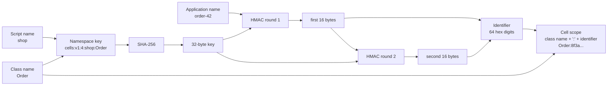
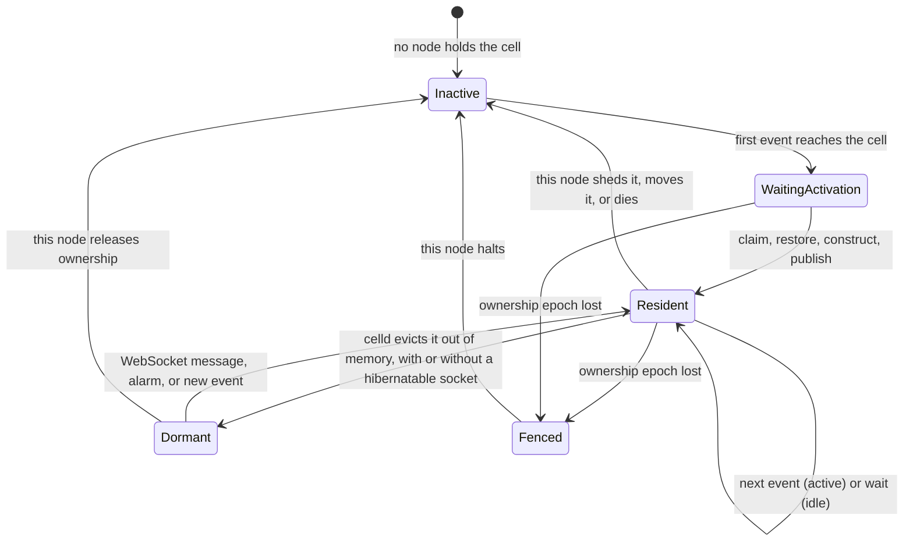

# Durable objects

A Durable Object is one instance of a JavaScript class that the platform keeps
for the application. Each instance has a name, one serial event stream, durable
storage, and alarms. The application does not start the instance, stop it, or
find out where it runs. It asks for a stub, and the platform sends each call to
the one place that holds that instance.

Cloudflare defines this model. celld is this repository's implementation of it.
The model is the contract; the implementation is the subject of this document.
The document covers identity, the namespace, the lifecycle, the concurrency
rules, the three storage surfaces, transactions, alarms, WebSocket hibernation,
and facets. It also names the parts of the model that celld does not implement.

Sources: `crates/celld/engine_api.rs`, `crates/celld/js.rs`,
`crates/celld/js/harness.js`, `crates/logic/lib.rs`, `crates/logic/cell.rs`,
`crates/logic/alarm.rs`, `crates/logic/wake.rs`, and `crates/logic/types.rs` at
commit `8702f6d186c77698dbfb30cf29e3b1922a88f008`, version 0.6.3.

## The words this document uses

| Word | Meaning here |
|------|--------------|
| Durable Object (DO) | One instance of an application class with a stable identity, a serial event stream, durable storage, and alarms. |
| Class | One JavaScript class that the deployment exports and registers as a Durable Object class, such as `Order`. |
| Cell | celld's internal name for one Durable Object instance. This document uses "cell" when it describes the implementation and "Durable Object" when it describes the contract. |
| Cell scope | The string `<class>:<identifier>`. It is the runtime key, the storage key, and the dispatch key. |
| Identifier | The 32-byte value, written as 64 hexadecimal digits, that names one instance inside one namespace. |
| Namespace | The name space that gives one class its identifier space. Two namespaces never share identifiers. |
| Namespace key | The text that the platform hashes to make the identifier derivation key. It is not a secret. |
| Identifier derivation key | The 32-byte value that the platform computes from the namespace key and uses as the key in both HMAC rounds. Any party that knows the namespace key can compute it. |
| Bucket | The object store that holds the ownership records, durability log, and snapshots for every cell. |
| Fleet | All celld nodes that serve one deployment and share one bucket. |
| Stub | A local proxy object that sends a call to the instance's owner. A stub is not the instance and holds no state. |
| Activation | The operation that loads an instance on a node. It restores storage, constructs the JavaScript object, and publishes the cell. |
| Resident | An instance whose JavaScript object and storage are loaded on a node. |
| Hibernation | The state in which an instance is out of memory but its accepted WebSockets stay open at the network layer. |
| Isolate | One JavaScript virtual machine instance that runs one or more cells of one script. |
| Turn | One synchronous stretch of JavaScript on one isolate. |
| Turn lane | The scheduler rule that gives an isolate to one turn and starts the next turn only after the current turn returns. |
| Input gate | The per-instance lock that lets one event run at a time, and holds across an `await`. |
| Output gate | The rule that holds a reply until a durability proof covers every write that the reply can reveal. |
| Epoch | The ownership epoch in the cell's ownership record. It increases on every acquisition and names the log prefix. |
| Fence | A boundary that stops an effect from escaping: the identifier, the epoch, or the output gate. |
| Transaction | A group of storage operations that commit together or not at all. |
| Alarm | A durable timer that wakes one instance at one time. |
| PublicationId | The pair of a SQLite writer epoch and a non-repeating alarm sequence. |
| Installation (alarm) | One committed alarm setting with its own PublicationId. It keeps one wake key for its lifetime. |
| Confirmed entry | A wake entry whose bucket write succeeded and which the in-memory cache recorded. |
| Proven SQLite frontier | A write position in a cell's SQLite database that the replica has proved durable. Only entries below it may be retired. |
| Save | One committed write to a cell's SQLite database. |
| Lite Transaction (LTX) | The replication format for the cell's SQLite changes. |
| Facet | A child Durable Object that belongs to a parent instance and shares its storage stream. |
| Stream | The bucket key prefix `cells/<scope>/` for one cell. A facet uses a nested prefix. |
| Attachment | Application data that the host stores beside a hibernatable WebSocket. |
| Hibernatable WebSocket | A WebSocket that the host keeps open after the isolate leaves memory. |
| Worker | One JavaScript isolate plus its event loop, as celld runs it. |
| workerd | Cloudflare's open-source JavaScript runtime, which defines the compatibility behaviour that celld copies. |
| V8 | The JavaScript engine that workerd and celld embed. |
| Decision core | The Rust crate `crates/logic` that decides ownership, activation, and wakes. It returns effects for an executor to perform. |
| Driver | The host task that polls and settles the asynchronous operations of one event. |
| Native context | A per-event token that V8 restores with each promise continuation, so an operation stays with its event's driver. |
| Foreign turn | A turn of a different event in the same isolate. |
| Critical section | A `blockConcurrencyWhile` callback. The input gate is shut while it runs. |
| Direct event | An event that the host delivers straight to the cell, so the cell's scope is the current event's scope. |
| Stub-mediated call | A call that reaches the cell through a stub from another event in the same isolate. |
| Actor break | The recorded failure of a cell scope. Every in-flight and later stub call to that scope rejects. |
| Actor | The Rust asynchronous task in the decision core that owns one cell's state machine. |
| Shed | To refuse or evict a cell under memory pressure. |
| Hypertext Transfer Protocol (HTTP) | The request and response protocol that the `fetch` handler speaks. |
| Remote procedure call (RPC) | A method call on a stub, as distinct from a `fetch` request. |
| Structured Query Language (SQL) | The query language that `ctx.storage.sql` speaks. |
| Key-value (KV) | The model that `ctx.storage` speaks: a key maps to a stored value. |
| JavaScript Object Notation (JSON) | A text format for values. |
| Unicode Transformation Format, 8-bit (UTF-8) | An encoding that stores each character in one to four bytes. |
| Secure Hash Algorithm 256 (SHA-256) | A hash function that returns 32 bytes. |
| Hash-based Message Authentication Code (HMAC) | A keyed hash that proves a message came from a holder of the key. |

## The model in one page

| Promise of the model | How celld keeps it |
|----------------------|--------------------|
| A name always reaches the same instance | The name is hashed with the namespace key, so the identifier is a pure function of the namespace key and the name |
| Only one instance runs for one identity | The ownership record in the bucket names one node and one epoch (document 06) |
| One event at a time | The input gate and the turn lane |
| Storage survives a crash | Every commit becomes an LTX segment, and the reply waits for a proof (document 05) |
| Alarms survive a crash | The alarm is a row in SQLite, and the wake entry is a bucket object |
| Code can sleep and wake | Hibernation keeps the sockets and drops the memory |
| A class can own a child object | Facets, with the root plus three facet levels |

The model does not promise low latency, a fixed location, or an upper bound on
the number of objects. celld also makes no such promise.

## Identity: a name becomes 64 hexadecimal digits

An application normally supplies a name, and the platform derives the
identifier. It may also pass back an identifier that it received earlier, and
the platform validates that identifier instead of deriving it. The derivation
has two inputs: the namespace key and the name.

The namespace key contains the script name and the class name:

```rust
// crates/celld/engine_api.rs:545-550
pub(crate) fn namespace_key(script_name: &str, class_name: &str) -> String {
    match shared_namespace_key(class_name) {
        Some(shared) => shared.to_string(),
        None => format!("cells:v1:{}:{script_name}:{class_name}", script_name.len()),
    }
}
```

The `<script length>` field is there for one reason: the separator is `:`, and
a script name may contain any character that the platform allows. Without the
length, two pairs could produce one key. With the length, a reader can split
the key without ambiguity. For example, `cells:v1:4:shop:Order` names script
`shop` and class `Order`.

Three reserved classes do not use the script name: the database service, the
key-value service, and the queue service. Their namespace keys are written out
because they are addresses, and a computed scheme would be free to change.

```rust
// crates/celld/engine_api.rs:507-520
pub(crate) const D1_NAMESPACE_KEY: &str = "cells:v1:d1:__D1Database";
pub(crate) const KV_NAMESPACE_KEY: &str = "cells:v1:kv:__KvNamespace";
pub(crate) const QUEUE_NAMESPACE_KEY: &str = "cells:v1:queue:__Queue";
```

These keys are fleet-wide on purpose. A database namespace is a resource that
several scripts bind, so two scripts that name one database must reach one set
of cells. A rename of a script must not rename the database.

The fourth reserved class is the workflow class. Its class name is script-scoped:
`__Workflow.<script>`. Its namespace key is
`cells:v1:<length>:<script>:__Workflow.<script>`, because a workflow instance
already belongs to one script. The class name used to be the bare `__Workflow`.
The source records why it changed: a deployment's class registry is one flat
map, so two co-hosted scripts that registered the same reserved class name
refused to start (`crates/celld/deploy.rs:93-101`).

The next step hashes the namespace key into a 32-byte identifier derivation key.
The key is not a secret:

```rust
// crates/celld/engine_api.rs:433-441
pub(crate) fn durable_object_id_key(namespace_key: &str) -> [u8; 32] {
    DO_ID_KEYS.with(|keys| {
        if let Some(key) = keys.borrow().get(namespace_key) {
            return *key;
        }
        use sha2::Digest;
        let key: [u8; 32] = sha2::Sha256::digest(namespace_key.as_bytes()).into();
        keys.borrow_mut().insert(namespace_key.to_string(), key);
        key
    })
}
```

The hash is cached for each thread. The cache is sound because the value is a
pure function of the key text. The cache is not a security boundary; an
attacker who knows the script name and the class name can compute the same
value. What the identifier hides is enumeration across namespaces: a client
that holds one identifier cannot test guesses against a namespace whose script
name it does not know, and an identifier from one namespace cannot be reused in
another. The identifier is not a secret from a caller that already knows the
script and the class.

The identifier itself comes from two HMAC rounds:

```rust
// crates/celld/engine_api.rs:482-492
let key = durable_object_id_key(namespace_key);
let mut id = [0_u8; 32];
let digest = durable_object_id_hmac(&key, name.as_bytes())
    .finalize()
    .into_bytes();
id[..16].copy_from_slice(&digest[..16]);
let digest = durable_object_id_hmac(&key, &id[..16])
    .finalize()
    .into_bytes();
id[16..].copy_from_slice(&digest[..16]);
```

The first round hashes the name. The second round hashes the first 16 bytes.
The result is 32 bytes, or 64 hexadecimal digits. The second round does not add
collision resistance that the first round lacks. It makes the second half of
the identifier a proof of the first half, because only a holder of the
namespace key can compute it. `idFromString` uses that property:

```rust
// crates/celld/js.rs:9902-9914 (abridged)
let Some(decoded) = decode_durable_object_id(&input) else {
    throw_durable_object_id_error(
        scope,
        "Invalid Durable Object ID: must be 64 hex digits",
    );
    return;
};
if durable_object_id_hmac(&key, &decoded[..16])
    .verify_truncated_left(&decoded[16..])
    .is_err()
{
    throw_durable_object_id_error(
        scope,
        "Durable Object ID is not valid for this namespace",
    );
    return;
}
```

A caller cannot invent an identifier. It must receive one from `idFromName`,
`newUniqueId`, or `idFromString` applied to a previously obtained identifier.
This is why an identifier from one namespace fails in another namespace: the
keys differ.

`newUniqueId` takes the other path. The host fills the first 16 bytes with
secure random data and then computes the second half from those bytes in the
same second HMAC round. The JavaScript side only chooses the mode:

```js
// crates/celld/js/harness.js:5140-5146
newUniqueId(options = {}) {
  const jurisdiction = options == null ? undefined : options.jurisdiction;
  if (jurisdiction != null)
    throw new Error("Jurisdiction restrictions are not implemented");
  return new DurableObjectId(
    this._className, __do_id(this._namespaceKey, "unique", ""),
  );
}
```

```rust
// crates/celld/js.rs:9880-9890
"unique" => {
    if getrandom::fill(&mut id[..16]).is_err() {
        throw_durable_object_id_error(scope, "secure random generation failed");
        return;
    }
}
```

The random half is 128 bits. A collision needs a birthday match in that space,
so the platform does not coordinate the allocation with any other node.

A name longer than 1024 UTF-8 bytes is not kept for `ctx.id.name`:

```js
// crates/celld/js/harness.js:5166-5174
const nm = id.name;
const dispatchName = nm === undefined ? undefined
  : nm.length < 256 || new TextEncoder().encode(nm).length <= 1024
    ? nm : undefined;
if (dispatchName !== undefined) __cell.idNames[scope] = dispatchName;
```

The `nm.length < 256` test is a fast path, not a separate limit. A string of
fewer than 256 JavaScript characters can encode to at most 1,020 UTF-8 bytes,
so the byte count is unnecessary for it. The full name still seeds the
identifier, so dispatch is unchanged. Only the cached display name is dropped:
`__cell.idNames[scope]` stays unset, and `ctx.id.name` reads as undefined. The
source states the platform behaviour that this copies: production recovers the
name from storage only when it is at most 1024 bytes.



The derivation is deterministic. Two nodes that receive the same name compute
the same identifier without talking to each other. The fleet does not need an
identifier registry, and a lost node does not block a new identifier.

## The namespace and the scope

A namespace object is the application's handle for one class:

```js
// crates/celld/js/harness.js:5124-5156 (abridged)
class DurableObjectNamespace {
  constructor(className, namespaceKey) {
    Object.defineProperty(this, "_className", { value: className });
    Object.defineProperty(this, "_namespaceKey", { value: namespaceKey });
  }
  idFromName(name) {
    name = String(name);
    return new DurableObjectId(
      this._className, __do_id(this._namespaceKey, "name", name), name,
    );
  }
  idFromString(value) {
    return new DurableObjectId(
      this._className, __do_id(this._namespaceKey, "validate", String(value)),
    );
  }
  newUniqueId(options = {}) {
    const jurisdiction = options == null ? undefined : options.jurisdiction;
    if (jurisdiction != null)
      throw new Error("Jurisdiction restrictions are not implemented");
    return new DurableObjectId(
      this._className, __do_id(this._namespaceKey, "unique", ""),
    );
  }
  jurisdiction(value) {
    if (value == null) return this;
    throw new Error("Jurisdiction restrictions are not implemented");
  }
  getByName(name, options) {
    return this.get(this.idFromName(name), options);
  }
  get(id) {
    const className = this._className;
    if (!(id instanceof DurableObjectId) || id._className !== className)
      throw new TypeError("Durable Object ID is not valid for this namespace");
    const scope = id._scope();
    ...
  }
}
```

A jurisdiction is a legal region that the platform must keep the data in.
celld does not implement jurisdictions. `newUniqueId({jurisdiction: ...})`
throws, `namespace.jurisdiction(value)` throws for a non-null value, and an
identifier object always carries `jurisdiction = undefined`. A caller that
ignores the option can use `newUniqueId()`, but the platform makes no promise
about where the cell runs.

`get` does not activate the cell. It validates that the identifier belongs to
this namespace, derives the scope, and caches the display name. The stub that it
returns carries that scope to the host with the first call.

An identifier object holds the class name, the identifier text, and the name:

```js
// crates/celld/js/harness.js:2012-2025
class DurableObjectId {
  constructor(className, value, name = undefined) {
    Object.defineProperties(this, {
      _className: { value: className },
      _value: { value },
    });
    this.name = name;
    this.jurisdiction = undefined;
  }
  toString() { return this._value; }
  equals(other) {
    return other instanceof DurableObjectId && other._value === this._value;
  }
  _scope() { return this._className + ":" + this._value; }
}
```

The scope is the class name, a colon, and the identifier. The identifier is
always 64 lowercase hexadecimal digits, so it contains no colon. That is what
makes the first colon the only separator. The cell validator enforces the same
rule at the storage boundary:

```rust
// crates/logic/cell.rs
pub const MAX_CELL_SCOPE: usize = 255;
```

A scope longer than 255 bytes is refused. The limit is not arbitrary. A scope
becomes a path component under the data directory and a key segment in the
bucket. `NAME_MAX` is the maximum length of one file name in bytes. celld
accepts a data file system only when its `NAME_MAX` is at least 255 bytes, and
the runtime checks that capability at start-up. A scope that passes the gate
therefore fits every node that can own the cell.

The charset is narrower than the full printable set. It is American Standard
Code for Information Interchange (ASCII) alphanumerics plus five characters:
`_`, `-`, `.`, `:`, and `$`.

```rust
// crates/logic/cell.rs:18-50 (abridged)
pub const MAX_CELL_SCOPE: usize = 255;

/// ... only ASCII alphanumerics plus `_ - . : $`.
pub fn valid_cell_scope(scope: &str) -> bool {
    !scope.is_empty()
        && scope.len() <= MAX_CELL_SCOPE
        && scope != "."
        && scope != ".."
        && scope
            .bytes()
            .all(|b| b.is_ascii_alphanumeric() || matches!(b, b'_' | b'-' | b'.' | b':' | b'$'))
}
```

The source gives four reasons for the set. The forward slash and the backslash
are excluded, so a scope can never be more than one path component. A scope of
`.` or `..` is refused, because the file system resolves those names. Control
bytes and the null byte (`NUL`, value zero) are excluded with everything else
outside the set. The colon and
the dollar sign are admitted because they are inert in a path component: the
colon separates the class from the identifier, and the dollar sign is a legal
JavaScript identifier character, so it is a legal exported class name.

## Lifecycle: from stub to resident object

The application calls `namespace.get(id)`. The call does not activate the
object. It returns a stub: a local JavaScript object that holds the identifier
and the routing data. A `fetch` or an RPC call on the stub sends the first
event, and the first event activates the cell.

The stub does not have a `then` method. That is deliberate. A stub that acted
like a promise would be awaited by accident, and the application would receive
the wrong value. The harness comment states the rule: a Durable Object stub is
not itself a promise.

An activation on the owner node follows the simplified path below. The decision
core adds capacity waiting and reconcile retries around it; the phases in the
next subsection name every step.

1. Read `cells/<scope>/own.json`.
2. If the record names another live node, forward the request to that node and
   stop.
3. Otherwise, acquire the cell with the correct guard and epoch (document 06).
   A missing record claims epoch 1. A released record or a dead owner claims
   `epoch + 1`. A record that names this node also claims `epoch + 1`, because
   each activation through this path starts a new writer session, and the new
   epoch keeps a stale writer from the earlier session out of the log. Only a
   clean local reload reuses the same epoch and the same database in place.
4. Restore the database from the bucket when the database is not local, and
   open the log prefix `cells/<scope>/ltx/e<epoch>/`.
5. Build the JavaScript instance with `_instance(scope)`.

The harness builds one instance for each scope:

```js
// crates/celld/js/harness.js:2870-2887
function _instance(scope) {
  let inst = __cell.instances[scope];
  if (!inst) {
    const className = scope.split(":")[0];
    const cls = __cell.classes[className];
    if (!cls) throw new Error("no DO class " + className);
    const state = new DurableObjectState(scope);
    inst = new cls(state, __cell.env);
    Object.defineProperty(inst, "__celldState", { value: state });
    state._rpcOk = __cell.compat.jsRpc ||
      __cell.doExports[className] === true;
    __cell.instances[scope] = inst;
  }
  return inst;
}
```

The table is per isolate, not per cell. Several cells of one script can share
one isolate, up to `MAX_CELLS_PER_ISOLATE`, which is 32
(`crates/celld/runtime.rs:456`). The table key is the full scope, so two classes
cannot collide. The hidden `__celldState` link lets a reset delete only its own
instance.

The constructor receives two arguments: the state object and `env`. The state
object is the application-visible half of the cell:

```js
// crates/celld/js/harness.js:2582-2604 (abridged)
class DurableObjectState {
  constructor(scope) {
    this._scope = scope;
    this._aborted = false;
    this.storage = new DurableObjectStorage(scope, this);
    this.facets = new DurableObjectFacets(this);
    this._gate = Promise.resolve();
    this._blockDepth = 0;
    const facet = __cell.facetConfigs[scope];
    this._facetDepth = facet?.depth ?? 0;
    const separator = scope.indexOf(":");
    const className = separator < 0 ? scope : scope.slice(0, separator);
    this.id = facet === undefined
      ? new DurableObjectId(
        className, separator < 0 ? scope : scope.slice(separator + 1),
        __cell.idNames[scope])
      : typeof facet.id === "string" ? facet.id : new DurableObjectId(...facet.id);
    this.props = facet?.props;
    // A class outside `containers` has no `ctx.container`, which is what
    // the `@cloudflare/containers` constructor checks.
    if (__cell.containers[className]) this.container = new Container(scope);
  }
  ...
}
```

The state object owns `storage`, `facets`, `id`, the input gate state, and the
facet depth. It also exposes `container` only when the deployment registers the
class as a container class. The class constructor receives the state object and
`env`. A class that extends `DurableObject` stores the two as `this.ctx` and
`this.env`, so a handler reads `this.ctx.id` to learn the identifier and the
name. `ctx.id.name` is undefined when the name was too long. It is also
undefined for every identifier that `idFromString` or `newUniqueId` made,
because neither call carries a name.

### The phases that an activation passes through

The decision core models the activation as a sequence of phases. The names are
stable because `/state` and `celld diagnose` publish them:

```rust
// crates/logic/lib.rs:203-292 (abridged)
pub enum Phase {
    Inactive,
    WaitingActivation,
    ReadingOwner { op: OpId },
    ReadingNodeLease { op: OpId, owner: OwnerRecord, .. },
    RecoveringOwnerLog { op: OpId, owner: OwnerRecord },
    WaitingOwnerLogRecovery { generation: u64 },
    ReadingCapacity { op: OpId, claim: Claim, .. },
    WaitingCapacity,
    Acquiring { op: OpId, claim: Claim, dormant: bool },
    ReconcilingAcquire { op: OpId, claim: Claim, dormant: bool },
    Restoring { op: OpId, spec: RestoreSpec },
    Starting { op: OpId, epoch: Epoch },
    Publishing { op: OpId, epoch: Epoch },
    EnsuringDurability { op: OpId, epoch: Epoch },
    Cleaning { op: OpId, epoch: Epoch, cause: StopCause },
    Dormant { epoch: Epoch },
    Adopting { op: OpId, released_epoch: Epoch },
    Resident { epoch: Epoch },
    Remote { node: NodeId, addr: String, epoch: Epoch, .. },
    Fenced,
}
```

Cloudflare numbers five lifecycle states. celld distinguishes them as follows:

| Platform state | What the cell is doing | Phase in celld |
|----------------|------------------------|----------------|
| 1, 2, and 3 | In memory. The cell is active while a handler does work and idle while it waits. | `Resident` |
| 4 | Hibernated: out of memory, still owned by this node, with at least one hibernatable WebSocket. | `Dormant` with a hibernatable socket |
| No platform number | Out of memory, still owned by this node, with no hibernatable WebSocket. | `Dormant` without a hibernatable socket |
| 5 | Inactive: no node holds it, and only bucket objects remain. | `Inactive`, or `Remote` on a node that is not the owner |

The platform's first three numbers distinguish bookkeeping states of an
in-memory object. celld treats all three as one `Resident` phase and does not
change its behaviour between them. The source comment that records this mapping
is at `crates/logic/lib.rs:186-198`.

```rust
// crates/logic/lib.rs:1794-1812 (abridged)
pub fn is_hibernated(&self, id: &str) -> bool {
    self.cells.get(id).is_some_and(|cell| {
        matches!(cell.phase, Phase::Dormant { .. })
            && cell.websockets.values()
                .any(|kind| matches!(kind, WebSocketKind::Hibernatable))
    })
}
```

Hibernated and inactive differ in two ways. A hibernated cell is still owned by
the node and has at least one hibernatable socket. An inactive cell is owned by
no node. A `Dormant` cell with no hibernatable socket is out of memory and still
owned, but it is not hibernated. A hibernated cell has no JavaScript object and
no memory of its previous events. The next event runs the constructor again,
exactly as a cold start does.

### When a handler fails

An ordinary handler throw does not reset the object. The harness rejects the
event's promise, the caller receives the error, and the instance stays in
memory with its storage. The error still passes the output gate, because a
thrown message can quote a value that the handler read or wrote.

A **concurrency failure** is different. The harness resets the instance:

```js
// crates/celld/js/harness.js:2763-2776
_resetAfterConcurrencyFailure(error) {
  if (this._aborted) return;
  this._aborted = true;
  __storage_cancel_pending_puts(this._scope);
  const instance = __cell.instances[this._scope];
  if (instance && instance.__celldState === this)
    delete __cell.instances[this._scope];
  if (__currentActorScope() !== this._scope)
    __actorBreak(this._scope, error);
}
```

Three events reach this path:

1. A `blockConcurrencyWhile` callback rejects.
2. A `blockConcurrencyWhile` block exceeds its 30-second limit.
3. `process.exit` runs inside a handler.

An ordinary throw does not reach it. That distinction keeps a normal
application error from discarding a healthy object, while a gate that is stuck
or a block that never returns must not keep serving.

The reset drops queued writes that have not reached SQLite, removes the
instance, and records an actor break when a stub sent the event. A direct event
keeps reset-only semantics: the instance resets, but no actor break is
recorded, because its caller receives the rejection. A stub-mediated call has
no local caller, so the actor break makes every waiting stub reject.

## Concurrency: one event at a time

The model promises that one event runs at a time in one object. Two mechanisms
keep that promise.

The first is the turn lane, described in
[the Worker runtime](03-the-worker-runtime.md). A turn is one synchronous
stretch of JavaScript on one isolate. The lane gives the isolate to one turn,
and the turn returns before another turn starts.

The second is the input gate. The gate is per cell, not per isolate, and it is
held across an `await`:

```js
// crates/celld/js/harness.js:2607-2611
blockConcurrencyWhile(f) {
  // The native context binds the gate and its operations to one driver.
  // Its async continuations keep that driver even inside a foreign turn.
  return __with_input_gate_context(() => this._blockConcurrencyWhile(f));
}
```

The native context is the per-event token that V8 restores with each promise
continuation. An operation that resumes in a different event's turn (a foreign
turn) still belongs to the driver of its own event, so it cannot take the other
event's gate. The gate closes in the calling turn, before the callback returns
a promise. No other event can start between the call and the close. The callback
can await. The gate stays closed until the callback settles.

A block has a limit of 30 seconds:

```js
// crates/celld/js/harness.js:2734-2762 (abridged)
const timeout = __op_timer(timerId, 30_000).then(() => {
  if (!settled) {
    throw new Error(
      "A call to blockConcurrencyWhile() in a Durable Object waited for " +
      "too long. The call was canceled and the Durable Object was reset.");
  }
});
return Promise.race([Promise.resolve(result), timeout]).then(
  (value) => { settled = true; __timer_cancel(timerId); this._blockDepth--; return value; },
  (error) => {
    settled = true; __timer_cancel(timerId); this._blockDepth--;
    this._resetAfterConcurrencyFailure(error);
    throw error;
  },
);
```

The limit is per block, not per event. A nested block gets its own timer and its
own 30-second limit. The outer block drains every nested block before it
releases the gate. The drain therefore ends when the last-started block settles
or its limit fires. `settled` prevents the timer from raising a second error
after the callback returned.

The nesting depth is limited to 64. The harness enforces the limit with
`if (this._blockDepth >= 64)` (`crates/celld/js/harness.js:2615-2618`). The
limit stops a recursive block from exhausting the stack.

### Transactions hold the gate

A transaction uses the same gate. Without it, a second event could read rows
that are not committed, join the open transaction on the same connection, or
lose a write at rollback:

```js
// crates/celld/js/harness.js:1915-1922 (abridged)
// Workerd runs the callback under blockConcurrencyWhile: the input gate
// shuts, so no other event starts in the object while the transaction is
// open. Without it another event's reads saw uncommitted rows, its
// writes joined the open transaction on the same connection, and a
// rollback discarded a write celld had already acknowledged (#714).
```

The failure chain is concrete. A nested block starts a transaction and does
not await it. The outer block returns, and the gate opens. Another event writes
into the still-open transaction. The transaction rolls back, and the write that
celld acknowledged disappears. The fix drains every nested block before the
outer block releases the gate.

A failed critical section resets the object. A failed transaction does not. The
transaction callback catches its own error, runs the rollback, and rejects to
its caller. The object stays usable.

## Storage: three surfaces

`ctx.storage` has three surfaces: the key-value methods, the SQL methods, and
`sync`. All three reach the same SQLite database.

### The key-value surface

```js
// crates/celld/js/harness.js:1601-1618 (abridged)
async get(k) { ... return __readStoredValue(this._scope, key, () => ...); }
async put(k, val) {
  this._assertTransactionActive("put");
  if (typeof k === "string") {
    try {
      __storage_queue_put(this._scope, k, val);
    } catch (error) {
      __storage_queue_put_serialized(this._scope, k, __storedBytes(val, error));
    }
    await Promise.resolve();
    this._flushPendingPuts();
  }
}
```

A `put` does not write to SQLite during the call itself. It queues the write in
a pending receipt, yields one microtask, and then calls `_flushPendingPuts()`
before its promise resolves. Every key-value and alarm method other than `put`
and `sync` calls `_flushPendingPuts()` before it touches SQLite: `get`,
`delete`, `list`, `deleteAll`, `setAlarm`, `getAlarm`, and `deleteAlarm`. The
read methods use the flush so a read sees every write that the same event made.
`delete` and the alarm methods use it so their operation applies after the
queued puts. The flush is what makes the asynchronous key-value interface
behave as if it were synchronous.

`_assertTransactionActive` rejects a call when the storage handle belongs to a
transaction that has already committed or rolled back. `_flushPendingPuts()`
returns false when a transaction has ended or the object was reset. The caller
then returns without touching storage; in `setAlarm`, a false return skips the
alarm write.

A value is stored as bytes with a tag. A string, a number, an array buffer, a
typed array, and a structured-clone value all round-trip. A value that cannot
be encoded raises an error from the serialized path.

A key may be a string or an array. An array key is converted to JSON text
before it reaches storage. `list` returns the keys in order and accepts a
prefix, a start key, an end key, a limit, and a reverse flag.

### The SQL surface

```js
// crates/celld/js/harness.js:1401-1465 (abridged)
exec(query, ...bindings) {
  ...
  return __sql_exec(this._scope, query, JSON.stringify(bindings));
}
```

`prepare(query)` returns a function that runs the query with the bindings it
receives. `exec` returns a `SqlCursor`, not an array. The cursor has `next`,
`one`, `toArray`, `raw`, `columnNames`, and `[Symbol.iterator]`, and reports
`rowsWritten` even when the query returns no rows. `ingest` applies an array of
values as a batch and returns a count; it throws a JavaScript error when the
batch fails.

The cursor refuses to run after a reset:

```js
// crates/celld/js/harness.js:1408-1415 (abridged)
if (this._state._aborted) {
  throw new Error("the Durable Object was reset; this event's storage is closed");
}
```

The guard exists because a callback that outlived its block still holds the
statement, and the replacement object uses the same connection. A statement
from the old callback would then write into the replacement's state. The
key-value surface drops such a call in silence. The SQL `exec` surface refuses
every call from an aborted event, because `exec` returns a lazy cursor and the
surface does not separate a read from a write at that point. The uniform refusal
keeps the replacement state safe.

Binary bindings are copied before `JSON.stringify` runs. The stringify can call
a later value's `toJSON()`, and that callback can resize or detach an earlier
buffer that the call had already accepted. The copy closes that window.

The SQL database is the cell's SQLite file. It is not a shared database. Two
cells never see each other's tables, because they never share a file.

### The sync surface

```js
// crates/celld/js/harness.js:1682-1694
async sync() {
  this._assertTransactionActive("sync");
  await Promise.resolve();
  const status = this._transactionStatus();
  if (this._state?._aborted || (status === null && !this._flushPendingPuts()))
    throw new Error(
      "storage.sync: " + this._scope + " was aborted; the object is no " +
      "longer running");
  await __storage_sync(this._scope);
}
```

`sync` is the application-visible durability barrier. It checks the transaction
status again after one microtask. If the transaction committed or rolled back
during that yield, the transaction boundary already settled the queued puts, so
`sync` does not flush. Otherwise it flushes the queued puts. An aborted object,
or a flush that cannot run, rejects before the host operation. Then `sync` calls
`__storage_sync`. That operation resolves only when the output gate's proof
covers every commit that this cell made before the call. It rejects when the
proof fails or times out. A `sync` that returns therefore means that the writes
are proven durable, not merely written to the local file. The reply that carries
the `sync` result passes the same output gate, so a caller cannot observe a
success that the replication path has not covered.

## Transactions and savepoints

```js
// crates/celld/js/harness.js:1898-1914 (abridged)
async transaction(f) {
  this._assertTransactionActive("transaction");
  if (this._transactionDepth > 0) {
    const nested = this._runTransaction(f);
    const pending = this._transactionControl.pending;
    pending.add(nested);
    nested.then(() => pending.delete(nested), () => pending.delete(nested));
    return nested;
  }
  const root = this._transactionRoot;
  const owner = String(__io_context_id());
  if (owner !== "" && root._transactionOwner === owner &&
      root._activeTransaction !== null)
    return root._activeTransaction.transaction(f);
  ...
}
```

A transaction at depth zero opens a SQLite transaction. A transaction at a
greater depth opens a savepoint. A savepoint can roll back without ending the
outer transaction. The outer transaction commits or rolls back once.

A second call from the same event joins the active transaction. The check has
two parts. `__io_context_id()` returns the identity of the current event's input
context. While the root storage holds a transaction, it records that identity in
`_transactionOwner` and the open transaction in `_activeTransaction`. A second
`transaction` call whose context identifier matches takes the savepoint path on
the active transaction. A call from another event has a different identifier, so
it waits on `_transactionTail` instead of joining. The input gate usually keeps
that event out, but an event that entered before the gate closed can still be
waiting for the slot, which is why the identifier check exists as well as the
gate.

`transactionSync` runs a callback in a nested block and commits at the end of
the block. It is the synchronous form that the platform added for code that
cannot await.

The transaction control has four operations: `start`, `commit`, `rollback`, and
`rollback to savepoint`. The harness sends each one to the host. A rollback
that fails aborts the object, because the database may be in an unknown state.

## Alarms: the durable timer

An alarm is one stored deadline for one cell. When the deadline arrives, the
platform runs the `alarm` handler on that cell. The alarm is durable: a node
that dies before the deadline does not lose it.

The application sets the alarm through the storage object:

```js
// crates/celld/js/harness.js:1696-1718 (abridged)
async setAlarm(t) {
  this._assertTransactionActive("setAlarm");
  if (!this._transactionControl) await Promise.resolve();
  if (!this._flushPendingPuts()) return;
  if (this._state?._facetDepth > 0)
    throw new Error("Facets currently cannot set alarms.");
  __alarm_set(this._scope, t instanceof Date ? t.getTime() : Number(t));
}
async getAlarm() {
  const v = __alarm_get(this._scope);
  return v === null ? null : v;
}
async deleteAlarm() { __alarm_delete(this._scope); }
```

The listing is abridged: `getAlarm` and `deleteAlarm` also call
`_assertTransactionActive` and `_flushPendingPuts()` in the source. A false
flush makes `getAlarm` return `null`, and makes `setAlarm` or `deleteAlarm`
skip the write.

Only one alarm exists for each cell. A second `setAlarm` replaces the first.
`getAlarm` returns `null` when no alarm is stored. During the `alarm` handler,
`getAlarm` also returns `null`, because the alarm has fired and is no longer
pending. The handler can set a new alarm to schedule the next run.

A facet cannot set an alarm. The harness throws before the call reaches the
host.

The alarm state is a row in SQLite. The row holds the scope, the deadline, two
retry counters, and the generation:

```
_cf_ALARM(scope, at_ms, retry, counted_retry, generation)
```

When a handler fails, the platform does not retry at once. It writes a new
deadline with exponential backoff:

```rust
// crates/logic/alarm.rs:9-31 (abridged)
const RETRY_CEILING: i64 = 6;
const BACKOFF_BASE_MS: Ms = 2_000;
const MAX_BACKOFF_SHIFT: i64 = 6;

pub fn alarm_retry(
    now_ms: Ms, retry: i64, counted_retry: i64, counts_against_limit: bool,
) -> Option<Ms> {
    if counts_against_limit && counted_retry >= RETRY_CEILING {
        None
    } else {
        let shift = retry.clamp(0, MAX_BACKOFF_SHIFT) as u32;
        let at_ms = now_ms.saturating_add(BACKOFF_BASE_MS * (1_i64 << shift));
        Some(at_ms)
    }
}
```

The first failure waits 2 seconds, the second 4 seconds, and the delay doubles
until the shift reaches six, which is 64 times the base, or 128 seconds. The
ceiling is checked before each new deadline: six counted failures each schedule
another attempt, and the next counted failure finds `counted_retry` at 6,
deletes the row, and abandons the alarm.

Some failures do not count. A failure that the caller excuses, such as a
shed under memory pressure, backs off but does not increment `counted_retry`.
The two counters make that possible: `retry` drives the delay, and
`counted_retry` counts toward the ceiling. `bump_alarm_with_policy` reads both
counters, calls the pure `alarm_retry` function, and then either deletes the row
or writes the new deadline. It sets `retry=retry+1` on every failure. It sets
`counted_retry=counted_retry+1` only when the failure counts against the limit,
and leaves `counted_retry` unchanged when the failure is excused
(`crates/celld/storage.rs:4442-4461`).

The `generation` column separates installations. Every `setAlarm` writes a new
random generation and resets both counters:

```sql
-- crates/celld/storage.rs:4208-4216 (abridged)
INSERT INTO _cf_ALARM(scope,at_ms,retry,counted_retry,generation)
VALUES(?1,?2,0,0,random())
ON CONFLICT(scope) DO UPDATE SET
  at_ms=excluded.at_ms, retry=0, counted_retry=0, generation=random()
```

The host records the generation when a firing enters the handler. `getAlarm`
returns `null` while the stored generation still matches that firing, because
the alarm has fired and is no longer pending. When the handler finishes, a
stored generation that differs from the recorded one means that the handler
called `setAlarm`; the finishing code then leaves the new alarm alone. A
successful handler deletes the row only when the stored deadline still equals
the time that fired, so a handler that re-armed itself to a later time keeps the
new deadline.

An alarm also has a wake entry in the bucket, so any node can find a cell whose
deadline is due and send the wake to its owner. The key has one minute
partition, the cell, and the publication identity:

```
wake/entries/<YYYY-MM-DDTHH:MM>/<cell>/<16 hex epoch>-<16 hex sequence>
```

The minute text is lexicographically ordered, so a waker can list due partitions
in time order. The identity is a `PublicationId`: the SQLite writer epoch plus a
non-repeating sequence. The SQLite writer epoch is the ownership epoch recorded
when the image opened (`_cf_WAKE.epoch`), and the sequence rises with each change
to the alarm row. A real publication always has a positive epoch. Epoch zero is
reserved for the migration seed at
`wake/entries/1970-01-01T00:00/<cell>/migration`, which is an inventory hint
and older than every real installation.

The node writes an entry only when the cache does not already cover the same
installation. An installation is one committed alarm setting, and it keeps one
wake key for its whole life. Coverage means that the newest confirmed entry for
the cell has the same deadline and the same `PublicationId` as the candidate
alarm. A confirmed entry is one whose bucket write succeeded and which the cache
recorded. The cache keeps at most 32 recent identities for each cell. That bound
limits the memory of a stalled durability proof without losing current coverage.
A replaced entry is retired only below a proven SQLite frontier: a write
position in the cell's SQLite database that the replica has proved durable. A
stale delete therefore cannot remove a later installation. After a lost response or a
restart, the bucket listing is the complete inventory; the cache is only an
optimisation.

```rust
// crates/logic/wake.rs:119-129
pub fn publication(&self, cell: &str, alarm: AlarmSnapshot) -> Option<Publication> {
    let due_ms = alarm.at_ms?;
    let source = alarm.source?;
    if due_ms < 0 || source.id.epoch == 0 || self.covered(cell, alarm) {
        return None;
    }
    Some(Publication {
        key: entry_key(due_ms, cell, source.id),
        alarm,
    })
}
```

## WebSockets and hibernation

A WebSocket is a two-way connection that starts as an HTTP upgrade. A Durable
Object can accept one:

```js
// crates/celld/js/harness.js:2809-2822
acceptWebSocket(ws, tags = []) {
  if (__heap_over_admission_share())
    throw new Error(
      "the isolate is near its V8 heap limit, so it refused a " +
      "WebSocket (see CELLD_V8_HEAP_LIMIT_MB)");
  ws._target = { id: ws._id, scope: this._scope };
  if (ws._peer) ws._peer._target = ws._target;
  ws._hibernatable = true;
  if (ws._peer) ws._peer._hibernatable = true;
  ws._tags = Array.from(tags, String);
  __ws_accept(ws._id, this._scope, JSON.stringify(ws._tags));
  __sockets.set(ws._id, ws);
}
```

An accepted socket is **hibernatable**. The host registry keeps the socket,
its scope, its tags, its attachment, its pending messages, and its automatic
response. The isolate does not need to stay in memory for the socket to stay
open.

The cell can find its sockets after a wake:

```js
// crates/celld/js/harness.js:2798-2807
getWebSockets(tag) {
  return JSON.parse(__ws_list(this._scope, tag)).map((row) => __socketFromRow(row));
}
getTags(ws) {
  if (!(ws instanceof WebSocket) || !ws._hibernatable) {
    throw new Error(
      "you must call 'acceptWebSocket()' before attempting to access " +
      "the tags of a WebSocket.");
  }
  return Array.from(ws._tags);
}
```

The tags survive hibernation because the host stores them. An application can
use a tag to find one user's sockets after a wake, without keeping a map in
memory.

A socket can also carry one **attachment**: an application value that the host
stores beside the socket and restores when the socket is rebuilt:

```js
// crates/celld/js/harness.js:10659-10666
serializeAttachment(value) {
  // Structured clone, not JSON: Cloudflare accepts anything cloneable
  // here, so a Date must come back a Date and a Map a Map.
  this._attachment = value;
  __ws_attachment_set(this._id, __sc_encode(value));
}
deserializeAttachment() { return this._attachment; }
```

The attachment uses structured clone, so a `Date` returns as a `Date` and a
`Map` returns as a `Map`. The host writes the bytes with the socket row, and
`__socketFromRow` decodes them when it rebuilds the socket after a wake.

The handler that receives an event depends on the socket kind. A hibernatable
socket routes a message to `webSocketMessage`, a close to `webSocketClose`, and
an abnormal closure to `webSocketError`. A regular socket dispatches a
`MessageEvent` or `CloseEvent` on the live `WebSocket` object instead. That
dispatch needs the JavaScript object, so a regular socket cannot outlive the
isolate. A socket that the application opened outbound is regular for the same
reason.

An automatic response answers a fixed request with a fixed response without
waking the cell:

```js
// crates/celld/js/harness.js:2830-2845 (abridged)
setWebSocketAutoResponse(pair) {
  if (pair === undefined || pair === null) {
    __ws_auto_response_set(this._scope, null, null);
    return;
  }
  ...
  const max = 2048;
  ...
}
```

Each side of the pair is limited to 2048 UTF-8 bytes. A matched message is
answered by the host, so a cell that only exchanges keepalive messages never
wakes.

A cell with a surviving hibernatable socket is in the hibernated state. A cell
with a regular socket is not, because a regular socket belongs to the isolate
and cannot outlive it. A cell that opened an outbound WebSocket is also not
hibernatable, because the connection lives in the isolate.



The diagram shows one cell. `Resident`, `Dormant`, and `Fenced` describe the node
that holds the cell. `Inactive` describes the fleet: no node holds the cell.

The diagram omits retries and waits. A real activation can pass through
`ReadingOwner`, `RecoveringOwnerLog`, `ReadingCapacity`, `Acquiring`, and
`Restoring` more than once before it reaches `Resident`; the phase enum above
is the complete list.

The diagram uses celld's words. Cloudflare uses "evict" for a different
transition, as The Aha below explains.

## Facets

A facet is a child Durable Object that belongs to a parent object. The parent
creates it, names it, and gets a stub for it. The facet has its own class, its
own identifier, and its own SQLite database. Each committed write to that
database (a save) is replicated in a stream nested under the parent's stream.

```js
// crates/celld/js/harness.js:2144-2163 (abridged)
get(name, getStartupOptions) {
  name = this._validName(name);
  if (this._state._facetDepth >= 3)
    throw new Error(
      "Facet nesting depth limit exceeded. The maximum depth including the root Durable Object is 4.");
  if (typeof getStartupOptions !== "function")
    throw new TypeError("The facet startup callback must be a function.");
  let record = this._running.get(name);
  if (record !== undefined) return record.stub;
  ...
}
```

The depth limit counts the root as one level. A root can have a facet, that
facet can have a facet, and that facet can have a facet. The fourth level below
the root is refused.

A facet name is at most 256 bytes. The name is not the identifier. The host
derives a run scope from three hashed inputs and one prefix: the parent scope,
the owner token, and the name are hashed, and the class name is the prefix.

```rust
// crates/celld/js.rs:7934-7945
fn facet_scope(class_name: &str, parent_scope: &str, owner: &str, name: &str) -> String {
    use sha2::Digest as _;
    let mut digest = sha2::Sha256::new();
    digest.update(parent_scope.as_bytes());
    digest.update([0]);
    digest.update(owner.as_bytes());
    digest.update([0]);
    digest.update(name.as_bytes());
    let digest: [u8; 32] = digest.finalize().into();
    format!("{class_name}:{}", durable_object_id_hex(&digest))
}
```

The owner token changes when a facet is restarted in the same parent session.
Each parent state takes one owner number from a host counter when its facet
manager is constructed. Each facet run under that state takes the next run
number from a second counter that the manager shares. A token therefore reads
`<owner number>:<run number>`. The owner number separates two parent states.
The run number orders the runs of one parent state. The harness comment gives
the reason: an aborted request can still hold a pending continuation, and a
reused scope would let that continuation enter the replacement instance after
the abort of the earlier run completes.

Four names are easy to confuse:

| Name | Form | What it names |
|------|------|---------------|
| Scope | `<class>:<64 hex>`; the hex is the full SHA-256 of the parent scope, a NUL byte, the owner token, a NUL byte, and the name | The runtime and dispatch identity of one facet run |
| Stream | `cells/<root scope>/facets/<32 hex>/` for each level; each 32 hex is the first 16 bytes of SHA-256 of that level's name | The bucket prefix that holds the facet's LTX segments |
| File | `<root file>.<facet path>.sqlite`, where the facet path is the stream path below the root scope with each `/` replaced by `-` | The local SQLite file beside the root's file |
| Hash | The first 16 bytes of SHA-256 of a facet name, as 32 lowercase hex digits | The path segment that names the facet without an index |

A nested facet adds one `/facets/<hash>` segment for each level of its path.

A facet's database is a file beside the root database. Its name is the root
file name, then a dot, then the facet stream path with each `/` replaced by
`-`, then `.sqlite`. For one level below the root, the file name is therefore
`<root file>.facets-<hash>.sqlite`:

```rust
// crates/celld/js.rs:7954-7961
let stream = crate::engine_api::facet_cell(&parent.root_scope, &names);
let facet = stream[parent.root_scope.len()..]
    .trim_start_matches('/')
    .replace('/', "-");
let root = std::path::Path::new(&parent.root_path);
let file = root.file_name().unwrap().to_string_lossy();
return Ok((root.with_file_name(format!("{file}.{facet}.sqlite")), false));
```

A facet's stream is a nested prefix under the root's stream:

```
cells/<root scope>/facets/<first 16 bytes of SHA-256(name), in hex>
```

Each level of a nested facet adds one `/facets/<hash>` segment. The 32
hexadecimal characters are enough to name the facet without an index, and a
scan of the cells cannot see a facet because a root scope cannot contain `/`.

A facet has no ownership record and no fence of its own. It shares the root's
owner and the root's epoch. This is why a facet cannot outlive its root, and why
the root's output gate covers a facet's writes.

## Compatibility notes

The table lists the contract features that celld refuses, and the ones where it
implements the feature with an exception:

| Feature | Status in celld |
|---------|-----------------|
| Jurisdictions | The option throws; no location promise is made. |
| `state.abort(reason)` | Implemented. It drops pending writes, deletes the instance, and terminates the running event. |
| Alarms in facets | Refused by the harness. |
| `ctx.container` beyond the documented subset | Containers are supported only for the documented surface. |
| `newUniqueId` with jurisdiction | Refused. |
| RPC on a Durable Object class that does not extend `DurableObject` | Allowed when the `js_rpc` compatibility flag is on (JavaScript reads it as `compat.jsRpc`), or when the deployment registers the class in its Durable Object exports (`doExports`). |

The platform also allows an application to call `ctx.storage.deleteAll()`.
celld implements it, and the `delete_all_deletes_alarm` compatibility flag
decides whether it also removes the alarm.

## The Aha

The model looks like a programming convenience: a JavaScript class whose
instances the platform keeps alive. The implementation shows that the
convenience rests on three separate fences, and that no one fence is enough.

The **identifier** fence stops a caller from inventing an identifier that
belongs to another namespace. The **ownership epoch** fence stops a stale node
from writing into the current log. The **output gate** fence stops a reply from
revealing a write that is not yet durable. Each fence answers a different
question:

- Which object does this name mean?
- Which node may write it now?
- May this answer leave the process now?

A system that has only the first two fences can lose an acknowledged write
during a takeover. A system that has only the first and third can send two
requests to two nodes that both believe they own the cell. The three fences
are not interchangeable, and the model's promise holds only when all three are
present.

The second insight is about the word "evict". The source comment draws the line
at `crates/logic/lib.rs:196-198`. Cloudflare evicts a cell *off its host*,
which produces the inactive state. celld evicts a cell *out of memory*, which
produces the dormant state. Shedding is what then publishes the cell unowned,
which produces inactive. A reader who compares the two systems without this
note will map one word onto two different transitions and draw the wrong
conclusion about where the cell went.

## Where to read next

- [The Worker runtime](03-the-worker-runtime.md) explains the isolate, the
  turn lane, and the output gate.
- [Cell storage and durability](05-cell-storage-and-durability.md) explains the
  SQLite file, the LTX segments, and the snapshots.
- [Ownership, failure, and rebalancing](06-ownership-failure-and-rebalancing.md)
  explains the epoch, the lease, and the takeover.
- [The services](07-the-services.md) explains the reserved classes and the
  platform services.
- [Limitations and compatibility](10-limitations-and-compatibility.md) lists the
  differences from the full platform model.
