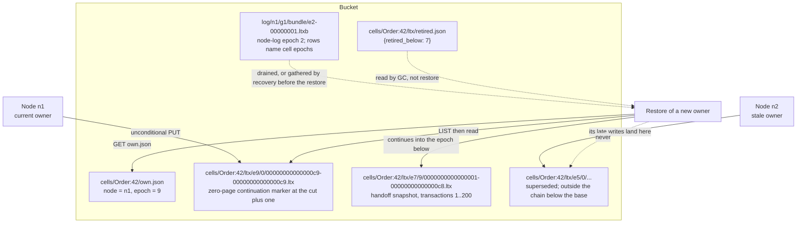
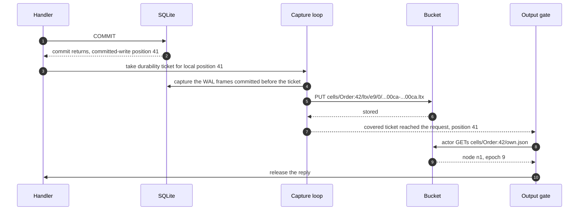
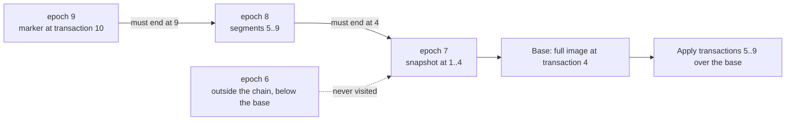

# Cell storage and durability

A cell's durable state is one SQLite database. On the owner node, that database
is a file. In the bucket, the same state is a chain of Lite Transaction (LTX)
segments. The chain has a base: a snapshot, which is one segment that carries
every page of the database at one transaction. The base can sit in any epoch of
the chain, not only the earliest epoch that the bucket holds. A cell can also
restore from its chain of captured level 0 segments without a level-9 handoff
snapshot; that chain starts with the first captured snapshot at transaction 1.
Each ownership epoch has its own prefix, and the chain crosses epochs. The epoch
is the fence: a node that lost ownership can keep writing, but the next restore
clips those writes at the cut, the last transaction identifier that a span
covers. The word table below defines these terms.

This document follows one write from the application call to the durability
proof. It also follows one restore from a cold process back to a usable
database. It covers the local file, the internal tables, the write-ahead log
(WAL), the segment format, the bucket layout, the two durability modes, paging,
compaction, and garbage collection.

Sources: `crates/celld/storage.rs`, `crates/ltx/`, and `docs/guarantees.md` at
commit `8702f6d186c77698dbfb30cf29e3b1922a88f008`, version 0.6.3.

## The words this document uses

| Word | Meaning here |
|------|--------------|
| Bucket | One object store bucket. It holds the ownership records, the cell logs, and the node records. |
| Cell | One Durable Object instance. A cell owns one SQLite database. |
| Durable Object | A Cloudflare platform object with one identity and one SQLite database. celld runs each Durable Object as a cell. |
| Cell scope | The string `<class>:<identifier>` that names a cell. Every path in this document writes `<cell>` for this scope. |
| Facet | A child Durable Object with its own database file and its own replication stream. Its keys sit under the root as `cells/<root>/facets/<hash>/`, with one `facets/<hash>` pair for each name in the facet path. `<hash>` is a 32-character hexadecimal hash of that name. |
| Stream | The bucket key prefix `cells/<scope>/` for one cell. |
| Write-ahead log (WAL) | SQLite's append-only file of committed pages that are not yet copied into the main database file. |
| Page | The fixed-size unit of a SQLite database file, normally 4,096 bytes. |
| Frame | The stored bytes of one changed page inside a segment: the page number, the page bytes, and a checksum. |
| Segment | One LTX object. It holds frames for a run of transactions and a page index that maps each page number to its newest frame. |
| Lite Transaction (LTX) | The replication format that celld takes from Litestream. One LTX object is one segment. |
| Litestream | The open-source SQLite replication tool whose LTX format and restore plan celld reuses. |
| Level | The directory number that classifies a segment. Level 0 holds captured transactions, level 1 holds the output of celld's compaction, levels 2 to 8 exist for Litestream compatibility, and level 9 holds handoff snapshots. |
| Snapshot | An LTX object whose header minimum transaction identifier is 1. It carries every page of the database at its maximum identifier. A handoff snapshot is a level-9 snapshot that celld writes when it evicts a cell. The first capture of a new database is also a snapshot. |
| Span | The files from one epoch that a restore keeps after it clips them at the newer span's first transaction identifier. Its first identifier is the lowest it serves; its cut is the highest. |
| Base | The oldest span of a restore chain, not the oldest epoch in the bucket; the chain can leave earlier epochs unread. It opens with a snapshot at transaction 1, so a chain reads no transaction before it. |
| Cut | The last transaction identifier that a span covers. The span above it must start at the cut plus one. |
| Target | The transaction identifier at which a restore stops. A target of 0 means the newest transaction. |
| Position (LTX position) | A pair: a transaction identifier (`txid`) and a rolling checksum of the database after that transaction. |
| Transaction identifier (txid) | A counter that increases by one for each captured transaction. |
| Committed-write position | The cell's local change counter: `total_changes + data_version + schema_cookie`. The output gate uses it to tell a write from a read. |
| Output gate | The rule that holds a reply until a durability proof covers every write that the reply can reveal. |
| Durability proof | Evidence that a committed-write position is on durable storage. The bucket mode reads the bucket; the fleet mode uses follower acknowledgements. |
| Epoch | The ownership epoch in `cells/<cell>/own.json`. It is a positive integer that increases on each acquisition and names the log prefix. |
| Chain | The ordered list of epochs, and the segments inside them, that one restore reads. |
| Follower | Another node that holds a copy of the owner's recent writes and confirms them with `fsync`. |
| Ensemble | The owner and its followers, considered together. |
| Node log | The fleet replication log of one node session. It holds the level 0 segments that the node captured but has not yet copied into per-cell prefixes. Its state is the `log` object in `nodes/<node>.json`, which folds the log state into the record; its bucket form is the retained bundle set under `log/<session>/bundle/`. |
| Session | One process lifetime of one node, named by the node and the generation of its lease record, as `<node>/<generation>`. Its bundles live under `log/<node>/<generation>/`, so `log/<session>/bundle/` means `log/<node>/<generation>/bundle/`. The generation increases when a new session starts. |
| Bundle (retained bundle) | One object that carries the level 0 segments of many cells. The extension is `.ltxb`. A retained bundle has at least one row that the per-cell prefixes do not cover. |
| Tiering path | The path that writes level 0 segments into node bundles first and drains them into the per-cell prefixes later. It runs when a fleet shipper and its bundle sink are active. |
| Drain (bundle drain) | The copy of a retained bundled segment into its per-cell prefix at a drain point, such as compaction or eviction. |
| Lease | The node's own record at `nodes/<node>.json`, with an expiry and a generation. Each node publishes its own lease; no peer grants it. The default lifetime is 10,000 milliseconds, renewed after one third of that lifetime. It is separate from the cell ownership record. |
| Activation | The start of a cell on a node. A cell is resident when the node holds local state for it. A cold activation has no resident state on that node and restores from the bucket. |
| Handoff | The release of a resident cell to a successor, with a durability proof and a restore artifact. A resident cell has local state on the node. The restore artifact is the snapshot or chain that the successor restores from. To evict a cell is to give it up in a handoff. |
| Eviction barrier | The durability gate that must pass before a node gives up a resident cell. Eviction is the local release of a cell after that gate. |
| Window of loss | The period between the latest commit and the latest backup, in which a crash can lose an acknowledged write. |
| Compaction | The merge of several contiguous level 0 segments into one level 1 segment. |
| Paging | A restore mode that leaves the database sparse and reads each page from the segments when the database first touches it. |
| Paged epoch | An epoch that opens with a zero-page continuation marker instead of a snapshot. Its restore continues into the epoch below it. |
| Paged format | Bucket format 2. Bucket format is the layout version that a node advertises in its lease. Format 1 opens every epoch with a snapshot; format 2 can open with a continuation marker. A node that reads format 2 can restore a paged epoch. A node that reads only format 1 cannot. |
| Conditional create | A bucket write that succeeds only when the object does not exist. |
| Durability ticket | A number that orders a proof request against the capture loop. A write waits for a sync that started after its ticket. |
| Garbage collection (GC) | The deletion of epoch prefixes that no restore reads. |
| `fsync` | The system call that forces written bytes to the storage device. |

## The local file

A cell's database is a file under the data directory. The path contains the cell
scope and the ownership epoch:
`<data_dir>/<cell>/ltx/e<epoch>/db.sqlite`. The epoch in the path is deliberate.
A new epoch opens a new file, so no connection of a previous epoch can write into
the database of the current one. A cell runtime with no bucket and no fleet has
no remote epoch namespace, which is a shared mapping from an epoch number to a
bucket prefix. One example is a local run without a bucket. Such a runtime keeps
one file at `e1` across ownership changes. No second node can open that local
file, so the file needs no new epoch to fence a second writer. The database
uses the WAL journal mode:

```rust
// crates/celld/storage.rs:372-382 (abridged)
pub fn schema(c: &Connection) -> anyhow::Result<()> {
    // OFF while schema() runs, then NORMAL for the steady state. schema()
    // writes only pragmas and celld's own tables, never user data, so a
    // crash mid-schema loses nothing a re-open does not rebuild.
    c.pragma_update(None, "synchronous", "OFF")?;
    c.pragma_update(None, "journal_mode", "WAL")?;
    ...
}
```

The source gives the reason for `OFF` in one comment. Switching a fresh
database to WAL is durable, so SQLite forces an `fsync` under every synchronous
level except `OFF`. The file system journal serializes that single `fsync`. The
source's workload record (`engine/pathological-load.md`) reports that cold-cell
creation reached about 1,000 cells per second at idle processor load. It
reports that warm cells served about 22,000 requests per second. Both numbers
are throughput, but they count different work. A cold creation pays the one
`fsync`; a warm request does not. The record presents the cold rate as the cost
of that `fsync`; it does not subtract the rate from the warm rate.

The steady state is different:

```rust
// crates/celld/storage.rs:448-455 (abridged)
// NORMAL, not the FULL default: with WAL, commits then skip the
// per-commit WAL fsync (measured 1.4ms -> 19us per put on cloud
// disks; the fsync was the entire single-cell write budget).
// Process crashes lose nothing. An OS/power crash may lose the
// last commits locally — celld's durability boundary for node
// loss is LTX replication either way.
c.pragma_update(None, "synchronous", "NORMAL")?;
```

A write at `NORMAL` reaches the operating system before the commit returns. A
process crash therefore loses nothing, because the operating system still holds
the bytes. A power loss can lose the last commits, because the operating system
may hold them in its page cache. This is why the local file is not the record.
The record is the replicated log, and the output gate closes the window of loss.

The database holds four internal tables. They use the `_cf_` prefix, which is
the platform's own prefix, so an application table cannot collide with them:

```sql
-- crates/celld/storage.rs:409-430 (abridged)
CREATE TABLE IF NOT EXISTS _cf_KV
  (scope TEXT, k TEXT, v TEXT, PRIMARY KEY(scope,k));
CREATE TABLE IF NOT EXISTS _cf_ALARM
  (scope TEXT PRIMARY KEY, at_ms INTEGER, retry INTEGER DEFAULT 0,
   counted_retry INTEGER NOT NULL DEFAULT 0,
   generation INTEGER NOT NULL DEFAULT 0);
CREATE TABLE IF NOT EXISTS _cf_METADATA
  (scope TEXT PRIMARY KEY, actor_name TEXT);
CREATE TABLE IF NOT EXISTS _cf_FACETS
  (scope TEXT NOT NULL, path TEXT NOT NULL, image BLOB NOT NULL,
   PRIMARY KEY(scope,path)) WITHOUT ROWID;
```

The roles are narrow. `_cf_KV` holds the key-value storage. `_cf_ALARM` holds
the one alarm deadline and its retry counters. `_cf_METADATA` holds the actor
name that the platform reports for diagnostics. `_cf_FACETS` holds the saved
images of child facets.

Three tables had other names before 2026-08-06: `kv`, `alarms`, and
`cell_metadata`. A user table can collide with those names, and a library that
drops every table except the `_cf_*` set deletes them (denoland/celld#122).
`schema()` renames each one at open time, before the `CREATE` statements, and
only when the old name exists and the new name does not:

```rust
// crates/celld/storage.rs:390-406 (abridged)
for (legacy, current) in [
    ("kv", "_cf_KV"),
    ("alarms", "_cf_ALARM"),
    ("cell_metadata", "_cf_METADATA"),
] {
    if exists(legacy)? && !exists(current)? {
        c.execute_batch(&format!("ALTER TABLE {legacy} RENAME TO {current}"))?;
    }
}
```

The rename changes only the schema catalog and moves no row. `_cf_FACETS` had
no earlier name; it uses the platform prefix from its introduction.

The `scope` column appears in every table. A facet has its own database file and
its own replication stream, so it does not normally put rows in its root's file.
An old facet from before facet streams kept its database as an image, a full
SQLite file, in a row of its root's `_cf_FACETS`. On the first open of that
facet, celld imports the image into the facet's own file. Each run of a facet
has its own row scope. A run is one opening of the facet inside its root's
activation. A continuation is a resumed open of an earlier instance. A
replacement is the run that follows an aborted one, which is an opening that
stopped before it completed. At open, celld moves every row in `_cf_KV`,
`_cf_ALARM`, and `_cf_METADATA` to the new run's scope. The scope is the one
passed to the open, so the move goes from the earlier run's scope to the new
scope. `_cf_FACETS` is not moved because it holds the saved images of child
facets. A continuation from an aborted run still holds the old scope, so it
cannot read the moved rows.

## What a commit is

SQLite reports a commit through three counters: the number of completed row
changes, the data version, and the schema cookie. celld combines them into one
number:

```rust
// crates/celld/storage.rs:1300-1302
fn fingerprint(scope: &str, connection: &Connection) -> u64 {
    total_changes(connection) + data_version(connection) + schema_cookie(scope, connection)
}
```

The sum is the cell's **committed-write position**. `total_changes` counts this
connection's row changes. `data_version` changes when another connection commits
to the file. `schema_cookie` changes when a schema statement runs. Each counter
only increases, so the sum never decreases. The output gate samples it before
and after a handler. A position that did not change means the handler did no
write. A position that changed means the handler did a write, and the reply must
wait for a proof at that position.

This position is not the LTX position. It is a local counter with no relation to
the transaction identifier in the log. The two numbers live in different spaces,
and no arithmetic converts one to the other. celld bridges them with a
**durability ticket**, not with a comparison of the numbers.

The sequence is:

1. The handler commits.
2. The runtime samples the committed-write position and asks the capture loop
   for a ticket. The ticket is one more than the count of tickets taken before
   it.
3. The capture loop reads the current ticket count at the start of a pass. It
   captures and uploads every level 0 segment up to the database position at
   that moment, then records that ticket count as the highest covered ticket.
4. The write waits until the covered ticket is at least its own ticket.
5. The runtime reports the position that it sampled in step 2.

To ask for a ticket is one atomic increment of `req_seq`. The database position
is the replicated transaction identifier that `db.sync` reports. A pass that
starts after the ticket must capture the write, because the write committed
before the ticket was taken. The ticket order is the proof; the
position is carried through only so the core can compare it with the barrier:

```rust
// crates/celld/ltx_repl.rs:2983-3006 (abridged)
pub async fn await_durable(
    &self,
    cell: &str,
    epoch: u64,
    position: u64,
) -> anyhow::Result<(u64, celld_logic::ProofSource)> {
    let Some(handle) = self.cells.lock().unwrap()
        .get(&(cell.to_string(), epoch)).cloned() else {
        anyhow::bail!("ltx cell not resident: {cell} epoch {epoch}");
    };
    let ticket = handle.req_seq.fetch_add(1, Ordering::SeqCst) + 1;
    let source = self
        .wait_for_durability_ticket(&handle, cell, epoch, ticket)
        .await?;
    Ok((position, source))
}
```

The core then applies its own rule to the returned position:

```rust
// crates/logic/output_gate.rs:283-305 (abridged)
pub(crate) fn durable_reached(
    &mut self,
    op: OpId,
    result: Result<u64, Failure>,
    source: ProofSource,
    effects: &mut Vec<Effect>,
) {
    let Some(gate) = self.barriers.get(&op) else {
        return;
    };
    let proven = matches!(result, Ok(durable) if durable >= gate.position);
    // A bucket proof reveals nothing until an ownership read confirms the
    // record still names this node at this epoch.
    if proven && source == ProofSource::Bucket {
        let (cell, epoch) = (gate.cell.clone(), gate.epoch);
        effects.push(Effect::VerifyOwnership { op, cell, epoch });
        return;
    }
    self.settle_gate(op, proven, effects);
}
```

Two comparisons use `>=`, and they answer different questions.

The first comparison is the ticket wait in `await_durable`. The capture loop
reads the ticket count at the start of a pass and records that value as the
highest covered ticket. A pass that starts after ticket N covers ticket N and
every ticket below it, because those writes committed before the pass began. A
waiting write releases when `covered >= ticket`, where `ticket` is its own
ticket. That is how one proof settles several barriers.

The second comparison is `durable >= gate.position` in `durable_reached`. It is
a coverage check. A proof must name a position at least as high as the barrier's
position; a shorter proof from a lagging or lying replica fails the write. The
core opens the barrier with the position that the handler sampled after the
commit. The current `await_durable` returns that same position, so the values
are equal on that path. A proof source that returns a later position
also passes, because a later commit has a position at least as high as an
earlier one. The check does not select which barrier to settle; the ticket walk
does that. The barrier stores the cell and the epoch, shown above as `gate.cell` and
`gate.epoch`, so a proof from a previous epoch cannot release a reply in the
current one.

When the proof comes from the bucket, the code above does not release the
reply. It pushes `Effect::VerifyOwnership` and returns. The actor's effect
handler reads `cells/<cell>/own.json` through `ownership.read_owner`. It checks
that the record still names this node at this epoch, then sends
`OwnershipVerified`. The core's `ownership_verified` calls `settle_gate`, which
releases or fails the reply. The early return is a wait for that ownership
read, not a completed release.

A write cursor breaks the rule in a dangerous way:

```rust
// crates/celld/storage.rs:1312-1318
fn ensure_no_unfinished_write_cursor(connection: &Connection) -> anyhow::Result<()> {
    anyhow::ensure!(
        !connection.is_autocommit() || !has_uncommitted_write(connection),
        "cannot publish storage with an unfinished SQL write cursor; \
         consume its rows before output or storage.sync()"
    );
    Ok(())
}
```

The test asks SQLite for the transaction state of the `main` database:

```rust
// crates/celld/storage.rs:1254-1261
fn has_uncommitted_write(connection: &Connection) -> bool {
    unsafe {
        rusqlite::ffi::sqlite3_txn_state(connection.handle(), c"main".as_ptr())
            == rusqlite::ffi::SQLITE_TXN_WRITE
    }
}
```

A Structured Query Language (SQL) statement with `RETURNING` runs its write
during the first step but keeps the implicit transaction open until the cursor
is exhausted. The rows and the
change counter both appear before the commit. A proof at that counter value
cannot contain the uncommitted write. A reply released then would be unsafe,
because a crash would restore the value that the client was told was deleted. celld therefore
refuses to release the reply while a write cursor is unfinished.

## From WAL frames to a segment

The capture loop reads committed WAL frames and writes them as an LTX segment.
A segment has four parts:

1. A 100-byte header: the format version, flags, the page size, the database
   page count at the commit, the first transaction identifier, the last
   transaction identifier, the commit time, the pre-apply checksum, the WAL
   offset and size, and the writer's node identifier.
2. One frame for each changed page: the page number, the page bytes after LZ4
   (Lempel-Ziv 4) frame compression for capture, and a per-frame checksum.
3. A page index that maps each page number to the frame that holds its newest
   copy.
4. A 16-byte trailer with the post-apply checksum and a CRC-64-ISO checksum (a
   64-bit cyclic redundancy check with the International Organization for
   Standardization (ISO) polynomial) of the file bytes.
   The post-apply field is zero when the file disables checksum tracking.

The page count and the commit time describe the last transaction in the run.
The header validation has three branches, and the branch decides which header
fields must be present:

```rust
// crates/ltx/src/ltx.rs:210-228 (abridged)
if self.is_snapshot() {
    if self.pre_apply_checksum != 0 {
        return Err(corrupt("pre-apply checksum must be zero on snapshots"));
    }
} else if self.no_checksum() {
    if self.pre_apply_checksum != 0 {
        return Err(corrupt("pre-apply checksum not allowed"));
    }
} else {
    if self.pre_apply_checksum == 0 {
        return Err(corrupt("pre-apply checksum required on non-snapshot files"));
    }
    if self.pre_apply_checksum & CHECKSUM_FLAG == 0 {
        return Err(corrupt("invalid pre-apply checksum"));
    }
}
```

`is_snapshot()` tests the transaction identifier. `no_checksum()` tests the
`HEADER_FLAG_NO_CHECKSUM` flag. The two properties are independent, and one file
can have both. A snapshot has a pre-apply checksum of zero. A file with the
no-checksum flag carries zero in its pre-apply header field and zero in its
post-apply trailer field. A file with neither property must carry the previous
file's post-apply checksum as its pre-apply checksum. The previous file is the
one that carries the transaction immediately before it in the writer's order. A
file that follows a no-checksum file must also disable checksums: its required pre-apply value would
be that file's zero post-apply value, and the third branch rejects zero. A
handoff snapshot can restart the checksum chain for a writer that enables
checksums, because it carries a nonzero rolling post-apply checksum.

A handoff snapshot has no no-checksum flag, so it carries a rolling post-apply
checksum over all its pages. The first captured snapshot has the no-checksum
flag, so its post-apply field is zero. celld sets the no-checksum flag on every
captured level 0 file and on its level 1 compaction output. The pre-apply chain
therefore does not order a cell's own captured or compacted files. The order
comes from the transaction identifiers and the cut rule. The pre-apply rule
still protects a file from another implementation that uses the chain.

Damage detection does not depend on that chain. Every file, in every mode, ends
with the file checksum in its trailer, and the decoder verifies it before any
page enters the database. A handoff snapshot also carries a rolling post-apply
checksum over all its pages; the decoder rebuilds that value and compares it. A
torn upload therefore fails its file checksum, and a mixed set of writers fails
the transaction range or the cut rule, even when every file disables header
checksums.

The position after a segment is a pair:

```rust
// crates/ltx/src/lib.rs:243-252
pub struct Pos {
    /// Transaction ID at this position.
    pub txid: TXID,
    /// Rolling CRC checksum of the database state after applying the
    /// transaction at `txid`.
    pub post_apply_checksum: Checksum,
}
```

For a file that disables checksums, `post_apply_checksum` is zero. The field is
meaningful only for a file that enables checksum tracking.

The transaction identifier orders segments. For a file with checksum tracking,
the checksum also proves that a restore applied the same bytes in the same
order. Inside one file, each frame carries its own checksum. The three checks
answer different questions: the frame checksum covers one page, the file
checksum in the trailer covers one object, and the header pre-apply value covers
the order between objects for implementations that enable it.

The local file name carries the level and the transaction range:

```rust
// crates/ltx/src/lib.rs:551-554
pub fn ltx_file_path(root: &str, level: u32, min_txid: TXID, max_txid: TXID) -> String {
    let filename = format!("{}-{}.ltx", min_txid, max_txid);
    path_join(&[&ltx_level_dir(root, level), &filename])
}
```

Both identifiers are written as 16-digit lowercase hexadecimal. The capture
loop writes one level 0 file for each transaction, so a local captured file has
equal minimum and maximum identifiers. The cell's upload pass can merge the
contiguous local run that it captured in one pass into one level 0 object; that
object covers the whole range. The loop below is the simple path; the cell's
`sync_cell` path stages the captured rows and merges them when they are
contiguous. Compaction output also covers a range, and its two identifiers
differ.

The upload loop walks one transaction at a time:

```rust
// crates/ltx/src/replica.rs:274-283 (abridged)
loop {
    let tx_id = TXID(self.pos().txid.0 + 1);
    if tx_id > dpos.txid {
        break;
    }
    self.upload_ltx_file(0, tx_id, tx_id).await?;
    self.set_pos(Pos::new(tx_id, 0));
}
```

`dpos` is the database's current replicated position, read from the local
writer. It carries the transaction identifier and the post-apply checksum. The
loop stops when the next transaction is beyond the transaction identifier. An
**upload gap** is a difference between the local position and the replica
position: a segment that is written locally but not yet uploaded. The output
gate does not release a reply while an upload gap covers the reply's write.

`set_pos(Pos::new(tx_id, 0))` sets the checksum field to zero because this
cursor has one job in the upload loop: it selects the next transaction to
upload. The cursor is not the ordering proof and not the checksum proof. The
order comes from the transaction identifiers and the cut rule. The header
pre-apply chain applies only to a writer that enables it; celld's own captured
and compacted files disable it. The cursor is also separate from the durability
ticket that the output gate waits on. The cursor says which segment the next
upload reads. The ticket says which committed writes a completed upload covers.

## The bucket layout

The objects of one cell sit under one prefix. The file names inside a level are
the minimum and maximum transaction identifier, in 16-digit lowercase
hexadecimal:

```
cells/<cell>/own.json                       the ownership record: node and epoch
cells/<cell>/ltx/e<epoch>/0/<min>-<max>.ltx captured segments for this epoch
cells/<cell>/ltx/e<epoch>/1/<min>-<max>.ltx compacted segments
cells/<cell>/ltx/e<epoch>/9/<min>-<max>.ltx snapshots
cells/<cell>/ltx/retired.json               the epoch GC mark {retired_below}
nodes/<node>.json                           the lease and the node-log record
log/<session>/bundle/e<epoch>-<seq>.ltxb    one bundle; <epoch> is the node-log epoch
```

The `e<epoch>` in a bundle path is the node-log epoch of the shipper, not a cell
ownership epoch. Each row in the bundle carries the cell's ownership epoch, so
one bundle can hold rows from many cells at different ownership epochs. The
node-log epoch only rises, and the sequence number is monotonic for the session,
so the pair orders the bundles in capture order
(`crates/celld/node_log.rs:2396-2402`).

Level 9 is where celld writes a handoff snapshot. The restore plan has two
parts. First, it picks the newest level-9 file that the target allows. A
nonzero target rejects a file whose maximum identifier is above it. Second, it
fills the rest from levels 0 to 8 by the longest contiguous run of transaction
identifiers. If no level-9 file is allowed, the plan starts at transaction 0
and takes a file that begins at transaction 1. Transaction 0 is an empty
starting point, not an object. A candidate must begin at most one above the
current maximum, so a file at 1 is the only file that can begin the chain. The header test is separate from
the plan's preference: `is_snapshot()` tests only the minimum transaction
identifier. A value of 1 means the file declares a full image of the database.
The level decides where celld writes a handoff snapshot and which object the
plan prefers as its anchor; the level is not part of the header test. The first
capture of a new database runs in snapshot mode, so it collects every page, not
only the changed pages. It has minimum 1 and is a full image. A chain whose
newest epochs wrote no handoff snapshot therefore still has a base:

```rust
// crates/ltx/src/ltx.rs:126-129
/// True if this header begins a complete database snapshot (MinTXID == 1).
pub fn is_snapshot(&self) -> bool {
    self.min_txid == TXID(1)
}
```

A handoff is the release of a resident cell to a successor. A cell writes a
handoff snapshot at level 9 when it hands off the cell and the database fits the
snapshot budget. The budget is 8 mebibytes for each second of the durability
deadline. The durability deadline is the time limit for one durability proof.
`CELLD_LTX_DURABILITY_TIMEOUT_SECS` sets the deadline, and its default is
10 seconds, so the default budget is 80 mebibytes. A paged activation writes
no handoff snapshot, because its local file is sparse and a snapshot built from
it would publish holes as data. A database that is larger than the budget, or
whose earlier snapshot attempt failed or exceeded the budget, hands off through
its level 0 chain instead (`crates/celld/ltx_repl.rs:1320-1321`). Without this
bound, a 120-megabyte cell built its image, timed out, and retried without end
on a test fleet (`crates/celld/ltx_repl.rs:1041-1043`).

The epoch directory is the fence, but the fence is a rule on the writer and the
restore, not a check in the object store. A node tries to write only under the
epoch that its ownership record names. A node that lost ownership can still
write into its old directory. It may not have learned of the loss, and the
object store does not check the ownership record. A restore reads the chain
that starts at the newest epoch and walks backwards. For each lower epoch, it keeps only the files whose maximum
transaction identifier is below the start of the span above. It then accepts
that epoch only when the largest remaining identifier is exactly one less than
that start. Any write that a stale owner made after the cut is removed from the
chain, so only the history up to the cut joins. A lower prefix whose clipped
range ends elsewhere is skipped, because a missing transaction identifier range
would make the restore incomplete.



The example uses the paged format. Epoch 9 opened with a marker at transaction
201, which is the cut, 200, plus one. The marker has no pages. The restore of
the chain reads the marker, sees that the span below must end at 200, and takes
the handoff snapshot in epoch 7 as its base. Epoch 5 is below the base and
outside the chain, so the retired mark names 7, not 5.

The nesting has one cost: a restore must list the epoch directories to find the
chain. That is one LIST request for the epoch level, then one LIST request for
each level from 0 through 9 in every epoch that it visits. An epoch that the cut
test later skips pays for its ten level lists before it is rejected, because the
code lists the levels before it checks the cut. A cell with ten visited epochs
can therefore cost about a hundred LIST requests.

## The two durability modes

celld has two ways to prove a write durable. The operator selects one with
`CELLD_DURABILITY`; the default is `fleet`.

### Bucket mode

In bucket mode, the proof is an upload plus a read of the ownership record:



The example continues the chain in the bucket-layout diagram. Epoch 9 restored
at transaction 200 and continued at the marker at transaction 201. The commit
shown here is transaction 202, which is `0xca` in hexadecimal. The position 41
is the local committed-write counter. It is not a transaction identifier, and
the two numbers have no relation.

The ownership record is an object in the same bucket, not a separate store. The
upload and the ownership read are Hypertext Transfer Protocol (HTTP) requests
on that bucket.

The ownership read is not optional. The upload proves that the bytes reached
the bucket. It does not prove that this node still owns the cell. A node that
was fenced before the upload can write into an old prefix, and that prefix is
not part of the chain that a new owner will read. The read of `own.json`
confirms that the record still names this node at this epoch. A fenced node
finds a different name in the record and refuses the reply.

The read is a bucket request per reply. That is the cost of bucket mode: one
extra round trip for each acknowledged write.

### Fleet mode

In fleet mode, the proof is a set of follower acknowledgements:

```
Owner --write--> Follower A --fsync--> ACK
Owner --write--> Follower B --fsync--> ACK
Owner releases after every follower in its current set has acknowledged.
```

The owner sends each write to one or two other nodes, its followers. A follower
writes the bytes and calls `fsync`, and only then acknowledges. The owner
releases the reply when every follower in the set that it sent the write to has
acknowledged. The set holds at most two followers, and the owner never counts
itself. The set shrinks when a follower dies or leaves, and a write waits only
for the members that remain. The ensemble keeps acknowledging while at least
one follower remains.
When the last follower dies or becomes unreachable, the owner has no ensemble
member to confirm a write, and that write waits for a bucket proof instead. A
node with one follower recruits a second one when another node becomes
available; until then, a write that is not yet in the bucket exists on the owner
and that one follower.

A fleet proof needs no ownership read. The ensemble arbitrated it: a takeover
seals the reachable members of the ensemble before it restores, so a stale owner
cannot collect the acknowledgements that it needs. A sealed follower refuses new
appends for that session, so it cannot acknowledge the stale owner's writes. An
unreachable member blocks recovery instead of granting a proof.

Fleet mode is the default. It needs two running nodes before any node can
complete a fleet proof, because a node never counts itself as a follower. A
one-node fleet that asks for fleet posture does not get it. The node stays
correct: it falls back to a bucket proof for that write, at the cost of latency.

A node recruits up to two followers. A larger fleet therefore holds up to three
copies of an acknowledged write: the owner and two followers.

The acknowledgement rule is the same in both modes. A response leaves only when
a proof covers every write that the response can reveal. A read-only response
also waits when the cell has an uncovered committed write, because the read can
reveal that write. An error response also waits, because a thrown message can
quote a value that the handler read.

The bucket is not always the acknowledged copy. In fleet mode, an acknowledged
write can exist only on the owner and its followers until the upload catches up.
The node log is what makes that safe: a successor recovers the log before it
claims the cell.

## Restore: from a cold process to a usable database

A restore starts from the newest ownership record. It reads the epoch, lists the
epoch prefixes, and builds a chain. The chain walk has one rule:

```rust
// crates/ltx/src/client/epochs.rs:39-78 (abridged)
/// Walks `epochs` (ascending) down from the newest until an epoch that
/// opens with a snapshot, listing every level of each visited epoch. The
/// link below a continued epoch is the epoch whose objects, clipped to
/// the txids before the continuation's first, end exactly at the cut; an
/// epoch below that ends elsewhere is skipped.
pub async fn build(mut epochs: Vec<(u64, C)>) -> Result<Self> {
    let mut spans: Vec<Span<C>> = Vec::new();
    while let Some((epoch, client)) = epochs.pop() {
        let mut levels = list_levels(&client).await?;
        if let Some(above) = spans.last() {
            for files in &mut levels {
                files.retain(|f| f.max_txid < above.lo);
            }
            let ends = levels.iter().flatten().map(|f| f.max_txid).max();
            if ends != Some(TXID(above.lo.0 - 1)) {
                continue;
            }
        }
        let Some(lo) = levels.iter().flatten().map(|f| f.min_txid).min() else {
            continue;
        };
        spans.push(Span { epoch, client, lo, levels });
        if lo == TXID(1) {
            break;
        }
    }
    // ...
}
```

The rule is strict. A **span** is one epoch's files that the restore keeps. Its
**cut** is its highest kept transaction identifier. An epoch that continues a
newer one must end exactly one transaction before the newer epoch starts. The
code tests this as `ends == above.lo - 1`, where `above.lo` is the newer span's
first identifier. An epoch that ends elsewhere is not part of the chain, because a missing
transaction identifier range would make the restore incomplete. A fenced owner
can write a whole snapshot into an intermediate epoch after it lost ownership.
That snapshot is complete, but its transaction range is older than the cut, and
taking it as the base would lose the writes between it and the cut. The rule
skips it.

The vector holds every epoch in ascending order, and `pop()` takes the newest
first. The walk stops when an epoch's lowest transaction identifier is 1. That
identifier means the span opens with a full image, so no epoch below it can add
a transaction that the restore needs. A paged epoch opens with a marker at the
cut plus one, so its lowest identifier is greater than 1 and the walk continues
into the epoch below it. If no epoch reaches 1, the walk ends with no base, and
the restore fails with `TxNotAvailable`.



Inside one epoch, the restore does not apply levels in a fixed order. The plan
orders files by transaction range, not by level number: the anchor first, then
each file that extends the run, oldest to newest. The **target** is the
transaction identifier at which the restore stops. A target of
0 means the newest transaction; it is a sentinel, so the plan skips the
maximum-identifier check. celld always passes 0. The library also accepts a
nonzero target, so a caller can restore the state at an earlier point in time.

The selection rule has two steps. First, the plan takes the newest level-9 file
that the target allows. A nonzero target rejects a file whose maximum identifier
is above it. If no such file exists, it starts at transaction 0 and takes a file
that begins at transaction 1. Second, it repeatedly picks a file from levels 0
to 8 that extends the longest contiguous run of transaction identifiers. A
candidate that reaches a higher maximum identifier wins. A tie goes to the lower
minimum identifier, then the higher level, then the earlier creation time. A file
whose maximum identifier is above the target is rejected. If no chain reaches
the target, the restore fails with `TxNotAvailable`. A latest restore also fails
when the tail has a missing range, with a non-contiguous file error.

The `infos` vector holds the anchor and each file chosen so far. The plan loop
starts from the highest identifier already in the plan, which is 0 when the
plan has no anchor; `slice_max_txid` returns 0 for an empty vector.

```rust
// crates/ltx/src/replica.rs:718-723 (abridged)
// Collect candidates across all compaction levels and pick the next file
// from any level that extends the longest contiguous TXID range
// (replica.go:1454-1515).
let max_level = SNAPSHOT_LEVEL - 1;
let start_txid = slice_max_txid(&infos);
let mut current_max = start_txid;
```

A frame checksum, a file checksum, or a header pre-apply mismatch stops the
restore before the frame enters the database. The checksum checks prove that the
bytes match the bytes that the writer captured. The cut rule proves that the
chain is continuous. The two kinds of check answer different questions, and a
chain needs both.

### Paging

A large database takes a long time to download. celld can instead open a sparse
local file and read each page from the segments when SQLite first touches it.
The mechanism is a custom SQLite virtual file system (VFS) that faults a page
into the local file on first read. A page map pins one restore cut and answers,
for each page, which object holds the newest copy:

```rust
// crates/ltx/src/paged.rs:116-135
/// Where one page's frame lives: the object that holds it and the byte range of
/// its frame within that object.
#[derive(Debug, Clone)]
pub struct PageLocator {
    pub info: FileInfo,
    pub offset: u64,
    pub size: u64,
}

/// An immutable per-activation view of a restore cut: which object serves each
/// page, plus the page size and the database's page count at the cut. Built
/// once from a plan and never updated in place, so a faulted page always comes
/// from the pinned cut even as newer objects land.
#[derive(Debug)]
pub struct PageMap {
    pub page_size: u32,
    pub commit: u32,
    pub pages: HashMap<u32, PageLocator>,
}
```

The `commit` field is the database's page count at the cut, not a commit
identifier. The virtual file system sizes the local file to
`page_size * commit`. The build fetches each object's page index with a range
read, without downloading the frames, and inserts the entries in plan order so a
newer object overrides an older one. The plan order is the order in which the
restore applies the chain: the anchor snapshot first, then each file that
extends the range, oldest to newest. A later insertion therefore names a newer
object, and it overrides an earlier one for the same page. A page that the map
does not hold returns `None`. The virtual file system reads a page above the
commit, or the lock page, as zeros from the sparse file. A page at or below the
commit that the chain does not contain is a missing page inside the cut, and
the read returns `SQLITE_IOERR_READ`.

A chain smaller than `CELLD_LTX_PAGED_MIN_MB` is downloaded whole; the default
is 256 megabytes. Paging adds bookkeeping and a fault per page, so it pays only
when the download work is much larger than the time and memory budget of a cold
start. Paged restore is on by default. `CELLD_LTX_PAGED=0` turns it off for one
node.

A paging activation also changes what the new epoch writes. Instead of opening
with a whole-database snapshot, a **paged epoch** opens with a zero-page
**continuation marker** at the cut plus one. Its local database starts as a
sparse file over the chain that it paged in, and later captures add the pages
that the cell changes. The marker gives the epoch a listed object at its first
transaction, so the cut rule can link it to the epoch below. The marker also
fixes the epoch's lowest transaction identifier at the cut plus one. The clip
uses that coordinate, so a stale snapshot in a lower epoch cannot move the
chain's start. An eviction is the local release of a resident cell. The
eviction barrier is the durability gate that must pass before the node gives up
the cell, and it passes when a proof covers every write before the handoff. The
marker prevents two failures: an empty epoch could not pass that barrier, and a
stale owner's late snapshot in a lower epoch would otherwise outrank the chain
(`crates/celld/ltx_repl.rs:2489-2494`).

This format is bucket format 2. A reader that reads only format 1 finds no
snapshot in a paged epoch and cannot restore the cell: it has no rule to follow
the continuation marker into the lower epoch, so its chain stops there without a
base (`crates/logic/format.rs` lines 14 to 24). A node therefore waits until every live lease advertises format
2 before it writes a paged epoch:

```rust
// crates/logic/format.rs:20-40 (abridged)
pub const BUCKET_FORMAT: u16 = 2;
const FIELDLESS_FORMAT: u16 = 1;

pub fn fleet_reads(peers: &[CapacityPeer], now_ms: u64, format: u16) -> bool {
    let mut live = peers.iter().filter(|peer| peer.expires_ms > now_ms).peekable();
    live.peek().is_some()
        && live.all(|peer| peer.bucket_format.unwrap_or(FIELDLESS_FORMAT) >= format)
}
```

The `format` field of a lease carries the newest format that its node reads. A
lease is the node's own record at `nodes/<node>.json`: it holds an expiry, a
generation, and this format number, and no peer grants it. An expired lease does
not count, so a crashed node keeps the gate closed only until its lease
expires. A fleet with no live lease does not pass the gate either,
because a node that has not seen the fleet does not know who is in it. The list
includes the node's own lease, because the sample lists every live member
including the refresher. A single node with a live lease therefore passes the
gate and can write a paged epoch.

The background fill reads at `CELLD_LTX_HYDRATE_MBPS`, whose default is 16
megabytes per second, and it runs one paged cell at a time on each node. The
fill copies the remaining pages from the chain into the sparse local file. A
query that touches a page the fill has not reached faults it from the page map
on demand. Epoch garbage collection waits for the fill to complete,
because a later page fault would otherwise read an object that the collector
had deleted. A paged cell sets `pinned_reads` for the chain that it built at
activation while its fill is incomplete. That flag is the condition in the GC
plan. A paged cell therefore reads no chain up front beyond the page
indexes, and it does not know the whole database until the fill completes.

## Bundles and the node log

A cell uploads each segment directly to its per-cell prefix when the durability
path has no active fleet shipper or no active bundle sink. The fleet shipper is
the node-log component that streams captured segments to followers. The bundle
sink is the component that writes those segments into bundle objects. The tiering path runs
when the active fleet shipper has a bundle sink. It first combines segments from
many cells into one node bundle at
`log/<session>/bundle/e<epoch>-<seq>.ltxb`, and drains each segment into its
per-cell prefix later. One object then carries the writes of many cells, which
reduces the number of bucket PUTs for a burst of small cells. The `e<epoch>` in
the key is the node-log epoch of the shipper, not a cell ownership epoch. The
node-log epoch is a counter in the session's log state that only rises; it
scopes recovery's gather.

A bundle is a container, not a new format. It holds the raw level 0 bytes of
each segment, then a footer of rows, then the footer length, then a four-byte
magic `CLB1`. A row is the cell name, the cell ownership epoch, the transaction
identifier, the offset, and the length. Un-bundling is arithmetic, and the inner
bytes are exactly what the direct writer would have uploaded.

A **retained bundle** is a bundle that recovery still needs, because at least
one of its rows has no covering object in a per-cell prefix. A drain point is a
moment when the uploader must copy a bundled segment into its per-cell prefix,
such as a compaction round or a cell eviction. A bundle is deleted only when the
per-cell prefixes cover every row. One uncovered row keeps the whole bundle.

The phrase **node log** names three related things. First, it is the stream of
captured level 0 segments that a node sends to its followers. Second, it is the
retained bundle set under `log/<session>/bundle/`. Third, it is the record in
`nodes/<node>.json` that tracks the stream's state. That record holds the `log`
object, and it lives in the node's lease record, not under `log/`.

A session is one process lifetime of one node. Its identity is the pair
`<node>/<generation>`, where the generation is the number in that node's lease
record. A replaced record is a session that was recovered and then superseded.
A node replaces it when it starts a new generation, so a reader that finds a
different generation knows that the session changed.
Before a node takes its first acknowledgement that a follower proof covers, it
publishes the `log` object in that lease record. The write goes through the
node's lease chain, which has one writer per process.

A **cold activation** is the start of a cell on a node with no resident state
for that cell. It learns the prior node from `own.json`, then reads that node's
record at `nodes/<prior-node>.json` before it reads the cell prefix
`cells/<cell>/`:

- An absent record proves that the session never acknowledged past the bucket.
- A sealed record proves that recovery completed.
- An open or recovering record forces recovery before the restore.

The record has three states. **Open** means the owner may still add entries.
**Recovering** means one node has taken the record to gather its entries.
**Sealed** means the gather is complete and no follower accepts more entries for
that session. Recovery writes recovering with a compare-and-swap, so two
recovering nodes cannot both win, then **seals** the reachable followers. To
seal a follower is to tell it to stop accepting appends for that session and to
report the entries it retained. The recovering node uploads those retained
segments into the per-cell prefixes and marks the record sealed. A cell can stop
while the node session stays open, so the next activation gathers the
acknowledged tail: the entries that followers hold but the per-cell prefixes do
not.

Recovery has limits, and `docs/guarantees.md` lists them. A follower's HTTP
error does not prove that its data is absent, so persistent errors can block
recovery. To certify a range is to report every entry in it. A batch is one
committed block of follower entries. A restarted follower cannot certify a
range with a damaged batch, which is a batch that fails its integrity check, or
with a missing transaction identifier range. A mixed-version
fleet can stall on a tail that exists only on followers until the upgrade
completes. These limits are documented because an operator must know when a
restore can wait.

## Compaction and levels

A local capture writes one segment for each transaction. A cell that syncs often
accumulates many small objects. Compaction merges a contiguous run of level 0
segments into one level 1 segment:

```rust
// crates/celld/ltx_repl.rs:4358
let worker = compactor.compact_with_progress(1);
```

The destination level is the argument. celld always passes `1`, so the source
is always level 0:

```rust
// crates/ltx/src/replica_compactor.rs:130-132
let seek = TXID(next.max(self.base.0));
let source_level = destination_level - 1;
let mut available = self
    .client
    .ltx_files_bounded(source_level, seek, self.max_files)
    .await?;
```

`next` is one above the highest destination identifier, `self.base` is the last
compacted identifier, and `seek` is where the input listing starts.

The library also accepts destination levels 1 to 8 (`(1..SNAPSHOT_LEVEL)`), and
the reader recognises segments at those levels. celld uses that range only to
read files that another writer produced; it never writes above level 1.

The compactor does not record the new position in a bucket manifest, which is a
metadata object that lists the files. The bucket listing is the source of
truth, and a restore discovers the merged file by its transaction range.

The pages that appear in several input segments appear once in the output. A
page that a later segment overwrote keeps only its newest bytes. The output is
one segment whose minimum transaction identifier is the first input's and whose
maximum is the last input's. The restore plan treats the merged file as a
candidate in the same way as a level 0 segment: it extends the contiguous run of
transaction identifiers.

### Two page encodings

Compaction does not write the same bytes as capture:

```rust
// crates/ltx/src/compactor.rs:50-52
pub fn new(writer: W, readers: Vec<R>) -> Self {
    Self {
        encoder: Encoder::new_block(writer),
```

`Encoder::new_block` selects `PageEncoding::SizedBlock`; `Encoder::new_legacy`
selects `PageEncoding::LegacyFrame` (`crates/ltx/src/codec.rs:176-182`). The
legacy frame stores each compressed page inside an LZ4 frame. The sized block
stores the compressed page after a page header with `PAGE_HEADER_FLAG_SIZE` and
a four-byte big-endian length
(`crates/ltx/src/codec.rs:261-273`). Both files end with a page index and a
trailer.

Capture uses the legacy encoder through `ltx::encode_file`
(`crates/ltx/src/db.rs:1577`). Handoff snapshots use it too
(`crates/ltx/src/db.rs:2141`). Only compaction output uses the sized block,
which is the format that LTX version 0.5.2 introduced. LTX version 0.5.2 is a
release of the LTX file format; bucket format 2 is a separate layout version.
The compacted header
sets `HEADER_FLAG_NO_CHECKSUM`
(`crates/ltx/src/replica_compactor.rs:245`), the same flag that capture sets.

A reader before version 0.5.2 understands only the legacy frame. It can open
every level 0 file and cannot open a level 1 file. The caution follows from
that: after a cell publishes its first level 1 file, an old node cannot take
that cell over. The plan prefers the higher level when two files cover the same
range, so the old reader selects the level 1 file that it cannot decode. A
mixed fleet must set `CELLD_LTX_COMPACTION=0` until every node can read the
sized-block format
(`crates/celld/ltx_repl.rs:4532-4536`). Paging has an automatic version of the
same rule; compaction does not, so the operator performs it.

### When a round starts

A round starts when the un-compacted level 0 run reaches at least 256
transaction identifiers (`CELLD_LTX_COMPACTION_MIN_TXIDS`) or 32 megabytes
(`CELLD_LTX_COMPACTION_MIN_MB`):

```rust
// crates/celld/ltx_repl.rs:4219-4225
let due_by_txids = durable_txid
    .saturating_sub(compaction.compacted_txid.load(Ordering::SeqCst))
    >= compaction.min_txids;
let due_by_bytes = compaction.pending_bytes.load(Ordering::SeqCst) >= compaction.min_bytes;
if due_by_txids || due_by_bytes {
    enqueue_compaction(handle, "threshold");
}
```

`durable_txid` is the highest durable transaction identifier, `compacted_txid`
is the highest already compacted, and `pending_bytes` is the size of the
uncompacted run.

One round reads at most 256 files (`COMPACTION_MAX_FILES`) and 64 mebibytes
(`COMPACTION_MAX_INPUT_BYTES`). When one input file is larger than that byte
limit, the round compacts that file alone
(`crates/ltx/src/replica_compactor.rs:166-175`). The node runs at most two
rounds at a time (`CELLD_LTX_COMPACTIONS`). The merge runs on a blocking
thread, because a restart runs rounds back to back and the merge must not
hold a runtime worker (`crates/ltx/src/replica_compactor.rs:237-245`).

## Garbage collection

An epoch stays in the bucket until a restore no longer needs it. When
`CELLD_LTX_RETENTION_SECS` is positive, the owner deletes the prefixes that no
restore reads. A zero or unset value turns deletion off.

The decision is a pure function:

```rust
// crates/logic/epoch_gc.rs:61-89 (abridged)
pub fn plan(
    own_epoch: Epoch,
    chain: &[Epoch],
    listed: &[ListedEpoch],
    recorded: Option<Epoch>,
    pinned_reads: bool,
    now_ms: u64,
    grace_ms: u64,
) -> Option<Plan> {
    if pinned_reads || chain.last() != Some(&own_epoch) {
        return None;
    }
    let base = *chain.first()?;
    if recorded.is_some_and(|mark| mark > base) {
        return None;
    }
    let delete = listed
        .iter()
        .filter(|l| l.epoch < base && l.epoch + 1 < own_epoch)
        .filter(|l| now_ms.saturating_sub(l.newest_ms) >= grace_ms)
        .map(|l| l.epoch)
        .collect();
    ...
}
```

The conditions are cumulative:

1. This cell is not a paged cell that is still reading its activation chain.
2. The newest span of the chain is this node's own epoch. The chain was built
   from the listing, so that epoch's opening object is in the listing. Under
   list-after-write consistency, a successor's later listing includes it too,
   so the successor finds this span in its chain. The opening object is the
   epoch's first object: a snapshot at transaction 1, or a paged epoch's
   continuation marker.
3. The recorded mark does not name a base above this one. A higher mark means
   an earlier owner saw a newer base, and this view is stale.
4. The ownership record still names this node at this epoch. The caller reads
   `own.json` after the chain walk and before the delete. That order, not a
   conditional write, is the fence. If ownership moves after the read, the
   successor's base is at or above the recorded base, the `retired_below` mark,
   so the delete removes only epochs below that base.
5. The epoch is below the base, is not this epoch, is not the epoch before it,
   and its newest object is at least the grace period old. The grace period is
   the value of `CELLD_LTX_RETENTION_SECS`, converted from seconds to
   milliseconds.

The previous-epoch rule is a margin against a lagging listing, not a safety
argument. The grace period only keeps an epoch that holds a recent object.
Neither rule makes the delete safe; the base does. The delete set never includes
the base itself, only epochs below it. A skewed clock can change
how long the grace lasts, but it cannot make an epoch below the base needed,
because no chain reads below its base. A later restore can find a base at a
higher epoch, but never at a lower epoch, because a chain never reads below a
span that begins at transaction 1.

After the checks, the owner writes `cells/<cell>/ltx/retired.json` with
`{"retired_below": <base>}`, then deletes the prefixes below it. A late delete
is safe because an epoch below the base never rejoins a chain. The mark also
lets bundle garbage collection and node-log recovery treat rows below the base
as covered.

Garbage collection needs list-after-write consistency. A listing after a write
must include the written object. Amazon S3, Cloudflare R2, Google Cloud
Storage, and Azure Blob Storage provide it. A multi-region Tigris bucket
provides it only in the region of the write. A collector in another region can
read a listing that misses the epoch's opening object. Its chain then starts at
a later file in that epoch, so the plan treats the epoch as the base and
deletes the older epochs that the true base still needs. celld therefore does not support epoch
garbage collection on a multi-region Tigris bucket when the fleet spans
regions.

## What can go wrong

| Failure | What the system does | What an operator sees |
|---------|----------------------|-----------------------|
| The process dies after a commit, before any proof | The reply does not leave, because no proof covers the write | The client sees a failed or closed connection |
| The bucket rejects a conditional create | The startup storage test, the check of bucket writes and reads, fails, so the node does not start | The error names the store |
| The ownership record is lost | The node refuses the cell and holds the refusal for 10 seconds, a fixed interval that is not the lease lifetime | `celld ownership record lost` on standard error |
| The node loses its lease | After a failed renewal, the node self-fences: it stops serving and exits with code 3 | A line starting with `SELF-FENCE:` |
| A segment fails its checksum | The restore stops | The startup error names the segment |
| No epoch reaches transaction 1 | The restore fails with `TxNotAvailable` | The activation reports a restore failure |
| A page read fails during a paged restore | The page fetch returns `SQLITE_IOERR_READ` without a retry; so does a page at or below the commit that the chain does not contain | The handler sees an input/output error; other pages stay readable |
| A write cursor is unfinished at output | The release is refused | The handler receives an error that names `storage.sync()` |
| A bundle is only partly drained | The bundle is kept until every segment is covered | No visible effect; the bundle remains |

The first row is the central promise. A commit that the client does not see
answered cannot be observed by the client, so a crash cannot turn an
acknowledged write into a missing one. The client may retry, and the retry may
duplicate an effect; the platform makes the *acknowledgement* safe, not the
application operation. That is why each write interface documents its retry
behaviour and why the application must be idempotent where it can be.

## The Aha

The common design for a durable object keeps a local database and takes an
occasional backup. The backup is a copy. The difference between the latest
commit and the latest backup is a window of loss: the period in which a crash
can lose an acknowledged write. celld removes that window by making the
replicated log the record and the database file a local cache.

Once the log is the record, three consequences follow, and each one shapes the
code. First, a reply must wait for the log, not for the local file, which is why
the output gate exists. Second, a log needs a prefix that exactly one successor
will select, which is why the epoch names the prefix and why the chain requires
an exact cut. Third, a restore must choose one chain, because two epoch prefixes
can both contain bytes that verify. The checksum proves the bytes; the cut
proves the order. Neither one alone chooses the chain.

The database file is still useful: it is the fast local copy, and a warm cell
reads it with no bucket request for the data. But no correct path treats it as
the record. The record is the log, the epoch selects it, and the gate proves it.

## Where to read next

- [The Worker runtime](03-the-worker-runtime.md) describes the output gate in
  detail.
- [Durable objects](04-durable-objects.md) describes the storage application
  programming interface that sits above this layer.
- [Ownership, failure, and rebalancing](06-ownership-failure-and-rebalancing.md)
  describes the lease, the epoch, and the takeover.
- [Deployment and operations](08-deployment-and-operations.md) lists the
  durability settings and the storage test.
