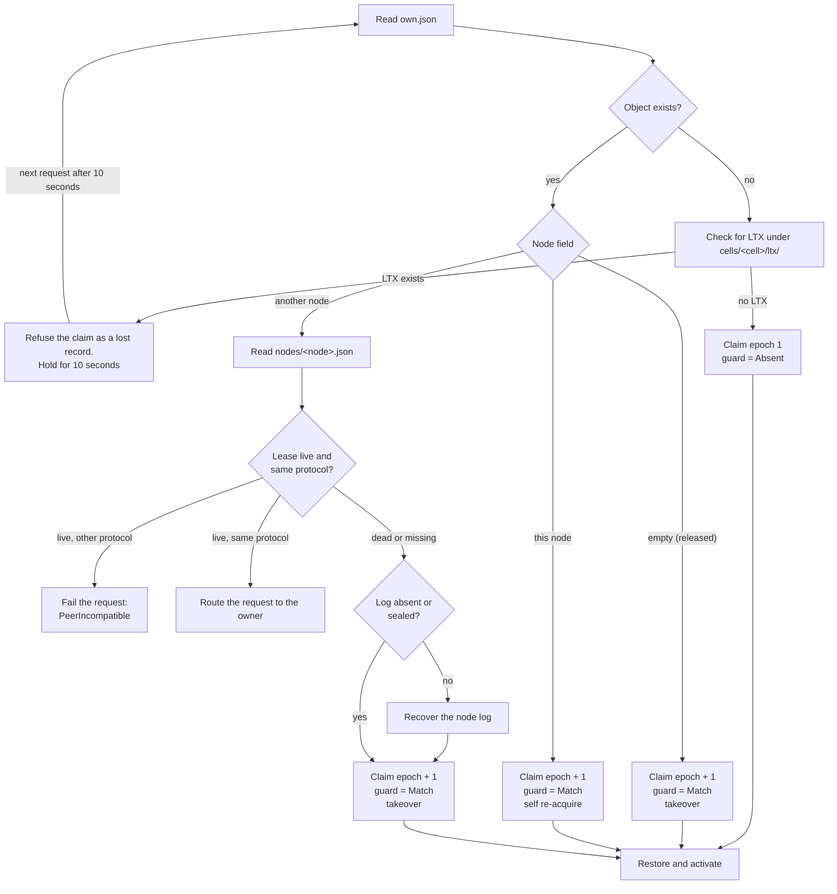
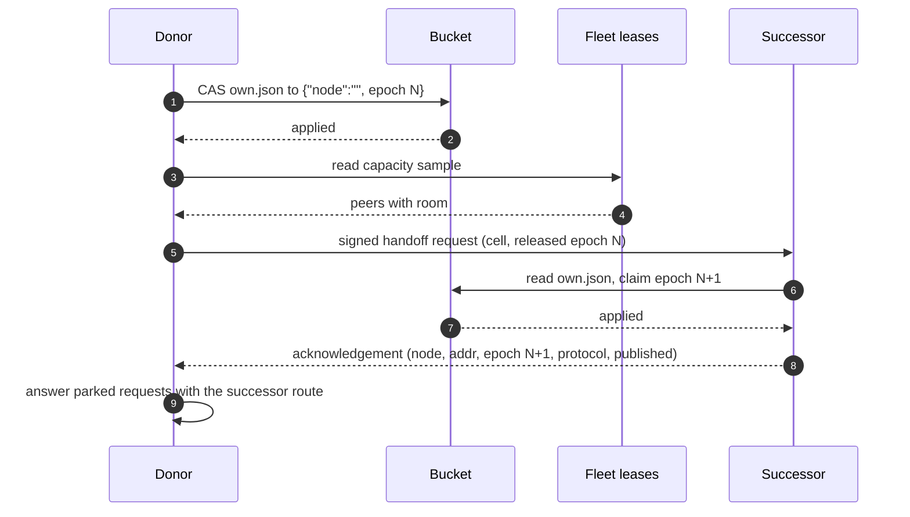

# Ownership, failure, and rebalancing

At most one node may serve a cell as its acknowledged owner. That rule is easy
to write and hard to enforce: a node can pause, lose its network, restart under
the same name, or run with a wrong clock. A node that has lost authority can
keep running code and writing to its local database for a short time. It cannot
acknowledge a reply. celld enforces the acknowledged rule with two records in
the bucket and one rule about who may change which record.

This document follows the two records through a normal acquisition, a dead
owner, a planned handoff, and a fleet-wide change of membership. It also
describes the client behaviour that depends on them, and the failure modes that
remain.

Sources: `crates/logic/lib.rs`, `crates/logic/types.rs`, `crates/logic/rebalance.rs`,
`crates/logic/drain.rs`, `crates/celld/ownership_store.rs`,
`crates/celld/actor.rs`, and `docs/guarantees.md` at commit
`8702f6d186c77698dbfb30cf29e3b1922a88f008`, version 0.6.3.

## The words this document uses

| Word | Meaning here |
|------|--------------|
| Node | One running celld process. |
| Node identifier | The name in `CELLD_NODE`. Two processes with one name are two generations of one logical node. |
| Cell | One addressable server unit with a name and a private SQLite database. In Cloudflare terms, a cell is a Durable Object. |
| Core | The `celld_logic` crate: the decision core. It reads events and returns effects, and it performs no input or output. |
| Shell | The `crates/celld` effect adapters: the executable that performs the core's effects, such as bucket reads, writes, and process exit. |
| Lease | The record at `nodes/<node>.json`. It carries an expiry and a process generation. |
| Process generation | A random value that one process instance writes into its lease. A restart makes a new one. |
| Authority | The right to act as a node: to route requests, to claim cells, and to acknowledge writes. Authority comes from a live lease. |
| Ownership record | The record at `cells/<cell>/own.json`. It carries a node name and an ownership epoch. |
| Ownership epoch | A counter that increases each time a cell changes owner. It never decreases and never resets. |
| Acquisition | The compare-and-swap (CAS) that writes a new ownership record and makes this node the owner. |
| Takeover | An acquisition over a cell whose recorded owner is not live: the named owner's lease has expired, or the record names no node. |
| Handoff | A deliberate release followed by an acquisition by a named successor. |
| Adoption | The successor's acknowledgement of a handoff. The acknowledgement carries the new epoch and the successor's address. |
| Drain | The planned exit of a node. The node hands its cells to peers before it stops. |
| Drain token | A bucket object that asks donors to take turns. It is advisory: a donor that cannot claim it within its wait bound proceeds unserialized. |
| Rebalance | The movement of idle cells from a dense node to a less dense node while every node keeps running. |
| Placement weight | The share of the fleet's cells that a node asks to own, relative to the other nodes. |
| Density | Owned cells divided by placement weight. |
| Deadband | A small margin below a receiver's target, so a receiver does not immediately give the cells back. |
| Planner | The pure function `celld_logic::rebalance::surplus`. Every node runs it on the interval; it only counts and returns a batch size for the densest node. |
| Executor | The donor node's shell code for a planned move. It quiesces, releases, and asks a receiver to adopt. |
| Interlock | A condition that must be settled before a takeover may proceed. The node log is the interlock here. |
| Node log | The per-session log of writes that the owner acknowledged before their bucket upload completed. |
| Follower | A peer node that holds a copy of the owner's node log and fsyncs each acknowledged write. One or two followers form the ensemble. |
| Fleet proof | A durability proof in which one or two followers fsync the write. It does not wait for the bucket. |
| Recovery | The act of draining a dead owner's node log into the per-cell prefixes, then sealing the session. |
| Fence | To remove a node's authority. A fenced node stops serving cells and fails its requests. It can still run code and write to its local database; it cannot acknowledge. |
| Self-fence | A node that fences itself because it cannot prove its lease is still live. |
| Routing | Forwarding a request to the node that owns the cell. |
| Park | To hold a request in the cell's request set while the cell quiesces for a handoff. Adoption answers it with the successor route; a failed move fails it or re-reads ownership. |
| Paced handoff | A lease flag that says the process accepts an ownership-only handoff request and acknowledges it after it claims the next epoch. |
| Pressured | True when a memory-pressure latch is engaged: a memory ceiling was crossed, or the sample is still above the 80 percent low watermark. |
| Memory headroom | `Some(true)` when every configured memory measurement is at or below its low watermark. `Some(false)` when at least one is above. `None` when the peer record predates the field. |
| Restore bound | The limit on a node's unfinished cold routes: its pre-drain baseline plus `max_activations`. |
| Ownership bound | The limit on incumbent ownership skew: the busiest incumbent may exceed the mean by at most one equal successor share. |
| Output gate | The single choke point for every reply and outbound effect. It holds an output until a durability proof covers every write the output can reveal. |
| Ambiguous | A request whose outcome is unknown: the bytes may have reached the peer, and the reply may be lost. |
| At-most-once | The dispatcher's promise not to send its own request twice. It does not promise that an application retry after an ambiguous failure is safe. |
| LTX | The log-tier transaction file format. celld stores replicated SQLite segments as LTX objects under `cells/<cell>/ltx/`. |

## The two records

The first record is the **lease**. One lease exists for each node name, and the
process that writes it holds authority until the recorded expiry passes:

```rust
// crates/celld/ownership_store.rs:35-42
#[derive(Clone, Deserialize, Serialize)]
#[serde(from = "NodeLeaseWireRaw")]
pub(crate) struct NodeLeaseWire {
    pub(crate) node: String,
    pub(crate) expires_ms: u64,
    #[serde(default)]
    pub(crate) addr: String,
    ...
}
```

The struct shown is abridged. The record also carries the process generation
(`generation`, also written as `ownership_index_generation`), the address, the
protocol version, a placement weight, a load sample, and the folded node-log
state. The node log record is folded into the lease: its state, epoch, ensemble,
and tiered offset live in a `log` object beside the authority fields, so one
lease read carries both. Those fields let a peer route a request without asking
the owner, and let the rebalancer compare load without a second read.

The second record is the **ownership record**. It has exactly two fields:

```rust
// crates/celld/ownership_store.rs:21-26
#[derive(Serialize)]
struct OwnerWire<'a> {
    node: &'a str,
    epoch: u64,
}

#[derive(Deserialize)]
struct OwnerWireOwned {
    node: String,
    epoch: u64,
}
```

An empty `node` is a released record: the cell has no owner, and any node may
claim it. The epoch stays. A record that names a node is an owned record. The
core (the `celld_logic` decision crate) reads it as:

```rust
// crates/logic/types.rs:164-171
pub struct OwnerRecord {
    /// `None` is a deliberately released, fenced record. Epochs never reset.
    pub node: Option<NodeId>,
    pub epoch: Epoch,
    pub etag: String,
}
```

The `etag` is the object version. It is the token for the compare-and-swap, and
its presence in the record is what makes an acquire safe without a lock.

The two records answer different questions. The lease answers "may this process
act at all?" The ownership record answers "which process acts for this cell?"
A node can hold a live lease and own no cells. A node can name a cell while its
lease is dead; that is exactly the stale-owner case that a takeover must fix.

## The lease: authority with an expiry

The lease lives for `CELLD_TTL_MS`, the time to live (TTL), which defaults to
10,000 milliseconds. The node renews after one third of the lifetime:

```rust
// crates/logic/lib.rs:2468-2475
let renew_after = if std::mem::take(&mut self.nudge_pending) {
    // The nudge lane: a renewal that answered late already proved the
    // record live, so the next one must follow at once, not a TTL later.
    0
} else {
    (spec.ttl_ms / 3).max(1)
};
```

A renewal is a conditional write against the entity tag (ETag) that this process
last published. The write replaces the expiry and keeps the process generation.
A failed renewal does not fence the node at once. The node reads its own record
back and compares the result against the body that it actually sent:

```rust
// crates/logic/lib.rs:2758-2768 (abridged)
Ok(LeaseCasOutcome::Rejected) => {
    // A rejected renewal is NOT proof of usurpation: an earlier
    // AMBIGUOUS renewal can land after its own readback missed
    // it, and then the ETag moved under our hand (#482 — R2
    // throttling manufactured exactly this, and fencing here
    // halted a healthy follower with 549ms of real authority
    // left). Read back and decide from the record; the readback
    // compares against what the shell actually serialized.
    let read = self.op();
    let mut pending = pending;
    pending.desired.log_state = stamped_log_state;
    self.node_authority = NodeAuthority::Reading { op: read, pending };
    effects.push(Effect::ReadSelfNodeLease { op: read });
}
```

The readback distinguishes three results:

- The record is the one this process wrote. The node continues; the rejection
  was a race with its own late write.
- The record is gone. Another process removed it. The node fences with
  `NodeLeaseMissing`.
- The record is present but carries another process generation. The readback
  compares the returned `generation` with the value this process wrote. The node
  fences with `NodeLeaseMismatch`.

A fourth case fences with `NodeLeaseExpired`: the published expiry passed before
a renewal landed. The fence is one function:

```rust
// crates/logic/lib.rs:3522-3526
fn fence_node(&mut self, reason: HaltReason, effects: &mut Vec<Effect>) {
    self.node_authority = NodeAuthority::Fenced;
    self.fence(effects);
    effects.push(Effect::Halt { code: 3, reason });
}
```

The shell (`crates/celld`, the effect adapters) prints the reason and exits with
code 3:

```rust
// crates/celld/actor.rs:4212-4216 (abridged)
celld_logic::HaltReason::NodeLeaseExpired => tracing::warn!(
    event = "node_lease_watchdog_fence",
    code,
    "SELF-FENCE: node lease not renewed within TTL — halting"
),
```

The fence itself writes nothing to the bucket. Peers already treat an expired
lease as dead, and the ownership records that name the dead node are exactly
what a successor will compare-and-swap. Writing a tombstone would add a request
on a path where the node may have no network.

The clock decides liveness, not the final check. A peer treats a lease as dead
when its recorded expiry is at or before the reader's clock. A node that lies
about its own time can keep acting, but it cannot acknowledge on a stale claim.
A bucket proof rereads the ownership record. A fleet proof is arbitrated by the
takeover, which seals the prior log session.

## The ownership record: who serves the cell

`own.json` is the only table of ownership. There is no separate index. A node
that asks "who owns this cell?" reads this object. The read is one GET:

```rust
// crates/celld/ownership_store.rs:584-596
pub async fn read_owner(&self, cell: &str) -> anyhow::Result<Option<OwnerRecord>> {
    let key = format!("cells/{cell}/own.json");
    let Some((owner, etag)) = load_json::<OwnerWireOwned>(&self.bucket, &key).await? else {
        return Ok(None);
    };
    let record = OwnerRecord {
        node: (!owner.node.is_empty()).then_some(owner.node),
        epoch: owner.epoch,
        etag,
    };
    Ok(Some(record))
}
```

`None` means the object does not exist. A missing object is different from a
released object. A release keeps the object and blanks the node field, so the
epoch is not lost. A deleted object would let the next claimant start at epoch
1. A restore that still finds LTX under `cells/<cell>/ltx/` would then see a
gap. celld therefore refuses to claim a cell whose record is missing while LTX
exists. The shell writes `celld ownership record lost` to standard error and
holds the refusal for 10 seconds (`LOST_RECORD_RECHECK_MS`) without a bucket
request.

The acquire is a conditional write:

```rust
// crates/celld/ownership_store.rs:949-966
pub async fn cas_owner(
    &self,
    cell: &str,
    guard: CasGuard,
    epoch: u64,
) -> anyhow::Result<CasOutcome> {
    let key = format!("cells/{cell}/own.json");
    let body = serde_json::to_vec(&OwnerWire {
        node: &self.node,
        epoch,
    })?;
    let etag = match &guard {
        CasGuard::Absent => None,
        CasGuard::Match(etag) => Some(etag.as_str()),
    };
    match self.bucket.put_cas(&key, body, etag).await? {
        Some(_) => Ok(CasOutcome::Applied),
        None => Ok(CasOutcome::Rejected),
    }
}
```

`CasGuard::Absent` means "create this object only if it does not exist". The
store enforces it with a conditional PUT that fails when the object exists.
`CasGuard::Match` means "replace only this version". Both guards make the
acquire atomic against every other node, because the object store compares the
version, not the content.

## Acquisition: four cases and one counter

A request for a cell that this node does not serve starts an ownership read.
The core takes one of four branches on the record state: absent, this node,
released, or a foreign node. A foreign node branch then splits on that owner's
lease and log.

| Record state | Guard | New epoch | Takeover | Next step |
|--------------|-------|-----------|----------|-----------|
| Absent, no LTX | `Absent` | 1 | No | Claim as a fresh cell |
| Absent, LTX exists | none | none | none | Refuse the claim as a lost record; hold for 10 seconds |
| Names this node | `Match` | `epoch + 1` | No | Claim, then restore |
| Released (empty node) | `Match` | `epoch + 1` | Yes | Claim, then restore |
| Names another node, lease live and same protocol | none | none | none | Route the request to that node |
| Names another node, lease live but protocol differs | none | none | none | Fail with `PeerIncompatible` |
| Names another node, lease expired and log absent or sealed | `Match` | `epoch + 1` | Yes | Claim, then restore |
| Names another node, lease expired and log open or recovering | none | none | none | Recover the node log, then claim at `epoch + 1` |

The released branch is the one that keeps the epoch alive:

```rust
// crates/logic/lib.rs:4134-4152 (abridged)
Ok(Some(record)) if record.node.is_none() => {
    let Some(epoch) = self.next_writer_epoch(&id, &mut cell, record.epoch, effects)
    else {
        self.cells.insert(id, cell);
        return;
    };
    self.place_unowned(
        &id,
        &mut cell,
        Claim {
            guard: CasGuard::Match(record.etag),
            epoch,
            takeover: true,
            prior: None,
            reconciles,
        },
        effects,
    );
}
```

The epoch increases on every acquisition, including a return to the same node.
The reason is the log, not bookkeeping. A new epoch is a new directory under
`cells/<cell>/ltx/`, so the node never appends to a chain that its previous
process wrote. If the previous process left a torn or stale segment, the new
chain starts clean.

A restore reads a chain of epoch prefixes, newest first, down to an epoch that
opened with a whole-database snapshot. A paged epoch continues its predecessor
from a cut: the last transaction identifier and the page count at that point. A
predecessor that does not end exactly at that cut is not part of the chain. A
new epoch directory on every acquisition therefore keeps a torn or stale
segment out of the new chain.

The self row in the table is a re-acquisition, not a local resume. A node that
already owns the cell takes the next epoch and restores from the bucket. The
clean-reload resume is a separate path. A process that restarts under the same
name and replaces a still-live lease with a matching generation keeps its local
database and LTX metadata. It continues the same epoch without a claim, and it
does not run after a takeover.

The increment is checked:

```rust
// crates/logic/lib.rs:1864-1877 (abridged)
fn next_writer_epoch(
    &mut self,
    id: &str,
    cell: &mut Cell,
    previous: Epoch,
    effects: &mut Vec<Effect>,
) -> Option<Epoch> {
    match previous.checked_add(1) {
        Some(epoch) => Some(epoch),
        None => {
            set_phase(&mut self.occupied, cell, Phase::Inactive);
            self.finish_requests(id, cell, Err(RequestError::ResolveFailed), effects);
            None
        }
    }
}
```

An epoch that cannot increase fails the requests instead of wrapping. A wrapped
epoch would reuse an old directory name and mix two chains.



## Takeover: the node-log interlock

A takeover is an acquire over a cell whose recorded owner is not live. In fleet
durability mode, the owner acknowledges a write when one or two followers fsync
it. That is a fleet proof, and it does not wait for the bucket upload. The
followers hold the acknowledged tail in the session's node log. A new owner
that claims first and recovers later would fix a bucket state that excludes
those writes. The claim must therefore wait for recovery:

```rust
// crates/logic/lib.rs:4463-4497 (abridged)
// The takeover interlock, decided HERE on the lease the
// core just read (lease-fold): a dead owner whose folded
// log state is not sealed may hold acked writes only on
// its followers, and claiming before recovery fixes a
// bucket state that excludes them.
let unrecovered = lease.as_ref().is_some_and(|lease| {
    !matches!(
        lease.record.log_state,
        None | Some(crate::log_tier::LogState::Sealed)
    )
});
if unrecovered {
    let owner = record.node.clone().unwrap_or_default();
    let next = self.cell_op(id);
    set_phase(
        &mut self.occupied,
        cell,
        Phase::RecoveringOwnerLog {
            op: next,
            owner: record,
        },
    );
    effects.push(Effect::RecoverNodeLog {
        op: next,
        cell: id.to_string(),
        owner,
    });
    return;
}
```

The two accepted states have different meanings. `None` means the session never
opened a node log, so it never acknowledged past the bucket. `Sealed` means
recovery already completed. The `LogState` enum has three values: `Open`,
`Recovering`, and `Sealed`. `Open` and `Recovering` block the claim. The folded
state is the node log record moved into the node lease record, so one lease
read carries it.

Recovery can fail, and the failure is bounded:

```rust
// crates/logic/lib.rs:4569-4572
cell.owner_log_recovery_attempts =
    cell.owner_log_recovery_attempts.saturating_add(1);
if cell.owner_log_recovery_attempts >= self.config.owner_log_recovery_attempts {
```

After the cap, the cell enters a waiting phase with a backoff and then re-reads
ownership. A persistent failure does not spin. The documented causes are a
follower that answers with an error, a restarted follower that cannot certify a
range, and a mixed-version tail that a newer release cannot decode. A follower
certifies a range when its seal and tail responses describe the same retained
range, and the tail proves that every retained sequence in that range is
readable. A mixed-version tail is an older node's entries-only tail, and it
proves neither completeness nor loss. `docs/guarantees.md` lists these limits
under "The takeover recovery gate".

Recovery reads the dead owner's followers' retained segments and bundles. It
uploads them into the per-cell prefixes under the dead owner's epoch,
`cells/<cell>/ltx/e<epoch>/`, and writes `sealed` into the folded log record.
Only then does the acquire run.

Recovery runs before the successor claims. The successor then claims `epoch + 1`
and restores a chain that includes the recovered prefix. A write that the old
owner makes after the successor's cut is not acknowledged: the takeover gate
seals the prior session before the restore, and a paged successor clips the
chain at the cut.

## Planned handoff: release, then adopt

A drain and a rebalance both move a cell without a dead owner. The order is
fixed: release first, adopt second.



The release is conditional on the exact record that the donor wrote:

```rust
// crates/celld/ownership_store.rs:934-947 (abridged)
pub async fn release_owner(&self, cell: &str, epoch: u64) -> anyhow::Result<CasOutcome> {
    let Some(current) = self.read_owner(cell).await? else {
        return Ok(CasOutcome::Rejected);
    };
    if current.node.as_deref() != Some(self.node.as_str()) || current.epoch != epoch {
        return Ok(CasOutcome::Rejected);
    }
    let key = format!("cells/{cell}/own.json");
    let body = serde_json::to_vec(&OwnerWire { node: "", epoch })?;
    match self.bucket.put_cas(&key, body, Some(&current.etag)).await? {
        Some(_) => Ok(CasOutcome::Applied),
        None => Ok(CasOutcome::Rejected),
    }
}
```

A rejection is an ordinary outcome, not an error. Another acquisition may have
happened between the read and the write. A donor that paused long enough for its
lease to expire is a dead owner to the fleet, so a peer can take the cell over.
A restarted process with the same node name can also replace the record. In
either case the cell belongs to someone else, and blanking the record would
remove a live claim.

The donor accepts an adoption only when it proves four facts: the successor is
another node, the successor's address is not empty, the successor's epoch is
greater than the released epoch, and the successor speaks the same protocol
version:

```rust
// crates/logic/lib.rs:5025-5031 (abridged)
Ok(adopted)
    if adopted.node != self.node
        && !adopted.addr.is_empty()
        && adopted.epoch > released_epoch
        && adopted.peer_protocol == self.config.peer_protocol =>
```

The epoch condition is the proof that the successor actually acquired after the
release. A successor that repeats the released epoch did not acquire anything,
and the donor keeps the cell unowned rather than route to it.

The donor signs the handoff request with the fleet peer-authentication key,
which is a shared hash-based message authentication code (HMAC) key. The request
is the instruction to claim ownership, so its signature is what stops a host
outside the fleet from issuing that instruction. The successor's acknowledgement
is not separately signed. The donor checks the acknowledgement's protocol
version header, and it trusts the internal peer network to carry an honest
reply.

## Rebalancing: moving cells while the fleet runs

The rebalancer is a planner plus an executor. The planner is the pure function
`celld_logic::rebalance::surplus`. Every node runs it on the interval, but only
the densest node gets a count. The executor is the donor node's shell code
behind `Message::Rebalance`: it quiesces each cell, releases it, and asks a
receiver to adopt. A receiver's shell accepts or refuses the handoff. Every move
still goes through the release compare-and-swap and the signed request.

The planner runs on an interval of 5,000 milliseconds by default
(`CELLD_REBALANCE_INTERVAL_MS`). It reads one fleet sample, computes each node's
target from its placement weight, and asks one question: how many cells may this
node give away now?

```rust
// crates/logic/rebalance.rs:129-151 (abridged)
pub fn surplus(
    peers: &[CapacityPeer],
    self_node: &str,
    now_ms: u64,
    max_age_ms: u64,
    since_ms: u64,
    batch: usize,
) -> Option<usize> {
    let fleet = Fleet::observe(peers, self_node, now_ms, max_age_ms, since_ms)?;
    let donor = fleet
        .members
        .iter()
        .max_by(|left, right| left.denser(right))?;
    if donor.peer.node != self_node {
        return None;
    }
    let surplus = donor.owned.saturating_sub(fleet.target(donor));
    let room: u128 = fleet
        .members
        .iter()
        .filter(|member| member.receives_from(self_node))
        .map(|member| fleet.room(member))
        .sum();
    let count = surplus.min(room).min(batch as u128);
    (count > 0).then_some(count as usize)
}
```

Density is owned cells divided by weight, compared without division:

```rust
// crates/logic/rebalance.rs:36-41
fn denser(&self, other: &Self) -> Ordering {
    (self.owned * other.weight)
        .cmp(&(other.owned * self.weight))
        .then_with(|| other.peer.node.cmp(&self.peer.node))
}
```

A receiver fills only to a deadband two percent below its target:

```rust
// crates/logic/rebalance.rs:25-27
const DEADBAND_PERCENT: u128 = 2;
```

The asymmetry is deliberate. A donor drains to exactly its target, so several
donors cannot leave the fleet short by one deadband each. A receiver stops below
its target, so a stale count that overshoots by one batch does not make the
receiver the next donor and send the cells straight back.

The planner refuses to plan from a mixed or stale view. Every live lease must be
fresh, must advertise the paced handoff, and must not be paused. The paced
handoff flag is a lease field. It says that the process accepts an ownership-only
handoff request and acknowledges it after it claims the next epoch. A live peer
that does not advertise the flag may be an older node, so the planner moves
nothing while that lease is live:

```rust
// crates/logic/rebalance.rs:70-86 (abridged)
fn observe(
    peers: &'a [CapacityPeer],
    self_node: &str,
    now_ms: u64,
    max_age_ms: u64,
    since_ms: u64,
) -> Option<Self> {
    ...
    for peer in peers.iter().filter(|peer| peer.expires_ms > now_ms) {
        let fresh =
            peer.sampled_ms > since_ms && now_ms.saturating_sub(peer.sampled_ms) <= max_age_ms;
        if !fresh || !peer.paced_handoff || peer.rebalance_paused {
            return None;
        }
        ...
    }
}
```

`since_ms` is the instant at which the donor's last batch could have reached
every lease. Without it, the planner could mix counts from before a batch with
counts from after it, compute a smaller total, and move cells that come back.

`pressured` is true when a memory-pressure latch is engaged. A latch engages
when a memory ceiling is crossed, and it releases only below the 80 percent low
watermark. `memory_headroom` has three values. `Some(true)` means every
configured memory measurement is at or below its low watermark. `Some(false)`
means at least one is above. `None` means the peer record predates the field.
The predicate below excludes a peer that is pressured or whose
`memory_headroom` is `Some(false)`. It does not exclude a peer whose value is
`None`.

One predicate decides whether a peer can receive a cell, and the planner and the
executor both call it:

```rust
// crates/logic/types.rs:258-261
pub fn reports_adoption_capacity(&self) -> bool {
    !self.pressured && self.memory_headroom != Some(false)
}
```

A split rule here breaks in a specific way. Suppose the planner counts a
saturated node as a receiver, the donor releases the cell, and the receiver then
refuses the handoff because its `reports_adoption_capacity` predicate is false.
The donor's executor skips that receiver and the handoff fails. The cell is now
unowned, and its epoch is retained, because the release runs before the
successor acquire.

The executor allows at most 32 cells in flight across the node's move pipeline
at the default settings (`CELLD_REBALANCE_BATCH_CELLS`). The loop plans a new
batch while cells from an earlier batch are still in flight. It subtracts the
in-flight count from 32 and plans only the remaining room. A single cell whose
proof cannot finish therefore takes one slot but does not stop planning: the
donor plans around it with the rest of the batch. When all 32 slots are in use,
the loop waits.

## Drain: leaving without losing a cell

A drain is a rebalance with a deadline. The node stops accepting new cells,
gives its cells away, and exits. Three things make a drain safer than an
unplanned death:

1. The node releases each cell through the compare-and-swap, so a successor can
   claim it immediately.
2. The node routes parked requests to the successor after the adoption, so a
   client does not see a failure for a cell that moved cleanly.
3. A drain token asks donors to take turns, so one cluster restart does not make
   every node hand off at once.

A parked request is a request that arrived while the cell was quiescing for the
handoff. It waits in the cell's request set. Adoption answers it with the
successor route. A failed drain handoff fails it; a failed rebalance move
re-reads ownership.

The token is advisory. A donor that cannot claim it within a bounded wait
proceeds unserialized, and a dead holder's claim lapses by its time to live.
Readiness stays closed while the token or the fleet capacity is unsettled, so
the orchestrator's rollout deadline bounds the wait.

The token's purpose is visible in the failure it prevents: if ten nodes all
release their cells at once, the survivors must claim thousands of cells in a
burst, and the restore bound fails before the ownership bound does.

The restore bound and the ownership bound are the two capacity checks in the
readiness gate. The restore bound limits each live node's `restoring` count,
which counts cold routes that have not finished, to its pre-drain baseline plus
`max_activations`. The ownership bound limits incumbent ownership skew: the
busiest incumbent may exceed the mean by at most one equal successor share. The
code checks restoration before ownership skew, so a fleet that breaches both
reports `Restoration` first.

## What the client sees

A request that arrives at a node that does not own the cell is forwarded to the
owner. The node keeps the route in a cache. The cache entry carries the owner's
lease deadline, and the ingress checks that deadline on each new request, so a
route to a dead owner stops being used at the deadline even before a new owner
appears.

Two outcomes are safe to retry:

- The peer answered `NotOwner`. Nothing ran.
- The connection was never established. No bytes reached the owner.

Every other outcome is ambiguous: a timeout after the request was written, a
truncated body, or a decode error. The owner may have run the request and lost
the reply. The dispatcher refuses those:

```rust
// crates/logic/routing.rs:55-64
pub fn redispatch(&mut self, attempt: Attempt) -> bool {
    match attempt {
        Attempt::Ambiguous => false,
        Attempt::NotOwner if self.retried_not_owner => false,
        Attempt::NotOwner => {
            self.retried_not_owner = true;
            true
        }
        Attempt::NeverConnected if self.retried_never_connected => false,
        Attempt::NeverConnected => {
            self.retried_never_connected = true;
            true
        }
    }
}
```

This is where the ownership design meets the client contract. A retry after an
ambiguous failure could run a write twice, and the cell would have no way to
tell the two runs apart. The client receives the error instead, and the
application decides whether its own operation is idempotent.

## What can go wrong

| Failure | What the system does | What an operator sees |
|---------|----------------------|-----------------------|
| A node loses its lease | It stops serving its cells and fails incomplete requests | `SELF-FENCE:` on standard error, exit code 3 |
| A node's lease record is replaced | It fences with `NodeLeaseMismatch` | `SELF-FENCE:` and an event name |
| A node restarts under one name | The new generation writes a fresh lease; the old generation is fenced by the ETag | The old process exits with code 3 if it still runs |
| The owner dies with an open node log | A successor recovers the log, then claims at `epoch + 1` | `recovering_owner_log` in the cell state |
| Recovery cannot finish | The cell waits, backs off, and retries up to the configured cap | `waiting_owner_log_recovery` |
| A release loses the race to another acquisition | The release returns `Rejected`; nothing is blanked | No error; the cell belongs to the new owner |
| A handoff successor repeats the released epoch | The donor treats the adoption as failed | `handoff_failed` in activity counts |
| The ownership record is lost | The node refuses the cell and holds the refusal for 10 seconds | `celld ownership record lost` |
| A forward fails ambiguously | The client receives an error; no retry | The error names the peer and the route |
| The fleet view is mixed | The planner moves nothing | No batch; balancing resumes when every lease agrees |

The first row is the deepest. A process that cannot prove its lease still runs
code, and that code can still write to its local database. The fence does not
prevent the write; it prevents the *acknowledgement*. The output gate is the
core's single choke point for every reply. It refuses a reply without a proof. A
proof needs either a live lease for a bucket read or a sealed prior session for
a fleet acknowledgement. A paused node that keeps running therefore fails its
clients. It can lose an unacknowledged write, but it cannot lose an acknowledged
write.

## The Aha

The common design for distributed ownership is a consensus group. A lease is
granted by a majority, and every decision needs a quorum. celld uses one bucket
object instead, and the reason works only because of three separate properties.

First, the object store gives a conditional write. That is a compare-and-swap,
which is the only primitive a consensus group adds for this purpose. Second,
the ownership record changes only on an acquire or a release, not on every
request, so the bucket is not in the request path. Third, a node can always
tell whether it may still act, because the answer is either its own copied lease
deadline or the object version it last wrote.

The cost is a window: between the instant a node's real authority ends and the
instant it notices, the node may act without authority. celld does not try to
close that window. It makes the window harmless. The node's writes go into an
epoch prefix that the successor's paged chain clips at the cut. A snapshot
successor can expose an unacknowledged late tail, and the contract allows that
because the write was never acknowledged. Its replies are held by the output
gate. Its routes expire at the published deadline. The old owner can be wrong
about its authority, and the system stays correct because the *effects* of that
authority are gated on facts that the old owner cannot forge.

This is why the design is not "lease-based consensus". It is "fence the
effects, not the actor". That framing explains the two records, the epoch, the
interlock, and the exit code 3: each one is a place where an actor's belief is
allowed to be stale, and an effect is not.

## Where to read next

- [Cell storage and durability](05-cell-storage-and-durability.md) describes the
  epoch prefix and the durability proof in detail.
- [The Worker runtime](03-the-worker-runtime.md) describes the output gate that
  holds replies.
- [The services](07-the-services.md) describes the fleet sampler, the rebalance
  loop, and the drain coordinator.
- [Deployment and operations](08-deployment-and-operations.md) lists the lease,
  drain, and rebalance settings.
