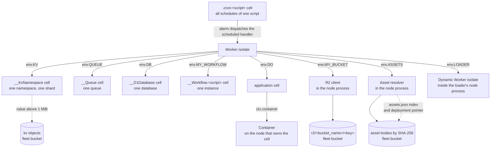
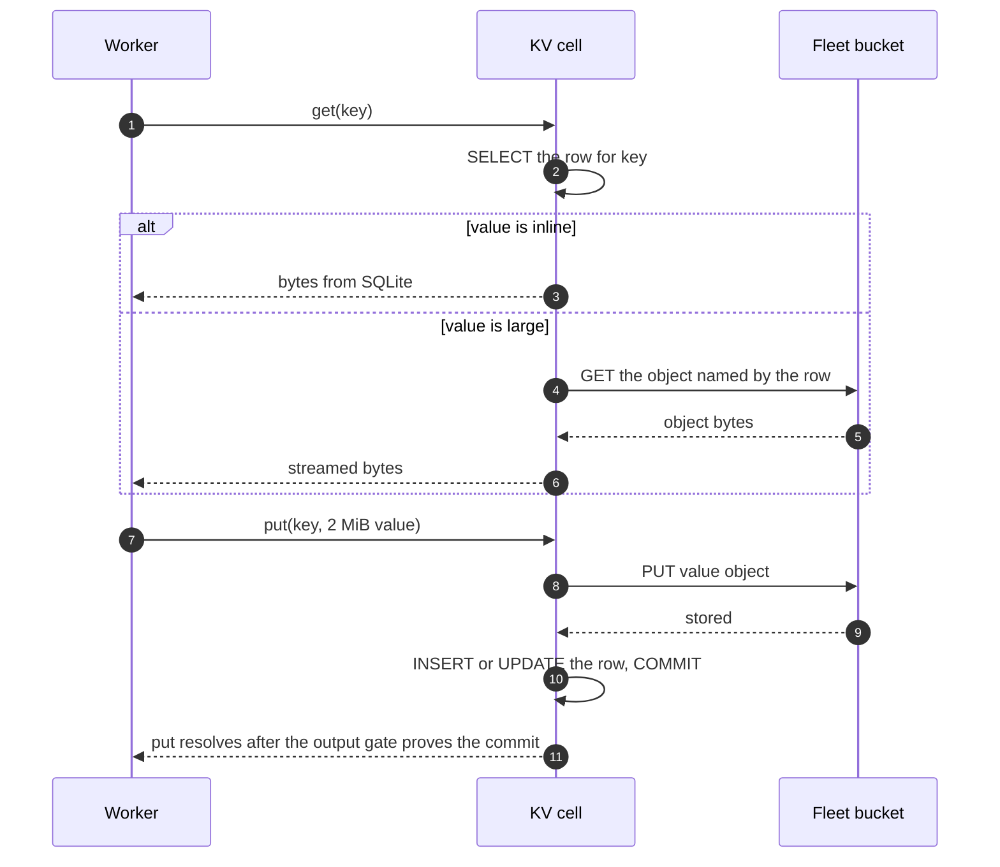
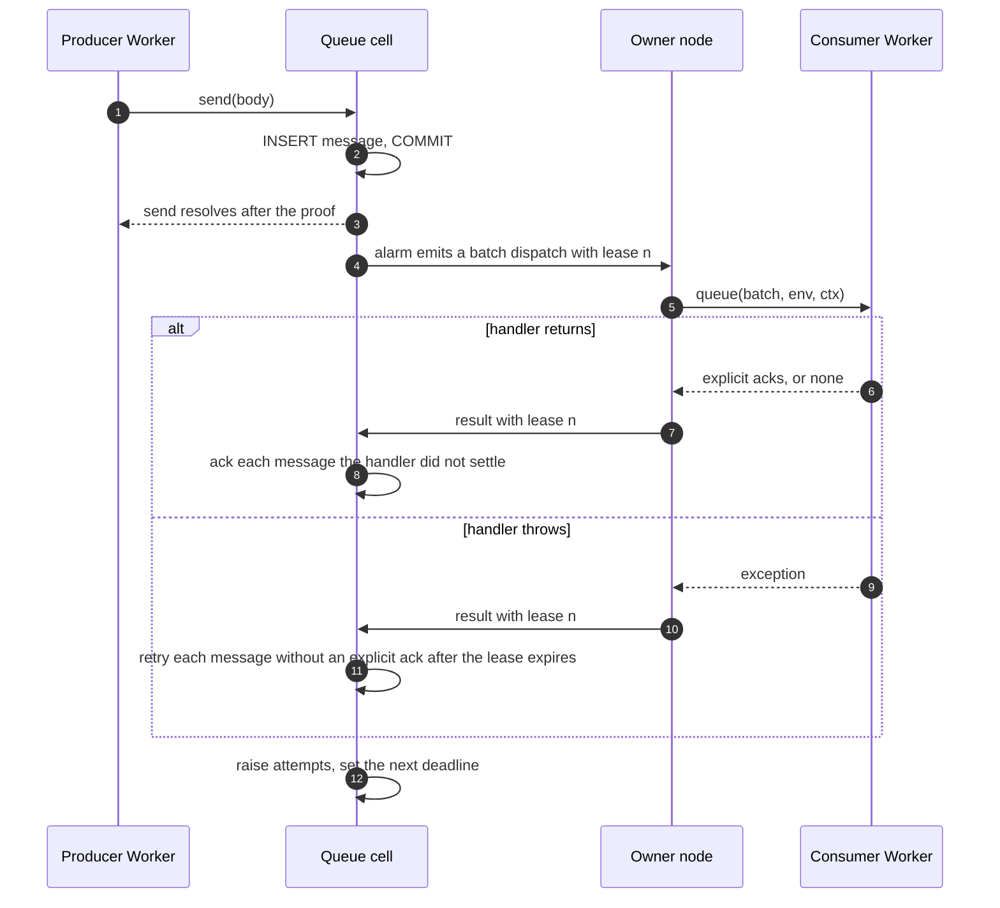

# The services

celld provides the Cloudflare services through three homes for state. A service
either uses one reserved cell, uses keys in the fleet bucket, or runs on the
node that owns its parent. The Key-Value store, the Queues broker, the D1
database service, Workflows, and Cron Triggers use a reserved cell. The R2
object store and the static asset store use the fleet bucket directly. A
Dynamic Worker runs in an isolate on the node of its loader, and a container
runs in the container engine on the node that owns the parent cell.

The homes mix at the edges. A Key-Value namespace keeps its rows in a cell and
puts a value above 1 MiB in the bucket. A static asset body is durable in the
bucket, and the serving node also caches it on local disk. An R2 multipart
upload keeps its in-progress state on the node that opened it. A container
image is durable in the bucket, and the container itself is local. Each section
names the second home where it matters.

The home is the important part. A service that is a cell inherits every promise
of the cell: one owner, serial events, a SQLite transaction, a fencing epoch,
and the output gate. The service code does not repeat those promises. It adds a
public Application Programming Interface (API) on top of them.

Sources: `docs/services/*.md`, `crates/logic/kv.rs`, `crates/logic/queue.rs`,
`crates/logic/cron.rs`, `crates/celld/engine_api.rs`, `crates/celld/r2_store.rs`,
`crates/celld/assets.rs`, `crates/celld/container.rs`, `crates/celld/pool.rs`,
`crates/celld/host_channels.rs`, `crates/celld/js.rs`, and
`crates/celld/js/harness.js` at commit
`8702f6d186c77698dbfb30cf29e3b1922a88f008`, version 0.6.3.

## The words this document uses

| Word | Meaning here |
|------|--------------|
| celld | The self-hosted Cloudflare Workers platform that this document describes. |
| Fleet | Every celld node that shares one fleet bucket. One fleet runs one application. |
| Cell | One Durable Object instance: one SQLite database, one prefix in the fleet bucket, and one ownership epoch. Document 04 defines it. |
| Node | One celld server process. A node owns cells, runs JavaScript isolates, and starts containers. |
| Fleet bucket | The object store that the node opened with `--bucket`. It holds cells, node records, logs, and service objects. |
| Owner | The node whose ownership record for a cell is current. Every event for that cell runs there. |
| Dispatch | One request from a Worker isolate to the owner node of a cell. |
| Durable Object | The Cloudflare primitive that gives one object one identity and one serial event stream. In celld, one Durable Object instance is one cell. |
| Cell scope | The string `<class>:<instance>`. The class name comes first and a colon separates the two parts. The instance is an identifier: a hexadecimal Durable Object identifier for most classes, a script name for a Cron Trigger, and `<workflow>/<instance>` hashed to hexadecimal for a Workflow. |
| Class | The Durable Object class name. It selects the code and the storage mode of a cell. |
| Script | One deployed Worker: its code, its bindings, and its configuration. |
| Binding | The object that the platform passes to a Worker under a name in `env`, such as `env.MY_BUCKET`. The name is the operator's choice. |
| Parent cell | The cell that owns the lifetime of a container. A Durable Object of that class called `ctx.container`. |
| Loader | The node process that runs the isolate that called `env.LOADER`. |
| Container engine | The Docker or Podman daemon on a node. It starts and stops container instances. |
| Container bridge | A virtual network interface that the container engine creates for a container network. |
| Script generation | One deployment version of one script. A new deployment creates a new generation. |
| Shard | One independent division of a namespace. Version 0.6.3 has one shard for each namespace. |
| Alarm | A stored deadline in a cell's SQLite database. The owner runs the matching handler when the deadline passes. |
| Output gate | The rule that holds a response until a proof covers every write the response can reveal. |
| Input gate | The rule that holds an incoming event until the cell's state matches the current ownership epoch. |
| Proof | Evidence that a write survives a failure: a follower wrote it to disk, or the bucket stored it. |
| Follower | A node that stores a copy of a segment for the fleet durability proof. |
| Epoch | The ownership epoch: a counter that grows at each activation. A write under a superseded epoch is fenced off. |
| Namespace key | A fixed string that scopes the identifier derivation of one service, such as `cells:v1:kv:__KvNamespace`. |
| Conditional write | A bucket write that applies only when the object is absent or matches an ETag, and fails otherwise. |
| Lite Transaction (LTX) segment | A file that holds the database pages that one commit changed. |
| Garbage collector | The JavaScript memory reclaimer. It can release an object when no live reference holds it. |
| Replay | Running a Workflow `run()` again from the first line after a step or a restart. A finished step returns its stored result. |
| Reserved cell | A cell whose class is supplied by the runtime, not by the application. |
| Reserved class | The class name of a reserved cell. A leading `__` marks most of them. |
| Namespace | One Key-Value address space. Several Workers can bind the same namespace. |
| Queue | One message broker. A producer sends to it, and one consumer script receives from it. |
| D1 | The Structured Query Language (SQL) database service. |
| R2 | The object storage service. |
| Workflow | A durable function that runs as a sequence of steps, sleeps, and events. |
| Step | One unit of Workflow work whose result is stored, so a later run reuses the result instead of running the callback again. |
| Static asset | A file that a deployment serves from its asset store, with or without application code. |
| Deployment pointer | The bucket object that names the current deployment. |
| Deployment manifest | The bucket object that records a deployment's assets, bindings, and configuration. |
| Dynamic Worker | Worker code that a running Worker supplies at run time and loads into a new isolate. |
| Principal | One deployed script, as the owner of the Dynamic Workers that it loads. |
| Isolate | One V8 (the JavaScript engine) instance with its own heap and context, inside a celld process. |
| Container | A program that runs in the container engine of a node, beside a Worker. |
| Context (`ctx`) | The execution context object that a handler receives. It carries `waitUntil()` and other request-lifetime controls. |
| Facet | A child Durable Object with its own database inside a parent cell. |
| Fetcher | An object with a `fetch()` method that reaches a Worker or a service. |
| Service Binding | A binding whose value is a Fetcher to another Worker. |
| `vars` | Plain configuration values in a deployment, passed to a Worker in `env`. |
| Egress policy | The rule that decides where an isolate may send outbound network traffic. |
| Navigation request | An HTTP request whose `Sec-Fetch-Mode` header is `navigate`; a browser sends it when the user opens a page. |
| Secure computing mode (seccomp) | A Linux facility that limits the system calls that a process may make. |
| Open Container Initiative (OCI) | The standard for container images and runtimes. |
| Central Processing Unit (CPU) | The processor resource that a container instance type reserves. |
| Hypertext Transfer Protocol (HTTP) | The request and response protocol that the services speak. |
| JavaScript Object Notation (JSON) | A text format for values. |
| Time to live (TTL) | The remaining life of a value before it expires. |
| Mebibyte (MiB) | 1,048,576 bytes. |
| SHA-256 | Secure Hash Algorithm 256, a hash that returns 32 bytes. |
| Content-Type | The HTTP header that names the media type of a body. |
| Dead-letter queue | A queue that receives messages that a consumer could not process. |

## The three homes

A service that is a cell has one name, and that name becomes a Durable Object
identifier through the same namespace derivation as an application class. The
derivation has two rounds. The first round hashes the namespace key with
SHA-256, and that hash becomes a Keyed-Hash Message Authentication Code (HMAC)
key. The second round signs the cell name with that key. Celld caches the
result for each thread, because the same name must always produce the same
identifier. The namespace key is written out, not computed, because it is a
stable address:

```rust
// crates/celld/engine_api.rs:507-520
pub(crate) const D1_NAMESPACE_KEY: &str = "cells:v1:d1:__D1Database";
pub(crate) const KV_NAMESPACE_KEY: &str = "cells:v1:kv:__KvNamespace";
pub(crate) const QUEUE_NAMESPACE_KEY: &str = "cells:v1:queue:__Queue";
```

The class name comes first in the cell scope. D1, the Key-Value
namespace, and the Queue broker use one class name for the whole fleet:

```rust
// crates/celld/deploy.rs:72-89 (abridged)
pub const D1_CLASS: &str = "__D1Database";
pub const WORKFLOW_CLASS: &str = "__Workflow";
pub const KV_CLASS: &str = celld_logic::kv::RESERVED_CLASS;
pub const QUEUE_CLASS: &str = celld_logic::queue::RESERVED_CLASS;
pub const RESERVED_CLASSES: &[&str] = &[D1_CLASS, WORKFLOW_CLASS, KV_CLASS, QUEUE_CLASS];
```

A Workflow is the exception. The bare `__Workflow` name in `RESERVED_CLASSES`
reserves the name and stops a user export from using it. The class of a real
Workflow cell is different: it carries the script name after a dot, because one
Workflow instance belongs to one script:

```rust
// crates/celld/deploy.rs:112-114
pub fn workflow_class(script_name: &str) -> String {
    format!("{WORKFLOW_CLASS}.{script_name}")
}
```

`is_reserved_class` accepts the bare `__Workflow` and every `__Workflow.<script>`
name (`crates/celld/deploy.rs:138-140`). The dot is a constraint, not a style
choice. A JavaScript class name cannot contain a dot, so no user export can
collide with it. A colon is the class-and-identifier separator in a cell scope,
so the separator cannot be a colon either. A dot is inside the character set of
the cell scope validator, which makes the name safe as a path component and as
an object key (`crates/celld/deploy.rs:104-111`).

A service that uses the bucket has no cell. R2 writes an object for each key
under one prefix. Static assets write a content-addressed file for each body.
Neither needs a serial event stream, because each write names its own object and
does not depend on an earlier read. R2 can offer a conditional write against an
object, but the object store does not put every writer into one ordered history.



The diagram uses one example binding name for each service. The configuration
chooses the actual name, so `env.KV` in the diagram can be `env.MY_KV` in a
deployment. The R2 binding and the assets binding are implemented inside the
node process, not in a separate service. A dashed edge marks a second home that
the service uses only for some operations.

The arrow to a cell is a dispatch, and a dispatch costs one trip to the owner.
The arrow to the bucket is an object request, and it costs one request to the
bucket. These are different budgets. A binding that writes one key has the
write cost of a cell; a binding that lists one key page has the read cost of a
cell. An R2 put has the cost of the bucket request. Each service section below
states its cost where the cost changes the design.

One arrow points the other way. A Cron Trigger has no binding. The reserved
cell holds the schedule, and its alarm calls the `scheduled` handler of the
script. A container also has no binding of its own: the Durable Object that
declares `ctx.container` starts it, and the container runs on the node that
owns that object.

## Key-Value

A Key-Value namespace is one cell. The cell holds small values in SQLite and
large values in the bucket. The split point is 1 MiB:

```rust
// crates/logic/kv.rs:20-60 (abridged)
pub const RESERVED_CLASS: &str = "__KvNamespace";
pub const MAX_KEY_BYTES: usize = 512;
pub const MAX_VALUE_BYTES: usize = 25 * 1024 * 1024;
/// The largest value celld stores inside the namespace cell.
pub const MAX_INLINE_VALUE_BYTES: usize = 1024 * 1024;
pub const MAX_METADATA_BYTES: usize = 1024;
pub const MIN_EXPIRATION_TTL_MS: i64 = 60_000;
pub const MAX_BULK_KEYS: usize = 100;
pub const MAX_LIST_LIMIT: usize = 1000;
```

The source gives the reason for the split. A cell's writes
replicate as Lite Transaction (LTX) segments, so an inline value is paid for
twice: once in SQLite and once on the wire. A 25 MiB inline put would be the
most expensive operation in the runtime. A repeated fleet A/B measurement (two
variants compared on the same fleet) found
that the inline path is faster at 1 MiB and the bucket path is faster at 2 MiB,
so 1 MiB is the largest measured size before the crossover.

A key is at most 512 bytes, and the metadata of one value is at most 1,024
bytes (`crates/logic/kv.rs:149`, `:153`). A value is at most 25 MiB. A call
that crosses a limit fails, and celld never truncates the value.

A large value becomes an object, and the row names it. The current object key
carries the ownership epoch, so an older garbage collector cannot address an
object that a later owner wrote. A legacy reference carries only a digest,
because it predates the epoch rule:

```rust
// crates/logic/kv.rs:70-80 (abridged)
pub enum BlobRef<'a> {
    Legacy { digest: &'a str },
    V2 { epoch: u64, digest: &'a str },
}
```

An inline value needs no bucket request. A large value needs one bucket request
to read and one to write, plus the cell dispatch. A node without a fleet bucket
refuses a large write with `KV large values need a fleet bucket`
(`crates/celld/host_channels.rs:168`). The service does not truncate the value.

The namespace identity becomes a cell scope through the same two-round
derivation as an application identifier. The operator command line interface
uses one function, and the binding uses the same function:
```rust
// crates/celld/engine_api.rs:570-575
pub fn kv_cell_scope(namespace_id: &str, shard: u32) -> String {
    let name = celld_logic::kv::cell_name(namespace_id, shard);
    let id = durable_object_id_for_name(KV_NAMESPACE_KEY, &name);
    format!("{}:{}", crate::deploy::KV_CLASS, durable_object_id_hex(&id))
}
```

This identity rule has a sharp edge. The cell name comes from one function on
both sides. A formatting disagreement would not fail; it would silently address
a second, empty namespace. `SHARDS` is 1 in this version, so one namespace has
one cell and one writer (`crates/logic/kv.rs:237`).

The binding surface is the Cloudflare surface:

- `get(key, type)` returns `"text"`, `"json"`, `"arrayBuffer"`, or `"stream"`,
  and a missing key gives `null`.
- `getWithMetadata(key, type)` returns the value and the metadata of the write.
- `put(key, value, options)` accepts a string, an `ArrayBuffer`, a typed array,
  or a `ReadableStream`. The options are `expiration` in seconds from the Unix
  epoch, `expirationTtl` in seconds from now, and `metadata`.
- `delete(key)` removes one key.
- `list({ prefix, cursor })` returns at most 1,000 keys in byte order and a
  cursor for the next page. A concurrent write cannot make the cursor skip a
  key.
- A bulk `get(keys)` takes an array of at most 100 keys.

A `kv_namespaces` entry gives a `binding` and an `id`. The `id` is the
namespace identity and can be any string. Two Workers that name one `id` reach
one namespace, and celld ignores `preview_id`. The minimum expiration is 60
seconds, and an expired key becomes invisible at the moment of expiry.

The public behaviour follows Cloudflare except where the service page records a
difference. A read never returns a stale value, because it reaches the owner
cell. A namespace has no edge cache, so `cacheTtl` has no effect and
`cacheStatus` is `null`. A read of a value costs one cell dispatch, so an
application that reads one value many times in one request should hold it in a
local variable. A write-hot counter belongs in a Durable Object, because the
counter logic and the write run in one event there. A Key-Value read and a
Key-Value write are two dispatches, so two clients can overwrite each other.



The row and the object are two records. The object is written first, and the
commit of the row makes it reachable. A crash between the two steps leaves an
unreferenced object, which the epoch garbage collection removes.

## Queues

A queue is one reserved cell. The cell owns the messages, the leases, the
retry deadlines, and the dead-letter rule. The policy is a pure module, so the
cell and the tests agree about every limit:

```rust
// crates/logic/queue.rs:17-42 (abridged)
pub const RESERVED_CLASS: &str = "__Queue";
pub const MAX_MESSAGE_BYTES: usize = 128_000;
pub const MAX_SEND_BATCH_BYTES: usize = 256_000;
pub const MAX_BATCH_MESSAGES: usize = 100;
pub const MAX_BATCH_TIMEOUT_SECONDS: u16 = 60;
pub const MAX_RETRIES: u16 = 100;
pub const MAX_CONCURRENCY: u16 = 250;
pub const MAX_DELAY_SECONDS: u32 = 86_400;
pub const DEFAULT_MAX_BATCH_SIZE: u16 = 10;
pub const DEFAULT_MAX_BATCH_TIMEOUT_SECONDS: u16 = 5;
pub const DEFAULT_MAX_RETRIES: u16 = 3;
pub const RETENTION_MS: Ms = 4 * 24 * 60 * 60 * 1000;
```

`Ms` is the source's type alias for a signed 64-bit count of milliseconds
(`crates/logic/types.rs:11`). `RETENTION_MS` is four days.

The queue name is already a fleet-wide resource identity, so the cell name is
the queue name itself:

```rust
// crates/logic/queue.rs:44-52 (abridged)
pub fn cell_name(queue_name: &str) -> &str {
    queue_name
}
```

A producer sends a message with `send(body, { contentType, delaySeconds })` or
`sendBatch(messages)`. `contentType` is `"v8"`, `"json"`, `"text"`, or
`"bytes"`. One `sendBatch` call holds at most 100 messages and 256,000 bytes,
and one message holds at most 128,000 bytes. A `delaySeconds` value is at most
86,400. A `queues.producers` entry gives a `binding` and a `queue` name, and the
entry can set `delivery_delay` as the default delay.

The cell holds at most 256 producer calls at one time. A further call is
refused with a cell overload error, and the producer can retry. The bound is
per queue cell, and it counts replies that wait for one shared commit:

```rust
// crates/celld/pool.rs:59-62
/// Bound the producer replies that can wait for one Queue's shared commit and
/// durability proof. Four 64-call groups can overlap, and a stopped bucket
/// still cannot retain an unbounded number of promises or copied bodies.
pub(crate) const MAX_QUEUE_PRODUCER_EVENTS_PER_CELL: usize = 256;
```

`send` resolves after the cell commits the message, so the message is in the
cell's log before the caller sees success. A queue has one writer, so more
queues are the way to add write capacity.

A consumer runs as a Worker handler, not inside the queue cell. The queue cell's
alarm emits a dispatch that names the consumer script, the batch, and one lease
generation for each message. The node that owns the queue cell runs the
consumer script's `queue` handler in a Worker isolate, then sends the handler's
result back to the cell. The cell applies a settlement only if the lease
generation in the result still matches the current lease. That comparison
prevents a late settlement from an expired lease from acknowledging a newer
delivery. The policy module never returns a bare sequence number for a
deliverable row; it returns the planned lease with the next generation:



The important edge is `Q->>N`: the cell does not run application code. It emits
a dispatch, and the node's runtime invokes the consumer script. The reverse edge
carries the result back to the cell, which alone decides the settlement.

A consumer is one script, and a `queues.consumers` entry names the `queue`. A
deployment in which two scripts consume one queue fails. The entry sets
`max_batch_size` (10 by default, 100 at most), `max_batch_timeout` in seconds
(5 by default, 60 at most), `max_retries` (3 by default, 100 at most),
`max_concurrency` (250 at most), `retry_delay`, and `dead_letter_queue`. Celld
validates each bound at deploy time.

`MAX_CONCURRENCY` is the largest value that the consumer configuration may set.
It limits the number of active leased batches, not the number of producer calls
(`crates/logic/queue.rs:214-216`). The 256 producer calls are a separate
admission bound on the queue cell.

`queue(batch, env, ctx)` receives the batch. `batch.queue` names the queue, and
each entry of `batch.messages` has an `id`, a `timestamp`, a `body`, and an
`attempts` count. `message.ack()` and `message.retry({ delaySeconds })` settle
one message. `batch.ackAll()` and `batch.retryAll()` settle the whole batch.
The first call for a message wins. A handler that returns acknowledges every
message that it did not settle. A handler that throws retries every message that
it did not acknowledge.

A message that passes `max_retries` moves to the queue named by
`dead_letter_queue`, or celld deletes it when the consumer names none. Delivery
is at least once, and the order is not guaranteed. The message identifier stays
the same across a redelivery, so it is a usable idempotency key.

Celld keeps a message for four days, and this period is not configurable. A
consumer that never settles its batch holds the lease until the lease expires,
and celld counts that as one failed delivery. The lease covers the admission
wait, the handler budget, and the settlement budget, and the cell stores the
absolute deadline when it installs the lease
(`crates/logic/queue.rs:131-141`). Celld adds no exponential backoff; the
application chooses the delay from `message.attempts`, usually a base delay
multiplied by two for each attempt.

## D1

D1 gives each database one cell, and one cell is one SQLite database. A
database therefore has its own SQLite file, one writer, and one event stream. A
`d1_databases` entry gives a `binding`, a `database_name`, and a `database_id`.
Celld uses the `database_id` as the identity, or the `database_name` when the
entry has no identifier. The class is fleet-wide, so two Workers that name one
identity reach one database:

```rust
// crates/celld/engine_api.rs:556-561
pub fn d1_cell_scope(database_identity: &str) -> String {
    let id = durable_object_id_for_name(D1_NAMESPACE_KEY, database_identity);
    format!("{}:{}", crate::deploy::D1_CLASS, durable_object_id_hex(&id))
}
```

A database is created on first use. A typo in `database_name` therefore opens
an empty database and does not fail, which the service page calls out as a
sharp edge. This is not a silent change to existing data. It creates a new,
empty database under the misspelled identity, so the application sees a missing
table or a missing row instead of an error. The sharp edge applies when the
entry has no `database_id`. When the entry has an identifier, celld uses that
identifier, and a name typo has no effect. The application should fix the name
in the configuration and keep the identity stable.

The API is the Cloudflare prepared-statement surface:

- `prepare(sql)` returns a statement, and `bind(...values)` returns a new
  statement with the values.
- `all()` and `run()` return `success`, a `results` array of row objects, and
  `meta`. `meta` is the statement metadata object; this version fills it with
  the row counts and the session flags below. `run()` is `all()` under a second
  name.
- `first()` returns the first row or `null`, and `first(column)` returns one
  column of that row.
- `raw()` returns the rows as arrays, and `raw({ columnNames: true })` puts the
  column names in the first array.
- `batch(statements)` runs prepared statements in one transaction and returns
  one result for each statement.
- `exec(sql)` runs one or more statements without parameters.

`bind()` checks each value. A number and a string pass. A boolean becomes `1`
or `0`. An `ArrayBuffer`, a typed array, or an array of byte numbers becomes a
Binary Large Object (BLOB). Any other value throws `D1_TYPE_ERROR`. A prepared
statement that holds a second statement fails, because a statement must contain
one statement. `exec` and `batch` accept several statements and run them in one
transaction.

The limits are the Cloudflare limits: a statement of at most 100,000 bytes, at
most 100 bound parameters, at most 100 columns in a table, and a string, a
BLOB, or a row of at most 2,200,000 bytes. A result
through a binding can hold at most 100,000 rows or 32 MiB; the row cap does not
apply to `first()`. Application SQL cannot use `BEGIN`, `COMMIT`, `ROLLBACK`,
`SAVEPOINT`, `ATTACH`, `DETACH`, `VACUUM`, `load_extension()`, or a temporary
table, index, trigger, or view. The service allows the `fts5` and `fts5vocab`
virtual tables, where `fts5` means SQLite full-text search version 5. It also
accepts the `PRAGMA` list in the Cloudflare D1 statement reference.

Every statement goes to the owner cell. A `batch` costs one dispatch for all of
its statements. A read-only statement reports `last_row_id` and `changes` as
`0`, where Cloudflare reports the values that the previous write left on the
connection. `withSession()` always selects the primary, `getBookmark()` returns
`celld:primary`, `meta.served_by_primary` is always `true`, and
`meta.served_by_region` is always `local`. These session helpers belong to the
database handle that `env.DB` returns. `dump()` throws. A database has one
writer, so more databases are the way to add write capacity.

`celld d1 execute` and `celld d1 migrations apply` run SQL from the command
line through a live node. Celld has no D1 Representational State Transfer
(REST) API and no Time Travel.

## R2

R2 binds a Worker to one bucket name, and celld stores each object in the fleet
bucket that the node opened with `--bucket`. The R2 bucket name is a logical
name inside the fleet bucket; it is not a separate object store. The key space
is one prefix:

```rust
// crates/celld/r2_store.rs:46-50
pub(crate) fn blob_key(bucket_name: &str, key: &str) -> String {
    format!("r2/{bucket_name}/{key}")
}
```

The prefix is safe for two reasons. The deployment manifest validates
`bucket_name` as at most 64 characters of letters, digits, `-`, and `_`, and it
must start with a letter, a digit, or `_`. A name therefore cannot contain `/`.
Object keys are also flat strings, not file-system paths, so a `..` inside a key
is part of the key and cannot move to another prefix
(`crates/celld/deploy.rs:1815`, `:2299-2309`). A node without a fleet bucket
answers every R2 call with an error (`crates/celld/r2_store.rs:53-57`).

The API is the Cloudflare R2 worker surface:

- `get(key, { range, onlyIf })` returns an `R2ObjectBody` with a streamed body,
  or `null`. A range is an `offset`, a `length`, a `suffix`, or a `Range`
  header.
- `head(key)` returns the object record without the body.
- `put(key, value, { httpMetadata, customMetadata, onlyIf })` accepts a string,
  an `ArrayBuffer`, a typed array, a `Blob`, or a `ReadableStream`. A refused
  condition returns `null`.
- `delete(keys)` removes one key or a list of up to 1,000 keys.
- `list({ prefix, delimiter, cursor, startAfter })` returns a page of at most
  1,000 objects and a cursor for the next page.
- `createMultipartUpload(key)` returns a handle. `uploadPart(number, value)`
  sends one part, and `complete(parts)` assembles the object.

A key is 1 to 1,024 bytes. Celld measures the key that the application supplies,
before it percent-encodes the key for storage
(`crates/celld/js/harness.js:804-813`). A streamed `put` body that grows past
8 MiB becomes a multipart upload. A conditional write cannot use a streamed
body larger than 8 MiB, because a multipart completion carries no precondition,
so celld rejects that write with an error. An object `version` equals its
content entity tag (ETag), so identical content produces the same version. `ssecKey` and
`jurisdiction` are unavailable, and `createMultipartUpload()` does not accept a
checksum.

The object store keeps some keys in a percent-encoded form. A key with a
non-ASCII character, a control character, the backtick character, or one of
the characters `%`, `\`, `{`, `}`, `^`, `[`, `]`, `"`, `<`, `>`, `~`, `#`,
`|`, `*`, or `?` is encoded byte by byte. Each empty
segment becomes `%`, so `photos/` becomes `photos/%`, and `a/b`, `/a/b`,
`a//b`, and `a/b/` are four different objects. A `list` returns the decoded
key, but it sorts and compares `startAfter` in the encoded form. For example,
Cloudflare R2 returns `a~` after `startAfter: "aa"`, but celld compares `a%7E`
with `aa` and skips the key. A cursor from a celld listing avoids that
mismatch. A listing fails when it reaches a non-UTF-8 percent-encoded key that
another tool wrote.

A multipart upload lives on the node that opened it. A part that arrives before
its predecessor waits in memory, up to 256 MiB; the node then refuses a further
part. A part that already reached the object store cannot be replaced. A
multipart upload cannot resume on another node or after a restart.

The metadata split is specific. Five content headers are stored as headers:
`Content-Type`, `Content-Language`, `Content-Disposition`, `Content-Encoding`,
and `Cache-Control`. `customMetadata`, `cacheExpiry`, the checksums, and the
storage class are stored together as one JSON value under the `celld-r2`
metadata name. Celld also runs on Azure Blob Storage, and that store refuses a
hyphen in a metadata name, so the name is `celld_r2` there
(`crates/celld/r2_store.rs:40-44`, `:60-77`). An object that another tool wrote
still reads through the binding: its user metadata becomes `customMetadata`,
and its headers become `httpMetadata`.

## Workflows

A Workflow instance is a cell. Each progress step calls `run()` again from the
first line. A finished step returns its stored result and does not run its
callback again. All code outside a step callback therefore runs again on every
replay. A step whose result did not commit before a node failure runs again, so
a step callback must tolerate a second attempt.

The public API is:

- A class extends `WorkflowEntrypoint` and implements `run(event, step)`.
  `event.payload` holds the parameters, and the return value becomes the
  `output` field of `status()`.
- `step.do(name, callback)` runs one durable step and retries it on failure.
- `step.sleep(name, duration)` and `step.sleepUntil(name, timestamp)` stop the
  instance until a deadline.
- `step.waitForEvent(name, options)` stops the instance until a matching event.
- `env.MY_WORKFLOW.create()` and `get(id)` return one instance.
  `createBatch(items)` returns a batch handle for at most 100 instances, and
  `deleteBatch(ids)` deletes 1 to 100 instances by identifier.
- `status()`, `sendEvent()`, `pause()`, `resume()`, `restart()`, `terminate()`,
  and `delete()` control the instance.

`status()` reports one of `queued`, `running`, `waiting`, `paused`, `errored`,
`terminated`, or `complete` (`crates/celld/js/harness.js:7946-7955`,
`:8505-8512`, `:8665-8675`, `:8800-8812`). A sleep, a wait, and a pending retry
all report `waiting`.

Every sleep, wait, and pending retry stores its deadline. A crash or a slow
replay cannot move the deadline. A waiting instance holds no isolate. Its cell
leaves memory and becomes dormant when the next deadline
is farther away than the near-alarm residency window, which is one hour by
default and changes with `CELLD_ALARM_RESIDENT_MS`.

`step.do()` uses the Cloudflare retry defaults when the call supplies no
`retries` object: five retries after the first attempt, a 10-second delay,
exponential backoff, and a timeout of 10 minutes for one attempt. Six attempts
are therefore the default maximum. A retries object can raise the limit to
10,000 attempts for one step. `step.waitForEvent()` times out after 24 hours by
default, the timeout must be at least one second, and a sleep or a wait can last
at most 365 days. An event that arrives before the instance reaches its wait
step is buffered. The instance retains a successful or failed result for 30
days by default. The `retention` option is an object with `successRetention`
and `errorRetention`, and neither duration can exceed 30 days
(`crates/celld/js/harness.js:7948-7956`, `:8093-8127`).

Celld sets no limit on the number of concurrent instances; fleet memory and the
resident-cell cap bound it. `locationHint` accepts one of `wnam`, `enam`, `sam`,
`weur`, `eeur`, `apac`, `apac-ne`, `apac-se`, `oc`, `afr`, and `me`, but fleet
ownership selects the cell location. A `workflows` entry cannot carry
`schedules`, `limits`, or a `script_name` that names another script. The
Workflows REST API and the `wrangler workflows` commands are unavailable, so an
application drives an instance through the binding.

The instance identity is script-scoped:

```rust
// crates/celld/engine_api.rs:589-597 (test helper, abridged)
pub fn workflow_cell_scope_for_test(script_name: &str, ...) -> String {
    let class = crate::deploy::workflow_class(script_name);
    let name = format!("{workflow_name}/{instance_id}");
    ...
}
```

The name combines the Workflow name and the instance identifier. The production
path builds the same string from the Workflow binding. Two scripts cannot
collide, because the class carries the script name. The source records why the
class name changed: the class registry of a deployment is one flat map, so two
co-hosted scripts that registered the same reserved class name refused to start
(`crates/celld/deploy.rs:93-111`).

Rollback, a sensitive step result, and a `ReadableStream` step result are not
available. A step result, an event payload, and the Workflow parameters each
have a 1 MiB limit. Non-step work cannot stay pending for more than 60 seconds.

## Cron Triggers

A Cron Trigger runs the `scheduled(controller, env, ctx)` handler of a Worker.
`controller.cron` holds the expression text, `controller.scheduledTime` holds
the occurrence in milliseconds, and `controller.noRetry()` stops the retries. A
project declares its schedules in a `triggers.crons` array. `main` names the
Worker entry module, and a project with Cron Triggers must have one.
`celld deploy` fails on a malformed expression or on `triggers.crons` without
`main`. Celld sets no limit on the number of expressions.

The schedule lives in one reserved cell, and the cell's alarm is the executor:

```rust
// crates/logic/cron.rs:24-39
pub const RESERVED_CLASS: &str = ".cron";

pub fn reserved_cell(script_name: &str) -> String {
    format!("{RESERVED_CLASS}:{script_name}")
}
```

The leading `.` is inside the cell scope character set, but it is not a legal
start for a JavaScript identifier, so no exported class can collide with the
reserved name. The cell is keyed on the script name and nothing else. A
conditional ownership claim on this one name is what makes a schedule fire once
per fleet instead of once per node. A stable name also lets a deployment change
the schedule without stranding the alarm that the old schedule armed.

A cell has one alarm row, so one deadline must serve every expression of the
script, however many there are. Two functions compress the expressions into
that one row:

```rust
// crates/logic/cron.rs:563-583
/// The earliest next occurrence across every expression on a script. This is
/// what the reserved cron cell arms, because one alarm row holds one deadline
/// however many expressions the script declares.
pub fn next_across(crons: &[Cron], after_ms: Ms) -> Option<Ms> {
    crons
        .iter()
        .filter_map(|cron| next_after(cron, after_ms))
        .min()
}

/// Which expressions match a fired occurrence, by index. A single deadline can
/// belong to several expressions, and Cloudflare invokes `scheduled` once per
/// matching cron, so the fan-out happens here rather than at arm time.
pub fn matching(crons: &[Cron], at_ms: Ms) -> Vec<usize> {
    crons
        .iter()
        .enumerate()
        .filter(|(_, cron)| matches(cron, at_ms))
        .map(|(index, _)| index)
        .collect()
}
```

Arm time keeps only the minimum: `next_across` asks each expression for its
next occurrence after the current time and takes the earliest. Fire time
recovers the rest: `matching` tests every expression against the deadline and
returns the indices that match. The handler then runs once for each index, in
index order, with `controller.cron` set to that expression's text. Two
expressions that share a deadline therefore produce two handler runs at that
deadline, not two alarm rows. The fan-out at fire time, rather than at arm
time, is what keeps the cell at one row when a script declares many
expressions.

A failed handler competes with the schedule for the same row for the same
reason. `cron_rearm` takes the earlier of the retry deadline and the next
occurrence (`crates/logic/cron.rs:585-603`). The next occurrence wins whenever
it is sooner, so a failing cron retries with the usual backoff but can never
delay or skip a scheduled run. A cron that fires faster than the backoff simply
never retries, because the next attempt is only seconds away.

Celld reads the Cloudflare cron dialect, not the Portable Operating System
Interface (POSIX) cron dialect. The weekday field numbers the days 1 to 7 from
Sunday, so `1-5` means Sunday to Thursday. The resolution is one minute, and
the zone is Coordinated Universal Time (UTC). A field takes `*`, a value, an
`a-b` range, an `a,b` list, and a `/n` step. The month and weekday fields take
three-letter names. The day fields are day-of-month and day-of-week. They take
`L` for the last day, `LW` for the last weekday, `<d>W` for the weekday nearest
day `<d>`, and `<dow>#<n>` for the `<n>`th `<dow>` of the month. When both day
fields are restricted, they form a union.

Celld refuses a descending range such as `SAT-SUN` and a list that contains `*`.
A step must not be larger than the field's span, which is 59 for the minute
field, so `*/60` fails. The parser walks at most 146,097 days, one Gregorian
cycle, before it calls an expression unsatisfiable. The calendar repeats every
400 years, so the bound is a proof, not an estimate. A malformed expression
stops the deploy. An expression that is well formed but can never match a date
deletes its alarm instead of firing late
(`crates/logic/cron.rs:335-341`).

Celld runs the scheduled handler of one script one at a time, and it waits for
the `waitUntil()` work of one handler before the next occurrence. `waitUntil()`
registers a promise that the handler does not await but that must finish before
the event is done. A handler that takes longer than the interval delays the next
occurrence, so long work belongs in a Queue or a Workflow.

A handler that throws retries after 4 seconds, and the delay doubles after each
further failure. Celld gives up after six failures, or at the next occurrence,
whichever comes first. `controller.noRetry()` stops the retries. An ownership
move loses a pending retry. After downtime, celld runs one missed occurrence and
skips the rest. `controller.scheduledTime` holds the scheduled occurrence, not
the start of the attempt, so a late run and a retry name the same minute.

## Static assets

A static asset is a file that a deployment serves from its asset store, with or
without application code. `celld deploy` uploads each file body once under its
SHA-256 digest, and a redeploy uploads only the changed bodies. A node caches a
file on its own disk when it first serves it.

Each deployment also writes an asset index named `assets.json` at the
deployment prefix, so its key is `<deployment prefix>/assets.json`. The index
lists every path, its digest and media type, and the header and redirect rules.
The deployment manifest carries the digest of the index. After an asset miss, a
node reads the deployment pointer at most once in five seconds. If the pointer
names a newer deployment, the node reads that deployment's manifest and then
its index, and it checks the index digest:

```rust
// crates/celld/assets.rs:604-613 (abridged)
let (bytes, _) = bucket.get(&index_key).await?.with_context(|| format!("read {index_key}"))?;
let sha256 = format!("{:x}", Sha256::digest(&bytes));
if sha256 != reference.sha256 {
    return Err(anyhow!("fallback asset index checksum mismatch"));
}
```

For an asset body, the content digest is also the ETag. A request with a
matching `If-None-Match` receives `304`. The index has its own digest, and the
node compares that digest with the value in the deployment manifest before it
uses the index; a mismatch fails the deployment read. A `Range` request receives `206`, an unsatisfiable range receives `416`,
and a `HEAD` response keeps the real `Content-Length`
(`docs/services/static-assets.md`).

The `assets` block accepts `directory`, `binding`, `html_handling`,
`not_found_handling`, and `run_worker_first`. Any other key stops the
deployment. A project with `assets` and no `main` cannot set `run_worker_first`
or declare a binding. Celld refuses a `.assetsignore` file, a symbolic link, a
special file, a non-UTF-8 name, an unsafe decoded path, and a `_worker.js`
entry, and it stops the deployment instead of skipping the file.

Routing has an order. Celld looks up an asset only for a `GET` or `HEAD`
request. Every other method goes to the Worker. On an asset-only deployment
there is no Worker, so a `POST` receives `404`. `run_worker_first` takes `true`
or a list of up to 100 route patterns in which a `!` prefix excludes a path.
Each pattern is an exact path or a path prefix, and the exact `/` pattern
matches only the root path. The `_redirects` rules run before any file lookup,
and the first match wins. A rule with status 301, 302, 303, 307, or 308 answers
with a `Location` header. A rule with status 200 restarts routing at the local
path and keeps the original Uniform Resource Locator (URL). A `_headers` file
sets response headers.

`html_handling` maps a path to an HTML file. The default,
`auto-trailing-slash`, maps `/about` to `/about.html` and `/about/` to
`/about/index.html`. `force-trailing-slash` makes the trailing slash canonical.
`drop-trailing-slash` makes the path without a trailing slash canonical.
`none` accepts only the exact path. A non-canonical spelling receives a `307`
to the canonical path with the query string
(`docs/services/static-assets.md:55-58`, `crates/celld/assets.rs:1119-1126`).

`not_found_handling` accepts `none` (the default), `single-page-application`, or
`404-page`. `single-page-application` returns `/index.html` with status `200`.
`404-page` returns the nearest `404.html` with status `404`. A navigation
request is one whose `Sec-Fetch-Mode` header is `navigate`; a browser sends it
when the user opens a page. With a Worker, celld applies `not_found_handling`
only to a navigation request, and only when the deployment's compatibility
date is 2025-04-01 or later, or the matching compatibility flag is set. The
Worker answers any other miss. With no Worker and no match, the node answers
`404`.

That pointer read lets a newer deployment serve a file to an upgraded node
during a rolling restart. The disk cache holds 512 MiB by default, and
`CELLD_ASSET_CACHE_BYTES` changes it. The cache evicts the least recently used
file. A deployment can hold 20,000 assets and 1 gibibyte (GiB) in total, and
one file can be at most 25 MiB. `CELLD_MAX_ASSET_FILE_BYTES` changes the per-file limit, and
it must have the same value wherever celld builds a deployment, in a managed
deployment agent that a hosting service runs for the operator, and on every
serving node. A process reads the value once, so a new value needs a restart.
Each `_headers` or `_redirects` file has a 100 kibibyte (KiB) limit.

Celld does not compress an asset response. It also sends no `Last-Modified`
header and reads no `If-Modified-Since` header. A `_headers` file cannot change
`connection`, `content-length`, or `transfer-encoding`. A body that the fleet
bucket cannot supply gives `502` and never reaches the Worker.

## Dynamic Workers

A Dynamic Worker is Worker code that a running Worker supplies at run time. A
`worker_loaders` binding exposes `env.LOADER`. The `get(name, getCode)` method
loads a Worker under a string name, and `load(code)` loads an anonymous Worker.
The `getCode` argument is a function that returns a `WorkerCode` object. Celld
compiles the code into a separate V8 isolate on the node of the loader.

```rust
// crates/celld/js.rs:7300-7326 (abridged)
struct LoaderOwner {
    id: u64,
    principal: LoaderPrincipal,
}
type LoaderRegistry = HashMap<u64, LoaderEntry>;
static LOADER_REGISTRY: OnceLock<std::sync::Mutex<LoaderRegistry>> = OnceLock::new();
static LOADER_NEXT_ID: AtomicU64 = AtomicU64::new(1);
```

The native registry owns the lifetime. The owner identifies the principal that
loaded the Worker, and the registry holds one entry for each live load. A stub,
an entrypoint, a Durable Object class, or a running facet keeps its loaded
Worker alive. In the JavaScript layer, the name map holds a `WeakRef` to the
load promise, so the name entry alone does not extend the lifetime. After the
last capability disappears, the garbage collector can release the Worker at no
guaranteed time, and a later `get()` runs `getCode` again
(`crates/celld/js.rs:7300-7326`, `crates/celld/js/harness.js:3199-3201`,
`:3517-3522`).

The rest of the surface is:

- `getCode` returns a `WorkerCode` object with `mainModule`, `modules`,
  `compatibilityDate`, `compatibilityFlags`, `env`, `globalOutbound`, `limits`,
  and `tails`. `compatibilityDate` is required.
- `stub.getEntrypoint(name, { props, limits })` returns a Fetcher for the
  default export or for a named `WorkerEntrypoint`.
- `stub.getDurableObjectClass(name, { props })` returns a Durable Object class,
  for example for a facet.
- `stub.dispose()` releases the loaded Worker and removes its identifier from
  the map. Other stubs for that load cannot start new calls, and an in-flight
  call finishes.
- A `WorkerCode.tails` Fetcher receives one event after a Dynamic Worker fetch
  invocation finishes. Celld records at most 256 KiB of serialized console log
  records for each invocation.
- `limits` enforces `cpuMs` and `subRequests`. When both `WorkerCode.limits` and
  `getEntrypoint()` set a limit, celld uses the lower value. Celld rejects
  `allowExperimental`.
- `WorkerCode.env` and the `props` of an entrypoint accept structured-clone
  values and Service Binding capabilities. Structured clone copies a value
  across an isolate boundary without a text format, so a `Map`, a `Date`, and a
  typed array keep their type. A Service Binding capability is a Fetcher to
  another Worker. The encoded values and the capability properties together
  can total 1 MiB.

The isolation boundary has a precise limit. The loaded isolate has its own
context and heap, but it runs in the process of the loader. It is not a second
process or a virtual machine, so the boundary scopes what the code can address.
It makes no claim about safety from a V8 escape, where loaded code gains the
memory of the engine. For a kernel boundary, run the code in a container under
a named runtime.

The loaded Worker inherits no binding from the deployment. Its `env` holds only
the values that the caller passes in `WorkerCode.env` and the entrypoint
`props`; a Service Binding capability inside those values is the one way that
it reaches another Worker. It also gets no `vars` entry of the deployment, and
no Worker Loader binding, so it cannot load another Worker. When `WorkerCode`
omits `globalOutbound`, the loaded Worker inherits the egress policy of the
loader. A `null` value makes `fetch()`
and `connect()` throw. `docs/security.md` states the host-function rule: celld
passes host operations to its internal scripts as function parameters, never as
globals, so `globalThis` exposes none.

The module sources can total 64 MiB by default. `CELLD_MAX_DYNAMIC_WORKER_CODE_BYTES`
raises that bound on each node; loaded code cannot raise it. The process limit
is 256 live Dynamic Workers. One principal, which is one deployed script, can
use at most 255 of those slots. The last slot is reserved so that a second
principal always has room for one load. A load over either limit throws
(`crates/celld/js.rs:7341-7352`).

## Containers

A container runs a program that is not JavaScript beside the Worker that needs
it. A Durable Object starts the container, reaches it over a Transmission
Control Protocol (TCP) port, and stops it. The container disk is ephemeral, so
durable state belongs in the storage of the object or in another binding.

A `containers` entry accepts `class_name`, `image`, `name`, `instance_type`,
`max_instances`, and `runtime`; any other key stops the deployment. Each object
of that class gets a `ctx.container` handle and controls at most one container.
The handle exposes the methods below.
`start()` accepts `entrypoint`, `env`, `enableInternet`, `labels`, and
`hardTimeout`. This version validates `hardTimeout` and then ignores it. `running`
is a boolean property that reports whether the engine
has a live container. `monitor()` returns a promise that settles when the
container exits. `destroy()` stops it, `signal()` sends
it a signal, `exec()` runs a process in it, and `setInactivityTimeout()` sets
the idle window. `getTcpPort(port).fetch()` sends an HTTP request to a port, and
`getTcpPort(port).connect()` opens a raw socket.

The idle window is 10 minutes by default, and `setInactivityTimeout()` changes
it. An idle eviction unloads the cell from the memory of the node. The
container keeps running for the idle window, and the next activation of the
same cell on the same node reconnects to it. The container is a separate
process, so it outlives the cell runtime. A move to another node, a node
restart, a reset of the container, and a node stop destroy the container. A
later `start()` can create a new container; the destroyed one does not return.

`celld deploy` builds a Dockerfile in the project, or pulls an image reference,
with the `docker` command on `PATH` or the command that `CELLD_DOCKER` names. A
Podman command works. The build or the pull happens once, on the machine that
runs `celld deploy`, and the command saves the image to
`deploy/images/<key>.tar` in the fleet bucket. The key hashes the image layers
and configuration, so a redeploy of an unchanged image uploads nothing. A
serving node loads the saved image into its own engine the first time a cell of
the class starts, and it never contacts a registry. The default platform is
`linux/amd64`, and `CELLD_CONTAINER_PLATFORM` selects another one.

Each node that serves a container class needs a Docker or Podman daemon. Celld
uses the Unix socket that `DOCKER_HOST` names, or the default socket of Docker,
Docker Desktop, OrbStack, or Podman. A node without an engine cannot activate a
cell of a container class, and it serves every other class. Each node
publishes its running container count per class in the shared capacity sample.
Before a start, a node sums the fleet count and its own live count against
`max_instances`. A start over the cap fails, and the node logs
`container_start_failed` with the limit.

Each instance type reserves a CPU share and a memory cap:

```rust
// crates/celld/container.rs:75-87
pub fn instance_resources(instance_type: &str) -> Option<(f64, u64)> {
    let gib = 1024 * 1024 * 1024;
    Some(match instance_type {
        "lite" | "dev" => (1.0 / 16.0, 256 * 1024 * 1024),
        "basic" => (0.25, gib),
        "standard-1" | "standard" => (0.5, 4 * gib),
        "standard-2" => (1.0, 6 * gib),
        "standard-3" => (2.0, 8 * gib),
        "standard-4" => (4.0, 12 * gib),
        _ => return None,
    })
}
```

The default is `dev`: one sixteenth of a CPU and 256 MiB. A name outside the
table is refused at deploy. Celld does not enforce a disk quota for a container.
The container disk is ephemeral, and the node's own disk is the bound.

The node counts the memory cap of every running container as committed memory,
because the container cgroup (control group) is outside the node process. A
container-heavy node therefore reports no headroom and sheds cells, which stops
their containers. The operator must set the node memory ceiling at or above the
largest instance type in use, plus headroom.

The isolation boundary depends on the runtime. Under the daemon's default
runtime, normally `runc`, a container shares the kernel of the node and is not a
virtual machine. Celld drops all Linux capabilities, sets `no-new-privileges`,
keeps the default secure computing mode (seccomp) profile of the daemon, limits
the container to 1,024 processes, and runs an init as process identifier 1 that
reaps orphans. Two containers on one node cannot connect to each other.

Before the first container starts, the node installs nftables rules on its
container bridges. nftables is the Linux packet filter, a container bridge is a
virtual network interface for a container network, and only a privileged
process can change these rules. The node therefore starts a one-shot privileged
container of the `celld-fence` image, which adds the rules and exits. The
`celld-fence` image is a small image that `celld deploy` builds and stores with
every deployment that has a container. A node that cannot install the rules
starts no container. A container with `enableInternet: true` reaches the
Internet, but not the node, another node, the private address ranges, or the
link-local range.

`CELLD_CONTAINER_RUNTIME` selects the Open Container Initiative (OCI) runtime
for every container on the node. `runc` is the reference runtime and shares the
kernel of the node. `runsc` is the runtime of gVisor, which intercepts the
system calls of the container and serves them in user space, so the container
gets a kernel of its own without a virtual machine. `kata` is the runtime of
Kata Containers, which starts each container inside a lightweight virtual
machine with its own kernel. A `runtime` key in a `containers` entry overrides
the node selection for one class. For code that the operator did not write, a
runtime that gives each container its own kernel is the safer choice.

`@cloudflare/containers` is the Cloudflare package that a Worker uses to start
and address containers. It runs without a celld patch, including `sleepAfter`,
`getContainer()`, `getRandom()`, and `switchPort()`. `@cloudflare/sandbox` is
the Cloudflare package that gives a Worker a persistent development sandbox
inside a container. It also runs without a patch on the `cloudflare/sandbox`
image.

Some methods reject with an error: `inspect()`, `snapshotDirectory()`,
`snapshotContainer()`, `interceptOutboundHttp()`, `interceptOutboundHttps()`,
and `interceptOutboundTcp()`. `start()` checks `hardTimeout` and then ignores it,
so a value of 0 or less throws and a valid value has no effect. A `monitor()`
promise and an `exec()` process do not keep the object active after the handler
answers. `max_instances` converges across the fleet instead of holding a central
count. Each node adds its own live count to the last fleet sample, and a new
sample can arrive after another node started a container, so the fleet can
exceed the cap until the next sample refresh.

## What can go wrong

| Failure | What happens | What the application sees |
|---------|--------------|---------------------------|
| A Key-Value value is above 1 MiB and the node has no fleet bucket | The cell refuses the write | `KV large values need a fleet bucket` |
| A Key-Value value is above 25 MiB | The cell refuses the write | A limit error; no truncation |
| A Queue producer exceeds 256 concurrent calls | The queue cell refuses the call | A cell overload error; retry |
| A Queue consumer never settles its batch | The lease expires and the delivery counts as failed | A later redelivery with the same message identifier |
| A D1 statement contains two statements | `prepare` refuses it | `A prepared SQL statement must contain only one statement.` |
| A D1 `database_name` has a typo, and the entry has no `database_id` | Celld opens an empty database under the misspelled identity | No error; the application must correct the name |
| An R2 key is not UTF-8 after percent decoding in another tool | `list` fails at that object | A listing error that names the object |
| A Workflow step result is above 1 MiB | The step fails | A limit error |
| A Workflow `run()` awaits non-step work for 60 seconds | Celld fails the instance | A failed instance |
| A static asset is above 25 MiB | The deployment stops | An error that names the path, the size, and the limit |
| An asset index digest does not match the manifest | The node fails the deployment read | The deployment is not served |
| A Cron expression is well formed but can never match | The cell deletes its alarm instead of firing late | No run; no error |
| A node cannot install the container fence rules | The node starts no container | `start()` rejects |
| A Dynamic Worker load exceeds 256 live Workers | The load throws | A limit error |
| A container class reaches `max_instances` | The start fails | `start()` rejects; the node logs `container_start_failed` |

The first row is the pattern that repeats through the services. When a value
crosses a bound, the service refuses it rather than truncating, reordering, or
silently changing it. The application sees a clear error and can choose a
different design. The D1 name typo is the exception: the misspelled identity is
a new identity, so the service creates a new empty database and changes no
existing value.

## The Aha

The services look like separate products. The implementation shows that they
are three answers to one question: where does the state live?

- A Key-Value namespace, a Queue, a D1 database, a Workflow instance, and a
  Cron schedule put their state in a cell, because they need one writer and a
  serial history. A Key-Value namespace keeps its rows in the cell and puts
  only a value above 1 MiB in the bucket.
- R2 and static assets put their state in the fleet bucket, because each write
  names its own object, needs no ordered history, and the bucket already
  provides the durability.
- A Dynamic Worker and a container put their state on the node that runs the
  parent, because the code or program is not durable and the parent owns its
  lifetime. The Dynamic Worker uses an isolate in the loader process. The
  container uses the container engine of the node that owns the parent cell.

Each answer inherits a different set of promises. The cell services inherit the
epoch, the input gate, and the output gate without writing any of them. The
bucket services inherit the object store's conditional writes and its
durability. The node-local services inherit the lifetime of their parent. A
reader who knows which home a service uses can predict its cost, its failure
modes, and its limits before reading its API page.

## Where to read next

- [Durable objects](04-durable-objects.md) explains the cell that most services
  use.
- [Cell storage and durability](05-cell-storage-and-durability.md) explains the
  log and the proof that a service write inherits.
- [Deployment and operations](08-deployment-and-operations.md) explains how a
  deployment writes the service configuration.
- [Security and tenancy](09-security-and-tenancy.md) explains the trust boundary
  of a container and a Dynamic Worker.
- [Limitations and compatibility](10-limitations-and-compatibility.md) lists the
  Cloudflare features that each service does not provide.
