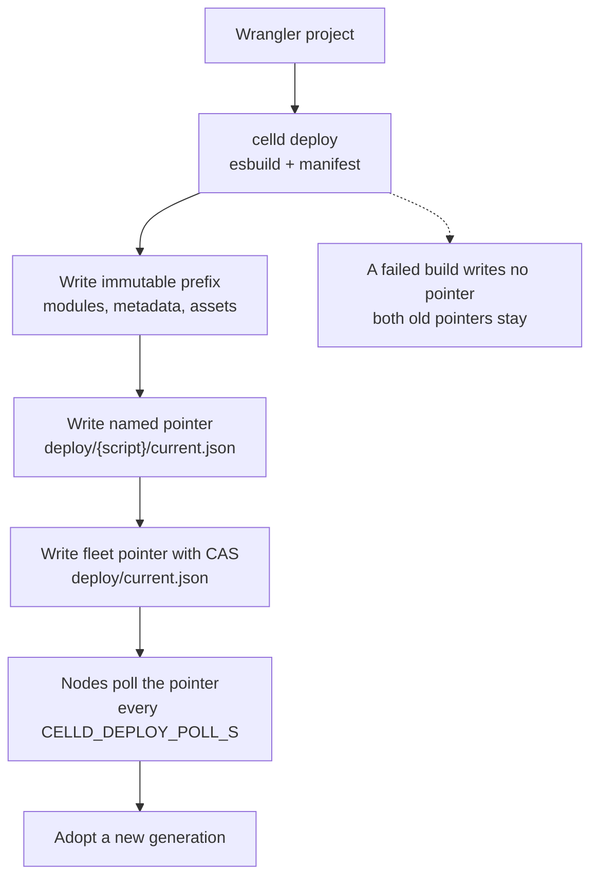
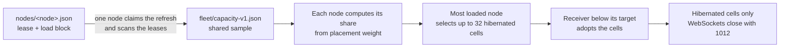

# Deployment and operations

One celld process is a node. The nodes that share one bucket are a fleet, and
each node serves cells. A cell is one Durable Object with a private SQLite
database. The bucket is the object store that holds the fleet state.

A fleet has two control surfaces. The first surface turns a project into a
deployment. A deployment is a set of immutable objects in the fleet bucket,
and one small pointer object selects the current deployment. The second
surface keeps a node healthy. A node reads the pointer, adopts the deployment,
serves cells, and hands its cells to a peer when it stops.

This document follows one deployment from `celld deploy` to a serving node. It
then covers the operator commands, the health paths, the autoscaler signals,
the shutdown sequence, telemetry, and the test strategy.

Sources: `docs/README.md`, `docs/telemetry.md`, `docs/testing.md`,
`crates/celld/deploy.rs`, `crates/celld/fleet.rs`, `crates/celld/generation.rs`,
`crates/celld/main.rs`, `crates/celld/main/cli.rs`,
`crates/celld/control_plane.rs`, `crates/celld/env_vars.rs`,
`crates/celld/protocol.rs`, and `crates/celld/drain_token.rs` at commit
`8702f6d186c77698dbfb30cf29e3b1922a88f008`, version 0.6.3.

## The words this document uses

| Word | Meaning here |
|------|--------------|
| Cell | One Durable Object: a single-threaded server with a private SQLite database. |
| Node | One celld process on one machine. |
| Fleet | The nodes that share one bucket. |
| Bucket | The object store that holds the fleet state. |
| Deployment | One immutable set of build objects, plus the metadata that describes the bindings of the project. |
| Generation | The local number that a node gives to one adopted deployment. It is not stored and not shared between nodes. |
| Deployment pointer | The bucket object `deploy/current.json`. It names the version and the object prefix that a node must load. |
| Named pointer | The bucket object `deploy/<script>/current.json`. A node uses it to resolve a service-binding target script to its deployment. |
| Immutable prefix | The object prefix of one build. celld writes it completely before the pointer names it. |
| Lease | A small record in the bucket with an expiry time that marks a node as live. |
| Drain token | The bucket object that makes draining nodes hand off one node at a time. |
| Epoch | The number of one cell activation. It names the bucket prefix where that activation writes, and it fences an older owner. |
| Idle | A resident cell that does no work. |
| Dormant | A cell that is out of memory but still owned by one node. |
| Hibernated | A dormant cell that keeps hibernatable WebSocket clients on its node. |
| Restore base | The epoch prefix from which the next restore of a cell starts. |
| Public listener | The Transmission Control Protocol (TCP) listener that serves Worker requests. The `--listen` flag sets it. |
| Internal listener | The TCP listener for peer traffic and the operator Application Programming Interface (API). The `--internal-listen` flag sets it. |
| Operator API | The unauthenticated Hypertext Transfer Protocol (HTTP) routes on the internal listener, such as `/state` and `/reload`. |
| Drain | The shutdown state in which a node refuses new public work and hands its cells to peers. |
| Handoff | The transfer of one cell from a draining node to a successor node. |
| Readiness gate | The startup wait until the fleet settles: no node drains, every node is below its memory low watermark, the restore backlogs are small, and ownership is balanced. |
| Autoscaler | An external system that starts and stops nodes from the signals that celld publishes. |
| Telemetry | Traces and logs that a node records about the requests that it serves. |
| Parquet | A columnar file format for analytics. |
| OpenTelemetry (OTEL) | The standard for traces, logs, and metrics export. |
| Conformance | A test that runs the same program on two runtimes and compares the output. |
| Temporal Logic of Actions (TLA+) | A specification language for concurrent systems. |
| Migration | One ordered Structured Query Language (SQL) file that changes a D1 database schema. |
| JSON | JavaScript Object Notation, a text format for values. |
| SHA-256 | Secure Hash Algorithm 256, a hash that returns 32 bytes. |
| Central Processing Unit (CPU) | The processor resource that a node schedules. |
| Resident Set Size (RSS) | The memory that a process holds in physical memory. |
| Transport Layer Security (TLS) | The protocol that encrypts a network connection. |
| Glob | A pattern that matches file paths, such as `*.ts`. |
| Compare-and-swap (CAS) | A write that succeeds only when the stored version matches the expected version. |
| Time to live (TTL) | The lifetime of a lease or a drain token before it expires. |

## From project to deployment

`celld deploy` reads a Wrangler project. It accepts module Workers, Durable
Object bindings, service bindings, variables, Cron Triggers, D1 databases, KV
namespaces, Queues, R2 buckets, Workflows, WebAssembly modules, and static
assets. An unknown Wrangler configuration key stops the deployment
(`docs/README.md`). The command needs `esbuild` on `PATH` when the project
contains Worker code. `CELLD_ESBUILD` names another executable.

The command builds one immutable prefix and writes a manifest. `celld deploy`
writes each module digest into the manifest. At adoption, a node verifies the
SHA-256 digest of each module against that manifest before it builds the
runtime generation. The deployment version is a hash of the module names and
bytes, the metadata bytes, and the asset index:

```rust
// crates/celld/protocol.rs:475-497 (abridged)
pub fn deployment_version(
    modules: &[(String, Vec<u8>)],
    metadata_json: &[u8],
    asset_index: Option<&[u8]>,
) -> String {
    let mut sorted = modules.iter().collect::<Vec<_>>();
    sorted.sort_by(|left, right| left.0.cmp(&right.0));
    let mut hasher = Sha256::new();
    for (name, bytes) in sorted {
        hasher.update(name.as_bytes());
        hasher.update([0]);
        hasher.update(bytes);
    }
    hasher.update(metadata_json);
    if let Some(index) = asset_index {
        hasher.update([0]);
        ...
```

The sort makes the version independent of upload order. The comment in the
source states the rule: every sender must agree on this value, or identical
code deploys as two versions.

The pointer is the commit point:

```rust
// crates/celld/protocol.rs:456-466
/// `deploy/current.json` — the fleet-wide pointer a node reads on startup.
/// Changing this is a deploy; nodes converge to it.
pub struct DeployPointer {
    #[serde(default, skip_serializing_if = "Option::is_none")]
    pub script_name: Option<String>,
    pub version: String,
    pub prefix: String,
    pub rollout: Rollout,
}
```

`prefix` names the immutable build. `version` is the identity above. `rollout`
holds a percentage, and this version writes 100.

The write order is part of the correctness argument:

```rust
// crates/celld/deploy.rs:930-947 (abridged)
let pointer = DeployPointer {
    script_name: Some(built.script_name.clone()),
    version: built.version.clone(),
    prefix: built.prefix.clone(),
    rollout: Rollout { percent: 100 },
};
let encoded = serde_json::to_vec_pretty(&pointer)?;
put_pointer(
    bucket,
    &format!("deploy/{}/current.json", built.script_name),
    encoded.clone(),
)
.await?;
put_pointer(bucket, "deploy/current.json", encoded).await?;
```

The named pointer resolves service-binding components. A service-binding
component is another Worker script that this script calls through a service
binding. The named pointer for that script names its deployment. The fleet-wide
pointer selects the application, so celld writes it last. A node can then
resolve a consumer to a complete deployment, never to a half-uploaded one.

`put_pointer` uses a conditional write (compare-and-swap, CAS), and a lost
race is an error:

```rust
// crates/celld/deploy.rs:1110-1123 (abridged)
async fn put_pointer(bucket: &Bucket, key: &str, body: Vec<u8>) -> anyhow::Result<()> {
    let etag = bucket.head(key).await.ok().flatten().map(|(_, etag)| etag);
    match bucket.put_cas(key, body, etag.as_deref()).await {
        Ok(Some(_)) => Ok(()),
        Ok(None) => Err(anyhow!(
            "write {}://{}/{key} lost a race\n\
             Another deploy may have landed first; re-run `celld deploy`.",
            bucket.scheme(),
            bucket.name
        )),
        Err(error) => ...
```

Two operators who deploy at the same time cannot silently overwrite each
other. The second deploy fails, and the operator decides whether to send it
again.



## Adoption by a node

A node does not restart for a deployment. It reads `deploy/current.json` every
`CELLD_DEPLOY_POLL_S` seconds, and the default is 30:

```rust
// crates/celld/generation.rs:89-94
pub fn poll_interval() -> std::time::Duration {
    let seconds = crate::env_vars::positive_or("CELLD_DEPLOY_POLL_S", 30u64)
        .expect("validated CELLD_DEPLOY_POLL_S");
    std::time::Duration::from_secs(seconds)
}
```

`POST /reload` on the internal listener adopts the pointer now. It also forces
a rebuild when the pointer names the current deployment. The node remembers a
failed build in memory and does not retry the same pointer on each poll, so
this request is how an operator retries a remembered failure. The answer is
one of three outcomes:

```rust
// crates/celld/generation.rs:52-71 (abridged)
pub enum ReloadOutcome {
    Adopted {
        generation: GenerationId,
        version: String,
        prefix: String,
    },
    Unchanged {
        generation: GenerationId,
        version: String,
    },
    Failed {
        version: String,
        prefix: String,
        error: String,
    },
}
```

An adopted deployment gets the next generation number. The number is local to
the node, and the fleet-wide identity is the version string
(`crates/celld/generation.rs:24-31`). A failed build leaves the serving
generation untouched, and the node reports the error in its log and in the
`/reload` response.

A resident cell moves to the new generation when no request, alarm handler, or
regular WebSocket is active. It keeps its storage and its hibernatable
WebSockets. A request that arrives during the move waits for the new code. An
outbound call from a request that already runs in the cell does not wait, so
that request can finish on the old code.

The node forces the move after the cell has run a superseded generation for
`CELLD_DEPLOY_MAX_AGE_S` seconds, and the default is 60 seconds:

```rust
// crates/celld/generation.rs:100-106
pub fn max_age() -> std::time::Duration {
    // Not `positive_or`: zero is meaningful here.
    let seconds = crate::env_vars::with_default("CELLD_DEPLOY_MAX_AGE_S", 60u64)
        .expect("validated CELLD_DEPLOY_MAX_AGE_S");
    std::time::Duration::from_secs(seconds)
}
```

A forced move cancels the running work and closes regular WebSockets with code
1012, as Cloudflare does. A value of 0 forces every resident cell at the flip:
the moment the node adopts the new generation.
During the move, a request on one deployment can call a Durable Object on the
other, so two adjacent versions must accept each other's calls.

A node that starts before the first deployment does not exit. It waits for the
pointer, and it serves the first deployment without a restart:

```rust
// crates/celld/fleet.rs:661-680 (abridged)
pub async fn wait_for_deployment_pointer(bucket: &Bucket) -> anyhow::Result<()> {
    let mut waited = false;
    loop {
        if bucket.get(CURRENT_POINTER_KEY).await?.is_some() {
            ...
            return Ok(());
        }
        ...
        tokio::time::sleep(std::time::Duration::from_secs(2)).await;
    }
}
```

A bucket or transport error still fails the boot. Only a missing pointer waits.

## Local development

`celld dev [PROJECT_DIR_OR_CONFIG]` starts a local object store, deploys the
project, and runs one node. It needs no Docker and no cloud bucket. The Worker
listener is `http://127.0.0.1:9876` by default.

| Flag | Effect |
|------|--------|
| `--port PORT` | The Worker listener port. |
| `--host ADDR` | The Worker listener interface. The internal listener, which carries the operator API, stays on loopback and does not follow `--host`. |
| `--logs` | Show the node warning and information logs. |
| `--clean` | Delete `.celld/dev` before the start. |
| `--watch-ignore GLOB` | Ignore one more project-relative glob. Repeatable. |
| `--no-watch` | Disable automatic builds and restarts. |

The command reads `.dev.vars` beside the Wrangler configuration. Without that
file, it reads `.env` and then `.env.local`, and `.env.local` overrides `.env`.
Each `NAME=value` entry becomes a Worker variable and overrides `vars`. A value
can use quotes and can span lines, such as a PEM key. Comments after a value
and variable references are not supported.

The command keeps state in `.celld/dev` across restarts and configuration
changes. Celld does not migrate stored state. A value from an earlier
configuration can therefore make the application fail with an error that looks
unrelated. `--clean` starts from an empty state and deletes nothing else under
`.celld`.

The watcher ignores `.celld`, `.git`, `.wrangler`, `node_modules`, and `target`
at each depth. It does not watch files outside the project. The current
application serves during a build, and a failed build does not replace it.
The local object store is not available to a fleet node or to an operator
subcommand.

## The command surface

Every command writes data to standard output and messages to standard error,
except the node, which writes its log to standard output. For an operator
command, a closed standard output pipe is a successful stop
(`docs/README.md`, `crates/celld/cli_output.rs`). The command sees
`BrokenPipe`, which means that the reader asked for less output, such as
`| head`. Any other write error stays a failure. The node does not stop: it
drops log lines when the reader stops consuming them, so request handling
continues.

| Command | What it does | Needs a live node? |
|---------|--------------|--------------------|
| `celld deploy [PROJECT]` | Build and publish a deployment. | No |
| `celld dev [PROJECT]` | Run a local store and one node. | No |
| `celld cell list [CLASS]` | List cell scopes in the bucket. | No |
| `celld cell gc --dry-run` | Report the epochs that epoch GC can delete. | No |
| `celld d1 migrations apply` | Apply migration files through a live cell. | Yes |
| `celld d1 execute` | Run SQL through a live cell. | Yes |
| `celld kv get put delete list info` | Operate a KV namespace through a live cell. | Yes |
| `celld queue info peek purge pause resume redrive` | Operate a queue through a live cell. | Yes |
| `celld r2 get head put delete list` | Read or write the R2 prefix in the bucket. | No |
| `celld diagnose` | Probe leases and peers. | No |

An epoch is the numbered bucket prefix of one cell activation. Epoch garbage
collection (epoch GC) deletes old epoch prefixes when a node has a positive
`CELLD_LTX_RETENTION_SECS`; the default is unset or 0, which deletes nothing.
The restore base is the epoch prefix from which the next restore starts. Epoch
GC keeps the owner's own epoch, the epoch before it, and every epoch younger
than the retention time.

`celld cell list` prints each line as `Class:ID`. It lists the Durable Object
instances, or cells, that exist in the bucket. A cell appears at its first
event, which is the first call on its stub that reaches the object. An
identifier that `idFromName()` or `newUniqueId()` only derives does not appear
until a call creates the object. The command stops at 1,000 instances and
prints a continuation on standard error. Pass `--after SCOPE`, `--limit N`, or
`--all`.

`celld cell gc --dry-run` prints, for each cell, the epoch prefixes that epoch
GC can delete, their bytes, and the restore base. It writes nothing. The real
deletion needs a positive `CELLD_LTX_RETENTION_SECS` on a node. One pass
deletes at most 64 epochs of a cell, and only while the cell is active.

The service commands read the fleet bucket directly or reach a cell through a
live node. `celld r2` needs no node, so a release pipeline can publish an
artifact before it deploys. The first argument is the `bucket_name`, not the
binding name. `celld d1` and `celld kv` reach the database cell through a node.

## Running a node

A node needs one bucket and one listener configuration:

```sh
celld \
  --bucket "$CELLD_BUCKET" \
  --endpoint "$S3_ENDPOINT" \
  --region "$AWS_REGION" \
  --listen 0.0.0.0:8080 \
  --internal-listen 10.0.0.12:8081 \
  --advertise node-a.internal:8081
```

`--advertise` requires an explicit `--internal-listen`. A non-loopback
`--listen` also requires an explicit `--internal-listen`. The advertised
address must route to the internal listener, not to the public listener, and
celld cannot verify that rule. A literal public IP in `--advertise` needs
`--unsafe-public-advertise`.

The bucket scheme selects the storage backend. `s3://` uses the standard
Amazon Web Services credential chain. `gs://` uses Google Application Default
Credentials. `az://` names an Azure Blob Storage container and takes the
account name from `AZURE_STORAGE_ACCOUNT_NAME`. A bucket value can add a key
prefix, so two fleets can share one bucket.

The store must provide conditional writes, exact ranged reads, and
read-after-write consistency. Amazon S3, Cloudflare R2, Google Cloud Storage,
Tigris, and Azure Blob Storage qualify. Backblaze B2, Hetzner, and DigitalOcean
Spaces do not. MinIO Community Edition passes the storage test but is not
qualified for production.

Peer traffic has no TLS, and cell fetch and Remote Procedure Call (RPC) traffic
is not signed. The internal listener also has an unauthenticated operator API.
Put the advertised addresses on a trusted private network or an encrypted
overlay such as WireGuard or Tailscale, and never expose the internal listener
to the internet (`docs/README.md`).

## Health and state

`GET /.well-known/celld/health` on the public listener returns a JSON object
with the Boolean field `ok`, and it sets the HTTP status. It reports `200` with
`{"ok":true}` when healthy, and `503` with `{"ok":false}` during a drain or
before a joining node settles. A caller can read the status or the body:

```rust
// crates/celld/main.rs:2844-2856 (abridged)
if path != "/.well-known/celld/health"
    && app.runtime.is_some()
    && fastwebsockets::upgrade::is_upgrade_request(&request)
{
    return Ok(handle_websocket(request, app).await);
}
let mut result = match path.as_str() {
    "/.well-known/celld/health"
        if !app.is_draining() && app.fleet_ready() && app.healthy().await =>
    {
        response(StatusCode::OK, "{\"ok\":true}")
    }
    "/.well-known/celld/health" => response(StatusCode::SERVICE_UNAVAILABLE, "{\"ok\":false}"),
```

`GET /state` on the internal listener returns the live counters:

```rust
// crates/celld/main.rs:2883
"/state" => response(StatusCode::OK, app.snapshot().await),
```

The `node_load` object in `/state` is the lease load block. It holds
`owned_cells`, `placement_weight`, `resident_cells`, `host_websockets`,
`rss_bytes`, `in_use_bytes`, `cpu_percent_x100`, `open_fds`, `pressured`,
`memory_headroom`, `shed_cells`, and `restoring`. The memory and CPU values are
sampled every second.

`/state` also has top-level `owned_cells`, `occupied`, and `shedding`.
`occupied` is the number of resident cells, and `shedding` is the current
pressure reason or `null`. `node_load` carries the lease copy, where
`resident_cells` and `shed_cells` are the equivalent counters.

A node does not report healthy immediately. It waits until the fleet settles:
no node drains, every node is below its memory low watermark, the restore
backlogs are small, and ownership is balanced. `memory_headroom` in a lease is
true only when every configured memory measurement is below its low watermark.
An activation budget is the node's limit on concurrent cold activations. After
a drain, a restore backlog is small when each node is at most one activation
budget above the level recorded before that drain. `CELLD_READY_FLEET_GATE_MS`
bounds that wait, and the default is 120 seconds. At the bound, celld logs
`ready_gate_expired` once, but readiness stays closed. The operator must
therefore set a rollout deadline in the orchestrator. After the first healthy
response, fleet state does not remove readiness.

## Autoscaler signals

Celld does not scale itself. It publishes signals, and an external system
starts and stops nodes. Each node writes its lease to `nodes/<node>.json`. The
lease has a time to live (TTL) of `CELLD_TTL_MS` milliseconds, and the default
is 10 seconds. The node renews at one third of that lifetime.

| Signal | Where | Meaning |
|--------|-------|---------|
| `capacity_waiting` | `/state` | Activations that wait behind the residency cap. A positive value means that the fleet needs a node. |
| `activation_waiting`, `restoring` | `/state` | Cold activations that wait for, or hold, a permit. |
| `owned_cells`, `occupied`, `shedding` | `/state` | Ownership count; resident cell count; the pressure-shedding reason or `null`. |
| `handed_off`, `rebalanced`, `rebalance_failed` | `/state` | Cells given to peers, the part that balancing moved, and the moves that no peer took. |
| `pressured` | lease | The node is under memory pressure. |
| `memory_headroom` | lease | A Boolean: every configured memory measurement is below its low watermark. |
| `shed_cells` | lease | The cells that the node removed under pressure. |

A positive `capacity_waiting`, or a lease with `pressured` set, is the signal
to add a node. Scale down only when every remaining node reports
`memory_headroom: true` and its `restoring` backlog is small, as the readiness
gate in [Health and state](#health-and-state) defines it. `restoring` is zero
in steady state. A drain into a full fleet leaves the cells dormant on the
survivors, and each later activation must shed a resident cell.

Balancing moves hibernated cells. Every node reads `fleet/capacity-v1.json`
every `CELLD_REBALANCE_INTERVAL_MS`, and the default is 5,000 milliseconds. One
node claims the refresh, scans every lease, and writes the shared sample. Each
node gets a share of the owned cells in proportion to
`CELLD_PLACEMENT_WEIGHT`, and the default is the CPU count. The most loaded
node hands at most 32 hibernated cells at a time to the node that is furthest
below its target. A receiver fills to 2 per cent below its target. This
deadband absorbs the lag between a handoff and the next lease sample, so a
receiver does not overshoot its target and hand the batch back. Only a
hibernated cell moves, and its hibernatable WebSockets close with code 1012 so
that clients reconnect. [Ownership, failure, and rebalancing](06-ownership-failure-and-rebalancing.md)
gives the full selection rule.

A draining node and a node with a cold-activation backlog receive no cells.
Nothing moves while a node reports a lease without a `load.placement_weight`;
the fleet refuses a sample that lacks it. A node that runs a version before
v0.4.1 omits the field, so balancing waits until every node writes a weight.
`POST /rebalance/pause` pauses balancing for the fleet, and
`POST /rebalance/resume` resumes it.



## Shutdown and rollout

Celld shuts down gracefully on `SIGTERM` or `SIGINT`. The health path reports
`503`, new public requests receive `503` with the connection closed, and
accepted requests finish. The node hands its cells off in batches: it cancels
running alarms, the successor retries them, it proves the data durable, it
publishes a final snapshot, and it releases each ownership record to a peer.
An alarm that is still due stays in the cell's SQLite database with its retry
state, so the successor restores it and runs it again. The peer keeps the cell
dormant until a request arrives. Busy cells move first.

The total bound is `CELLD_SHUTDOWN_TOTAL_MS`, and the default is 40 seconds:

```rust
// crates/celld/env_vars.rs:33-51 (abridged)
pub struct ShutdownTiming {
    pub total_ms: u64,
    pub drain_token_wait_ms: u64,
    pub drain_no_progress_ms: u64,
}

impl ShutdownTiming {
    fn from_total_ms(total_ms: u64) -> Self {
        let drain_token_wait_ms = (total_ms / 4) * 3 + (total_ms % 4) * 3 / 4;
        let drain_no_progress_ms = ((total_ms / 8) * 5 + (total_ms % 8) * 5 / 8).max(1);
        ...
    }
}
```

The token wait is three quarters of the bound, so 30 seconds by default. The
handoff no-progress interval is five eighths, so 25 seconds. `CELLD_RELEASES`
sets the number of concurrent complete handoffs, and the default is 128.

The orchestrator stop grace must be longer than `CELLD_SHUTDOWN_TOTAL_MS`, or
`SIGKILL` can interrupt the handoff. A systemd unit uses `TimeoutStopSec`, and
a Kubernetes pod uses `terminationGracePeriodSeconds`, for that value.

Concurrent stops do not flood the survivors. A draining node claims a fleet
drain token, so nodes hand off one at a time. The token is advisory: a node
that cannot claim it within its wait proceeds without it
(`crates/celld/drain_token.rs`). An unserialized handoff is better than a
forced exit, because the orchestrator stop grace is finite. Usually the token
makes the fleet take handoffs one node at a time.

A cut handoff can leave the node log of the stopped process for its
replacement to recover. The node log holds writes that the process
acknowledged before their bucket upload completed. A process with the same
`CELLD_NODE` recovers it at startup; another node recovers it after the lease
of the stopped process expires. One node claims a recovery, and the claim has
a heartbeat. Another node takes the claim over when the heartbeat is 30
seconds old. [Ownership, failure, and rebalancing](06-ownership-failure-and-rebalancing.md)
explains the takeover recovery gate.

A remote call to a cell that is changing owner waits for the new owner, for at
most `CELLD_OPERATION_DEADLINE_MS`, and the default is 15 seconds. Celld
retries only an attempt that provably did not start. An application must keep
one stable operation identifier when it retries an ambiguous fetch, RPC, D1, or
service operation. A WebSocket client must reconnect.

To roll out a new version, use the rolling update of the orchestrator. Stop
each node with `SIGTERM`, wait for its replacement to report healthy, and then
move to the next node. Celld paces the handoffs and readiness itself.

`POST /shutdown?handoff=preserve` prepares a same-node restart that keeps the
ownership records. It cancels cold activations and uploads each stopped
database first. If an upload fails, the next process uses normal recovery.

A fleet at its resident limit has no space for the cells of a lost node. The
loss of several nodes therefore degrades service more than the loss of one
node. Keep reserve capacity when the application needs fast takeover.

## Diagnose a fleet

`celld diagnose` reads the node leases and probes each live peer. It does not
take a lease and does not change ownership. `--peer NODE_ID` limits the probe
to named nodes, and the flag is repeatable. `--json` prints one object per
check. `--read-only` skips the bucket write probe, which writes and deletes a
small object under the `probe/` prefix.

The report shows expired leases, bad advertised addresses, unreachable peers,
authentication failures, and protocol mismatches. Each node line shows
`restoring`, the cold activations in progress. During a rolling update, wait
for `restoring=0` on every node before the next restart.

## Telemetry

Telemetry is off by default and costs nothing when off. `CELLD_OTEL=1` writes
Parquet files under the `telemetry/` prefix of the fleet bucket. A value such
as `CELLD_OTEL=http://collector:4318` sends the same data to an OTEL collector
through the OpenTelemetry Protocol (OTLP) over HTTP.

| Variable | Default | Effect |
|----------|---------|--------|
| `CELLD_OTEL` | `0` | `0` disables telemetry. `1` writes Parquet to the fleet bucket. A collector base Uniform Resource Locator (URL) selects OTLP/HTTP. |
| `CELLD_OTEL_BUCKET` | the fleet bucket | A different bucket for Parquet files, with the same endpoint and credentials. |
| `CELLD_OTEL_RETENTION` | `30d` | Celld deletes telemetry files older than this value. `none` disables deletion. |
| `CELLD_OTEL_FLUSH_MS` | `300000` | Celld writes a Parquet file after this many milliseconds of buffered events. |
| `CELLD_OTEL_FLUSH_BYTES` | `5242880` | The estimated buffered bytes that force a flush. |
| `OTEL_TRACES_SAMPLER` | `parentbased_always_on` | A standard sampler name. |
| `OTEL_SERVICE_NAME` | `celld` | The service name in the exported resource. |

Celld records a span for each stateless Worker request, each cell event (a
fetch, an alarm, an RPC, or a WebSocket message), each outbound `fetch()`, and
each cell start. A span carries the request identifier, the cell, the isolate,
the queue wait, the outbound URL and status, and the known durability facts.

Each `console.log` line becomes a log record with the trace identifier and the
span identifier of its handler, across `await`. The record carries the console
method as its severity:

| Method | Severity number | Severity text |
|--------|-----------------|---------------|
| `console.debug` | `5` | `DEBUG` |
| `console.log`, `console.info` | `9` | `INFO` |
| `console.warn` | `13` | `WARN` |
| `console.error` | `17` | `ERROR` |

Celld reads the W3C `traceparent` header on incoming requests and sends it on
outbound `fetch()`. A malformed header starts a new trace. A Worker call to a
Durable Object stays in one trace.

Under load, telemetry sheds before requests do, and celld counts what it
sheds. Celld records no metrics yet. The schema is version `v0-unstable`, so
column names can change before a stable release. A log file from an earlier
celld version has no severity columns; read a mix of versions with
`union_by_name = true`. The example below uses DuckDB, which reads Parquet
files and S3-compatible stores through its `httpfs` extension.

```sql
-- docs/telemetry.md:73-94
INSTALL httpfs; LOAD httpfs;
CREATE SECRET celld_telemetry (
  TYPE s3, KEY_ID '...', SECRET '...',
  ENDPOINT 's3.example.com', URL_STYLE 'path'
);
CREATE VIEW traces AS SELECT * FROM
  read_parquet('s3://YOUR-BUCKET/telemetry/traces/*/*/*/*/*/*.parquet');
CREATE VIEW logs AS SELECT * FROM
  read_parquet('s3://YOUR-BUCKET/telemetry/logs/*/*/*/*/*/*.parquet');

SELECT name, duration_us, trace_id FROM traces
  ORDER BY duration_us DESC LIMIT 20;
```

Files are partitioned by node and hour:
`telemetry/traces/<node>/<yyyy>/<mm>/<dd>/<hh>/<id>.parquet`. Celld writes one
file per flush, at 5 minutes or 5 mebibytes (MiB) of estimated buffered events,
whichever comes first. A shorter interval makes many small files, so start a
compaction job before a short interval. The OTLP sink makes at most five
attempts per batch on a transient failure, with exponential backoff and
jitter, and each delay is capped at 30 seconds.

## Testing

Celld tests three promises: an acknowledged write is durable, a cell has one
writer at a time, and Cloudflare code operates the same on celld. Each promise
has a different test method (`docs/testing.md`).

**Conformance.** The same Workers and Durable Objects programs run on workerd,
the Cloudflare production runtime, and on celld. The outputs must match.
workerd supplies the reference output, so the expected behavior does not
depend on celld. The corpus includes the workerd Durable Objects contract
tests, the web-platform globals tests, and the upstream Web Platform Tests.

**Specification.** The coordination protocol is specified in TLA+. Model
checking found four bugs and a split-brain that lost an acknowledged write.
All are fixed. The model grants a linearizable object store and perfect shared
clocks, so a violation needs no clock skew and no storage anomaly. The
invariants are one writer for each epoch and no lost acknowledged write.

**Simulation.** The coordination protocol is a pure decision core with no I/O
(input/output). The core returns decisions, and the simulator supplies the
clock, the randomness, and the object store interfaces and applies their
effects. The simulated store injects latency, compare-and-swap races, and lost
responses. The clocks drift, and a node can crash at each await point. A
seeded scheduler makes each failure reproduce exactly. V8 is not deterministic,
so it stays out of the simulation.

**Live fleets.** A permanent fleet lab runs standard virtual machines from
standard providers against a real bucket. Faults land between verification
passes. A pass fetches each cell through different nodes and compares the
status, the body, and the full message ledger. The scenarios include a
`SIGKILL` in the middle of a write stream, a frozen owner, a node that is cut
off from the bucket, a bucket that returns 429 for every request, and a host
that stops at the provider level.

The "few numbers we trust" section reports five hundred concurrent claimants
that made 5,500 attempts on the same cells with zero writer violations. A warm
resident request does zero bucket operations and returns in about 1.1
milliseconds at the 50th percentile (p50) and about 7 milliseconds at the 99th
percentile (p99). A bucket proof waits for one object store round trip, and a
fleet proof waits until one or two peers hold the write on disk. In the lab, a
bucket proof measured about 600 milliseconds and a fleet proof measured about
25 milliseconds. Ten nodes, each with 4 vCPU and 8 gibibytes (GiB) of memory, held
10,000 resident cells and 20,000 concurrent WebSocket connections. With two of
the ten nodes stopped, every cell was available again on another node in about
11 seconds at the tail, the slow end of the distribution.

## What can go wrong

| Failure | What the system does | What an operator sees |
|---------|----------------------|-----------------------|
| Two deploys race | The conditional write makes one deploy lose | `lost a race`; run `celld deploy` again |
| A new deployment does not build on a node | The old generation keeps serving | The error in the node log and the `/reload` response |
| A node starts before the first deploy | The node waits for the pointer | `awaiting_initial_deployment` in the log |
| A resident cell does not move | The node forces the move at `CELLD_DEPLOY_MAX_AGE_S` | Regular WebSockets close with 1012 |
| A node stops with a short grace period | `SIGKILL` can interrupt the handoff | Cells recover from the bucket, and recovery takes longer |
| A node cannot claim the drain token | The node drains without the token | `drain_token_bypassed` in the log |
| The readiness gate expires | Readiness stays closed | `ready_gate_expired` once in the log |
| The bucket is throttled | The engine slows to the store's rate | Higher latency, with no retry storm |
| A fleet loses more nodes than its reserve | Cells wait for capacity | `capacity_waiting` stays positive |

The first row shows the same rule that the cells use: one conditional write
decides a race. A deploy is a commit, and a lost commit is an error, not a
silent overwrite.

## The Aha

The bucket is the control plane. A deployment is not a message to a node, and
a node does not coordinate a rollout. A deploy writes immutable objects and
then moves one pointer with a conditional write. Each node polls that pointer
and adopts the result. The fleet converges because every node reads the same
small object, not because a coordinator told each node what to do.

The same idea appears in ownership. A node does not ask a leader for a cell.
It writes a lease and an ownership record, and the bucket decides the winner.
A shutdown is therefore a sequence of conditional writes and handoffs, not a
broadcast. The operator supplies the machines and the stop grace; the bucket
supplies the order.

## Where to read next

- [System architecture](02-system-architecture.md) explains how a request
  reaches a node and a cell.
- [Ownership, failure, and rebalancing](06-ownership-failure-and-rebalancing.md)
  explains the lease, the takeover, and the rebalancing that this document
  operates.
- [The services](07-the-services.md) explains what a deployment configures.
- [Security and tenancy](09-security-and-tenancy.md) explains the trust boundary
  of the internal listener and the bucket credentials.
- [Limitations and compatibility](10-limitations-and-compatibility.md) lists the
  Cloudflare differences that affect an operation.
