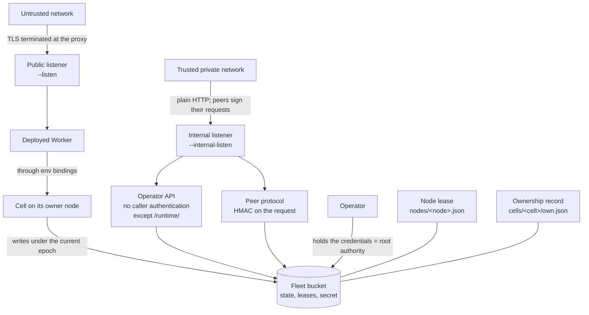
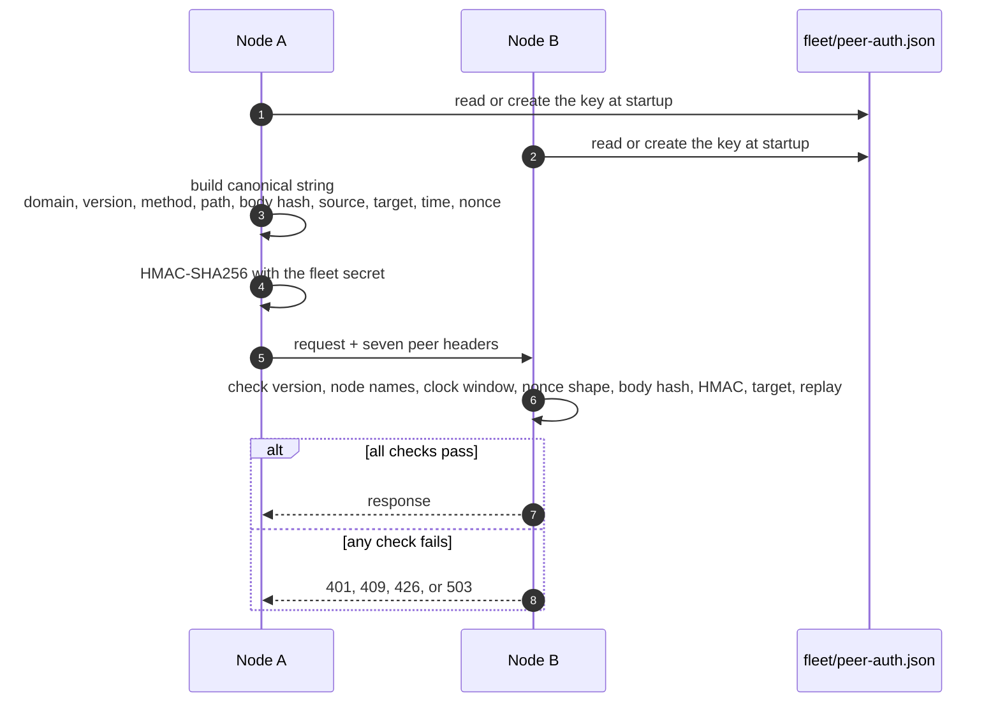

# Security and tenancy

celld is the node server that runs the deployed Worker. It has one security
model, and it is narrow. One fleet (a set of celld nodes that share one bucket,
one deployment, and one fleet secret) runs one application. The operator trusts
the application code, the nodes, and the people who hold the credentials for
the bucket, the object store that holds all fleet state. The model puts the
internal listener behind a private network and the public listener behind a
proxy that authenticates users. It does not isolate hostile tenants from each
other. The public listener itself authenticates no one.

This document states that model, then follows each boundary: the two
listeners, the peer signature, the operator Application Programming Interface
(API), the cell name validator, the request body limit, and the isolation of a
Dynamic Worker (a Worker that the application loads at run time) and a
container.

Sources: `docs/security.md`, `docs/limitations.md`, `docs/guarantees.md`,
`crates/celld/peer_auth.rs`, `crates/logic/cell.rs`,
`crates/celld/deploy.rs`, `crates/celld/actor.rs`, `crates/celld/container.rs`,
and `crates/celld/js/harness.js` at commit
`8702f6d186c77698dbfb30cf29e3b1922a88f008`, version 0.6.3.

## The words this document uses

| Word | Meaning here |
|------|--------------|
| Fleet | The set of nodes that share one bucket, one deployment, and one fleet secret. |
| Tenant | One logical data partition inside the application, such as one document, one chat room, or one agent. A tenant is not a separate security boundary. |
| Application | The one deployed program and its bindings that a fleet serves. |
| Node | One running celld process on one machine. |
| Deployment | The uploaded scripts, assets, and bindings that a fleet serves. The object `deploy/current.json` in the bucket names the active deployment. |
| Worker | The application program that runs inside the engine and handles public requests. |
| Script | One uploaded Worker program. One deployment can hold more than one script. |
| Engine | The V8 JavaScript engine inside a node. |
| Class | The name before the colon in a cell scope. It names the Durable Object class, or the reserved runtime service, that owns the cell. |
| Durable Object class | The JavaScript class that declares a cell's handlers and its SQLite schema. One deployment can export several classes. |
| Durable Object (DO) | A named object with private SQLite storage. One node owns it at a time. |
| Cell | One Durable Object instance: one SQLite database, one bucket prefix, and one ownership epoch. |
| Scope | The `Class:ID` string that names one cell, for example `__D1Database:3f0c...`. The class is first. |
| Owner | The node that holds the current lease for a cell and serves its requests. |
| Node session | One lease generation of one node. The pair of node name and lease generation names it, so a later process cannot use an older lease. |
| Lease generation | The public key of the node process's signed liveness check (`/peer/probe`), written as `ownership_index_generation` in the lease record. A new process makes a new value. |
| Lease | The time-limited record `nodes/<node>.json` that says a node is alive. Its `log` field carries the node log, a replicated log that recovery uses to re-create the uploads of a dead owner. The owner renews it. |
| Ownership epoch | A counter that grows at each activation. Storage keys under an older epoch are superseded and are not restored. |
| Bucket | The object store that speaks the Amazon Simple Storage Service (S3) interface and holds deployments, cell state, leases, and the peer secret. |
| Binding | An object in the Worker `env`, such as `env.DB`, that grants the operations of one service. |
| Operator | The person or process that runs the nodes and holds the bucket credentials. |
| Trust boundary | A line that separates two groups with different authority. |
| Internal listener | The Transmission Control Protocol (TCP) listener for peer traffic and the operator API. |
| Public listener | The TCP listener that serves the deployed Worker. |
| Peer | Another node in the same fleet. |
| Peer request | One Hypertext Transfer Protocol (HTTP) request from a node to another node's internal listener. |
| Peer forwarding request | One cell fetch or call that a node sends to a peer inside a tunnel. |
| Peer control message | A small JavaScript Object Notation (JSON) request on a peer route, such as a probe, abort, handoff, or log control. |
| Fleet secret | The 32-byte key in `fleet/peer-auth.json`. It authenticates every `/peer/` and `/runtime/` request. |
| Keyed-Hash Message Authentication Code (HMAC) | A signature that uses a shared secret and a hash function. |
| Canonical string | The fixed text form of a request that both nodes build and sign. |
| Replay | A second send of a captured request. |
| Replay cache | The in-memory set of nonces that one node has already accepted. An entry stays for 60 seconds, twice the 30-second clock window. |
| Nonce | 16 random bytes that a sender uses once, so a replay is detectable. |
| Tunnel | One long-lived connection that carries cell fetch and Remote Procedure Call (RPC) traffic between peers. |
| Operator API | The HTTP routes on the internal listener, such as `/state` and `/evict`. |
| Reserved class | A class name that the runtime supplies, such as `__D1Database`. Application code cannot export one. |
| Host function | A function that the engine supplies to internal JavaScript, such as a storage call. |
| Internal script | The JavaScript that celld runs to implement a binding. It is not application code. |
| Loader | The node component that reads deployment metadata and builds the application generations and isolate pools that run the scripts. |
| Application generation | One built form of a deployment inside one node process. A reload builds a new one. |
| Linux capability | A named right of a process, such as the right to change its user identifier. |
| Secure Computing Mode (seccomp) | The Linux system-call filter. |
| Isolation boundary | The mechanism that stops code from reaching a resource. |
| Kernel | The core of the operating system that enforces process and memory boundaries. |
| Namespace | A Linux kernel feature that gives a process its own view of a resource, such as processes or the network. |
| Dynamic Worker | A Worker that the application loads at run time with the `worker-loader` binding. It is not the deployed script. |
| Isolate | One V8 execution context with its own heap. Several isolates can run in one process. |
| Container | A process tree that the node starts from an image, with its own filesystem view, network namespace, and limits. |
| Open Container Initiative (OCI) | The standard for container image formats and runtimes. |
| gVisor | A container runtime that handles system calls in user space and gives each container a separate kernel interface. |
| Classless Inter-Domain Routing (CIDR) | The `a.b.c.d/n` form that names an address range. |
| Transport Layer Security (TLS) | The protocol that encrypts a network connection. |
| Internet Protocol (IP) | The addressing protocol that carries the connections. |
| Internet Protocol version 4 (IPv4) / version 6 (IPv6) | The two address families. |
| Central Processing Unit (CPU) | The processor resource that a node schedules. |
| SHA-256 | Secure Hash Algorithm 256, a hash that returns 32 bytes. |
| Uniform Resource Locator (URL) | The address of a resource. |

## The trust model

The security page states the rule directly: celld version 0.6.3 is a beta
release, and it is not safe for hostile multi-tenant use. One fleet runs one
application. The application code, the fleet nodes, and the operators are
trusted (`docs/security.md`).

That rule has two consequences. First, a cell is not a security boundary
between tenants. The ownership epoch fences storage consistency, so a node
that lost its lease cannot change the current state. It does not stop one
tenant's code from consuming shared node resources or from using the bindings
that the deployment gave it. A binding is an object in the Worker `env`, such
as `env.DB`; it grants exactly the operations of that service and nothing
more.

Second, the fleet has two places where authority crosses its edge: the
trusted private network in front of the internal listener, and the object
storage credentials. The bucket holds the deployments, the cell state, the
ownership and node leases (`nodes/<node>.json`), the per-cell ownership
record (`cells/<cell>/own.json`), and the fleet secret. A holder of the bucket
credentials controls the fleet (`docs/security.md`).

The bucket credential is the root of authority because the bucket is the only
shared state. A holder can do four things:

1. Read `fleet/peer-auth.json`, so it can sign peer requests.
2. Replace `deploy/current.json`, so it can serve new code.
3. Change `cells/<cell>/own.json`, so it can move ownership.
4. Read every cell's state.

A read-only credential is weaker, but it is still dangerous. It can read the
fleet secret, so it can sign peer requests from any machine that reaches the
internal listener. It can also read every cell's state. Only a write
credential can replace code or move ownership. Grant write access only to the
operator process.

No account database exists alongside the bucket, so no second place exists to
revoke a disclosed credential. Rotation of the bucket credential is the
revocation procedure. celld encrypts nothing in the bucket; confidentiality
depends on the transport secrecy and the encryption at rest that the object
store provides.

Two fencing mechanisms work together. The node lease is a record in the
bucket with an expiry time, and the owner renews it while the node is alive.
The ownership epoch is a counter that grows at each activation. The
replication path writes each cell under a key prefix that names its epoch,
`cells/<cell>/ltx/e<epoch>/`. A stale owner can still write, but only into a
superseded prefix that no restore selects. After each write is durable in the
bucket, celld reads `cells/<cell>/own.json` and acknowledges only if the record
still names this node at this epoch. A node that lost its lease therefore stops acknowledging,
and the next activation fences it out with a higher epoch. [Ownership, failure,
and rebalancing](06-ownership-failure-and-rebalancing.md) gives the full
protocol.

The public listener does not authenticate anyone. celld serves the Worker
there and leaves authentication to a proxy or to the application. The
"boundary" on that side is the proxy, not celld.



## Separate the listeners

celld opens two HTTP listeners, and it terminates TLS on neither:

| Listener | Serves | Required protection |
|----------|--------|---------------------|
| `--listen` | The deployed Worker. | Terminate TLS and authenticate users in a proxy or in the application. |
| `--internal-listen` | The peer protocol and the operator API. | Restrict access to trusted operators and fleet nodes. Never expose it to the public internet. |

Each listener has one flag and one environment variable: `--listen` or
`CELLD_ADDR` for the public listener, and `--internal-listen` or
`CELLD_INTERNAL_ADDR` for the internal one. An explicit flag wins over the
environment variable. Standalone mode starts a node from the operator's flags,
and the operator supplies the bucket and its credentials. Managed mode
(`CELLD_CLOUD=1` or `--control-plane`) enrolls the node with the hosted
control plane at `celld.dev`. That control plane issues one bucket and its
storage credentials to the fleet, and it supplies the active deployment. In
standalone mode the public listener defaults to `127.0.0.1:8080`. In managed
mode it tries the loopback ports 8080 to 8099 in order and uses the first free
one (`crates/celld/main/cli.rs:112`, `:141-142`).

The internal listener defaults to `127.0.0.1:0`. Port 0 tells the operating
system to choose a free port; celld reads the assigned port after the bind.
Peers cannot guess that port, so a multi-node fleet needs an explicit
`--internal-listen` and an `--advertise` value. celld rejects `--advertise`
without an explicit internal listener because the default port changes at
each start. It also rejects a non-loopback public `--listen` without an
explicit internal listener, because it never reuses the public socket for
peer traffic.

`--advertise` accepts `IP:PORT` or `HOST:PORT`. The hostname is not resolved
at startup, because reachability depends on each peer's network. celld
rejects a public Internet Protocol (IP) advertise address unless the operator
also passes `--unsafe-public-advertise`, because the operator API has no
caller authentication and peer HTTP has no built-in encryption. Use an
encrypted overlay, such as WireGuard or Tailscale, when the private network
does not provide confidentiality. celld cannot verify a hostname or a
translated port, so the operator must route the advertised address to the
internal listener.

The public listener reserves only `/.well-known/celld/health`. That path
returns `200` with `{"ok":true}` only when the node is not draining, the fleet
is ready, and the node reports healthy; otherwise it returns `503`. "Draining"
means that a shutdown has started, so the node refuses new public work. "Fleet
ready" means that the one-shot readiness gate is open: no donor is mid-handoff
and every live peer publishes successor capacity. "Healthy" means that the node
is not fenced, is not resuming a clean reload, and holds a fresh node lease.
The Worker owns every other public path, including `/health`.

The two listeners have separate routers, so no path belongs to both. The
internal listener returns `404` for an unknown path, so an operator request
cannot become an application request. The reverse is also true for the routers:
a public request cannot enter an operator route through the public listener.
The deployed Worker can still send its own request to the internal listener, as
the isolation section explains.

A node finds its peers by listing the `nodes/` prefix in the bucket
(`crates/celld/fleet.rs:518-528`). For each name, it reads `nodes/<node>.json`
and decodes the lease (`crates/celld/fleet.rs:483-514`). The lease holds the
address that the peer advertised with `--advertise`, its peer protocol version,
and its lease generation. An expired lease, or one with an empty address, is
not a live peer. A node sends its peer requests to that address over plain
HTTP. That listing is why the bucket, not a separate discovery service, is the
membership record.

## Peer authentication

Every route under `/peer/` and `/runtime/` carries a signature. This includes
the `/peer/tunnel` establishment request. The cell fetch and RPC calls that
then travel inside the tunnel are not signed again; the section below states
the limit of that choice. The fleet secret is one 32-byte
key in the bucket:

```rust
// crates/celld/peer_auth.rs:16-17, 20-24, 29
pub const PROTOCOL_VERSION: u16 = 5;
pub const PROTOCOL_VERSION_TEXT: &str = "5";
const SECRET_KEY: &str = "fleet/peer-auth.json";
const SECRET_VERSION: u8 = 1;
const DOMAIN: &str = "cells-peer-request-v1";
const CLOCK_WINDOW_MS: u64 = 30_000;
const REPLAY_RETENTION_MS: u64 = CLOCK_WINDOW_MS * 2;
const MAX_REPLAY_ENTRIES: usize = 1_000_000;
```

The first node creates the key with a conditional write. `put_cas` is a
compare-and-swap: it writes only if the object still matches the expected
value. The expected value `None` means "the object must not exist". A second
node that races the first one loses the write and reads the winner's key:

```rust
// crates/celld/peer_auth.rs:275-300 (abridged)
pub async fn load_or_create(bucket: &Bucket) -> anyhow::Result<[u8; 32]> {
    if let Some(key) = load(bucket).await? {
        return Ok(key);
    }
    let mut key = [0_u8; 32];
    rand::rngs::OsRng.fill_bytes(&mut key);
    let stored = StoredSecret {
        version: SECRET_VERSION,
        key: encode_hex(&key),
    };
    match bucket
        .put_cas(SECRET_KEY, serde_json::to_vec(&stored)?, None)
        .await
    {
        Ok(Some(_)) => Ok(key),
        Ok(None) => load(bucket),
        ...
```

The signature covers a canonical string. A canonical string is the fixed text
form that both nodes build from the same request, so any difference in
framing produces a different signature. A running node reads the key once at
startup with `load_or_create`, which creates the key when the fleet has none,
so it keeps that key for its whole life. An operator client reads the same key
with `load_existing`. celld has no fleet-secret rotation command. To replace
the key, stop every node, overwrite `fleet/peer-auth.json` with a new key, and
start the fleet. A mixed fleet cannot work: a node with the old key cannot
verify a request that a node with the new key signed. This string names a fixed
domain tag (`cells-peer-request-v1`), the protocol version, the method, the
path and query, the body hash, the source node, the target node, the
timestamp, and the nonce, in that order, with one newline between fields:

```rust
// crates/celld/peer_auth.rs:254-273 (abridged)
fn mac(&self, request: &CanonicalRequest<'_>) -> Hmac<Sha256> {
    let canonical = format!(
        "{DOMAIN}\n{PROTOCOL_VERSION}\n{method}\n{path_and_query}\n{body_hash}\n\
         {source}\n{target}\n{timestamp}\n{nonce}"
    );
    let mut mac =
        <Hmac<Sha256> as Mac>::new_from_slice(&self.key).expect("HMAC accepts a 32-byte key");
    mac.update(canonical.as_bytes());
    mac
}
```

The target node is in the signed string, so a request for one node cannot be
replayed against another. The body hash binds the body to the signature. The
timestamp must be inside the 30-second clock window, so the nodes must keep
their clocks synchronized to well under 30 seconds; run a time service such
as the Network Time Protocol (NTP) on every node. The nonce must not appear
twice inside that window. The cache keeps each entry for twice the window,
which is 60 seconds, so a nonce cannot expire while its signature is still
acceptable.

The replay cache is in memory in one process. A restart clears it, so a
captured request can be replayed after a restart until its timestamp leaves
the 30-second window. The window bounds that exposure.

The request carries seven headers:

| Header | Value | Purpose |
|--------|-------|---------|
| `x-cells-peer-version` | `"5"` | The protocol version. |
| `x-cells-peer-source` | The source node name. | Names the sender. |
| `x-cells-peer-target` | The target node name. | Names the receiver. |
| `x-cells-peer-timestamp` | Milliseconds since the Unix epoch. | Sets the clock window. |
| `x-cells-peer-nonce` | 16 random bytes, hex-encoded. | Makes each request unique. |
| `x-cells-peer-body-sha256` | The SHA-256 hash of the body, hex-encoded. | Binds the body. |
| `x-cells-peer-signature` | 32 HMAC bytes, hex-encoded. | The signature. |

The receiver checks the fields in a fixed order, and it stops at the first
failure (`crates/celld/peer_auth.rs:180-249`):

1. The version header must equal `"5"`. A missing header returns `401`, and any
   other value returns `426`.
2. The source and target names must pass `validate_node_name`. A bad name
   returns `401`.
3. The timestamp must parse and fall inside the 30-second window. A bad value
   returns `401`.
4. The nonce must decode to 16 bytes. A bad value returns `401`.
5. The body hash header must equal the SHA-256 hash of the received body. A
   mismatch returns `401`.
6. The signature must verify against the canonical string. A bad signature
   returns `401`.
7. The target must equal the node's own name. A mismatch returns `409`.
8. The nonce must be absent from the replay cache. A hit returns `409`. A full
   cache returns `503`. A pass inserts the nonce.

Step 7 compares the target header to the receiving node's own name. The `409`
message calls that name a node session.

The check runs in this order for a reason. Every cheap test runs before the
expensive hash, and the replay cache is consulted only after the signature is
proven. An attacker cannot fill the cache with unsigned requests.

`validate_node_name` accepts 1 to 128 bytes, and each byte must be an ASCII
letter, a number, a dot, a dash, or an underscore
(`crates/celld/machine.rs:12-22`). The same rule applies to a storage key, a
local path, and a peer message, so one bad name cannot become a path escape.

The response is not signed. The receiver sends `x-cells-peer-version`, and the
sender checks that one header with `validate_response`
(`crates/celld/peer_auth.rs:324-336`). A missing header, or a value other than
`"5"`, fails the call with an error, and the caller does not use the response
body. The fleet trusts the private network for response integrity. A reply
that an attacker changes inside an open tunnel is not detected.



The verifier maps each failure to a status:

```rust
// crates/celld/peer_auth.rs:67-88 (abridged)
pub enum VerifyError {
    Unauthorized,
    WrongTarget,
    IncompatibleVersion,
    Replay,
    ReplayCapacity,
}

impl VerifyError {
    pub fn status(&self) -> axum::http::StatusCode {
        match self {
            Self::Unauthorized => axum::http::StatusCode::UNAUTHORIZED,
            Self::WrongTarget => axum::http::StatusCode::CONFLICT,
            Self::IncompatibleVersion => axum::http::StatusCode::UPGRADE_REQUIRED,
            Self::Replay => axum::http::StatusCode::CONFLICT,
            Self::ReplayCapacity => axum::http::StatusCode::SERVICE_UNAVAILABLE,
        }
    }
}
```

The replay cache holds at most one million entries. A full cache refuses new
requests with `503`, because the node cannot prove that a new request is not a
replay.

The signature authenticates the start of a tunnel. It does not sign every
call inside the tunnel, and it does not encrypt any byte. The private network
therefore remains necessary. A node that reaches the internal listener can
read and change traffic after the tunnel is open.

## The operator API

The operator API is an alpha interface, and a release can change its paths or
response formats. These routes do not authenticate the caller. The private
network is their only access control. The one exception is `/runtime/<SCOPE>`,
which requires the fleet HMAC because it can carry application data:

- `/state` reports node state.
- `/cell/<SCOPE>` resolves or activates a cell. Activation starts the cell on
  the receiving node when the cell is not resident there.
- `/evict/<SCOPE>` tries to evict a resident cell and reports the result.
  "Resident" means that the cell is in memory on this node. An active cell
  runs code, an idle cell waits for work and can leave memory after a timer,
  and a hibernated cell keeps its WebSocket clients on the node while its
  code does not run.
- `/do/<ID>` sends a direct request to an ordinary Durable Object. `<ID>` is a
  Durable Object identifier, and celld derives the scope from the class and
  the identifier.
- `POST /shutdown` starts a graceful ownership handoff. The node stops
  accepting new work, moves its cells, and exits. `handoff=preserve` keeps the
  ownership records so a new process on the same node can adopt the cells.

An operator command such as `celld d1` signs `/runtime/<SCOPE>` with the same
seven-header scheme as a peer request. The command reads `fleet/peer-auth.json`
with its bucket credentials, builds the canonical string, and sends the
signature. The check proves possession of the fleet secret, not a separate
user identity.

`/do/<ID>` refuses every reserved runtime class, such as Cloudflare D1 (a
managed SQLite database), Cloudflare Workflows (a durable workflow service),
Key-Value (KV), and Cloudflare Queues (a message queue service), because their
protocols can reach application data. An ordinary Durable Object handler is
application code, and the public listener already serves that code without
authentication. A reserved class instead exposes an operator protocol, such as
arbitrary SQL for D1, on the cell fetch surface. The refusal is one predicate,
not one test for each class:

```rust
// crates/celld/deploy.rs:148-164 (abridged)
pub fn reserved_class_of(scope: &str) -> Option<&str> {
    let (class, _) = scope.split_once(':')?;
    is_reserved_class(class).then_some(class)
}

pub fn is_reserved_scope(scope: &str) -> bool {
    reserved_class_of(scope).is_some()
}
```

A new reserved class is refused on the `/do/` route with no new code. The
source comment states why this shape matters: a forgotten refusal is not a
missing feature, but an unauthenticated route onto a cell whose whole surface
is an operator protocol. The HMAC-authenticated `/runtime/<SCOPE>` route serves
those classes instead.

An accepted eviction waits for the operation to finish, and a refused one
returns at once. Concurrent callers can join one eviction, so the success count
does not equal the stop count. Inside the node, the success value is one of
two variants. `Evicted` confirms a completed runtime stop. `AlreadyAbsent`
confirms settled local absence with no pending transition. The HTTP route
collapses both into `200` with `{"ok":true}`, so an HTTP caller cannot tell
which one occurred. A caller that needs proof of a stop must use a stronger
signal, such as `/state` or the ownership record. An error body has this
form:

```json
{"ok":false,"error":{"kind":"refused","reason":"cell_active"}}
```

A cell with active work returns `409` with `reason: cell_active`. A cell with
another lifecycle transition returns `409` with `cell_transitioning`. A node
that cannot accept the eviction returns `503` with `node_unavailable`. The full
table is in `docs/security.md`. An error does not prove that the runtime is
still resident.

## Names are a security fence

A cell scope becomes a path component and an object-store key. The validator
therefore accepts a small character set and a small length. The limit is
`MAX_CELL_SCOPE`, which is 255 bytes (`crates/logic/cell.rs:18`). Where a
scope arrives percent-encoded in a path, celld decodes it first
(`crates/celld/main.rs:2221-2227`), so an encoded `/` becomes `/` and then
fails the character set:

```rust
// crates/logic/cell.rs:43-51
pub fn valid_cell_scope(scope: &str) -> bool {
    !scope.is_empty()
        && scope.len() <= MAX_CELL_SCOPE
        && scope != "."
        && scope != ".."
        && scope
            .bytes()
            .all(|b| b.is_ascii_alphanumeric() || matches!(b, b'_' | b'-' | b'.' | b':' | b'$'))
}
```

The validator rejects `.` and `..`, so a scope cannot escape its directory.
It rejects every other byte, including `/`, `\`, and `@`. The workflow class
uses a dot to separate the script name, and the source explains the choice:
the dot is inside this character set, while `@` is not
(`crates/celld/deploy.rs:104-111`).

A scope has the form `Class:ID`. The class is the text before the first
colon, and the identifier is the text after it. `/do/<ID>` accepts a full
scope, or a bare identifier with no colon. A bare identifier takes the class
from the deployment's default Durable Object class, and the route refuses the
request when the deployment has no single default class
(`crates/celld/cell_runtime.rs:144-160`). The composed `Class:ID` value is
validated again, so a long class name cannot push the scope past
`MAX_CELL_SCOPE`.

The check for a workflow class is one reading of the shape, so the separator
cannot come to mean two things:

```rust
// crates/celld/deploy.rs:130-140
pub fn is_workflow_class(class: &str) -> bool {
    class
        .strip_prefix(WORKFLOW_CLASS)
        .is_some_and(|rest| rest.starts_with('.'))
}

pub fn is_reserved_class(class: &str) -> bool {
    RESERVED_CLASSES.contains(&class) || is_workflow_class(class)
}
```

The runtime supplies these class names, not the application. `RESERVED_CLASSES`
holds `__D1Database`, `__Workflow`, `__KvNamespace`, and `__Queue`, and
`is_workflow_class` adds every `__Workflow.<script>` name
(`crates/celld/deploy.rs:70-89`, `:138-140`).

A configuration that names a reserved class is refused. The parser checks
every Durable Object class, every SQLite migration class, and every workflow
`class_name`, and it stops with an error while it reads the upload metadata,
before celld installs the deployment. The source comment gives the reason: the
harness registers `__D1Database` in every isolate, so a user binding with that
name would silently reach a D1 database cell instead of the user's class. A
Durable Object binding resolves its class through one flat class registry for
the isolate. The harness adds `__D1Database` to that registry before user code
runs, so a user class with that name would resolve to the runtime D1 class.

A bare module export of a reserved name is a different case. celld does not
refuse it; the loader skips it, so it cannot shadow the built-in. The dot in
`__Workflow.<script>` also prevents a collision, because a JavaScript class
name cannot contain a dot.

## Limit request bodies

The public listener and `/do/<ID>` limit a request body to 1 gibibyte (GiB) by
default:

```rust
// crates/celld/actor.rs:1291
pub const DEFAULT_MAX_REQUEST_BODY_BYTES: usize = 1 << 30;
```

`CELLD_MAX_REQUEST_BODY_BYTES` sets a smaller positive value. celld refuses to
start when the value is larger than the default. The listener returns `413`
(Payload Too Large) when the declared length is too large, and also when a
Worker reads past the limit.

For a method other than `GET` or `HEAD`, `/do/<ID>` streams a body when the
length is unknown or at least 1 mebibyte (MiB). It collects a smaller body
before it dispatches the call, so the Worker receives the complete body. `GET`
and `HEAD` need no buffer because they carry no body.

A body limit is not an authorization rule. It bounds memory and disk use for
one request. The application still validates its own input.

The internal listener applies four body limits. `/do/<ID>` uses the public
ingress limit, which is 1 GiB by default. A peer forwarding request, which is
one cell fetch or RPC call inside a tunnel, may carry a body up to the default
public limit plus 1 MiB for frame metadata. The frame metadata holds the tunnel
headers that carry the scope, name, request identifier, and capacity handoff.
An operator protocol request, such as `/runtime/<SCOPE>`, is limited to 64 MiB.
A peer control message is limited to 64 kibibytes (KiB)
(`crates/celld/main.rs:1577-1585`).

## Host headers and the request URL

celld ignores `X-Forwarded-Host` and `X-Forwarded-Proto` by default. The
operator sets `--trust-forwarded-headers` or
`CELLD_TRUST_FORWARDED_HEADERS=1` only when a trusted proxy replaces both
headers. A client can send these headers too. When the flag is set, celld uses
the last value in each header, so the safe configuration is a proxy that
removes the client values and appends its own. A proxy that passes a client
value unchanged would make celld trust that value.

Without a trusted proxy, the `Host` header sets the hostname in `request.url`.
Celld accepts a hostname, an Internet Protocol version 4 (IPv4) address, or a
bracketed Internet Protocol version 6 (IPv6) address, with an optional port. It
rejects malformed and noncanonical values and falls back to `celld.local`.
The hostname is still client-controlled, so the application must not use an
unchecked hostname for an authorization decision. Use a trusted proxy, or check
the hostname against a list in the Worker.

## Application isolation

Application code cannot reach the host functions of the engine. The engine
calls an internal script with the host functions as function parameters, so
they exist only in that script's closure. The shared `globalThis` object
carries no `__`-prefixed property (`docs/security.md`). This is a capability
boundary in the object-capability sense: code can use only the objects that
someone passed to it, and it cannot name a new one.

One binding shows the path. The harness builds `env.DB` by calling
`__celld.__makeD1Database`, which returns a JavaScript client object. Each
method of that object calls the `__d1_run` host op, and that op is one of the
function parameters of the internal script. Application code can use `env.DB`,
but it cannot name `__d1_run`.

A Dynamic Worker with `globalOutbound: null` also loses the default outbound
fetch. It reaches the host only through the capabilities in its `env`, which
are the bindings that the loader gave it.

A Dynamic Worker is not a separate process. Its isolate has its own context and
heap, but it runs in the process of the loader. The boundary scopes what the
code can address. It makes no claim about the safety of a V8 escape.

A deployed Worker has a wider reach. Its egress policy is `Allow`, and celld
does not filter `fetch` targets (`crates/celld/js.rs:2427-2435`, `:8999-9009`).
The internal listener is a loopback or private address on the same host, so
trusted application code can reach the operator API. This is consistent with
the trust model: celld trusts the application, and the operator API is not a
boundary against it. An operator who does not trust the deployed code must
separate the networks, or run that code in a Dynamic Worker with
`globalOutbound: null`.

A container is a process tree in its own set of Linux namespaces. Under the
default OCI runtime, runc, the container shares the kernel of the node. The
kernel enforces the namespace and control-group limits, but one kernel fault
can cross them. A named runtime moves that boundary: `runsc` (gVisor) handles
system calls in user space, and `kata` runs each container in a virtual
machine. The operator selects the runtime with `CELLD_CONTAINER_RUNTIME`, and
a `runtime` key overrides it for one class. The class value wins
(`crates/celld/container.rs:1052-1064`), so a class can name a weaker runtime
than the node default. An operator who must enforce one runtime must review
the class configuration, not only the node environment.

celld removes the usual privilege paths even under runc:

```rust
// crates/celld/container.rs:1035-1051 (abridged)
// A container is a tenant's process tree, not the operator's: no
// capability, no privilege gain through setuid binaries, the
// daemon's seccomp profile, and a process ceiling.
let mut host_config = json!({
    "NetworkMode": if offline { &internal } else { &open },
    "PublishAllPorts": !cfg!(target_os = "linux"),
    "CapDrop": ["ALL"],
    "SecurityOpt": ["no-new-privileges"],
    "PidsLimit": PIDS_LIMIT,
    "Init": true,
});
```

In this configuration, `offline` means that the container runs on Linux with no
egress. `internal` and `open` are the two bridge network names, `celld-internal`
and `celld`. `PublishAllPorts` is true only off Linux, because there the node
reaches the container through published host ports and not through a bridge
address.

Each setting closes one path:

- `CapDrop: ["ALL"]` removes every Linux capability, including the right to
  change the user identifier.
- `no-new-privileges` stops a set-user-identifier binary from gaining a
  privilege.
- The daemon's seccomp profile filters system calls.
- `PidsLimit` is 1,024 processes, which is room for a build tool's process
  tree and far short of a fork bomb.
- `Init: true` starts a small init process as process identifier 1. It reaps
  orphaned children, so zombies cannot fill the process ceiling.

Network egress is fenced on the host, not inside the container. The node has
two bridges: `celld0` carries Internet egress, and `celld1` has no route out.
The node runs a one-shot privileged container of the `celld-fence` image. That
container needs privilege to change host packet-filter rules, and it exits
after it loads them. Every container start calls this step first; if the fence
cannot load, the start fails and the node runs no container. The rules use
nftables, the Linux packet filter, at priority -10, ahead of the Docker rules,
so their verdict is final. No process inside a container can see or remove
them, and the host-side position covers every OCI runtime, including gVisor.

The fence has two chains. The input chain rejects a new connection from either
bridge to the node itself. The node listens there on the internal and public
ports, so a container cannot reach either listener. Replies to connections
that the node opened still pass, so the node can reach the container. Name
resolution does not cross that rule: Docker's embedded resolver at `127.0.0.11`
is reached inside the container, and a non-default runtime gets a bind-mounted
public resolver that the forward chain permits. The forward chain rejects
traffic to the private address
ranges `169.254.0.0/16`, `10.0.0.0/8`, `172.16.0.0/12`, `192.168.0.0/16`,
and `100.64.0.0/10`, and to the Internet Protocol version 6 (IPv6) ranges
`fe80::/10` and `fc00::/7`
(`crates/celld/container.rs:146-160`). Those ranges hold the fleet, the cloud
private network, and the instance metadata service at `169.254.169.254`. The
notation `a.b.c.d/n` is CIDR.

Two containers on one node also cannot connect to each other, because both
bridges set `enable_icc` to false. A container with `enableInternet: true`
reaches the Internet through the `celld0` bridge and nothing else. A container
with `enableInternet: false` attaches to `celld1`, an internal bridge with no
route out.

For code that the operator did not write, a runtime that gives each container
its own kernel is the safer choice. A Worker can start any image that its
container binding names, so the operator may not have written that image. If
the daemon lacks the runtime, every `start()` fails, so the class runs only
where its isolation is real. Under runc, treat a container as a resource
limit, not as a boundary that holds a hostile tenant.

## Tenancy rules

The fleet is the tenancy unit. celld enforces none of these rules. They are
operator policy. Keep them:

1. Give each fleet one application, and do not mix mutually distrusting
   tenants in one fleet.
2. Give each bucket credential access to one fleet bucket only, and rotate the
   credential after a suspected disclosure.
3. Put the internal listener on a private network or an encrypted overlay.
4. Terminate TLS at the ingress proxy, not at celld.
5. Treat a cell as a consistency boundary, not as a confidentiality boundary.
6. Use a named OCI runtime for code that the operator did not write, and check
   that no class names a weaker runtime.
7. Keep the application's own authorization check in the application, and do
   not rely on the hostname in `request.url`.

The first rule is the one that a reader is most likely to miss. celld can give
each logical tenant of one application a cell: a document, a chat room, or an
agent. Each cell has one writer, so one tenant's write cannot race another
tenant's write. Those tenants are still parts of the same trusted application.
The cell separates their storage operations, not their authority. They run on
the same nodes, use the same deployment, and hold the same bindings. To
separate mutually distrusting parties, run separate fleets with separate
buckets and separate credentials.

## What can go wrong

| Failure | What the system does | What an operator sees |
|---------|----------------------|-----------------------|
| A peer request has a bad signature | The verifier returns `401` | `peer authentication failed` |
| A peer request names a different target node | The verifier returns `409` | `peer request targets a different node session` |
| A peer request repeats a nonce | The verifier returns `409` | `peer request replay rejected` |
| The replay cache is full | The verifier returns `503` | `peer replay cache is full` |
| A peer has a different protocol version | The verifier returns `426` | `peer protocol version is incompatible` |
| A caller reaches `/do/` for a reserved class | The route refuses the request | `use celld d1`, `use celld kv`, `use celld queue`, or a binding hint |
| A request body is too large | The listener returns `413` | A size error to the client |
| An application reads the host through `globalThis` | No host function is present | The call is undefined or throws |
| A configuration names a reserved class | The deploy parser stops before install | The class name and an instruction to rename it |
| A module export shadows a reserved class name | The loader skips that export | No error; the built-in class stays |
| A container has no fence rules | The node starts no container | A fence error in the node log |
| A container class names a missing runtime | Every `start()` fails | The daemon error |
| A container opens a connection to a node port | The fence rejects it | The connection fails inside the container |
| An operator sets a body limit above 1 GiB | Startup stops | `CELLD_MAX_REQUEST_BODY_BYTES cannot exceed ...` |
| A deployed Worker calls the internal listener | celld does not filter `fetch` targets, so the request arrives | The operator API acts on it |
| A client reaches the public listener directly | celld serves the Worker and authenticates no one | Whatever the Worker returns |
| A holder has a write-capable bucket credential | It reads the fleet secret and every cell, and it can replace code or move ownership | Full control of the fleet |
| A holder has a read-only bucket credential | It reads the fleet secret and every cell, so it can sign peer requests | Read access to every cell and node impersonation; it cannot replace code or move ownership |
| A class names a weaker runtime than the node default | The class value wins | The class runs under its named runtime |

The first rows show the peer rule: the signature covers the request, the
target, the time, and the nonce. A copy is useless outside its 30-second
window. Inside the window, a copy is useless after the first send unless the
receiver restarted and cleared its replay cache; the restart paragraph above
bounds that exposure.

## The Aha

Most platforms put tenancy in the scheduler: a tenant gets an account, a quota,
and an isolation boundary, and the platform enforces all three. celld puts the
authority in the bucket and the boundary in the network. The bucket decides
which node owns a cell and which deployment serves it. The private network
decides who may speak the peer protocol. The application code is trusted, and
the pages that describe the system say so.

That design makes the system small. It has no account service, no tenant
scheduler, and no per-tenant key hierarchy. It also makes the trust unit large:
one fleet is one application, and the bucket credential is the root of
authority. A reader who remembers that trade-off can predict the shape of
every other security rule in this document.

## Where to read next

- [System architecture](02-system-architecture.md) explains the listeners and
  the request path.
- [Ownership, failure, and rebalancing](06-ownership-failure-and-rebalancing.md)
  explains the lease and the ownership epoch that the bucket records.
- [Deployment and operations](08-deployment-and-operations.md) explains the
  node flags, the health paths, and the shutdown sequence.
- [The services](07-the-services.md) explains the reserved classes and the
  bindings.
- [Limitations and compatibility](10-limitations-and-compatibility.md) lists
  the unsupported Cloudflare features.
