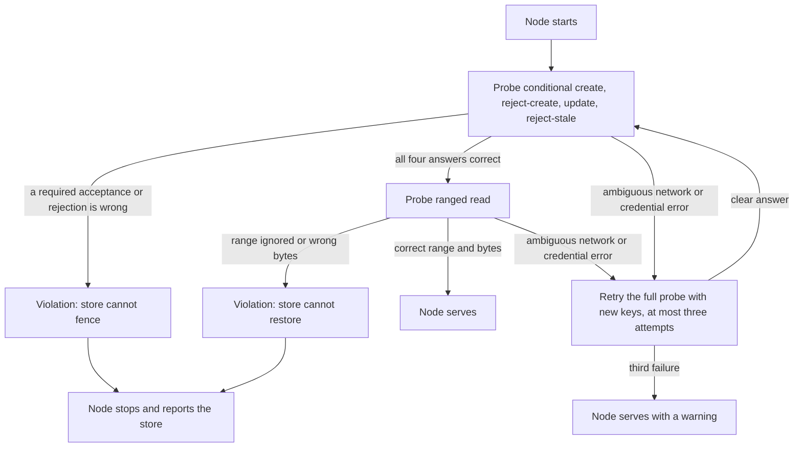
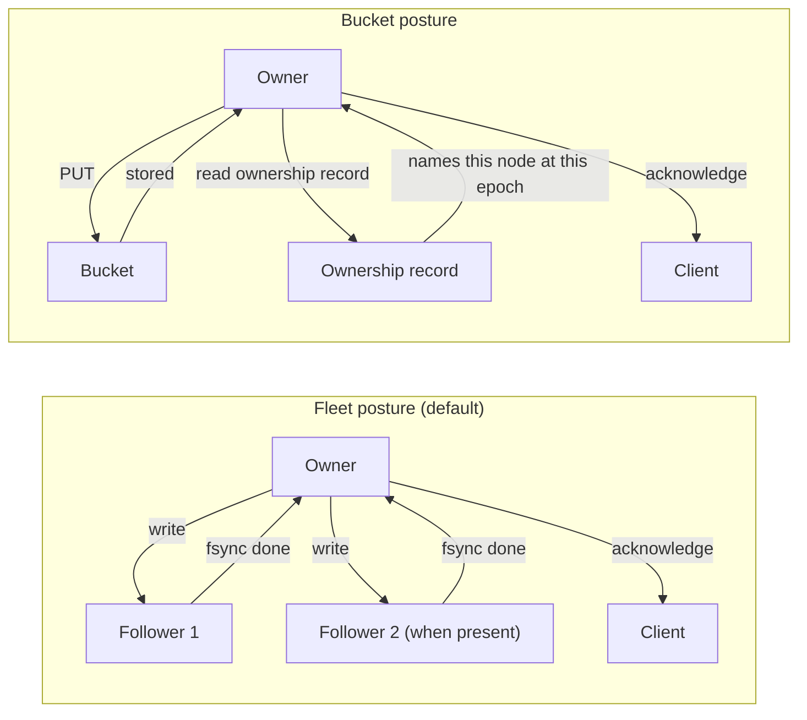

# Limitations and compatibility

celld is deliberately smaller than Cloudflare Workers. It implements one
JavaScript runtime model, one deployment model, and one tenancy unit. The unit
is the fleet: the nodes that share one bucket. Most differences fail at
deployment or at first call. A few are silent, and this document names them,
because the design treats an undocumented difference as a defect.

This document lists what celld does not do, the hard requirements that the
bucket and the network must meet, the size and time limits that apply at run
time, and the Cloudflare application programming interfaces (APIs) that differ
or that are absent. Sources: `docs/limitations.md`,
`docs/cloudflare-compat.md`, `docs/guarantees.md`, `docs/wasm.md`, and the
crates named in each section at commit
`8702f6d186c77698dbfb30cf29e3b1922a88f008`, version 0.6.3.

## The words this document uses

| Word | Meaning here |
|------|--------------|
| Activation | The process that makes a cell resident (in memory): restore the SQLite database and run the Durable Object constructor. A claim of the ownership record comes first when the node does not already own the cell. |
| Active | A resident cell that is doing work. |
| Bucket proof | A write that the bucket holds and that a later read of the ownership record confirms still belongs to this node at this epoch. |
| Binding | A platform resource that the deployment makes available to the Worker, such as a bucket, a queue, or a Durable Object namespace. |
| Cell | A named server with a private SQLite database. In Cloudflare terms, a cell is a Durable Object. |
| Compatibility flag | An option in Wrangler, the Cloudflare command-line deployment tool, that selects one behavior between two versions. |
| Conditional write | A write that the store applies only when its precondition holds. |
| Compare-and-swap (CAS) | A write that carries the token of the version it read. |
| Compaction | The merge of several Lite Transaction (LTX) segments into one larger segment at a higher level. |
| Dormant | The internal phase for a cell that is out of memory but still owned by its node. |
| Epoch | The counter in the ownership record that fences one activation from the next. |
| Ensemble | The followers of one owner, at most two nodes. |
| Fleet | The nodes that share one bucket. A fleet is the tenancy unit. |
| Garbage collection (GC) | The deletion of old epochs and other objects that no owner needs. |
| Generation | One application deployment as a node holds it. A node counts generations from one at boot and never reuses a number in one process. |
| Handler | The function that a runtime calls for one event, such as `fetch` or `alarm`. |
| Hibernated | A dormant cell that keeps its hibernatable WebSocket clients on its node. |
| Hibernatable WebSocket | A WebSocket that stays connected while its cell is out of memory. |
| Idle | A resident cell that is waiting for work. |
| Inactive | A cell that no node owns. It is only an object in the bucket. |
| Ingress | The node that accepts a client request and routes it to the owner. |
| Isolate | One JavaScript execution context in V8, the JavaScript engine that runs the Worker. |
| Lease | The node's claim in `nodes/<node>.json` with an expiry, renewed after one third of `CELLD_TTL_MS` (default 10,000 milliseconds). |
| Lifecycle rule | A bucket setting that deletes or moves objects by prefix and age. |
| LTX | Lite Transaction. The replication format that captures each committed SQLite write as a segment. |
| Node | One celld process on one machine. |
| Owner | The node that currently holds a cell's ownership record and serves the cell. |
| Ownership record | The bucket object `cells/<cell>/own.json` that names the owner and the epoch. |
| Ranged read | A read that returns a named byte range, not the whole object. |
| Read-after-write | A read after a successful write returns that write. |
| List-after-write | A listing after a successful write includes the written object. |
| Regular WebSocket | A WebSocket that cannot outlive the cell's memory, so it keeps the cell resident. |
| Resident | A cell that is in memory on a node. A resident cell is active or idle. |
| Reserved prefix | A key prefix inside the bucket that celld owns, such as `cells/`. |
| Restore | The rebuild of a cell's SQLite database from a snapshot and the later LTX segments. |
| Durability posture | The method that proves a write survives a failure. |
| Fleet proof | A write that the owner holds and every follower that it sent the write to has written to disk with fsync. One follower is enough; a second follower gives a third copy. |
| Fleet secret | The shared key in `fleet/peer-auth.json` that authenticates peer requests. |
| Follower | Another node that holds a copy of the owner's write log for a cell. |
| OAuth | Open Authorization, an authorization protocol that issues access tokens. |
| R2 | Cloudflare R2 object storage. |
| RSS | Resident Set Size, the physical memory that the process uses. |
| AKS | Azure Kubernetes Service. |
| Supervisor | The program that restarts celld after it exits. |
| Tiering path | The background process that copies node-log segments into their per-cell prefixes. A log drain is one run of that copy. |
| Exit code | The number that a process returns to its supervisor. |
| fsync | The system call that forces written data to durable storage. |
| Simple Storage Service (S3) | The Amazon object storage protocol. |
| Transmission Control Protocol (TCP) | The stream protocol under Hypertext Transfer Protocol (HTTP). |
| Internet Protocol (IP) | The addressing protocol for the network. |
| Transport Layer Security (TLS) | The protocol that encrypts a network connection. |
| Content Delivery Network (CDN) | A cache network near users. |
| Virtual Machine (VM) | An isolated operating system instance. |
| UTF-8 | Unicode Transformation Format 8-bit, a text encoding. |
| V8 heap | The memory that one V8 isolate may use for JavaScript objects. |
| Wake | The fleet mechanism that tells a cell's owner that the cell has work. |
| Wake cleanup pass | One cleanup cycle that lists at most 128 wake objects and processes at most 8 cells at once. |
| Waker | The role that reads wake records and tells the owner that a cell has work. |
| workerd | The open-source Workers runtime that Cloudflare publishes. |
| GiB, MiB | Gibibyte (2^30 bytes), mebibyte (2^20 bytes). |
| Central Processing Unit (CPU) | The processor that runs the work. |
| Key-Value (KV) | A store that maps one key to one value. |

## The shape of the limits

The limits fall into five groups. Each group has a different failure mode:

| Group | Limit | Failure mode |
|-------|-------|--------------|
| Storage | The bucket must enforce five properties. | The node stops at startup for a proven violation of a probed property. |
| Fleet | One fleet serves one application. | No limit is enforced; the operator must obey. |
| Network | celld does not terminate TLS and does not encrypt peer traffic. | The operator must supply the private network. |
| Runtime | Some Cloudflare APIs are absent or partial. | The deploy or the first call fails for an absent API. |
| Platform | Linux on x86-64 or ARM64, and macOS on Apple Silicon only. | Installation fails on another platform. |

The platform row produces a visible failure, and the runtime row usually does:
an absent API fails at deployment or at first call. Some runtime differences are
documented no-ops, such as the always-miss cache. A proven storage violation
stops the node at startup; a store that ignores a condition can fail late and
silently, so the qualified list and the probe matter. The fleet and network
rows are design choices, and no check can enforce them.

## Storage is a hard requirement

The bucket is the root of authority, so celld requires five properties. The
first two decide ownership. The third makes a successful write visible to a
later read, so a bucket-mode proof can trust the upload. The fourth enables
restore. The fifth enables epoch GC (`docs/guarantees.md:9-24`):

1. A conditional create fails when the object exists. The ownership claim uses
   it.
2. A conditional overwrite fails when the object changed after the read. Lease
   renewal and takeover use it.
3. A read after a successful write returns that write. A later restore must
   see the write, so the bucket proof relies on it.
4. A ranged read returns the requested bytes. Restore uses it.
5. For epoch GC only, a listing after a successful write includes the object.

A store that lacks the first two properties lets two nodes own one cell. A
store that lacks the third property loses a write that the node already
acknowledged. A store that lacks the fourth property cannot restore a database.
GC builds the epoch chain from listings. A store that lacks the fifth property
can return a listing that misses a new object, so GC can compute a base below
it and delete a prefix that a new owner needs.

Each node runs a probe before it serves. The probe tests three of the five
properties for the request form it uses: conditional create, conditional
overwrite, and ranged reads. It does not test read-after-write or
list-after-write. A store can pass the probe and still fail read-after-write or
list-after-write, which is why the qualified list below matters. The probe
separates a permanent violation from a temporary error:

```rust
// crates/celld/bucket.rs:1633-1661 (abridged)
pub(crate) async fn probe_startup_storage_steps(&self) -> anyhow::Result<StorageProbeVerdict> {
    match self.probe_cas_steps().await {
        Ok(StorageProbeVerdict::Conformant) => {}
        Ok(violation) => return Ok(violation),
        Err(error) if is_unsupported_operation(&error) => {
            return Ok(StorageProbeVerdict::Violation(
                "the store does not support conditional writes, so celld cannot acquire a cell"
                    .to_string(),
            ));
        }
        Err(error) => return Err(error),
    }

    match self.probe_range_steps().await {
        Err(error) if is_unsupported_operation(&error) || is_invalid_range_response(&error) => {
            Ok(StorageProbeVerdict::Violation(
                "the store does not honor ranged reads, so celld cannot read stored cell data"
                    .to_string(),
            ))
        }
        result => result,
    }
}
```

The conditional-write probe has four steps against one key. Two of them must
fail, or the store cannot fence:

```rust
// crates/celld/bucket.rs:1682-1745 (abridged)
// 1. A create on an absent key applies, and answers the token that
//    steps 3 and 4 need.
let Some(token) = self.put_cas(key, b"probe-create".to_vec(), None).await? else {
    return Ok(StorageProbeVerdict::Violation(
        "the store rejected a conditional create of an object that does not exist".to_string(),
    ));
};

// 2. A create over the object step 1 wrote must be rejected.
if self.put_cas(key, b"probe-recreate".to_vec(), None).await?
    .is_some()
{
    return Ok(StorageProbeVerdict::Violation(format!(
        "the store overwrote an object although the write was conditional on that object \
         being absent; ... two nodes can own one cell"
    )));
}

// 3. An update that carries the current token applies, and that
//    retires the token step 4 reuses.
if self.put_cas(key, b"probe-update".to_vec(), Some(&token)).await?
    .is_none()
{
    return Ok(StorageProbeVerdict::Violation(
        "the store rejected a conditional update that carried the current token".to_string(),
    ));
}

// 4. The token is stale now, so the update must be rejected. This
//    step is the fencing contract itself.
if self.put_cas(key, b"probe-stale".to_vec(), Some(&token)).await?
    .is_some()
{
    return Ok(StorageProbeVerdict::Violation(format!(
        "the store applied a conditional write that carried a stale token; ..."
    )));
}
```

A `Violation` is permanent, so the node stops. An ordinary `Err` is ambiguous,
so the node runs the complete probe up to three times in total, each time with
a new key. It then starts with a warning, because a temporary outage can end.
The warning means that the node has not proven the store. It serves on the
assumption that the error is temporary, so a store that stays broken can fail
later. A node cannot disable the probe.

The probe classifies an error with two predicates. `is_unsupported_operation`
matches `Error::NotSupported`, `Error::NotImplemented`, or a response status of
405 or 501. `is_invalid_range_response` matches the parser messages of the
object_store library (the Rust storage client that celld uses) for a wrong
range. The ranged-read probe writes a second object whose body is
`celld-range-probe`, reads the half-open byte range 6..11, which is bytes 6
through 10, and verifies both the returned range and the bytes
(`crates/celld/bucket.rs:1758-1800`). The node writes a violation reason to
standard error and exits nonzero.

A process that stops mid-probe can leave a small object under `probe/`. celld
never reads it.



### Qualified stores

Qualified means that the celld maintainers tested the store and accept it for
production. A qualified store is the only safe choice for a fleet.

| Store | Status |
|-------|--------|
| Amazon S3 | Qualified. The release tests use the same client and headers as R2. |
| Cloudflare R2 | Qualified, and the release tests run against it. |
| Tigris | Qualified. A Global or Dual-region Tigris bucket (a bucket type that copies data across regions) provides list-after-write only in the region of the write, so do not enable epoch GC when nodes are in several regions. |
| Google Cloud Storage | Qualified through the XML API with `x-goog-if-generation-match` and OAuth credentials. |
| Azure Blob Storage | Qualified on 2026-08-18 in a single-node test, with an account key, a virtual machine (VM) managed identity, or an Azure Kubernetes Service workload identity. The source does not state whether a multi-node Azure fleet is qualified. |
| MinIO community edition | Later releases pass the probe but are not qualified for production. `RELEASE.2025-09-06T17-38-46Z` fails the first `celld deploy` to it; use `RELEASE.2025-09-07T16-13-09Z` or later. |
| Backblaze B2, Hetzner Object Storage, DigitalOcean Spaces | Not supported. They do not implement the required conditional writes, so two nodes can own one cell. |

The source does not describe a separate test for read-after-write or
list-after-write. The qualified list is the maintainers' acceptance, and the
release tests run against R2.

The probe uses small objects and one request form for each property, so it does
not prove every form. The source reports that a store can accept the conditional header and
still ignore the condition, and it fails late and silently. Run `celld diagnose`
with a credential that can write before production. The source describes
`celld diagnose` as sending the four conditional writes; it does not state that
the command tests ranged reads, read-after-write, or list-after-write. `celld diagnose --read-only` exists for a credential that
cannot write, but it skips the bucket write probe, so it cannot detect this
failure.

Azure has one more limit. A managed identity from Azure App Service or Azure
Container Apps does not work. Use a workload identity (a credential that a
cloud platform issues to a workload) or a storage account key in those
services.

A bucket value has the form `s3://BUCKET/PREFIX`, `gs://BUCKET/PREFIX`, or
`az://CONTAINER/PREFIX`. For `az://`, the name is the container
(`docs/README.md:182`). A `gs://` bucket uses the Extensible Markup Language
(XML) API with `x-goog-if-generation-match`, because Cloud Storage does not
apply `If-Match` to a PUT (`docs/guarantees.md:42-45`).

### Reserved prefixes

celld owns ten key prefixes inside the bucket and deletes objects under some of
them:

```
probe/       cells/       nodes/       node-cells/   fleet/
deploy/      deploy-blobs/ log/        wake/         telemetry/
```

An application must not write under any of these prefixes. celld does not
check application writes; an application with bucket access can write anywhere.
The rule is a contract, not an enforced policy. An operator must not delete,
expire, or overwrite an object under them, except under `probe/` and
`telemetry/`. A lifecycle rule must not select an object under any other
reserved prefix, because celld reads those objects to fence and restore cells.
With a key prefix, each reserved name follows it, for example
`PREFIX/telemetry/`.

Epoch GC is off until `CELLD_LTX_RETENTION_SECS` has a positive value
(`crates/celld/ltx_repl.rs:1342`). An LTX epoch is one
`cells/<cell>/ltx/e<epoch>/` prefix that holds the replication segments for
that epoch. Without epoch GC, old epoch prefixes stay in the bucket. When it is
on, the owner deletes the old LTX epochs that no restore reads, at most every 5
minutes. A node-log bundle is a group of segments from many cells that a node
uploads under `log/`. The tiering path copies each segment into its per-cell
prefix. A node deletes a bundle only when the per-cell prefixes cover every
segment in it, and a bundle is never deleted on a guess. Wake cleanup passes run
every 60 seconds by default, and telemetry has its own retention sweep. The ban
above is on the operator, not on celld.

The rule matters most for `cells/<cell>/own.json`. celld never deletes the
ownership record, and the record must stay for the life of the cell. If the
record is missing under the same cell prefix as LTX data under
`cells/<cell>/ltx/`, celld refuses to acquire the cell, because a new record at
epoch 1 would start an empty database. Each request that must read the record fails, and the node writes
`celld ownership record lost` to standard error. The node then refuses the cell
for 10 seconds and makes no bucket request in that interval, so it writes the
line at most once.

One case is worse. A new cell can keep its first writes in a node-log bundle
under `log/` until the tiering path copies them into `cells/<cell>/ltx/`. A lost
record before that copy starts the cell empty, because no LTX file exists under
`cells/<cell>/ltx/` to prove the loss (`docs/guarantees.md:111-113`).

## One fleet, one application

The fleet is the tenancy unit. Version 0.6.3 has no account service, no
multi-tenant scheduler, and no managed ingress. A managed ingress is a shared
front door that routes each request by account. The operator gives each
application its own fleet, its own bucket, and its own credentials.

This limit is not a check. Nothing rejects a second application that shares a
fleet. The design assumes that the operator does not do that, because the
bucket credential and the fleet secret give full control of every cell.

A cell is also not a security boundary. The ownership epoch stops two writers,
and it does not stop one tenant's code from using the bindings that the
deployment gave it. [Security and tenancy](09-security-and-tenancy.md) gives
the full model.

## The network is a hard requirement

celld terminates no TLS and adds no encryption to peer traffic. The public
listener needs a proxy that terminates TLS. The internal listener defaults to
`127.0.0.1:0`, a free loopback port, so a multi-node fleet sets
`--internal-listen` and `--advertise`. The internal listener needs a private
network or an encrypted overlay, which is a virtual private network such as
WireGuard or Tailscale. If an operator advertises a public address, celld
requires `--unsafe-public-advertise`, because the operator API (the internal
interface for commands such as `/shutdown` and `/rebalance/pause`) has no
caller authentication (`docs/security.md`).

## Durability has two postures

`CELLD_DURABILITY` selects the proof that covers an acknowledged write:

```rust
// crates/celld/main.rs:4239-4243
let durability = std::env::var("CELLD_DURABILITY").unwrap_or_else(|_| "fleet".into());
ensure!(
    durability == "fleet" || durability == "bucket",
    "CELLD_DURABILITY must be `bucket` or `fleet`"
);
```

`fleet` is the default. The owner sends each write to one or two followers.
The followers are the ensemble. Every recruited follower writes
the write to disk with `fsync`, and the owner acknowledges when every recruited
follower confirms, or when the bucket upload finishes, whichever comes first.
The first proof to complete acknowledges the write, so a write in fleet posture
can use the bucket proof; the copy counts below apply only to a write that the
fleet proof covers. One follower is enough for a fleet proof. This posture needs at least two running
nodes, because a node never counts itself as a follower. A fleet of two holds
two copies of a write that uses a fleet proof: the owner and its one follower.
A fleet of three or more holds three copies while two followers are available:
the owner and two followers. When only one follower remains, the owner keeps
acknowledging and holds two copies until another node becomes available. A
write that uses a bucket proof is in the bucket
(`docs/guarantees.md:174-186`).

A one-node fleet requests the fleet posture and does not get it. The node stays
correct and acknowledges each write on a bucket proof instead, at the cost of a
bucket write and an ownership-record read per write. It does not refuse to
start. The operator sees the fallback as latency, not as an error.



A fleet with one follower keeps acknowledging while that follower remains, and
it recruits a second follower when another node becomes available. That is when
a write can reach three copies.

### Recovery limits

A takeover is the acquisition of a cell by a new node after the old owner
stopped renewing its lease. A takeover can need recovery before it serves. A
cold activation opens the database, restores it from the bucket, and runs the
constructor.

The limits use these terms. A follower is another node that holds a copy of
the cell's log. To certify a range is to state that the range is complete and
the bytes are valid. A batch is one contiguous group of log entries. A gap is a
missing range between two batches. An entries-only tail is an older format that
carries log entries without completeness metadata. A persisted end is a record
that names the last range that reached durable storage. A torn batch is a batch
that was written only in part. A loss record is a record that says a range may
be lost. A window is one read of at most 512 MiB. A retained bundle is a
node-log bundle that a stopped node uploaded and that still exists under
`log/`.

Recovery has known limits:

- A follower that returns an HTTP error does not prove that its data is
  absent, even when the follower's lease expired. A persistent error can block
  recovery.
- A restarted follower cannot certify a range with a damaged batch or a gap
  until valid data covers it.
- An older node's entries-only tail proves neither completeness nor loss, so
  recovery can stall during a mixed-version update.
- A deleted final batch is undetectable if no later batch or persisted end
  records its range.
- A torn batch with an unacknowledged write can cause a loss record for a range
  that holds no acknowledged write. The loss record reports the range; it does
  not by itself lose an acknowledged write.

Recovery of a large dead node can take minutes. Recovery reads the retained
bundles in windows of at most 512 MiB. It uploads each window to the cell's LTX
prefix and releases the window's memory before the next window. A failed or timed-out attempt does not fail a waiting request. The
cell retries with a backoff, `CELLD_RECOVERY_RETRY_MS`, which defaults to 1,000
milliseconds, and the request fails with a resolve error only after
`CELLD_RECOVERY_RETRIES` attempts, which defaults to 240
(`docs/guarantees.md:229-237`).

## The supervisor is mandatory

A node that loses its lease fences itself and exits with code 3. To fence
itself is to stop serving and exit, so the node cannot write under an epoch
that it no longer owns. It does not recover on its own. Without a supervisor,
the fleet loses that capacity permanently.

```rust
// crates/celld/main.rs:4886-4889 (abridged)
eprintln!("SELF-FENCE: the core actor exited unexpectedly");
exit_flushed(3);
```

Run celld under systemd, Docker with a restart policy, or Kubernetes. The
supervisor must restart without an attempt limit, and it must wait at least one
lease lifetime between attempts. `CELLD_TTL_MS` sets that lifetime, and it
defaults to 10,000 milliseconds. The wait matters because a restarted process
must let the old lease expire before it can claim the same cells; a restart
inside the lifetime fails the claim.

The exit codes are these. Code 2 is not used.

| Code | Meaning |
|------|---------|
| 0 | A normal shutdown. |
| 1 | A startup error, reported through the Rust error return from `main`. |
| 3 | A self-fence, or another internal failure that uses the `SELF-FENCE:` prefix. |

The fence has four causes, and each names itself on standard error. The signal
is a message for the core actor and a tracing event name for the three lease
causes:

| Cause | Signal |
|-------|--------|
| The core actor stopped. | `SELF-FENCE: the core actor exited unexpectedly` |
| The lease was not renewed before it expired. | `node_lease_watchdog_fence` |
| The lease record is gone. | `node_lease_record_missing_fence` |
| The lease record names another process. | `node_lease_record_mismatch_fence` |

Other internal failures, such as the exit of the task that replicates the cell
log, also use code 3 and the `SELF-FENCE:` prefix
(`docs/guarantees.md:297-303`).

The core actor is the task that owns the cell state, the lease chain, and the
ownership timers. If it stops, no other task can renew the lease or serve a
cell safely. The lease record is `nodes/<node>.json`, and the same object
carries the node's recovery log.

The fenced state is terminal. Only a restart returns the node, through the
normal cold-activation path.

## Capacity and scheduling limits

celld does not measure central processing unit (CPU) time or memory use when it
balances cells. It counts each cell as one unit of load. Each node reports a
placement weight, `CELLD_PLACEMENT_WEIGHT`, which defaults to the CPU count,
and its target is the total cell count multiplied by that node's share of the
total weight (`crates/logic/rebalance.rs:83-101`). A node with twice the weight
receives twice the target. The shared capacity sample (the cell count that every node reads) is
`fleet/capacity-v1.json`, read every `CELLD_REBALANCE_INTERVAL_MS`, which
defaults to 5,000 milliseconds; `0` disables balancing. The most loaded node hands at most 32 cells at a time
to the node furthest below its target, and a receiver fills to 2 percent below
its target (`docs/README.md:402-412`). The 2 percent is a deadband, so a stale
count cannot overshoot and send the batch back.

Balancing moves only dormant cells (`crates/logic/lib.rs:5790-5811`). A
resident cell is in memory: it is active while it runs a handler and idle while
it waits. An idle eviction removes an idle cell from memory and leaves it
dormant, and `CELLD_IDLE_EVICT_S` sets the wait before it. A dormant cell is
still owned by its node, so balancing can move it: the node releases the
ownership record to a successor. A dormant cell that keeps its hibernatable
WebSocket clients is hibernated. A resident cell cannot move. It must leave
memory first, through an idle eviction or another eviction path, and become
dormant. Without `CELLD_IDLE_EVICT_S`, only memory pressure or the residency
cap removes an idle cell (`docs/README.md:27-29`). A pressure eviction releases
the ownership record by default, so that cell becomes inactive. An inactive
cell is unowned, so balancing has nothing to move; the next request cold-starts
it. A fleet without idle eviction therefore balances only the cells that leave
memory by another path. If every cell stays resident, no balance happens.

An idle eviction keeps the ownership record, so the cell wakes on its own node
until balancing moves it. A pressure eviction releases the ownership record by
default (`CELLD_PRESSURE_OWNERSHIP=release`), so another node can claim the
cell. `CELLD_PRESSURE_OWNERSHIP=sticky` keeps the record, so the cell stays
dormant instead of inactive. A node under pressure also hands a new activation
to the least loaded peer (`docs/README.md:395-405`).

A resident cell pins work to its node. An outbound WebSocket is a socket that
the Durable Object opens to another server. An active handler, a regular
WebSocket, or an outbound WebSocket keeps its cell resident, and eviction
refuses while one is active. A cell therefore moves only after it leaves
memory. When balancing moves a cell that is out of memory and still holds
hibernatable WebSocket clients, those clients close with code 1012 (service
restart), so the application must store the connection intent and reconnect.
The sockets never move with the cell. A WebSocket in the response is different:
it belongs to the client connection, and it stays open after the handler
returns.

A node limits resident cells with `CELLD_MAX_RESIDENT_CELLS`, which is unset by
default and then applies no hard cap. It limits outbound Durable Object
WebSockets to 32 for one cell, and `CELLD_MAX_OUTBOUND_WEBSOCKETS` changes that
value (`crates/celld/machine.rs:78-80`). These are node settings, not
application quotas. Under memory pressure, a node sheds cells by evicting them
from memory. `CELLD_MAX_RSS_MB` sets the pressure threshold from the Resident
Set Size (RSS), which is the physical memory that the process uses. The default
is 80 percent of available memory.

## Time and size limits

| Limit | Value | Source |
|-------|-------|--------|
| Public request body | 1 GiB by default | `crates/celld/actor.rs:1291` |
| Internal operator protocol body | 64 MiB | `crates/celld/main.rs:1583` |
| JavaScript handler budget | 300 seconds by default | `crates/celld/engine_api.rs:874-881` |
| Idle HTTP stream | 60 seconds | `crates/celld/http_streams.rs:34` |
| WebSocket non-terminal frame budget | 1 MiB per isolate-polled queue | `docs/cloudflare-compat.md:104-105` |
| Workflow step value (a return value, an event payload, or a step parameter) | 1 MiB | `crates/celld/js/harness.js:7933` |
| LTX compaction round | 256 files, 64 MiB | `crates/celld/ltx_repl.rs:172-176` |
| Worker script name | 63 bytes | `crates/celld/deploy.rs:193` |
| V8 heap limit for one isolate | 128 MiB by default | `crates/celld/js.rs:2352` |
| Wake cleanup pass | 128 objects, 8 cells | `docs/guarantees.md:329` |
| Recovery read window | 512 MiB | `docs/guarantees.md:231` |

Some limits are constants, and others have an environment variable.
`CELLD_MAX_REQUEST_BODY_BYTES` lowers the public limit and cannot raise it above
1 GiB. `CELLD_HANDLER_BUDGET_S` changes the handler budget.
`CELLD_V8_HEAP_LIMIT_MB` changes the heap limit. A workflow value is a step
return, an event payload, or a step parameter. The other limits in this table are constants: the operator body, the idle
stream, the frame budget, the workflow value, the compaction round, the script
name, the cleanup pass size, and the recovery window.

The handler budget is per request. A handler that exceeds the budget is
stopped, and the request fails:

```rust
// crates/celld/engine_api.rs:874-881
pub fn handler_budget() -> std::time::Duration {
    static BUDGET: OnceLock<std::time::Duration> = OnceLock::new();
    *BUDGET.get_or_init(|| {
        std::time::Duration::from_secs(
            crate::env_vars::positive_or("CELLD_HANDLER_BUDGET_S", 300)
                .expect("validated CELLD_HANDLER_BUDGET_S"),
        )
    })
}
```

`CELLD_MAX_REQUEST_BODY_BYTES` lowers the body limit, and
`CELLD_HANDLER_BUDGET_S` changes the handler budget. Both must be positive.

An HTTP stream is a request or response body that crosses the host boundary by
identifier, not by value. The Worker reads the stream one operation at a time;
an operation is one call that takes the next chunk. A stream is claimed while a
reader holds it. The stream expires after 60 seconds in which it is neither
claimed nor operated on. A successful operation starts a new 60-second period. An
expired or unknown stream reports an error, not an end of stream (EOF):

```rust
// crates/celld/http_streams.rs:34
pub(crate) const HTTP_STREAM_IDLE_TIMEOUT_MS: u64 = 60_000;
```

A non-terminal frame is any WebSocket frame other than a close frame. The 1
MiB budget applies to each input queue that an isolate polls for frames, and a
message larger than 1 MiB uses the whole budget, so the queue is full until the
reader consumes it.

## Runtime compatibility gaps

celld matches workerd, the open-source Workers runtime that Cloudflare
publishes, for most of the runtime. The differences below are the ones that can
change an application. A remote Durable Object call is a request that this node
forwards to the owner node. A replay copy is a stored copy of the request body
that the sender can send again. The owner generation is the generation that
owned the object when the caller resolved it. To resolve is to look up the
current owner node of a cell. A resolve error says that the node could not
route the call to an owner. The deadline is the longest time that a call waits
for the owner generation to change, set by `CELLD_OPERATION_DEADLINE_MS`.

### Fetch, Request, Response, and Headers

| Difference | Effect |
|------------|--------|
| The `cache` request option is absent. | A request cannot ask for a cache mode. |
| The `cf` object has no edge fields. | Geolocation, data center, and TLS metadata are absent. |
| celld removes `Content-Length` from a response, except for `HEAD`. | A client must not rely on the header. |
| A remote Durable Object call cannot retry after the body starts. | celld keeps no replay copy. |
| A call whose owner generation is rejected waits at most `CELLD_OPERATION_DEADLINE_MS`. | A call can fail with a resolve error. |

### Context and handlers

`passThroughOnException()` asks the platform to run the Worker's fallback logic
when the origin (the server that the Worker fetches from) fails. It has no
effect, because celld has no CDN fallback. A
facet is a nested Durable Object that shares its parent's identity, and
`ctx.facets` is available only inside a Durable Object. A `tail` handler
receives logs after a request finishes, and an `email` handler receives
inbound email. Neither is available.

### Remote Procedure Call (RPC)

An RPC stub is the client object that sends a method call to another object. It
cannot cross an isolate boundary, because it holds a handle that belongs to one
isolate. An `AbortSignal` (the standard cancellation object) does not cross a
node boundary. A remote RPC retries only when the failed peer attempt did not
start the method. An application retry therefore needs a stable operation
identifier: the same identifier on every attempt, so the receiver can recognize
the repeat.

### Streaming and WebSockets

An outbound Worker WebSocket is a socket that the Worker opens to another
server. It closes when its event and its `waitUntil` work end. `waitUntil` is
the promise set that keeps work alive after the response. A socket that the
response returns stays open. If the isolate stops polling its input queue,
celld discards the unread frames, and a later pull reports an abnormal close.

A WebSocket transport cannot move to a new cell owner, although the cell itself
can move. The client must reconnect with the same operation identifier. A
tunneled connection is one that the ingress node forwards to the owner. The
ingress forwards the owner's Close without a second Close. If the owner fails
between frames before a Close, the ingress sends code 1012, which means service
restart. If a frame is incomplete, the ingress closes the transport instead.

`acceptWebSocket()` throws above 90 percent of the V8 heap limit, which is 128
MiB by default. A response with a WebSocket to a request without
`Upgrade: websocket` fails, as in workerd.

### Web Crypto

The table uses these abbreviations. HMAC is a Hash-based Message Authentication
Code. ECDSA is the Elliptic Curve Digital Signature Algorithm. AES-GCM is the
Advanced Encryption Standard with Galois/Counter Mode. RSA-OAEP is the
Rivest-Shamir-Adleman Optimal Asymmetric Encryption Padding scheme. DSA is the
Digital Signature Algorithm, and RSA-PSS is the Rivest-Shamir-Adleman
Probabilistic Signature Scheme. MD5 is Message Digest 5, and SHA is the Secure
Hash Algorithm.

| Algorithm | Difference |
|-----------|------------|
| HMAC | Accepts MD5, SHA-1, SHA-224, SHA-256, SHA-384, and SHA-512. |
| ECDSA | P-256 with SHA-256 only. |
| AES-GCM | Tags from 96 through 128 bits, in 8-bit steps. |
| RSA-OAEP | SHA-1, SHA-256, SHA-384, and SHA-512. A label must be valid UTF-8. |
| Ed25519 | Signs and verifies. `NODE-ED25519` (the Cloudflare Node.js spelling) names the same algorithm. |
| X25519 | A low-order peer key is rejected. |
| Secret keys | `jwk` cannot be used with `exportKey()` or `wrapKey()`. |

The Web Crypto Application Programming Interface (API) is present, with
narrower parameters in the places that the table lists. A
`jwk` is a JSON Web Key, the JavaScript Object Notation (JSON) form of a key. A
secret key cannot use that form with `exportKey()` or `wrapKey()`, so the key
cannot leave the isolate in that form.

### Node.js compatibility

celld implements `node:assert`, `node:async_hooks`, `node:buffer`,
`node:diagnostics_channel`, `node:events`, `node:fs`, `node:os`, `node:path`,
`node:stream`, `node:timers/promises`, and `node:util`.

The gaps are:

- `node:crypto` omits Diffie-Hellman, streaming signatures, ciphers, RSA-PSS,
  and DSA.
- `node:zlib` implements only the synchronous gzip and deflate functions.
- `node:fs` provides `access`, `mkdir`, `realpath`, `stat`, `lstat`, and
  `readFile`. It exposes an empty, request-local `/tmp` and a read-only
  `/bundle`.
- A global `process` matches workerd for each field that it defines, such as
  `process.execPath`, `process.argv`, and `process.title`. Other fields, such as
  `process.kill` and `process.features`, are undefined.
- The celld bundler supports a synchronous CommonJS `require()` of a Node.js
  built-in module. CommonJS is the older Node.js module format, in which a
  module calls `require()`. A raw ECMAScript Module (ESM) Worker is an unbundled
  Worker, such as one deployed with `no_bundle`, so celld does not run the
  bundler on it. It has no global `require()`.
- celld provides a stub for an unsupported `node:*` built-in or member. The
  import succeeds, so a module-scope reference does not crash, but the first
  call or construction on the stub throws `not implemented in celld`. A patch
  to a built-in module object stays in its isolate.

### Cache, TCP, and BroadcastChannel

`caches` is an always-miss cache. A miss is the only possible result, because
celld has no shared edge cache. `put()` validates and consumes the response but
stores nothing, `match()` returns `undefined`, and `delete()` returns `false`.

A TCP socket cannot outlive its event. A Durable Object must reconnect during a
later event. celld verifies a TLS server against its bundled Mozilla root store
(the certificate authority list that Mozilla publishes), and it does not block
the destination ports that Cloudflare blocks. The fleet network, not celld,
controls the egress policy.

`BroadcastChannel` exists so that a bundle can load, but its constructor throws.
The class is present because an import of it must not fail at load time.

### WebAssembly

celld supports WebAssembly through the V8 engine. A bundle imports a `.wasm`
file and receives the compiled module, not the bytes. celld compiles each module
once per process, so later isolates and cell activations reuse it. With
`no_bundle: true`, celld preserves the entry file byte for byte and applies the
default `**/*.wasm` and `**/*.wasm?module` patterns below the entry directory.
It does not accept `rules`, `base_dir`, or `find_additional_modules` for module
discovery, and it does not discover additional JavaScript modules. A symbolic
link with a WASM pattern name is refused. `docs/wasm.md` gives the build rules
and the `workers-rs` example.

## Service status

| Service | Status |
|---------|--------|
| Workers | Yes |
| Durable Objects | Yes |
| Durable Object Facets | Yes |
| Containers | Experimental |
| Static assets | Yes |
| Cron Triggers | Yes |
| Dynamic Workers | Yes |
| KV | Yes |
| Queues | Yes |
| D1 | Yes |
| Workflows | Yes |
| R2 | Yes |
| Workers AI | No |
| Vectorize | No |
| Hyperdrive | No |
| Browser Rendering | No |
| Email Workers | No |
| Python Workers | Partial: `fetch` handlers on the Pyodide 0.28 runtime line |

The table lists the major services, not every API. A service marked Yes can
still lack an option that another section names. [The services](07-the-services.md)
describes each service; this table reports only the celld status.

The four values have these meanings:

- **Yes** means the named binding or handler exists. The sections above list
  the options that are narrower.
- **Partial** means a substantial part is unavailable.
- **Experimental** means the interface can change without notice.
- **No** means not implemented.

Pyodide is the Python distribution compiled to WebAssembly. A Python Worker
therefore runs inside the same V8 process, not in a separate Python process.

## Configuration compatibility

`celld deploy` accepts `wrangler.jsonc` or `wrangler.json`. It does not accept
`wrangler.toml`. `compatibility_date` is the date that selects the Cloudflare
API defaults, and `compatibility_flags` adds explicit switches to that date
(`crates/celld/lib.rs:285-313`). celld also rejects every top-level key that it
does not model:

```rust
// crates/celld/deploy.rs:42-65
const SUPPORTED_KEYS: &[&str] = &[
    "$schema",
    "name",
    "main",
    "compatibility_date",
    "compatibility_flags",
    "durable_objects",
    "migrations",
    "assets",
    "services",
    "triggers",
    "vars",
    "d1_databases",
    "kv_namespaces",
    "queues",
    "workflows",
    "r2_buckets",
    "worker_loaders",
    "containers",
    "no_bundle",
    "define",
    "rules",
];
```

A `routes` key therefore stops the deployment. celld has no route table,
because the public listener sends every path to the deployed Worker.

This rejection is the opposite of the compatibility-flag rule below. celld
rejects an unknown configuration key because it cannot tell what behavior the
key would have selected. It accepts an unknown flag because a flag is a named
switch that it can report as unhonored. `Cloudflare.compatibilityFlags` is the
runtime object that lists the honored flags.

The application name has a narrow shape, because celld reuses it in several
keys and classes. The name identifies the deployment record, the script in the
bucket, and the reserved workflow class `__Workflow.<script>` for a workflow in
that script:

```rust
// crates/celld/deploy.rs:193, 2314-2328 (abridged)
const MAX_SCRIPT_NAME_BYTES: usize = 63;

fn valid_script_name(name: &str) -> bool {
    name.len() <= MAX_SCRIPT_NAME_BYTES
        && name.bytes().next().is_some_and(|first| {
            first.is_ascii_lowercase() || first.is_ascii_digit()
        })
        && name.bytes().last().is_some_and(|last| {
            last.is_ascii_lowercase() || last.is_ascii_digit()
        })
        && name.bytes().all(|value| {
            value.is_ascii_lowercase() || value.is_ascii_digit() || value == b'-'
        })
}
```

A name is 1 to 63 lowercase letters, digits, or internal hyphens. It cannot
start or end with a hyphen.

`define` and `rules` go to esbuild, the JavaScript bundler that celld runs.
`define` replaces one identifier with a constant. `rules` maps a file glob (a
pattern such as `*.txt`) to a module type. Each rule type must be `Text`,
`Data`, or `CompiledWasm`, and each glob must be `**/*.ext` or `*.ext`. Two
rules that give one extension different types stop the deployment. `no_bundle`
skips esbuild and preserves the entry file byte for byte, so it cannot be
combined with `define` or `rules`. The `rules` key is accepted only when celld
runs the bundler.

An asset-only project can omit `main`. celld rejects an asset tree with a
non-UTF-8 name, a backslash or null byte, a path over 1,024 bytes, a
noncanonical path, a symbolic link, `_worker.js`, or `.assetsignore`
(`crates/celld/deploy.rs:2698-2750`). It skips `_headers` and `_redirects`, so
those files are not published. celld does not implement `.assetsignore`. If the
asset tree contains it, `celld deploy` refuses the tree. Remove the file, or
apply it with Wrangler and deploy the resulting assets.

### Compatibility flags

A date default is a behavior that a compatibility date at or after the given
date turns on. A paired flag turns the same behavior off or back on. celld
honors these flags:

| Flag | Effect |
|------|--------|
| `delete_all_deletes_alarm` | `storage.deleteAll()` also deletes the alarm. It is on from compatibility date 2026-02-24, or with this flag. `delete_all_preserves_alarm` turns it off. |
| `js_rpc` | Enables RPC on a Durable Object class that does not extend `DurableObject`. No date default. |
| `fetcher_no_get_put_delete` | Removes the deprecated `get()`, `put()`, and `delete()` helpers on a stub. The helpers are on from compatibility date 2024-03-26 unless this flag is present. `fetcher_has_get_put_delete` turns them back on. |
| `sqlite_vec` | Exposes the pre-v1 sqlite-vec extension (the vector search extension before its 1.0 release) to SQLite-backed Durable Objects. No date default. |
| `websocket_standard_binary_type` | `binaryType` defaults to `"blob"`, and a binary message arrives as a `Blob`. Without it, celld keeps the historical `"arraybuffer"`. |
| `assets_navigation_prefers_asset_serving` | A navigation request is served from assets when the flag is present or the compatibility date is 2025-04-01 or later. |
| `assets_navigation_has_no_effect` | Turns that navigation behavior off. It overrides both the other flag and the date default. |
| `queue_json_messages` | Queue message bodies use JSON from compatibility date 2024-03-18, or with this flag. `queue_v8_messages` turns JSON off and keeps the structured-clone default. |

celld accepts every other flag without effect. This is a deliberate exception
to the rule that a silent difference is a defect. A flag is a name that celld
records. An unknown name is not an error, so one configuration can load on both
Cloudflare and celld. The cost is that an unknown flag does nothing, and the only report
is that the name is absent from `Cloudflare.compatibilityFlags`. Check this
table against the deployment before you depend on a flag.

## Wake format migration

A wake is the fleet notification that a cell has work for its owner. The bucket
holds a wake format marker. A binary refuses a format that it does not know,
because the discovery entries have different shapes. The marker is read at
startup only. A discovery entry is one
wake record that tells a waker which cell has work:

```rust
// crates/celld/wake_format.rs:7, 18-25
const KEY: &str = "wake/format.json";

fn decode(bytes: &[u8]) -> anyhow::Result<FormatRecord> {
    let record: FormatRecord = serde_json::from_slice(bytes)?;
    ensure!(
        record.format == 2,
        "unsupported wake format; this binary requires format 2"
    );
    Ok(record)
}
```

An empty fleet initializes format 2 automatically. An upgrade from version
0.4.1 needs a stopped fleet, because an old node cannot read the new discovery
entries. The source documents the upgrade from 0.4.1 only; it does not state
whether other versions need the same steps. The upgrade steps are in `docs/guarantees.md:342-374`:

1. Stop application traffic, every old node, and every supervisor. Wait for
   every node lease to expire.
2. Back up the bucket and the node data. A follower disk can hold acknowledged
   writes that the bucket does not hold.
3. Revoke the old credentials, so an old binary cannot write to the bucket.
4. Start the new binary on every node with the same names, data, and
   addresses.

The nodes can start together. A live node lease blocks the migration. The
migration preserves databases, node logs, ownership records, deployments, and
application objects. It creates a discovery seed for each stored cell, in pages
of at most 128 entries, and removes the seed only after the cell's log and
alarm state are durable. A discovery seed is a temporary wake record that lets
recovery find the cell's alarm records and installation identity. If a node stops mid-migration, another
starting node resumes it. No node serves until the full inventory succeeds, so
alarms can run late. The inventory is the list of stored cells and their wake
records.

To roll back, restore the full stopped-fleet backup, then start the old binary
on the restored fleet. Never start an old binary against the upgraded bucket.
The restore loses every write made after the backup, so keep those writes
separately. The format marker is read at startup only, so it cannot stop an old
writer that is already running; revoking the old credentials is the control.

## Platform limits

The installer supplies binaries for three targets: two Linux architectures and
one macOS architecture. Windows is not supported on any processor.

| Platform | Supported |
|----------|-----------|
| Linux on x86-64 | Yes |
| Linux on ARM64 | Yes |
| macOS on Apple Silicon | Yes |
| Windows on any processor | No |

Memory sampling is a platform capability. The node reads the Linux control
group (cgroup) files, or the macOS process information, and returns zero on any
other platform:

```rust
// crates/celld/memory.rs:65-68, 159-162
#[cfg(not(target_os = "linux"))]
fn cgroup_memory() -> Option<CgroupMemory> {
    None
}

#[cfg(not(any(target_os = "linux", target_os = "macos")))]
pub fn resident_bytes() -> u64 {
    0
}
```

A zero sample means that the pressure path sees no memory use, so memory
pressure cannot trigger on an unsupported platform. A source build on another
operating system can compile, but the installer does not supply it.

`celld dev` is the local development command. It can use the local SQLite
object store, a development substitute for the bucket; a production node uses a
bucket. `celld diagnose` is the command that tests a bucket before
production. Every fleet uses an S3-compatible bucket, a Google Cloud Storage
bucket, or an Azure Blob Storage container; the bucket value forms are above.

## Operational risks

The default container runtime is `runc`, which Docker uses. `runsc` is gVisor,
a runtime that handles system calls in user space, and `kata` runs each
container in a virtual machine. celld passes `CELLD_CONTAINER_RUNTIME` as the
node default, and a class can override it. A weaker runtime means less
isolation: `runc` shares the node kernel, while `runsc` and `kata` add a
boundary.

| Risk | Result | Control |
|------|--------|---------|
| No supervisor | A fenced node stays down. | Run under a supervisor that restarts without an attempt limit. |
| A lifecycle rule selects `cells/` | The ownership record is lost, and the cell refuses to start. | Exclude every reserved prefix. |
| The bucket does not enforce conditional writes | Two nodes own one cell. | Run `celld diagnose`; use a qualified store. |
| A one-node fleet | No fleet proof; every write takes a bucket write and an ownership-record read. | Add a second node, or accept the latency. |
| The internal listener is public | Anyone can speak the peer protocol or the operator API. | Use a private network or an encrypted overlay. |
| celld terminates no TLS | Public traffic is plaintext. | Terminate TLS at the ingress proxy. |
| An unhonored compatibility flag | The bundle behaves differently with no error. | Check the honored list. |
| A container on the default runtime | The container shares the node kernel. | Use a named runtime such as `runsc` or `kata`. |
| The bucket credential leaks | The holder reads every cell and can replace the deployment. | Rotate the credential; no account service can revoke it. |
| Epoch GC is not enabled | Old epoch prefixes stay in the bucket. | Set `CELLD_LTX_RETENTION_SECS`. |
| The ownership record is lost before the first log drain | The cell starts empty. | Exclude every reserved prefix from lifecycle rules. |
| Recovery hits a persistent follower error | The cell cannot activate. | Restore the follower, or keep a healthy follower. |
| A class names a weaker runtime than the node default | The class runs under that runtime. | Review the class configuration. |

## The Aha

Most platforms treat a missing feature as a reason to degrade without a report:
a retry becomes best effort, a route becomes a prefix match, and a cache returns
no result. celld rejects the unreported version of that pattern.
`docs/cloudflare-compat.md` states the rule: "An unsupported feature that does
not cause an error is a defect." This document reads that rule as a ban on a
difference that is both silent and undocumented. celld does implement some
defined no-ops, such as the always-miss cache and the `passThroughOnException()`
no-op, but each has a stated result in this document.

The rule explains the startup storage probe, the reject-on-unknown-key deploy,
the version check in the peer protocol (a peer with a different protocol
version is refused), and the exit code 3 fence. Each one turns an unobservable
difference into a stop that an operator can see. The cost is flexibility: celld
cannot run on a store with weak conditional writes, and it cannot accept a
configuration that it only partly understands.

Three kinds of case are deliberate exceptions. An unknown compatibility flag is accepted
for configuration portability, and it is not honored; its absence from
`Cloudflare.compatibilityFlags` is the report. A one-node fleet requests the
fleet posture and gets a bucket proof on every write; the operator sees added
latency, not an error. A feature that celld implements as a defined no-op, such
as the always-miss cache, is documented with its result. Outside these cases,
the rule covers every difference that celld can detect. This document names
them so that a working deployment has no hidden difference outside this list.

## Where to read next

- [Security and tenancy](09-security-and-tenancy.md) explains the trust model
  that the fleet scope depends on.
- [Deployment and operations](08-deployment-and-operations.md) explains the
  node flags, the health paths, and the supervisor setup.
- [Cell storage and durability](05-cell-storage-and-durability.md) explains the
  LTX files, the compaction limits, and the bucket layout.
- [The services](07-the-services.md) explains the status of each service and
  its bindings.
- [Glossary](13-glossary.md) defines every term in this set.
