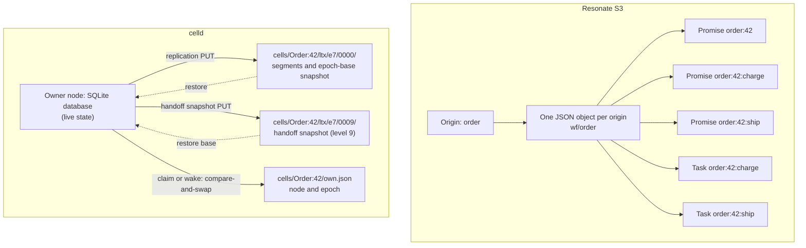

# Resonate S3 and celld: two ways to keep durable state in a bucket

Both systems put their durable state in an object store bucket. Both use a
conditional write to stop two writers from losing each other's work. They
differ in what one write unit is.

The Resonate S3 (Amazon Simple Storage Service) server stores one object for
each origin. An origin is the text before the first colon of an identifier; an
identifier with no colon is its own origin. The object begins with a canonical
JavaScript Object Notation (JSON) header line. It then holds one canonical JSON
line for each promise and each task that shares the origin. One protocol
transition reads the object, applies the transition in memory, and replaces the
whole object with a conditional write. A protocol transition is one operation
of the Resonate protocol, such as create a promise, settle a promise, or
acquire a task. [The S3 server in
Zig](../../src.resonate/markdown/13-the-s3-server-in-zig.md) explains each step.

celld stores one SQLite database for each cell. A cell is one Durable Object
instance. A Durable Object is a Cloudflare platform object: a named
single-writer instance with private SQLite storage, WebSockets, and alarms.
celld reimplements that interface on a self-hosted fleet, which is the set of
nodes that share one bucket. A celld node is one process that runs the Worker
code. The node's replication task captures each
committed SQLite transaction as a Lite Transaction (LTX) segment. The segment
holds the database pages that the transaction changed. The node ships the
segment to a follower node or to the bucket. The bucket also holds an ownership
record with a fencing epoch. An activation makes a cell resident on a node: a
first claim of a new cell, a takeover from another node, or a local wake after
the cell was dormant. A fencing epoch is a number that increases on each
activation. It appears in the object key, so a writer with an old epoch writes
to a prefix that no restore reads. Exactly one node serves a cell at a time.

The sentence to remember is this: Resonate stores a materialized document and
replaces it; celld stores a database and appends its write-ahead log under a
fenced prefix.

Sources: `README.md:16-35` and `docs/guarantees.md:1-7` in celld;
`impl/server/core/crates/resonate-server-blob/README.md` and
`impl/server/s3/src/doc.zig` in Resonate.

## The two shapes



Solid arrows are writes. Dashed arrows are the restore path. A level is a
numbered LTX compaction tier: level 0 holds new segments, and level 9 holds a
handoff snapshot (a snapshot of a closed cell published during a handoff).

The Resonate document is the state. The celld bucket objects are a log and a
backup of the state. The live state is the SQLite database on the owner node.

## What one write unit contains

| Property | Resonate S3 | celld |
|----------|-------------|-------|
| Atomicity unit | Origin document | Cell (one SQLite transaction) |
| Write unit | Whole document | Dirty pages in one LTX segment |
| Identity | Origin string, percent-encoded in the key | `Class:ID` cell scope: class and identifier (ID) |
| Format | JSON Lines: a header line, then one canonical JSON line per promise and task | SQLite pages inside LTX segments |
| Location | `wf/<encoded origin>` | `cells/<cell>/ltx/e<epoch>/<level:04x>/` |
| Scope | Every promise and task whose identifier shares the origin; this can hold more than one call tree | Every table and index in one Durable Object |
| Ownership | None. Any server can write any origin. | One node at a time, named in `own.json` |
| Fence | Entity tag (ETag) precondition | Fencing epoch in the key prefix |
| Contention | Conditional write fails, then the server re-decides | The ownership compare-and-swap admits one node per epoch; a stale writer writes under a superseded prefix |
| Read path | Read the document, or trust a validated cached copy | Read the local SQLite database |

A call tree is one root promise and every promise created by its tasks,
recursively. One origin can hold more than one call tree.

The identity difference matters. Two Resonate tasks in different origins can
run on different servers with no coordination. Two Durable Object instances are
always different cells, so they can also run on different nodes. But a whole
Resonate call tree is one document, while a celld application is split by the
application author into as many Durable Objects as the author chooses.

## How Resonate writes one transition

The S3 server keeps a cache of decoded documents. A cache entry is not
authoritative by default. The default configuration sets
`linearizable_reads = true`, so a cached entry is validated with a conditional
read before it is used. A linearizable read returns the latest committed
document. The validation read sends `If-None-Match` with the cached ETag. When
the object is unchanged, the bucket answers `304 Not Modified` with no body,
and the server reuses the cached document.

The actor for the origin then applies the protocol transition in memory. To
settle a promise is to move it to a resolved or rejected state. To wake a task
is to make it runnable after its awaited promise settles. The actor arms or
disarms timer objects, commits the document, sends the response messages, and
answers the caller. The order is deliberate. A deadline object must exist
before the document that depends on it. A response must not leave before the
document that justifies it.

```mermaid
sequenceDiagram
    autonumber
    participant S as S3 server instance
    participant B as Bucket
    participant W as Worker
    S->>B: GET wf/&lt;escaped origin&gt; with If-None-Match (cached ETag)
    B-->>S: document and ETag, or 304 Not Modified
    S->>S: decide the transition in memory
    S->>B: PUT t/&lt;NN&gt;/&lt;20-digit deadline&gt;_&lt;escaped origin&gt;@&lt;generation&gt;
    B-->>S: armed
    S->>B: PUT wf/&lt;escaped origin&gt; with If-Match ETag
    alt ETag still current
        B-->>S: new ETag
        S->>B: DELETE old deadline object
        S->>W: messages and answer
    else another writer won
        B-->>S: 412 Precondition Failed
        S->>B: GET wf/&lt;escaped origin&gt;
        B-->>S: current document and ETag
        S->>S: decide again from the new document
    end
```

A zero-byte timer object is a marker. The timer daemon lists the `t/` prefix,
parses each key, and fires the deadline in memory when it is due. The key is
`t/<NN>/<20-digit deadline>_<escaped origin>@<generation>`. `<NN>` is the
shard: the high 32 bits of a 64-bit hash of the origin, modulo the timer shard
count (default 4). The 20-digit deadline makes a lexicographic listing return
the nearest deadline first. `<generation>` is the token of the commit that
armed the object. The server deletes the old object only after the new document
commits, so a replaced deadline does not fire early or twice. The generation in
the key makes that delete target its own predecessor. A crash therefore leaves
at worst a stale deadline that fires into a sweep with nothing due.

The precondition does not need a lock. It becomes a Hypertext Transfer Protocol
(HTTP) header on the write:

```zig
// impl/server/s3/src/s3.zig:119-127
.put => {
    headers.append(.{ .name = "Content-Type", .value = "application/octet-stream" }) catch {};
    switch (op.precondition) {
        .none, .unchanged => {},
        // `*` means "no version at all", which is what create-only is.
        .absent => headers.append(.{ .name = "If-None-Match", .value = "*" }) catch {},
        .match => |etag| headers.append(.{ .name = "If-Match", .value = etag.slice() }) catch {},
    }
},
```

The bucket evaluates the condition. A write with a stale ETag receives HTTP
`412 Precondition Failed`. The server drops the decision, invalidates the
cache, and after a backoff reads the document again. It then decides again from
the new document. This is the whole concurrency control of the S3 backend.

The document header records the origin hash, clock, and generation.

```zig
// impl/server/s3/src/doc.zig:538-564
pub fn encode(self: *const Doc, out: *std.ArrayList(u8), origin: []const u8) !void {
    out.clearRetainingCapacity();
    const hash = origin_hash(origin);

    try out.appendSlice("{\"v\":");
    try out.writer().print("{d}", .{format_version});
    try out.appendSlice(",\"og\":\"");
    try out.appendSlice(&hash);
    try out.appendSlice("\",\"cl\":");
    try out.writer().print("{d}", .{self.clock});
    try out.appendSlice(",\"gn\":");
    try out.writer().print("{d}", .{self.generation});
    if (self.timer_at) |at| {
        try out.appendSlice(",\"ta\":");
        try out.writer().print("{d}", .{at});
        try out.appendSlice(",\"tgn\":");
        try out.writer().print("{d}", .{self.timer_generation});
    }
    try out.append('}');

    for (self.promises.items) |p| {
        try out.append('\n');
        try encode_promise(out, p);
    }
    for (self.tasks.items) |t| {
        try out.append('\n');
        try encode_task(out, t);
    }
}
```

The 16 hexadecimal characters in the header bind the document to its key.
They are a Fowler-Noll-Vo 1a (FNV-1a) hash of the origin. They are not a
checksum of the body. They guard against reading one origin's document as
another origin's:

```zig
// impl/server/s3/src/doc.zig:515-530
/// The 16 hex characters that bind a document to the key it lives under.
///
/// FNV-1a over the origin. Not a checksum of the body -- the store's ETag is
/// the integrity and concurrency token -- but a guard against a document
/// being read as some other origin's, which would silently graft one
/// execution's promises onto another.
pub fn origin_hash(origin: []const u8) [16]u8 {
    var h: u64 = 0xcbf29ce484222325;
    for (origin) |b| {
        h ^= b;
        h *%= 0x100000001b3;
    }
    var out: [16]u8 = undefined;
    _ = std.fmt.bufPrint(&out, "{x:0>16}", .{h}) catch unreachable;
    return out;
}
```

Each promise line carries its state, timeout, creation time, optional settle
time, arm flag, parameter, value, tags, callbacks, and listeners. Empty fields
are omitted. There is no null and no empty string.

```zig
// impl/server/s3/src/doc.zig:568-603
fn encode_promise(out: *std.ArrayList(u8), p: Promise) !void {
    try out.appendSlice("{\"p\":");
    try json.write_string_ascii(out, p.id, true);
    try out.appendSlice(",\"s\":\"");
    try out.appendSlice(p.state.as_str());
    try out.appendSlice("\",\"to\":");
    try out.writer().print("{d}", .{p.timeout_at});
    try out.appendSlice(",\"ca\":");
    try out.writer().print("{d}", .{p.created_at});
    if (p.settled_at) |sa| {
        try out.appendSlice(",\"sa\":");
        try out.writer().print("{d}", .{sa});
    }
    if (p.timeout_armed) try out.appendSlice(",\"ar\":true");
    if (!p.param.is_empty()) {
        try out.appendSlice(",\"pa\":");
        try encode_value(out, p.param);
    }
    if (!p.value.is_empty()) {
        try out.appendSlice(",\"va\":");
        try encode_value(out, p.value);
    }
    if (p.tags.len() > 0) {
        try out.appendSlice(",\"tg\":");
        try encode_map(out, p.tags);
    }
    if (p.callbacks.len() > 0) {
        try out.appendSlice(",\"cb\":");
        try encode_set(out, p.callbacks);
    }
    if (p.listeners.len() > 0) {
        try out.appendSlice(",\"ls\":");
        try encode_set(out, p.listeners);
    }
    try out.append('}');
}
```

The commit is one conditional put. A missing document is created only if it is
still absent. An existing document is replaced only if its ETag is unchanged.

```zig
// impl/server/s3/src/applier.zig:634-647
fn commit(self: *Actor) void {
    const key = self.applier.keys.doc_key(&self.key, self.origin) catch
        return self.fail_batch(503, "out of memory");
    self.phase = .committing;
    self.op = .{
        .kind = .put,
        .key = key,
        .body = self.body,
        .precondition = if (self.etag) |e| .{ .match = e } else .absent,
        .arena = self.scratch.allocator(),
    };
    self.op.listen(*Actor, self, on_commit_complete);
    self.applier.store.submit(&self.op);
}
```

A failed precondition does not replay the old decision. The server drops the
decision and decides again against a document that it reads after a backoff.
The default retry limit is eight re-decisions (`max_cas_retries: u32 = 8`; the
`--cas-retries` option changes it). A separate token is randomly generated for
each arm and becomes the `<generation>` in the timer key. It makes the object
name unique to that arm, so a retry cannot collide with the object left by a
failed attempt.

```zig
// impl/server/s3/src/applier.zig:684-699
fn retry(self: *Actor) void {
    self.attempt += 1;
    if (self.attempt > self.applier.cfg.max_cas_retries) {
        return self.fail_batch(503, "the origin was contended for too long");
    }
    const at = self.applier.clock.now_ms() + self.applier.backoff_ms(self.attempt);
    self.phase = .waiting;
    self.backoff = .{ .at_ms = at, .listen = .{ .actor = self, .fn = on_backoff } };
    self.applier.timer.arm(&self.backoff, at);
}
```

The cache is a performance feature, not a correctness feature. The default S3
configuration validates each cached read. A server operator can turn validation
off with `--sole-writer`, and must do so only when this server is the only
writer to the bucket. A reader cannot set this flag.

## How celld writes one transition

A celld node first claims the cell. The claim is a conditional create of
`cells/<cell>/own.json`, or a compare-and-swap of an existing record. The new
record names the node and the next epoch. Every activation advances the epoch,
so every activation pays one conditional write, even when the owner does not
change.

```rust
// crates/celld/ownership_store.rs:949-967
pub async fn cas_owner(
    &self,
    cell: &str,
    guard: CasGuard,
    epoch: u64,
) -> anyhow::Result<CasOutcome> {
    let key = format!("cells/{cell}/own.json");
    let body = serde_json::to_vec(&OwnerWire {
        node: &self.node,
        epoch,
    })?;
    let etag = match &guard {
        CasGuard::Absent => None,
        CasGuard::Match(etag) => Some(etag.as_str()),
    };
    match self.bucket.put_cas(&key, body, etag).await? {
        Some(_) => Ok(CasOutcome::Applied),
        None => Ok(CasOutcome::Rejected),
    }
}
```

The token is the ETag of the record that the caller read. The bucket layer
turns the token into the object store's write mode: no token means create-only,
and a token means update-only on that version. A clean rejection means the
store refused the condition. It is a normal `Rejected` answer, not an error:

```rust
// crates/celld/bucket.rs:1034-1077 (abridged)
pub async fn put_cas(
    &self,
    key: &str,
    body: impl Into<PutPayload>,
    token: Option<&str>,
) -> anyhow::Result<Option<String>> {
    let key = self.key(key);
    let mode = match token {
        None => PutMode::Create,
        Some(token) => PutMode::Update(self.backend.update(token)),
    };
    match self
        .cas_store
        .put_opts(&Path::from(key.as_str()), body.into(), PutOptions::from(mode))
        .await
    {
        Ok(result) => { /* the token of the new version */ }
        Err(error) if is_clean_cas_rejection(&error) => Ok(None),
        Err(error) => Err(anyhow!(error).context(format!(
            "conditional write {}://{}/{key} may have committed",
            self.scheme(),
            self.name
        ))),
    }
}
```

The last arm is the important one. An error that is not a clean rejection
means "the write may have committed," so the caller must reconcile before it
reports a failure. Reconciliation reads `own.json` again. If the record names
this node at the expected epoch, the write landed. If not, it did not. The
caller reports a failure only after that read.

When the node owns the cell, the SQLite database lives on that node. The node
starts the database in write-ahead log (WAL) mode. After each commit, the
node's replication task reads the new WAL frames and encodes them as an LTX
segment. The LTX format is a binary format, not JSON. The magic is `LTX1`. Each
file has a 100-byte header, a 6-byte header for each page, and a 16-byte
trailer.

```rust
// crates/ltx/src/ltx.rs:19-24
pub const MAGIC: &[u8; 4] = b"LTX1";
/// Current LTX file format version.
pub const VERSION: i32 = 3;
pub const HEADER_SIZE: usize = 100;
pub const PAGE_HEADER_SIZE: usize = 6;
pub const TRAILER_SIZE: usize = 16;
```

The segment holds changed database pages. It does not hold the whole database.
A transaction that changes one row ships the pages that the row occupies, plus
the pages that the indexes occupy.

The prefix carries the epoch. The replicator uses unconditional puts, because
the key already says which epoch may write it.

```mermaid
sequenceDiagram
    autonumber
    participant C as Client
    participant N as Owner node
    participant Q as SQLite
    participant F as Follower
    participant B as Bucket
    C->>N: request
    N->>Q: BEGIN, write, COMMIT
    Q-->>N: WAL frames
    N->>N: encode LTX segment
    alt fleet durability (CELLD_DURABILITY=fleet)
        N->>F: POST append
        F->>F: fsync
        F-->>N: durable
    else bucket durability (CELLD_DURABILITY=bucket)
        N->>B: PUT cells/&lt;cell&gt;/ltx/e&lt;epoch&gt;/0000/&lt;min&gt;-&lt;max&gt;.ltx
        B-->>N: 200 OK
        N->>B: GET cells/&lt;cell&gt;/own.json
        B-->>N: record with node and epoch
        alt record names this node at this epoch
            N->>N: release the output gate
        else another node or a newer epoch
            N->>N: do not acknowledge
        end
    end
    N-->>C: response
```

`CELLD_DURABILITY` selects one mode for the whole node, not one mode for each
transaction. `fleet` is the default: the node sends each write to one or two
followers and answers when a follower has fsynced it. That is a fleet proof.
`bucket` makes every write wait for a bucket proof: the write is durable once
it is in the bucket. A one-node fleet, or a fleet that lost all but one node,
falls back to the bucket proof. The output gate holds each response until a
durability proof (a fleet proof or a bucket proof) covers it. In the bucket
proof, the node reads `own.json` after the LTX put and acknowledges only if the
record still names this node at this epoch.

The epoch is the safety argument. A node that lost ownership may still run and
may still commit locally. Its segments land under a prefix that the next
restore does not read. The new owner opens a new epoch and restores the chain
from the newest epoch down to an epoch that opened with a whole-database
snapshot.

**Aha:** Resonate resolves a race after it happens with an ETag, and the loser
re-decides. celld makes a race harmless: the ownership compare-and-swap picks
one node before the data write, and a node that lost ownership still writes,
but only into a superseded epoch prefix that no restore reads. Resonate needs
one conditional document write for each transition that changes the document.
celld needs no conditional write for data. It pays one conditional ownership
write on each activation, not once per transaction.

## Serialization and size

Resonate pays a cost that grows with the number of promises and tasks in the
origin. Every transition that changes the document rewrites every line of the
document. The Blob backend documents this cost directly: the whole document is
the unit of the conditional put. A large call tree with thousands of pending
tasks makes each transition larger.

The S3 server limits the cost of a transition in two ways. First, the
`changed` check compares promises, tasks, and the timer, and skips the write
when nothing changed. Second, deadlines are separate zero-byte objects, so the
document does not carry the deadline list. This adds one arm write and one
disarm write when a deadline changes, but it keeps the document small. The
promise and task lines still all travel in one put.

```zig
// impl/server/s3/src/doc.zig:494-511 (abridged)
/// Did the decision touch anything worth writing an object for?
///
/// The write law. `clock` and `generation` are excluded on purpose: the
/// clock is a hint and the generation counts writes, so including either
/// would make every read a write.
pub fn changed(before: *const Doc, after: *const Doc) bool {
    if (before.promises.items.len != after.promises.items.len) return true;
    if (before.tasks.items.len != after.tasks.items.len) return true;
    if (!eql_opt_i64(before.timer_at, after.timer_at)) return true;
    if (before.timer_generation != after.timer_generation) return true;
    for (before.promises.items, after.promises.items) |a, b| {
        if (!a.eql(b)) return true;
    }
    for (before.tasks.items, after.tasks.items) |a, b| {
        if (!Task.eql(a, b)) return true;
    }
    return false;
}
```

The check is a full comparison of both documents. A skipped write still costs
the read and the comparison, but it avoids the conditional put.

LTX objects use numbered compaction levels. Level 0 holds the segments that the
capture loop writes, including the whole-database snapshot at the start of an
epoch. Higher levels hold compacted segments. Level 9 is the snapshot level
that the restore planner probes first; celld publishes an authoritative
whole-database handoff snapshot there. The key is
`cells/<cell>/ltx/e<epoch>/<level:04x>/<min>-<max>.ltx`. An epoch base is an
epoch that opens with a whole-database snapshot: an LTX file with minimum
transaction identifier 1. A restore walks from the newest epoch down until it
reaches an epoch base.

celld pays a cost that grows with the number of changed pages. A SQLite page is
usually 4,096 bytes. The write-ahead log records the pages that changed. A
small transaction produces a small LTX segment, even when the database holds
gigabytes. The snapshot is large, but it is written once per epoch base, not
once per transaction.

Columns: Resonate Blob is the Rust blob backend, with one object per origin and
deadlines inside the object. Resonate S3 is the Zig S3 server, with one object
per origin and deadlines in separate timer objects. celld fleet mode is
`CELLD_DURABILITY=fleet` with at least one follower. celld bucket mode is
`CELLD_DURABILITY=bucket`, or a one-node fleet that must use the bucket. The
SQLite server baseline is the SQLite backend on one server, with its database
file on local disk and no replication. A node lease is the heartbeat record
`nodes/<node>.json`; peers read it to decide whether a node process is alive.

| Cost of one small transition | Resonate Blob | Resonate S3 | celld fleet mode | celld bucket mode | SQLite server baseline |
|------------------------------|---------------|-------------|------------------|-------------------|------------------------|
| Read before write | Whole document | Whole document, or a 304-validated cache entry | None: local SQLite | None: local SQLite | Rows needed by the transaction |
| Write | Whole document, one conditional put | Whole document, one conditional put, plus one timer object put and one delete when the deadline changes | Dirty pages, one LTX segment | Dirty pages, one LTX segment | Dirty pages, one transaction |
| Commit wait | Bucket round trip | Bucket round trip for the document put; the validation read, timer put, and timer delete are separate round trips | Follower fsync, usually local network; the bucket upload races it | Bucket round trip, plus one ownership record read | Local disk fsync |
| Bucket traffic per transition | Document size | Document size, plus one timer object put and one delete | One LTX object put in the background; the node does not wait for it | One LTX object put, plus one ownership record read | None |
| Coordination per transition | None, but a lost race re-decides | None, but a lost race re-decides | None while the lease and ownership record hold | One ownership read per bucket proof; no lock | None |

The table is a shape, not a benchmark. The measured celld numbers in its README
are about 90 milliseconds (ms) for a bucket proof in a region-local store,
about 600 ms for a bucket proof against a store that was not region-local, and
about 25 ms for a fleet proof once a second node held the write. The Resonate
cost depends on document size, bucket latency, and contention.

## Many promises, one document, one cell

The Resonate document can serve many durable promises at once because the
origin is the unit of atomicity. A parent promise and its child promises share
the origin. A settle of the parent and the wake of a child must be one atomic
change, or the system can wake a task whose input is not yet visible. One
document gives that atomicity for free.

celld has a different atomic unit: the cell. Inside a cell, SQLite transactions
give atomicity across tables and indexes. Across cells, there is no shared
transaction. A Durable Object can call another Durable Object, but the two
writes are separate and each has its own acknowledgement. The application
author chooses the cell boundaries.

This is the deepest design difference. Resonate chooses the unit from the
protocol: the origin. celld chooses the unit from the application: the Durable
Object. Resonate's unit is fixed and small enough to replace on each transition.
celld's unit is arbitrary and can be large, so it uses a log instead of a
snapshot-per-write.

## Failure and recovery

A Resonate S3 server holds no durable local state. Any server can load any
origin. A server crash loses only cached documents and in-flight decisions. A
retry reads the current document and decides again. There is no takeover, no
lease, and no recovery step. The bucket is the entire state.

celld keeps the live database on the owner node, so a crash needs a recovery
path. The node lease records an expiry, `CELLD_TTL_MS` (default 10,000 ms), and
the node renews it after one third of that lifetime. A per-cell ownership
record names the owner of one cell. When a node lease expires, a peer may claim
that node's cells through their ownership records. [Ownership, failure, and
rebalancing](06-ownership-failure-and-rebalancing.md) gives the full protocol.

The new owner runs the takeover gate. It reads the prior node's node-log
record, `nodes/<node>.json`. An absent record proves that the prior session
never acknowledged past the bucket, and a sealed record proves that recovery
completed. An open or recovering record forces recovery before the restore. The
new owner then compare-and-swaps the record to fence it, tells the reachable
followers to seal their part of the log, uploads their retained segments and
bundles into the per-cell prefixes, and marks the record sealed. Only then does
it restore the epoch chain. The restore reads the newest epoch prefix, then the
next, until it reaches an epoch base.

This difference drives the operational cost. Resonate has no data to restore,
because it never holds data outside the bucket. celld has a fast local path and
a slower recovery path. A large dead node can take minutes to recover. A
retained segment is a write that a follower holds on disk and that the bucket
does not yet cover. A bundle is a container of LTX segments from many cells,
written under `log/`. The recovery reads retained bundles in windows of at most
512 mebibytes (MiB). It uploads and releases each window before it reads the
next, so memory does not grow with the session.

| Failure | Resonate S3 | celld |
|---------|-------------|-------|
| Server process dies | Another server serves the next request | The node lease expires; a peer claims the cell and runs the takeover gate |
| Server loses the bucket | It cannot read or write; requests fail | It commits locally, cannot prove durability, and does not acknowledge. When the expiry that it published passes, it stops each active cell, fails incomplete requests, and exits with code 3 |
| Two servers write the same origin | One conditional write wins; the loser re-decides | The ownership compare-and-swap admits one node per epoch; a stale owner writes a superseded prefix |
| Bucket ignores preconditions | Two writers can lose one another's writes | Two owners could serve one cell. Before it serves, each node runs four conditional writes and a range read; it stops when the store accepts a condition it must reject or returns wrong bytes |
| Read after write | A validated cache read sees the new document | Local SQLite already has the write |

## What each system optimizes

Resonate optimizes for a stateless server and a simple durability story. Every
server is interchangeable. A request can go to any server. The bucket is the
only source of truth. The price is a full-document rewrite for each transition
and a limit on how large one origin can grow before the rewrite hurts.

celld optimizes for local execution and fast repeated access. A cell runs on
one node, near its clients, with a local SQLite database. WebSockets, SQL
queries, and alarms are local operations. The bucket holds the long-term state
and the ownership records. The price is ownership management, recovery, and a
placement problem: a cell must move when its node fails or becomes full.

Neither model is a superset of the other. Resonate's document is excellent for
a protocol with a small, well-defined state machine. celld's database is
excellent for arbitrary application state and long-lived connections.

## Choosing between them

Choose the Resonate model when the state has a fixed schema, the atomic unit is
a small call tree, and the server must be replaceable at any moment. Choose the
celld model when the state is arbitrary and lives in Structured Query Language
(SQL) tables, the application needs a single writer for a long-lived object, or
the application needs WebSockets and alarms.

A system can use both. The Resonate S3 server already keeps origin documents in
a bucket, and any server can serve any origin, so it needs no placement layer.
The complementary move is to host a Resonate-style protocol on celld: one origin
per Durable Object, with the origin as the cell name. In that design the cell
boundary is drawn at the origin, so the two atomic units coincide. The two
models answer different questions: what is the unit of atomic change, and where
does the code that changes it run.

## Cross-references

- [Overview](00-overview.md) explains the celld promises and the four nouns:
  node, fleet, cell, and deployment.
- [Cell storage and durability](05-cell-storage-and-durability.md) explains the
  LTX chain, restore, and garbage collection.
- [Ownership, failure, and rebalancing](06-ownership-failure-and-rebalancing.md)
  explains the lease and takeover in detail.
- [Documents, rows, and partitions](../../src.resonate/markdown/21-documents-rows-and-partitions.md)
  explains every Resonate write unit: the Blob and S3 documents, the SQLite,
  PostgreSQL, and MySQL rows, the ScyllaDB partition, and the Neo4j nodes and
  edges.
- [The S3 server in Zig](../../src.resonate/markdown/13-the-s3-server-in-zig.md)
  explains every step of the Resonate S3 commit path.
