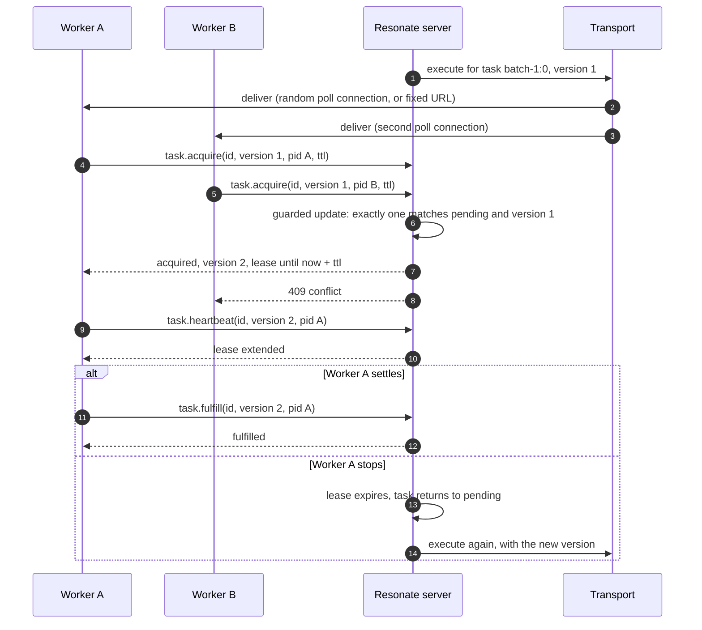
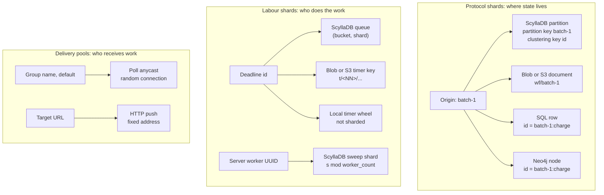

# Work placement and sharding

Resonate does not assign a task to a worker. It invites a worker to take the task, and exactly one worker can win the take for one version. celld does not schedule a request. A node owns a cell until a lease expires or a balance plan moves the cell.

Both systems distribute work. They distribute different things, and they use different gates. This document explains both mechanisms and names every sharding rule that the source code contains.

Source: Resonate at commit `9c72d818721b1776edd6b1b2939a83b3c0b248a6`. celld at commit `8702f6d186c77698dbfb30cf29e3b1922a88f008`, version 0.6.3.

## The words this document uses

The table gives one definition for each word. Where the same word has a
different meaning in the two systems, the row says which meaning belongs to
which system.

| Word | Meaning here |
|------|--------------|
| Resonate | The durable execution system in this study. It stores promises in a database or an object store, and workers poll it for work. |
| celld | The Durable Object server in this study. It runs cells on a fleet of nodes and keeps each cell's storage in a shared bucket. |
| Promise | A Resonate record with an identifier, a state, a value, and tags. It is the unit of durable execution. |
| Task | A promise that carries the `resonate:target` tag. The same tag makes the promise external, so any client may await it. |
| Target | The address value in the `resonate:target` tag of a task. Its presence is what turns a promise into a task. |
| Origin | The identifier of the promise that starts a call graph. Resonate uses it as the partition key and as the document key. |
| Call graph | One promise and every promise that it creates, directly or through other promises. |
| Worker | A Resonate process that polls for tasks and runs their handlers. In celld, the deployed application is a **script**, never a Worker in this sense. |
| Worker group | A logical pool of workers that share one address. Anycast chooses a member of the pool. |
| Node | One celld process on one machine. |
| Bucket | The shared object store that holds celld ownership records, cell logs, fleet samples, and deployments. |
| Script | One deployed Worker application in celld. Each script has its own pools. |
| Binding | A named capability that a script receives in its `env` object, such as a service binding or a queue. |
| Acquire | The conditional update that gives one worker a task for one version. |
| Version | The fence token on a task. An acquire, a settle, a release, and a suspend name the version that the worker saw, and they fail when it has moved. A heartbeat sends the version but does not fail when the guard matches no row. |
| Lease | For Resonate, the time window in which an acquired task belongs to one worker. For celld, a node lease is the record under `nodes/` that says a node is alive, and a cell tenure is the ownership record. |
| Time to live (TTL) | For Resonate, the length of a lease, in milliseconds, that the worker asks for in its acquire. For celld, the node sets its own lease lifetime with `CELLD_TTL_MS`; no caller requests it. |
| Anycast | An address that accepts any member of a group. The transport chooses the member. |
| Unicast | An address that names exactly one connection. The transport has no choice. |
| Durable Object | The platform programming model that gives one named object a single-threaded event loop, persistent storage, and alarms. |
| Cell | One celld Durable Object instance, named `<Class>:<identifier>`. A cell can be resident, dormant, or inactive, so "cell" does not imply a running runtime. |
| Cell scope | The name of a cell. It is also a path component and an object-store key. |
| Ownership record | The object at `cells/<cell>/own.json`. It holds exactly two fields: the owner node and the ownership epoch. It has no expiry field of its own; the node lease under `nodes/` decides whether the named owner is still alive. |
| Activation | The act of loading a cell on a node and making its runtime ready, after a cold start, a hibernation wake, or a move. Every activation increases the ownership epoch. |
| Epoch | The number of one ownership tenure of a cell. Every activation increases it. |
| Fleet sample | The shared object `fleet/capacity-v1.json` that holds a recent view of every node. |
| Capacity | A node's advertised ability to accept more cells. It is a separate field from the placement weight and from the **adoption-capacity flag**, which is the lease flag that says the node accepts a signed shutdown-adoption request during a drain. |
| Placement weight | The relative share of cells that a node should own. `CELLD_PLACEMENT_WEIGHT` sets it, and its default is the processor count. |
| Resident cell | A cell whose runtime is loaded on a node. |
| Dormant cell | A cell whose ownership record names a node but whose runtime is not loaded on that node. The source calls this phase dormant. A dormant cell that keeps at least one hibernatable WebSocket is **hibernated**. |
| Inactive cell | A cell whose ownership record names no node. Any node may claim it. |
| Draining | A node state in which the node gives cells away and accepts no new ownership. |
| Sweep | A scan for due deadlines or expired leases. |
| Planner | The rebalance loop on each node. It computes a target cell count and moves cells when a move is safe. |

## The one-page answer

| Question | Resonate | celld |
|----------|----------|-------|
| What is distributed? | One task execution: one promise that carries a target, for one version | Ownership of one cell |
| Who decides? | The worker, by acquiring. The transport only delivers the invitation. | The node, by a conditional claim on the ownership record |
| What is the gate? | A compare-and-set on `(task_state, task_version)` | A compare-and-set on `cells/<cell>/own.json` |
| What is the unit? | One promise and its task | One cell and its SQLite database, plus any facet databases that belong to it |
| What shards the data? | The origin. It is the partition key in ScyllaDB and the document key in the object backends. The SQL backends do not shard; they use indexes inside one database. Neo4j also does not shard; it takes a per-node write lock. | The cell name. Each cell has its own root SQLite database, plus any facet child databases inside it. |
| What shards the labour? | The transport scheme, the worker group, and the timeout-queue shard when the shard count is above one | The cell count on each node, adjusted by the placement weight and moved by the planner |
| What happens when a worker dies? | The task lease expires and the task returns to pending | The node lease expires; a peer claims each owned cell at a new epoch |

The short sentence is this. Resonate shards a protocol state space: every
promise, task, and timer of one call graph sits under one origin, and every rule
that changes them is a conditional write in that origin's backend. celld shards
an ownership space: every cell has exactly one owner node, and only that node
may write the cell's database.

The cell's **root database** is the unit. A **facet** is a child SQLite database
inside the root cell. A facet has no ownership record and no epoch of its own,
so it moves and restores with the root and never appears as a separate shard.
"One cell, one database" in this document always means one root database.

## Part 1: how Resonate places work

### A target creates a task

A promise that carries the `resonate:target` tag is a task. The same tag also makes the promise external, because a dispatch target implies that anyone may await the result. The caller does not submit work to a queue. The caller creates a promise with a target.

```rust
// impl/server/core/crates/resonate-core/src/types.rs:582-583
/// - `resonate:target` present — a dispatch target implies anyone may await
///   the result;

// impl/server/core/crates/resonate-core/src/types.rs:601-605
/// `Task` exactly when a dispatch target is present, which is the same
/// condition as carrying a task — both directions hold, and the storage
/// invariant `consistent_task_iff_targeted_promise` is the other half of it.
```

The server creates the task in state `pending` and emits an `execute` message. While the task stays pending, the server emits `execute` again every `tasks.retry_timeout`. The default is 30,000 milliseconds. The retry loop never stops until the promise settles.

Source: `impl/server/core/.claude/skills/integration/references/contract.md:295-305`.

### The transport delivers an invitation

A committed transition emits a message. The SQL server delivers the message immediately after the commit. There is no queue between the transaction and the send. Delivery is best effort. A failed route is logged, and that attempt is lost. The retry deadline is what recovers it.

Source: `impl/server/core/crates/resonate-sql/src/server.rs:186-198`, `impl/server/core/crates/resonate-sql/src/server.rs:209-228`.

The router knows only the address scheme. It parses the address as a Uniform Resource Locator (URL), reads the scheme, and hands the whole address to the transport plugin for that scheme. It does not choose among workers.

Source: `impl/server/core/crates/resonate-core/src/router.rs:8-13`.

| Scheme | Transport | Who selects the worker |
|--------|-----------|------------------------|
| `http`, `https` | Hypertext Transfer Protocol (HTTP) push | The address. The sender chose that URL. |
| `poll` | Server-Sent Events (SSE) long poll | The transport. Anycast picks a random connection in the group. Unicast names one connection. |
| `gcps` | Google Cloud Pub/Sub | The Pub/Sub service. The fan-out is outside this repository. |

Source: `impl/server/core/crates/resonate-transport-http-push/src/lib.rs:7-13`, `impl/server/core/crates/resonate-transport-http-poll/src/lib.rs:20-26`, `impl/server/core/crates/resonate-transport-gcps/src/lib.rs:10-16`.

The poll transport is the only transport that balances load. The address has two cast modes. An **anycast** address names a group and accepts any member of that group. In this transport it first tries a named connection when the address also carries an identifier, then picks a random connection from the group. A **unicast** address names one connection, and the transport delivers only to that connection. Anycast is the only case in which the sender does not choose the worker. That is the whole balancing rule.

```rust
// impl/server/core/crates/resonate-transport-http-poll/src/lib.rs:299-325
PollCast::Any => {
    // Prefer specific id, fall back to random
    if let Some(target_id) = &address.id {
        if let Some(conn) = group_conns.iter().find(|c| &c.id == target_id) {
            let ok = conn.tx.try_send(payload.to_string()).is_ok();
            if ok {
                return ok;
            }
        }
    }
    // Fall back to random selection to distribute work
    let idx = fastrand::usize(..group_conns.len());
    let ok = group_conns[idx].tx.try_send(payload.to_string()).is_ok();
    ok
}
```

The group is a string that the worker chooses. It is a logical pool, not a membership protocol. The worker group defaults to `"default"`. A worker registers under its group when it opens the poll connection.

Source: `impl/sdk/ts/src/resonate.ts:86-117`, `impl/server/core/crates/resonate-transport-http-poll/src/lib.rs:71`.

### The acquire is the real assignment

A delivered `execute` message does not give the worker the right to run the task. The worker must acquire the task. The acquire request names the task, the version that the worker saw, its process identifier, and a lease time to live (TTL).

```rust
// impl/server/core/crates/resonate-core/src/types.rs:496-506
pub struct TaskAcquireData {
    #[validate(length(min = 1, message = "Task ID is required"))]
    pub id: String,
    #[validate(range(min = 0, message = "Version must be a non-negative integer"))]
    pub version: i64,
    #[validate(length(min = 1, message = "Process ID is required"))]
    pub pid: String,
    #[validate(range(min = 1, message = "TTL must be a positive integer"))]
    pub ttl: i64,
}
```

The server applies the acquire as a guarded update. The update succeeds only if the task is still pending and its version still matches. The update also increments the version, records the process identifier, and sets the lease deadline.

```sql
-- impl/server/core/crates/resonate-server-postgres/src/lib.rs:3365-3385
WITH before AS (
  SELECT id, task_state, task_version FROM promises WHERE id = $1 AND task_state IS NOT NULL
),
acquired_task AS (
  UPDATE promises p SET
    task_state = 'acquired', task_version = p.task_version + 1,
    lease_timeout_at = $3 + $4, ttl = $4, pid = $5, retry_timeout_at = NULL,
    resumes = '{}'
  WHERE p.id = $1 AND p.task_version = $2 AND p.task_state = 'pending'
  RETURNING p.id, p.task_state, p.task_version
)
SELECT {cols},
  COALESCE(a.task_state, b.task_state)     AS task_state,
  COALESCE(a.task_version, b.task_version) AS task_version,
  (a.id IS NOT NULL)                       AS was_acquired
FROM before b
JOIN promises p ON p.id = b.id
LEFT JOIN acquired_task a ON a.id = b.id
```

In the snippet, `$1` is the task identifier, `$2` is the version that the worker saw, `$3` is the current time, `$4` is the TTL, and `$5` is the process identifier. The `before` common table expression reads the row that exists, so the answer can report the current state even when the guarded update matches nothing. `was_acquired` then tells the caller which outcome happened; a false value becomes status 409 (Conflict).

Exactly one concurrent acquire succeeds for one version. Every other caller gets status 409. The ScyllaDB backend uses the same rule as a lightweight transaction (LWT), which is a conditional write that ScyllaDB evaluates atomically. The S3 backend uses the same rule as a version check in memory.

Source: `impl/server/core/crates/resonate-server-scylladb/src/ops_task.rs:419-449`, `impl/server/s3/src/handle.zig:1038-1061`.



### The four mechanisms that stop duplicate execution

The acquire is not the only protection. Four mechanisms work together, and each has a different job.

| Mechanism | What it does | What it does not do |
|-----------|--------------|---------------------|
| Acquire compare-and-set | Gives the task to exactly one concurrent attempt for one version | It does not stop an earlier attempt that already acted and then died |
| Fence version | Every later task operation must name the current version | It does not undo a side effect that already happened |
| Process identifier | A heartbeat extends a lease only for the process that holds it | It is not a uniqueness constraint on execution |
| Lease and expiry | A silent worker loses the task after the lease ends | It does not detect a lost lease during the heartbeat |

The fence version is the important one. An acquire increments the version. A settle, a release, and a suspend must name that version, and a worker with an old version gets a loss result. A heartbeat also names the version and the process identifier, but it reports success even when its guard matches no row. The ScyllaDB heartbeat also requires the process identifier, so one process cannot extend another process's lease.

Source: `impl/server/core/crates/resonate-server-scylladb/src/ops_task.rs:960-968`, `impl/server/core/crates/resonate-server-postgres/src/lib.rs:3585-3599`.

The heartbeat always succeeds. A worker cannot use it to learn that it lost the lease. The loss surfaces at the next settle. The contract states this on purpose, so no worker can depend on a heartbeat as a leader check.

Source: `impl/server/core/.claude/skills/integration/references/contract.md:355-371`.

The limit is explicit in the contract. The acquire stops two attempts from running at the same time. It does not stop a previous attempt that fired a downstream request and then died. Idempotency must live in the downstream system.

Source: `impl/server/core/.claude/skills/integration/references/contract.md:310-313`.

> Aha: the Resonate server is not a scheduler. It is a durable mailbox plus a versioned lock. The invitation can arrive twice, or not at all. The lock is what makes execution exclusive, and the retry deadline is what makes the invitation durable.

### Worker death and delivery failure

The recovery path is the lease, not the transport.

- A poll connection deregisters when its SSE stream ends, so a dead worker leaves its group.
- A push delivery that fails is logged and dropped. The transport does not retry it.
- When a lease expires, the task returns to pending, the server clears the lease fields, and it emits `execute` again.
- A worker that died before it settled loses ownership only after the lease deadline. Its side effects are not rolled back.

Source: `impl/server/core/crates/resonate-transport-http-poll/src/lib.rs:456-471`, `impl/server/core/crates/resonate-transport-http-push/src/lib.rs:446-457`, `impl/server/core/crates/resonate-server-postgres/src/lib.rs:4431-4465`.

The poll transport uses a non-blocking send. A full channel or a closed channel returns false, and the message is not queued. The task stays pending, and the retry deadline sends the invitation again. A slow worker therefore does not block other workers, but it can miss a message.

Source: `impl/server/core/crates/resonate-transport-http-poll/src/lib.rs:286`, `impl/server/core/crates/resonate-transport-http-poll/src/lib.rs:332-338`.

There is no fair scheduler. The only balancing is the random choice among anycast poll connections. The code has no round-robin, no least-loaded choice, and no per-worker queue. The group is only a vector of connections with a global connection cap.

Source: `impl/server/core/crates/resonate-transport-http-poll/src/lib.rs:81-86`, `impl/server/core/crates/resonate-transport-http-poll/src/lib.rs:313-316`.

### The preload saves round trips

A task resume needs the results of its sibling promises. Without help, the worker would read each sibling with a separate request. The server sends a preload list with the acquire or fence response. The list holds every promise that shares the `resonate:branch`, in identifier order, truncated to the preload limit. The default limit is 10.

The worker decodes the list into its promise cache. A later `promise.create` for a sibling then hits the cache and sends no request. This is a data-placement optimisation, not a work-placement rule. It works because one branch usually reads its siblings together.

Source: `impl/server/s3/src/handle.zig:251-275`, `impl/server/core/crates/resonate-server-postgres/src/lib.rs:3937-3950`, `impl/sdk/ts/src/util.ts:178-196`, `impl/sdk/ts/src/util.ts:217-224`.

### What Resonate actually shards

The next table lists every sharding mechanism in the server code.

| # | Sharded thing | Key or hash | Rule | Default |
|---|---------------|-------------|------|---------|
| 1 | ScyllaDB promise rows | `origin` | Partition key `origin`; clustering key `id`. One call graph is one partition. | Not configurable |
| 2 | Object-backend origin document | `origin` | One newline-delimited document per origin at `wf/<encoded origin>`. One call graph is one document. | Not configurable |
| 3 | ScyllaDB timeout queues | Time bucket and entity id | Partition key `(bucket, shard)`. `bucket = timeout_at / bucket_width`. `shard = fnv32a(id) % shards`, where `fnv32a` is the Fowler-Noll-Vo 1a (FNV-1a) 32-bit hash. | Width 3,600,000 ms (one hour), lookback 1 bucket, shards 1 |
| 4 | ScyllaDB sweep labour | Server worker identifier | Live workers sorted by Universally Unique Identifier (UUID). A worker keeps shard `s` when `s % worker_count == its_index`. | Worker lease 180,000 ms |
| 5 | Blob timer keys | Target name | FNV-1a 64-bit hash. The first 8 hexadecimal digits (the high 32 bits), modulo the shard count, form the two-digit decimal `t/<NN>/` prefix. | 4 shards |
| 6 | S3 timer keys | Target name | FNV-1a 64-bit hash. The high 32 bits, modulo the shard count, form the two-digit decimal `t/<NN>/` prefix. This is the same operation as row 5, written as a shift instead of a string slice. | 4 shards |
| 7 | SQL timeout queues | Deadline column | No shards. Partial indexes in PostgreSQL and SQLite, ordinary indexes in MySQL. | Not configurable |
| 8 | Schedules | Identifier and next run time | ScyllaDB uses the same bucket and shard rule on the schedule id. SQL uses an index on `next_run_at`. Blob and S3 use sharded timer keys. | Same as above |
| 9 | Local timer structure | Deadline | Not sharded. The database backends use one bounded, deduplicating wheel per process; the object backends use a sorted set of armed timer keys. | Wheel: capacity 8,192 deadlines, refill every 30,000 ms, backstop sweep every 60,000 ms |
| 10 | Gateway instances | None | One HTTP Application Programming Interface (API) listener per process, plus a metrics gateway on its own port. No instance selection. | 2 listeners |
| 11 | Worker groups | Group name | A logical, application-chosen name. The poll transport maps it to a list of connections. | `"default"` |

The first three rows are protocol shards. Rows 1 and 2 co-locate one call graph, so one conditional write can commit a whole transition. Row 3 spreads deadlines by entity id on purpose, so one call graph's deadlines do not all land in one timeout partition when the shard count is above one. The default is one shard, so with the defaults every deadline of one time bucket lands in one partition.

Rows 4 to 6 are labour shards. They divide sweep work among server processes, or spread object keys across prefixes. They do not change where the protocol state lives.

Rows 7 and 9 are not shards. Row 7 is a set of indexes inside one shared database, so every server process can see every due row through the same index. Row 9 is a local timer structure. Row 9 does not divide work either; it is a cache of the schedule. Rows 10 and 11 divide delivery, not storage. A worker group is a list of connections, and the metrics listener carries measurements rather than task traffic.

Three rows need a precise reading.

Row 3's *lookback* is a count of buckets, not a time. The sweep scans the current bucket and the number of previous buckets that the lookback names. With the defaults, that is the current one-hour bucket and the one before it.

Row 7 uses different index shapes in the three SQL backends. PostgreSQL uses partial indexes, which hold only the rows that can match a sweep: `(timeout_at) WHERE state = 'pending'`, `(retry_timeout_at) WHERE task_state = 'pending'`, and `(lease_timeout_at) WHERE task_state = 'acquired'`. SQLite uses `(timeout_at) WHERE state = 'pending' AND external`, `(retry_timeout_at, id) WHERE retry_timeout_at IS NOT NULL`, and `(lease_timeout_at, id) WHERE lease_timeout_at IS NOT NULL`. MySQL has no partial index, so it indexes the columns plainly, with `id` as the second key on the retry and lease indexes. A partial index keeps settled rows out, so the index holds only the rows that a sweep can still return.

Row 9 is the in-memory timer. The five database backends are ScyllaDB, PostgreSQL, SQLite, MySQL, and Neo4j. They repeat the same defaults. The wheel holds the 8,192 nearest deadlines. It refills from the durable store when fewer than half of its entries remain, and the refill interval is `wheel_refresh`, which defaults to 30,000 milliseconds. The code also caps one sleep at 30 seconds, so a deadline that another instance armed cannot stay invisible for longer than that. The backstop sweep runs every 60,000 milliseconds and is a second safety net, not the bound on invisibility.

When a merge would exceed the capacity, the farthest future entries fall off. The backend still holds every durable deadline, so nothing is lost. The recovery path has two branches. If the wheel drops below half capacity, the next refill reads the deadlines again. If the dropped deadline becomes due first, the backstop sweep returns it at the next sweep. The worst delay is therefore one sweep interval.

The Blob and S3 backends use a different local structure. They keep a sorted set of armed timer keys, seeded from one full listing at start-up. Each later write to a timer key also updates the set, so the set stays a mirror of the durable keys. It is not a bounded cache, so it has no capacity default. The firing loop consults the set first and the object store only when the set is empty or a sweep fails.

The two object backends differ in the key. A Blob timer key is `<prefix>t/<NN>/<20-digit deadline>_<escaped target>`. An S3 timer key adds `@<generation>`, where the generation is the commit that armed the deadline. Two writers that arm the same deadline on S3 therefore write two distinct keys; on Blob they write one key. `encode_key` escapes the target, including the `@` character, so a raw `@` in the key always marks the generation field. The shard prefix spreads keys across different targets. It does not spread the deadlines of one hot target, because those keys still share the target and the shard.

Source: `impl/server/core/crates/resonate-server-scylladb/schema.cql:24-49`, `impl/server/core/crates/resonate-server-scylladb/schema.cql:67-95`, `impl/server/core/crates/resonate-server-scylladb/src/lib.rs:286-309`, `impl/server/core/crates/resonate-server-scylladb/src/timeouts.rs:697-735`, `impl/server/core/crates/resonate-server-blob/src/applier.rs:88-96`, `impl/server/core/crates/resonate-server-blob/src/applier.rs:167-180`, `impl/server/core/crates/resonate-server-blob/src/applier.rs:196-206`, `impl/server/s3/src/store.zig:205`, `impl/server/s3/src/store.zig:240-247`, `impl/server/s3/src/store.zig:319-334`, `impl/server/core/crates/resonate-server-postgres/migrations/0001_initial.sql:135-149`, `impl/server/core/crates/resonate-server-sqlite/migrations/0001_initial.sql:59-68`, `impl/server/core/crates/resonate-server-mysql/migrations/0001_initial.sql:57-65`, `impl/server/core/crates/resonate-sql/src/deadlines.rs:8-15`.

Source for the delivery rows: `impl/server/core/src/main.rs:80-82`, `impl/server/core/crates/resonate-gateway-metrics/src/lib.rs:1-10`.



### Hot origins and hot queues

The object backends group commits. A request that arrives while a write is in flight waits for the next write. A hot origin therefore costs one conditional write per round, not one per request. This bounds write amplification. It also means one hot origin is serialized, which is a throughput ceiling and not a correctness problem.

Source: `impl/server/s3/src/applier.zig:844-848`, `impl/server/core/crates/resonate-server-blob/README.md:257-262`.

The ScyllaDB timeout queues spread by entity id. The comment states the reason: one call graph's deadlines spread. The time bucket bounds the scan range, and the lookback covers a late sweep. There is no documented hot-bucket mitigation beyond these two rules.

Source: `impl/server/core/crates/resonate-server-scylladb/src/lib.rs:290-292`, `impl/server/core/crates/resonate-server-scylladb/src/lib.rs:304-309`.

The object-store timer prefixes are the hot-prefix mitigation. A timer key is `<prefix>t/<NN>/<20-digit deadline>_<escaped target>`. The S3 key adds `@<generation>`, where the generation is the commit that armed the deadline. Two writers that arm the same deadline therefore write two distinct keys, and removing one cannot remove the other's. The deadline is zero-padded to 20 digits, because a 64-bit signed integer (`i64`) needs 19, and a fixed width makes lexicographic order identical to time order. A capped, ascending listing therefore returns the nearest deadlines first. A newly armed deadline is normally later than the deadlines already written, so writes march forward through the key space. The shard prefix stops every one of those writes from landing under one prefix when the targets differ. It does not help one hot target: every deadline of that target carries the same escaped target and therefore the same shard, so the hot-target series still shares one prefix.

Source: `impl/server/core/crates/resonate-server-blob/src/applier.rs:92-96`, `impl/server/s3/docs/on-s3.md:49-50`.

## Part 2: how celld places cells

### The cell is the unit

A cell is one Durable Object instance. It may be resident (running on a node),
dormant (owned but not loaded), or inactive (owned by nobody). Its scope is
`Class:instance`, or a bare instance that the runtime prefixes with the
configured class. The scope is used as a path component and as an object-store
key.

```rust
// crates/logic/cell.rs:1-18
//! A cell scope names one Durable Object: `Class:instance`, or a bare instance
//! that the runtime prefixes with the single configured class. The scope is
//! then used as a path component and as an object-store key — `db_path` joins
//! it under the data directory, and the replication client builds
//! `cells/<scope>/ltx/e<epoch>` from it — so its charset is a SECURITY fence.

/// The fleet-wide storage limit for one cell scope.
pub const MAX_CELL_SCOPE: usize = 255;
```

The limit is 255 bytes. It is also the smallest file-name limit that celld
accepts for a data filesystem, and the runtime checks that limit at start-up. A
scope must be one path component. The allowed characters are ASCII letters,
digits, and `_ - . : $`; that set excludes `/` and `\`, so an embedded `..` is
inert, and the check rejects `.` and `..` as whole scopes.

An application creates a Durable Object by name. celld derives the identifier from the name with Hash-based Message Authentication Code (HMAC) and Secure Hash Algorithm 256-bit (SHA-256). The namespace key contains the script name and the class name. The same name therefore reaches the same cell from every node, and a script rename changes every identifier.

```rust
// crates/celld/engine_api.rs:467-501
pub(crate) fn durable_object_id_for_name(namespace_key: &str, name: &str) -> [u8; 32] {
    let key = durable_object_id_key(namespace_key);
    let mut id = [0_u8; 32];
    let digest = durable_object_id_hmac(&key, name.as_bytes())
        .finalize()
        .into_bytes();
    id[..16].copy_from_slice(&digest[..16]);
    let digest = durable_object_id_hmac(&key, &id[..16])
        .finalize()
        .into_bytes();
    id[16..].copy_from_slice(&digest[..16]);
    id
}
```

The derivation has two HMAC rounds. The key is the SHA-256 digest of the
namespace key. The first round authenticates the name; its first 16 bytes
become the first half of the identifier. The second round authenticates those
16 bytes; its first 16 bytes become the second half. The result is 32 bytes,
written as 64 hexadecimal digits. The namespace key for an ordinary class is
`cells:v1:<length>:<script>:<class>`, where `<length>` is the decimal length of
the script name. A script rename therefore changes every identifier.

D1 (the hosted database service backed by SQLite), Key-Value (KV), and Queue
use fixed namespace keys that the source spells out, so a binding from any
Worker reaches the same cell. The derivation is cached per thread, with 4,096
entries, because the same name resolves on every request and two HMAC rounds
are not free.

Source: `crates/celld/engine_api.rs:433-451`, `crates/celld/engine_api.rs:453-501`, `crates/celld/engine_api.rs:504-515`, `crates/celld/engine_api.rs:545-574`.

**Aha:** the cell identifier is a shard key that the application chooses. When the application calls `idFromName("order-42")`, it places that object in the cell namespace with a hash. The platform does not split one cell across nodes, and it does not merge two cells. One cell has one root database.

### Ownership is the placement

Each cell has one ownership record at `cells/<cell>/own.json`. The record holds the owner node name and a fencing epoch. A node claims an absent record with a conditional create, and that first claim writes epoch 1. It claims an existing record with a compare-and-swap against the record's entity tag. Every activation advances the epoch.

Source: `docs/guarantees.md:92-100`.

The epoch is a fencing token. It increases by one on every activation. The
storage prefix `cells/<cell>/ltx/e<epoch>/` carries it, so a write from an
earlier owner lands under a prefix that the new owner never reads. The output
gate also compares the epoch that an output sampled with the epoch in the
ownership record. A stale owner can still write bytes, but it cannot make them
durable under the current epoch, and it cannot acknowledge them. [The Worker
runtime](03-the-worker-runtime.md) explains the gate.

The record decides where the cell runs. A request for a cell goes to the node that the record names. If the local node is not the owner, it opens a tunnel to the owner over the internal listener. The tunnel establishment is signed with the fleet HMAC. The calls inside the tunnel are plain, unsigned HTTP, and the peer-control and reserved-cell routes sign each request. The HMAC authenticates; it does not encrypt.

Source: `docs/security.md:40-48`, `docs/limitations.md:22-24`, `docs/services/durable-objects.md:56-57`, `crates/logic/routing.rs:3-18`.

There is no central placement service. The bucket is the only shared memory, so the bucket is the placement authority. A node learns the fleet from the lease records under `nodes/`. Each lease lives for `CELLD_TTL_MS`, the lease time to live (TTL), which defaults to 10,000 milliseconds, and renews at one third of that.

Source: `docs/README.md:424-432`, `docs/guarantees.md:278-280`.

The failure rule is simple. A node that stops renewing its lease fences itself. A peer reads the ownership record, waits for the lease to expire, recovers the prior node log, and claims the cell at the next epoch.

### Rebalancing is a weighted count

celld balances ownership, not load in flight. Every node reads one shared fleet sample from `fleet/capacity-v1.json` every `CELLD_REBALANCE_INTERVAL_MS`, which defaults to 5,000 milliseconds. The sample holds the lease and load block of every node. A value of `0` disables balancing.

One node at a time writes the sample; every node reads it. A node that finds the sample older than one interval claims the refresh with a compare-and-swap. The claim replaces the sample with a `refreshing` record that carries an expiry and the previous sample. The winner lists the records under `nodes/` and writes one `ready` sample that holds the scan start time and the lease bodies exactly as it read them. A reader that meets a live claim uses the previous sample while that sample is younger than three intervals. The claim expires at three intervals or 30 seconds, whichever is smaller. A scan that finds no lease record fails the refresh and restores the previous sample, because an empty listing is a failed read, not an empty fleet.

Source: `crates/celld/ownership_store.rs:66-90`, `crates/celld/ownership_store.rs:792-925`.

Each node gets a share of the owned cells in proportion to `CELLD_PLACEMENT_WEIGHT`. The default weight is the Central Processing Unit (CPU) count. The target is `total_owned_cells * node_weight / total_weight`.

The planner is a pure function. It observes the live fleet, rejects a mixed or stale sample, elects the densest node as the donor, and computes the surplus. The donor moves at most 32 dormant cells at a time, and no more than 32 cells are in flight across batches. Dormant is the only phase that moves: the runtime is already stopped, so the move is one record write and one signed acquire. A receiver fills to 2 percent below its target, so a stale count cannot overshoot and move the cells straight back.

```rust
// crates/logic/rebalance.rs:116-141
pub fn surplus(
    peers: &[CapacityPeer],
    self_node: &str,
    now_ms: u64,
    max_age_ms: u64,
    since_ms: u64,
    batch: usize,
) -> Option<usize> {
    let fleet = Fleet::observe(peers, self_node, now_ms, max_age_ms, since_ms)?;
    let donor = fleet
        .members
        .iter()
        .max_by(|left, right| left.denser(right))?;
    if donor.peer.node != self_node {
        return None;
    }
    let surplus = donor.owned.saturating_sub(fleet.target(donor));
    let room: u128 = fleet
        .members
        .iter()
        .filter(|member| member.receives_from(self_node))
        .map(|member| fleet.room(member))
        .sum();
    let count = surplus.min(room).min(batch as u128);
    (count > 0).then_some(count as usize)
}
```

A member is a valid receiver only when it is not draining, has no cold-activation backlog, and reports adoption capacity. The planner excludes a memory-saturated node through the same predicate that the executor uses. A donor therefore never releases a cell that no receiver can take.

```rust
// crates/logic/rebalance.rs:37-50
fn receives_from(&self, self_node: &str) -> bool {
    self.peer.node != self_node
        && !self.peer.draining
        && self.peer.restoring == 0
        && self.peer.reports_adoption_capacity()
}

/// Owned cells per unit of weight, compared without division.
fn denser(&self, other: &Self) -> Ordering {
    (self.owned * other.weight)
        .cmp(&(other.owned * self.weight))
        .then_with(|| other.peer.node.cmp(&self.peer.node))
}
```

The observation has a freshness rule. A sample must be newer than the last batch and no older than the maximum age. Every live lease must report a weight, a paced handoff, and no operator pause. If one lease is stale, missing a weight, or paused, the fleet moves nothing. A rolling upgrade therefore finishes before balancing starts.

```rust
// crates/logic/rebalance.rs:76-91
for peer in peers.iter().filter(|peer| peer.expires_ms > now_ms) {
    let fresh =
        peer.sampled_ms > since_ms && now_ms.saturating_sub(peer.sampled_ms) <= max_age_ms;
    if !fresh || !peer.paced_handoff || peer.rebalance_paused {
        return None;
    }
    members.push(Member {
        peer,
        owned: peer.owned_cells? as u128,
        weight: u128::from(peer.placement_weight?.max(1)),
    });
}
if !members.iter().any(|member| member.peer.node == self_node) {
    return None;
}
```

Only a dormant cell moves. Its runtime is already stopped, so the move is one record write and one signed acquire; the donor takes no snapshot. A resident cell is not cut in the middle of an event. A hibernatable WebSocket on a moved cell closes with code 1012 (service restart), and the client reconnects. `CELLD_IDLE_EVICT_S` is the interval at which a node unloads an idle resident cell; an idle eviction keeps the ownership record and leaves the cell dormant, which is the state that balancing can move. A fleet without `CELLD_IDLE_EVICT_S` therefore balances only the cells that reach dormancy by another path.

Source: `docs/README.md:404-417`, `docs/services/durable-objects.md:75`, `crates/logic/lib.rs:5759-5760`, `crates/logic/lib.rs:5792-5794`.

```mermaid
sequenceDiagram
    autonumber
    participant D as Dense node
    participant B as Bucket
    participant R as Receiver node
    D->>B: read fleet/capacity-v1.json
    R->>B: read fleet/capacity-v1.json
    D->>D: plan: densest member exceeds target
    D->>D: confirm the cell is dormant and its runtime is stopped
    D->>B: CAS release cells/&lt;cell&gt;/own.json with an empty node name
    B-->>R: sample shows the released record
    R->>B: signed acquire at epoch + 1
    R->>R: restore the cell on the first request
```

The plan is only a count. Every move still goes through the release compare-and-swap and the signed successor acquire. A wrong count costs movement, never authority.

Source: `crates/logic/rebalance.rs:3-8`.

### How the receiver restores a moved cell

The new owner does not receive a copy of the database from the donor. It reads
the chain in the bucket. The acquire writes the ownership record at epoch N+1,
and the new epoch has no data yet; the receiver restores the history below it.

1. Read `cells/<cell>/own.json` to learn the current epoch. That number is the
   top of the chain.
2. List the epoch directories under `cells/<cell>/ltx/` and walk down from the
   newest. For each epoch, list every level from 0 through 9.
3. Clip each lower epoch to the transaction identifiers below the first
   transaction of the span above it. Accept that epoch only when its largest
   remaining transaction is exactly one below that first transaction.
4. Stop at the epoch whose lowest transaction is 1. That epoch carries the base:
   a snapshot, or a full level-0 image.
5. Read the accepted spans in order, oldest first, into the local SQLite file.
   The new epoch then opens with a continuation marker or a snapshot, and later
   writes land under it.

The clip is what makes a stale owner harmless. A fenced owner can still write
into its old epoch prefix, because the object store does not check the
ownership record. Those late objects carry transaction identifiers above the
cut, so the clip removes them before the chain forms. If a lower epoch's clipped
range ends anywhere other than one below the cut, the restore skips it,
because joining it would leave a gap.

```rust
// crates/ltx/src/client/epochs.rs:49-81 (abridged)
pub async fn build(mut epochs: Vec<(u64, C)>) -> Result<Self> {
    let mut spans: Vec<Span<C>> = Vec::new();
    while let Some((epoch, client)) = epochs.pop() {
        let mut levels = list_levels(&client).await?;
        if let Some(above) = spans.last() {
            // Clip to the txids before the continuation's first, then
            // the link must end at the cut.
            for files in &mut levels {
                files.retain(|f| f.max_txid < above.lo);
            }
            let ends = levels.iter().flatten().map(|f| f.max_txid).max();
            if ends != Some(TXID(above.lo.0 - 1)) {
                continue;
            }
        }
        let Some(lo) = levels.iter().flatten().map(|f| f.min_txid).min() else {
            continue;
        };
        spans.push(Span { epoch, client, lo, levels });
        if lo == TXID(1) {
            break;
        }
    }
    if spans.is_empty() {
        return Err(Error::TxNotAvailable);
    }
    spans.reverse();
    Ok(Self { spans })
}
```

The restore has a version gate. A `paged` epoch opens with a zero-page
continuation marker instead of a snapshot, and only a node that reads bucket
format 2 can follow it. That is why the fleet judges the paged-format gate
before any node writes in the newer format: a receiver that reads only format 1
would find no snapshot at the top of the chain and could not restore the cell.

The cost is list requests, not data transfer. A restore lists the epoch level
once, then every level of every epoch it visits before the cut test rejects it.
[Cell storage and durability](05-cell-storage-and-durability.md) gives the full
cost and the snapshot rules.

### Capacity and pressure are separate

celld keeps three limits apart, because joining them caused placement churn in an earlier design.

1. The residency cap is a hard limit on resident cells. The node enforces it at admission. A new cell waits when the cap is full.
2. Memory pressure is a classifier over a memory sample. A node under pressure sheds resident cells.
3. Ownership count is the balancing quantity. The planner compares owned cells, not memory, across the fleet.

The source states the separation as a design rule:

```rust
// crates/logic/pressure.rs:3-12, 20-42 (abridged)
//! Residency is deliberately *not* here. A node's cell count is a hard cap
//! enforced at admission, self-limiting and known exactly; it is not a
//! resource that needs a proactive walk down. This classifier answers only
//! the other question -- "is this node out of memory and must give cells
//! back to recover?" -- which a cell count cannot answer. Conflating the two
//! produced the placement churn and the admission wedge; splitting them is
//! what keeps each decision small.

pub struct PressureConfig {
    /// The ceiling on the memory the cells hold. `CELLD_MAX_RSS_MB` sets it.
    pub high_bytes: Option<u64>,
    /// An absolute ceiling on the cgroup charge, or process RSS when the
    /// process has no readable cgroup: 95% of the available memory.
    pub rss_hard_bytes: Option<u64>,
}
```

The cell count is enforced at admission. The memory classifier answers only
whether the node is out of memory and must give cells back.

The load block in the lease reports `owned_cells`, `placement_weight`, `resident_cells`, `host_websockets`, `rss_bytes`, `in_use_bytes`, `cpu_percent_x100`, `open_fds`, `pressured`, `memory_headroom`, `shed_cells`, and `restoring`. `rss_bytes` is the resident set size, the physical memory that the process holds. The internal `GET /state` endpoint reports the live counters.

Source: `crates/logic/pressure.rs:3-14`, `docs/README.md:424-446`.

celld does not scale itself. An external autoscaler starts and stops nodes. A positive `capacity_waiting` count, which is the number of requests waiting for admission on the node that reported it, or a `pressured` lease is the signal to add a node. Scale down only when every remaining node reports memory headroom and a small restore backlog.

Source: `docs/README.md:419-456`.

### What celld shards

| Sharded thing | Key | Rule |
|---------------|-----|------|
| Cell ownership | `cells/<cell>/own.json` | One record per cell. One owner at a time. |
| Cell data | `cells/<cell>/ltx/e<epoch>/` | One root database per cell. The epoch is part of the prefix. |
| Durable Object name | HMAC-SHA-256 of the name under a namespace key | The same name reaches the same cell from every node. |
| D1 database | Fixed namespace key `cells:v1:d1:__D1Database` | Several Workers can bind one database. |
| Key-Value namespace | Fixed namespace key `cells:v1:kv:__KvNamespace` | Several Workers can bind one namespace. |
| Ownership share | `CELLD_PLACEMENT_WEIGHT` | The default is the CPU count. |
| Fleet sample | `fleet/capacity-v1.json` | One shared object. Every node reads it. |
| Node lease | `nodes/<node>.json` | One record per node. |
| Wake entries | `wake/<minute>/<cell>` and the `wake/waker.json` role lease | One immutable entry per due time. One waker role for the fleet. |
| Queue broker | One `__Queue:<id>` cell per queue | One owner writes the queue state. |
| Cron schedule | One `.cron:<script>` cell per script | One alarm row serves every expression of the script. |
| Deployment | `deploy/current.json` plus `deploy/<script>/<version>/` | One fleet pointer; one immutable prefix per version. |
| Facets | A child database inside a root cell | A facet has no own ownership and no own epoch. |

celld does not shard one cell across nodes. It does not split a database. It does not move a live event to another node. The cell is the smallest unit of placement, ownership, storage, and recovery.

A facet is the exception inside a cell. A facet is a child SQLite database inside a root Durable Object. It has no own ownership and no own epoch. It moves with its root cell.

Source: `docs/services/durable-object-facets.md:3-8`, `docs/services/durable-object-facets.md:28-37`, `crates/celld/engine_api.rs:504-515`, `crates/logic/cell.rs:3-18`.

### What celld does not promise

celld makes no placement, migration, or jurisdiction promise. A cell runs on a node of the operator's fleet. The jurisdiction options of `newUniqueId()` throw. The platform balances ownership across the fleet, but it does not pin a cell to a region.

Source: `docs/services/durable-objects.md:105-107`.

## The two systems side by side

| Property | Resonate | celld |
|----------|----------|-------|
| Distribution decision | The worker acquires the task | A node claims or releases the cell |
| Decision authority | The protocol state in the backend | The ownership record in the bucket |
| Duplicate-execution gate | Fence version plus lease | Epoch plus lease, and one owner |
| Unit of work | One task execution | One cell, which may serve many events |
| Unit of storage | One origin, or one row, or one partition | One cell root database, plus its facets |
| Cost of a wrong placement | One task execution runs on a different worker; the task state is unchanged | One restore of the cell database on another node |
| Load balancing | Random anycast among poll connections. No fair scheduler. | Weighted cell-count target, 5-second sample |
| Data movement on rebalance | None. The task is stateless; a worker takes another task. | The cell database moves to the new owner. |
| Failure recovery | The lease expires and the task returns to pending | The lease expires, a peer reclaims the cell, and recovery replays the log |
| Shard key | Origin, deadline, timer shard, or worker group | Cell name, ownership weight, node lease |
| Delivery guarantee | At-least-once invitation. The retry deadline re-emits it, so a task can run twice. | At-most-once forwarding. celld retries only a connection that never opened or a not-owner answer; an ambiguous failure is not re-sent. |

### Pairs that look contradictory

| Claim | The claim it appears to contradict | Resolution |
|-------|-----------------------------------|------------|
| "Exactly one worker wins the take." | "A task can run twice." | The take is exclusive for one version. A lease loss starts a new version, so a second attempt can run after the first. The fence keeps the first attempt out of the protocol; it cannot undo its side effects. |
| "The acquire is the real assignment." | "Delivery is best effort." | Delivery carries an invitation. Only the guarded update changes ownership. A lost invitation costs time, not correctness. |
| "There is no fair scheduler." | "Anycast picks a random connection." | Random choice spreads invitations. It does not order or reserve execution, so it is not a scheduler. |
| "celld does not scale itself." | "celld balances ownership." | The planner moves cells between existing nodes. It does not start or stop nodes; an external autoscaler does. |
| "A node owns a cell." | "The bucket is the placement authority." | Ownership is a record in the bucket. The node holds the lease; the record is the truth. |

The deepest difference is the cost of a move. A Resonate task moves for free, because the task has no local state. A celld cell moves with its database, so celld moves only a dormant cell; its runtime is already stopped, and the receiver restores the database when traffic returns. Resonate trades placement freedom for a stateless worker. celld trades placement cost for local execution and a long-lived single writer.

## What this means in practice

- If the application has many short tasks and workers that can start anywhere, the Resonate model fits. The target tag chooses a worker pool. The acquire gate makes execution exclusive. The retry deadline makes delivery durable.
- If the application has long-lived objects with local SQL and WebSocket connections, the celld model fits. The cell name chooses the object. The ownership record chooses the node. The epoch makes a stale writer harmless.
- Neither model needs a central scheduler. Resonate uses the protocol state as the queue. celld uses the bucket as the placement authority.
- Both models rely on idempotency at the boundary. A Resonate task can run twice after a lost lease. A client can retry a celld request after a takeover, and the cell sees a new request; celld itself does not replay an ambiguous forward. The storage layer makes the retry safe, but it does not remove the retry.

## Related documents

- [Overview](00-overview.md) for the node, fleet, cell, and bucket.
- [Ownership, failure, and rebalancing](06-ownership-failure-and-rebalancing.md) for the lease, takeover, and pressure rules in depth.
- [Cell storage and durability](05-cell-storage-and-durability.md) for the log and the restore path that a move uses.
- [Documents, rows, and partitions](../../src.resonate/markdown/21-documents-rows-and-partitions.md) for the origin and the storage write units.
- [Deterministic identifiers](../../src.resonate/markdown/20-deterministic-identifiers.md) for the origin and identifier rules.
- [The S3 server in Zig](../../src.resonate/markdown/13-the-s3-server-in-zig.md) for the timer shards and the group commit.
