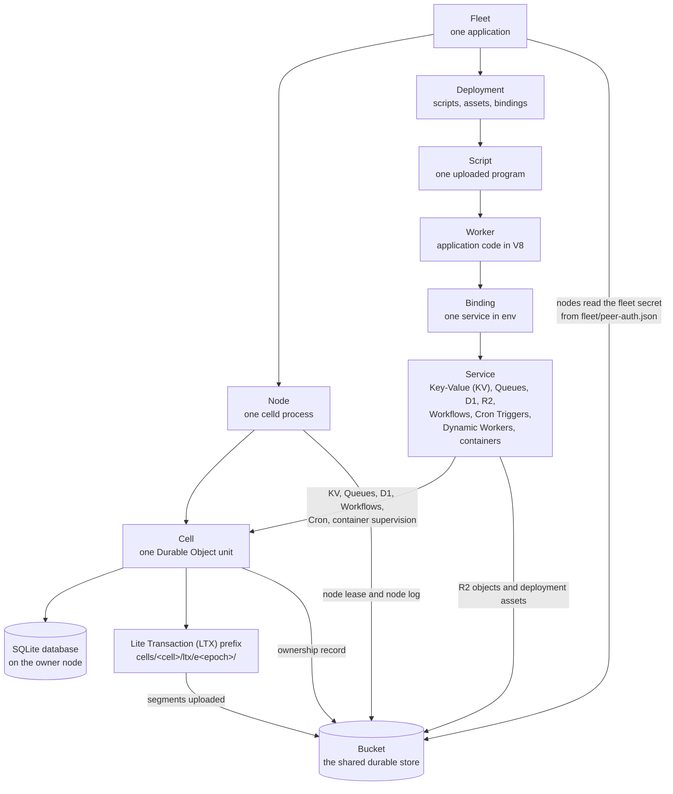
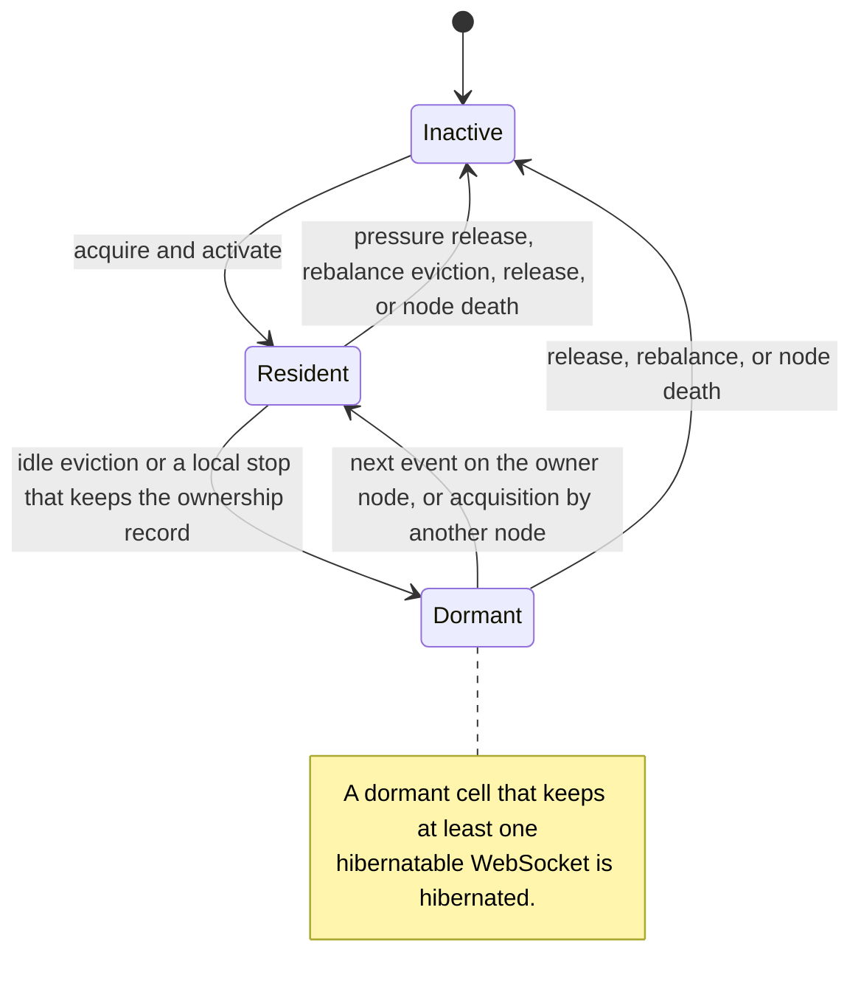
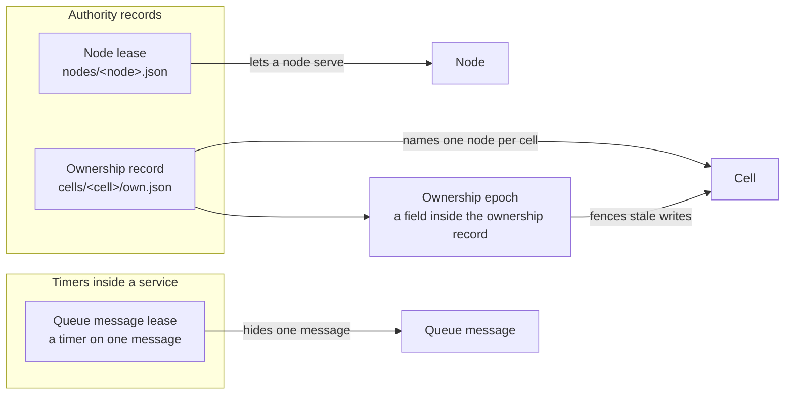

# Glossary

This file defines the terms that the other celld documents use as terms of
art. A term of art is a word that this exploration uses with a precise
meaning. Some words carry more than one precise sense, such as lease, fence,
generation, session, and state. The section
[Terms that look alike](#terms-that-look-alike) separates those senses. Ordinary
English words keep their usual meaning.
The definitions use Simplified Technical English (STE) from the AeroSpace and
Defence (ASD) association: the ASD Simplified Technical English, issue 100
(ASD-STE100) standard. Read the definition, then follow the Read more link when
you need the full mechanism that belongs to another document.

Sources: the whole celld repository at commit
`8702f6d186c77698dbfb30cf29e3b1922a88f008`, version 0.6.3. The checkout used
for this exploration is `/Users/darkvoid/GitSources/src.s3/celld`. Each code
snippet names its file and line.

## How to read an entry

An entry has this shape:

| Part | Meaning |
|------|---------|
| Term | The word as the documents use it. |
| Expansion | The full form, when the term is an abbreviation. |
| Definition | A short explanation in Simplified Technical English. |
| Read more | The document that gives the full mechanism. |

Entries appear in reading order. When a definition uses a term that has its own
later entry, the sentence stays short, and the later entry gives the full sense.
Some words name more than one thing. The section
[Terms that look alike](#terms-that-look-alike) separates those senses.

## The terms in one map



The map shows the main path only. A container runs on the node that owns the
cell which starts it, so the cell supervises the container. Static assets are
served from the deployment. R2 reads and writes the bucket directly. A Dynamic
Worker runs in an isolate pool and does not become a cell. The service edge
names the services that use a cell; R2 and a Dynamic Worker do not.

## Base terms

| Term | Expansion | Definition | Read more |
|------|-----------|------------|-----------|
| celld | — | The open-source server program that implements the Cloudflare Durable Objects interface, at version 0.6.3. It is the subject of this exploration. The name is never an abbreviation. | [Overview](00-overview.md) |
| Application | — | The set of scripts, assets, and bindings that one fleet serves. A fleet runs one application, in one stored deployment at a time. | [Overview](00-overview.md) |
| Two promises | — | The two guarantees that celld makes. First, exactly one node serves a cell at a time. Second, celld does not acknowledge a write until the write survives the loss of the node that acknowledged it. | [Overview](00-overview.md) |
| Object | — | One named thing. A Durable Object is a programming interface with private storage. A bucket object is one stored file. A JavaScript object is one value in a heap. | [Terms that look alike](#terms-that-look-alike) |
| Object storage | — | A store that keeps named byte objects. A read can take a whole object or a byte range. A write replaces the whole object; a conditional write applies only if the object is absent or unchanged. The bucket is object storage. | [Cell storage and durability](05-cell-storage-and-durability.md) |
| Work | — | One unit that a cell must process, such as an incoming request, an alarm, a queue message, or a WebSocket message. An event is one delivery of work to the runtime. | [Durable Objects](04-durable-objects.md) |
| Wake | — | The action that makes a cell resident. The owning node wakes a dormant cell; another node wakes a cell after it acquires the ownership record. | [Durable Objects](04-durable-objects.md) |
| Phase | — | The lifecycle position of a cell: resident, dormant, or inactive. A phase tells whether the cell has a runtime and an owner. | [Durable Objects](04-durable-objects.md) |
| State | — | A stored value in a record or a promise. A Resonate promise state is pending, resolved, or rejected. Do not confuse a stored state with a cell phase. | [Terms that look alike](#terms-that-look-alike) |
| Bucket | — | The object storage that every node shares. It holds deployments, cell state, ownership records, node leases, the fleet secret, wake entries, and R2 objects. In fleet mode a follower node also keeps a local copy of each acknowledged segment, and a takeover can recover that copy; the owner still uploads the segment to the bucket afterwards. | [Cell storage and durability](05-cell-storage-and-durability.md) |
| Bucket prefix | — | The leading part of an object key that belongs to one cell. For a cell the prefix is `cells/<cell>/`, where `<cell>` is the `Class:ID` scope. A node does not have one prefix: it writes the record `nodes/<node>.json` and the prefix `log/<node>/<generation>/`, where `<generation>` is the process generation of the node session. The prefix names the owner, and that owner writes inside it. | [Cell storage and durability](05-cell-storage-and-durability.md) |
| Object key | — | The full path of one object in the bucket, such as `cells/Class:ID/own.json`. | [Cell storage and durability](05-cell-storage-and-durability.md) |
| Record | — | One JavaScript Object Notation (JSON) object that celld reads or writes in the bucket. | [Cell storage and durability](05-cell-storage-and-durability.md) |
| Authority | — | The right to act for a cell or a node. A bucket record grants authority. An expiry ends it, and a record that names a different owner or a different epoch takes it away. | [Ownership, failure, and rebalancing](06-ownership-failure-and-rebalancing.md) |
| Tenant | — | One logical data group inside the application, such as one document, one chat room, or one agent. A tenant is not a separate security boundary, and this sense is not a storage partition. | [Security and tenancy](09-security-and-tenancy.md) |
| Tenancy unit | — | The object that groups tenants for trust. In celld the fleet is the tenancy unit. | [Security and tenancy](09-security-and-tenancy.md) |
| Account | — | A billing and identity record on a hosted platform. celld has no account object. | [Security and tenancy](09-security-and-tenancy.md) |
| Cloudflare | — | The company that operates the hosted Cloudflare Workers platform. | [Limitations and compatibility](10-limitations-and-compatibility.md) |
| Cloudflare Workers | — | The hosted platform that Cloudflare operates, and whose interface and behavior celld implements. celld copies a subset of that platform. | [Limitations and compatibility](10-limitations-and-compatibility.md) |

## Platform and deployment

| Term | Expansion | Definition | Read more |
|------|-----------|------------|-----------|
| Fleet | — | The set of nodes that share one bucket, one fleet secret, and one deployment. One fleet runs one application. | [Security and tenancy](09-security-and-tenancy.md) |
| Node | — | One running celld process on one machine. A node owns some cells and forwards requests for the rest. | [System architecture](02-system-architecture.md) |
| Operator | — | The person or process that runs the nodes and holds the bucket credentials. | [Deployment and operations](08-deployment-and-operations.md) |
| Deployment | — | One stored version of the application: the scripts, static assets, and bindings of one stored build. A deployment identity names that stored version. A fleet serves the deployment that `deploy/current.json` names. | [Deployment and operations](08-deployment-and-operations.md) |
| Active deployment | — | The deployment that `deploy/current.json` names now. That object is the deployment pointer. A node checks the pointer on a slow periodic interval; `POST /reload` or a notification from the managed control plane makes it read the pointer at once. | [Deployment and operations](08-deployment-and-operations.md) |
| Script | — | One uploaded Worker program with its own name, modules, assets, and bindings. One deployment can hold more than one script. | [The Worker runtime](03-the-worker-runtime.md) |
| Worker | — | The application code that the V8 engine runs for one script. It handles events, which are the inputs that the runtime delivers, and calls bindings. | [The Worker runtime](03-the-worker-runtime.md) |
| Binding | — | An object in the Worker `env` argument, such as `env.DB`, that grants the operations of one service. A binding grants those operations, not the node's other authority, and it does not grant another script's bindings. | [The services](07-the-services.md) |
| `env` | — | The second argument of a Worker handler function. It holds the bindings, which expose services, and the configuration values of the script. | [The Worker runtime](03-the-worker-runtime.md) |
| Service | — | One platform feature that a binding exposes: Key-Value (KV), Queues, D1, R2, Workflows, Cron Triggers, Dynamic Workers, or containers. Static assets have no binding; the node serves them from the deployment. | [The services](07-the-services.md) |
| Deployment generation | — | A loaded build of a deployment inside a node. It keeps the isolate pools that serve that build; an isolate is one V8 execution context. A new deployment creates a new generation. | [System architecture](02-system-architecture.md) |
| Control plane | — | A separate hosted service, controlled by Cloudflare, that deploys code and tracks node presence. It does not take part in the path that acknowledges a write. A standalone node runs without it. | [System architecture](02-system-architecture.md) |
| Placement | — | The assignment of cells to nodes. Nodes make it as they claim ownership records, and the planner moves cells to balance the fleet; the control plane does not make it. | [Ownership, failure, and rebalancing](06-ownership-failure-and-rebalancing.md) |
| Standalone mode | — | The operating mode in which a node reads the deployment from the bucket and serves it without the managed control plane. | [Deployment and operations](08-deployment-and-operations.md) |
| Managed mode | — | The operating mode in which a node runs under the hosted control plane. Set `CELLD_CLOUD=1`. | [Deployment and operations](08-deployment-and-operations.md) |
| Peer | — | Another node in the same fleet. | [Security and tenancy](09-security-and-tenancy.md) |
| Fleet secret | — | The 32-byte key in `fleet/peer-auth.json`. It authenticates peer control requests with a Keyed-Hash Message Authentication Code (HMAC). | [Security and tenancy](09-security-and-tenancy.md) |

The peer constants set the protocol version and the limits that stop a replay.
`DOMAIN` separates this protocol from every other use of the key:

```rust
// crates/celld/peer_auth.rs:16-29
pub const PROTOCOL_VERSION: u16 = 5;
pub const PROTOCOL_VERSION_TEXT: &str = "5";
const SECRET_KEY: &str = "fleet/peer-auth.json";
const SECRET_VERSION: u8 = 1;
const DOMAIN: &str = "cells-peer-request-v1";
const CLOCK_WINDOW_MS: u64 = 30_000;
const REPLAY_RETENTION_MS: u64 = CLOCK_WINDOW_MS * 2;
const MAX_REPLAY_ENTRIES: usize = 1_000_000;
```

The clock window accepts a request timestamp within 30 seconds of the local
clock. The retention is twice the window, so a nonce stays in the replay cache
for the full time in which a copy could arrive. The cache holds at most one
million nonces; when it is full, the node rejects new peer requests until
entries expire.

## Identity and placement

| Term | Expansion | Definition | Read more |
|------|-----------|------------|-----------|
| Durable Object (DO) | — | The Cloudflare programming interface for a named object with private SQLite storage (SQLite is the embedded relational database that each cell uses). A Durable Object is an instance of a class that a Worker exports. Calls reach it as a `fetch` request or a Remote Procedure Call (RPC), and the application obtains it from a binding to a Durable Object namespace. One node owns the object at a time. | [Durable Objects](04-durable-objects.md) |
| Cell | — | The durable unit behind one Durable Object: one root SQLite database, one bucket prefix `cells/<cell>/`, and one ownership epoch counter. A facet adds a child database that the same cell owns and restores. A cell continues to exist when no node runs it. | [Cell storage and durability](05-cell-storage-and-durability.md) |
| Cell scope | — | The `Class:ID` string that names one cell, for example `__D1Database:3f0c...`. The class comes first, and `ID` is 64 hexadecimal digits derived from a namespace key and a name. A namespace key is a byte string that the namespace fixes. For an application class, the namespace key contains the script name, so the same class name in two scripts gives two identifiers. | [Durable Objects](04-durable-objects.md) |
| Class | — | The first part of a cell scope. It names the implementation that handles the object. | [Durable Objects](04-durable-objects.md) |
| Durable Object class | — | A JavaScript class that a Worker exports and that the runtime instantiates for a cell. | [Durable Objects](04-durable-objects.md) |
| Reserved class | — | A class that the runtime registers in every isolate (one V8 execution context), such as `__D1Database`. A deployment configuration that names one in `durable_objects` or `migrations` is refused. The runtime also forms the workflow class `__Workflow.<script>` itself, and that class is reserved. | [Security and tenancy](09-security-and-tenancy.md) |
| Reserved cell | — | A cell that celld creates for its own service code, under a reserved class. One example is `.cron:<script>` for a schedule. `.cron` is a fifth reserved class, and it is not in `RESERVED_CLASSES`, because that list holds only the classes that a deployment configuration can name. A Key-Value shard cell is `__KvNamespace:<64-hex identifier>`. The name that the runtime hashes is `<namespace identifier>/<shard>`, and the scope prints the hash as 64 hexadecimal digits, so the shard never appears in the scope: `/` is not a valid scope character. An application does not declare a reserved cell, and its identifier is stable because the identifier is a hash of the name. | [The services](07-the-services.md) |
| Durable Object identifier (ID) | — | The 32-byte value that selects one object inside one class and namespace. celld prints it as 64 hexadecimal digits. | [Durable Objects](04-durable-objects.md) |
| Named | — | A Durable Object is named when `idFromName(name)` on its namespace derives the identifier from a text name. The namespace fixes the key, and the same name and namespace always give the same identifier. `newUniqueId()` makes an unnamed object with a random identifier. | [Durable Objects](04-durable-objects.md) |
| Namespace (Durable Object) | — | The object that fixes the key which scopes identifier derivation. A different namespace gives a different identifier for the same name. | [Durable Objects](04-durable-objects.md) |
| Owner | — | The node that holds the current ownership record for a cell and serves its requests. | [Ownership, failure, and rebalancing](06-ownership-failure-and-rebalancing.md) |
| Lease | — | A grant of authority for a limited purpose. The node lease is a bucket record with an expiry. The ownership record is a bucket record without an expiry of its own. The queue message lease is a timer inside the queue cell (a Queue is a celld service). A Resonate task lease is a timer inside the Resonate server. | [Ownership, failure, and rebalancing](06-ownership-failure-and-rebalancing.md) |
| Node lease | — | The record `nodes/<node>.json`. It names the node, its address, its expiry, its process generation (also called the session generation), its folded node log, and its load sample. A folded log is one that the node merges into a single record instead of storing one entry per event. | [Ownership, failure, and rebalancing](06-ownership-failure-and-rebalancing.md) |
| Ownership record | — | The bucket object `cells/<cell>/own.json`. It has two fields: `node`, which is empty after a release, and `epoch`. The entity tag (ETag) that the node read selects the compare-and-swap: a conditional write that applies only if the record still has that ETag. | [Ownership, failure, and rebalancing](06-ownership-failure-and-rebalancing.md) |
| Cell tenure | — | The period during which one node holds the ownership record for a cell. | [Ownership, failure, and rebalancing](06-ownership-failure-and-rebalancing.md) |
| Ownership epoch | — | A counter that grows at each acquisition. A local wake from dormant also re-acquires the record, so each activation advances the epoch by one; the epoch does not advance only at a takeover. A storage write succeeds only under the current epoch. | [Cell storage and durability](05-cell-storage-and-durability.md) |
| Fence (ownership) | — | The rule that rejects a write from a node without authority. A writer records the epoch in its LTX key prefix and in each write. A restore accepts only the epoch that the ownership record names, so it ignores the segments of a superseded writer. | [Cell storage and durability](05-cell-storage-and-durability.md) |
| Acquisition | — | The compare-and-swap that writes the ownership record and makes a node the owner, at the epoch after the one in the read record. When the record is absent, the acquisition is a conditional create at epoch 1. A compare-and-swap is a conditional write that applies only if the record still has the entity tag (ETag) that the writer read. | [Ownership, failure, and rebalancing](06-ownership-failure-and-rebalancing.md) |
| Release | — | The write that empties the owner field of the ownership record and lets another node acquire the cell. | [Ownership, failure, and rebalancing](06-ownership-failure-and-rebalancing.md) |
| Activation | — | The process that makes a cell resident on a node: open its database, restore any state that the local file does not hold from the bucket, and run the constructor. Every activation advances the epoch. | [Durable Objects](04-durable-objects.md) |
| Resident | — | The phase in which the cell has a JavaScript runtime in memory on a node. celld has one resident phase; active and idle describe whether a handler runs now. | [Durable Objects](04-durable-objects.md) |
| Active | — | A word for a resident cell that runs a handler now. It is not a separate phase. | [Durable Objects](04-durable-objects.md) |
| Idle | — | A word for a resident cell that waits for work. It is not a separate phase. | [Durable Objects](04-durable-objects.md) |
| Dormant | — | The phase in which a cell has an owner but no running runtime. A dormant cell can keep hibernatable WebSocket clients (clients whose socket the node holds without running the object code), or it can hold no socket. | [Durable Objects](04-durable-objects.md) |
| Hibernated | — | A dormant cell on its owner node that keeps at least one hibernatable WebSocket. The node still owns it, and hibernated is not a fourth phase. | [Durable Objects](04-durable-objects.md) |
| Inactive | — | The phase in which no node holds the cell. Only the bucket objects remain. | [Durable Objects](04-durable-objects.md) |
| Eviction | — | The removal of a resident cell from node memory. The bucket state remains. | [Ownership, failure, and rebalancing](06-ownership-failure-and-rebalancing.md) |
| Idle eviction | — | Eviction after `CELLD_IDLE_EVICT_S` seconds without work. The node keeps the ownership record, so the cell can wake locally. | [Ownership, failure, and rebalancing](06-ownership-failure-and-rebalancing.md) |
| Pressure release | — | Eviction to lower memory use or the resident cell count. The node releases the ownership record. | [Ownership, failure, and rebalancing](06-ownership-failure-and-rebalancing.md) |
| Takeover | — | The acquisition of a cell after its prior owner stopped renewing the node lease. | [Ownership, failure, and rebalancing](06-ownership-failure-and-rebalancing.md) |
| Handoff | — | A planned move of a cell from one node to another. The owner releases the cell first. | [Ownership, failure, and rebalancing](06-ownership-failure-and-rebalancing.md) |
| Rebalancing | — | The movement of cells while the fleet runs, to keep the weighted cell count similar across nodes. | [Ownership, failure, and rebalancing](06-ownership-failure-and-rebalancing.md) |
| Placement weight | — | The weight that sets a node's share of the cells. The default weight is the Central Processing Unit (CPU) count. The total fleet weight is the sum of the weights of every live node. A node's target cell count is `total cells * node weight / total fleet weight`. | [Ownership, failure, and rebalancing](06-ownership-failure-and-rebalancing.md) |
| Weighted cell count | — | The target count of cells for a node, computed from its placement weight. Rebalancing compares this target with the actual count. | [Ownership, failure, and rebalancing](06-ownership-failure-and-rebalancing.md) |
| Planner | — | The rebalance loop on each node. It reads the fleet records, picks a donor (a node that holds more cells than its target), and moves safe cells. A safe cell is dormant, holds no pending request, and has no alarm about to fire; a hibernated cell is dormant and can move. | [Ownership, failure, and rebalancing](06-ownership-failure-and-rebalancing.md) |
| Pressure | — | A node condition, such as low memory, that makes the node shed cells. | [Ownership, failure, and rebalancing](06-ownership-failure-and-rebalancing.md) |
| Shed | — | To give up cells because of pressure. A shed cell is released, so its ownership record does not stay with the node. | [Ownership, failure, and rebalancing](06-ownership-failure-and-rebalancing.md) |
| Drain | — | The graceful shutdown sequence. The node stops accepting new work, releases its cells, and lets other nodes acquire them. | [Deployment and operations](08-deployment-and-operations.md) |
| Self-fence | — | The action in which a node stops itself because its core actor stopped, its lease stopped renewing, or its ownership record no longer names it. The process exits with code 3. | [Ownership, failure, and rebalancing](06-ownership-failure-and-rebalancing.md) |
| Core actor | — | The task inside the node process that holds the cell state, the node lease, and the ownership timers. If it stops, the node cannot renew the lease safely and self-fences. | [Ownership, failure, and rebalancing](06-ownership-failure-and-rebalancing.md) |



The idle eviction edge ends at Dormant, not at Inactive, because the eviction
is local. The node stops the runtime and keeps the ownership record, so the
next request wakes the cell on the same node. Only a pressure release, a
rebalance eviction, a release, or the death of the node process removes the
owner. The source states this in
`crates/logic/lib.rs`: idle eviction is "a local residency decision, not a
handoff" (`:6136`), and a completed eviction whose requested `rebalance` flag
is false sets the dormant phase and leaves the record in place
(`:5119-5137`). The `rebalance` flag is the Boolean argument of
`begin_eviction`; a true value asks the node to release the cell for another
node. The cleanup code also names the cost directly: "The record still names
this node, which is the whole cost of stopping here" (`:5124-5127`). That cost
is that the node must keep tracking the cell, and no other node can take it
while the record names this node.

The scope grammar fixes the character set and the length limit in bytes. The
limit is 255 bytes, not 255 characters, because a scope becomes a path
component and an object key, and the storage layer counts bytes. The runtime
checks the scope before storage:

```rust
// crates/logic/cell.rs:18, 43-51
pub const MAX_CELL_SCOPE: usize = 255;

pub fn valid_cell_scope(scope: &str) -> bool {
    !scope.is_empty()
        && scope.len() <= MAX_CELL_SCOPE
        && scope != "."
        && scope != ".."
        && scope
            .bytes()
            .all(|b| b.is_ascii_alphanumeric() || matches!(b, b'_' | b'-' | b'.' | b':' | b'$'))
}
```

The `.` and `..` values are rejected because they name the current directory
and the parent directory; a key with either could escape its prefix. The other
allowed characters, `_ - . : $`, appear in class names, the hexadecimal text of
an identifier, and binding names. An empty scope is rejected because it would
leave a doubled path separator.

The four Durable Object classes in `RESERVED_CLASSES` are runtime code, not
application code. The first two constants hold literal strings and the last two
refer to the constants that the Rust modules `celld_logic::kv` and
`celld_logic::queue` define, so the four class names are `__D1Database`,
`__Workflow`, `__KvNamespace`, and `__Queue`:

```rust
// crates/celld/deploy.rs:72-89
pub const D1_CLASS: &str = "__D1Database";
pub const WORKFLOW_CLASS: &str = "__Workflow";
pub const KV_CLASS: &str = celld_logic::kv::RESERVED_CLASS;
pub const QUEUE_CLASS: &str = celld_logic::queue::RESERVED_CLASS;
pub const RESERVED_CLASSES: &[&str] = &[D1_CLASS, WORKFLOW_CLASS, KV_CLASS, QUEUE_CLASS];
```

The cron module adds a fifth reserved class, `.cron`, for the one schedule cell
of each script. It is not in `RESERVED_CLASSES`, because that list holds only
the Durable Object classes that a deployment configuration can name:

```rust
// crates/logic/cron.rs:33, 41-43
pub const RESERVED_CLASS: &str = ".cron";

pub fn reserved_cell(script_name: &str) -> String {
    format!("{RESERVED_CLASS}:{script_name}")
}
```

A workflow class carries the script name. The separator is `.`, because a
JavaScript class name cannot contain one:

```rust
// crates/celld/deploy.rs:112-114
pub fn workflow_class(script_name: &str) -> String {
    format!("{WORKFLOW_CLASS}.{script_name}")
}
```

## Storage and durability

| Term | Expansion | Definition | Read more |
|------|-----------|------------|-----------|
| Write-ahead log (WAL) | Write-ahead log | The SQLite log that records changed database pages (fixed-size blocks) before the database file changes. LTX segments carry these records to the bucket. | [Cell storage and durability](05-cell-storage-and-durability.md) |
| Lite Transaction (LTX) | Lite Transaction | The log file format that celld adapts from Litestream, an open-source replication tool for SQLite, and uses to move SQLite transactions into the bucket. An LTX file covers a transaction identifier range. | [Cell storage and durability](05-cell-storage-and-durability.md) |
| Transaction identifier (TXID) | Transaction identifier | The SQLite commit number that orders an LTX segment. celld writes it as 16 hexadecimal digits. | [Cell storage and durability](05-cell-storage-and-durability.md) |
| Segment | — | One LTX file. A segment holds the database pages changed in one transaction, or in a contiguous range of transactions. | [Cell storage and durability](05-cell-storage-and-durability.md) |
| Level | — | One tier in the compaction tree. Level 0 holds fresh segments from recent commits, levels 1 to 8 hold merged segments, and level 9 holds a snapshot. | [Cell storage and durability](05-cell-storage-and-durability.md) |
| Snapshot | — | A full database image at level 9. A restore starts from the newest snapshot and replays later segments. | [Cell storage and durability](05-cell-storage-and-durability.md) |
| Compaction | — | The merge of lower-level segments into a higher level. Compaction reduces the number of objects that a restore must read. | [Cell storage and durability](05-cell-storage-and-durability.md) |
| Restore | — | The process that rebuilds the local SQLite file from a snapshot and later segments. | [Cell storage and durability](05-cell-storage-and-durability.md) |
| Paging | — | A restore mode that reads pages from the bucket when the database asks for them, instead of downloading the whole file first. | [Cell storage and durability](05-cell-storage-and-durability.md) |
| Log bundle | — | One bucket object under `log/<node>/<generation>/bundle/`, named `e<epoch>-<seq>.ltxb`, that carries the level 0 segments of many cells. A node ships the segments of all its cells in one stream, so a bundle is not tied to one cell prefix. The `<epoch>` is the shipper epoch: the counter that the node log increments each time the node opens a new shipping stream. `<seq>` is the bundle sequence number inside that epoch. The footer is an index at the end of the file with one row for each segment: the cell, the cell epoch, the transaction identifier, the byte offset, and the length, so a restore reads only its cell's byte ranges. | [Cell storage and durability](05-cell-storage-and-durability.md) |
| Node log | — | The folded `log` field inside `nodes/<node>.json`. It records the cells that the session owned, the shipper epoch that names the current bundle stream, and one of three states: open (the session accepts entries), recovering (a takeover is reading it), and sealed (complete, with no new entries). | [Cell storage and durability](05-cell-storage-and-durability.md) |
| Seal | — | To close a node log so that its session can no longer acknowledge a new write. A takeover seals the prior owner's log before it restores the cell. | [Cell storage and durability](05-cell-storage-and-durability.md) |
| Takeover gate | — | The check of a dead owner's node log before a restore. It fences the open record, seals the reachable followers, uploads their retained segments into the per-cell prefixes, and marks the record sealed. | [Ownership, failure, and rebalancing](06-ownership-failure-and-rebalancing.md) |
| Session | — | One node lease generation during which the node accepts log entries. The generation is the process generation, also called the session generation. The pair `<node>/<generation>` names a session. | [Cell storage and durability](05-cell-storage-and-durability.md) |
| Checkpoint | — | A local operation in which SQLite writes the pages of its write-ahead log into the database file. The bucket copy of the database is a snapshot, not a checkpoint. | [Cell storage and durability](05-cell-storage-and-durability.md) |
| Durability proof | — | The evidence that a committed write survives a node loss. Fleet mode and bucket mode give different proofs. | [Cell storage and durability](05-cell-storage-and-durability.md) |
| Fleet proof | — | A durability proof that waits for one or two follower nodes to write the log segment to local disk. The set of chosen followers is the ensemble. The owner keeps up to two followers, and one follower that answers is enough. When no follower answers, the node falls back to a bucket proof; it never acknowledges on its own local disk alone. The owner uploads the segment to the bucket afterwards, and a takeover can recover a segment that only a follower holds. | [Cell storage and durability](05-cell-storage-and-durability.md) |
| Bucket proof | — | A durability proof that waits until the segment is in the bucket and the ownership record still names the writer. | [Cell storage and durability](05-cell-storage-and-durability.md) |
| Fleet mode | — | The durability mode `CELLD_DURABILITY=fleet`. It uses a fleet proof. It is the default. | [Cell storage and durability](05-cell-storage-and-durability.md) |
| Bucket mode | — | The durability mode `CELLD_DURABILITY=bucket`. It uses a bucket proof for every write. | [Cell storage and durability](05-cell-storage-and-durability.md) |
| Follower | — | A node that stores another node's log segments on local disk for a fleet proof. A node never counts itself as a follower. | [Cell storage and durability](05-cell-storage-and-durability.md) |
| Replication | — | The copy of a committed segment to a follower or to the bucket. | [Cell storage and durability](05-cell-storage-and-durability.md) |
| Visible | — | A bucket object is visible when a later reader can list or read it after the write returned success. Only garbage collection needs list-after-write visibility. | [Cell storage and durability](05-cell-storage-and-durability.md) |
| Probe | — | The startup test of the bucket. celld requires five properties: conditional create, conditional overwrite, read-after-write (a read returns the bytes that the write sent), ranged read (a read can ask for a byte range), and list-after-write (a list shows an object after its write returns). The probe tests the two conditional writes, and it writes an object then reads a byte range of it, so a missing read-after-write or a missing ranged read also fails at startup. Only list-after-write is untested; epoch garbage collection is the only path that needs it, so a bucket without it fails at the first garbage-collection pass. | [Limitations and compatibility](10-limitations-and-compatibility.md) |
| Wake entry | — | A bucket object under `wake/entries/` that makes an alarm durable before `setAlarm()` returns. It records the cell, the due time in `due_ms`, the owner, and the epoch. One node holds the waker role, which is a lease from the bucket: it scans these entries and wakes a cell whose owner stopped. If the waker stops, its lease expires and another node takes the role. | [Durable Objects](04-durable-objects.md) |
| Garbage collection (GC) | Garbage collection | The removal of old epochs, stale segments, and dead objects. | [Cell storage and durability](05-cell-storage-and-durability.md) |
| Epoch garbage collection | — | The removal of LTX epoch prefixes that no restore can need. Each epoch records the epoch that it restored from, and those records form a chain. The restore base is the oldest epoch that the chain from the newest epoch reaches; no restore can need an older epoch. The operation is off by default: `CELLD_LTX_RETENTION_SECS` is unset or `0` until the operator sets a positive number. | [Cell storage and durability](05-cell-storage-and-durability.md) |
| Stale object | — | A bucket object that no live record names. A live record is the current ownership record, a live node lease, or a live node log. | [Cell storage and durability](05-cell-storage-and-durability.md) |
| Dead object | — | A bucket object that belongs to a dead session or a superseded epoch. A session is dead when its node lease expired and a takeover sealed its node log. | [Cell storage and durability](05-cell-storage-and-durability.md) |
| Garbage collector | — | The task on the owner node that deletes stale and dead objects. It lists the objects under a prefix, compares each key with the live records that name it, and deletes the keys that no live record names. It uses list-after-write visibility to find them. | [Cell storage and durability](05-cell-storage-and-durability.md) |

A snapshot is level 9. Level 0 holds fresh segments and is not a merge tier.
Levels 1 to 8 are merge tiers. The code names the snapshot level:

```rust
// crates/ltx/src/compaction_level.rs:7
pub const SNAPSHOT_LEVEL: i32 = 9;
```

The path functions put the level in the directory and the transaction range in
the file name:

```rust
// crates/ltx/src/lib.rs:538-556 (abridged)
pub fn ltx_level_dir(root: &str, level: u32) -> String {
    path_join(&[&ltx_dir(root), &level.to_string()])
}

pub fn ltx_file_path(root: &str, level: u32, min_txid: TXID, max_txid: TXID) -> String {
    let filename = format!("{}-{}.ltx", min_txid, max_txid);
    path_join(&[&ltx_level_dir(root, level), &filename])
}
```

The durability mode is an environment value with the default `fleet`:

```rust
// crates/celld/main.rs:4239
let durability = std::env::var("CELLD_DURABILITY").unwrap_or_else(|_| "fleet".into());
```

The node lease and the node log share one object. The `log` field is the
folded node log:

```rust
// crates/celld/ownership_store.rs:35-62 (abridged)
pub(crate) struct NodeLeaseWire {
    pub(crate) node: String,
    pub(crate) expires_ms: u64,
    pub(crate) addr: String,
    pub(crate) probe_public_key: String,
    pub(crate) generation: String,
    pub(crate) log: Option<NodeLogWire>,
    pub(crate) load: NodeLoadWire,
}
```

Each field has one role. `node` names the process. `expires_ms` is the lease
expiry. `addr` is the internal listener address that peers dial.
`probe_public_key` is the public half of the key that a peer probe uses.
`generation` is the process generation, which in production has the same value
as `probe_public_key`. `log` is the folded node log, absent until the session's
first fleet open. `load` is the node load sample: the ownership count (cells
owned), `placement_weight`, `bucket_format` (the bucket format that the node
serves), resident cells, hosted WebSockets (sockets that the node keeps), and
resident set size (the memory that the process uses). The placement planner
reads `load`; the lease refresh replaces the sample and changes nothing else.

The wake format is a compatibility fence. A wake entry makes an alarm durable
before `setAlarm()` returns, and the entry layout changed between formats. A
node refuses a bucket whose format is not 2, so an old node cannot read a new
entry or write an entry that a new node misreads:

```rust
// crates/celld/wake_format.rs:7, 18-25
const KEY: &str = "wake/format.json";

fn decode(bytes: &[u8]) -> anyhow::Result<FormatRecord> {
    let record: FormatRecord = serde_json::from_slice(bytes)?;
    ensure!(
        record.format == 2,
        "unsupported wake format; this binary requires format 2"
    );
    Ok(record)
}
```

`FormatRecord` is the small stored record `{ format, migrating }`.
`migrating` is true while startup is still moving old wake entries into the
format-2 index under `wake/`. A node serves only when `format` is 2 and
`migrating` is false.

## Runtime and execution

| Term | Expansion | Definition | Read more |
|------|-----------|------------|-----------|
| V8 | — | The JavaScript engine that celld embeds. It compiles and runs the Worker code. | [The Worker runtime](03-the-worker-runtime.md) |
| Isolate | — | One V8 execution context with its own heap. Several isolates can run in one process. | [The Worker runtime](03-the-worker-runtime.md) |
| Isolate pool | — | A set of isolates that one deployment generation keeps for one script. A pool holds isolates, not cells. Several cells of one script can live in one isolate, each as its own realm (a separate JavaScript global environment inside one isolate), and the isolate serves one turn at a time across all of them. | [The Worker runtime](03-the-worker-runtime.md) |
| Heap | — | The memory region of one isolate. The heap holds the JavaScript objects. | [The Worker runtime](03-the-worker-runtime.md) |
| Event | — | One input that the runtime delivers to an isolate, such as an HTTP request, an alarm, a queue message, or a WebSocket message. | [The Worker runtime](03-the-worker-runtime.md) |
| Handler | — | The Worker function that receives one kind of event, such as `fetch`, `scheduled`, `queue`, `alarm`, or `webSocketMessage`. | [The Worker runtime](03-the-worker-runtime.md) |
| Constructor | — | The class constructor that runs when an activation starts the object. It runs again after a hibernation wake, because a hibernation wake starts a new runtime and only stored state remains. | [Durable Objects](04-durable-objects.md) |
| Cell fetch | — | An HTTP request delivered to the `fetch` handler of a cell. A node forwards the request to the owner when it is not the owner. | [Durable Objects](04-durable-objects.md) |
| Turn | — | One event that one cell handles to completion in an isolate. The isolate runs no other turn, for any cell, until this turn ends. | [The Worker runtime](03-the-worker-runtime.md) |
| Input gate | — | The per-cell order that decides when an event may enter an isolate. It admits one event at a time and holds the next event until the running one finishes, even across an `await`. | [The Worker runtime](03-the-worker-runtime.md) |
| Output gate | — | The per-cell rule that holds observable output until a durability proof reaches the write position that the output can reveal. Observable output is any value that can leave the process, such as a Hypertext Transfer Protocol (HTTP) response, an error answer, a streamed chunk, a raw Transmission Control Protocol (TCP) write, a WebSocket frame, or an R2 bucket mutation. The write position is the latest committed transaction identifier that the output can expose. | [The Worker runtime](03-the-worker-runtime.md) |
| Host function | — | A function that the engine supplies to internal JavaScript, such as a storage call. | [The Worker runtime](03-the-worker-runtime.md) |
| Internal script | — | The JavaScript that celld runs to implement a binding. It is not application code. | [The Worker runtime](03-the-worker-runtime.md) |
| Module | — | One JavaScript source unit in a Worker bundle. | [The Worker runtime](03-the-worker-runtime.md) |
| Worker bundle | — | The compiled code, modules, and assets that the node loads for one script. | [The Worker runtime](03-the-worker-runtime.md) |
| Compatibility flag | — | A configuration switch that changes one runtime behavior to match a Cloudflare version. | [Limitations and compatibility](10-limitations-and-compatibility.md) |
| Replay (workflow) | — | The second run of a Workflow `run()` from its first line after a step or a restart. A finished step returns its stored result instead of running its function again, so the replay reproduces the run from the stored history. | [The services](07-the-services.md) |
| Remote Procedure Call (RPC) | — | A call from one Worker or Durable Object to a method on another. | [Durable Objects](04-durable-objects.md) |
| WebSocket | — | A long-lived two-way connection between a client and a Worker or Durable Object. | [Durable Objects](04-durable-objects.md) |
| Hibernation | — | The mechanism that keeps WebSocket connections on the node while the object code does not run. The node process holds the socket and its attachments (stored values attached to the socket), not the isolate. A message on the socket makes the cell resident again, and the same activation path advances the epoch. | [Durable Objects](04-durable-objects.md) |
| Alarm | — | A durable timer that belongs to one Durable Object. The runtime calls the object when the time arrives, and the call is an event that makes the cell resident. | [Durable Objects](04-durable-objects.md) |
| Facet | — | A child object inside a Durable Object. The object that creates it is its parent facet, or the root cell for a level 1 facet. A facet has its own SQLite database, shares the root cell's ownership record and epoch, and is not a cell. | [Durable Objects](04-durable-objects.md) |
| Facet depth | — | The nesting count of a facet, counted from the root object, which is level 0. The limit is 4 levels including the root, so facet levels 1, 2, and 3 are allowed. | [Durable Objects](04-durable-objects.md) |
| Dynamic Worker | — | A Worker that the application loads at run time with a `worker-loader` binding. It is not the deployed script. | [The services](07-the-services.md) |
| Worker Loader | — | The binding that loads Worker code at run time, named `worker-loader` in configuration. It supplies a class or a module to a Dynamic Worker or a facet. | [The services](07-the-services.md) |
| Container | — | A process tree that the node starts from an image, with its own filesystem view, network namespace, and limits. | [The services](07-the-services.md) |
| Network namespace | — | The private network stack that a container receives. It separates the container's interfaces and routes from the node. | [The services](07-the-services.md) |
| OCI | Open Container Initiative | The standard for container image formats and runtimes. | [The services](07-the-services.md) |
| Container runtime | — | The program that starts a container. `runc` is the reference runtime, `runsc` is the gVisor runtime, and `kata` is the Kata Containers runtime, which runs each container in a light virtual machine. | [The services](07-the-services.md) |
| Sandbox | — | An execution environment from the Cloudflare Sandbox SDK (`@cloudflare/sandbox`). celld runs one container per sandbox. | [The services](07-the-services.md) |

## Services

| Term | Expansion | Definition | Read more |
|------|-----------|------------|-----------|
| KV | Key-Value | A namespace of keys with values and optional metadata (a short text map). Each KV namespace runs on cells of the reserved class `__KvNamespace`. | [The services](07-the-services.md) |
| KV key | — | The name of one KV entry. The maximum length is 512 bytes. | [The services](07-the-services.md) |
| KV namespace | — | One named set of KV entries. It is not a Durable Object namespace. It runs on shard cells of the reserved class `__KvNamespace`, with one cell for each shard. Version 1 has one shard (`SHARDS = 1`), and the shard still travels in the cell name `<namespace identifier>/<shard>`, so a later version can add shards without moving existing cells. | [The services](07-the-services.md) |
| Value | — | The bytes of one KV entry. The maximum size is 25 mebibytes (MiB). A value of 1 MiB or more is stored as a bucket object. | [The services](07-the-services.md) |
| Value split | — | The rule that stores a KV value of 1 MiB or more as one bucket object. The SQLite row holds a reference with the object digest, which is the SHA-256 hash of the value bytes, and, in the current format, the ownership epoch. The epoch stops an older garbage collector from deleting an object that a later owner wrote. A legacy reference has only the digest because it predates that rule. | [The services](07-the-services.md) |
| Queue | — | A durable message stream with producers and consumers. Each queue runs on cells of the reserved class `__Queue`. | [The services](07-the-services.md) |
| Producer | — | A Worker or Durable Object that sends a message to a queue. | [The services](07-the-services.md) |
| Consumer | — | A Worker handler that receives messages from a queue. | [The services](07-the-services.md) |
| Message lease | — | The time during which one consumer holds one queue message, also called the visibility timeout. The message stays hidden from other consumers until the lease ends or the consumer acknowledges it, so delivery is at least once. A message lease is not a node lease: the subject is one message, not a cell. | [The services](07-the-services.md) |
| D1 | — | A Structured Query Language (SQL) database service. "D1" is a product name and has no expansion. Each D1 database runs on cells of the reserved class `__D1Database`. | [The services](07-the-services.md) |
| R2 | — | An object-storage service. "R2" is a product name and has no expansion. It stores objects in the same bucket that the fleet uses, under `r2/<R2 bucket name>/`. | [The services](07-the-services.md) |
| Workflow | — | A durable multi-step program. Each workflow instance runs on a cell of the reserved class `__Workflow.<script>`. | [The services](07-the-services.md) |
| Workflow instance | — | One run of a workflow, with its own identity and state. | [The services](07-the-services.md) |
| Step | — | One durable unit of work inside a workflow. A completed step is not repeated during a replay. | [The services](07-the-services.md) |
| Cron Trigger | — | A schedule that calls the `scheduled` handler of a Worker. A reserved cell holds the schedule, and its alarm makes the call. | [The services](07-the-services.md) |
| Static asset | — | A file that the node serves from the deployment without running Worker code. A request reaches the Worker first only when the asset configuration sets `run_worker_first` for the path; otherwise the node answers a matching asset directly. | [The services](07-the-services.md) |

## Security

| Term | Expansion | Definition | Read more |
|------|-----------|------------|-----------|
| Trust boundary | — | A line that separates two groups with different authority. | [Security and tenancy](09-security-and-tenancy.md) |
| Unit of isolation | — | The object that a trust boundary separates. In celld the fleet is the unit of isolation because every node holds the fleet secret and the bucket credentials; a cell is not one. Within a fleet, a cell gets ownership, one writer at a time, and its own storage, but its code can use every binding of its script and call other cells. | [Security and tenancy](09-security-and-tenancy.md) |
| Internal listener | — | The TCP listener for peer traffic and the operator API. | [Security and tenancy](09-security-and-tenancy.md) |
| Public listener | — | The TCP listener that serves the deployed Worker. It authenticates no one, so the application or an outer proxy must authenticate its users. | [Security and tenancy](09-security-and-tenancy.md) |
| Operator API | Application Programming Interface | The Hypertext Transfer Protocol (HTTP) routes on the internal listener. `/state` returns a snapshot of the node state, and `/evict/<scope>` evicts the named cell. The operator protects the listener, for example with a network rule or a proxy; celld does not authenticate these routes itself. | [Security and tenancy](09-security-and-tenancy.md) |
| Peer control request | — | A request on `/peer/*` that changes fleet state, such as an acquire (claim a cell) or a seal (close the log of a dead node). It carries an HMAC. | [Security and tenancy](09-security-and-tenancy.md) |
| HMAC | Keyed-Hash Message Authentication Code | A message authentication code that uses a shared secret and a hash function. It proves that a holder of the secret made the message. It is not a digital signature. | [Security and tenancy](09-security-and-tenancy.md) |
| Canonical string | — | The nine newline-joined fields that a peer signs, in this order: `cells-peer-request-v1`, the protocol version, the method, the path and query, the SHA-256 hash of the body as hexadecimal, the source node, the target node, the timestamp in milliseconds, and the nonce as hexadecimal. No field contains a newline: the node names are validated, HTTP forbids a newline in the path, and the hash and nonce are hexadecimal. An empty body hashes as the SHA-256 of zero bytes. Both nodes build the text in the same order, so a change to any field changes the HMAC. | [Security and tenancy](09-security-and-tenancy.md) |
| Nonce | — | 16 random bytes that a sender uses once, so a replayed request is detectable. | [Security and tenancy](09-security-and-tenancy.md) |
| Replay (peer) | — | A captured peer request that an attacker sends again. The nonce and the clock window stop it. | [Security and tenancy](09-security-and-tenancy.md) |
| Clock window | — | The 30-second band on each side of a request timestamp in which a peer accepts the request. The test is `abs(now - timestamp) <= 30,000`, so a clock skew of more than 30 seconds rejects the request. Nodes therefore need synchronized clocks, usually through the Network Time Protocol (NTP). | [Security and tenancy](09-security-and-tenancy.md) |
| Replay cache | — | The in-memory set of nonces that one node has already accepted. It keeps each nonce for 60 seconds and holds at most 1,000,000 entries. When the cache is full, the node rejects new peer requests until entries expire. | [Security and tenancy](09-security-and-tenancy.md) |
| Tunnel | — | One long-lived connection that carries cell fetch and RPC traffic between peers. | [Security and tenancy](09-security-and-tenancy.md) |
| Linux capability | — | A named right of a process, such as the right to change its user identifier. celld drops all of them in a container. | [Security and tenancy](09-security-and-tenancy.md) |
| Seccomp | — | The Linux system-call filter. celld uses the default profile of the container daemon (the program that starts containers, such as Docker). The kernel refuses a call that the profile blocks. | [Security and tenancy](09-security-and-tenancy.md) |
| nftables | — | The Linux packet filter. celld uses it to fence container network traffic. | [Security and tenancy](09-security-and-tenancy.md) |
| Container fence | — | The nftables rules in the `inet celld` table on the interfaces `celld0` and `celld1`. They stop a container from reaching the node or a private address. | [Security and tenancy](09-security-and-tenancy.md) |
| CIDR | Classless Inter-Domain Routing | The `a.b.c.d/n` form that names an address range. | [Security and tenancy](09-security-and-tenancy.md) |
| gVisor | — | A container runtime that handles system calls in user space and gives each container a separate kernel interface. | [Security and tenancy](09-security-and-tenancy.md) |
| Egress policy | — | The rule that decides which network targets a Worker may reach. The default policy allows every target. | [Security and tenancy](09-security-and-tenancy.md) |
| Transport Layer Security (TLS) | — | The protocol that encrypts a network connection. | [Security and tenancy](09-security-and-tenancy.md) |

The default limit on one request body is 1 gibibyte (GiB). The operator can
lower it with `CELLD_MAX_REQUEST_BODY_BYTES`, but cannot raise it. The peer
forwarding limit is `MAX_PEER_FORWARD_BODY_BYTES`, which is 1 mebibyte (MiB)
larger, so a forwarded request still fits:

```rust
// crates/celld/actor.rs:1291
pub const DEFAULT_MAX_REQUEST_BODY_BYTES: usize = 1 << 30;

// crates/celld/main.rs:1579
const MAX_PEER_FORWARD_BODY_BYTES: usize = DEFAULT_MAX_REQUEST_BODY_BYTES + (1 << 20);
```

The container fence has two chains. The input chain rejects new connections
from a container to the node. The forward chain rejects the private ranges,
which include the metadata address `169.254.169.254`. That address is the cloud
instance metadata service; a process that reaches it can receive cloud
credentials, so a container must not reach it:

```nftables
# crates/celld/container.rs:149-163 (abridged)
table inet celld {
  chain input {
    type filter hook input priority -10; policy accept;
    iifname { "celld0", "celld1" } ct state established,related accept
    iifname { "celld0", "celld1" } reject
  }
  chain forward {
    type filter hook forward priority -10; policy accept;
    iifname { "celld0", "celld1" } ip daddr { 169.254.0.0/16, 10.0.0.0/8, 172.16.0.0/12, 192.168.0.0/16, 100.64.0.0/10 } reject
    iifname { "celld0", "celld1" } ip6 daddr { fe80::/10, fc00::/7 } reject
  }
}
```

## Resonate comparison terms

| Term | Expansion | Definition | Read more |
|------|-----------|------------|-----------|
| Resonate | — | The durable-execution system (a system that keeps the state of a long-running program) whose S3 server and work distribution this exploration compares with celld. | [Resonate S3 and celld](11-resonate-s3-and-celld.md) |
| Origin | — | The text before the first colon of an identifier; an identifier with no colon is its own origin. The caller supplies the root identifier when it starts the root task, and that text becomes the origin. | [Resonate S3 and celld](11-resonate-s3-and-celld.md) |
| Root task | — | The first task in a call tree. Its identifier has no colon, and that identifier is the origin. | [Resonate S3 and celld](11-resonate-s3-and-celld.md) |
| Call tree | — | The root task and every descendant whose identifier starts with `<origin>:`. The client library writes each child identifier with the parent identifier as a prefix, and the server checks that the `resonate:parent` tag is a prefix of the identifier. | [Resonate S3 and celld](11-resonate-s3-and-celld.md) |
| Durable promise | — | A named record with a state, an optional deadline, and optional callbacks. | [Work placement and sharding](12-work-placement-and-sharding.md) |
| Promise | — | The short name for a durable promise. | [Work placement and sharding](12-work-placement-and-sharding.md) |
| State (promise) | — | The value of a promise: pending, resolved, or rejected. | [Work placement and sharding](12-work-placement-and-sharding.md) |
| Deadline | — | A stored time at which the server acts on a promise or a task, such as settling a pending promise as timed out or returning a task to pending. | [Work placement and sharding](12-work-placement-and-sharding.md) |
| Resolve | — | To record a promise's value and settle it. | [Work placement and sharding](12-work-placement-and-sharding.md) |
| Settle | — | To complete a promise with a value or an error. A settled promise does not change again. | [Work placement and sharding](12-work-placement-and-sharding.md) |
| Task | — | A durable promise that carries a target. The target tells a worker group that the task is ready. | [Work placement and sharding](12-work-placement-and-sharding.md) |
| Target | — | The address value in the `resonate:target` tag of a task. Its presence turns a promise into a task. | [Work placement and sharding](12-work-placement-and-sharding.md) |
| Worker group | — | A logical pool of Resonate workers that share one target address. A worker joins a group when it opens a poll connection. | [Work placement and sharding](12-work-placement-and-sharding.md) |
| Poll connection | — | The long-lived request that a Resonate worker keeps open to its worker group. The server sends work on it, and a closed connection removes the worker from the group. | [Work placement and sharding](12-work-placement-and-sharding.md) |
| Execute message | — | The server-to-worker message that tells a worker that one task is ready. Receipt does not grant the task; the worker must acquire it with an update that carries the version it read. The server repeats the message after a retry timeout, which defaults to 30,000 milliseconds, until the task settles. | [Work placement and sharding](12-work-placement-and-sharding.md) |
| Task lease | — | The period during which one worker holds one task. The lease has a time to live (TTL) that the worker names in its acquire. A heartbeat from the worker, with the version that it holds, extends the lease. When the lease deadline passes without a heartbeat, the task returns to pending and the server sends execute again. | [Work placement and sharding](12-work-placement-and-sharding.md) |
| Version guard | — | The rule that a Resonate update succeeds only if the record version still matches the version that the worker read. A successful update increments the version, so two workers cannot both acquire one task. The version is the task or promise fence value: an update that carries an older version fails. It is not the document generation, which is the commit counter of the storage object. | [Work placement and sharding](12-work-placement-and-sharding.md) |
| Deadline key | — | The durable key that a Resonate storage backend writes for a timer, such as `<prefix>t/<shard>/<20-digit deadline>_<target>@<timer generation>`. The deadline is a non-negative time in milliseconds, zero-padded so that key order is time order. A sweep is a scan for due keys. The timer generation is the document commit that armed (created) the deadline. It lets a writer remove only the key that the prior write created, and never a newer key for the same target and time. A sweep that meets two keys for one target and time applies the deadline idempotently and removes each key that it read. | [Work placement and sharding](12-work-placement-and-sharding.md) |
| Ready | — | A task is ready when it is pending and its target names a worker group. The server can emit an `execute` message for it. | [Work placement and sharding](12-work-placement-and-sharding.md) |
| Acquired | — | A task is acquired while one worker holds its lease for one version. | [Work placement and sharding](12-work-placement-and-sharding.md) |
| Invocation | — | One worker attempt to run an acquired task. | [Work placement and sharding](12-work-placement-and-sharding.md) |
| Preload | — | A list of sibling promise values (the other promises of the same task) that the server sends with an acquire or fence response, so the worker does not read each one. | [Work placement and sharding](12-work-placement-and-sharding.md) |
| Callback | — | A registration on a promise that a task waits on. It names the promise of the task that waits. A task registers callbacks when it suspends to wait. | [Work placement and sharding](12-work-placement-and-sharding.md) |
| Server | — | The Resonate process that stores promises, tasks, and deadlines and delivers work to workers. | [Work placement and sharding](12-work-placement-and-sharding.md) |
| Storage backend | — | The database or object store that a Resonate server uses to keep promises, tasks, and deadlines. | [Documents, rows, and partitions](../../src.resonate/markdown/21-documents-rows-and-partitions.md) |
| Storage engine | — | The database program inside a storage backend, such as SQLite (embedded relational), PostgreSQL and MySQL (client-server relational), ScyllaDB (distributed wide-column), or Neo4j (graph). | [Documents, rows, and partitions](../../src.resonate/markdown/21-documents-rows-and-partitions.md) |
| Document (origin document) | — | The record that a Resonate storage backend writes for one origin: newline-delimited canonical JSON, one line for each promise record. | [Resonate S3 and celld](11-resonate-s3-and-celld.md) |
| Canonical JSON | — | JSON with a fixed key order, a fixed number form, and no optional whitespace. Two equal documents encode to the same bytes. | [Resonate S3 and celld](11-resonate-s3-and-celld.md) |
| Entity tag (ETag) | — | The version token that the object store returns for an object. A conditional write compares it. | [Resonate S3 and celld](11-resonate-s3-and-celld.md) |
| Conditional write | — | A write that succeeds only if the object is absent or its ETag still matches. | [Resonate S3 and celld](11-resonate-s3-and-celld.md) |
| S3 server | — | The Resonate server that stores origin documents in a Simple Storage Service (S3) bucket. "S3 server" is this exploration's name for that Resonate mode; it is not the S3 protocol and not a celld node. | [Resonate S3 and celld](11-resonate-s3-and-celld.md) |
| Partition | — | A group of rows that a storage engine keeps together, such as a SQLite table region or a ScyllaDB partition. A partition is not a cell. | [Documents, rows, and partitions](../../src.resonate/markdown/21-documents-rows-and-partitions.md) |
| ScyllaDB | — | A distributed wide-column database compatible with Apache Cassandra. | [Documents, rows, and partitions](../../src.resonate/markdown/21-documents-rows-and-partitions.md) |
| Shard | — | A split of work or storage across servers that do not share a lock. Resonate shards deadline keys; celld shards by cell ownership. | [Work placement and sharding](12-work-placement-and-sharding.md) |
| Lock | — | A rule that lets only one holder change a record at a time. Resonate uses a version guard; celld uses the ownership record and the epoch. | [Work placement and sharding](12-work-placement-and-sharding.md) |
| Task set | — | The pending tasks of one origin. The server offers them to a worker group. There is no separate task queue object. | [Work placement and sharding](12-work-placement-and-sharding.md) |
| Hot origin | — | One origin with much more work than other origins. Its task set can become a bottleneck. | [Work placement and sharding](12-work-placement-and-sharding.md) |

## Terms that look alike

The words below are easy to confuse because they name different things in
different parts of the system. Each row separates the senses.



| Pair | Difference |
|------|------------|
| Two promises and durable promise | The two promises are the two guarantees that celld makes: one owner for each cell, and no acknowledgement before durability. A durable promise is the Resonate record that holds a value. The words are not related. |
| Work and event | Work is the unit that a cell must process. An event is one delivery of work to the runtime, so one piece of work makes one event. |
| Cell and Durable Object | A Durable Object is the programming interface. A cell is its durable unit: one database, one bucket prefix, one epoch. |
| Cell and scope | A cell is the durable unit. A scope is the `Class:ID` string that names it. |
| Node lease and node log | Both live in `nodes/<node>.json`. The lease grants a node authority to serve. The `log` field records the sessions and cells that the node owned. |
| Node lease and ownership record | The node lease says that a node is alive. The ownership record says which node serves one cell. |
| Lease senses | A node lease is `nodes/<node>.json` and has an expiry. An ownership record grants one cell to one node, is also a bucket record, and has no expiry of its own. A queue message lease and a Resonate task lease are timers inside a service, not bucket records. |
| Generation senses | A deployment generation is one loaded build. A node session generation is part of `<node>/<generation>` and is the same value as the process generation. A shipper epoch is the node log's own counter, and it is a different value. A Resonate document generation is the commit counter of the storage object, which is not the promise or task version. A Resonate timer generation is the commit that armed a deadline key. |
| Fence senses | An ownership fence rejects a stale write through the epoch. A compatibility fence stops a node from serving a bucket whose format it does not support, such as wake format 1 against format 2. A container fence rejects network traffic through nftables. A self-fence stops a node that lost authority. A Resonate task fence is the version guard: an update with a stale version fails, and a heartbeat with the current version keeps the lease. |
| Worker senses | A celld Worker is deployed application code. A Resonate worker is a process that polls for tasks. A Dynamic Worker is code loaded at run time. An internal script is celld code that implements a binding. |
| Script and Worker | A script is one uploaded program in the deployment. A Worker is the code that runs for that script. |
| Namespace senses | A Durable Object namespace scopes identifier derivation. A KV namespace is a named set of KV entries. A network namespace is the private network stack of a container. |
| Key senses | An object key is a bucket path. A KV key is a name inside a KV namespace. A secret key is the input to an HMAC. |
| Deployment and deployment generation | A deployment is the stored code in the bucket. A deployment generation is one loaded build of it in a node. |
| Application and deployment | An application is the whole thing that a fleet serves. A deployment is one stored version of that application. A fleet serves the deployment that `deploy/current.json` names. |
| Pressure release and shed | A pressure release is an eviction that empties the owner field of the ownership record. To shed a cell is to give it up for this reason. The shed cell becomes inactive, and the next node to need it acquires it again. |
| Tenant, tenancy unit, and storage partition | A tenant is one logical data group inside the application. The tenancy unit is the object that groups tenants for trust, and the unit of isolation is the object that a trust boundary separates; in celld both are the fleet. A storage partition groups rows inside a Resonate storage engine. None of the three is a cell. |
| Worker bundle and log bundle | A Worker bundle holds code. A log bundle holds LTX segments from many cells. |
| Snapshot and checkpoint | A snapshot is a full level 9 image in the bucket. A checkpoint writes the local write-ahead log into the database file. |
| Class and binding name | A class names a Durable Object implementation. A binding name is the `env` property that exposes a service. |
| Document senses | A Resonate origin document is one newline-delimited JSON record. A Markdown document is one file in this exploration. |
| Partition, shard, and cell | A partition groups storage rows. A shard splits work across servers. A cell is celld's unit of ownership and storage. |
| Task and Workflow | A Resonate task is one promise with a target. A celld Workflow is a durable multi-step program that runs on cells. |
| Queue and task set | A Queue is a celld service with messages and consumers. A task set is the pending tasks of one Resonate origin; it has no message object. |
| Replay senses | A peer replay is a captured request sent again. A workflow replay is a second run of a workflow from its first line; it reads the stored history to return the results of finished steps. The history is the stored list of completed steps and their results that the replay reads. |
| Origin and cell | An origin is a Resonate name for one call tree and one document. A cell is a celld unit of ownership and storage. |
| Hibernated and Hibernation | Hibernated is a state of one cell. Hibernation is the mechanism that keeps WebSocket clients while the object code does not run. |
| Resident, dormant, and hibernated | A resident cell has its JavaScript runtime in memory. A dormant cell has an owner but no runtime. A hibernated cell is dormant and keeps its WebSocket clients on the node. |
| Handoff and eviction | A handoff moves a cell to another node after a release. An eviction removes a cell from memory and can keep the ownership record. |
| Container, Sandbox, and Dynamic Worker | A container is a process tree. A Sandbox is an execution environment that the Cloudflare Sandbox SDK controls; it runs one container. A Dynamic Worker is JavaScript that the application loads at run time, with no container. |
| Idle senses | A celld idle cell is resident and waits for work. A Resonate worker is idle when it runs no task. |
| Session senses | A node log session is `<node>/<generation>`. A control-plane session is the node's enrollment record at the managed control service. The two are different records. |

## Units and spelled-out abbreviations

celld uses binary size units and a small set of abbreviations.

| Unit or abbreviation | Expansion | Value or meaning |
|----------------------|-----------|------------------|
| ASD | AeroSpace and Defence | The industry association that publishes ASD-STE100. |
| API | Application Programming Interface | The defined set of calls between two programs. |
| CIDR | Classless Inter-Domain Routing | The `a.b.c.d/n` form that names an address range. |
| CLI | Command-line interface | The `celld` command. |
| CPU | Central Processing Unit | The processor resource that a node schedules. |
| D1 | — | A product name. It has no expansion. |
| DNS | Domain Name System | The service that maps a hostname to an address. |
| DO | Durable Object | The named object with private SQLite storage. |
| ETag | Entity tag | The version token of one bucket object. |
| GC | Garbage collection | The removal of old epochs, stale segments, and dead objects. |
| GiB | gibibyte | 1,073,741,824 bytes. |
| HMAC | Keyed-Hash Message Authentication Code | A message authentication code with a shared secret. |
| HTTP | Hypertext Transfer Protocol | The request and response protocol that the listeners speak. |
| HTTPS | Hypertext Transfer Protocol Secure | HTTP inside TLS. |
| ID | Identifier | The value that names one object. |
| IP | Internet Protocol | The addressing protocol that carries the connections. |
| IPv4 | Internet Protocol version 4 | The 32-bit address family. |
| IPv6 | Internet Protocol version 6 | The 128-bit address family. |
| JSON | JavaScript Object Notation | The text format for the bucket metadata and the API bodies. |
| KiB | kibibyte | 1,024 bytes. |
| KV | Key-Value | A namespace of keys with values and metadata. |
| LTX | Lite Transaction | The log format that carries SQLite changes to the bucket. |
| MiB | mebibyte | 1,048,576 bytes. |
| NTP | Network Time Protocol | The time service that keeps node clocks synchronized. The peer clock window depends on it. |
| OCI | Open Container Initiative | The standard for container image formats and runtimes. |
| R2 | — | A product name. It has no expansion. |
| RPC | Remote Procedure Call | A call to a method on another Worker or object. |
| S3 | Simple Storage Service | The object-storage protocol of Amazon S3 and of compatible stores such as Cloudflare R2. The "S3 server" entry uses the name for a Resonate mode, not for a celld node. |
| SDK | Software Development Kit | A client library for one language. |
| SHA-256 | Secure Hash Algorithm 256 | A hash that returns 32 bytes. |
| SQL | Structured Query Language | The language of the D1 service and SQLite. |
| SQLite | — | The embedded relational database that each cell uses for its state. |
| STE | Simplified Technical English | The controlled language that this file uses. |
| TCP | Transmission Control Protocol | The transport that the listeners use. |
| TLS | Transport Layer Security | The protocol that encrypts a network connection. |
| TTL | Time to live | The duration for which a lease or a cached value stays valid. |
| TXID | Transaction identifier | The SQLite commit number of an LTX segment. |
| URL | Uniform Resource Locator | The address of a resource. |
| UTC | Coordinated Universal Time | The time standard that bucket timestamps use. |
| WAL | Write-ahead log | The SQLite log of changed pages. |
| WASM | WebAssembly | The bytecode format that the V8 engine can execute when a Worker bundle includes a WebAssembly module. |

## The Aha

A glossary usually answers questions about nouns. This one gives you a better
move: ask two questions about the mechanism. The first question is: which
stored record carries the fact? A cell fact lives under `cells/<cell>/`. The
ownership record is `cells/<cell>/own.json`; the live epoch is
`cells/<cell>/ltx/e<epoch>/`, where the record supplies the epoch. A node fact
lives in the record `nodes/<node>.json`, or under the prefix `log/<node>/`. A
reader that finds the
prefix can list the records, and the ownership record names the epoch that is
live. Read that record first.

The second question is: which record makes the fact true, and what ends it? A
node lease is true until its expiry. A queue message lease is true until its
visibility timeout ends. A Resonate task lease is true until its lease
deadline, and a heartbeat with the current version moves that deadline later.
The ownership record is the exception: it
names an owner and an epoch and has no expiry of its own, so the release of the
record or a newer acquisition makes it false. A probe is not a record; it is a
test, and it either passes or the node refuses to serve. A deadline
is a time inside a record, not a record with its own address. When a celld
sentence is ambiguous, ask which record carries the fact and what ends it. The
answers place the noun in the system.

## Where to read next

- [Overview](00-overview.md) gives the four nouns (node, fleet, cell, and
  deployment) and the two promises.
- [System architecture](02-system-architecture.md) shows how the terms appear
  in one request path.
- [Cell storage and durability](05-cell-storage-and-durability.md) gives the
  storage terms their full mechanism.
- [Security and tenancy](09-security-and-tenancy.md) gives the authority terms
  their full mechanism.
- [Limitations and compatibility](10-limitations-and-compatibility.md) gives
  the measured limits that the definitions name.
