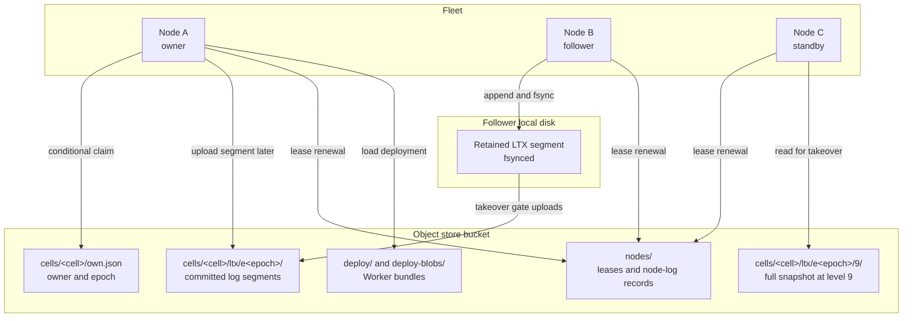
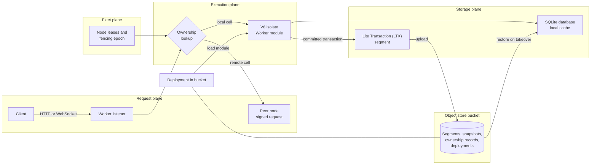

# celld: a Workers platform that runs on your machines

celld is a self-hosted implementation of the Cloudflare Workers platform. A
Worker is an application program that the runtime runs for each request. A
Workers platform is the runtime around that program: the module loader, the
network listeners, the bindings to storage and other services, and the Durable
Objects. A Durable Object is a named object with one owner at a time, private
SQLite storage, and a handler that runs one event at a time. In celld, a fleet
of nodes runs Worker modules and Durable Objects. The nodes share one object
store bucket. The bucket holds every durable byte. This exploration covers the
whole system: the runtime, the Durable Objects, every service, the ownership
rules, the security model, the limits, and two comparisons with the Resonate
server that stores its state in an Amazon Simple Storage Service (S3) bucket.

Source: repository `git@github.com:denoland/celld.git`, checkout
`/Users/darkvoid/GitSources/src.s3/celld`, commit
`8702f6d186c77698dbfb30cf29e3b1922a88f008`, version 0.6.3. Citations in this
exploration are relative to the checkout root. See `README.md:16-35` and
`docs/guarantees.md:1-7`.

## The one-page thesis

A celld node is a process that embeds the V8 JavaScript engine. The node owns a
set of cells. A cell is one Durable Object instance. A cell has its own SQLite
database, one owner node at a time, and one fencing epoch. A facet is a child
database that shares the root cell's owner record and its epoch.

A node acknowledges a write only after it holds a durability proof. celld has
two proofs, and the operator selects one with `CELLD_DURABILITY`.

In a **fleet proof**, the owner sends each committed Lite Transaction (LTX)
segment to as many as two other nodes. These nodes are the followers. A fleet
proof needs at least one follower. When the owner has one follower, it keeps
acknowledging and recruits a second follower when one becomes available. Each
recruited follower writes the segment to its own local disk and calls fsync.
Only then does the owner acknowledge the write. The owner uploads the segments
to the bucket later, in the background. If the owner dies before that upload,
the takeover gate uploads the followers' retained copies before the new owner
restores the cell.

In a **bucket proof**, the owner uploads the segment to the bucket and then
reads the ownership record once. The upload is the durability point. The read
does not prove durability. It shows that no other node has taken the cell, so a
paused node cannot acknowledge a write after a network partition.

A node's local disk is never the permanent record. The local SQLite file is a
cache that a restore can rebuild. A follower holds a segment only until the
owner uploads it. The bucket is the source of truth for every acknowledged
write.

A node uses the fleet proof only when at least one other live node can act as
a follower. A single-node fleet, or a node whose peers are all unavailable,
asks the fleet posture for permission and does not get it. Such a node uses
the bucket proof. A change in fleet size does not change a write that is
already acknowledged: the proof that covered it remains valid.

Ownership is a record in the bucket, not a message between nodes. A node claims
a cell by a conditional write to `cells/<cell>/own.json`. The record holds the
owner name and a fencing epoch. The epoch is a counter: a new claim takes the
highest epoch it read and adds one. The store applies one conditional write and
rejects the other claimant, so only one epoch wins. Every log segment lives
under `cells/<cell>/ltx/e<epoch>/`. A node log is the set of segments that a
node has acknowledged but not yet uploaded. It lives in the node's lease
record and under `log/<node>/`.

A node proves that it is alive with a lease at `nodes/<node>.json`. The lease
expires after `CELLD_TTL_MS`, and the default is 10,000 milliseconds. A peer
takes over a cell only after the lease of its owner expires. An acknowledged
write is not lost in that takeover. A request that has no acknowledgement can
fail or be retried.

A handoff snapshot sits at level 9, the compaction level for complete database
snapshots. Level 0 holds the new segments and the epoch-base snapshot. These
level numbers are a Litestream convention.

A restore reads the chain of epochs that ends at the current epoch. It walks
back through the epochs whose snapshots and segments link together, and it
ignores a prefix from an epoch outside that chain. A node that loses its lease
can continue to append under its old prefix, but no restore reads that prefix,
so the database is not corrupted. The node must still stop acknowledging
clients. It watches the expiry that it published. When that expiry passes, it
fences itself and exits. A stale writer is therefore harmless to the database,
but not harmless to a client. The prefix fence and the self-fence together
make the acknowledgement safe.

**Aha:** The ownership record is the lock, and the epoch is the lock's version.
The log prefix repeats the epoch. A restore follows one epoch chain and ignores
every prefix outside it. The conditional write selects the owner; the prefix
then makes a loser harmless.

## What this exploration covers

The documents fall into five groups.

### Foundation

| Document | What it explains |
|----------|------------------|
| [Overview](00-overview.md) | The node, the fleet, the cell, the deployment, and the two promises (one owner and durable acknowledgement) |
| [Repository map](01-repository-map.md) | Every crate, module, package, example, and document |
| [System architecture](02-system-architecture.md) | Listeners, routing, deployment, and the control plane (the operator API at `/state` and `/evict`) |

### Deep dives

| Document | What it explains |
|----------|------------------|
| [The Worker runtime](03-the-worker-runtime.md) | V8 isolates, bundles, events, bindings, gates, and limits |
| [Durable Objects](04-durable-objects.md) | Identity, lifecycle, storage Application Programming Interface (API), alarms, WebSockets, and facets (child databases that share the root cell's owner and epoch) |
| [Cell storage and durability](05-cell-storage-and-durability.md) | SQLite, the Lite Transaction (LTX) log, epochs, the two durability proofs, restore, and garbage collection |
| [Ownership, failure, and rebalancing](06-ownership-failure-and-rebalancing.md) | Leases, fencing, takeover, self-fencing (a node stops acknowledging when its lease expires), load pressure, and rebalancing |
| [The services](07-the-services.md) | Key-Value (KV), Queues, D1 (Cloudflare SQL databases), R2 (Cloudflare object storage), Workflows (durable multi-step programs), Cron Triggers, static assets, containers, and sandboxes |

### Operations and assessment

| Document | What it explains |
|----------|------------------|
| [Deployment and operations](08-deployment-and-operations.md) | The Wrangler subset, deploy, the command line interface, telemetry, and tests |
| [Security and tenancy](09-security-and-tenancy.md) | The fleet trust model, peer authentication, the operator API, and isolation |
| [Limitations and compatibility](10-limitations-and-compatibility.md) | Cloudflare gaps, hard limits, and operational risks |

### Comparisons

| Document | What it explains |
|----------|------------------|
| [Resonate S3 and celld](11-resonate-s3-and-celld.md) | Two models for durable state in a bucket, point by point |
| [Work placement and sharding](12-work-placement-and-sharding.md) | How Resonate distributes tasks and how celld places cells |

### Reference

| Document | What it explains |
|----------|------------------|
| [Glossary](13-glossary.md) | Every term in this exploration, spelled out |

## The system in one diagram

The diagram shows the four planes. The request plane accepts Hypertext Transfer
Protocol (HTTP) and WebSocket traffic. The execution plane runs JavaScript in
V8. The storage plane holds the SQLite database and the LTX log. The fleet
plane holds the leases and the ownership records that decide which node owns
each cell. The bucket is the shared source of truth for the storage plane and
the fleet plane.

## Reading order

A new reader should start with the [overview](00-overview.md), then read
[cell storage and durability](05-cell-storage-and-durability.md). A reader who
wants to understand application behaviour should read
[Durable Objects](04-durable-objects.md) and [the services](07-the-services.md).
A reader who wants the Resonate comparison should read
[Resonate S3 and celld](11-resonate-s3-and-celld.md) after the overview and the
storage document.

## How to verify claims

Every document cites source paths relative to the celld repository root, such
as `crates/logic/lib.rs` and `docs/guarantees.md`. Line numbers refer to the
commit above. The celld source is the authority for this exploration. When a
document and the source disagree, the source wins.

## Related explorations

- [Documents, rows, and partitions](../../src.resonate/markdown/21-documents-rows-and-partitions.md)
  explains how the Resonate backends hold the document for one origin. The
  origin is the name that starts a root task.
- [The S3 server in Zig](../../src.resonate/markdown/13-the-s3-server-in-zig.md)
  explains the document that the Resonate Amazon Simple Storage Service (S3)
  server stores.
- [Storage engines](../../src.resonate/markdown/06-storage-engines.md) compares
  the six Resonate backends: SQLite, PostgreSQL, MySQL, ScyllaDB, Blob, and
  Neo4j.
