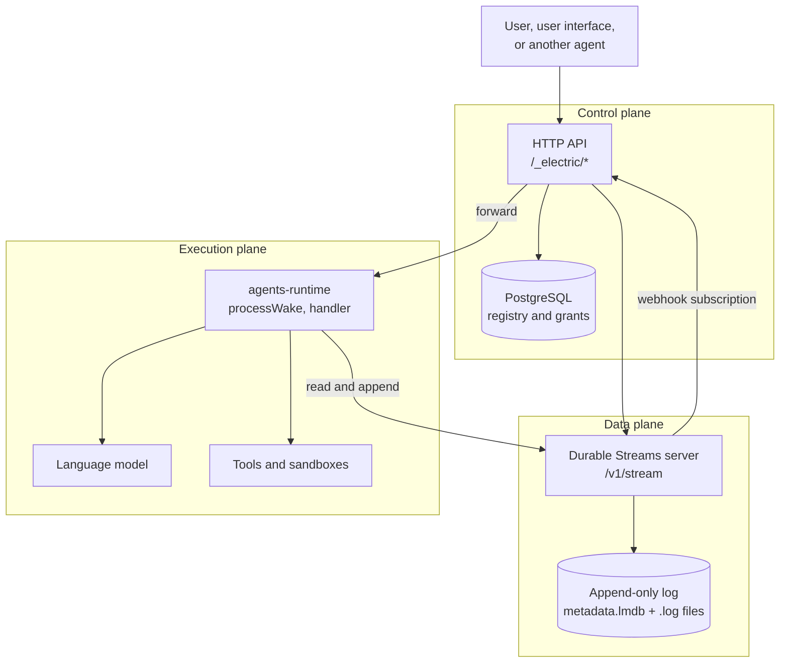
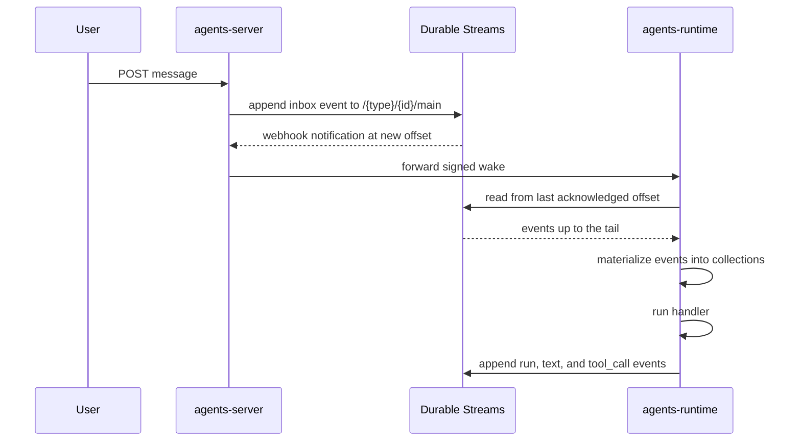

# Overview: two repositories, one durable agent system

Electric Agents is a platform for long-lived artificial-intelligence agents that survive process restarts. The design has one central idea: **an entity is its event stream**. No separate database row holds the agent's memory. The append-only stream holds every event: what the user said, what the model produced, which tool ran, which wake fired, and which errors occurred. A typed projection over that stream gives the handler its working state.

Durable Streams is the family of libraries and servers that make this possible. It turns an ordinary Hypertext Transfer Protocol (HTTP) endpoint into an append-only byte log with resumable offsets, live reads, and delivery subscriptions.

## The problem each part solves

| Problem | Part that solves it | Mechanism |
|---------|--------------------|-----------|
| An agent must remember across restarts | Durable Streams | Append-only log addressed by offset |
| An agent must wake when work arrives | agents-server + Durable Streams | Stream subscription and webhook or pull wake |
| A handler needs typed state | agents-runtime | Materialization into TanStack DB collections |
| Many agents must share one machine | agents-server | Postgres registry, tenancy, sandboxing |
| A user interface needs live updates | Durable Streams | Long-poll and Server-Sent Events reads |
| A tool must act on external systems | agents-mcp + agents | Model Context Protocol bridges and tool adapters |

## The three surfaces

Electric Agents exposes three surfaces. Each surface has a different audience.

**Control plane.** The HTTP application programming interface under `/_electric` manages entity types, entities, permissions, runners, schedules, and webhook sources. PostgreSQL holds the registry. The control plane decides *what exists* and *who may touch it*.

**Data plane.** Durable Streams holds all event bytes. It is the only writer target for entity events. The data plane decides *what happened*.

**Execution plane.** The runtime reads a stream, materializes it, calls the handler, and writes the results. It is stateless between wakes. All durable state lives in the data plane.

## Why the split matters

The split lets the system scale each plane independently. A stream server can run as a separate process, a container, or a hosted service. The runtime can run on a laptop, in a container, or on a remote runner. The registry can be a local PostgreSQL instance or a managed cluster.

The split also makes the wake path observable. Every wake has a stream path, an offset, a subscription identifier, and a delivery attempt. You can debug an agent by reading its stream and its wake records, without attaching a debugger.

## The event model in one table

The runtime defines twenty event types. The five most important types are:

| Event type | Collection | Meaning |
|-----------|------------|---------|
| `entity_created` | `entityCreated` | The entity started, with its type, arguments, and parent |
| `inbox` | `inbox` | A message arrived for the entity |
| `run` | `runs` | One handler execution started, finished, or failed |
| `text` | `texts` | One complete text output from the model |
| `tool_call` | `toolCalls` | One tool invocation, with its arguments and result |

Source: `packages/agents-runtime/src/entity-schema.ts` defines the full set of event types and their collections. `packages/agents-server/src/entity-manager.ts` writes the creation and inbox events.

The path from a user message to a handler call has five steps. The diagram shows the same stream in three roles: the message bus, the state store, and the audit log.

The handler never receives state in the wake message. The wake carries a stream path, an offset, and a wake identifier. The handler rebuilds its state by reading the stream. This is why a restart loses nothing: the state is not in the process that died.

Document [03-the-durable-stream-primitive.md](03-the-durable-stream-primitive.md) explains the storage format. Document [04-how-the-runtime-sets-up-a-stream.md](04-how-the-runtime-sets-up-a-stream.md) explains stream creation. Document [05-wake-dispatch-and-entity-lifecycle.md](05-wake-dispatch-and-entity-lifecycle.md) explains how a new event becomes a handler call.

## Aha: the stream is the database

Most agent frameworks keep conversation history in a database table, then rebuild a prompt from rows. Electric Agents appends the history to a log and projects the log into collections. The projection is deterministic. Two processes that read the same stream at the same offset see the same state.

This design removes three common failure modes:

1. **Lost wake-ups.** A wake is a subscription event backed by a durable offset, not an in-memory callback.
2. **Divergent replicas.** Every reader applies the same event order, so every replica converges.
3. **Untraceable tool use.** A tool call is an event with a key, a timestamp, and arguments. It is not a log line.

The price is that every state change must be an event. A handler cannot mutate a local variable and expect it to persist. It must write an event. Document [agents-runtime/04-entity-stream-db.md](agents-runtime/04-entity-stream-db.md) explains how the runtime enforces this.

## The two storage questions

The user asked two storage questions. The short answers are:

1. **Where does the runtime set up the stream?** In `EntityManager.spawnInner` in the agents-server package. The server creates the PostgreSQL entity row first, then calls `streamClient.create(mainPath, { contentType: 'application/json', body: initialBody })`. The path is `/{entityType}/{instanceId}/main`.
2. **Where is the stream stored?** By default, in a `DurableStreamTestServer` embedded in the agents-server process. The file-backed store keeps metadata in `metadata.lmdb` and event bytes in append-only `.log` files under `.streams-data` in the current working directory. Docker deployments use `/var/lib/electric-agents/streams`. A deployment can replace the embedded server with an external Durable Streams service.

The full answer, with code and diagrams, is in [04-how-the-runtime-sets-up-a-stream.md](04-how-the-runtime-sets-up-a-stream.md).

## Next

Read [01-repository-map.md](01-repository-map.md) to see every package and its role.
