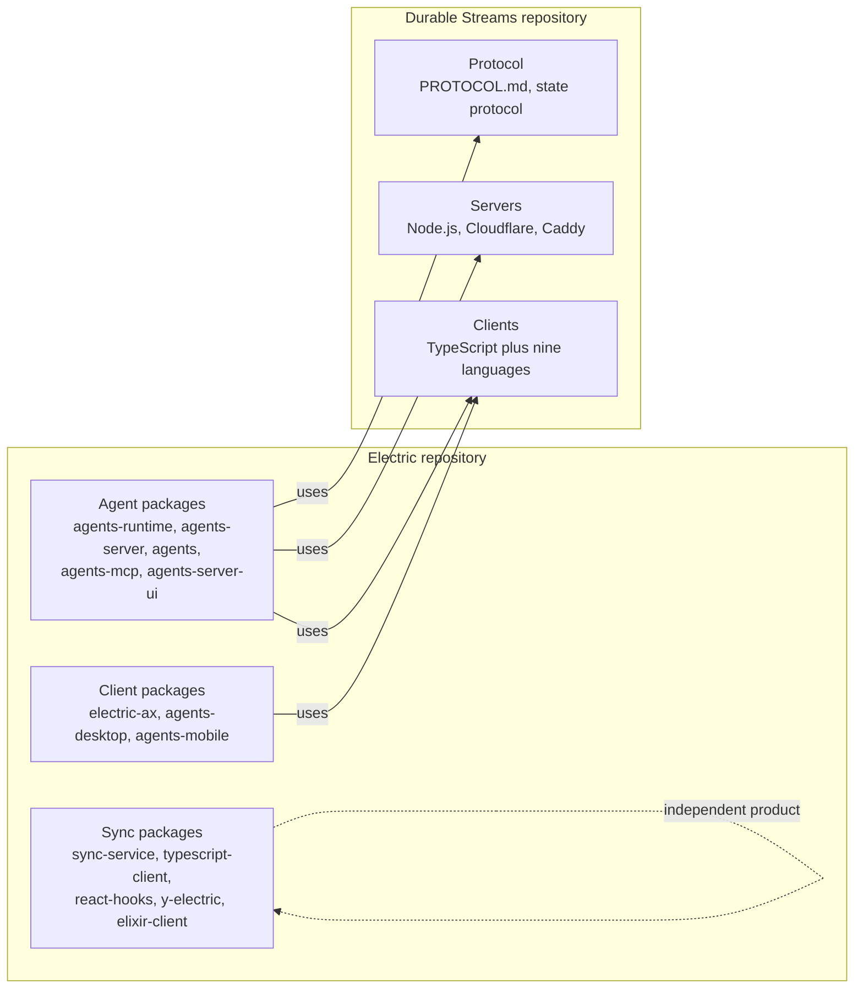
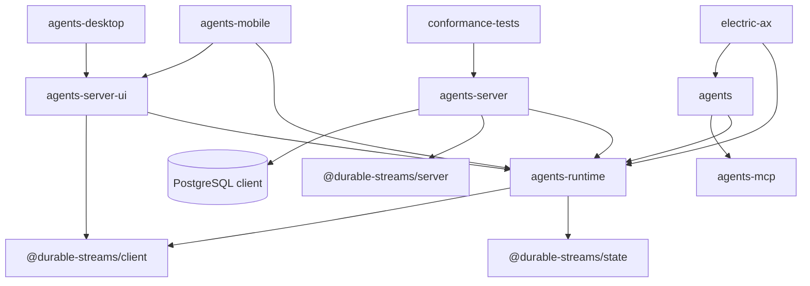

# Repository map: every package and what it does

The Electric repository is a pnpm workspace monorepo. It holds eighteen packages. The Durable Streams repository is a second pnpm workspace. Its `packages/` directory has twenty-two subdirectories. Fifteen hold a `package.json` and are workspace packages. The other seven are language-client projects without one. This document maps every package in both repositories.

## Top-level layout of the Electric repository

```
electric/
├── packages/                18 workspace packages
├── examples/                Example applications
├── integration-tests/       Cross-package integration tests
├── website/                 Documentation website and HTTP API definition
├── docs/                    Internal design notes
├── plans/                   Planning documents
├── scripts/                 Repository scripts
├── .support/                Docker Compose support files
├── AGENTS.md                Repository guide for coding agents
├── COMPOSER_INPUT_PLAN.md   Design plan for composer input
└── pnpm-workspace.yaml      Workspace definition
```

## Electric package inventory

The table orders packages by role, not alphabetically. The source-file count shows the relative size of each package. The count includes every TypeScript, TSX, and Elixir source file in the package, including test files. It excludes generated Durable Streams clients, which the table lists separately.

### Agent platform packages

| Package | Version | Access | Source files | Purpose |
|---------|---------|--------|--------------|---------|
| `@electric-ax/agents-runtime` | 0.6.3 | public | 178 | Behavioral stack for agent entities over durable streams |
| `@electric-ax/agents-server` | 0.6.4 | public | 120 | Entity runtime server; registry, routes, wakes, scheduler |
| `@electric-ax/agents` | 0.6.3 | public | 40 | Built-in runtimes such as Horton and worker |
| `@electric-ax/agents-mcp` | 0.6.0 | public | 44 | Model Context Protocol registry, transports, Open Authorization (OAuth) bridges |
| `@electric-ax/agents-server-ui` | 0.6.4 | private | 200 | Browser single-page application for the server |
| `@electric-ax/agents-desktop` | 0.6.1 | private | 54 | Electron desktop application |
| `@electric-ax/agents-mobile` | 0.6.5 | private | 80 | Mobile application |
| `@electric-ax/agents-server-conformance-tests` | 0.6.0 | public | 7 | Conformance suite for server implementations |
| `electric-ax` | 0.2.23 | public | 26 | Command-line interface for Electric Agents |
| `@electric-ax/durable-streams-server-rust` | 0.1.5 | private | 2 | Native Rust Durable Streams server distributed through npm |

### Electric Sync packages

| Package | Version | Access | Source files | Purpose |
|---------|---------|--------|--------------|---------|
| `@core/sync-service` | 1.8.2 | private | 328 | Elixir Postgres sync engine that serves Shapes |
| `@electric-sql/client` | 1.5.28 | public | 54 | TypeScript client for Shape streams |
| `@electric-sql/react` | 1.0.57 | public | 10 | React hooks, including `useShape` |
| `@electric-sql/y-electric` | 0.1.54 | public | 9 | Yjs network provider for Electric |
| `@core/elixir-client` | 0.10.3 | private | 59 | Elixir client for Electric |
| `@core/electric-telemetry` | 0.4.0 | private | 23 | Shared telemetry library |
| `@electric-sql/start` | 1.0.3 | public | 13 | Quickstart command-line interface |
| `@electric-sql/experimental` | 6.0.28 | public | 13 | Experimental TypeScript features |

## Durable Streams package inventory

The Durable Streams repository has a different shape. It contains one protocol document, one Node.js server, one TypeScript client, one state layer, several transport adapters, and many language clients.

```
durable-streams/
├── PROTOCOL.md              The complete protocol specification
├── CLIENT_MATURITY.md       Support level for each language client
├── IMPLEMENTATION_TESTING.md  Testing guidance for implementations
├── packages/                22 directories, 15 workspace packages
├── examples/                Example applications
├── docs/                    Protocol and implementation notes
└── scripts/                 Release and test scripts
```

| Package | Role | Source files |
|---------|------|--------------|
| `server` | Node.js Durable Streams server with in-memory and file-backed stores | 20 |
| `client` | TypeScript client for the protocol | 35 |
| `state` | State protocol over streams; collections and transactions | 11 |
| `proxy` | Hypertext Transfer Protocol (HTTP) proxy for stream backends | 38 |
| `server-cloudflare` | Cloudflare Workers server implementation | 18 |
| `server-conformance-tests` | Server conformance suite | 4 |
| `client-conformance-tests` | Client conformance suite | 9 |
| `cli` | Command-line tool for streams | 11 |
| `client-rust` | Rust client | 8 |
| `client-go` | Go client | generated, counted separately |
| `client-py` | Python client | generated, counted separately |
| `client-java` | Java client | generated, counted separately |
| `client-php` | PHP client | generated, counted separately |
| `client-rb` | Ruby client | generated, counted separately |
| `client-swift` | Swift client | generated, counted separately |
| `client-dotnet` | .NET client | generated, counted separately |
| `client-elixir` | Elixir client | generated, counted separately |
| `y-durable-streams` | Yjs binding over streams | 9 |
| `tanstack-ai-transport` | Transport adapter for TanStack AI | 7 |
| `aisdk-transport` | Transport adapter for the AI Software Development Kit (AI SDK) | 6 |
| `benchmarks` | Performance benchmarks | 2 |
| `caddy-plugin` | Caddy web server plugin | 26 (25 Go, 1 TypeScript) |

The two repositories divide by change rate. The Electric repository changes when the agent product changes. The Durable Streams repository changes when the storage protocol changes. Most Electric packages depend on Durable Streams. No Durable Streams package depends on Electric.



The dotted edge marks Electric Sync as a separate product. It shares the repository and the brand, but it does not use Durable Streams. A reader who studies Electric Sync should not expect the agent concepts to apply.

## Dependency direction

The dependency graph is acyclic. The arrows below mean "depends on".



Three facts follow from this graph:

1. `agents-runtime` is the bottom of the agent stack. It depends on Durable Streams, not on the server.
2. `agents-server` depends on both the runtime and the Durable Streams server. It can embed the server.
3. The user interfaces depend on the runtime and the stream client, not on the server's internal modules.

## What "package" means in this exploration

Each package gets a directory under `markdown/`. Each directory contains:

- A `README.md` index.
- One document per major subsystem.
- Source paths and code snippets for every claim.

The three priority packages have the deepest coverage. They are `agents-runtime`, `agents-server`, and `durable-streams`.

## Aha: the runtime has no server dependency

`@electric-ax/agents-runtime` does not import `agents-server`. It talks to the control plane through HTTP only. The file `src/runtime-server-client.ts` defines `createRuntimeServerClient`, which wraps `fetch` calls to `/_electric/entities`, `/_electric/wake`, `/_electric/wake/unregister`, `/_electric/shared-state`, `/_electric/observations`, `/_electric/pg-sync/register`, and `/_electric/webhook-sources`.

This separation means a runtime can run anywhere that can reach the server:

- Inside the server process.
- In a separate container.
- On a remote runner behind a pull-wake subscription.

The server never calls runtime code directly except through the webhook endpoint. The webhook is the only contract.

## Source references

| Claim | Source |
|-------|--------|
| Package names and versions | `packages/*/package.json` |
| Root workspace | `pnpm-workspace.yaml` |
| Runtime has no server import | `packages/agents-runtime/package.json` dependencies |
| Server embeds the stream server | `packages/agents-server/src/server.ts` |

## Next

Read [02-system-architecture.md](02-system-architecture.md) for the full request path. Read [00-overview.md](00-overview.md) for the one-sentence architecture, and [README.md](README.md) for the reading order.
