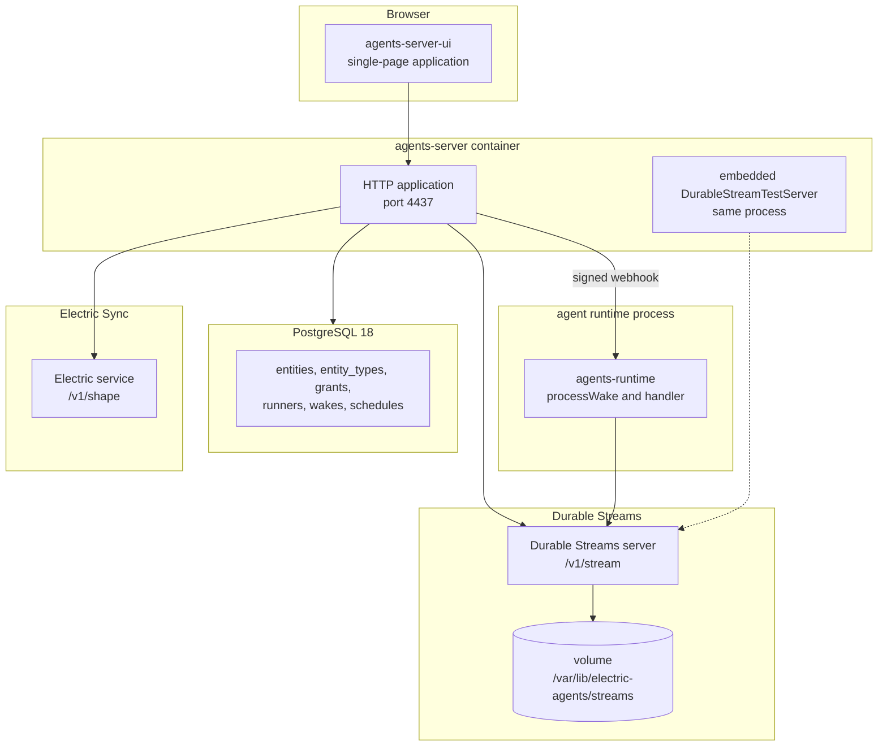
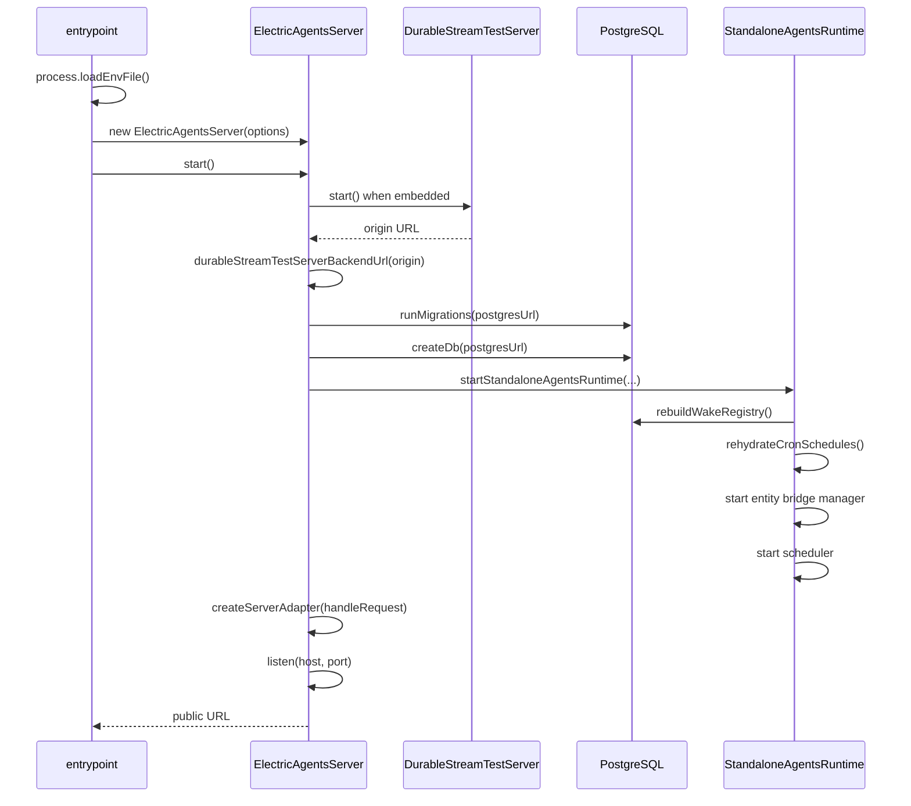
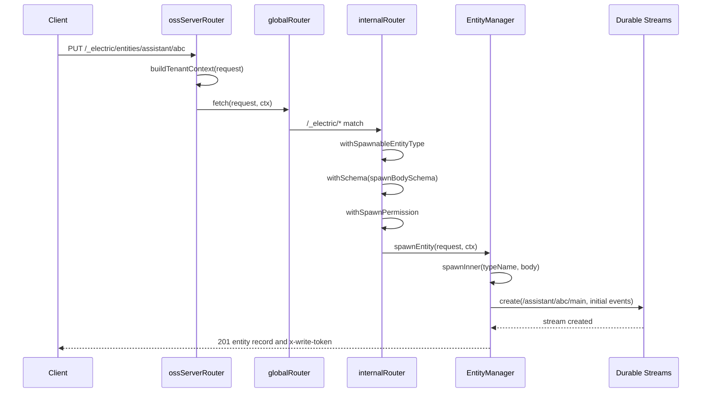
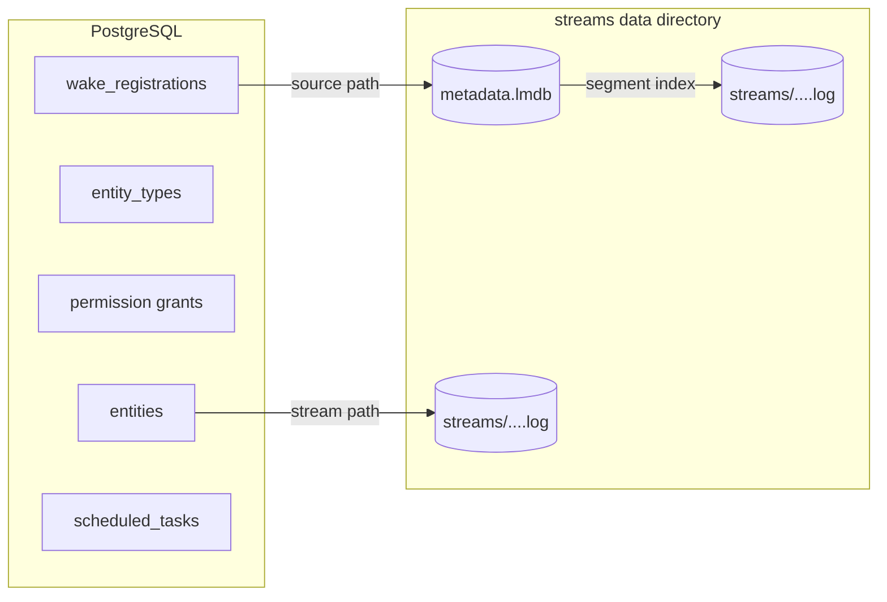

# System architecture: control plane, data plane, execution plane

Electric Agents has three planes. The **control plane** is a PostgreSQL-backed Hypertext Transfer Protocol (HTTP) server. The **data plane** is a Durable Streams service. The **execution plane** is one or more agent runtimes. The planes communicate through HTTP and through signed webhooks. The default deployment co-locates the control plane and the stream server in one process, but no plane shares application state with another.

This document shows the full process topology, the boot order, the request path, the stream namespace, and the configuration surface.

## Process topology

A deployment needs at least two processes: PostgreSQL and the `electric-agents` server, which can embed the stream server. The Docker Compose file `docker-compose.full.yml` defines three services: `postgres`, `electric`, and `electric-agents`. The `electric` service is optional. It supplies the Electric Sync service that the wake registry uses to follow its registrations. A deployment that sets `ELECTRIC_AGENTS_DURABLE_STREAMS_URL` adds the external stream server as another process. The embedded stream server shares the `electric-agents` process.



The entrypoint starts no handler. The agents-server forwards each subscription webhook to the runtime's registered Uniform Resource Locator (URL), and the agents-runtime package processes it. The one handler that can share the server process is the mock handler. `createMockAgentBootstrap` registers a `chat` type and serves it at `/_electric/mock-agent-handler` when a caller supplies `mockStreamFn` programmatically (`packages/agents-server/src/server.ts:107-136, 262-270`).

The embedded stream server is optional. When `ELECTRIC_AGENTS_DURABLE_STREAMS_URL` is set, the server does not start an embedded one. When the variable is absent, the server starts `DurableStreamTestServer` inside the same Node.js process and uses it as the backend.

## Boot sequence

The entrypoint does six things in order. The order matters. The runtime needs the database before it can rebuild the wake registry. It also needs the stream server before it can serve any stream request.



### Step 1: environment load

`main()` calls `process.loadEnvFile()` and ignores the error when no `.env` file exists. Source: `packages/agents-server/src/entrypoint-lib.ts`.

### Step 2: option resolution

`resolveElectricAgentsEntrypointOptions(env, cwd)` reads the environment variables in the table below, including the listed aliases. It validates each URL and each port number. It returns a typed options object.

| Setting | Environment variable | Default |
|---------|---------------------|---------|
| Service identifier | `ELECTRIC_AGENTS_SERVICE` or `SERVICE` | None; falls back to the tenant identifier, then `default` |
| Tenant identifier | `ELECTRIC_AGENTS_TENANT_ID` or `TENANT_ID` | Used only when the service identifier is unset; both unset gives `default` |
| Public base URL | `ELECTRIC_AGENTS_BASE_URL` or `BASE_URL` | derived from the listen address |
| Postgres URL | `ELECTRIC_AGENTS_DATABASE_URL` or `DATABASE_URL` | required |
| Durable Streams URL | `ELECTRIC_AGENTS_DURABLE_STREAMS_URL`, `DURABLE_STREAMS_URL`, `STREAMS_URL` | none; embedded server starts |
| Durable Streams bearer | `ELECTRIC_AGENTS_DURABLE_STREAMS_BEARER` or `DURABLE_STREAMS_BEARER` | none |
| Streams data directory | `ELECTRIC_AGENTS_STREAMS_DATA_DIR` or `STREAMS_DATA_DIR` | `${cwd}/.streams-data` |
| Streams host | `ELECTRIC_AGENTS_STREAMS_HOST` or `STREAMS_HOST` | `127.0.0.1` |
| Streams port | `ELECTRIC_AGENTS_STREAMS_PORT` or `STREAMS_PORT` | `0` (operating system chooses) |
| Electric URL | `ELECTRIC_AGENTS_ELECTRIC_URL` or `ELECTRIC_URL` | none |
| Electric secret | `ELECTRIC_AGENTS_ELECTRIC_SECRET` | none |
| Webhook signing key | `ELECTRIC_AGENTS_WEBHOOK_SIGNING_PRIVATE_KEY` or `WEBHOOK_SIGNING_PRIVATE_KEY` | generated at start |
| HTTP host | `ELECTRIC_AGENTS_HOST` or `HOST` | `0.0.0.0` |
| HTTP port | `ELECTRIC_AGENTS_PORT` or `PORT` | `4437` |
| Working directory | `ELECTRIC_AGENTS_WORKING_DIRECTORY` or `WORKING_DIRECTORY` | process working directory |
| Dispatch recovery interval | `ELECTRIC_AGENTS_DISPATCH_RECOVERY_INTERVAL_MS` | Disabled; parsed, but no open-source code consumes it |
| Stale wake age | `ELECTRIC_AGENTS_STALE_OUTSTANDING_WAKE_AFTER_MS` | Defaults to the recovery interval; parsed, but no open-source code consumes it |

Source: `packages/agents-server/src/entrypoint-lib.ts:115-179`.

The effective tenant identifier is `service ?? tenantId ?? 'default'` (`packages/agents-server/src/standalone-runtime.ts:64`, `packages/agents-server/src/tenant.ts:1`). The service identifier therefore wins over the tenant identifier.

Electric Sync is optional. When `ELECTRIC_AGENTS_ELECTRIC_URL` is set, `rebuildWakeRegistry` calls `WakeRegistry.startSync`, which follows the `wake_registrations` table through a Shape stream. When it is absent, `rebuildWakeRegistry` calls `loadRegistrations` once (`packages/agents-server/src/entity-manager.ts:428-438`). A single server still receives registrations through in-process `register()` calls. The Shape stream keeps several server instances consistent. The Docker Compose file runs an `electric` service and sets the URL.

### Step 3: embedded stream server

`createEmbeddedStreamsServer` returns `undefined` when an external URL is set. Otherwise it constructs a `DurableStreamTestServer` with three settings:

```ts
return new DurableStreamTestServer({
  host: readEnv(env, [`ELECTRIC_AGENTS_STREAMS_HOST`, `STREAMS_HOST`]) ?? DEFAULT_STREAMS_HOST,
  port: readOptionalPort(env, [`ELECTRIC_AGENTS_STREAMS_PORT`, `STREAMS_PORT`], `embedded streams port`) ?? 0,
  dataDir,
  webhooks: true,
})
```

Source: `packages/agents-server/src/entrypoint-lib.ts:181-211`.

The `webhooks: true` flag is important. Without it, the stream server would not deliver subscription webhooks. The wake model depends on that delivery.

The function `durableStreamTestServerBackendUrl` appends `/v1/stream` to the origin that the embedded server returns (`packages/agents-server/src/server.ts:141-149`). A user-supplied `durableStreamsUrl` is already a backend prefix, so the server uses it unchanged. Stream paths do not include the prefix. `StreamClient` joins the base URL and the stream path.

### Step 4: migrations and database handle

`runMigrations(postgresUrl)` applies migrations `0000` through `0016`. `createDb(postgresUrl)` opens a Drizzle database handle and a raw PostgreSQL client. Source: `packages/agents-server/src/server.ts:234-236`.

### Step 5: standalone runtime

`startStandaloneAgentsRuntime` constructs six long-lived components directly:

| Component | Responsibility |
|-----------|----------------|
| `StreamClient` | HTTP client for the Durable Streams server |
| `PostgresRegistry` | Entity, type, permission, and runner records |
| `WakeRegistry` | In-memory wake conditions, synchronized from PostgreSQL |
| `Scheduler` | Delayed sends and cron ticks |
| `EntityBridgeManager` | Bridges between entity streams and external sources |
| `TagStreamOutboxDrainer` | Drains queued tag events to the stream server |

The function then constructs an `ElectricAgentsTenantRuntime`. That object creates the `EntityManager` for entity lifecycle operations and the `PgSyncBridgeManager` that replicates entity events to PostgreSQL (`packages/agents-server/src/runtime.ts:88, 105`).

It then runs `rebuildWakeRegistry`, `rehydrateCronSchedules`, and starts the bridge managers, the tag-stream drainer, and the scheduler. Source: construction at `packages/agents-server/src/standalone-runtime.ts:65-118`; start sequence at `:150-181`.

The `runtime` field of this result is an `ElectricAgentsTenantRuntime`, not the `agents-runtime` package. It performs control-plane work: wake dispatch, scheduler execution, bridge management, and per-wake token minting. The `agents-runtime` package materializes entity streams and runs handlers. It reaches the server over HTTP and never imports the server.

### Step 6: HTTP listen

The server builds a Web Hypertext Application Technology Working Group (WHATWG) `Request`/`Response` adapter with `createServerAdapter`. The Node.js `http.Server` wraps the adapter. The server listens on the configured host and port. Source: `packages/agents-server/src/server.ts:253-260`.

## Request path

A request passes through five stages.



### Stage 1: tenant context

`handleRequest` calls `buildTenantContext(request)`. This function resolves the calling principal. It calls the optional `authenticateRequest` hook first. If that returns nothing, it reads the `electric-principal` header. If no principal is found and the development fallback is allowed, it uses `system:dev-local`.

The fallback is allowed when any of three conditions is true:

- `ELECTRIC_INSECURE === 'true'`.
- `NODE_ENV !== 'production'`.
- The server owns an embedded Durable Streams server.

An explicit `allowDevPrincipalFallback` option overrides these conditions. Source: `packages/agents-server/src/server.ts:380-389`.

### Stage 2: top-level routing

The `ossServerRouter` handles four cases in order:

1. `/` redirects to `/__agent_ui/`.
2. `/__agent_ui/*` serves the user interface.
3. `/_electric/mock-agent-handler` serves the mock agent webhook. Its handler uses the built-in `MOCK_CHAT_MODEL`, so a developer can test an entity without a model provider.
4. Everything else goes to `globalRouter`.

Source: `packages/agents-server/src/routing/oss-server-router.ts:37-41`.

### Stage 3: global routing

`globalRouter` routes by prefix:

| Prefix | Handler | Purpose |
|--------|---------|---------|
| `/_electric/shared-state/*` | `durableStreamsRouter` | Shared state streams |
| `/_electric/pg-sync/register` | `internalRouter` | Register a PostgreSQL sync bridge |
| `/_electric/pg-sync/*` | `durableStreamsRouter` for GET and HEAD; `internalRouter` (`pgSyncRouter`) for other methods | Read via the stream backend; write through the PostgreSQL sync router |
| `/_electric/*` | `internalRouter` | All control-plane routes |
| `*` | `durableStreamsRouter` | Direct stream paths |

Source: `packages/agents-server/src/routing/global-router.ts:31-36`.

The last rule is the key to the data plane. A request to `/assistant/abc/main` is not a control-plane request. It is a stream request. `durableStreamsRouter` forwards it to the Durable Streams backend.

### Stage 4: internal routing

`internalRouter` has base path `/_electric`. It handles health, wake registration, subscription webhooks, wake callbacks, runners, entities, entity types, PostgreSQL sync, observations, and the Electric proxy. The observations routes under `/_electric/observations` create the backing streams for entity membership and cron schedules. The Electric proxy forwards Shape reads under `/_electric/electric/*` to the configured Electric Sync service.

```ts
internalRouter.get(`/health`, () => json({ status: `ok` }))
internalRouter.post(`/wake`, withSchema(wakeRegistrationBodySchema), registerWake)
internalRouter.post(`/wake/unregister`, withSchema(wakeUnregisterBodySchema), unregisterWake)
internalRouter.post(`/subscription-webhooks/:subscriptionId`, subscriptionWebhook)
internalRouter.post(`/wake-callbacks/:consumerId`, wakeCallback)
internalRouter.all(`/runners`, runnersRouter.fetch)
internalRouter.all(`/entities/*`, entitiesRouter.fetch)
internalRouter.all(`/entity-types/*`, entityTypesRouter.fetch)
```

Source: `packages/agents-server/src/routing/internal-router.ts:130-154`.

### Stage 5: entity operations

`entitiesRouter` has base path `/_electric/entities`. It exposes twenty-four routes. The most important routes are:

| Method and path | Operation |
|-----------------|-----------|
| `GET /` | List entities |
| `PUT /:type/:instanceId` | Spawn an entity |
| `GET /:type/:instanceId` | Get an entity |
| `HEAD /:type/:instanceId` | Check entity existence |
| `DELETE /:type/:instanceId` | Kill an entity |
| `POST /:type/:instanceId/signal` | Send a signal |
| `POST /:type/:instanceId/send` | Send a message |
| `POST /:type/:instanceId/collections/:collection` | Write to a collection |
| `POST /:type/:instanceId/fork` | Fork the entity subtree |
| `PUT /:type/:instanceId/schedules/:scheduleId` | Upsert a schedule |
| `POST /:type/:instanceId/grants` | Grant a permission |

Source: `packages/agents-server/src/routing/entities-router.ts:385-533`.

## Stream namespace

Every stream has a path. The path determines its purpose.

| Path pattern | Owner | Purpose |
|--------------|-------|---------|
| `/{entityType}/{instanceId}/main` | One entity | The entity event log |
| `/principal/{encodedPrincipalKey}/main` | One principal | The main stream of the principal entity |
| `/_electric/shared-state/{sharedStateId}` | Several entities | Shared state between entities |
| `/_cron/{base64url spec}` | Scheduler | Cron tick stream |
| `/_entities/{sourceRef}` | Entity projector | Membership and tag projection |
| `/{entityType}/{instanceId}/attachments/{attachmentId}` | One entity | Attachment bytes |
| `/runners/{runnerId}/wake` | One runner | Pull-wake delivery stream |

Source: `packages/agents-runtime/src/runtime-server-client.ts`, `packages/agents-runtime/src/cron-utils.ts`, `packages/agents-runtime/src/tags.ts`.

## Storage in one view

The data plane stores three kinds of bytes:

1. **Stream metadata.** Content type, current offset, producer state, reference count, fork parent, closure state. Stored in Lightning Memory-Mapped Database (LMDB) at `metadata.lmdb`.
2. **Stream event bytes.** Append-only segments. Stored as `.log` files under the data directory.
3. **Control-plane records.** Entities, types, permissions, wakes, schedules. Stored in PostgreSQL.



The full storage analysis is in [04-how-the-runtime-sets-up-a-stream.md](04-how-the-runtime-sets-up-a-stream.md) and [durable-streams/05-storage-and-durability.md](durable-streams/05-storage-and-durability.md).

## Aha: the server is also a stream proxy

The same HTTP port serves the control plane and the data plane. A request to `/_electric/entities/...` goes to the control plane. A request to `/assistant/abc/main` goes to the stream backend. The router chooses by prefix.

This design lets a browser read an entity stream without knowing the stream server address. The browser talks only to the agents-server. The server replaces the `Authorization` header with the configured `durableStreamsBearer` value, which comes from `ELECTRIC_AGENTS_DURABLE_STREAMS_BEARER` (`packages/agents-server/src/routing/durable-streams-router.ts:136, 157-158`). Source: `packages/agents-server/src/routing/durable-streams-router.ts`.

## Aha: the embedded server makes development instant

The default configuration needs one command and one PostgreSQL database. The server starts its own stream server on an operating-system-chosen port. It stores data in `.streams-data` relative to the working directory. Electric Sync is optional, and the entrypoint needs no model provider. No container, no external stream service, and no network configuration are necessary. An agent still needs a separate runtime process. The saving is that the control plane and the stream server need no external service.

The tradeoff is that the embedded server is called a *test server*. It is not designed for multi-node production. Production deployments set `ELECTRIC_AGENTS_DURABLE_STREAMS_URL` and use a dedicated stream service.

## Related documents

- [03-the-durable-stream-primitive.md](03-the-durable-stream-primitive.md) — the stream model.
- [04-how-the-runtime-sets-up-a-stream.md](04-how-the-runtime-sets-up-a-stream.md) — stream creation.
- [05-wake-dispatch-and-entity-lifecycle.md](05-wake-dispatch-and-entity-lifecycle.md) — wake delivery.
- [agents-server/01-boot-and-configuration.md](agents-server/01-boot-and-configuration.md) — server detail.
