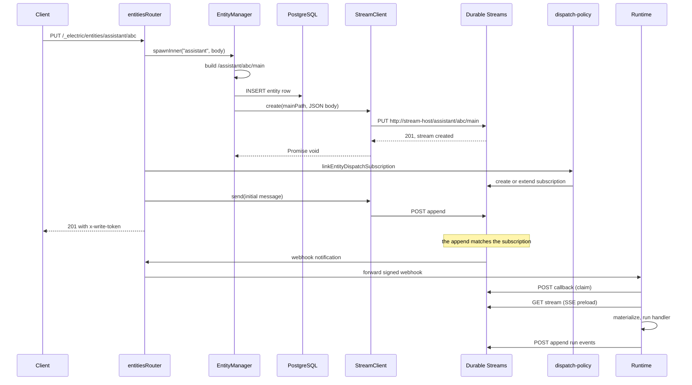
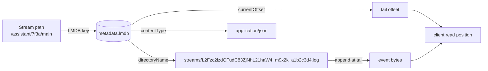

# How the runtime sets up a durable stream

An entity stream is created once and opened many times. The **creation** happens in the agents-server during spawn. The **opening** happens in the agents-runtime during each wake. This document follows both moments in code and then states exactly where the bytes live.

## Terms used in this document

These terms have one exact meaning here.

| Term | Meaning |
|------|---------|
| Entity | One agent instance. It has a type, an address, and one append-only event stream. |
| Spawn | The act of creating an entity. The agents-server writes the entity row and creates the stream. |
| Wake | One unit of work. A wake happens when a subscription reports new bytes, a runner claims a pull-wake record, a timer fires (a delayed send or a cron tick), or a condition registration matches an event. |
| Stream | One persistent, append-only sequence of bytes at one path. The stream is the event log of the entity. |
| Tail | The current end of the stream. A reader at the tail has read every message that exists now. |
| Runtime | The agents-runtime package. It reads the stream, runs the handler, and writes events back. |
| Server | The agents-server package. It owns the control records and the HTTP interface. |
| Subscription | A Durable Streams object that tells the stream server which streams to watch and where to send a notification. |
| Principal | The authenticated identity that makes a request. |
| Runner | A remote process that executes agent work and receives pull wakes. |
| SSE | Server-Sent Events. A one-way Hypertext Transfer Protocol stream from the server to the client. |
| LMDB | Lightning Memory-Mapped Database. An embedded key-value store. |
| TTL | Time To Live. The period after which a stream may expire. |
| MIME | Multipurpose Internet Mail Extensions. The media type, such as `application/json`. |
| JSON | JavaScript Object Notation. |
| UUID | Universally Unique Identifier. |
| cwd | Current working directory of the process. |

## The short answer

1. **Creation.** `EntityManager.spawnInner` builds the path `/{entityType}/{instanceId}/main`. It inserts the entity row into PostgreSQL first. It then calls `streamClient.create(mainPath, { contentType: 'application/json', body: initialBody })`. The initial body is a JSON array that holds the `entity_created` event, any static slash commands, and an optional first inbox message. The HTTP route passes no first message, so its body holds only the first two kinds.
2. **Subscription.** After spawn, `linkEntityDispatchSubscription` adds the new stream to a Durable Streams subscription. The subscription is either a webhook target or a pull-wake target.
3. **Opening.** On each wake, `processWake` constructs a `DurableStream` for the same path. It constructs an `IdempotentProducer` with the identifier `entity-${entityUrl}`. It calls `createEntityStreamDB` and then `db.preload()`. Preload opens one SSE connection, reads to the tail, and keeps the connection open.
4. **Storage.** By default, the stream lives in a `DurableStreamTestServer` embedded in the server process. The name says "test", but the agents-server uses this class as its default embedded server for single-process deployments. The class is the only embedded server in the Durable Streams package. When an external server URL is set, the agents-server does not start the embedded server. The file-backed store writes metadata to `metadata.lmdb` and event bytes to `<dataDir>/streams/<directoryName>.log`. The default data directory is `${cwd}/.streams-data`. Docker uses `/var/lib/electric-agents/streams`.

The rest of this document shows the code behind each statement.

## Part 1: creation during spawn

### Step 1: resolve the type and validate

`spawnInner(typeName, req)` first checks three conditions:

- A principal entity can only be created by the system.
- An entity type name cannot start with `_`.
- The type must exist in the registry.

Source: `packages/agents-server/src/entity-manager.ts:636-667`.

Then it validates the spawn arguments against the type's `creation_schema`. A failed check returns `422` with the validation details.

### Step 2: compute the identifiers

```ts
const instanceId = req.instance_id || randomUUID()
if (instanceId.includes(`/`)) {
  throw new ElectricAgentsError(
    ErrCodeInvalidRequest,
    `instance_id must not contain forward slashes`,
    400
  )
}

const writeToken = randomUUID()

const entityURL =
  typeName === `principal`
    ? principalUrl(instanceId)
    : `/${typeName}/${instanceId}`
const mainPath = `${entityURL}/main`

const subscriptionId = `${typeName}-handler`
```

Source: `packages/agents-server/src/entity-manager.ts:687-704`.

Three names come out of this block:

| Name | Example | Purpose |
|------|---------|---------|
| `entityURL` | `/assistant/7f3a...` | Canonical entity address |
| `mainPath` | `/assistant/7f3a.../main` | Stream path for the entity event log |
| `subscriptionId` | `assistant-handler` | Base subscription identifier |

The `writeToken` is a second identifier. It is stored on the entity row as `write_token` and returned in the `x-write-token` response header. `EntityManager` accepts this per-entity token only when no custom validator is installed. The standalone runtime installs a validator that accepts only a per-wake token, minted at the wake claim callback. [06-security-tenancy-and-permissions.md](06-security-tenancy-and-permissions.md) explains the three token kinds.

**Why the slash check matters:** the stream path is built by string concatenation. A slash inside `instanceId` would create a deeper path. The path could collide with another entity or with an internal namespace such as `/_electric`. The check prevents that.

### Step 3: resolve the dispatch policy

The dispatch policy decides where wakes go. The resolution order is:

1. The explicit `dispatch_policy` in the spawn request.
2. The parent entity's policy. If the type default names a `subscription_id` and both targets have the same destination, the type default's `subscription_id` replaces the parent's.
3. The type default policy.

Source: `packages/agents-server/src/entity-manager.ts:729-738`; the replacement rule is `applyTypeDefaultSubscriptionScope` at `packages/agents-server/src/routing/dispatch-policy.ts:89-107`.

The policy has one target. The target is either a webhook URL or a runner identifier.

### Step 4: build the entity row

The entity record holds the stream path, the subscription identifier, the policy, the write token, the tags, the spawn arguments, the sandbox choice, the schemas, and the timestamps.

```ts
const entityData: ElectricAgentsEntity = {
  type: typeName,
  status: `idle`,
  url: entityURL,
  streams: {
    main: mainPath,
  },
  subscription_id: subscriptionId,
  dispatch_policy: dispatchPolicy,
  write_token: writeToken,
  tags: initialTags,
  spawn_args: req.args,
  sandbox,
  type_revision: entityType.revision,
  inbox_schemas: entityType.inbox_schemas,
  state_schemas: entityType.state_schemas,
  created_at: now,
  created_by: req.created_by ?? parentEntity?.created_by,
  updated_at: now,
}
```

Source: `packages/agents-server/src/entity-manager.ts:748-771`.

### Step 5: build the initial events

The first event is always `entity_created`.

```ts
const createdEvent = entityStateSchema.entityCreated.insert({
  key: `entity-created`,
  value: {
    entity_type: typeName,
    timestamp: new Date().toISOString(),
    args: req.args ?? {},
    ...(req.parent ? { parent_url: req.parent } : {}),
  },
} as any)
```

Source: `packages/agents-server/src/entity-manager.ts:788-800`.

Next, the code appends one `slash_command` event for each command declared by the entity type. The source is `static`.

Then, if `req.initialMessage` is present, the code appends one `inbox` event. The key has the form `msg-in-${Date.now()}-${randomSuffix}`. This key format is the same one the live send path uses.

### Step 6: wrap the body for JSON mode

```ts
// JSON-mode streams: server flattens one level. Append auto-wraps the
// body in [...] but create does not, so we wrap it ourselves.
const initialBody = `[${initialEvents.map((e) => JSON.stringify(e)).join(`,`)}]`
```

Source: `packages/agents-server/src/entity-manager.ts:829-831`.

This is the most important line in the creation path. `create` does not wrap the body. The spawn path builds the JSON array itself. The server parses the array and flattens it one level, so each event becomes its own message and its own offset. A single object body would store one message.

### Step 7: write the row first, then the stream

The server uses a first-in-first-out job queue (the `fastq` package) to serialize spawn persistence. Inside the queued job it does two things in order:

```ts
// Create entity first so it's visible in the DB before stream
// creation can trigger webhooks that look up the entity.
let entityTxid: number
try {
  entityTxid = await withSpan(`db.createEntity`, () =>
    this.registry.createEntity(entityData)
  )
} catch (err) {
  return [ ... ]
}

const [mainStreamResult] = await Promise.allSettled([
  this.streamClient.create(mainPath, {
    contentType,
    body: initialBody,
  }),
])
```

The source comment explains the order: a webhook can observe the new stream and look up the entity. The dispatch subscription for this entity is linked later, by the route. The comment therefore covers a subscription that already lists the path. The cases are a subscription with a glob `pattern` (`*` matches one path segment, `**` matches zero or more, `PROTOCOL.md:875`), a reused path, or a runner wake source.

Source: `packages/agents-server/src/entity-manager.ts:836-864`.

**Aha: the row must exist before the stream.** Stream creation can trigger a subscription webhook. The webhook handler looks up the entity by URL. If the row were written after the stream, the first wake could arrive before the entity existed, and the runtime would drop the wake. The comment in the source states this reason directly.

`streamClient.create` delegates to `DurableStream.create`:

```ts
async create(
  path: string,
  opts: { contentType: string; body?: Uint8Array | string; closed?: boolean }
): Promise<void> {
  await DurableStream.create({
    url: this.streamUrl(path),
    headers: this.streamHeaders(),
    contentType: opts.contentType,
    body: opts.body,
    closed: opts.closed,
  })
}
```

Source: `packages/agents-server/src/stream-client.ts:227-244`.

### Step 8: handle a conflict or a failure

Two failure classes are special:

| Failure | Detection | Action |
|---------|-----------|--------|
| Duplicate entity | `EntityAlreadyExistsError` | Return `409`; the winning spawn owns the row and the stream; do not roll back |
| Stream path conflict | HTTP `409` or `CONFLICT_SEQ` | Return `409` as "entity already exists"; do not roll back |
| Other failure | any other error | Delete the stream if it exists, delete the row, and remove the `req.wake` registration |

Source: `packages/agents-server/src/entity-manager.ts:867-940`.

`CONFLICT_SEQ` is the Durable Streams error code for a sequence conflict. An append carries an optional `Stream-Seq` header. The server stores the last value in `lastSeq`. An append with a value that is not newer than `lastSeq` is rejected with this code. A client can use the rejection as proof that the earlier append already reached the server.

The rollback order protects the invariant "a live entity row always has a live main stream" on the handled error path. If the stream failed, the row is deleted. If the row failed, no stream was created. A process crash between the two writes can break the invariant; [07-critical-assessment.md](07-critical-assessment.md) explains that case.

### Step 9: link the dispatch subscription

The spawn route calls `linkEntityDispatchSubscription` after `spawnInner` returns. There is a subtle ordering rule:

```ts
const linkBeforeInitialMessage =
  parsed.initialMessage !== undefined &&
  shouldLinkDispatchBeforeInitialMessage(dispatchPolicy)
if (linkBeforeInitialMessage) {
  await linkEntityDispatchSubscription(ctx, entity)
}
if (parsed.initialMessage !== undefined) {
  await ctx.entityManager.send(entity.url, {
    from: principal.url,
    payload: parsed.initialMessage,
    type: parsed.initialMessageType, // optional message type from the request body
  })
}
if (!linkBeforeInitialMessage) {
  await linkEntityDispatchSubscription(ctx, entity)
}
```

Source: `packages/agents-server/src/routing/entities-router.ts:1519-1534`.

The condition `parsed.initialMessage !== undefined` is true for the route above, so the route sends the message itself. The route passes `initialMessage: undefined` to `spawnInner`, so the `req.initialMessage !== undefined` check inside `spawnInner` is false and no inbox event enters the initial body. The route is the only caller in this path.

`spawnInner` also has a second, internal path. When a caller passes `req.initialMessage`, `spawnInner` adds one `inbox` event to the initial body. That event exists before the stream is created. This path is for internal callers, not for the HTTP route. The two paths never run together for one spawn.

**Aha: the subscription is linked before the first message when a wake target exists.** Suppose the order were reversed. The message append would happen first. The subscription would be created second. The Durable Streams protocol links an existing stream at its current tail offset, so a late subscription does not replay the earlier bytes. The agent would sit idle with an unread inbox message. Linking first removes that race.

**Why the subscription identifier has a suffix.** `subscriptionIdForEntityDispatchTarget` adds a suffix for every runner target, and for a webhook target only when it carries a `subscription_id`. The suffix is the first 16 hexadecimal characters of the SHA-256 digest of the entity address. SHA-256 means Secure Hash Algorithm with a 256-bit output. One webhook therefore gets one subscription per entity, not one shared subscription for all entities. The base identifier is the one held on the entity row, such as `assistant-handler`.

### Step 10: how the subscription is built

`linkStreamToTargetSubscription` ensures the stream exists, reads any existing subscription, and then creates or extends it.

For a **runner** target:

```ts
const wakeStream = runner.wake_stream || runnerWakeStream(target.runnerId)
await ctx.streamClient.ensure(wakeStream, { contentType: `application/json` })
await ensureSubscriptionIncludesStream(ctx, subscriptionId, streamPath, {
  type: `pull-wake`,
  streams: [streamPath],
  wake_stream: wakeStream,
  description: `Electric Agents runner ${target.runnerId}`,
}, existing)
```

For a **webhook** target:

```ts
const forwardUrl = appendPathToUrl(
  ctx.publicUrl,
  `/_electric/subscription-webhooks/${encodeURIComponent(subscriptionId)}`
)
await ensureSubscriptionIncludesStream(ctx, subscriptionId, streamPath, {
  type: `webhook`,
  streams: [streamPath],
  webhook: { url: forwardUrl },
  description: `Electric Agents webhook ${subscriptionId}`,
}, existing)
```

Source: `packages/agents-server/src/routing/dispatch-policy.ts:279-350`.

The webhook does not point at the final target. It points at the agents-server forward route. The real target URL is stored in the `subscription_webhooks` PostgreSQL table. The forward route reads the table and sends a signed request to the real target.

This indirection exists for three reasons:

1. The stream server must reach the agents-server anyway.
2. The server can rewrite loopback addresses for Docker.
3. The server can sign every delivery with its own key.

## Part 2: opening during a wake

### The notification

The runtime receives a `WebhookNotification`. The important fields are:

| Field | Meaning |
|-------|---------|
| `streamPath` | Which stream changed |
| `entity.url` | Which entity the stream belongs to |
| `entity.type` | Which registered handler to run |
| `streams[].offset` | The offset that triggered this wake |
| `callback` | URL to claim the wake |
| `claimToken` | Pull-wake lease claim token from the runner claim |
| `epoch` | Producer generation |
| `wakeId` | Unique wake identifier |

### The three objects

`processWake` creates three objects that share one connection:

```ts
const stream = new DurableStream({
  url: streamUrl,
  headers: serverHeaders,
  contentType: `application/json`,
})

const producer = new IdempotentProducer(stream, `entity-${entityUrl}`, {
  epoch,
  autoClaim: true,
  fetch: (input, init) => { ... },
  onError: (error) => { failBackgroundWake(error, `WRITE_FAILED`) },
})

const db = createEntityStreamDB(
  streamUrl,
  entry.definition.state,
  entry.definition.actions,
  {
    stream,
    actorFrom: entityUrl,
    writeEvent,
    flushWrites: () => producer.flush(),
    onEvent: ...,
    onBatch: ...,
  }
)
```

Source: `packages/agents-runtime/src/process-wake.ts:529-573`.

Four identifiers in this block need a definition.

| Name | Meaning |
|------|---------|
| `epoch` | The producer generation number. The server uses it to reject a write from an older producer after a newer one has claimed the stream. |
| `autoClaim` | When true, the producer claims the stream for its epoch on the first write. The runtime does not make a separate claim call. |
| `entry.definition` | The registered entity type: its state collections and its generated write actions. The runtime looked it up from the wake notification. |
| `writeEvent` | The function that turns one generated action into one stream append. |

The order matters. The producer is created before the stream database. The reason is in the comment:

```ts
// Create producer BEFORE the StreamDB so state actions can write through it.
```

Source: `packages/agents-runtime/src/process-wake.ts:535`.

A state action such as `ctx.db.actions.status_insert` must be able to write as soon as the handler calls it. The producer must already exist.

### Preload

`db.preload()` opens one SSE connection. It reads from the stream's beginning to the current tail. It applies each message to the collections. Then it keeps the connection open for live messages.

```ts
const preloadPromise = db.preload().then(() => {
  preloadMs = +(performance.now() - preloadT0).toFixed(2)
})
const [claimed] = await Promise.all([claimPromise, preloadPromise])
preloaded = true
```

Source: `packages/agents-runtime/src/process-wake.ts:1206-1211`.

`claimPromise` is the promise for the wake claim. A claim tells the Durable Streams server that this runtime has taken the wake. A second runtime must not also take it. The claim callback carries the `claimToken` from the notification.

The claim callback and the preload run in parallel. The claim takes milliseconds when the entity row and the wake record exist. The preload takes longer when the stream is large. Running them together hides the claim latency.

**Aha: one connection, three consumers.** The `DurableStream` is shared by the materialized database, the producer, and the live tail. The comment at `process-wake.ts:513-516` states that `StreamDB` opens one SSE connection on `preload()` and all readers share it. A naive design would open a separate catch-up connection and live connection. Producer writes are separate HTTP `POST` requests on the same `DurableStream` object; the single connection serves reads only.

### The handler

After preload, the runtime builds the handler context and calls the registered handler. The handler reads collections through `ctx.db` and writes events through the generated actions. Each action becomes an append through the producer.

The handler does not return state. Any durable change must be an event. The runtime flushes the producer before it acknowledges the wake.

## The full path in one diagram



## Part 3: where the stream is stored

### Storage modes

The stream server has two storage modes. The store is selected in the constructor:

```ts
// Choose store based on dataDir option
if (options.dataDir) {
  this.store = new FileBackedStreamStore({
    dataDir: options.dataDir,
    ...
  })
} else {
  this.store = new StreamStore()
}
```

Source: `durable-streams/packages/server/src/server.ts:182-188`.

| Mode | Selection | Durability |
|------|-----------|------------|
| In-memory | No `dataDir` | Lost on process exit |
| File-backed | `dataDir` is set | Survives process exit |

The agents-server always sets `dataDir` for the embedded server. The default is `${cwd}/.streams-data`. Therefore the default deployment is file-backed.

### The file layout

```text
.streams-data/
├── metadata.lmdb              LMDB database with one record per stream
└── streams/
    ├── <directoryName>.log    append-only event bytes for stream 1
    └── <directoryName>.log    append-only event bytes for stream 2
```

The two files have different jobs. LMDB answers "does this stream exist, and what is its tail offset". The log file answers "what are the bytes". A reader needs both: the metadata gives the offset and content type, and the log gives the payload.



`directoryName` is the bridge between the two files. It is the encoded stream path, a base-36 timestamp, and four random bytes. The timestamp and the random suffix prevent an old asynchronous delete from removing a new file with the same path.

The LMDB record holds:

| Field | Purpose |
|-------|---------|
| `path` | The stream path |
| `contentType` | The MIME type |
| `currentOffset` | The tail offset |
| `lastSeq` | The last `Stream-Seq` value |
| `ttlSeconds` | Sliding time to live in seconds, if set |
| `expiresAt` | Absolute expiry time, if set |
| `createdAt` | Creation time |
| `lastAccessedAt` | Last read or write time |
| `segmentCount` | Always `1` in this store. The field is left from an older multi-segment layout. The active layout writes one `.log` file per stream. |
| `totalBytes` | Total byte count |
| `directoryName` | The log file name prefix |
| `producers` | Idempotent producer state |
| `closed` | Closure flag |
| `closedBy` | Who closed the stream |
| `forkedFrom` | Source stream path |
| `forkOffset` | Divergence offset |
| `forkSubOffset` | Divergence position inside the fork message: an element count in JSON mode, a byte count in binary mode |
| `refCount` | Number of live forks |
| `softDeleted` | Soft-deletion flag |

Source: `durable-streams/packages/server/src/file-store.ts:40-105`.

### The log file name

The name is generated by `generateUniqueDirectoryName`:

```ts
function generateUniqueDirectoryName(streamPath: string): string {
  const encoded = encodeStreamPath(streamPath)
  const timestamp = Date.now().toString(36)
  const random = randomBytes(4).toString(`hex`)
  return `${encoded}~${timestamp}~${random}`
}
```

Source: `durable-streams/packages/server/src/file-store.ts:259-264`.

The log file is:

```ts
function segmentFile(dataDir: string, dirName: string): string {
  return path.join(dataDir, `streams`, `${dirName}.log`)
}
```

Source: `durable-streams/packages/server/src/file-store.ts:266-268`.

The unique suffix lets the store delete a stream and immediately reuse its path. A new stream at the same path gets a new file name, so a slow reader on the old file cannot see the new stream's bytes.

**Note on an unused class.** The file `file-manager.ts` defines `StreamFileManager`, which uses a different layout: `streams/<encoded>/segment_00000.log`. No file imports that class. The active layout is the one in `FileBackedStreamStore`. This exploration states the discrepancy so that a future reader does not follow the unused class.

### Recovery on start

`FileBackedStreamStore` runs `recover()` in its constructor. Recovery scans LMDB, checks each record against its log file, and reconciles the two. The rule for each mismatch is exact:

| Condition found at start | Action |
|--------------------------|--------|
| The log file is missing | Remove the metadata record from LMDB. The stream no longer exists. |
| The file has fewer bytes than `currentOffset` says | Set `currentOffset` to the offset computed from the file. The file wins. |
| The file has more bytes than `currentOffset` says | Set `currentOffset` to the offset computed from the file. The file wins. |
| A fork child exists | Set `currentOffset` to the source stream's offset at the fork point plus the physical bytes in the child file. |
| `refCount` is not the number of live children | Rebuild `refCount` from the `forkedFrom` edges of all surviving records. |
| A record is soft-deleted and has no live child | Delete the record and cascade to the file. |

The log is the data and the metadata is a cache of the log's state. A crash between the file write and the LMDB write leaves the file ahead. Creation is the exception in ordering: the store commits the metadata record before it opens the log file. A crash in that window leaves a record with no file, and recovery removes the record. A crash during the initial append leaves the file ahead of the record, because the record still holds the start offset.

Source: `durable-streams/packages/server/src/file-store.ts:333-441`.

`scanFileForTrueOffset` reads the framing of each message to find the true end. The framing is a 4-byte length prefix, the payload, and a newline. A partial final message is not counted. This is why a truncated tail does not move the offset into the middle of a message.

### Deployment matrix

| Deployment | Stream server | Data directory |
|------------|---------------|----------------|
| Local development | Embedded `DurableStreamTestServer` | `${cwd}/.streams-data` |
| Docker Compose full | Embedded by default, optional external | `/var/lib/electric-agents/streams` |
| External service | A separate Durable Streams server | Set by that service |

The Docker value comes from `ELECTRIC_AGENTS_STREAMS_DATA_DIR=/var/lib/electric-agents/streams` in `packages/agents-server/docker-compose.full.yml`. The volume name is `electric-agents-streams-data`.

The Durable Streams server package can also run without `dataDir`. In that mode the store is in memory and the bytes are lost when the process exits. The agents-server never selects this mode: `createEmbeddedStreamsServer` always passes a `dataDir`, and the default is `${cwd}/.streams-data`. In-memory mode is therefore a property of the server package when it is used directly, not a deployment mode of the agents-server.

Source: `packages/agents-server/src/entrypoint-lib.ts:181-211` and `durable-streams/packages/server/src/server.ts:182-188`.

### What is *not* in the stream

Three things live outside the stream:

1. **The entity row.** PostgreSQL holds the status, the policy, the schemas, and the write token.
2. **The subscription.** Durable Streams holds the subscription object. PostgreSQL holds the real webhook URL.
3. **The schedules.** The entity stream holds a `manifest` event for each schedule. PostgreSQL mirrors the declarations: a cron specification is a row in `wake_registrations`, and each pending delayed send is a row in `scheduled_tasks`. Startup replay rebuilds delayed sends from the manifests, but `rehydrateCronSchedules` reads cron specifications from `wake_registrations`.

This split is why the system can restart safely. The stream is the event truth. The registry is the control truth.

## A concrete trace

Assume a spawn request with this body:

```json
{
  "args": { "name": "Ada" },
  "initialMessage": "Hello"
}
```

1. `instanceId` is a random UUID, for example `4f2c1e9a`.
2. `entityURL` is `/assistant/4f2c1e9a`.
3. `mainPath` is `/assistant/4f2c1e9a/main`.
4. The initial body holds the `entity_created` event. It holds no inbox event, because the route passes `initialMessage: undefined` to `spawn`. Assume this type declares no static slash commands; if it did, the body would hold one `slash_command` event for each.
5. `initialBody` is the JSON array `[{...entity_created...}]`.
6. The server sends `PUT <base-url>/assistant/4f2c1e9a/main` with that body and `Content-Type: application/json`. The path has no `/v1/stream` prefix. `appendPathToBaseUrl` joins the base URL and the path directly.
7. The stream server flattens the array. It stores one message with its own offset. `StreamClient.create` returns `Promise<void>`. This wrapper does not read the tail offset from the response, and it discards the `DurableStream` handle that `DurableStream.create` returns. Later reads learn the tail from the stream itself.
8. The route links the dispatch subscription when the effective dispatch policy has a target. It creates or extends subscription `assistant-handler:<digest>` with the stream in its list.
9. The route calls `ctx.entityManager.send`. That call appends the `inbox` event in a second request, so the event gets a later offset. Without a dispatch target, the route sends first and links after.
10. On the next wake, the runtime opens the stream through `preload()`. The consumer calls `stream.stream({ live: true, json: true })` with no start offset, so the read starts at the beginning of the stream.
11. The materializer applies `entity_created` and `inbox`. The inbox collection now holds one row.
12. The handler sees one unread message and runs.

## Aha summary

| Insight | Why it matters |
|---------|----------------|
| The entity row is written before the stream | Prevents a wake from arriving before the entity exists |
| The body is wrapped by hand | JSON mode flattens one level; the client `create` does not wrap the body |
| The subscription is linked before the first message | Prevents a lost first wake |
| One `DurableStream` serves three consumers | One SSE connection instead of three |
| The LMDB record is committed before the log file is opened | No reader can reach bytes that have no metadata record. The reverse case is possible for a moment, and recovery removes the empty record. |
| The log file wins a byte-count mismatch | The data is the truth and the metadata is a cache of it |
| Log file names are unique per generation | Delete and recreate at the same path is safe |

## Related documents

- [03-the-durable-stream-primitive.md](03-the-durable-stream-primitive.md) — the protocol under this code.
- [05-wake-dispatch-and-entity-lifecycle.md](05-wake-dispatch-and-entity-lifecycle.md) — what happens after the wake.
- [agents-server/02-entity-manager.md](agents-server/02-entity-manager.md) — the full entity manager.
- [agents-runtime/03-wake-processing.md](agents-runtime/03-wake-processing.md) — the full wake processor.
- [durable-streams/05-storage-and-durability.md](durable-streams/05-storage-and-durability.md) — the store in full.
