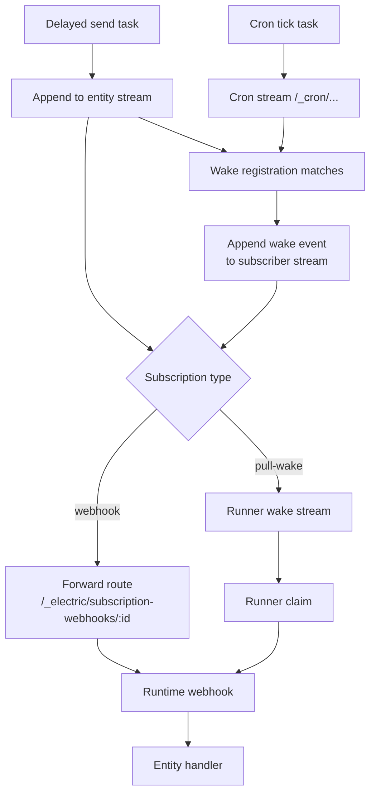
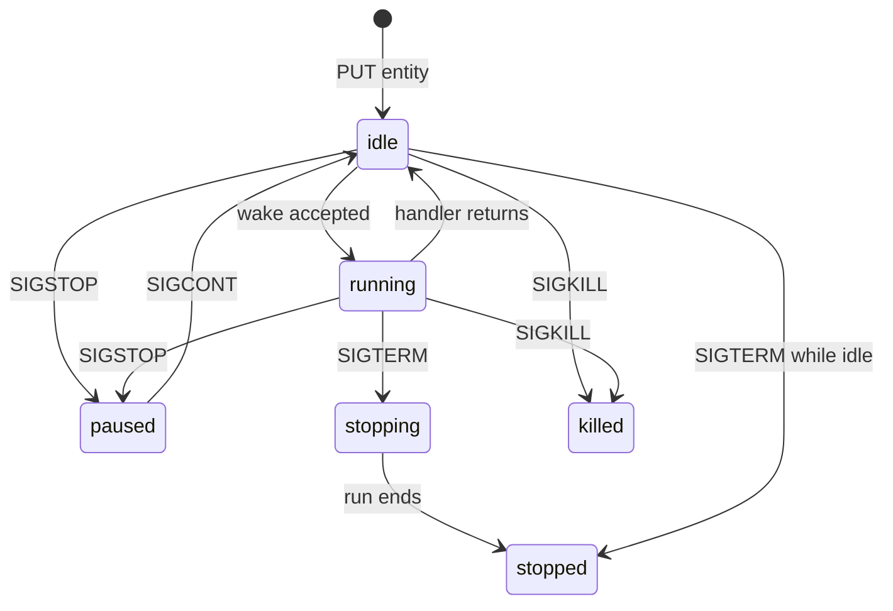

# Wake dispatch and entity lifecycle

A wake is a request to run an entity handler. Five sources can produce a wake: a stream subscription, a runner pull, a delayed send, a cron tick, and a condition registration. This document explains all five, how they are deduplicated, and how an entity moves between statuses.

## The five wake sources

| Source | Produced by | Target | Transport |
|--------|-------------|--------|-----------|
| Stream subscription | Durable Streams | Runtime webhook | Signed HTTP `POST` |
| Pull wake | Durable Streams subscription of type `pull-wake` | Runner poll loop | Claim, ack, release |
| Delayed send | PostgreSQL `scheduled_tasks` | Entity stream | Internal append |
| Cron tick | PostgreSQL `scheduled_tasks` | Cron stream | Internal append |
| Condition wake | `WakeRegistry` condition match | Subscriber entity stream | Internal append of a `wake` event |

The first two sources start at the stream transport. A delayed send starts at the scheduler, which appends to the entity stream, so it becomes a stream subscription wake. A cron tick starts at the scheduler, which appends to the cron stream; a cron wake registration is a condition on that stream, so the tick becomes a condition wake. The fifth source starts at a rule: a condition registration matches an event and writes a `wake` event into another entity's stream. That append then uses the first source. The sections below explain both layers.



## Webhook dispatch

A webhook wake has five steps.

### Step 1: the stream server detects an append

The subscription holds a list of stream paths. When any of them grows, the server builds a notification. The notification names the stream, the new offset, the entity, and a callback URL.

### Step 2: the server forwards to itself

The subscription webhook URL is the agents-server forward route:

```text
${publicUrl}/_electric/subscription-webhooks/${encodeURIComponent(subscriptionId)}
```

Source: `packages/agents-server/src/routing/dispatch-policy.ts:327-330`.

The real target URL is in the `subscription_webhooks` table. The forward route reads it and rewrites loopback addresses when the target runs in another container.

### Step 3: the forward route signs the request

The server adds a `webhook-signature` header. The signature is an Ed25519 signature over the timestamp, a dot, and the request body, in that order. The runtime verifies it against the JSON Web Key Set (JWKS) at `/__ds/jwks.json`.

Source: `packages/agents-server/src/webhook-signing.ts:88-106`; the signed bytes are built by `bytesWithTimestamp`. The runtime rebuilds the same bytes at `packages/agents-runtime/src/webhook-signature.ts:81`.

### Step 4: the runtime claims the wake

`processWake` calls the notification's callback with `{ epoch, wakeId }`. A claim request makes the server mint a **per-wake write token** (`routing/internal-router.ts:717-726, 904-912`). The token authorizes appends to the entity stream during this wake. The runtime sends it on producer writes.

Three different secrets exist. They have different scopes, and the documentation must not merge them:

| Name | Scope | Travels in |
|------|-------|------------|
| Per-entity write token | One entity stream | `Authorization: Bearer` or `Electric-Claim-Token` |
| Per-wake write token | One wake on one entity stream | The claim-token header selected by `claimTokenHeader` |
| Pull-wake lease claim token | One pull-wake lease | Bearer token for the claim, acknowledge, and release routes |

The entity row stores the per-entity token, and the spawn response returns it in the `x-write-token` header. The append path reads a token from `Authorization: Bearer` or `Electric-Claim-Token`. `EntityManager.isValidWriteToken` accepts the per-entity token only when no custom validator is configured. The standalone runtime supplies a validator that accepts only per-wake tokens, so the default server authorizes appends with the per-wake token. [06-security-tenancy-and-permissions.md](06-security-tenancy-and-permissions.md) explains the validator.

The claim and the stream preload run in parallel:

```ts
const [claimed] = await Promise.all([claimPromise, preloadPromise])
```

Source: `packages/agents-runtime/src/process-wake.ts:1210`.

### Step 5: the runtime acknowledges

After the handler returns and the producer flushes, the runtime acknowledges the wake by posting `{ epoch, done: true }` to the same callback. The server releases the claim row and clears the per-wake write token if this consumer still owns it (`packages/agents-server/src/routing/internal-router.ts:807-880`).

A failed acknowledge leaves the wake unacknowledged. The subscription can deliver it again after the claim lease expires, and the dispatch deduplication prevents a second concurrent handler. The server declares two options for a periodic recovery loop: `ELECTRIC_AGENTS_DISPATCH_RECOVERY_INTERVAL_MS` and `ELECTRIC_AGENTS_STALE_OUTSTANDING_WAKE_AFTER_MS`. The entrypoint parses them (`packages/agents-server/src/entrypoint-lib.ts:168-175`), but no code in the open-source server consumes them. Recovery is therefore limited to the subscription lease.

## Pull-wake dispatch

A pull-wake subscription is used when the runtime cannot accept inbound webhooks. Common cases are a laptop behind a network address translator, a sandbox, and a runner that the server cannot reach.

### Setup

`linkStreamToTargetSubscription` creates the subscription:

```ts
await ensureSubscriptionIncludesStream(ctx, subscriptionId, streamPath, {
  type: `pull-wake`,
  streams: [streamPath],
  wake_stream: wakeStream,
  description: `Electric Agents runner ${target.runnerId}`,
}, existing)
```

Source: `packages/agents-server/src/routing/dispatch-policy.ts:297-310`.

The wake stream is `runner.wake_stream` if the runner record has one. Otherwise it is `runnerWakeStream(runnerId)`.

### Claim, ack, release

| Operation | Endpoint | Effect |
|-----------|----------|--------|
| Claim | `POST /_electric/runners/:id/claim` | Takes one wake. `:id` is the runner identifier. Returns a pull-wake lease claim token and a lease |
| Ack | `POST /_electric/wake-callbacks/:consumerId` | Marks the wake complete. `:consumerId` is the wake identifier returned in the claim response. The bearer token is the pull-wake lease claim token |
| Release | `POST {stream-base}/__ds/subscriptions/:id/release` | Returns the wake for another runner. `:id` is the subscription identifier that owns the wake stream. The bearer token is the pull-wake lease claim token |

A claim has a lease. If the runner crashes, the lease expires and another runner can claim the same wake.

Source: `packages/agents-server/src/routing/runners-router.ts:130`.

## Condition wakes: the wake registry

A wake registration has a condition. The `WakeRegistry` checks every event against every condition.

| Condition | Matches when |
|-----------|--------------|
| `runFinished` | A `run` event changes to status `completed` or `failed` |
| `{ on: 'change', collections?, ops? }` | A matching collection event occurs with a matching operation |

Source: `packages/agents-server/src/wake-registry.ts:19-31`.

### Where the events come from

The registry receives its registrations from a Shape stream, but it receives the events to match from the server's own append points. The server's append helper calls `evaluateWakePayload` after an append (`packages/agents-server/src/routing/stream-append.ts:151`). The PostgreSQL sync bridge calls `evaluateWakes` for each bridged event (`packages/agents-server/src/runtime.ts:107`). The cron scheduler calls it for each tick.

### How a match becomes a wake

`WakeRegistry.evaluate` returns one result for each matching registration. `deliverWakeResult` then appends one `wake` event to the subscriber entity's main stream. The producer identifier is `wake-reg-<registration database id>-<source event key>`, so a repeated match is not a second wake. The append uses `appendIdempotent`, which starts every call at epoch 0 and sequence 1, so the same producer identifier presents the same tuple (`packages/agents-server/src/stream-client.ts:313-336`). That append is an ordinary stream append, so the subscriber's own subscription delivers the wake by webhook or by runner pull. Source: `packages/agents-server/src/entity-manager.ts:3289-3363`.

This is why the registry is a wake source, not a wake transport. It turns a condition into a wake event; the stream subscription does the delivery.

A registration also carries:

| Field | Purpose |
|-------|---------|
| `subscriberUrl` | The entity URL that receives the wake event |
| `sourceUrl` | The stream to watch |
| `debounceMs` | Wait this long and merge events |
| `timeoutMs` | Fire even if no event arrives |
| `oneShot` | Remove the registration after the first wake |
| `includeResponse` | Include the matching event data |
| `manifestKey` | Tie the registration to a manifest entry |

**Aha: the wake registry is a shape consumer.** The registry does not poll PostgreSQL. It opens an Electric Shape stream:

```ts
const stream = new ShapeStream<WakeRegistrationShapeRow>({
  url: electricUrlWithPath(electricUrl, `/v1/shape`).toString(),
  params: {
    table: `wake_registrations`,
    ...(this.tenantId
      ? { where: `tenant_id = ${sqlStringLiteral(this.tenantId)}` }
      : {}),
    ...(electricSecret ? { secret: electricSecret } : {}),
    columns: [
      `id`, `tenant_id`, `subscriber_url`, `source_url`,
      `condition`, `debounce_ms`, `timeout_ms`, `one_shot`,
      `timeout_consumed`, `include_response`, `manifest_key`, `created_at`,
    ],
    replica: `full`,
  },
  ...
})
```

Source: `packages/agents-server/src/wake-registry.ts:190-213`.

This reuses the Electric Sync engine as a change feed for the control plane. The same protocol that synchronizes user data to browsers synchronizes wake rules to the server. The server keeps an in-memory cache and updates it from the shape messages.

## The scheduler

The scheduler owns two task kinds: `delayed_send` and `cron_tick`.

```ts
export type SchedulerTaskKind = 'delayed_send' | 'cron_tick'
```

Source: `packages/agents-server/src/scheduler.ts`.

### Task table

| Column | Purpose |
|--------|---------|
| `kind` | `delayed_send` or `cron_tick` |
| `run_at` | When the task becomes due |
| `payload` | Task-specific data |
| `claimed_by` | Which scheduler instance owns the task |
| `claimed_at` | When the claim was taken |
| `completed_at` | When the task finished |

Source: `packages/agents-server/src/scheduler.ts`.

### Claim and recovery

A scheduler instance claims a task and records the claim time. If the instance dies, the claim expires after `claimExpiryMs`, which defaults to 30,000 milliseconds. `reclaimStaleClaims()` finds expired claims and clears them.

Source: `packages/agents-server/src/scheduler.ts:285, 468-500`.

### Delayed send

`executeDelayedSend(payload, taskId)` appends a message to the target entity stream. It uses the same send path as a user message. The wake then follows the normal subscription path.

Source: `packages/agents-server/src/runtime.ts:328`.

### Cron tick

A cron schedule is encoded in a stream path:

```text
/_cron/<base64url of {expression, timezone}>
```

`getCronStreamPath` in `packages/agents-runtime/src/cron-utils.ts` builds the path. `parseCronStreamPath` reverses it. The `cron_tick` event is not one of the twenty entity event types; it belongs to the cron stream only.

On each tick the agents-server scheduler calls `executeCronTick`, which appends a `cron_tick` event with an idempotent producer:

```ts
const tickEvent = {
  type: `cron_tick`,
  key: `tick-${tickNumber}`,
  value: {
    expression: spec.expression,
    timezone: spec.timezone,
    firedAt: new Date().toISOString(),
    tickNumber,
  },
  ...
}
await this.streamClient.appendIdempotent(
  streamPath,
  new TextEncoder().encode(JSON.stringify(tickEvent)),
  { producerId: `scheduler-cron-${encodedExpression}-${tickNumber}` }
)
await this.manager.evaluateWakes(streamPath, tickEvent)
```

Source: `packages/agents-server/src/runtime.ts:388-419`.

The producer identifier includes the tick number. A retry of the same tick deduplicates. A new tick gets a new identifier. `appendIdempotent` creates a fresh `IdempotentProducer` with epoch 0. Its sequence starts at 1, so two calls with the same producer identifier present the same `(Producer-Id, 0, 1)` tuple (`packages/agents-server/src/stream-client.ts:313-336`).

### How a cron tick becomes a wake

A cron schedule is a wake registration with three fields: `sourceUrl` is the cron stream path, `subscriberUrl` is the entity URL, and `condition` is `{ on: 'change' }` (`packages/agents-server/src/entity-manager.ts:2984-2997`). The registration also carries `manifestKey: schedule:<id>`, and the entity stream holds a matching `manifest` event. The registration row is the source of truth on startup: `rehydrateCronSchedules` reads it, and the manifest replay does not recreate cron registrations.

`executeCronTick` appends the tick event and then calls `evaluateWakes(streamPath, tickEvent)`. The registry matches the registration's `change` condition against the `cron_tick` event. `deliverWakeResult` appends a `wake` event to the subscriber entity's main stream, and that stream's own subscription delivers the wake. No subscription watches the cron stream, and the cron stream has no handler of its own.

### Rehydration on restart

`rehydrateCronSchedules()` rebuilds cron state after a restart:

1. Read `wake_registrations`.
2. For each source that starts with `/_cron/`, parse the spec.
3. Recreate the cron stream if it is missing.
4. Register the next tick.

Then it replays each entity's `manifest` events from its main stream. Replay recreates three side effects: the entity-source projection for membership and tags, the shared-state link, and a pending future-send task. It does not recreate cron registrations, which come from `wake_registrations`, or child entities, which are separate rows.

Source: `packages/agents-server/src/runtime.ts:148-186, 511-532`.

**Aha: future sends are derived, not primary.** The manifest events in the entity stream are the source of truth for an entity's future sends. The `scheduled_tasks` table is a projection. After a restart, the server replays the manifests and rebuilds the projection for each entity that it can list in the registry. Replay is idempotent: it closes the previous pending row for the same manifest key and inserts one fresh row (`packages/agents-server/src/scheduler.ts:126-165`). A future send therefore survives the loss of its task row, as long as the entity row and the stream survive. Cron schedules are different: `rehydrateCronSchedules` reads their specifications from `wake_registrations`, so they need that row too.

## Entity lifecycle

The status type declares seven values.



| Status | Meaning | Accepts normal writes |
|--------|---------|----------------------|
| `spawning` | Declared in the type; the open-source server never sets it | No |
| `running` | A handler is active | Yes |
| `idle` | No handler is active | Yes |
| `paused` | Stopped by `SIGSTOP` | Yes |
| `stopping` | A stop was requested | No |
| `stopped` | Stopped normally | No |
| `killed` | Killed | No |

Source: `packages/agents-server/src/electric-agents-types.ts:17-26, 28-36, 361-383`.

`entityData` sets `status: idle` before the insert (`packages/agents-server/src/entity-manager.ts:748-750`). No code writes `spawning`.

`rejectsNormalWrites` returns true for `stopping`, `stopped`, and `killed`. A write to such an entity returns an error, except for the system signal path that performs the transition.

### Signals

Seven signals exist:

| Signal | Expected result |
|--------|-----------------|
| `SIGINT` | Abort the active handler |
| `SIGHUP` | Reload or notify |
| `SIGTERM` | Stop; `idle` becomes `stopped`, `running` becomes `stopping` |
| `SIGKILL` | Kill immediately; status becomes `killed` |
| `SIGSTOP` | Pause; `idle` or `running` becomes `paused` |
| `SIGCONT` | Resume; `paused` becomes `idle` |
| `SIGUSR` | Application-defined |

Source: `packages/agents-server/src/electric-agents-types.ts:23-31, 366-380`.

A signal is stored as an event in the entity stream, not only as a database update. This keeps the stream as the audit log. The runtime also reacts to signals during a wake. For example, `SIGINT` aborts the active handler invocation.

Source: `packages/agents-runtime/src/process-wake.ts:868-872`.

## Run completion wakes

A parent entity often needs to know when a child finishes. The condition `runFinished` provides this.

`checkRunFinished` inspects a `run` event. The event matches when the operation is `update` and the status is `completed` or `failed`. The matching wake carries the final response if `includeResponse` is set.

This mechanism lets an agent spawn a child, continue its own work, and receive a wake when the child is done. It is the basis for hierarchical agent designs.

## Deduplication and ordering

Three mechanisms prevent duplicate work:

1. **Idempotent producers.** The producer tuple `(Producer-Id, Producer-Epoch, Producer-Seq)` deduplicates append retries.
2. **Wake identity.** A wake has a `wakeId`. The server records the notification and the claim. A repeated delivery with the same identifier is not a new unit of work.
3. **Per-entity wake queue.** The runtime tracks pending wakes per entity. A new wake for a busy entity waits in the queue instead of running two handlers in parallel.

Source: `packages/agents-runtime/src/create-handler.ts` (`dispatchWake`, `pendingWakes`) and `packages/agents-runtime/src/process-wake.ts` (`queuedNextWake`).

## Aha summary

| Insight | Why it matters |
|---------|----------------|
| The wake registry consumes an Electric Shape | Control-plane changes propagate through the same sync engine as user data |
| Cron schedules are stored as wake registrations | A restart rebuilds them from `wake_registrations`; the stream alone is not enough |
| Future sends are projections of stream manifests | A pending send survives the loss of its task row |
| Signals are stream events | The audit log and the control path agree |
| Claims have leases | A crashed runner does not block a wake forever |
| The forward route signs every delivery | The stream server never needs the runtime's address or secret |

## Related documents

- [04-how-the-runtime-sets-up-a-stream.md](04-how-the-runtime-sets-up-a-stream.md) — stream creation.
- [06-security-tenancy-and-permissions.md](06-security-tenancy-and-permissions.md) — signatures and grants.
- [agents-server/05-wake-registry-and-scheduler.md](agents-server/05-wake-registry-and-scheduler.md) — server detail.
- [agents-runtime/03-wake-processing.md](agents-runtime/03-wake-processing.md) — runtime detail.
- [durable-streams/03-live-reads-and-subscriptions.md](durable-streams/03-live-reads-and-subscriptions.md) — protocol detail.
