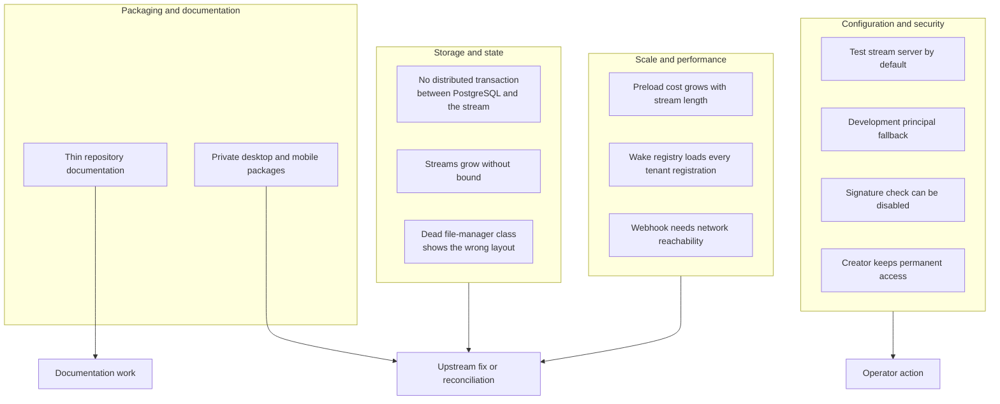

# Critical assessment: strengths, limits, and open questions

This document states what the code does well, what it does not do, and where a production operator must add work. Each finding names the source. Nothing here is a guess about intent.

## Strengths

### 1. One primitive, many uses

The entity stream serves as the database, the message queue, the audit log, and the live feed. This removes a whole class of synchronization bugs. A reader that replays the stream gets the same state as a reader that never disconnected.

The proof is in `packages/agents-runtime/src/entity-stream-db.ts`. The same `createEntityStreamDB` call, a wrapper over `createStreamDB`, serves catch-up and live reads, because the underlying `DurableStream` covers both through one SSE read connection.

### 2. Clean plane separation

The runtime does not import the server. The server does not import handler code. The contract is HTTP plus a signed webhook. This makes each plane replaceable.

Source: `packages/agents-runtime/package.json` has no dependency on `@electric-ax/agents-server`.

### 3. Correct idempotency at the transport

The producer tuple makes retries safe without handler cooperation. `process-wake.ts:536` uses a stable producer identifier, `entity-${entityUrl}`, so a retry after a network failure deduplicates.

### 4. A real conformance suite

`packages/agents-server-conformance-tests` lets a second server implementation prove compatibility. The Durable Streams repository has separate server and client conformance suites. This is stronger than most projects of this age.

## Limits and risks

The twelve risks fall into four groups. The grouping shows which team must act: an operator, the upstream project, or a documentation author.



**Aha: the deepest risk is not a defect in a component. It is that the default configuration is a development configuration.** Each individual mechanism is sound. The danger comes from the composition of defaults. An embedded test server, a development principal, and an unsigned-webhook option can all be active at once in a process that looks like production.

### 1. The default stream server is a test server

The class is named `DurableStreamTestServer`. The agents-server uses it by default whenever `ELECTRIC_AGENTS_DURABLE_STREAMS_URL` is absent. Source: `packages/agents-server/src/entrypoint-lib.ts:181-211`.

A test server may lack:

- Multi-process coordination.
- Horizontal scaling.
- Production backup and restore procedures.
- Resource limits.

The Docker Compose file names it as the default. A production deployment must set an external URL or accept the limits of a single process.

**Recommendation:** require `ELECTRIC_AGENTS_DURABLE_STREAMS_URL` when `NODE_ENV=production`.

### 2. The development principal can be enabled by accident

`allowDevPrincipalFallback()` returns true when any of three conditions holds. One condition is simply that the server owns an embedded stream server. An explicit option overrides these conditions. Source: `packages/agents-server/src/server.ts:380-389`.

A server with an embedded stream server accepts anonymous requests as `system:dev-local`, even when `NODE_ENV=production`, unless the deployment sets `allowDevPrincipalFallback: false` or its authentication hook rejects every anonymous request. That principal bypasses every permission check.

**Recommendation:** make the fallback opt-in through one explicit flag, and log a warning on every request that uses it.

### 3. Two stores, no distributed transaction

PostgreSQL holds the entity row. Durable Streams holds the event bytes. The spawn path writes the row first and the stream second. If the process dies between the two writes, the row exists without a stream.

The code handles the normal error path with a rollback. It cannot handle a process crash in the middle. Source: `packages/agents-server/src/entity-manager.ts:836-940`.

```mermaid
sequenceDiagram
    participant M as EntityManager
    participant P as PostgreSQL
    participant D as Durable Streams
    M->>P: INSERT entity row (status idle, streams.main set)
    P-->>M: committed
    Note over M,D: crash window<br/>the row exists, the stream does not
    M->>D: create main stream with initial body
    D-->>M: stream created
    Note over M,D: normal error path rolls back the row;<br/>a process crash cannot
```

**Consequence:** a crash can leave an entity in `idle` status with no `main` stream. The next wake attempt fails. An operator must detect and repair this state.

**Recommendation:** add a startup reconciliation pass that checks every entity row for an existing main stream.

### 4. Streams grow without bound

An entity stream is append-only. The runtime never truncates it. The file store supports a time to live, but the agents-server does not set one on entity streams. Source: `packages/agents-server/src/entity-manager.ts` create call has no TTL.

Context compaction exists at the model-prompt level. It reduces what the model sees. It does not reduce what the stream stores.

**Consequence:** a long-lived entity accumulates every text delta, every reasoning delta, and every tool result. Storage grows with use, and preload time grows with storage.

**Recommendation:** set a retention policy, or archive a prefix of the stream and start a new segment with a context checkpoint.

### 5. Preload cost is proportional to stream length

`db.preload()` reads from the beginning of the stream on every new wake worker. Source: `packages/agents-runtime/src/process-wake.ts:1206-1211`.

The runtime mitigates this with an idle timeout. The worker stays warm for `idleTimeout`, which defaults to 20,000 milliseconds, so a burst of wakes does not pay the preload cost each time. After the timeout, the next wake pays it again.

**Consequence:** the first wake after an idle period is slower than later wakes. On a large stream, the delay is noticeable.

**Recommendation:** persist a materialized checkpoint and load it before replaying the tail.

### 6. Webhook delivery depends on network reachability

A webhook target must be reachable from the stream server. The code rewrites loopback addresses for Docker through `rewriteLoopbackWebhookUrl`. Source: `packages/agents-server/src/utils/webhook-url.ts:1`; the call is at `packages/agents-server/src/routing/dispatch-policy.ts:319`.

A runtime behind network address translation cannot use a webhook. It must use a pull-wake subscription and a runner.

The server also declares `dispatchRecoveryIntervalMs` and `staleOutstandingWakeAfterMs` for a periodic loop that recovers expired dispatch claims and stale outstanding wakes (`packages/agents-server/src/server.ts:77-87`). The entrypoint parses both environment variables, but no open-source code reads the options after that. A wake stranded by a failed acknowledgement is therefore recovered only by the subscription's own claim lease.

**Consequence:** the simple path works only when the runtime is on the same network as the server or has a public address.

### 7. Signature verification can be turned off

`durableStreamsWebhookSignature` accepts `false`. Source: `packages/agents-server/src/routing/context.ts`.

A deployment that sets it to false accepts unsigned webhooks. Any caller that can reach the runtime webhook endpoint can trigger a wake.

**Recommendation:** allow `false` only in test configurations, and fail the start when it is combined with a non-development principal mode.

### 8. The creator keeps permanent access

`canAccessEntity` allows the creator unconditionally:

```ts
const builtInAllowed =
  entity.created_by === ctx.principal.url ||
  (await ctx.entityManager.registry.hasEntityPermission(...))
```

Source: `packages/agents-server/src/permissions.ts:38-44`.

A grant cannot revoke the creator's access. Only the authorization hook can deny it.

**Consequence:** in a product where an entity changes owner, the old creator keeps access unless the hook denies it.

### 9. The wake registry loads every registration for its tenant

The Shape query uses `replica: 'full'` and filters only by tenant. Source: `packages/agents-server/src/wake-registry.ts:190-213`.

**Consequence:** memory use grows with the number of wake registrations. A tenant with many short-lived registrations can grow the cache without bound until the rows are deleted.

**Recommendation:** delete one-shot registrations promptly, and add a maximum registration count per tenant.

### 10. Dead code creates a false storage picture

`packages/server/src/file-manager.ts` defines `StreamFileManager`. It writes `streams/<encoded>/segment_00000.log`. No other file imports it.

The live storage layout is `streams/<uniqueName>.log` from `FileBackedStreamStore`. A reader who finds the dead class will document the wrong layout.

**Recommendation:** delete the class, or mark it deprecated in the source.

### 11. Package visibility is inconsistent

The browser user interface and the desktop and mobile applications are private packages. The runtime and server are public. The desktop and mobile applications therefore cannot be built from the published packages alone.

**Consequence:** an external contributor can run the server and the runtime but cannot reproduce the official desktop application.

### 12. Documentation inside the repository is thin

`LIMITATIONS.md` lists two limitations, both about the sync engine:

- Truncate messages are not handled.
- Shape logs have no transaction boundaries.

Source: `LIMITATIONS.md`.

Neither the agents server nor the durable stream store has a limitations document. An operator must read the code to learn the limits above.

## Open questions

| Question | Why it matters |
|----------|----------------|
| How does a multi-node agents-server coordinate entity claims? | The `consumer_claims` table (a lease table for stream consumers) exists, but the OSS entrypoint starts one runtime |
| What is the intended production stream backend? | The embedded server is a test server; no first-party production server for Node.js is named |
| How should an operator repair a row without a stream? | No repair command exists |
| How large can one entity stream grow before preload is unacceptable? | No benchmark in the repository answers this |
| Is the Rust server intended to replace the Node.js server? | `packages/durable-streams-rust` exists and is named a high-performance server |
| How does context compaction interact with fork and replay? | The runtime has background compaction, but no document explains the replay rule |

## A balanced verdict

Electric Agents is an unusually coherent design. The choice to make the event stream the only durable state produces a system that is easy to reason about and hard to corrupt silently. The wake model is grounded in a real protocol, not in ad-hoc polling.

The main risks are operational, not architectural. The default configuration is a development configuration. The two-store design needs a reconciliation pass. Stream growth needs a retention answer. These are solvable problems, and the code leaves clear places to solve them.

## Related documents

- [02-system-architecture.md](02-system-architecture.md) — the architecture under assessment.
- [06-security-tenancy-and-permissions.md](06-security-tenancy-and-permissions.md) — the security model.
- [agents-server/11-operations-testing-and-conformance.md](agents-server/11-operations-testing-and-conformance.md) — operations detail.
- [durable-streams/04-node-server.md](durable-streams/04-node-server.md) — the server under the default configuration.
