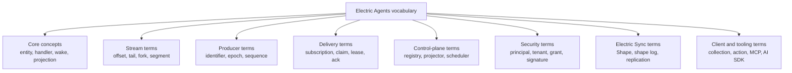
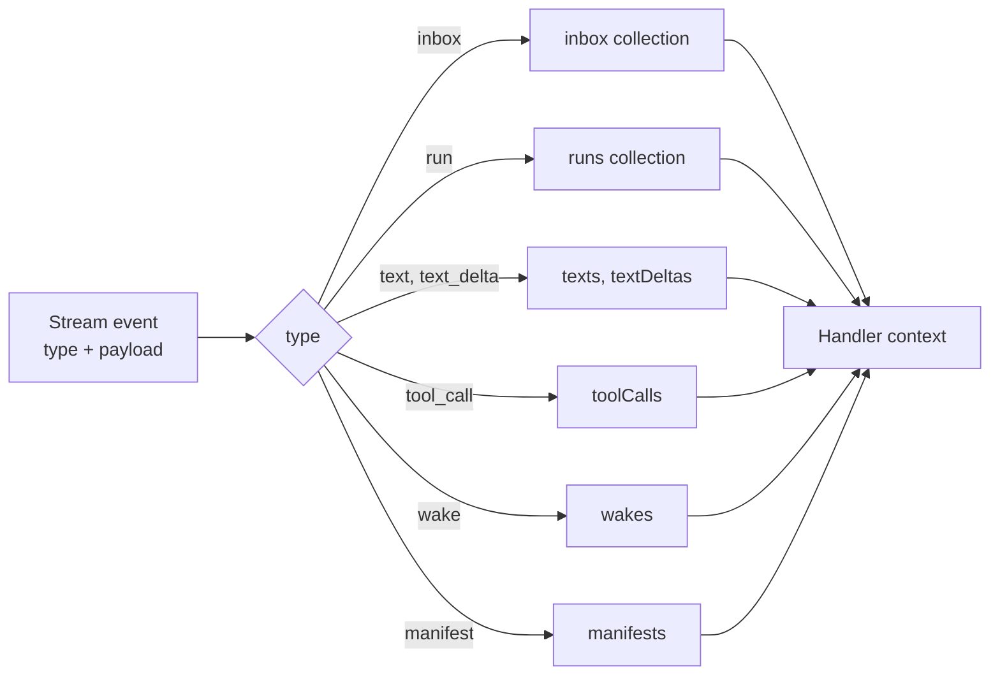

# Glossary

This glossary defines the key terms and abbreviations used in this exploration. Terms are grouped by area. Each entry names the source file when the term is a code identifier.

**Aha: the vocabulary follows the architecture.** Most terms describe a position in a log or a rule for delivering the next position. Few terms describe business data. That imbalance is the design: the system stores events, and the meaning of an event belongs to the handler.

## Core concepts

| Term | Definition |
|------|------------|
| **Agent** | A long-lived software worker that reads events, calls a model, uses tools, and writes events. In this system, an agent is an entity with a handler. |
| **Entity** | The unit of agent identity. An entity has a type, an identifier, a status, one main stream, and a set of permissions. Source: `packages/agents-server/src/entity-manager.ts`. |
| **Entity type** | A named template. It declares the state collections, the inbox schemas, the slash commands, the creation schema, and the default dispatch policy. |
| **Handler** | The async function that runs on each wake. It receives a handler context and the wake description. |
| **Durable stream** | An append-only byte sequence, reachable by Hypertext Transfer Protocol (HTTP) at a Uniform Resource Locator (URL), with ordered offsets and live reads. |
| **Wake** | A request to run a handler because something changed. |
| **Materialization** | The process of reading stream events and applying them to typed in-memory collections. |
| **Projection** | A derived view of events. The collections are a projection. The `/_entities/` streams are another projection. |

## Stream terms

| Term | Definition |
|------|------------|
| **Offset** | An opaque, lexicographically sortable token that names a position in a stream. |
| **Tail offset** | The position immediately after the last byte. New appends write here. |
| **Sentinel offset** | One of two special values: `-1` for the beginning, `now` for the current tail. |
| **Catch-up read** | A read from an offset to the current tail that then stops. |
| **Long-poll read** | A read that waits for new data until data arrives or a timeout expires. |
| **Server-Sent Events (SSE)** | A one-way HTTP streaming mode. The server pushes events on an open response. |
| **JavaScript Object Notation (JSON) mode** | The special behavior of streams created with `Content-Type: application/json`. Message boundaries are preserved, arrays flatten one level, and reads return arrays. |
| **Content type** | The Multipurpose Internet Mail Extensions (MIME) type set at stream creation. |
| **Closed stream** | A stream in the terminal state. It rejects appends. |
| **Soft-deleted stream** | A deleted stream whose data remains for live forks. Its own URL returns `410 Gone`. |
| **Fork** | A stream that inherits a prefix from a source stream without copying bytes. |
| **Fork offset** | The divergence point between a source stream and its fork. |
| **Sub-offset** | A position inside one message. It marks the fork point when the split must occur inside a message. The value is an element count in JSON mode or a byte count in binary mode. |
| **Reference count** | The number of forks that point at a source stream. |
| **Time to live (TTL)** | An optional expiry rule for a stream. |
| **Segment** | One append-only log file that holds stream bytes. |
| **LMDB** | Lightning Memory-Mapped Database. The embedded key-value store that holds stream metadata. |
| **Base64url** | A URL-safe Base64 encoding. Used for cron stream paths and signatures. |

## Producer terms

| Term | Definition |
|------|------------|
| **Idempotent producer** | A writer that supplies a stable identifier, an epoch, and a sequence number so the server can drop duplicate appends. |
| **Producer identifier** | The stable writer name. The runtime uses `entity-${entityUrl}`. |
| **Producer epoch** | A generation number. A new epoch tells the server that the writer restarted. |
| **Producer sequence** | A per-epoch counter. |
| **`Stream-Seq`** | A per-writer ordering header. Values compare lexicographically. |

## Delivery terms

| Term | Definition |
|------|------------|
| **Subscription** | A server-side rule that watches streams and delivers new data to a target. |
| **Webhook subscription** | A subscription that sends an HTTP `POST` to a URL. |
| **Pull-wake subscription** | A subscription that writes a wake record into a wake stream for a runner to claim. |
| **Wake record** | One JSON message in a wake stream, with the subscription identifier, the changed stream, the generation, and a timestamp. |
| **Wake stream** | The stream that receives pull-wake records for one runner. |
| **Claim** | The act of taking ownership of a wake. A claim has a lease. |
| **Ack** | The act of marking a wake complete. |
| **Release** | The act of returning a claimed wake so another worker can take it. |
| **Lease** | A time limit on a claim. An expired lease allows another worker to reclaim the wake. |
| **Wake registry** | The agents-server component that holds wake conditions and matches events to them. Source: `packages/agents-server/src/wake-registry.ts`. |
| **Manifest** | A stream event that declares a side effect, such as a future send, a shared state link, or an entity source. |
| **Forward route** | The agents-server path `/_electric/subscription-webhooks/:subscriptionId` that receives stream notifications and forwards them to the real target. |
| **Loopback rewrite** | The replacement of `127.0.0.1` with `host.docker.internal` so a container can reach the host. |

## Control-plane terms

| Term | Definition |
|------|------------|
| **Control plane** | The HTTP and PostgreSQL layer that manages entity types, entities, permissions, runners, and schedules. |
| **Data plane** | The Durable Streams layer that stores and delivers event bytes. |
| **Execution plane** | The runtime layer that materializes streams and runs handlers. |
| **Entity manager** | The agents-server class that performs spawn, send, fork, signal, kill, and related operations. |
| **Entity registry** | The PostgreSQL-backed store for entity types and entity records. Source: `packages/agents-server/src/entity-registry.ts`. |
| **Entity projector** | The component that writes entity and tag records into `/_entities/` streams. Source: `packages/agents-server/src/entity-projector.ts`. |
| **Runner** | A process or host that claims pull wakes and runs handlers. |
| **Sandbox** | An isolated execution environment for tools. |
| **Bridge** | A connector between an entity stream and an external source or destination. |
| **PostgreSQL sync (pg-sync)** | A bridge that replicates entity events into PostgreSQL. |
| **Scheduler** | The component that runs delayed sends and cron ticks. Source: `packages/agents-server/src/scheduler.ts`. |
| **Delayed send** | A scheduled message append. |
| **Cron tick** | A scheduled event on a cron stream. Cron schedules are rehydrated from rows in `wake_registrations`, although a matching `manifest` event is also written; manifest replay does not recreate the registration. |
| **Cron stream** | A stream whose path encodes a cron expression and timezone: `/_cron/<base64url>`. |
| **Shared state** | A stream that several entities can read and write: `/_electric/shared-state/<id>`. |

## Security terms

| Term | Definition |
|------|------------|
| **Principal** | An identity with a kind, an identifier, a key, and a URL. |
| **Tenant** | An isolated workspace. The identifier selects the PostgreSQL rows and appears in their composite keys. The default routing adapter does not add it to stream paths. |
| **Permission grant** | A record that allows a subject to perform one verb on one resource. |
| **Propagation** | Whether a grant applies to the entity alone or to its descendants. |
| **Authorization hook** | A caller-supplied function that makes the final access decision. |
| **Per-entity write token** | A secret stored as `entities.write_token` and returned in the `x-write-token` response header at spawn. One entity. |
| **Per-wake write token** | A secret minted at the wake claim callback. It authorizes appends to the entity stream for one wake. |
| **Pull-wake lease claim token** | A secret returned by a runner claim. It is the bearer token for acknowledge and release. |
| **JSON Web Key Set (JWKS)** | A JSON document that publishes public signing keys. Served at `/__ds/jwks.json`. |
| **Ed25519** | An elliptic-curve signature algorithm. Used for webhook signatures. |
| **Webhook signature** | A header with the form `t=<timestamp>,kid=<key id>,ed25519=<signature>`. |
| **Replay attack** | Resending a captured valid request. A timestamp tolerance window prevents it. |

## Electric Sync terms

| Term | Definition |
|------|------------|
| **Electric Sync** | The Elixir service that reads the PostgreSQL replication stream and serves Shapes. |
| **Shape** | A read-only, filtered subset of a PostgreSQL table served over HTTP. |
| **Shape stream** | A client object that follows a Shape and yields change messages. |
| **Shape log** | The stored sequence of changes for a Shape. |
| **Logical replication** | The PostgreSQL mechanism that publishes row changes as a stream. |
| **Replica full** | A Shape mode that sends the full current state, not only changes. |

## Client and tooling terms

| Term | Definition |
|------|------------|
| **TanStack DB** | A reactive client-side database library. The runtime uses its collection model. |
| **Collection** | A typed table inside the materialized stream database. |
| **Action** | A generated write function such as `<name>_insert`, `<name>_update`, or `<name>_delete`. |
| **Model Context Protocol (MCP)** | An open protocol for exposing tools and resources to language models. |
| **AI Software Development Kit (AI SDK)** | A TypeScript toolkit for model calls and streaming. |
| **Command-line interface (CLI)** | A text interface. The `electric-ax` package is the CLI. |
| **Conflict-free Replicated Data Type (CRDT)** | A data type that merges concurrent edits without conflict. |
| **Yjs** | A CRDT library for shared editing. |
| **Single-page application (SPA)** | A browser application that updates without full page reloads. |
| **Electron** | A framework for desktop applications built with web technology. |
| **Content Delivery Network (CDN)** | A distributed cache network. |

## Repository terms

| Term | Definition |
|------|------------|
| **Package** | One workspace unit with its own `package.json` or `mix.exs`. Each package in this exploration has its own `markdown/` directory. |
| **Workspace** | A monorepo managed by pnpm. |
| **Changeset** | A release note file used by the Changesets tool. |
| **Conformance test** | A test suite that checks whether an implementation follows a protocol. |
| **Grandfather review** | A documentation review that checks names, numbers, flows, and coverage against the source. |
| **Fresh-reader review** | A documentation review by an agent with no prior context and no tool use. |

## Entity event types

| Event type | Collection | Meaning |
|------------|------------|---------|
| `run` | `runs` | One handler execution |
| `step` | `steps` | One step inside a run |
| `text` | `texts` | One complete text output |
| `text_delta` | `textDeltas` | One incremental text fragment |
| `tool_call` | `toolCalls` | One tool invocation |
| `reasoning` | `reasoning` | One complete reasoning block |
| `reasoning_delta` | `reasoningDeltas` | One incremental reasoning fragment |
| `error` | `errors` | One error record |
| `inbox` | `inbox` | One inbound message |
| `wake` | `wakes` | One wake record |
| `entity_created` | `entityCreated` | Entity creation record |
| `entity_stopped` | `entityStopped` | Entity stop record |
| `signal` | `signals` | One signal |
| `child_status` | `childStatus` | Child entity status |
| `tags` | `tags` | Entity tag |
| `slash_command` | `slashCommands` | Available slash command |
| `context_inserted` | `contextInserted` | Context added to the prompt |
| `context_removed` | `contextRemoved` | Context removed from the prompt |
| `manifest` | `manifests` | Declared side effect |
| `replay_watermark` | `replayWatermarks` | Replay boundary marker |

Source: `packages/agents-runtime/src/entity-schema.ts:1050-1082`.

The event type selects the collection. The materializer reads an event, dispatches on its type, and writes one row into the matching collection. The handler then reads the collection, not the raw stream.

This is why the glossary lists each event type beside its collection. The pair is the contract between the storage format and the handler.

## Entity statuses

| Status | Meaning |
|--------|---------|
| `spawning` | Creation in progress. Declared in the type; the open-source server never sets it. |
| `running` | A handler is active |
| `idle` | No handler is active |
| `paused` | Paused by `SIGSTOP` |
| `stopping` | A stop is in progress |
| `stopped` | Stopped normally |
| `killed` | Killed |

## Signals

| Signal | Meaning |
|--------|---------|
| `SIGINT` | Interrupt the active handler |
| `SIGHUP` | Hang up; reload or notify |
| `SIGTERM` | Terminate |
| `SIGKILL` | Kill immediately |
| `SIGSTOP` | Pause |
| `SIGCONT` | Continue |
| `SIGUSR` | Application-defined signal |

## Abbreviations

| Abbreviation | Expansion |
|--------------|-----------|
| API | Application Programming Interface |
| CDN | Content Delivery Network |
| CLI | Command-line interface |
| CRDT | Conflict-free Replicated Data Type |
| HTTP | Hypertext Transfer Protocol |
| JSON | JavaScript Object Notation |
| JWKS | JSON Web Key Set |
| JWT | JSON Web Token |
| LMDB | Lightning Memory-Mapped Database |
| MCP | Model Context Protocol |
| MIME | Multipurpose Internet Mail Extensions |
| OAuth | Open Authorization, a delegated-access protocol |
| RPC | Remote Procedure Call |
| SDK | Software Development Kit |
| SPA | Single-page application |
| SSE | Server-Sent Events |
| TTL | Time to live |
| URL | Uniform Resource Locator |
| UUID | Universally Unique Identifier |

## Related documents

- [00-overview.md](00-overview.md) — the system in one page.
- [03-the-durable-stream-primitive.md](03-the-durable-stream-primitive.md) — stream terms in context.
- [agents-runtime/01-entity-model.md](agents-runtime/01-entity-model.md) — entity event detail.
