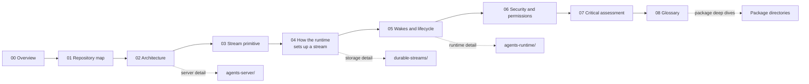
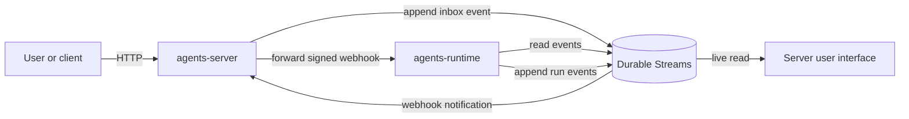

# Electric and Durable Streams

This exploration studies two repositories as one system:

1. **Electric** at `/Users/darkvoid/GitSources/src.Electric/electric` (commit `3f9809fb0`).
2. **Durable Streams** at `/Users/darkvoid/GitSources/src.Electric/durable-streams` (commit `461b4026`).

Electric Agents is a platform for durable artificial-intelligence agents. Each agent is an *entity*. Each entity owns one append-only event stream. Durable Streams stores and delivers that stream. The agent runtime writes events into the stream. A wake mechanism tells the runtime when to run the handler again.

The most important question in this exploration is: **how does the runtime set up the durable stream, and where is that stream stored?**

Document [04-how-the-runtime-sets-up-a-stream.md](04-how-the-runtime-sets-up-a-stream.md) answers that question in full.

## Reading order

| Order | Document | What you learn |
|-------|----------|----------------|
| 1 | [00-overview.md](00-overview.md) | What the two repositories do, and the one-sentence architecture |
| 2 | [01-repository-map.md](01-repository-map.md) | Every package, its purpose, and its size |
| 3 | [02-system-architecture.md](02-system-architecture.md) | The full request path, control plane, data plane, and storage |
| 4 | [03-the-durable-stream-primitive.md](03-the-durable-stream-primitive.md) | The stream model: offsets, append, read, producers, forking |
| 5 | [04-how-the-runtime-sets-up-a-stream.md](04-how-the-runtime-sets-up-a-stream.md) | The exact stream-creation path, byte for byte |
| 6 | [05-wake-dispatch-and-entity-lifecycle.md](05-wake-dispatch-and-entity-lifecycle.md) | Webhook wakes, pull wakes, the scheduler, and entity states |
| 7 | [06-security-tenancy-and-permissions.md](06-security-tenancy-and-permissions.md) | Principals, grants, bearer tokens, signatures, tenancy |
| 8 | [07-critical-assessment.md](07-critical-assessment.md) | Limits, risks, and open questions |
| 9 | [08-glossary.md](08-glossary.md) | Key terms and abbreviations |

**Aha: one stream is the unit of everything.**

An entity, its memory, its inbox, its audit log, and its wake cursor are all views of one append-only stream. The master documents follow that stream from creation, through delivery, to the stored bytes.



## Package deep dives

Each package has its own directory. Each directory has a `README.md` that indexes its documents.

### Core platform packages

| Package | Documents | Purpose |
|---------|-----------|---------|
| [agents-runtime](agents-runtime/README.md) | 11 documents | The library that defines entities, materializes streams, and runs handlers |
| [agents-server](agents-server/README.md) | 12 documents | The control plane: entity registry, Hypertext Transfer Protocol (HTTP) routes, wakes, scheduler, bridges |
| [durable-streams](durable-streams/README.md) | 12 documents | The protocol, the Node.js server, storage, clients, and the state layer |

### Agent application packages

| Package | Documents | Purpose |
|---------|-----------|---------|
| [agents](agents/README.md) | 5 documents | Built-in runtime implementations, including Horton and the worker runtime |
| [agents-mcp](agents-mcp/README.md) | 5 documents | Model Context Protocol registry, transports, and Open Authorization (OAuth) bridges |
| [agents-server-ui](agents-server-ui/README.md) | 7 documents | The browser single-page application for the server |
| [agents-desktop](agents-desktop/README.md) | 4 documents | The Electron desktop application |
| [agents-mobile](agents-mobile/README.md) | 5 documents | The mobile application |
| [agents-server-conformance-tests](agents-server-conformance-tests/README.md) | 2 documents | The shared conformance test suite for servers |
| [electric-ax](electric-ax/README.md) | 4 documents | The command-line interface and project tooling |

### Electric Sync packages

| Package | Documents | Purpose |
|---------|-----------|---------|
| [sync-service](sync-service/README.md) | 8 documents | The Elixir Postgres sync engine |
| [typescript-client](typescript-client/README.md) | 5 documents | The TypeScript shape client |
| [react-hooks](react-hooks/README.md) | 3 documents | The React `useShape` hooks |
| [y-electric](y-electric/README.md) | 2 documents | The Yjs shared-editing integration |
| [elixir-client](elixir-client/README.md) | 3 documents | The Elixir client |
| [electric-telemetry](electric-telemetry/README.md) | 2 documents | The telemetry library |
| [sync-engines](sync-engines/README.md) | 2 documents | How the shape engine captures changes from PostgreSQL and from the SQLite family |
| [start](start/README.md) | 2 documents | The TanStack Start integration |
| [experimental](experimental/README.md) | 2 documents | Experimental client modules |

### Durable Streams implementations

| Package | Documents | Purpose |
|---------|-----------|---------|
| [durable-streams-rust](durable-streams-rust/README.md) | 4 documents | The Rust server and client implementation |

## The one-paragraph architecture

A user sends a message to an entity through the agents-server HTTP interface. The server writes an `inbox` event into the entity's stream. Durable Streams stores the event and notifies the entity's subscription. The subscription forwards a signed webhook to the agent runtime. The runtime reads the stream from its last acknowledged offset. It materializes the events into typed collections. It runs the entity handler. The handler writes new `run`, `step`, `text`, and `tool_call` events back into the same stream. The stream is the database, the message bus, and the audit log at the same time.



## Source of truth

Every claim in this exploration comes from the source code at the two commits above. Each document names the file and, where useful, the line number.

## Build

```bash
cd src.durable-streams
python3 -I build.py .
```

The build reads every `src.*/markdown/**/*.md` tree, including this one, and writes the matching `html/**/*.html` files with the same directory layout. It also writes the Resonate tree and the shared index.
