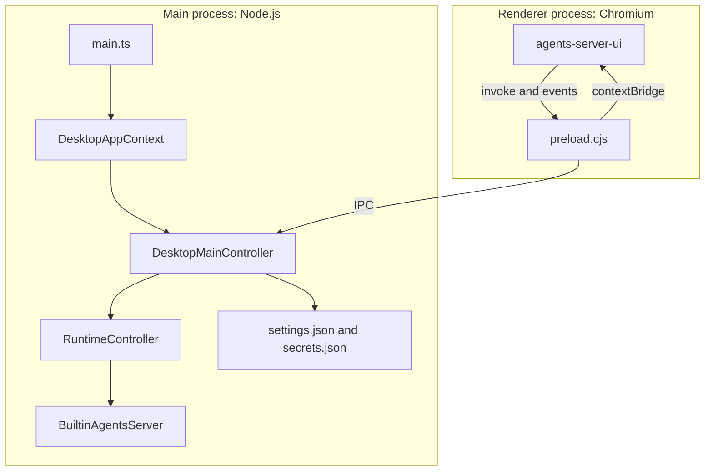
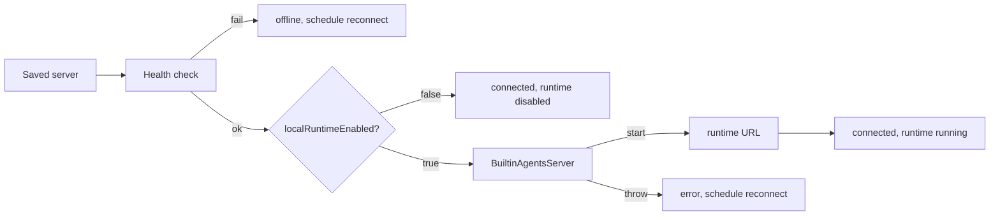

# Overview of agents-desktop

`@electric-ax/agents-desktop` is an Electron application. Electron embeds Chromium and Node.js in one program. The program provides a native window for the `agents-server-ui` web application. It also provides the parts that a web page cannot do:

- Read and write local files.
- Keep credentials in operating-system encrypted storage.
- Run a local agents server inside the desktop process.
- Show a tray icon and a native application menu.
- Install updates.

This document explains the process model, the runtime modes, the state model, and the package boundaries.

## Process model



The main process starts first. It creates one shared context, then one controller. The controller registers every inter-process communication (IPC) handler before it creates a window. Source: `packages/agents-desktop/src/main.ts:43-58` and `packages/agents-desktop/src/main.ts:97-135`.

Four names in the diagram refer to concrete parts:

- `DesktopAppContext` is the shared object that holds settings, credentials, windows, and runtime entries. See the next section.
- `DesktopMainController` is the class that connects the modules and registers the handlers.
- `RuntimeController` is the module that connects, disconnects, and supervises each saved server.
- `BuiltinAgentsServer` is the agent engine from `@electric-ax/agents`. The desktop process starts it in Mode B.

The renderer starts when the window loads. It is a separate desktop build of the same `agents-server-ui` package that the web client uses. The window adds one preload script. Source: `packages/agents-desktop/src/windows/manager.ts:43-46` and `packages/agents-desktop/src/windows/manager.ts:93-97`.

The renderer has no Node.js access. Three settings enforce the boundary:

| Setting | Value | Effect |
|---------|-------|--------|
| `contextIsolation` | `true` | The preload script and the page run in separate JavaScript contexts. |
| `nodeIntegration` | `false` | The page cannot call `require` or use Node.js modules. |
| `sandbox` | `false` | The preload script can use Node.js. The page still cannot. |

Source: `packages/agents-desktop/src/windows/manager.ts:43-45`.

**Important:** The window sets `sandbox: false`. The preload runs without the renderer sandbox restrictions. The page still cannot use Node.js, because context isolation is on and Node.js integration is off. The bridge is the only path across the boundary.

## The shared application context

`createDesktopAppContext` builds one object that every controller uses. It holds settings, keys, per-window selections, runtime entries, the tray handle, and lazy service instances.

```ts
// packages/agents-desktop/src/app/context.ts:25
export type DesktopAppContext = {
  settings: DesktopSettings
  apiKeys: ApiKeys
  envApiKeysSnapshot: ApiKeys
  state: DesktopState
  credentialsRestartPending: boolean
  windows: Set<BrowserWindow>
  windowSelections: Map<number, string | null>
  runtimeEntries: Map<string, RuntimeEntry>
  lastMcpSnapshots: Map<string, DesktopMcpSnapshot>
  shell: {
    tray: Tray | null
    aboutWindow: BrowserWindow | null
    isQuitting: boolean
  }
  // ...
}
```

Three maps carry live state:

1. `windows` holds every open `BrowserWindow`.
2. `windowSelections` maps a window identifier to the server that the window selected. Two windows can show two different servers.
3. `runtimeEntries` maps a server identifier to its connection and local runtime state.

Source: `packages/agents-desktop/src/app/context.ts:31-34`.

The services start lazily. `getSecretStore`, `getCloudAuth`, `getCloudAgentServers`, and `getCli` create their object on first use. Source: `packages/agents-desktop/src/app/context.ts:89-124`.

## Two runtime modes

A saved server has a `localRuntimeEnabled` flag. The flag selects one of two modes.

### Mode A: remote server only

The main process checks the server health at `/_electric/health`. If the check succeeds, the entry becomes `connected` with `localRuntimeStatus: disabled`. The main process then forwards renderer requests to the remote server. No local runtime starts. Source: `packages/agents-desktop/src/runtime/lifecycle.ts:239-259`.

### Mode B: embedded runtime

The main process creates a `BuiltinAgentsServer` from `@electric-ax/agents`. This is a Node.js agents server that runs inside the desktop process. It connects to the same server as a pull-wake runner.

A pull-wake runner reads a wake stream. A wake is a small event with four values: the type `wake`, a subscription identifier, a stream, and a generation. The runner claims a wake, then runs the entity work in the local process. The remote server keeps the durable state. Durable state is the saved entity data, the streams, and the permissions. The local process is the worker, not the source of truth. Source: `packages/agents-runtime/src/pull-wake-runner.ts:12-18` and `packages/agents-runtime/src/pull-wake-runner.ts:22-46`.

```ts
// packages/agents-desktop/src/runtime/lifecycle.ts:300
const nextRuntime = new BuiltinAgentsServer({
  agentServerUrl: activeServer.url,
  workingDirectory: deps.settings.workingDirectory ?? app.getPath(`home`),
  durableStreamsFetchCache: {
    store: `sqlite`,
    sqliteLocation: path.join(
      app.getPath(`userData`),
      `durable-streams-fetch-cache.sqlite`
    ),
    maxCount: 10_000,
  },
  extraMcpServers: deps.settings.mcp?.servers,
  enabledModelValues: resolveEnabledModelValues(
    deps.settings.enabledModelValues
  ),
  loadProjectMcpConfig: true,
  mcpOAuthRedirectBase: MCP_OAUTH_REDIRECT_BASE,
  baseSkillsDir: AGENT_SKILLS_DIR,
  appSkillsDirs: desktopSkillDirectories({
    workingDirectory: deps.settings.workingDirectory ?? app.getPath(`home`),
    configured: deps.settings.skillDirectories ?? [],
  }),
  // ...
})
```

The embedded runtime uses a Structured Query Language (SQL) fetch cache. The file lives in the Electron user data directory. The limit is 10,000 entries. Source: `packages/agents-desktop/src/runtime/lifecycle.ts:303-310`.

The pull-wake runner has a stable identifier. The identifier comes from an environment variable, or from the saved settings, or from a generated universally unique identifier (UUID). Source: `packages/agents-desktop/src/runtime/lifecycle.ts:261-269` and `packages/agents-desktop/src/settings/store.ts:147-154`.



A reconnect uses exponential backoff. The delay starts at 1,000 milliseconds and doubles up to a maximum of 30,000 milliseconds. The code multiplies the delay by a random factor between 0.8 and 1.2. Source: `packages/agents-desktop/src/runtime/lifecycle.ts:70-76`.

## The state model

Every window receives a `DesktopState` value. The value is a projection, not the source of truth.

```ts
// packages/agents-desktop/src/shared/types.ts:56
export type DesktopState = {
  servers: Array<ServerConfig>
  selectedServerId: string | null
  connections: Array<ServerConnectionState>
  runtimeStatus: DesktopRuntimeStatus
  runtimeUrl: string | null
  activeServer: ServerConfig | null
  workingDirectory: string | null
  skillDirectories: Array<string>
  error: string | null
  discoveredServers: Array<DiscoveredServer>
  pullWakeRunnerId: string | null
  credentialsRestartPending: boolean
}
```

The main process builds this value for a specific window. The selected server can differ per window. Source: `packages/agents-desktop/src/state/desktop-state.ts:27-54`.

The values have four sources:

| Field group | Source |
|-------------|--------|
| `servers`, `selectedServerId` | Saved settings and per-window selection |
| `connections`, `runtimeStatus`, `runtimeUrl` | Live `RuntimeEntry` map |
| `discoveredServers` | Local network scan |
| `workingDirectory`, `skillDirectories`, `pullWakeRunnerId` | Saved settings |

The main process uses two channels. `desktop:get-state` returns the value when a window asks. `desktop:state-changed` carries a new value to each window after a change. Source: `packages/agents-desktop/src/state/desktop-state.ts:56-65` and `packages/agents-desktop/src/preload.ts:226-233`.

## Saved data

| File | Contents | Protection |
|------|----------|------------|
| `settings.json` | Servers, working directory, skill directories, launch-at-login, model choices, Model Context Protocol (MCP) server list | Plain JavaScript Object Notation (JSON) |
| `secrets.json` | Provider keys, Codex token (for the Codex agent from OpenAI), cloud token, cloud tenant tokens | Electron `safeStorage` encryption |

Both files live in the Electron user data directory. Source: `packages/agents-desktop/src/shared/paths.ts:33-39`.

The default macOS path is `~/Library/Application Support/Electric Agents/`. The default Linux path is `~/.config/Electric Agents/`. Source: `packages/agents-desktop/README.md:38-41`.

Settings have a version number. The current version is 2. A load migrates older fields and removes obsolete ones. Source: `packages/agents-desktop/src/settings/store.ts:24` and `packages/agents-desktop/src/settings/store.ts:216-222`.

## What this package does not own

- **The user interface.** The renderer is `agents-server-ui`. This package builds a separate desktop bundle of that package and copies it into the application.
- **The agent loop.** The embedded runtime is `@electric-ax/agents`. This package starts it and supplies credentials and paths.
- **The durable state.** The remote agents server owns entities, streams, and permissions. The desktop runtime is a worker.
- **The command-line interface.** The `electric` command is `electric-ax`. This package installs a small shim script to the bundled copy and reports its status.

## Aha: one state projection, many windows

**Aha:** The desktop application does not keep one global "current server". It keeps one server selection per window and one runtime entry per saved server. `desktopStateForWindow` combines the two. As a result, two windows can watch two servers at the same time. A connection for a server that no window shows still runs in the background. The tray menu reports every runtime entry, not only the active one.

This is why the tray menu builds a submenu for every saved server. Source: `packages/agents-desktop/src/ui/tray.ts:107-191`.

## A note about Electric Cloud

The package README states that Electric Cloud has shut down. Source: `packages/agents-desktop/README.md:3-6`. The context still creates a cloud authentication service and a cloud agent server service. The code paths remain. This exploration describes them as present code with a historical purpose, not as working features.

## Related documents

- [Main process](01-main-process.md) explains the startup sequence and every controller.
- [Renderer and IPC](02-renderer-and-ipc.md) explains the bridge and the channel catalog.
- [Packaging and release](03-packaging-and-release.md) explains the build and the installer.
- [agents-server-ui overview](../agents-server-ui/00-overview.md) explains the renderer in detail.
